# Link Into The SSI — Platform Documentation

> **Canonical, end‑to‑end reference for how this platform works** — architecture, data
> model, business logic, every backend function, both frontends, environment variables,
> security posture, deployment, and flow charts.
>
> This document is **source‑of‑truth derived from the actual code**, not from prior docs.
> Where the root `README.md` disagrees with the code, the code wins; those conflicts are
> catalogued in [§19 Known Discrepancies & Dead Code](#19-known-discrepancies-dead-code--roadmap).
>
> **Keep this document up to date.** Per the rule in `CLAUDE.md`, whenever a feature is
> added/changed or any code is pushed, update the relevant section (s) here in the same change.
> See [§21 Maintaining This Document](#21-maintaining-this-document).

---

## Table of Contents

1. [Product Overview & Business Model](#1-product-overview--business-model)
2. [System Architecture](#2-system-architecture)
3. [Tech Stack](#3-tech-stack)
4. [Repository Layout](#4-repository-layout)
5. [Data Model](#5-data-model)
6. [Backend Architecture & Conventions](#6-backend-architecture--conventions)
7. [Authentication & Identity](#7-authentication--identity)
8. [Subscriptions & Billing](#8-subscriptions--billing)
9. [Plan Limits System](#9-plan-limits-system)
10. [Posts & Content Pipeline](#10-posts--content-pipeline)
11. [Feed & Engagement](#11-feed--engagement)
    11A. [AI Reaction & Comment Assistance](#11a-ai-reaction--comment-assistance)
    11B. [Search & Command Palette](#11b-search--command-palette)
12. [Admin & Moderation](#12-admin--moderation)
    12A. [Feedback](#12a-feedback)
    12B. [Message of the Day (MOTD)](#12b-message-of-the-day-motd)
13. [Scheduled Jobs (Crons)](#13-scheduled-jobs-crons)
    13A. [Profile Enrichment (LinkedIn Profile Scrape)](#13a-profile-enrichment-linkedin-profile-scrape)
    13B. [Privacy & Compliance](#13b-privacy--compliance)
14. [Frontend — Authenticated App (`app/`)](#14-frontend--authenticated-app-app)
    14A. [Design System](#14a-design-system)
    14B. [Cross-site Theme & Language Persistence](#14b-cross-site-theme--language-persistence)
15. [Frontend — Landing Site (`landing/`)](#15-frontend--landing-site-landing)
16. [Environment Variables](#16-environment-variables)
17. [Security Posture](#17-security-posture)
18. [Configuration, Tooling & Testing](#18-configuration-tooling--testing)
19. [Known Discrepancies, Dead Code & Roadmap](#19-known-discrepancies-dead-code--roadmap)
20. [Glossary](#20-glossary)
21. [Maintaining This Document](#21-maintaining-this-document)

---

## 1. Product Overview & Business Model

**Link Into The SSI** helps people stay active in relevant LinkedIn conversations so more of the right people can come
across their work — one ICP, defined by buying criteria rather than job title (see
[§15](#15-frontend--landing-site-landing)). The product premise:

1. A user signs in with **LinkedIn OAuth** (OpenID Connect), so the app can identify them and show their posts in the
   shared feed.
2. The user joins a **shared real‑time feed** of posts from all other subscribers.
3. They **engage** (comment, react) on those posts — initiated in the app, completed on LinkedIn. LinkedIn exposes **no
   member API** to react/comment on another member's post, so the app surfaces the post plus an AI‑drafted comment and
   **hands off** to LinkedIn (opens the post, copies the draft to the clipboard); the user performs the action there
   under their own identity. The app counts the engagement **optimistically on tap** — it cannot confirm the LinkedIn
   action. See [§11](#11-feed--engagement).
4. LinkedIn's **Social Selling Index (SSI)** scores four parts of that activity from 0 to 25: professional brand,
   finding the right people, engaging with insights, and building relationships. The app does not access or predict the
   score and promises no change or timeline.

**Network effect:** more users → richer feed → more relevant conversations available to each member.

**Monetization** is subscription‑based via Stripe across four tiers (Starter / Growth / Pro / Contact‑Enterprise).
Higher tiers unlock feed targeting (by industry/country), post‑visibility controls, featured posts, and higher
engagement/post‑volume limits. See
[§8](#8-subscriptions--billing) and [§9](#9-plan-limits-system).

### Subscription tiers (business view)

| Capability                          | Starter |               Growth                |     Pro     |     Contact (Enterprise)     |
|-------------------------------------|:-------:|:-----------------------------------:|:-----------:|:----------------------------:|
| Price                               | $10/mo  |               $15/mo                |   $50/mo    |            Custom            |
| Access shared feed                  |   ✓    |                 ✓                  |     ✓      |              ✓              |
| 7‑day trial (card required)         |   ✓    | ✓ (tier chosen on landing, see §8) |     ✓      |              —               |
| Feed filtered by industry + country |   ✗    |       ✓ (auto from profile)        | ✓ (custom) |         ✓ (custom)          |
| Control who sees your posts         |   ✗    |                 ✗                  |     ✓      |              ✓              |
| Interactions counted per post (cap) |   25    |                 50                  |     200     | 200 (per‑user override‑able) |
| Posts admitted to feed / week       |    1    |                  2                  |      5      |  5 (per‑user override‑able)  |
| Featured posts / month              |    0    |                  1                  |      3      |  9999 (unlimited sentinel)   |
| AI comment generator                |   ✓    |                 ✓                  |     ✓      |              ✓              |

The numeric limits (interactions/post, posts/week, featured‑posts/month) are all **enforced**
values read from the `planLimits` table via `getPlanLimitsHelper` (see
[§9](#9-plan-limits-system)); the AI comment generator is **live** for every tier — gated on an active subscription (the
same `assertCanEngage` card-on-file gate as engaging), rate-limited, but never tier-gated
(see [§11A](#11a-ai-reaction--comment-assistance)). Contact tier's featured‑posts cap of 9999
(`UNLIMITED_FEATURED_SENTINEL` in `lib/postLimit.ts`) is a sentinel for
"effectively unlimited". Unlike the other two caps, it is **not**
exposed in the admin per‑user override UI — `setContactUserLimit` only edits `interactionsPerPost`/
`postsPerWeek`, so a contact user's `featuredPerMonth` always coalesces to the 9999 default; a custom featured cap for
one enterprise account currently requires a direct DB edit to that user's
`planLimits` row (no admin control yet). See [§19](#19-known-discrepancies-dead-code--roadmap).

**Trial model (Plan 2B).** New users start at `subscriptionStatus: 'none'` with no app-side trial. The trial begins when
they add a card via Stripe Checkout, which creates a real subscription in
`trialing` status for the **plan the member chose** — the one they picked on the landing site, carried through OAuth as
`?plan=`/`?interval=` and re-offered as the single primary card on `/billing`, with **Growth** as the fallback for
anyone arriving cold (see §14). Billing starts at **50 combined interactions (made + received)
OR 7 days, whichever comes first**: the 7-day side is Stripe's own `trial_period_days`; the 50-interaction milestone
fires `endTrialEarly` (server-side) to convert the trial immediately. Because the trial is a real Stripe subscription,
trialing users get the **chosen tier's plan limits naturally** — no tier mapping shim is needed. **Engaging** with
others (comment / react) is **card-gated server-side** via `assertCanEngage` in `convex/lib/access.ts`, which requires
an engage‑granting `subscriptionStatus ∈ {trialing, active, canceled}`; only `none` (never subscribed) and `past_due`
(failed payment) receive a `PAYMENT_REQUIRED` error. **Cancellation never revokes access** — a canceled member keeps
engaging; instead their own posts stop showing in the feed once their paid period ends (see §Feed). The app-facing UI
for this gate (hidden-post banner, tap-bound gate dialog, X/50 progress bar, SSI link-out, downgrade prompt) is **Plan
2C**, reordered by **R04 (Option A)** so the ask binds at the tap instead of on a disabled control — shipped;
see [§14 "Trial UI (Plan 2C)"](#trial-ui-plan-2c).

**One trial per account, forever.** `createCheckoutSession` grants `trial_period_days` only to a member who has never
held a `subscriptions` row, and refuses a second _live_ subscription outright (`ALREADY_SUBSCRIBED` → the Customer
Portal). A returning subscriber checks out **without** a trial and is billed on day one — stated on the Billing page
_before_ the checkout (`getMe.trialEligible` swaps every trial promise on the Billing page **and on the card gate** for
its honest twin, §14) and again under
Stripe's pay button, not discovered on the statement. Members are warned before the first charge on both paths (at 40 of
50
interactions, and 3 days before day 7). See [§8](#8-subscriptions--billing).

---

## 2. System Architecture

The repository is a **pnpm monorepo** with **three deployable packages sharing one Convex backend**:

| Package    | Stack                                                                                         | Deploy target                          | Domain (prod)                                |
|------------|-----------------------------------------------------------------------------------------------|----------------------------------------|----------------------------------------------|
| `landing/` | Next.js 15 (App Router), React 19, Tailwind 4 (CSS-first)                                     | **Cloudflare** Workers (OpenNext)      | `www.linkintothessi.com`                     |
| `app/`     | React 19 + Vite 6, TypeScript, Tailwind 4, react‑i18next                                      | **Cloudflare** Workers (Static Assets) | `www.app.linkintothessi.com`                 |
| `convex/`  | Convex (serverless, real‑time, TS‑native) + `@convex-dev/stripe` + `@convex-dev/rate-limiter` | **Convex** managed                     | `<deployment>.convex.cloud` / `.convex.site` |

Cloudflare **hosts both frontends** (Workers) and provides DNS/CDN/TLS. External services: **LinkedIn**
(OAuth + posting), **Stripe** (billing), **Apify** (LinkedIn post scraping).

The landing Worker declares both `www.linkintothessi.com` and `linkintothessi.com` as Custom Domains in
`landing/wrangler.jsonc`. The `www` hostname is canonical; every apex request receives a path- and query-preserving
**308** redirect to `www` before locale routing runs.

The app Worker likewise declares `www.app.linkintothessi.com` and `app.linkintothessi.com` as Custom Domains in
`app/wrangler.jsonc`. Its Worker entrypoint (`app/src/cloudflare-worker.ts`) runs before Static Assets, permanently
redirects the old app hostname to `www.app` while preserving path/query, and delegates canonical-host requests to the
`ASSETS` binding so SPA fallback remains active.

### Deployment & integration topology

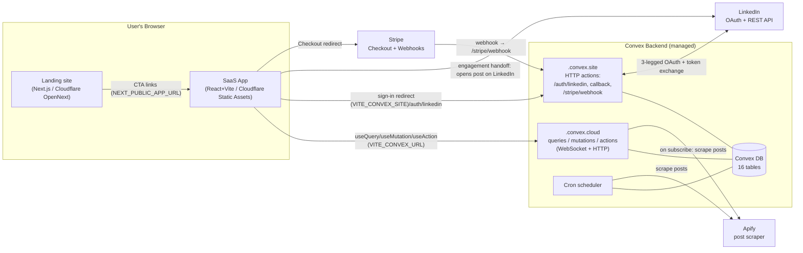

### Why OAuth runs through `.convex.site` (key design decision)

The LinkedIn `redirect_uri` points at **Convex** (`https://<deployment>.convex.site/auth/linkedin/callback`), **never**
at the React app. LinkedIn returns the authorization `code` to Convex, which exchanges it for tokens **server‑side**, so
the **client secret and the user's access/refresh tokens never touch the browser**. Convex then issues an opaque session
token and redirects the browser back to the app. This is the backbone of the [security model](#17-security-posture).

---

## 3. Tech Stack

- **Backend:** [Convex](https://convex.dev) `^1.33–1.34` — real‑time serverless TypeScript. Queries (reactive reads),
  mutations (transactional writes), actions (side‑effects/external fetch), HTTP actions, and cron jobs. Stripe via the
  official `@convex-dev/stripe` component.
- **App (`app/`):** React **19**, Vite **6**, TypeScript (strict), Tailwind CSS **4**,
  `react-router-dom` **7**, `convex/react` client, `i18next` **25** (en/pt/es), plus **shadcn/ui**
  primitives (`cmdk`, `@radix-ui/react-popover`, `lucide-react`) + `@tanstack/react-virtual` for the searchable
  industry/country comboboxes (`@/*` alias → `app/src`; theme tokens in `index.css`).
- **Landing (`landing/`):** Next.js **15** (App Router), React **19**, Tailwind CSS **4** (CSS-first,
  `@tailwindcss/postcss`), TypeScript.
- **Payments:** Stripe (Checkout + Customer Portal + webhooks).
- **Post ingestion:** Apify REST API (`harvestapi~linkedin-profile-posts` actor) + manual user‑pasted post URLs.
- **Testing:** Vitest across all workspaces; React Testing Library + jsdom for the app; a custom
  `convex-mocks` shim for backend unit tests.
- **Tooling:** ESLint 9 (flat config, `--max-warnings 0`), Prettier (no‑semicolons, single‑quotes, 120 cols), pnpm
  workspaces.

---

## 4. Repository Layout

```
/
├── landing/                     # Next.js marketing site → Cloudflare Workers (OpenNext)
│   ├── app/
│   │   ├── globals.css          # Tailwind v4 CSS-first: @theme inline, :root/:dark tokens
│   │   └── [lang]/              # lang ∈ {en,pt,es} (default en)
│   │       ├── layout.tsx       # root <html>; inline no-flash script (cookie→localStorage→system)
│   │       ├── page.tsx         # home (composes section components)
│   │       ├── privacy/         # +content/{en,pt,es}.tsx — LinkedIn app-review requirement
│   │       ├── terms/           # +content/{en,pt,es}.tsx — LinkedIn app-review requirement
│   │       └── cookies/         # +content/{en,pt,es}.tsx — cookie & storage policy
│   ├── middleware.ts            # bare / or unprefixed path → locale redirect (cookie→Accept-Language→en)
│   ├── components/              # Nav, Hero, SSIExplainer, HowItWorks, Features,
│   │                            #   Pricing, FAQ, FinalCTA, Footer, CookieNotice,
│   │                            #   ThemeToggle (3-state light/dark/system), LanguageSelector
│   ├── lib/
│   │   ├── cookies.ts           # SSR-safe cookie read/write (Next/process.env)
│   │   └── theme.ts             # resolveTheme / applyTheme / cookie get/set
│   └── next.config.js
│
├── app/                         # React + Vite SaaS dashboard → Cloudflare Workers (Static Assets)
│   ├── index.html               # mount point + pre-hydration theme guard (CSP is generated into dist/_headers
│   │                            #   by scripts/gen-headers.mjs, not an index.html meta tag)
│   ├── src/cloudflare-worker.ts # canonical-host 308, then delegation to the ASSETS binding
│   ├── vite.config.ts           # dev port 5174, inline Vitest config
│   └── src/
│       ├── main.tsx             # ConvexProvider + BrowserRouter bootstrap
│       ├── App.tsx              # routes + RequireAuth guard
│       ├── convex.ts            # re-export of convex/_generated/api
│       ├── pages/               # AuthSuccess, Feed, MyPosts, Settings, Billing, Admin
│       ├── components/          # PostCard, PostComposer, CommentBox, LinkedInEmbed,
│       │                        #   AppShell, Sidebar, TopBar, UserMenu, LanguageMenu,
│       │                        #   Modal, BannedScreen, BanUserDialog,
│       │                        #   UsersTab, PlanLimitsTab, RowActionsMenu, LoadingSpinner
│       └── i18n/                # i18next init + locales/{en,pt,es}.json
│
├── convex/                      # Convex backend (shared by both apps)
│   ├── schema.ts                # 16-table database schema
│   ├── convex.config.ts         # registers @convex-dev/stripe + @convex-dev/rate-limiter components
│   ├── crons.ts                 # the ONLY file Convex reads for scheduled jobs
│   ├── http.ts                  # LinkedIn OAuth + Stripe webhook HTTP routes
│   ├── users.ts                 # getMe, subscription info, public identifier, logout
│   ├── sessions.ts              # session tokens + OAuth-state CSRF storage
│   ├── feed.ts                  # tier-gated feed query
│   ├── interactions.ts          # comment + react engagement counters (optimistic; client hands off to LinkedIn)
│   ├── posts.ts                 # submitPost, getMyPosts, weekly usage
│   ├── billing.ts               # Stripe Checkout + Customer Portal sessions
│   ├── stripe.ts                # webhook-driven subscription sync mutations
│   ├── admin.ts                 # admin queries/mutations (users, plan limits, ban)
│   ├── lib/
│   │   ├── auth.ts              # requireAuth / requireAuthAction / resolveSession / assertNotBanned
│   │   ├── planLimits.ts        # plan-limit lookup + tierToRank
│   │   └── rateLimit.ts         # wraps @convex-dev/rate-limiter (fixed-window, per user+action)
│   ├── linkedin/
│   │   ├── oauth.ts             # auth URL builder + token exchange + userinfo
│   │   ├── auth.ts              # upsertUser mutation
│   │   ├── parsePostUrl.ts      # /posts/… + /feed/update/… parser & lnkd.in shortlink resolver
│   │   ├── parsePostContent.ts  # HTML → text/media + shared-article link (extractArticleUrl) + article enrichment (parseArticle)
│   │   ├── verifyPostOwnership.ts
│   │   └── types.ts             # LinkedIn API response interfaces
│   ├── jobs/
│   │   ├── syncPosts.ts         # upsertPost mutation + syncAllPosts router
│   │   ├── syncPostsApify.ts    # Apify scrape (per-user + fan-out)
│   │   └── processQueue.ts      # drains postQueue → posts when capacity opens
│   └── migrations/
│       └── seedPlanLimits.ts    # explicit (re-)seed of tier-default plan limits — optional, updateTierDefault self-heals
│
├── convex-mocks/                # Vitest mock for `convex/server` (backend unit tests)
├── docs/                        # planning/spec markdown + THIS document
├── README.md                    # quickstart (reconciled to code 2026-08-30 — see §19)
├── CLAUDE.md / AGENTS.md        # agent instructions
└── pnpm-workspace.yaml, tsconfig.base.json, eslint.config.js, .prettierrc
```

---

## 5. Data Model

All state lives in **Convex** (`convex/schema.ts`). There are **16 tables**. Every document also carries Convex‑managed
`_id` (`Id<table>`) and `_creationTime` (ms epoch) fields implicitly.

Convex `v.id('table')` fields are **logical foreign keys** — there is **no DB‑enforced referential integrity**;
consistency is maintained in application code.

### Entity relationships

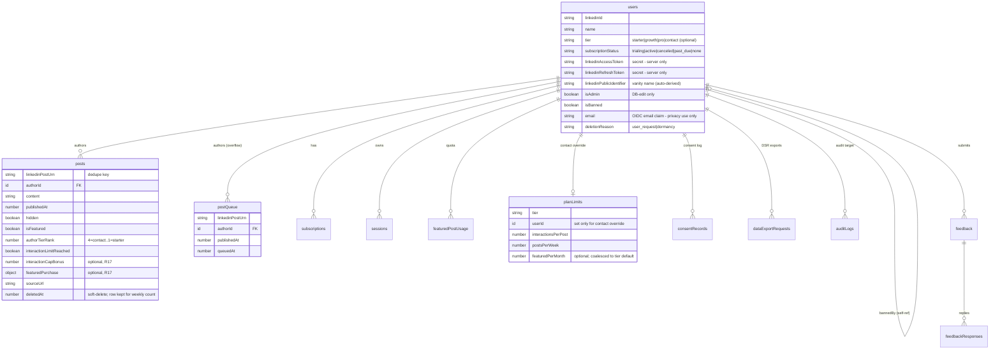

**R19 adds no table and no relationship line:** `users.referredByCode` → `users.inviteCode` is a self‑reference resolved
by the `by_invite_code` / `by_referred_by_code` indexes on **string codes**, not a `v.id('users')` foreign key — so an
inviter's erasure leaves the invitee's stamp behind as an inert code that resolves to nobody.

### Table reference

#### `users` — central identity / subscription / OAuth / admin record

One row per authenticated LinkedIn member. Inserted on first login (`linkedin/auth.ts:upsertUser`), patched thereafter
(profile, subscription, ban). Read almost everywhere.

| Field                         | Type                                                   | Req | Meaning                                                                                                                                                                                                                                                                                                                                                                                                             |
|-------------------------------|--------------------------------------------------------|:---:|---------------------------------------------------------------------------------------------------------------------------------------------------------------------------------------------------------------------------------------------------------------------------------------------------------------------------------------------------------------------------------------------------------------------|
| `linkedinId`                  | string                                                 | ✓  | LinkedIn member id (`sub` from OIDC). Lookup key (`by_linkedin_id`).                                                                                                                                                                                                                                                                                                                                                |
| `name`                        | string                                                 | ✓  | Display name.                                                                                                                                                                                                                                                                                                                                                                                                       |
| `headline`                    | string                                                 |  –  | LinkedIn headline.                                                                                                                                                                                                                                                                                                                                                                                                  |
| `profilePictureUrl`           | string                                                 |  –  | Avatar URL.                                                                                                                                                                                                                                                                                                                                                                                                         |
| `industry`                    | string                                                 |  –  | Drives feed targeting (Growth/Pro).                                                                                                                                                                                                                                                                                                                                                                                 |
| `country`                     | string                                                 |  –  | Drives feed targeting (Growth/Pro).                                                                                                                                                                                                                                                                                                                                                                                 |
| `location`                    | string                                                 |  –  | Scraped LinkedIn display location (e.g. "Curitiba, Paraná, Brazil"). Read-only (profile scrape only).                                                                                                                                                                                                                                                                                                               |
| `primaryLocale`               | string                                                 |  –  | Scraped LinkedIn primary-locale **language** (e.g. "en"). Seeds the UI i18n language; not user-editable.                                                                                                                                                                                                                                                                                                            |
| `language`                    | string                                                 |  –  | UI language the member last checked out in (`'en'`/`'pt'`/`'es'`). Written by `billingNode.createCheckoutSession` via `internal.users.setLanguage`, read by the billing mailers — the UI-language choice otherwise lives only in a browser cookie the backend never sees. Distinct from `primaryLocale`. See [§8](#8-subscriptions--billing).                                                                       |
| `billingNotice`               | string                                                 |  –  | One-shot billing notice key, rendered as a dismissible banner on `/billing` (only `'duplicate_canceled'` today). Set by the duplicate-subscription webhook, cleared by `users.clearBillingNotice`. Absent ⇒ no notice; a voided subscription is never silent.                                                                                                                                                       |
| `commentLanguage`             | string                                                 |  –  | Default language for AI-drafted comments: an ISO 639-1 code or `'auto'`. Absent ⇒ resolves to `'auto'` (match the post). User-set in Settings. Distinct from `primaryLocale`. See [§11A](#11a-ai-reaction--comment-assistance).                                                                                                                                                                                     |
| `defaultVisibilityIndustries` | string[]                                               |  –  | Pro/Contact-only. Industry-code allowlist copied onto every post this user authors from now on (`posts.visibilityIndustries`, set at insert time — not retroactive). Absent/empty ⇒ new posts are visible to everyone. Set via `users.setPostVisibility` (tier-gated server-side); a downgrade does **not** clear it. See [§11](#11-feed--engagement).                                                              |
| `defaultVisibilityCountries`  | string[]                                               |  –  | Pro/Contact-only. Country-code allowlist copied onto every post this user authors from now on (`posts.visibilityCountries`, set at insert time — not retroactive). Same semantics as `defaultVisibilityIndustries` above.                                                                                                                                                                                           |
| `feedFilterIndustries`        | string[]                                               |  –  | Pro/Contact-only. Industry-code allowlist that filters the viewer's **own** feed (`feed.getFeed` reads it off the viewer doc). Absent/empty ⇒ that dimension isn't filtered. Set via `users.setFeedFilter` (tier-gated server-side); a downgrade does **not** clear it. A "what I want to see" preference — distinct from the author-side `defaultVisibility*`. See [§11](#11-feed--engagement).                    |
| `feedFilterCountries`         | string[]                                               |  –  | Pro/Contact-only. Country-code allowlist filtering the viewer's own feed. ANDed with `feedFilterIndustries` (each list ORs internally). Same source/semantics as `feedFilterIndustries` above.                                                                                                                                                                                                                      |
| `tier`                        | `'starter'\|'growth'\|'pro'\|'contact'`                |  –  | Subscription tier. **Optional** → users with no tier are absent from the `by_tier` index.                                                                                                                                                                                                                                                                                                                           |
| `subscriptionStatus`          | `'trialing'\|'active'\|'canceled'\|'past_due'\|'none'` | ✓  | Stripe‑mirrored status; also admin‑overridable via `setUserSubscriptionStatus`. New users start at `none`; `trialing` begins on card-add (Stripe trial for the chosen tier — see §8); trialing users' posts are now **visible** in the feed. Engage access is granted for `{trialing, active, canceled}` — cancellation never revokes it (see `canEngage`).                                                         |
| `trialEndsAt`                 | number                                                 |  –  | Trial expiry (ms).                                                                                                                                                                                                                                                                                                                                                                                                  |
| `subscriptionEndsAt`          | number                                                 |  –  | Paid‑through instant (ms; Stripe `current_period_end`), mirrored on every sync + cancel. A **canceled** author's posts stay in the feed until `now ≥ subscriptionEndsAt`, then drop out (`isAuthorFeedEligible`). Does not affect engage access.                                                                                                                                                                    |
| `stripeCustomerId`            | string                                                 |  –  | Resolves Stripe webhooks → user (`by_stripe_customer`).                                                                                                                                                                                                                                                                                                                                                             |
| `linkedinAccessToken`         | string                                                 |  –  | **Secret.** Used to act as the user on LinkedIn. Never sent to clients.                                                                                                                                                                                                                                                                                                                                             |
| `linkedinRefreshToken`        | string                                                 |  –  | **Secret.** Refresh flow exists (dormant — Standard-tier OAuth issues no refresh_token; reconnect banner mitigates). See §7/§13.                                                                                                                                                                                                                                                                                    |
| `tokenExpiresAt`              | number                                                 |  –  | Access‑token expiry (ms).                                                                                                                                                                                                                                                                                                                                                                                           |
| `linkedinPublicIdentifier`    | string                                                 |  –  | LinkedIn vanity name, **auto‑derived (set‑once)** from the `author.url` of a name‑verified submitted post (`users.setDerivedPublicIdentifier`); never user‑typed. Seeds the Apify profile/post scrape. NOT the ownership check (that matches the post's author name against the OIDC `name`).                                                                                                                       |
| `isAdmin`                     | boolean                                                |  –  | **Set only by direct DB edit.** No application write path touches it.                                                                                                                                                                                                                                                                                                                                               |
| `isBanned`                    | boolean                                                |  –  | Ban flag; set/cleared by `banUser`/`unbanUser`.                                                                                                                                                                                                                                                                                                                                                                     |
| `bannedAt`                    | number                                                 |  –  | Ban timestamp.                                                                                                                                                                                                                                                                                                                                                                                                      |
| `bannedBy`                    | `id('users')`                                          |  –  | Admin who banned (self‑reference).                                                                                                                                                                                                                                                                                                                                                                                  |
| `bannedReason`                | string                                                 |  –  | User‑visible reason on the banned screen.                                                                                                                                                                                                                                                                                                                                                                           |
| `email`                       | string                                                 |  –  | Email from LinkedIn OIDC `email` claim. Used for DSR confirmations and breach notification. Not used for marketing.                                                                                                                                                                                                                                                                                                 |
| `deletionRequestedAt`         | number                                                 |  –  | When the user requested account deletion (ms). Erasure-audit-trail field — kept for compliance even though no query reads it back (`deletionScheduledAt` drives the actual cron/idempotency logic).                                                                                                                                                                                                                 |
| `deletionScheduledAt`         | number                                                 |  –  | When the hard-delete cron will purge this account (ms). Presence signals pending erasure.                                                                                                                                                                                                                                                                                                                           |
| `deletionReason`              | `'user_request'\|'dormancy'`                           |  –  | Why the deletion was scheduled.                                                                                                                                                                                                                                                                                                                                                                                     |
| `lastLoginAt`                 | number                                                 |  –  | Timestamp of most recent login (ms); updated on every `upsertUser` call. Powers the dormancy retention check.                                                                                                                                                                                                                                                                                                       |
| `acknowledgedPolicyVersion`   | string                                                 |  –  | Privacy-policy version string the user last accepted. Drives the re-consent prompt when it diverges from the current policy version.                                                                                                                                                                                                                                                                                |
| `consentPromptedAt`           | number                                                 |  –  | When the user completed the one-time consent prompt (ms). Unset ⇒ `ConsentPromptScreen` is shown on next login.                                                                                                                                                                                                                                                                                                     |
| `firstPostPromptedAt`         | number                                                 |  –  | When the first‑post onboarding step was resolved (ms) — set once by submitting any post (`posts.submitPost` → `users.markFirstPostPrompted`) or skipping (`users.dismissFirstPostPrompt`). Unset ⇒ `FirstPostPromptScreen` is shown after the consent gate (to every new member; the onboarding post is created hidden for no-card members, and everyone — card or not — lands on the feed afterward, per **R04**). |
| `inviteCode`                  | string                                                 |  –  | **R19** — the member's own invite code: 8 characters of `[a-z0-9]`, minted lazily by `users.getOrCreateInviteCode` on the first visit to Settings › Invite and **never reissued** (links people already shared must keep working). Unique by construction — the minting mutation checks `by_invite_code`, retries a collision once, then throws `ConvexError('INVITE_CODE_RETRY')`.                                 |
| `referredByCode`              | string                                                 |  –  | **R19** — the inviter's code this member joined through. Stamped **insert‑only** by `linkedin/auth.upsertUserHandler`, after a `by_invite_code` lookup proves the code belongs to a real member who is **not banned**; an unknown or banned‑inviter code is dropped, never stored, and an existing member logging in with a `ref` is unchanged. Drives `trialDaysFor` (14 days, not 7) and the Billing gift line.   |
| `createdAt`                   | number                                                 | ✓  | Creation timestamp (ms).                                                                                                                                                                                                                                                                                                                                                                                            |

Indexes: `by_linkedin_id [linkedinId]`, `by_stripe_customer [stripeCustomerId]`, `by_tier [tier]`,
`by_subscription_status [subscriptionStatus]` (active-subscriber fan-out for the Apify sync),
`by_token_expiry [tokenExpiresAt]` (retention cron targets expired tokens directly),
`by_deletion_and_last_login [deletionScheduledAt, lastLoginAt]` (compound — serves both the hard-delete sweep, ranging
the leading field, and the dormancy sweep, `eq(deletionScheduledAt,
undefined)` + range on `lastLoginAt`), `by_invite_code [inviteCode]` (**R19** — inviter lookup at
signup attribution and for `getMe`'s gift line), `by_referred_by_code [referredByCode]` (**R19** — the
"N joined through your link" count, bounded at `.take(101)`).

#### `posts` — the shared feed

Inserted by `jobs/syncPosts.upsertPost` (manual + Apify) and `jobs/processQueue` (queue promotion). Patched by
`stripe.ts` **and** `admin.setUserTier` (re‑stamp `authorTierRank` + `feedRank` on tier change, via the shared
`restampUserPostsTierRank` helper — which schedules a batched, self‑rescheduling re‑stamp so a high‑volume author never
exceeds one mutation's write budget), `interactions.ts`
(`interactionLimitReached`), and `posts.ts` (`setPostHidden` → `hidden`; `deletePost` → `deletedAt`). Every post writer
keeps the denormalized `feedRank` / `inFeed` fields in sync through the single
`computeFeedFields` helper (`lib/feedRank.ts`).

| Field                     | Type          | Req | Meaning                                                                                                                                                                                                                                                                                                                              |
|---------------------------|---------------|:---:|--------------------------------------------------------------------------------------------------------------------------------------------------------------------------------------------------------------------------------------------------------------------------------------------------------------------------------------|
| `linkedinPostUrn`         | string        | ✓  | LinkedIn URN; dedupe key (`by_urn`).                                                                                                                                                                                                                                                                                                 |
| `authorId`                | `id('users')` | ✓  | Post author.                                                                                                                                                                                                                                                                                                                         |
| `content`                 | string        | ✓  | Post text (composed text + appended media links).                                                                                                                                                                                                                                                                                    |
| `publishedAt`             | number        | ✓  | Publish time (ms); primary sort + 7‑day window key.                                                                                                                                                                                                                                                                                  |
| `likeCount`               | number        | ✓  | Reaction count. Seeded from LinkedIn on submit/sync (`parsePostEngagement` / Apify), then incremented on in‑app reactions.                                                                                                                                                                                                           |
| `commentCount`            | number        | ✓  | Comment count. Seeded from LinkedIn on submit/sync, then incremented on in‑app comments.                                                                                                                                                                                                                                             |
| `mediaUrls`               | string[]      | ✓  | Extracted media URLs (images, documents, and the shared‑article link when the post links a LinkedIn article).                                                                                                                                                                                                                        |
| `imageUrls`               | string[]      |  –  | Image‑typed media URLs only (subset of `mediaUrls`), captured at manual submit and sent to the AI as **vision input** (see [§11A](#11a-ai-reaction--comment-assistance)). Absent on synced/legacy posts.                                                                                                                             |
| `isFeatured`              | boolean       | ✓  | Pinned to top of feed.                                                                                                                                                                                                                                                                                                               |
| `featuredAt`              | number        |  –  | When featured (display only; the feed orders featured posts by `publishedAt`, not this — see `computeFeedFields` in [§10](#10-posts--content-pipeline)).                                                                                                                                                                             |
| `visibilityIndustries`    | string[]      | ✓  | Author allowlist — only viewers in these industries see it. Copied from `users.defaultVisibilityIndustries` at insert time (empty when the author has none set); never edited after write — see [§11](#11-feed--engagement).                                                                                                         |
| `visibilityCountries`     | string[]      | ✓  | Author allowlist — only viewers in these countries see it. Copied from `users.defaultVisibilityCountries` at insert time (empty when the author has none set).                                                                                                                                                                       |
| `hidden`                  | boolean       | ✓  | `true` = excluded from feed (trial posts, un‑hidden on activation; also author/admin **Hide** via `setPostHidden`).                                                                                                                                                                                                                  |
| `authorTierRank`          | number        |  –  | Denormalized tier rank at write time (4=contact, 3=pro, 2=growth, 1=starter). Defaults to 1 in feed sort when absent.                                                                                                                                                                                                                |
| `interactionLimitReached` | boolean       |  –  | `true` once `likeCount+commentCount ≥ interactionsPerPost + interactionCapBonus` (the effective cap — see the row below); filtered out of feed.                                                                                                                                                                                      |
| `interactionCapBonus`     | number        |  –  | Per‑tier bonus added to the post's interaction cap when its featured slot is bought (starter +25, growth +50, pro +100, contact 0); written once at fulfilment so a later plan change can't move it. See [§8](#8-subscriptions--billing).                                                                                            |
| `featuredPurchase`        | object        |  –  | The one‑time Checkout purchase record (`checkoutSessionId`, `amountCents`, `paidAt`) written once by the `checkout.session.completed` webhook. Present ⇒ this post was bought, not earned by tier — re‑featuring is free and a redelivered webhook is a no‑op. See [§8](#8-subscriptions--billing).                                  |
| `sourceUrl`               | string        |  –  | Original submitted URL (preserved for correct back‑links; powers PostCard's "View on LinkedIn"). Absent for cron‑synced posts.                                                                                                                                                                                                       |
| `article`                 | object        |  –  | Best‑effort enrichment for a linked article (`{ url, title?, summary?, text?, author?, imageUrls }`, where `text` is the **full body**); see `lib/articleValidator.ts`. Feeds the AI reaction/comment prompts; not displayed. Absent when the post shares no article or enrichment failed.                                           |
| `suggestedReaction`       | enum          |  –  | AI‑predicted most‑likely reaction (`LIKE\|PRAISE\|EMPATHY\|INTEREST\|APPRECIATION\|ENTERTAINMENT`), set async after a **new** post is inserted (manual submit or Apify sync — a re‑synced/queued‑then‑promoted post does not get one). Absent ⇒ the UI picker treats it as `LIKE`. See [§11A](#11a-ai-reaction--comment-assistance). |
| `deletedAt`               | number        |  –  | Soft‑delete marker (`deletePost`). Excluded from feed + My Posts, but the row is **kept** so it still counts toward the weekly limit.                                                                                                                                                                                                |
| `feedRank`                | number        |  –  | Denormalized single feed sort key (featured→tier→recency); see `lib/feedRank.ts`. Backs the `by_feed_rank` cursor index. Optional during rollout.                                                                                                                                                                                    |
| `inFeed`                  | boolean       |  –  | `true` iff visible **and** under its interaction limit **and** not soft‑deleted. The filter column of `by_feed_rank`.                                                                                                                                                                                                                |

Indexes: `by_author [authorId]`, `by_urn [linkedinPostUrn]`,
`by_author_and_publishedAt [authorId, publishedAt]`, and `by_feed_rank [inFeed, feedRank]` which backs the **live
cursor‑paginated feed** — `getFeed` reads via this index (`eq(inFeed, true)`, `feedRank`
desc). The older `by_featured`, `by_published`, and `by_feed` indexes were **removed** once the feed migrated to
`by_feed_rank` (they had no remaining `withIndex` callers, and every index adds write amplification on this high‑write
table). See
[feed-cursor-pagination-plan.md](feed-cursor-pagination-plan.md).

#### `subscriptions` — Stripe subscription mirror

Written by `stripe.ts` (`syncUserSubscription`, driven by the Stripe webhooks); read by `users.getSubscriptionInfo`
and by the internal readers in `billing.ts` (`listUserSubscriptions`, `getBillingContext`,
`getUserBySubscriptionId`) that back the checkout guard, the duplicate-subscription guard and the billing mailers
(see [§8](#8-subscriptions--billing)).

| Field                  | Type                                    | Req | Meaning                                                                                                                                                                                                                                                                                        |
|------------------------|-----------------------------------------|:---:|------------------------------------------------------------------------------------------------------------------------------------------------------------------------------------------------------------------------------------------------------------------------------------------------|
| `userId`               | `id('users')`                           | ✓  | Subscriber.                                                                                                                                                                                                                                                                                    |
| `stripeSubscriptionId` | string                                  | ✓  | Stripe sub id (`by_stripe_id`).                                                                                                                                                                                                                                                                |
| `tier`                 | `'starter'\|'growth'\|'pro'\|'contact'` | ✓  | Subscribed tier.                                                                                                                                                                                                                                                                               |
| `status`               | string                                  | ✓  | **Free‑form** raw Stripe status (not a constrained union here).                                                                                                                                                                                                                                |
| `currentPeriodEnd`     | number                                  |  –  | Period end (ms).                                                                                                                                                                                                                                                                               |
| `priceAmount`          | number                                  |  –  | Price snapshot from the webhook payload (`items.data[0].price.unit_amount`), in **minor units** (e.g. `15000`). Lets a billing email state the exact amount with no second Stripe call and no hardcoded price table that drifts the day pricing changes. Absent ⇒ the email renders no amount. |
| `priceCurrency`        | string                                  |  –  | ISO 4217, lowercase as Stripe sends it (e.g. `'usd'`).                                                                                                                                                                                                                                         |
| `priceInterval`        | string                                  |  –  | `'month'` or `'year'`, from `price.recurring.interval`.                                                                                                                                                                                                                                        |
| `cancelAtPeriodEnd`    | boolean                                 |  –  | Mirrors Stripe's `cancel_at_period_end`. **Stripe keeps `status: 'trialing'` after a member cancels mid-trial**, so this is the only signal that tells the trial mailers not to promise a charge that will never happen (see [§8](#8-subscriptions--billing)).                                 |
| `stripeCreated`        | number                                  |  –  | Stripe's own `created` (ms). The duplicate-subscription guard voids the **newest** live row by this stamp, never by webhook arrival order, which Stripe does not guarantee (see [§8](#8-subscriptions--billing)). Absent on a row ⇒ it counts as the oldest and is never the one voided.       |
| `lastEventAt`          | number                                  |  –  | Stripe `created` (ms) of the newest webhook **event** applied to this row. `syncUserSubscription` / `markPastDue` skip an event older than it, so a late retry can never rewind `status` or re‑send the trial‑converted email (see [§8](#8-subscriptions--billing)). Absent ⇒ never stale.     |
| `pendingTier`          | `'starter'\|'growth'`                   |  –  | backlog/B07 — the tier a scheduled cross-tier downgrade moves to at the period end. Set when `billingNode` attaches the Stripe subscription schedule, cleared when the swap lands or the schedule is released. A mirror for the UI: the schedule on Stripe is the source of truth.             |
| `pendingAt`            | number                                  |  –  | backlog/B07 — when that pending change applies (ms), taken from the schedule second phase `start_date`. Absent ⇒ `BillingPage` falls back to `currentPeriodEnd`, which is the same instant on every schedule we write.                                                                         |

Indexes: `by_user [userId]`, `by_stripe_id [stripeSubscriptionId]`.

#### `planLimits` — tier limits + per‑user contact overrides

Tier‑default rows have **no `userId`**; override rows (contact tier only) set `userId`. Seeded by
`migrations/seedPlanLimits.ts`; read by `lib/planLimits.ts`; CRUD‑managed by `admin.ts`.

| Field                 | Type                                    | Req | Meaning                                                                                                                                                                                                                                                                          |
|-----------------------|-----------------------------------------|:---:|----------------------------------------------------------------------------------------------------------------------------------------------------------------------------------------------------------------------------------------------------------------------------------|
| `tier`                | `'starter'\|'growth'\|'pro'\|'contact'` | ✓  | Tier this row applies to.                                                                                                                                                                                                                                                        |
| `userId`              | `id('users')`                           |  –  | **Only** set for contact per‑user overrides.                                                                                                                                                                                                                                     |
| `interactionsPerPost` | number                                  | ✓  | Max likes+comments counted per post before lockout.                                                                                                                                                                                                                              |
| `postsPerWeek`        | number                                  | ✓  | Max posts admitted to feed per rolling 7 days.                                                                                                                                                                                                                                   |
| `featuredPerMonth`    | number                                  |  –  | Max `posts.featurePost` calls per UTC calendar month, enforced against `featuredPostUsage`. Optional — `getPlanLimitsHelper` coalesces a missing value to the tier's hardcoded default so unseeded/legacy rows keep working (widen‑then‑coalesce, no backfill migration needed). |

Indexes: `by_tier [tier]` (matches default **and** override rows — callers filter `userId===undefined`
in JS), `by_user [userId]`.

#### `postQueue` — weekly‑limit overflow buffer

Posts that couldn't be inserted because the author hit their weekly limit. Drained by the
`processQueue` cron when capacity reopens. Written by `syncPosts.upsertPost` (Apify path only).

| Field                                                                                     | Type          | Req  | Meaning                                          |
|-------------------------------------------------------------------------------------------|---------------|:----:|--------------------------------------------------|
| `linkedinPostUrn`                                                                         | string        |  ✓  | Dedupe key (`by_urn`).                           |
| `authorId`                                                                                | `id('users')` |  ✓  | Author (`by_author`).                            |
| `content`, `publishedAt`, `likeCount`, `commentCount`, `mediaUrls`, `hidden`, `sourceUrl` | —             | ✓/– | Snapshot carried so promotion needs no re‑fetch. |
| `queuedAt`                                                                                | number        |  ✓  | Enqueue timestamp (ms).                          |

On promotion, `authorTierRank` is recomputed and `interactionLimitReached` is derived from the queued engagement counts
against the author's cap (`hasReachedInteractionLimit`) — an already‑over‑cap queued post is promoted flagged (out of
feed).

#### `sessions` — app's own auth tokens

Random UUID tokens issued by the OAuth callback. **15‑day sliding TTL** — the window is renewed on authenticated use
once it passes the halfway mark, so active users stay logged in while an idle (or stolen‑but‑unused) token dies 15 days
after its last use. `SESSION_TTL_MS` in `convex/sessions.ts` is the single source of truth; renewal lives in
`resolveSession` (mutation ctx) / `requireAuthAction` (via
`sessions.slide`).

| Field       | Type          | Req | Meaning                                                                                                                 |
|-------------|---------------|:---:|-------------------------------------------------------------------------------------------------------------------------|
| `token`     | string        | ✓  | Opaque session token (`by_token`).                                                                                      |
| `userId`    | `id('users')` | ✓  | Session owner (`by_userId`).                                                                                            |
| `expiresAt` | number        | ✓  | Expiry (ms). `by_expires_at` backs the indexed expired-session cleanup cron (range scan, not a full-table `.filter()`). |

#### `oauthStates` — CSRF nonces

Single‑use OAuth `state` values; ~10‑minute TTL; deleted on validation. The row also carries the plan-selection the user
made on the landing page — and, since **R19**, the inviter's code — so both survive the OAuth redirect round-trip.

| Field       | Type                         | Req | Meaning                                                                                                                                        |
|-------------|------------------------------|:---:|------------------------------------------------------------------------------------------------------------------------------------------------|
| `state`     | string                       | ✓  | Random nonce (`by_state`).                                                                                                                     |
| `expiresAt` | number                       | ✓  | Expiry (ms). `by_expires_at` backs the indexed expired-state cleanup cron.                                                                     |
| `plan`      | `'starter'\|'growth'\|'pro'` |  –  | Tier chosen on the landing Pricing page before starting OAuth. Absent when OAuth is initiated without a plan selection (e.g. direct app link). |
| `interval`  | `'monthly'\|'annual'`        |  –  | Billing interval chosen alongside `plan`. Absent when `plan` is absent.                                                                        |
| `ref`       | string                       |  –  | **R19** — invite code from the landing `?ref=`, checked by `isInviteCode` in `http.ts` before storing. See [§7](#7-authentication--identity).  |

#### Rate‑limit counters — the `@convex-dev/rate-limiter` component

There is **no app `rateLimits` table**. Per‑user, per‑action fixed‑window counters live in the **
`@convex-dev/rate-limiter`** component's own isolated tables (mounted in `convex.config.ts`, consumed through
`lib/rateLimit.ts`). Keys are `(action, userId)`; each caller's window is passed inline. See **§11 — Rate limiting**.
Erasure clears a user's counters via `resetUserRateLimits` (see **§14 — Privacy & Compliance**).

#### `appSettings` — singleton global settings

Accessed via `.first()` (treated as a singleton; no index).

| Field                       | Type    | Req | Meaning                                                                                                   |
|-----------------------------|---------|:---:|-----------------------------------------------------------------------------------------------------------|
| `apifySyncEnabled`          | boolean | ✓  | Master toggle for the Apify post‑sync cron.                                                               |
| `apifyEnabled`              | boolean |  –  | **Master Apify kill-switch.** Absent ⇒ enabled. When false, all Apify (post sync + profile scrape) halts. |
| `apifyProfileScrapeEnabled` | boolean |  –  | Gates the LinkedIn profile scrape. Absent ⇒ disabled (opt-in; paid actor).                                |
| `lastApifySyncAt`           | number  |  –  | Last post‑sync timestamp (cron or manual "Sync all posts").                                               |
| `lastApifySyncError`        | string  |  –  | Last post‑sync error message.                                                                             |
| `lastProfileScrapeAt`       | number  |  –  | Last profile‑scrape fan‑out timestamp (manual "Sync all users").                                          |
| `lastProfileScrapeError`    | string  |  –  | Last profile‑scrape fan‑out error message.                                                                |

#### `featuredPostUsage` — per‑user monthly featured‑post quota

One row per `(userId, month)` that has featured at least one post. Read and written by `posts.featurePost` /
`posts.getFeaturedUsage` (backend/B07); the deletion cascade (`privacy/deletion.ts`) also owns rows here. Featuring
permanently consumes a slot for the month — `posts.unfeaturePost` never decrements `usedCount`.

| Field       | Type          | Req | Meaning                                                                                                                                                                |
|-------------|---------------|:---:|------------------------------------------------------------------------------------------------------------------------------------------------------------------------|
| `userId`    | `id('users')` | ✓  | Featuring user.                                                                                                                                                        |
| `month`     | string        | ✓  | UTC calendar month key, `"YYYY-MM"` (`lib/postLimit.ts:currentUtcMonthKey`) — UTC so the quota resets at the same instant for every user regardless of local timezone. |
| `usedCount` | number        | ✓  | Posts featured so far this month. Compared against `planLimits.featuredPerMonth` (`lib/postLimit.ts:isFeaturedLimitReached`).                                          |

Index: `by_user_month [userId, month]` — read with `.unique()` since a user has at most one row per month.

#### `consentRecords` — append-only consent/withdrawal log (GDPR)

One row per consent event. Current effective consent for a given `(userId, purpose)` pair is the **most recent** row for
that pair. Queried via `by_user`; latest-per-purpose is resolved in code (`latestConsentByPurpose`), not via an index.
The `purpose` union is intentionally narrow at launch (`'marketing' | 'analytics'`).

| Field           | Type                       | Req | Meaning                                                |
|-----------------|----------------------------|:---:|--------------------------------------------------------|
| `userId`        | `id('users')`              | ✓  | User who granted or withdrew consent.                  |
| `purpose`       | `'marketing'\|'analytics'` | ✓  | Consent purpose.                                       |
| `granted`       | boolean                    | ✓  | `true` = consent granted; `false` = consent withdrawn. |
| `policyVersion` | string                     | ✓  | Policy version in effect at time of consent event.     |
| `createdAt`     | number                     | ✓  | Event timestamp (ms).                                  |

Index: `by_user [userId]`.

#### `dataExportRequests` — asynchronous data-export (Subject Access Request)

Tracks the lifecycle of data-export jobs. The generated bundle is stored in Convex file storage (`fileStorageId`); the
download link is short-lived (`expiresAt`). A retention cron purges expired records and their associated storage
objects.

| Field           | Type                                      | Req | Meaning                                                                         |
|-----------------|-------------------------------------------|:---:|---------------------------------------------------------------------------------|
| `userId`        | `id('users')`                             | ✓  | Requesting user (`by_user`).                                                    |
| `status`        | `'pending'\|'ready'\|'failed'\|'expired'` | ✓  | Job state.                                                                      |
| `requestedAt`   | number                                    | ✓  | When the request was received (ms).                                             |
| `fileStorageId` | `id('_storage')`                          |  –  | Convex storage id for the generated export bundle. Set when `status = 'ready'`. |
| `expiresAt`     | number                                    |  –  | When the download link/bundle expires (ms).                                     |

Indexes: `by_user [userId]`, `by_status [status]` — the latter lets the retention cron pull `'ready'`
exports via index instead of a full‑table `.filter()` scan.

#### `auditLogs` — accountability log (GDPR Art. 5 (2))

Append-only record of DSR actions, consent changes, and admin access to personal data. A pseudonymized subset is
retained past account deletion (actorId and targetUserId nulled out, action/metadata preserved).

| Field          | Type                        | Req | Meaning                                                                                                       |
|----------------|-----------------------------|:---:|---------------------------------------------------------------------------------------------------------------|
| `actor`        | `'user'\|'admin'\|'system'` | ✓  | Who triggered the action.                                                                                     |
| `actorId`      | `id('users')`               |  –  | Convex user id of the actor (absent for system-triggered events or after pseudonymization).                   |
| `action`       | string                      | ✓  | Structured action name (e.g. `'consent.granted'`, `'dsr.export_requested'`, `'admin.view_user'`).             |
| `targetUserId` | `id('users')`               |  –  | The user this action was performed on, if applicable.                                                         |
| `metadata`     | string                      |  –  | JSON-encoded additional context (e.g. `purpose`, `policyVersion`). Stored as string to avoid schema coupling. |
| `createdAt`    | number                      | ✓  | Event timestamp (ms).                                                                                         |

Indexes: `by_target [targetUserId]`, `by_created [createdAt]`.

#### `feedback` — user-submitted product feedback

One row per feedback submission. `userId` is cleared on account deletion (anonymization, not deletion). Replies live
entirely in the separate `feedbackResponses` table below (one row per admin reply) — the row itself never carries the
reply text.

| Field       | Type                                                                                                            | Req | Meaning                                  |
|-------------|-----------------------------------------------------------------------------------------------------------------|:---:|------------------------------------------|
| `userId`    | `id('users')`                                                                                                   |  –  | Submitter (cleared on account deletion). |
| `category`  | `'feature_request'\|'bug'\|'comment'\|'criticism'\|'praise'\|'question'\|'suggestion'\|'other'\|'cancellation'` | ✓  | Feedback category.                       |
| `message`   | string                                                                                                          | ✓  | Free-text feedback body (≤4000 chars).   |
| `status`    | `'new'\|'responded'\|'archived'`                                                                                | ✓  | Triage state.                            |
| `createdAt` | number                                                                                                          | ✓  | Submission timestamp (ms).               |

Index: `by_user [userId]`.

`cancellation` was added 2026‑09‑07 for the cancel flow (R09): it is written **only** by `CancelInterstitial`
([§8](#8-subscriptions--billing), [§14](#14-frontend--authenticated-app-app)) and is deliberately **not** offered in
`FeedbackModal`'s own category list — a member never picks it by hand. See [§12A](#12a-feedback).

#### `feedbackResponses` — append-only admin reply thread

Each row is one admin reply to a feedback item. Multiple rows per feedback item are allowed (threaded replies).

| Field         | Type             | Req | Meaning                     |
|---------------|------------------|:---:|-----------------------------|
| `feedbackId`  | `id('feedback')` | ✓  | Parent feedback item.       |
| `responderId` | `id('users')`    | ✓  | Admin who wrote this reply. |
| `text`        | string           | ✓  | Reply text.                 |
| `createdAt`   | number           | ✓  | Reply timestamp (ms).       |

Index: `by_feedback [feedbackId, createdAt]` (chronological per feedback item).

#### `motds` — admin Message of the Day

Admin-authored announcements. Exactly one is shown at a time: the newest `enabled` row whose
`[startAt, expiresAt)` window covers "now" (`convex/motd/motd.ts:selectActiveMotd`). Hard-deleted on removal (admin
content, not personal data).

| Field       | Type                     | Req | Meaning                                                                                          |
|-------------|--------------------------|:---:|--------------------------------------------------------------------------------------------------|
| `bodies`    | `record<string, string>` | ✓  | Locale code → markdown body. `en` required (validation) and is the fallback for missing locales. |
| `important` | boolean                  | ✓  | `false` → dismissible top banner; `true` → blocking modal (closable only via OK).                |
| `enabled`   | boolean                  | ✓  | Admin on/off switch.                                                                             |
| `startAt`   | number                   |  –  | Optional scheduled start (ms). Absent ⇒ active immediately.                                      |
| `expiresAt` | number                   |  –  | Optional "limited date" (ms). Absent ⇒ never expires.                                            |
| `createdBy` | `id('users')`            | ✓  | Admin who created it.                                                                            |
| `createdAt` | number                   | ✓  | Creation timestamp (ms); also the tie-breaker for "newest active".                               |
| `updatedAt` | number                   | ✓  | Last-edit timestamp (ms).                                                                        |

Index: `by_enabled_and_created [enabled, createdAt]` — the viewer query walks `enabled=true` newest-first.

#### `userInteractions` — per-user engagement log

One row per reaction or comment a user made on a post, written **inside** `incrementLikeCount` / `incrementCommentCount`
(`convex/interactions.ts`) in the **same transaction** as the counter patch, so the log and the aggregate
(`posts.likeCount` / `commentCount`) can never drift. This log is the authoritative source for the **recap** (§11,
`interactions.getRecap`) and the **history page** (§11, `interactions.listMyInteractions`), and it powers the **DSR
export** (§13B — included in the user's data bundle, deleted in the erasure cascade).

| Field       | Type                      | Req | Meaning                                                |
|-------------|---------------------------|:---:|--------------------------------------------------------|
| `userId`    | `id('users')`             | ✓  | Who reacted / commented (the "made" side).             |
| `postId`    | `id('posts')`             | ✓  | The target post.                                       |
| `authorId`  | `id('users')`             |  –  | The post's author at write time (the "received" side). |
| `kind`      | `'reaction' \| 'comment'` | ✓  | Which interaction this row records.                    |
| `reaction`  | enum                      |  –  | Reaction value (set when `kind === 'reaction'`).       |
| `comment`   | string                    |  –  | Comment text (set when `kind === 'comment'`).          |
| `createdAt` | number                    | ✓  | Interaction timestamp (ms).                            |

`authorId` is **optional** because the field was added on 2026‑09‑07: rows written before that date carry no author and
are therefore invisible to the `by_author` read, i.e. excluded from every "received" count. Dev data is disposable and
prod has none, so no backfill was run (see [§19](#19-known-discrepancies-dead-code--roadmap) on the widen-not-backfill
convention).

Indexes: `by_user [userId]` (DSR export, a user's activity, the history page), `by_post [postId]` (erasure cascade —
§13B), `by_author [authorId]` (the recap's "received" side).

#### `userPostState` — per- (user, post) engagement state

One lazily-created row per (user, post), distinct from the append-only `userInteractions` log. Holds **current** state:
`reactedAt` (set on the user's first reaction so a repeat doesn't double-count / double-bill — a member holds at most
one reaction per post), `commentedAt` / `hiddenAt` (the **R21** 24-hour feed-hygiene stamps, see
[§11](#11-feed--engagement)) and `commentDraft` (the last AI-generated comment for the post, reloaded into `CommentBox`
for reuse/regeneration). Per-user data: included in the DSR export and deleted in the erasure cascade (§13B).

| Field          | Type          | Req | Meaning                                                        |
|----------------|---------------|:---:|----------------------------------------------------------------|
| `userId`       | `id('users')` | ✓  | Owner of the state row.                                        |
| `postId`       | `id('posts')` | ✓  | The target post.                                               |
| `reactedAt`    | number        |  –  | Set on the first reaction; presence = already counted (dedup). |
| `commentedAt`  | number        |  –  | **R21** — set by `incrementCommentCount` on the Comment tap.   |
| `hiddenAt`     | number        |  –  | **R21** — set by `interactions.hidePost`. No unhide.           |
| `commentDraft` | string        |  –  | Last AI-generated comment for the post (reuse/regenerate).     |

`commentedAt` and `hiddenAt` are **widen-only, with no backfill**: rows written before 2026‑09‑07 have neither, so a
pre-existing reaction shows the R21 done footer only because `reactedAt` was already there, and comments recorded
before that date do not.

Indexes: `by_user_and_post [userId, postId]` — the dedup/draft lookups, the per-page R21 viewer-state read, and the
by-user DSR/erasure scan; `by_post [postId]` — erasure of other members' state on a deleted member's posts
(`privacy/deletion.ts`).

---

## 6. Backend Architecture & Conventions

### Convex function kinds used here

| Kind         | Reactive? | DB access                           | External fetch | Used for                                                           |
|--------------|-----------|-------------------------------------|----------------|--------------------------------------------------------------------|
| `query`      | ✓ (live) | `ctx.db` read                       | ✗             | reads (feed, getMe, usage)                                         |
| `mutation`   | –         | `ctx.db` read/write (transactional) | ✗             | writes (upsert, ban, plan limits)                                  |
| `action`     | –         | via `ctx.runQuery/runMutation`      | ✓             | LinkedIn/Stripe/Apify calls (submitPost, comment, react, checkout) |
| `internal*`  | –         | as above                            | as above       | server‑only; not callable from clients                             |
| `httpAction` | –         | via `ctx.run*`                      | ✓             | OAuth routes + Stripe webhook (`http.ts`)                          |
| cron         | –         | mutation/action                     | as above       | scheduled jobs (`crons.ts`)                                        |

### Auth helper pattern (every protected function uses it)

Clients **never** pass a `userId`. They pass a `sessionToken`; the server resolves it. All helpers live in
`convex/lib/auth.ts`:

- `resolveSession(ctx, token)` → `Doc<'users'> | null` — resolves token → user **without** ban enforcement. Used by
  `getMe` so a banned user gets an `isBanned` signal (not `null`). In a **mutation** ctx it also slides the session's
  expiry forward once past the halfway mark (a query ctx is read‑only and skips the write).
- `requireAuth(ctx, token)` → `Doc<'users'>` — for queries/mutations. Throws `'Unauthorized'` if the token is
  missing/expired/invalid; throws `'Account suspended'` if banned.
- `requireAuthAction(ctx, token)` → `Doc<'users'>` — same for actions (resolves via
  `ctx.runQuery(internal.sessions.getByToken)` + `internal.users.getWithTokens`, returning the token‑bearing record).
  Slides the session forward (past halfway) via `ctx.runMutation(internal.sessions.slide)`, since actions can't write
  directly.
- `assertNotBanned(user)` — the single definition of "what a ban blocks"; called by both
  `requireAuth*`.

### Error‑handling convention (system‑wide)

- **Reads soft‑fail:** `getMe`, `getFeed`, `getMyPosts`, `getWeeklyUsage`, `getSubscriptionInfo`,
  `checkIsAdmin` catch auth errors and return `null` / `[]` / `false` rather than throwing.
- **Writes hard‑fail:** mutations/actions throw on the unhappy path.
- **User‑facing messages throw `ConvexError(message)`** — its payload is the one thing Convex delivers to the client
  intact in **production** (plain `Error` messages are redacted there). Used for validation, ownership/authorization,
  not‑found, and plan‑limit/gate messages across every function the app surfaces to a user or admin: `submitPost` and
  the
  `posts` mutations, `reactToPost`/`commentOnPost`, `generateComment`, `createCheckoutSession`/`createPortalSession`,
  `updateProfile`/`setPostVisibility`/`setCommentLanguage`/`refreshProfileFromLinkedIn`, the admin mutations (sync,
  `setContactUserLimit`, `setUserTier`, `setUserSubscriptionStatus`, ban/unban, `validateLimitArgs`), the
  `feedback` mutations, and the `assertCanEngage`/`assertCanRefresh` gate helpers. The card‑gate sentinel
  `assertCanEngage` throws `ConvexError('PAYMENT_REQUIRED: …')` so the feed can still detect it by prefix in production.
  `posts.submitPost`/`featurePost` use the same `PREFIX:value` shape for the weekly/featured plan-limit throws —
  `` `WEEKLY_LIMIT:${postsPerWeek}` `` / `` `FEATURED_LIMIT:${featuredPerMonth}` `` — carrying the numeric cap rather
  than
  English prose, so a production redaction can't strip the number the UI needs; the client's `mapLimitError` (below)
  matches the prefix and localizes it (see [§9 "Upgrade at the limit"](#9-plan-limits-system)).
- **Internal invariants and external‑call failures throw plain `Error`** (e.g. `Failed to upsert post`, missing
  `STRIPE_SECRET_KEY`) — deliberately redacted in production and **logged server‑side with the real error**, surfaced to
  clients as generic sanitized messages (see [§17](#17-security-posture)).
- **Frontend display:** catch sites never render `err.message` directly — Convex frames it as
  `[CONVEX …] Server Error Uncaught Error: <msg> at handler (…) Called by client` (and redacts `<msg>` in production).
  All UI catch handlers pass the error through `friendlyError(err, fallback)`
  (`app/src/lib/errors.ts`), which unwraps `ConvexError.data`, strips the frame off dev messages, and falls back to a
  caller‑supplied string when nothing readable remains. The composer's and My Posts' catch sites additionally pipe that
  result through `mapLimitError(msg, t)` (same file), which recognizes the `WEEKLY_LIMIT:<n>`/`FEATURED_LIMIT:<n>`
  prefixes above and swaps them for the localized `errors.weeklyLimit`/`errors.featuredLimit` copy naming the cap;
  anything else (an already‑friendly message, or a code it doesn't recognize) passes through untouched.

### LinkedIn member‑API calls

All authenticated requests to `api.linkedin.com` (Bearer = the user's token) route through the single
`linkedin/client.ts` `callMemberApi` seam, which owns the `Authorization` header, the
`Content-Type` header (when a body is present), and the log-real-error → throw-sanitized error policy. Only the OAuth
token exchange (`exchangeCodeForTokens`) calls LinkedIn directly — it targets
`www.linkedin.com` with a `client_secret` form‑POST and is a different auth shape.

### Type‑shim landscape

The former `convex/convexTypes.ts` hand‑mirror of `DataModel`/`ctx`/`db` shapes has been **removed**; all backend code
now imports generated `Doc<>`/`Id<>`/`QueryCtx`/`MutationCtx`/`ActionCtx` from
`convex/_generated/`. Two intentional patterns remain:

1. **Test mock seam.** `convex/lib/audit.ts` and the two Apify jobs (`jobs/syncPostsApify.ts`,
   `jobs/scrapeProfileApify.ts`) import `internalActionGeneric` / `internalMutationGeneric` from
   `convex/server` (the registration generic the `convex-mocks` Vitest alias replaces) and cast
   `ctx as unknown as ActionCtx` using the **generated** `ActionCtx`. Each fan‑out handler annotates its return type
   (`Promise<void>`) to break the same‑file `internal.*` type cycle that the precise generated ctx would otherwise
   introduce.
2. `app/src/convex.ts` — re‑exports `{ api }` from `convex/_generated/api` for a stable app‑side import path.

---

## 7. Authentication & Identity

LinkedIn **3‑legged OAuth 2.0 (OIDC)**, brokered entirely by Convex HTTP actions so secrets stay server‑side. After
OAuth the app uses its **own opaque session tokens**.

- **Scopes requested** (`convex/linkedin/oauth.ts`): `openid profile email` — the only Standard‑tier product (Sign In
  with LinkedIn / OIDC), so **every** LinkedIn member can authenticate. No
  `w_member_social*` / `r_basicprofile`: the app makes **no LinkedIn API writes** (react/comment happen on LinkedIn via
  the handoff, §11), and those scopes are Development‑tier/ungranted — requesting them throws
  `unauthorized_scope_error` for anyone without a role on the app (i.e. breaks login for all non‑team users).
- **OAuth endpoints:** authorize `https://www.linkedin.com/oauth/v2/authorization`, token
  `https://www.linkedin.com/oauth/v2/accessToken`, userinfo `https://api.linkedin.com/v2/userinfo`
  (OIDC; replaces the deprecated `/v2/me`).
- **CSRF:** a random `state` is stored in `oauthStates` (10‑min TTL) before redirect and is single‑use validated on
  callback (deleted before the expiry check → replay‑safe).
- **Session token:** a random UUID stored in `sessions` (**15‑day sliding TTL** — renewed on authenticated use past the
  halfway mark; `SESSION_TTL_MS` is the source of truth); returned to the app in the redirect URL **fragment**
  `#session=…` (fragments never reach servers/proxies/access logs, unlike query strings). The app keeps it in **
  `sessionStorage`** (key `sessionToken`).
- **Sign‑out:** the app auto‑starts OAuth for any unauthenticated visit (see `RequireAuth`, §14), and LinkedIn keeps its
  own SSO session — so a naive sign‑out is silently re‑authenticated. Sign‑out therefore sets a **persistent `signedOut`
  marker** (`localStorage`, `lib/session.ts`) _before_
  calling `users.logout`, drops the local `sessionToken`, and redirects to the **marketing/landing site**
  (`VITE_LANDING_URL` — the separate Next.js app at its own origin, see §15). The marker does two jobs: **(1)** it wins
  the race against the **reactive** `getMe → null` that `users.logout`
  triggers while the SPA is still mounted (which would otherwise trip `RequireAuth`'s auto‑OAuth and silently re‑log the
  user in via LinkedIn SSO → `/auth/success` → `/feed`); and **(2)** it **persists across the return visit**, so when a
  signed‑out user navigates back to the app
  `RequireAuth` bounces them to the landing site instead of auto‑logging them in. It is cleared on the next successful
  login (`AuthSuccessPage`), so "auto‑redirect for login" resumes for fresh/expired sessions. To log back in, the
  landing site's CTAs point **straight at OAuth**
  (`${NEXT_PUBLIC_CONVEX_SITE}/auth/linkedin`, §15) — not the app root — so a signed‑out visitor doesn't ping‑pong
  between the landing site and the app. All three sign‑out buttons (`UserMenu`,
  `BannedScreen`, `CancelDeletionScreen`) route through the shared `performSignOut()` helper in
  `app/src/lib/session.ts`, which `await`s `users.logout` to invalidate the session server‑side.

### OAuth login flow

The `/auth/linkedin` start handler reads optional `plan`, `interval` and `ref` query parameters from the URL (appended
by the landing Pricing page CTAs, and — for `ref` — by `RefCarrier`, see [§15](#15-frontend--landing-site-landing)).
The `plan` value is validated against the allowed tier list (`starter|growth|pro`); `ref` is kept only when
`isInviteCode(ref)` matches `/^[a-z0-9]{8}$/` (`lib/invite.ts`). All three are stored on the `oauthStates` row via
`sessions.createOAuthState`, so they survive the LinkedIn redirect round-trip.

**Referral attribution (R19)** is a four-hop chain, and every hop can drop the code without failing the login:

1. The landing's `RefCarrier` appends `?ref=<code>` to every `/auth/linkedin` href.
2. `http.ts` keeps it only when the **shape** matches; anything else becomes `undefined`.
3. The callback passes `referredByCode: oauthState.ref` to `upsertUser`.
4. `upsertUserHandler` stamps it **on insert only**, and only after a `by_invite_code` lookup proves the code belongs to
   a real member who is **not banned** — a banned member's link mints nothing. An **existing** member who signs in
   through someone's link is untouched: attribution is a property of the account's creation, not of a session.

```mermaid
sequenceDiagram
    participant U as User (browser)
    participant LP as Landing (Pricing CTA / RefCarrier)
    participant CV as Convex .site (http.ts)
    participant LI as LinkedIn
    participant DB as Convex DB
    participant A as App (React)
    LP ->> CV: /auth/linkedin?plan=growth&interval=annual&ref=k3p9x2ab
    Note over LP, CV: plan/interval/ref all optional — absent on direct app link
    CV ->> CV: isInviteCode(ref) ? ref : undefined
    CV ->> DB: createOAuthState(state, +10min, plan?, interval?, ref?)
    CV -->> U: 302 → LinkedIn authorize?scope=…&state
    U ->> LI: authenticate & consent
    LI -->> CV: 302 /auth/linkedin/callback?code&state
    CV ->> DB: validateAndConsumeOAuthState(state) → { valid, plan?, interval?, ref? }
alt invalid / expired state
CV -->> U: 302 → APP_URL/?error=oauth_failed
else valid
CV ->> LI: exchangeCodeForTokens(code)
LI -->> CV: access_token, refresh_token, expires_in
CV ->> LI: GET /v2/userinfo
LI -->> CV: sub, name, picture
CV ->> DB: upsertUser(…, referredByCode: ref?) → userId (tokens stored server-side)
Note over CV, DB: insert only, and only if by_invite_code finds a non-banned member
CV ->> DB: sessions.create(token=UUID, userId, +15d sliding)
CV -->> U: 302 → APP_URL/auth/success#session=UUID&plan=growth&interval=annual
Note over CV, U: plan/interval omitted from hash when absent ; ref is never echoed back
        U ->> A: /auth/success reads hash → stores token + plan/interval → navigate /feed
end
```

### Session‑authenticated request flow

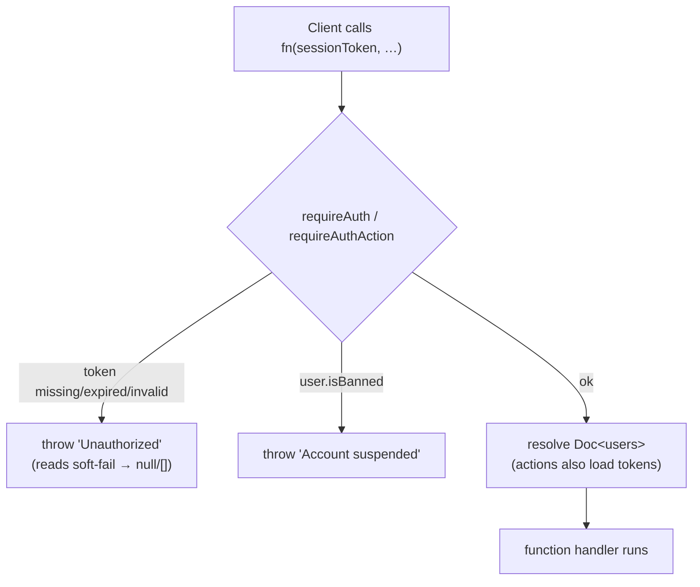

### Identity / user functions (`convex/users.ts`, `linkedin/auth.ts`, `sessions.ts`)

| Function                                                                 | Kind                           | Purpose                                                                                                                                                                                                                                                                                                                                                                                                                                                                                                                                                                                                   |
|--------------------------------------------------------------------------|--------------------------------|-----------------------------------------------------------------------------------------------------------------------------------------------------------------------------------------------------------------------------------------------------------------------------------------------------------------------------------------------------------------------------------------------------------------------------------------------------------------------------------------------------------------------------------------------------------------------------------------------------------|
| `linkedin.auth.upsertUser`                                               | internalMutation               | Insert on first login (default `subscriptionStatus`, `createdAt`); patch profile + tokens thereafter. `headline` is patched **only when provided** — OIDC login carries none, so a manually-set/scraped headline survives every login instead of being unset. Never writes `isAdmin`.                                                                                                                                                                                                                                                                                                                     |
| `users.getMe`                                                            | query (public)                 | Safe profile via `resolveSession` + `toSafeMe` (strips token **values** + raw `isAdmin`; re‑adds `isAdmin:true` only for admins; passes `isBanned`/`bannedReason`; **keeps `tokenExpiresAt`** — not a secret, drives the client's reconnect‑before‑expiry banner). **R19** adds `trialDays` (`trialDaysFor(user)`: 14 or 7) and `inviterName` (first name only, never stored). Also adds **`trialEligible`** — `trialEligible(rowCount)` over the member's `subscriptions` rows (`by_user`), the same rule checkout enforces, so no client has to guess trial eligibility from `subscriptionStatus` (§8). |
| `linkedin.oauth.refreshAccessToken`                                      | function (server‑only)         | `grant_type=refresh_token` call to the token endpoint. Same log‑real/throw‑sanitized discipline as `exchangeCodeForTokens`; never logs the token value. Called only by the refresh cron below.                                                                                                                                                                                                                                                                                                                                                                                                            |
| `linkedin.auth.updateTokens`                                             | internalMutation               | Patches `linkedinAccessToken`/`tokenExpiresAt` (always) + `linkedinRefreshToken` (only when LinkedIn returns a new one — a non‑rotating provider's omitted `refresh_token` leaves the stored value untouched instead of clearing it). Never writes `isAdmin`, mirroring `upsertUser`.                                                                                                                                                                                                                                                                                                                     |
| `linkedin.tokenRefresh.getUsersPendingRefresh` / `refreshExpiringTokens` | internalQuery / internalAction | Refresh-cron pair — see [§13](#13-scheduled-jobs-crons).                                                                                                                                                                                                                                                                                                                                                                                                                                                                                                                                                  |
| `users.getWithTokens`                                                    | internalQuery                  | Full record **incl. tokens** — server‑only.                                                                                                                                                                                                                                                                                                                                                                                                                                                                                                                                                               |
| `users.getActiveSubscribers`                                             | internalQuery                  | All users with `subscriptionStatus === 'active'` via the `by_subscription_status` index (reads only active subscribers, not the whole table).                                                                                                                                                                                                                                                                                                                                                                                                                                                             |
| `users.getSubscriptionInfo`                                              | query (public)                 | Billing‑page data; reads the Stripe component's live subscriptions + our `subscriptions.tier`.                                                                                                                                                                                                                                                                                                                                                                                                                                                                                                            |
| `users.getTrialProgress`                                                 | query (public)                 | Trial meter data for `BillingPage`. Returns `{ made, received, combined, threshold, reached, status, trialEndsAt }` — `combined = made + received`; `threshold = TRIAL_INTERACTION_THRESHOLD` (50); `reached` when `combined >= threshold`. Returns `null` if unauthenticated. Mirrors `getMe`'s `resolveSession` pattern.                                                                                                                                                                                                                                                                                |
| `users.getOrCreateInviteCode`                                            | mutation (public)              | **R19** — returns the member's `inviteCode`, minting it on the first call (Settings › Invite). Idempotent afterwards; codes are never reissued. On a `by_invite_code` collision it retries once, then throws `ConvexError('INVITE_CODE_RETRY')`.                                                                                                                                                                                                                                                                                                                                                          |
| `users.getInviteSummary`                                                 | query (public)                 | **R19** — `{ inviteCode: string \| null; joined: number }`, or `null` when unauthenticated. `inviteCode` is `null` until the mutation above mints it. `joined` counts members carrying the code via `by_referred_by_code` with `.take(101)`, so the read is bounded and the UI can render "100+" past the ceiling.                                                                                                                                                                                                                                                                                        |
| `users.setDerivedPublicIdentifier`                                       | mutation (internal)            | Set‑once: fills `linkedinPublicIdentifier` from a name‑verified post's author profile URL; triggers the budget‑guarded Apify profile scrape. Called by `posts.submitPost`.                                                                                                                                                                                                                                                                                                                                                                                                                                |
| `users.dismissFirstPostPrompt`                                           | mutation (public)              | Set‑once stamp of `firstPostPromptedAt` when the user **skips** the first‑post onboarding step ("I'll do this later").                                                                                                                                                                                                                                                                                                                                                                                                                                                                                    |
| `users.markFirstPostPrompted`                                            | mutation (internal)            | Set‑once stamp of `firstPostPromptedAt`; called by `posts.submitPost` after a post persists, so posting from the gate **or** the normal composer clears the onboarding step.                                                                                                                                                                                                                                                                                                                                                                                                                              |
| `users.updateProfile`                                                    | mutation (public)              | User edits their own `industry`/`country`/`headline`. `industry`/`country` validate against canonical lists; `headline` is free text, trimmed, capped at `MAX_HEADLINE_LENGTH` (65) chars — rejected if longer; empty string clears any of them.                                                                                                                                                                                                                                                                                                                                                          |
| `users.setPostVisibility`                                                | mutation (public)              | **Pro/Contact only** (checked server-side — throws otherwise). Sets `defaultVisibilityIndustries`/`defaultVisibilityCountries`; each entry validated against the canonical `INDUSTRIES`/`COUNTRY_CODES` lists (rejects unknown values), countries upper-cased. Empty arrays are valid (⇒ everyone). Applies to future posts only — see [§11](#11-feed--engagement).                                                                                                                                                                                                                                       |
| `users.setFeedFilter`                                                    | mutation (public)              | **Pro/Contact only** (checked server-side — throws otherwise). Sets the viewer's own feed filter `feedFilterIndustries`/`feedFilterCountries`; same validation as `setPostVisibility` (canonical lists, countries upper-cased). Empty arrays clear the filter. `feed.getFeed` reads these off the viewer doc, so saving re-filters the feed reactively — see [§11](#11-feed--engagement).                                                                                                                                                                                                                 |
| `users.refreshProfileFromLinkedIn`                                       | mutation (public)              | User-triggered profile re-scrape; requires a public identifier; **throws when the profile-scrape flag is off**; rate-limited 2/day; schedules the scrape action.                                                                                                                                                                                                                                                                                                                                                                                                                                          |
| `users.isProfileRefreshEnabled`                                          | query (public)                 | Whether the dev-only Apify profile scrape is enabled; Settings uses it to **hide** the "Refresh from LinkedIn" button when off (the prod default).                                                                                                                                                                                                                                                                                                                                                                                                                                                        |
| `users.applyScrapedProfile`                                              | internalMutation               | Writes scraped fields: `country` + `headline` **fill-when-empty** (scraped headline trimmed + truncated to the `MAX_HEADLINE_LENGTH` cap, never rejected); `location`/`primaryLocale` always refresh.                                                                                                                                                                                                                                                                                                                                                                                                     |
| `users.logout`                                                           | mutation (public)              | Deletes the current session token.                                                                                                                                                                                                                                                                                                                                                                                                                                                                                                                                                                        |
| `users.forceLogoutAll`                                                   | mutation (public)              | Deletes **all** sessions for the user (compromise response).                                                                                                                                                                                                                                                                                                                                                                                                                                                                                                                                              |
| `sessions.create` / `getByToken` / `deleteByToken`                       | internal                       | Session lifecycle.                                                                                                                                                                                                                                                                                                                                                                                                                                                                                                                                                                                        |
| `sessions.deleteAllForUser`                                              | internalMutation               | Revoke all sessions for a user (used by `forceLogoutAll`).                                                                                                                                                                                                                                                                                                                                                                                                                                                                                                                                                |
| `sessions.createOAuthState` / `validateAndConsumeOAuthState`             | internalMutation               | CSRF nonce lifecycle. `createOAuthState` accepts optional `plan`/`interval`/`ref` and stores them on the `oauthStates` row. `validateAndConsumeOAuthState` returns `{ valid, plan?, interval?, ref? }` so the callback can forward the chosen tier **and the R19 invite code** to `upsertUser`.                                                                                                                                                                                                                                                                                                           |
| `sessions.deleteExpiredSessions` / `deleteExpiredOAuthStates`            | internalMutation               | Cron cleanup (batches of 200).                                                                                                                                                                                                                                                                                                                                                                                                                                                                                                                                                                            |

### Token lifecycle: issue → refresh window → reconnect fallback

1. **Issue.** Every login (`http.ts` OAuth callback → `linkedin.auth.upsertUser`) stores
   `linkedinAccessToken` / `linkedinRefreshToken` / `tokenExpiresAt` (= `now + expires_in*1000`, LinkedIn's access
   tokens run **~60 days**).
2. **Refresh window (pre‑expiry, best‑effort).** The `refresh LinkedIn tokens` cron (every
   6h, [§13](#13-scheduled-jobs-crons))
   renews any token entering its **last 7 days** before expiry, via `linkedin.oauth.refreshAccessToken` +
   `linkedin.auth.updateTokens`. **This is dormant for essentially every user in practice**: the app's OAuth scopes are
   OIDC Standard‑tier (`openid profile email`, no `offline_access`), and LinkedIn does not issue a
   `refresh_token` for that tier — so `linkedinRefreshToken` is `undefined` on nearly every account and the cron's
   `by_token_expiry` + refresh‑token‑present query matches nothing. The path is kept correct (and unit‑tested) for the
   rare account that does have one, or a future tier change, without being load‑bearing for the common case.
3. **Post‑expiry (today).** If a token is never refreshed, the daily `enforce data retention` cron
   ([§13](#13-scheduled-jobs-crons), [§13B](#13b-privacy--compliance)) **NULLs** it once `tokenExpiresAt` is in the
   past. After that, every LinkedIn‑dependent action fails — e.g. `posts.submitPost` throws `'No LinkedIn access
   token. Please sign in again.'`
4. **Reconnect fallback (built, task B01b).** Because step 2 is dormant for most users, the real mitigation is
   `app/src/components/ReconnectBanner.tsx` — a persistent top‑of‑app banner (mounted in `App.tsx` alongside `Motd`,
   authenticated region only) driven by the `tokenExpiresAt` `users.getMe` returns. Pure gate
   `shouldShowReconnect(me, now)`: `tokenExpiresAt == null` → "expired" copy; `tokenExpiresAt < now + 7d` (including
   already past) → "expiring in N day (s)" copy; otherwise renders nothing. No dismiss — it stays up while the condition
   holds. Its "Reconnect" button just re‑runs `/auth/linkedin` (`window.location.href = AUTH_URL`, the same URL
   `RequireAuth`'s own auto‑OAuth redirect uses) — the existing OAuth entry point already re‑stores a fresh token via
   `upsertUser`. An expired‑token user who still manages to submit sees the `submitPost` error above, but the banner
   means that's no longer their first signal.

---

## 8. Subscriptions & Billing

Stripe is integrated via the **`@convex-dev/stripe`** component, registered in
`convex/convex.config.ts` (`app.use(stripe)`). The component auto‑syncs customers/subscriptions and serves the webhook;
our code adds **Checkout/Portal session creation** and **webhook callbacks**
(`http.ts` → `stripe.ts`) that keep our `users`/`subscriptions` tables in sync.

### Price‑ID → tier mapping

`lib/stripePrices.ts` is the single source of truth for the price‑to‑tier mapping. It covers **both monthly and annual**
price IDs (six env vars total — see §16). The pure helpers
`buildPriceMap(env)` and `resolveTier(map, priceId)` are unit‑tested; the module‑level
`ALLOWED_PRICE_IDS` set and `getTierFromPriceId(priceId)` function read `process.env` once at load. Unknown or blank IDs
default to `starter`. `contact` is admin‑assigned, not purchasable via Checkout. The one-time featured-post Price
(`STRIPE_FEATURED_POST_PRICE_ID`, backlog/R17) is exported separately as `FEATURED_POST_PRICE_ID` and is never part of
`buildPriceMap`, so it cannot enter the subscription allowlist or resolve to a tier.

> **Tier pin — admins only.** Stripe webhook tier writes route through the pure, unit‑tested
> `resolveSyncedTier(currentTier, isAdmin, stripeTier)` in `stripe.ts`: an **admin's tier is never
> changed** by Stripe; everyone else follows Stripe. `contact` is **not** pinned — `contact` is
> admin‑assigned (not Stripe‑purchasable), but a contact member who subscribes to a paid plan moves to
> that tier like anyone else. Applied in `syncUserSubscription` and `cancelUserSubscription`.
>
> **Access is never revoked by cancellation** — this is enforced in `lib/access.canEngage`, not in the
> webhook: `canEngage` grants engagement for `subscriptionStatus ∈ {trialing, active, canceled}`, so a
> canceled member keeps commenting / reacting / submitting. Only `none` (never subscribed) and
> `past_due` (failed payment) are gated. What a cancellation *does* remove is **feed visibility of the
> member's own posts**, and only after their paid period ends: `cancelUserSubscription` stamps
> `subscriptionEndsAt = current_period_end`, and `feed.isAuthorFeedEligible(author, now)` drops a
> canceled author's posts once `now ≥ subscriptionEndsAt`. (The `subscriptions` row still records the
> real Stripe price/status verbatim.)

### Billing intervals

The BillingPage exposes a **monthly / annual toggle**, seeded from the interval the member is already billed on
(`getSubscriptionInfo.priceInterval`) and defaulting to annual for anyone without a subscription row; a `?interval=`
link, the landing's stash, or a click always wins (§14). Annual pricing is 2 months free: Starter $100/yr · Growth
$150/yr ·
Pro $500/yr. The landing shows the annual price on every card and puts the monthly price behind a text link ("Prefer to pay monthly?") — the Good-Better-Best ladder is Starter $
10 → Growth $15 → Pro $50, and Starter is the
decoy that makes Growth the obvious buy (backlog/revenue/R13).

### Featured post add-on (one-time Checkout, backlog/R17)

A member buys one featured slot for **$5** for ONE of their posts. It is a Stripe Checkout in `mode: 'payment'`
on the same customer as the subscription (saved card offered), fulfilled by webhook. It is outside the monthly
featured quota: `featuredPostUsage` is never written, a bought post re-features for free forever, and there is
no refund for un-featuring it (the hint under the button says so before the tap).

**Entry points (all in the app, upgrade named first on every one):** the capped-post row on My Posts
(`buyFeaturedCapped` copy, source `cap`), the Feature slot on an unfeatured card at the monthly quota or in
`?feature=buy` mode (source `quota` / `billing`), the featured `UpgradeAtLimit` line (`upgrade.featuredAddon`,
text only), and the Billing page line (`billing.featuredAddon` → `/my-posts?feature=buy`). The buy control itself
is withheld — `MyPostsPage.tsx`'s `canBuy()` is the single gate — on a hidden post (fulfilment keeps `inFeed`
false, so the placement could not happen), on a post that already has a `featuredPurchase`, for a canceled
member (`assertCanEngage` still allows it inside the paid window, but a $5 placement that outlives that window
is a bad sale), and for a card-gated member or a tier with unlimited featured slots.

**`billingNode.purchaseFeaturedPost({ sessionToken, postId })`** — `"use node"` action:

1. `requireAuthAction` → `assertCanEngage(user)` (`PAYMENT_REQUIRED:` for no card / past due; trialing passes —
   the trial hint says "Charged today, separate from your trial" — and so do canceled-but-still-engaging
   members and admins, per `canEngage` / `isAdmin` in `lib/access.ts`).
2. `FEATURED_POST_PRICE_ID` unset → `FEATURED_PRICE_UNSET`.
3. `internal.posts.assertFeaturedPurchasable({ postId, userId })` → `POST_NOT_FOUND` (missing, deleted, or not
   the caller's — one answer, no ownership leak), `ALREADY_PURCHASED`, `NOTHING_TO_BUY` (unlimited featured tier).
4. `getOrCreateCustomer` → `checkout.sessions.create({ mode: 'payment', customer, line_items: [featured price × 1],
   metadata: { kind: 'featured_post', convexUserId, postId }, locale, success_url: /my-posts?featured=paid&post=<id>,
   cancel_url: /my-posts })` → `{ url }`.

**Fulfilment — `checkout.session.completed` → `posts.applyPurchasedFeature`:**
`lib/featuredPurchase.isFeaturedPostCheckout`
lets only a paid `payment`-mode session with `metadata.kind === 'featured_post'` through (subscription checkouts
complete through the same event). The mutation takes `postId` as a plain string and `normalizeId`s it. A malformed
id, or a valid id for a post that no longer exists (hard-deleted via the erasure cascade, `privacy/deletion.ts` —
not merely soft-deleted), logs and returns with no audit row, so Stripe never retries. Then, via the pure
`purchasedFeaturePatch`:

| Post state at the webhook                                      | Written                                                                                                                                                                                                                                  | Audit action                                                                          |
|----------------------------------------------------------------|------------------------------------------------------------------------------------------------------------------------------------------------------------------------------------------------------------------------------------------|---------------------------------------------------------------------------------------|
| Already has `featuredPurchase` (redelivery)                    | nothing                                                                                                                                                                                                                                  | —                                                                                     |
| A second, different paid session for an already-purchased post | nothing (the first purchase stands)                                                                                                                                                                                                      | `post.featured_purchase_duplicate` (both session ids + `amountCents` in the metadata) |
| Soft-deleted between Checkout and webhook                      | `featuredPurchase` only (the money exists; nothing to feature)                                                                                                                                                                           | `post.featured_purchase_orphaned`                                                     |
| Live                                                           | `isFeatured: true`, `featuredAt`, `interactionCapBonus = FEATURED_CAP_BONUS[author tier]`, `featuredPurchase`, `interactionLimitReached` re-decided against `planCap + bonus` (a capped post comes back at the top), `feedRank`/`inFeed` | `post.featured_purchased`                                                             |

Every branch above returns `null` — the webhook handler never throws for a redelivery or a duplicate payment, so
Stripe always sees a 200 (a duplicate charge is real money Stripe won't take back on our say-so; the audit row is
where the owner finds it, not a thrown error that would just make Stripe retry the same charge forever).

Cap bonus by the author's tier at fulfilment: starter +25, growth +50, pro +100, contact 0 (nothing to buy).
§9 and §11 describe how the effective cap is applied.

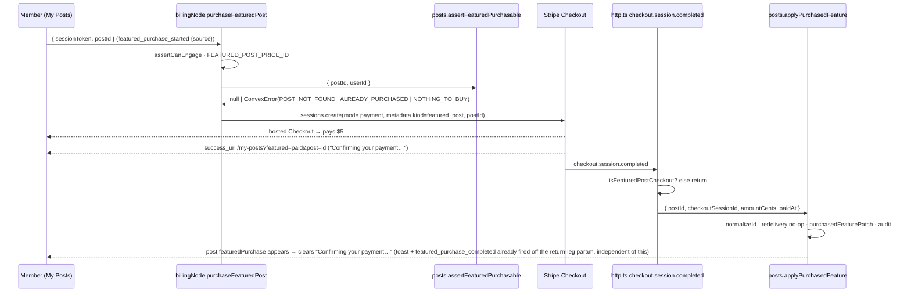

### Checkout (subscribe) flow

Checkout runs through `billingNode.createCheckoutSession` (a `"use node"` Convex action that calls the Stripe Node SDK
directly). The `@convex-dev/stripe` component handles **customer creation/lookup** (`getOrCreateCustomer`) and **webhook
sync**; `billing.ts` is now **internal-only** — `setStripeCustomerId`, `setPendingDowngrade` and three internal
queries, no public action and no Stripe client at all. `createPortalSession` moved to `billingNode.ts` on 2026-09-09
because the component's `createCustomerPortalSession` cannot name a portal configuration (see "Per-tier portal
configurations", §8).

> ⚠️ **The Stripe customer id is mirrored TWICE, and the two paths read different copies.** `createCheckoutSession`
> takes it from the **component's** `customers` table via `getOrCreateCustomer`; `createPortalSession` reads **our**
> `users.stripeCustomerId` (`billingNode.ts:263`). On the checkout path our mirror is write-only — set at
> `billingNode.ts:86` only when absent, never read there — so the two can drift apart silently. **Neither validates the
> id against Stripe.** `getOrCreateCustomer` returns whatever it stored, so a customer that no longer exists produces
> an uncaught `No such customer: 'cus_…'` at `checkout.sessions.create` — the payment step, the worst place to fail —
> and the component ships **no repair path**: it has no delete, and `createOrUpdateCustomer` is keyed by
> `stripeCustomerId`, so writing a fresh id *inserts a second row for the same user* rather than replacing the stale
> one. Fixing it properly means resolving customers ourselves and bypassing the component. **Deliberately not done**
> (pre-launch, no prod data; the only live trigger is an admin deleting a customer in the Dashboard). Hit in **dev on
> 2026-09-09** after the test sandbox was deleted out from under the stored ids; cleared by hand in the Convex
> dashboard — the component's `customers` row *and* `users.stripeCustomerId`, since one alone leaves the other path
> broken. Revisit if a live customer is ever deleted, or if it recurs.

Key checkout parameters:

- `trial_period_days: trialDaysFor(user)` — **conditional**, not unconditional: set only when
  `trialEligible(rows.length)` (`lib/trialMilestone.ts`) is true, i.e. the member has never held a subscription row. See
  "One live subscription, one trial" below. The length is `TRIAL_PERIOD_DAYS` (**7**) normally and
  `INVITED_TRIAL_PERIOD_DAYS` (**14**) when `users.referredByCode` is set (**R19**); both constants and `trialDaysFor`
  live in `lib/trialMilestone.ts` — the hard-coded `TRIAL_PERIOD_DAYS` that used to sit in `billingNode.ts` is gone, so
  backend and UI read one source. **The R01 repeat-trial rule still wins:** a member who has already held a subscription
  gets no trial at all, referral or not — a referral lengthens a trial, it never re-grants one.
- `payment_method_collection: 'always'` — card required even during the trial (no free-ride signups).
- `allow_promotion_codes: true` — enables Henriko's manual free-month promotion-code campaign on Stripe hosted checkout.
  No coupons are created or auto-applied in code.
- `locale: stripeCheckoutLocale(billingLocale)` (`lib/checkoutCopy.ts`) — the hosted page renders in the member's own
  language. Stripe's codes are not ours: our `pt` maps onto Stripe's `pt-BR`.
- `custom_text.submit.message: checkoutSubmitMessage(billingLocale, { trial, days })` — the early-charge rule, stated
  under the pay button, **before** the card. Two deterministic variants (trial / no trial) × three languages, pure and
  unit-tested. `days` is the trial length actually granted, so an invited member reads "after 14 days" on the same
  screen where they are about to enter a card. Never "may end early" — the rule is a fact, not a hedge — and Stripe caps
  the field at 1200 characters.

#### One live subscription, one trial

Two pure guards run before the session is created, both reading `internal.billing.listUserSubscriptions` (every
`subscriptions` row the member has ever had — bounded: at most one row per subscription they have ever held):

- **`findLiveSubscription(rows)`** — if any row is `trialing`, `active` or `past_due`, the action throws
  `ConvexError('ALREADY_SUBSCRIBED: You already have a plan. Manage it from the billing portal.')` rather than creating
  a second Stripe subscription. `canceled` is deliberately **not** a live status: a canceled member re-subscribes
  through checkout. The client branches on the prefix (the `PREFIX: sentence` convention of `lib/access.ts`) and opens
  the **Customer Portal** instead — a card holder who wants another plan switches there, never through a second
  checkout (from the plan grid, straight into the portal's confirm step for that price — see "Plan switch" below).
  The blocked path is a door, not an accusation: no "trial abuse" copy, no warning, no penalty state.
- **`trialEligible(rows.length)`** — the trial is granted only to a member with **no subscription row, ever**. It is
  keyed on the row **count**, not on `users.trialEndsAt`, because `syncUserSubscription` overwrites `trialEndsAt` with
  `undefined` for a non-trial subscription: a marker that erases itself would hand a returning member a second free
  trial. A returning subscriber is billed on day one and is told so in `custom_text` before entering the card, never
  discovered on the statement.
- **The same answer reaches the client, from the server (`getMe.trialEligible`).** The UI must never re-derive
  eligibility from `users.subscriptionStatus`: that field is not the rule. `canceled` is only the _common_ ineligible
  state — `toSubscriptionStatus` (`stripe.ts`) maps Stripe's `incomplete`, `incomplete_expired` and `paused` to **
  `'none'`** with the `subscriptions` row already inserted, and `admin.setUserSubscriptionStatus` can patch a member
  with rows back to `'none'` too. Both are ineligible while reading as a brand-new member. `getMe` therefore returns
  the row-count answer itself, and **every** trial promise in the app renders behind it: `BillingPage`'s pre-card block
  and, since 2026‑09‑07, the three **card-gate** surfaces, which are gated on exactly the statuses (`'none'` /
  `past_due`) where this trap lives — `useCardGate().canTrial` (§14).

**Language.** `createCheckoutSession` takes an optional `locale` argument (the app passes `i18n.language`) and persists
the resolved value to `users.language` through `internal.users.setLanguage`. The member's UI language otherwise lives
only in a browser cookie the backend never sees, and the billing mailers run hours or days later. Resolution order for
every billing notice is `resolveBillingLocale(users.language, users.primaryLocale)`, falling back to `'en'`; regional
and mis-cased tags (`pt-BR`, `ES`) normalize, unsupported ones fall through to the next candidate.

```mermaid
sequenceDiagram
    participant A as App (BillingPage)
    participant B as billingNode.createCheckoutSession (node action)
    participant DB as Convex DB
    participant SC as Stripe component
    participant S as Stripe Checkout
    A ->> A: captureEvent('checkout_started', { plan, interval })
    A ->> B: createCheckoutSession(priceId, sessionToken, locale)
    B ->> B: validate priceId ∈ ALLOWED_PRICE_IDS
    B ->> B: requireAuthAction(sessionToken)
    B ->> DB: internal.billing.listUserSubscriptions(userId)
    B -->> A: findLiveSubscription? → ConvexError ALREADY_SUBSCRIBED (client opens the portal)
    B ->> B: trial = trialEligible(rows.length); days = trialDaysFor(user); billingLocale = resolveBillingLocale(...)
B ->> SC: getOrCreateCustomer(userId, email, name)
B ->> S: checkout.sessions.create(trial? days, card-required, promo-codes, locale, custom_text)
B ->> DB: setStripeCustomerId (if unset) + users.setLanguage (if changed)
B -->> A: { url }
A ->> S: window.location = url
```

**`checkout_started` (R18).** `BillingPage.handleUpgrade` fires `captureEvent('checkout_started', { plan, interval })`
immediately before `createCheckoutSession`, so the survival panel's funnel can separate a member who never reached the
card from one who reached it and bounced. It fires only on the checkout branch — a card holder clicking a plan goes to
`createPlanSwitchSession` (below), which deep-links into the Customer Portal's confirm flow or, for a move down a
tier, schedules the change for the period end; either way it fires `plan_switch_opened`, and the scheduled path adds
`downgrade_scheduled`. See [§17](#17-security-posture).

`billingNode.createPortalSession` returns a Stripe **Customer Portal** URL (requires an existing `stripeCustomerId`,
not a live subscription — a churned member keeps invoice access). It opens the configuration that matches the
member's tier, so the portal home offers upgrades and interval switches and never a cheaper tier; if no configuration
carries that tier's `metadata.lits_tier` it throws `PORTAL_NOT_CONFIGURED` rather than falling back to the account
default. See "Per-tier portal configurations" in [§8](#8-subscriptions--billing).

**The return leg (R07 — celebrate activation).** The success URL is `${appUrl}/billing?success=true`. `BillingPage`
reads it once — latching a `justSubscribed` flag during render, not in an effect. The webhook (`http.ts` →
`stripe.ts`) can land a moment after the redirect, so while `justSubscribed` is true and `me.subscriptionStatus` is
still pre‑checkout — `none` for a first checkout, or `canceled` for a member re‑subscribing (their row keeps
`canceled` until the webhook lands) — the page shows an inline activating state: `billing.activating` ("your trial…")
for `none`, `billing.activatingPlan` ("your plan…") for `canceled`, because the repeat‑trial guard in `billingNode.ts`
gives a re‑subscriber no second trial. `getMe` is reactive, so it clears itself the instant the row updates — no
polling. After ~20s with no flip it falls back to `billing.activatingTimeout` (a neutral "your
plan will show here shortly", the Manage button visible, never blaming the member or naming a webhook) and reports the
case via `captureException` (§17) so a genuinely lost webhook is visible. Once the status becomes `trialing` or
`active` (only those two — `past_due`/`canceled` are never "you're in"),
`CheckoutSuccessDialog` (shadcn `Dialog`) opens exactly once — title "You're in.", the member's plan, and "your first
post is now in the feed" when they had one (reusing FeedPage's `useOwnPostState`, R04, §14 — specifically `hasAnyPost`,
not `hasHiddenPost`: the hidden-only signal can already read `false` on the very first render before the post has
synced as hidden, while `hasAnyPost` is race-independent since any pre-existing post is definitely live once the
member has converted — latched into state before the flip since the conversion itself is what un-hides it) — plus one
reinforcing line from `billing.plans.<id>.description`. No upsell, no fabricated number. Primary CTA → `/feed`,
secondary closes the dialog. Fires the consent-gated `checkout_success_viewed` PostHog event (§14 `captureEvent`) with
the plan id. A cancelled checkout returns to `/billing` without the parameter and changes nothing. The `?success=true`
param itself is only stripped (`setSearchParams({}, { replace: true })`) **once the celebration has actually fired**,
not on mount: stripping it eagerly would lose it for good if the member refreshes during the activation window (before
`hasCelebrated` flips) — a fresh mount can only re-latch `justSubscribed` by reading that same param, so an early strip
turns a mid-activation refresh into a silently skipped celebration. Once stripped, a later refresh no longer repeats
it.

**50-interaction milestone (Plan 2B).** `billingNode.endTrialEarly` (internalAction) sets
`trial_end: 'now'` on a Stripe subscription, converting the trial to a paid subscription immediately. It is scheduled by
`bumpTrialInteractionHandler` in `interactions.ts` whenever a trialing user's **combined**
`trialInteractionsMade + trialInteractionsReceived` first reaches 50 (the `TRIAL_INTERACTION_THRESHOLD` constant,
enforced by the pure `crossesThreshold` helper in
`convex/lib/trialMilestone.ts`). Counters are bumped inside `incrementCommentCount` /
`incrementLikeCount`, in the same transaction as the counter patch and the `userInteractions` row
([§11](#11-feed--engagement)), so the milestone can never disagree with the log it is counted from. The check fires **at
most once** per user: the `subscriptionStatus !== 'trialing'` guard inside
`bumpTrialInteractionHandler` skips any increment once the trial has already converted. The handler is split out of
the mutation so that wiring is unit-tested (`convex/interactions.trialMilestone.test.ts`, 9 cases): the three
predicates it calls were always covered, but nothing pinned that **the 50th interaction is the one that charges the
card**, on the trialing row rather than an older canceled one, exactly once, and never for a cancel-pending trial. Its
`loadSubscriptions` argument is a lazy getter so the `by_user` index is still read only on that one interaction in
fifty. The combined
"50 interactions OR 7 days" rule is therefore split: the 7-day side is Stripe's
`trial_period_days` (from Checkout); the 50-interaction side fires `endTrialEarly` to end it early. Both sides converge
on the same webhook sync path (below) — `endTrialEarly`'s `trial_end: 'now'` is just another
`customer.subscription.updated` event.

`users.trialEndsAt` (ms) is sourced **verbatim from Stripe's `trial_end`** (epoch seconds × 1000,
`null` → `undefined`) by `syncUserSubscription` — it is not computed locally as `now + 7d`. This keeps it correct across
both the 7-day elapse and the 50-interaction early-end (`trial_end: 'now'`
reads back as a past/`now` timestamp on the next sync). The UI's `status === 'trialing'` gate (`BillingPage`) — not the
value of `trialEndsAt` itself — decides when the countdown is shown, so a stale past `trialEndsAt` left over after
conversion to `active` never misrenders.

**Which subscription the early end targets.** `bumpTrialInteraction` reads **all** of the member's `subscriptions` rows
(`.collect()`) and selects with the pure `pickTrialingSubscription`. It must never use `.first()` on the `by_user`
index: Convex appends `_creationTime` to every index, so `.first()` returns the **oldest** row — after a cancel and
re-subscribe that is the _canceled_ subscription, and calling `endTrialEarly` on it is a silent no-op. Harmless while
every member had exactly one row; a real bug the moment the guard above deliberately permits a second one. A trialing
row with `cancelAtPeriodEnd: true` is skipped as well (`shouldEndTrialEarly`, `convex/lib/trialMilestone.ts`): a member
who cancelled during the trial keeps the trial end date the cancel dialog showed them, exactly as the two trial emails
already skip that case.

### Trial notifications

Two trial-end paths exist, and they must never both warn about the same event:

- **50 interactions** — `endTrialEarly` sets `trial_end: 'now'`, so Stripe emits **no** `trial_will_end`. Ours is the
  only warning, and it fires earlier, at **40 of 50** (`TRIAL_WARNING_THRESHOLD`, 80% of the threshold), scheduled from
  `bumpTrialInteraction` through the same `crossesThreshold` helper — so it fires exactly once per member.
- **The elapsed-days side** (7 days, or 14 for an invited member — **R19**, see "Checkout (subscribe) flow") — Stripe
  emits `customer.subscription.trial_will_end` three days ahead; `http.ts` schedules
  `internal.notifications.sendTrialEnding`. Stripe's own built-in trial-ending email stays **OFF** in the Dashboard (see
  "Stripe Dashboard setup" below), so exactly one warning reaches the member. Nothing here reads the trial **length**:
  the warning is driven by Stripe's own event and by the stored `trial_end`, so a 14-day trial needs no extra branch.

| Event                              | Channel                                         | Sender                                                |
|------------------------------------|-------------------------------------------------|-------------------------------------------------------|
| 40 of 50 combined interactions     | Email + emphasised in-app banner on `/billing`  | Ours — `internal.notifications.sendTrialNearEnd`      |
| 3 days before the trial's last day | Email                                           | Ours — `internal.notifications.sendTrialEnding`       |
| Trial converted: trialing → active | Email                                           | Ours — `internal.notifications.sendTrialConverted`    |
| First successful charge            | Email receipt                                   | **Stripe** (Dashboard setting, kept ON)               |
| Duplicate subscription voided      | Email + dismissible in-app notice on `/billing` | Ours — `internal.notifications.sendDuplicateCanceled` |

**The conversion email (R14).** `syncUserSubscription` decides it, not a cron: when the incoming webhook moves *this
subscription row* from `trialing` to `active`, `isTrialConversion(existing?.status, args.status)` returns true. The call
is made **before** the row is patched (the old status is still readable) and the send is scheduled **after** the user
doc is patched, so the mailer re-reads a settled member. The action is `internal.notifications.sendTrialConverted`, the
copy comes from `trialConvertedEmail`, and the mail links to **`/recap`** — the first paid touch points at the receipts,
not at an upsell. It re-reads state and **skips** when the member has no email, when `subscriptionStatus` is no longer
`active` at send time, when `findLiveSubscription` finds no live row, or when `made + received === 0` (the trial
counters `trialInteractionsMade` / `trialInteractionsReceived`, read through `internal.billing.getBillingContext`) —
nothing recorded means nothing to recap, so a zero-activity member gets silence rather than an empty summary. **Known
timing, accepted for launch (2026‑09‑07):** the trigger is `trialing → active` only. Stripe marks the subscription
`active` about an hour before it attempts the trial‑end charge, so a failed first card is not known at send time, and a
trial that converts via `past_due → active` (first charge failed, retry succeeded) gets no email. Revisit after launch —
a first‑paid‑invoice trigger (`invoice.paid`) or a row flag for the first `active` after a `trialing`.

`convex/notifications.ts` is I/O only. Every string comes from the pure `lib/billingEmails.ts` — five builders
(`trialNearEndEmail`, `trialEndingEmail`, `trialConvertedEmail`, `duplicateSubscriptionCanceledEmail` and
`postCapReachedEmail`, the last one **not** a trial notice — see "Post-cap email (R20)" below) plus
`formatPriceLabel`, the `INTL_TAG` map and `planName(locale, tier)` — and every branch from `lib/trialMilestone.ts`, so
the copy and the rules are unit-tested without a database. **Plan names are localized:** `planName` mirrors
`billing.plans.*.name` in the app
locales (including the `Enterprise` tier name), so a raw tier id never reaches a member and
an English plan name never lands inside a Portuguese email. `sendDuplicateCanceled` therefore takes a **tier id**, not a
rendered plan name: `http.ts` deals in tier ids and the mailer localizes, so display copy never passes through the
webhook layer.

Each mailer **re-reads state before sending** and skips when the member is no longer `trialing` — and, critically, when
the row's `cancelAtPeriodEnd` is set. **Stripe keeps `status: 'trialing'` after a member cancels mid-trial**, so that
flag is the only signal that no charge is coming; both trial mailers check it, so we never promise a charge that will
not happen. A member who already cancelled receives nothing.

**The amount is Stripe's own.** No backend module knows a plan's price — `lib/stripePrices.ts` maps price id → tier and
nothing else, and the `$150/yr` strings live on the client. Rather than duplicate a price table that drifts the day
pricing changes, both subscription webhooks persist `items.data[0].price`'s `unit_amount`, `currency` and
`recurring.interval` onto the `subscriptions` row (`priceAmount` / `priceCurrency` / `priceInterval`), and
`formatPriceLabel` renders them with `Intl.NumberFormat` in the member's locale. A missing snapshot degrades to an empty
label, never to a wrong number.

`sendEmail` (`lib/email.ts`) no-ops when `RESEND_API_KEY` / `EMAIL_FROM` are unset. For a privacy flow that is a
convenience; for a pre-charge notice it is a compliance hole, so `notifications.deliver` logs
`console.error('[billing] notification skipped — email not configured', scrubError(…))`, which surfaces in
`pnpm watch:errors` and the Convex dashboard. If Resend returns a non-2xx, `sendEmail` throws and the scheduled action
fails loudly; there is no retry loop, because the in-app banner is the durable channel.

**Erasure resets the trial.** A member who deletes their account ([§13B](#13b-privacy--compliance)) and signs in again
is a **new** `users` row with a new Stripe customer and no `subscriptions` rows, so `trialEligible` grants a fresh
trial (7 days, or 14 if they sign up again through an invite link). This is accepted deliberately: the alternative —
retaining an identifier of an erased person purely to deny
them a future trial — would sit badly against the erasure right the same section implements.

### Post-cap email (R20)

When a post reaches its author's plan cap it leaves the feed (`interactionLimitReached` → `inFeed: false`). Before R20
that was silent unless the author happened to open My Posts; now they get **one email, once per post**, in their own
language. It is a **state notice, not a broadcast**: the event already happened, and the closing line is the single
thing the author's tier can actually do about it.

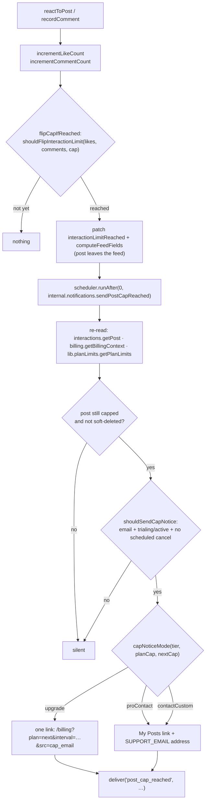

**The subject reports the post's own total, the body reports the cap it hit.** `postCapReachedEmail` takes both
`total` (the post's `likeCount + commentCount`, passed by `sendPostCapReached`) and `cap`. At the flip the two usually
agree, but after a **Growth → Starter downgrade** a post already sitting at 41 flips against a cap of 25 — so the
subject ("your post reached **41** interactions and left the feed") uses the total, and the body names the cap with no
plan attribution ("it reached its cap of **25** interactions") — a bought post's cap already includes its R17 bonus,
so naming a plan there would sometimes be false.

**The upgrade line promises the author's *next* posts, never this one coming back — unless it is bought back.** Apart
from `posts.applyPurchasedFeature` (backlog/R17, which re-decides `interactionLimitReached` against the post's new,
bigger `effectiveInteractionCap` at fulfilment), nothing un-flips it: no other writer sets it `false`,
`computeFeedFields` (`lib/feedRank.ts`) preserves it through the tier restamp, and `syncPosts.applyEngagementCounts` is
one-way. A capped post therefore stays out of the feed after a plain upgrade — the bigger cap only applies to the
author's *next* posts — so the line reads *"On {nextPlan}, your next posts collect up to {nextCap} each:"* (and the
pt-BR / es equivalents) rather than anything suggesting the post keeps collecting. It is still the email's one
actionable line and still the only link. A locale-wide unit test bans the old "keeps collecting" / "continua recebendo"
/ "sigue recibiendo" phrasings, because that promise sits directly in front of a charge.

**One flip, one email — until a purchase resets it.** Both `incrementLikeCount` and `incrementCommentCount` call a
single helper, `flipCapIfReached` (`convex/interactions.ts`), instead of duplicating the cap check. It patches
`interactionLimitReached` together with the recomputed `computeFeedFields`, then schedules
`internal.notifications.sendPostCapReached({ postId })` at 0 ms. Because both callers return early when the post is
**already** capped, an organic flip happens exactly once against a given cap — so the schedule, and therefore the
email, cannot repeat against that same number. `posts.applyPurchasedFeature` (backlog/R17) is the one path that
un-flips `interactionLimitReached`, against the post's new, bigger `effectiveInteractionCap`; from there the same
`flipCapIfReached` (and the Apify-refresh equivalent in `syncPosts.applyEngagementCounts`, [§11](#11-feed--engagement))
can flip it a second time once the bought post reaches that bigger cap, scheduling a second, independent
`post_cap_reached` email at the new number. There is no dedupe flag on the post: the flip *is* the dedupe, once per cap
it is currently measured against.

**Everything that could make the email wrong is re-checked at send time.** The action re-reads the post
(`internal.interactions.getPost`), the author's billing context (`internal.billing.getBillingContext`) and the effective
limits (`internal.lib.planLimits.getPlanLimits`, for the author's tier and for `nextTier(tier)`), and drops silently
when the post is gone, no longer capped, or soft-deleted. `shouldSendCapNotice` (`lib/postCapNotice.ts`) then requires
an address on file **and** a `trialing`/`active` status **and** no `cancelAtPeriodEnd` on the live subscription row
(`findLiveSubscription`). `none`, `past_due` and `canceled` members see the card-gate or expired banners in the app
instead, and a member who has already scheduled a cancel gets nothing — mailing them would read as a retention push,
which R20 forbids.

**`capNoticeMode(tier, cap, nextCap)`** picks the closing line — one pure function rather than the two the spec
imagined:

| Mode            | When                                                                 | Closing line                                                                   |
|-----------------|----------------------------------------------------------------------|--------------------------------------------------------------------------------|
| `upgrade`       | Starter/Growth **and** the next tier's cap is genuinely higher       | Checkout link: `/billing?plan=<next>&interval=<annual\|monthly>&src=cap_email` |
| `proContact`    | Pro, **or** `nextCap` is missing or not greater than the current cap | `SUPPORT_EMAIL`, plain text — "need a higher cap? write to …"                  |
| `contactCustom` | The `contact` tier, whose cap is bespoke                             | The same address, saying the cap is custom                                     |

The `nextCap <= cap` fallback matters: plan limits are admin-editable ([§9](#9-plan-limits-system)), so a
misconfiguration that makes the next tier no better must not produce an email selling it. `interval` comes from the live
subscription's stored `priceInterval` through `billingIntervalParam` (Stripe's `month` → `monthly`, everything else →
`annual`, the billing page's own cold default; `UpgradeAtLimit` runs its in-app link through the same mapper, so the
email and the app never point one member at different prices), so the link lands on the interval the member is already
paying.

**Exactly one link per email.** In `upgrade` mode the checkout link is the only one and the "it stays on My Posts" line
is dropped; in the other two modes the My Posts link is the only link and the support address closes as **plain text,
not a `mailto:`**. `postCapReachedEmail(locale, args)` in `lib/billingEmails.ts` builds the subject (which quotes the
post's **own**
interaction total, never the plan's cap — a downgrade can leave the cap below it) and the body in en/pt/es, quotes the
post's `excerpt(post.content)` (`lib/recap`) so the author knows which post
it is, and is enumerated in the existing "billing emails stay transactional" guard test alongside the trial mailers.
`SUPPORT_EMAIL` moved to **`convex/lib/support.ts`**, and `app/src/lib/support.ts` is now a re-export of it, so the
email, the banned screen and the upgrade-at-limit mailto cannot drift apart.

Delivery uses the same `deliver()` seam as the trial mailers, so an unconfigured mailer logs
`console.error('[billing] notification skipped — email not configured', …)` rather than failing quietly.

**The billing page knows where the click came from.** The deep link carries `src=cap_email`, and `BillingPage` fires
`cap_email_billing_opened { plan }` once per landing (ref-latched against StrictMode's double effect) —
see [§17](#17-security-posture).

### Webhook‑driven subscription sync

`http.ts` registers handlers for these Stripe events, each delegating to an internal mutation in
`stripe.ts`:

| Stripe event                                | Handler effect                                                                                                                                                                                                                                                                                                                                                                                                                                                                                                                                                                                                                                                                                                                                                                                                                                                                                                                                                                                                                                                                                                                                                                                                                                                                                                    |
|---------------------------------------------|-------------------------------------------------------------------------------------------------------------------------------------------------------------------------------------------------------------------------------------------------------------------------------------------------------------------------------------------------------------------------------------------------------------------------------------------------------------------------------------------------------------------------------------------------------------------------------------------------------------------------------------------------------------------------------------------------------------------------------------------------------------------------------------------------------------------------------------------------------------------------------------------------------------------------------------------------------------------------------------------------------------------------------------------------------------------------------------------------------------------------------------------------------------------------------------------------------------------------------------------------------------------------------------------------------------------|
| `customer.subscription.created` / `updated` | `syncUserSubscription`: set `tier` (via `resolveSyncedTier` — **admin tier never changes**) + `subscriptionStatus`, stamp `subscriptionEndsAt = current_period_end`, stamp `trialEndsAt = sub.trial_end` (seconds→ms, `null` → `undefined`), persist the **price snapshot** (`unit_amount` / `currency` / `recurring.interval` off `items.data[0].price`) and `cancelAtPeriodEnd`, re‑stamp `authorTierRank` on all the user's posts, **upsert** our `subscriptions` row. If status `active` → **un‑hide** the user's hidden posts **and** schedule an immediate Apify sync (only when `isApifyPostSyncEnabled(appSettings)`). Also persists `stripeCreated` + `lastEventAt`, **refuses a stale replay** (a live status for a row already `canceled` — Stripe retries on any non-2xx) **and an out‑of‑order event** (`event.created` older than the row's `lastEventAt`; only the duplicate decision still runs), and when **another row defines the member** (this row is the duplicate, or this is a non-live event while they still hold a live row) leaves the user doc alone. Returns the **duplicate to void**, which only the `created` handler acts on (below). Mirrors `sub.schedule` as `stripeScheduleId`; a landed **scheduled downgrade** clears the pending mirror and releases the schedule (B07). |
| `customer.subscription.deleted`             | `cancelUserSubscription`: mark sub `canceled`. If the member **still holds a live row** (the voided duplicate's own `deleted`, or a period-end cancel landing after a re-subscribe) their `tier` / `subscriptionStatus` / `subscriptionEndsAt` follow that row — nothing is downgraded. Otherwise set user `status = canceled` (access is **not** revoked — see `canEngage`) and `subscriptionEndsAt = the sub's last `current_period_end` (their posts leave the feed after this), downgrade tier→`starter`, **except admins** whose tier is fixed. Re‑stamp posts.                                                                                                                                                                                                                                                                                                                                                                                                                                                                                                                                                                                                                                                                                                                                              |
| `customer.subscription.trial_will_end`      | Schedules `internal.notifications.sendTrialEnding` with `sub.trial_end` (seconds→ms). Stripe fires this **3 days before** `trial_end`; it never fires for the 50-interaction path, because `endTrialEarly` sets `trial_end: 'now'`. Ours is therefore the only day-7 warning — Stripe's built-in trial-ending email stays OFF (see "Stripe Dashboard setup").                                                                                                                                                                                                                                                                                                                                                                                                                                                                                                                                                                                                                                                                                                                                                                                                                                                                                                                                                     |
| `invoice.payment_failed`                    | `markPastDue`: set `subscriptionStatus = past_due` (tier unchanged) — this **does** gate engagement until payment clears. Skips an event older than the row's `lastEventAt`, so a retried failure cannot re‑block a member whose payment already cleared, and ignores a failure for a row already `canceled` (Stripe's dunning end delivers the final failure and the `deleted` in either order).                                                                                                                                                                                                                                                                                                                                                                                                                                                                                                                                                                                                                                                                                                                                                                                                                                                                                                                 |
| `checkout.session.completed`                | `isFeaturedPostCheckout` (`lib/featuredPurchase.ts`) lets through only a **paid** `payment`-mode session tagged `metadata.kind === 'featured_post'` — a subscription checkout completes through this same event and is ignored here. `posts.applyPurchasedFeature` normalises `postId`, no-ops on a redelivery (same session id) or logs a `post.featured_purchase_duplicate` audit row for a second paid session on an already-featured post (no refund), and otherwise features the post with its tier's cap bonus. Never throws — Stripe always sees 200. See "Featured post add-on" above.                                                                                                                                                                                                                                                                                                                                                                                                                                                                                                                                                                                                                                                                                                                    |


> **Apify dormant guard:** `syncUserSubscription` reads `appSettings` and checks
> `isApifyPostSyncEnabled(settings)` (from `lib/apify.ts`) before scheduling any Apify sync.
> Apify is dormant at launch (compliance gate); billing alone cannot re‑enable it.

### Duplicate-subscription race

The checkout guard runs when the session is **created**; it cannot see a second checkout completed in another tab
between that check and Stripe confirming payment. `syncUserSubscription` closes that window **inside its own
transaction**: after upserting the row it collects the member's rows and, when two are live, `findDuplicateSubscription`
names the **newest by Stripe's own `created`** (persisted as `subscriptions.stripeCreated`) — never by webhook arrival
order, which Stripe does not guarantee. Deciding in the transaction is what makes it safe: two concurrent `created`
syncs conflict on the user doc (OCC), so exactly one of them sees both rows and exactly one cancel is scheduled. The
mutation returns `{ userId, stripeSubscriptionId, keepTier }`, and only the `customer.subscription.created` handler
acts on it (Stripe emits `updated` for the duplicate right after `created`; acting there too would void and notify
twice), scheduling `internal.billingNode.cancelDuplicateSubscription`. The member keeps the plan they already had: their
user doc never follows the duplicate, and the duplicate's own `customer.subscription.deleted` re-derives their state
from
the surviving row (table above):

- `stripe.subscriptions.cancel(id, { prorate: false, invoice_now: false })` — no proration credit and no immediate
  invoice; financially the duplicate never existed.
- `internal.users.setBillingNotice(userId, 'duplicate_canceled')` — raises the dismissible banner on `/billing`
  (`users.billingNotice`; cleared by `users.clearBillingNotice`).
- `internal.notifications.sendDuplicateCanceled({ userId, tier })` — the email, in the member's language.

A voided subscription is **never silent**: the member is told in-app **and** by email, in the same pass that cancels it.

A Stripe **retry** of the duplicate's `created` (after a non-2xx) is harmless: once the row is `canceled`,
`syncUserSubscription` ignores any live status for it (a canceled Stripe subscription never comes back), and if the
retry lands before the `deleted` event, `cancelDuplicateSubscription` catches Stripe's already-canceled error and
returns without a second notice.

**Webhook ordering.** Stripe does **not** guarantee the delivery order of webhook events, so every applied `created` /
`updated` / `payment_failed` event stamps the row with its own `event.created` (`subscriptions.lastEventAt`, ms —
`http.ts` passes it as `eventCreated`), and `syncUserSubscription` / `markPastDue` **skip an event strictly older than
that stamp** (`isStaleEvent`, `lib/trialMilestone.ts`): the row, the user doc, the post re‑stamp and every email are
left alone, so a late `trialing` update can no longer rewind a converted subscription and make the next `active` event
re‑send the conversion email. Only the duplicate decision still runs for a stale `created`, on the rows as they are, so
a retried two‑tab `created` can still void its duplicate. Stripe stamps events at second resolution, so equal stamps
apply in arrival order (the checkout `created` and its sibling `updated` share a second); two *distinct* same‑second
events with different statuses can therefore still land in arrival order, as they always did — that is the known
ceiling. A row or event without a stamp is never treated as stale — no backfill. Replays of the **same** event were
already safe (the row is `active`, so `isTrialConversion` is false). The `canceled`‑row guard is the other half and
lives in **both** writers: `cancelUserSubscription` does not stamp, so it is the status, not the stamp, that rejects a
late live event for a voided row — and `markPastDue` ignores a failure for a row already `canceled`, because Stripe's
dunning end delivers the final `invoice.payment_failed` and the `deleted` in either order, and applying it would leave
the member `past_due` for good.

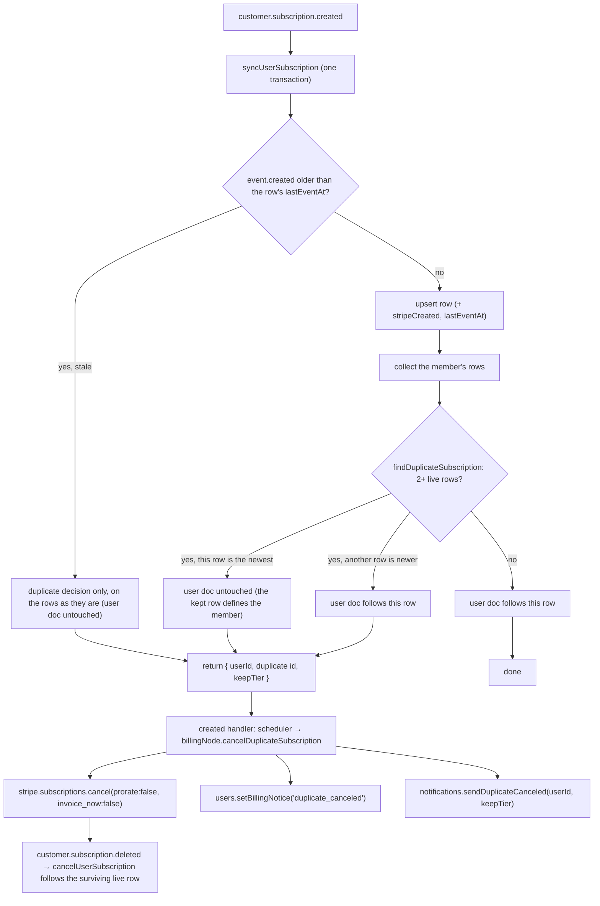

### Status semantics

`toSubscriptionStatus(raw)` (`convex/stripe.ts`) maps the raw Stripe status onto the
`trialing|active|canceled|past_due|none` union with an explicit, **fail-safe** mapping — a status that does not clearly
grant access can never become one that does:

| Stripe status                                | Stored `subscriptionStatus`  | `canEngage` |
|----------------------------------------------|------------------------------|-------------|
| `active`, `trialing`, `canceled`             | passed through unchanged     | yes         |
| `past_due`                                   | passed through unchanged     | no          |
| `unpaid`                                     | `past_due`                   | no          |
| `incomplete`, `incomplete_expired`, `paused` | `none`                       | no          |
| anything else (unknown or empty string)      | `none` (+ a console warning) | no          |

**Default is `none`, never `active`.** `none` and `past_due` are both rejected by `canEngage` (`convex/lib/access.ts`),
so a half-finished, lapsed, paused or unrecognised subscription never grants access. Covered by `convex/stripe.test.ts`.

### Renewal / access-end date (B21)

`subscriptions.currentPeriodEnd` (ms — written on every webhook sync from `sub.current_period_end`, see the table above)
was persisted but never read back anywhere. `getSubscriptionInfo` (`convex/users.ts`) now also returns
`currentPeriodEnd` (sourced from our own `subscriptions` row, not the user table) alongside `cancelAtPeriodEnd`, so
`BillingPage` can render "Renews on {date}" / "Access until {date}" (see §14 BillingPage). It is `undefined` when
there's no non-canceled Stripe subscription at all (never subscribed, or fully canceled) or, transiently, if our own
`subscriptions` row hasn't yet caught up with a brand-new webhook sync — the UI renders nothing for this line in either
case.

### Cancel, downgrade and resume (R09)

`billingNode.createCancelFlowSession({ sessionToken, flow })` (public action, `'use node'`) answers the interstitial's
two buttons and returns **`{ url: string | null }`** — a **hosted Customer Portal** deep link when Stripe owns the next
step, `null` when the change was written here instead. Every path opens with the same two reads: `liveSubscriptionFor`
(auth → the live `subscriptions` row, else `ConvexError('NO_LIVE_SUBSCRIPTION')`) and `retrieveWithItem` (Stripe's copy
of the subscription **and** its single item in one retrieve, else `Subscription has no item`). Portal links are minted
by the shared `portalSession(ctx, user, flow)` helper — customer id from `stripeComponent.getOrCreateCustomer`,
`return_url` of `/billing` — which uses the Stripe SDK directly because the `@convex-dev/stripe` component's
`createCustomerPortalSession` cannot set `flow_data`, the same pattern `createCheckoutSession` already follows. Two
flows here (the plan switch below is the third):

- **`cancel`** → `flow_data.type = 'subscription_cancel'` on the live subscription, returning to
  `/billing?canceled=true`. It **releases any downgrade schedule first**, so the portal acts on a plain subscription: a
  pending downgrade and a pending cancellation both want the period end, and the cancellation wins. A member who then
  abandons the portal has lost the downgrade and can schedule it again.
- **`downgrade`** → Starter at the **same billing interval**. The interval comes from the **retrieved Stripe
  subscription item** (`item.price.recurring?.interval`, narrowed to `month`/`year`), with our own optional
  `subscriptions.priceInterval` snapshot as the fallback; `starterPriceIdFor(process.env, interval)`
  (`convex/lib/stripePrices.ts`) then resolves it to `STRIPE_STARTER_ANNUAL_PRICE_ID` for `year` and
  `STRIPE_STARTER_PRICE_ID` otherwise — **annual stays annual**. The move is always **scheduled, not switched**
  ("Scheduled downgrade" below) and the action returns `null`; there is no longer any status that takes the immediate
  portal switch, so **`?downgraded=` is never produced**. `past_due` schedules like `active` (2026-09-09): Stripe's
  dunning owns the open invoice either way, and an immediate switch there would still credit. `trialing` throws **
  `TRIAL_NO_SWITCH`** — a trial runs on the plan it started on (§8), and the interstitial hides the offer anyway.

`billingNode.resumeSubscription({ sessionToken })` undoes a pending period-end cancellation
(`cancel_at_period_end: false`), and `billingNode.undoScheduledDowngrade({ sessionToken })` undoes a pending downgrade
(release the schedule, clear the mirror). Both are **idempotent**: a subscription that is already not cancelling, or
that carries no schedule (stale tab, double tap), returns `null` **without calling Stripe** — there is no "nothing to
resume" error. `downgrade` additionally throws `ALREADY_STARTER` on the Starter tier, `CANCEL_PENDING` when the
subscription is already cancelling (a schedule would fight the cancellation), and `Starter price not configured` when
neither Starter price env var is set.

Only the scheduled path writes to our tables, and only the `pendingTier` / `pendingAt` mirror (§5). Everything else
rides the existing **`customer.subscription.updated` webhook**, which carries `cancel_at_period_end` into
`subscriptions.cancelAtPeriodEnd` (and into the component's own table that `getSubscriptionInfo` reads), so
`BillingPage` swaps its "Cancel plan" link for "Resume plan" reactively, from that one field. A downgrade never
redirects at all now, so it fires `cancel_alternative_completed { from }` — `from` is the tier left behind, pairing
with `cancel_alternative_taken` — in the interstitial the moment the action resolves. `BillingPage`'s
`?downgraded=<tier>` reader, which used to land that return leg in the plan switch's "Switching you to Starter…"
state, **was deleted with it** on 2026-09-09: no path produces the marker, so a stale link is now ignored outright
rather than starting a 20-second wait for a tier that will not move. `?canceled=true` fires
`cancel_completed { plan }` exactly once (a `useRef` latch, so React StrictMode's double effect can't double-count) and
is then stripped from the URL. A trialing member who cancels keeps `status: 'trialing'` with `cancelAtPeriodEnd: true`,
and both trial mailers already skip that state (see "Trial notifications" above). While a trial is cancel-pending, the
50-interaction early end is skipped (see the milestone paragraph above), so the date the interstitial promised holds.
No proration, no refund, no discount — the policy is unchanged.

The app shows **exactly one** interstitial before Stripe (`app/src/components/CancelInterstitial.tsx`, §14): what
leaves the feed (the member's live post count from `posts.getMyPosts` plus their 30-day received total from
`interactions.getRecap`), a **"Schedule Starter"** alternative shown only above the Starter tier **and only while no
downgrade is already pending** (the `pendingTier` prop), and one optional question stored as `feedback` category
`cancellation` (§5, §12A). Stripe's own portal owns the **cancellation's** confirmation step — the interstitial never
confirms the cancellation itself. Before the alternative action, the interstitial names Starter's actual price for the
member's current interval, the effective date (or "end of your current period" fallback), the current Starter weekly
post and per-post interaction limits from `getTierLimits` (falling back to `DEFAULTS.starter`), and the loss of industry
filtering. A **scheduled** downgrade has no confirmation step to own: the action returns no
url, so the interstitial toasts "You move to Starter at the end of your period.", fires
`cancel_alternative_completed { from }` and closes itself.


### Plan switch (R08 / R20)

`billingNode.createPlanSwitchSession({ sessionToken, priceId })` (public action, `'use node'`) is the card holder's
"Switch to {{plan}}", aimed at the **price on the button the member clicked** — the plan × the interval toggle, which
the post-cap email's link pre-sets to the member's charged interval (`?plan=&interval=`, R20). It returns the same **
`{ url: string | null }`** as the cancel flow, and the **direction** decides which:

- **Up, or a same-tier interval switch** → the `subscription_update_confirm` portal flow. The member lands on Stripe's
  confirmation for **that** plan (upcoming invoice, proration, 3-D Secure all handled by the portal), never on the
  portal home four clicks away from it, and returns to `/billing?switched=<tier>`.
- **Down a tier** (`planChangeDirection(live.tier, targetTier) === 'down'`, ranked by `tierToRank`, **never** by price
  amount — the R13 decoy ladder makes amounts a liar) → scheduled at the period end, `url: null`, no redirect. See
  "Scheduled downgrade" below. `past_due` schedules exactly like `active` (2026-09-09); a trialing member never
  reaches this point.

Direction is computed from tiers, so the annual↔monthly toggle inside one tier stays a portal switch whichever way it
points. `priceId` is client-chosen, so the action checks it against `ALLOWED_PRICE_IDS` first (exactly as
`createCheckoutSession` does), retrieves the subscription's single item, and throws `ALREADY_ON_PLAN` when the item
already carries that price. Then **`TRIAL_NO_SWITCH` on `trialing`**, before any direction or price is resolved (§8).
It also throws `CANCEL_PENDING` when a downgrade would fight a pending cancellation, and **`PENDING_DOWNGRADE`** when
an upgrade or interval switch is attempted while a schedule is attached: the portal would write the same subscription
the schedule owns, so `BillingPage` asks for the undo first. The portal return leg is
`/billing?switched=<tier>` — the tier resolved from the price through `getTierFromPriceId` — which `BillingPage` reads
back as a landing state (next paragraph). **A scheduled downgrade never appends a marker**, which is what keeps it out
of that state's 20-second Sentry timeout.

On the client, `BillingPage.handlePlanClick` fires `plan_switch_opened { plan, source }` and calls `handlePlanSwitch`,
which redirects to the flow URL **when one comes back**; a `null` url means the change was scheduled, so it toasts
"You move to {{plan}} at the end of your period." and fires `downgrade_scheduled { from, to }` instead.
`PENDING_DOWNGRADE`
and `CANCEL_PENDING` each toast the one-line instruction that clears them ("Undo your scheduled change first.",
"Resume your plan first."); **any other** refusal (`ALREADY_ON_PLAN`, a price not yet allowed in the portal
configuration, a Stripe error) falls back to `handleManageSubscription` — the portal **home**, where every plan is one
more click away — with no error toast; the refusal is logged server-side. The plan buttons are disabled while a portal
session is being minted, so a double tap cannot open two. Back on `/billing?switched=<tier>`, the page latches the tier
during render (the `justSubscribed` pattern) and shows **"Switching you to X…"** while `me.tier` still differs — the
same 20-second timeout and Manage escape valve as the R07 activation, with a Sentry exception if it never lands — then,
once the webhook has moved the tier, **"You're on X now."** and `plan_switch_completed { plan }` exactly once (a
`useRef`
latch), stripping the param only at that point so a refresh mid-wait re-latches it. A card-less member ignores the
marker: their default tier could otherwise "complete" a switch that never happened. The portal flow needs subscription
updates **on** in the configuration this member gets — which lists their own tier and the tiers above it, so every
price a deep link can name is present. The portal runs `always_invoice`, so
an upgrade taken here is invoiced on the spot for the rest of the period, while a **same-product** interval switch
matches `schedule_at_period_end` and lands at the end of the period with no credit — the same economics as the portal
home's own "Update plan", not new ones. **Cross-tier downgrades no longer reach the portal at all**, which is how the
credit they used to pay out was closed; the section below has the whole story.

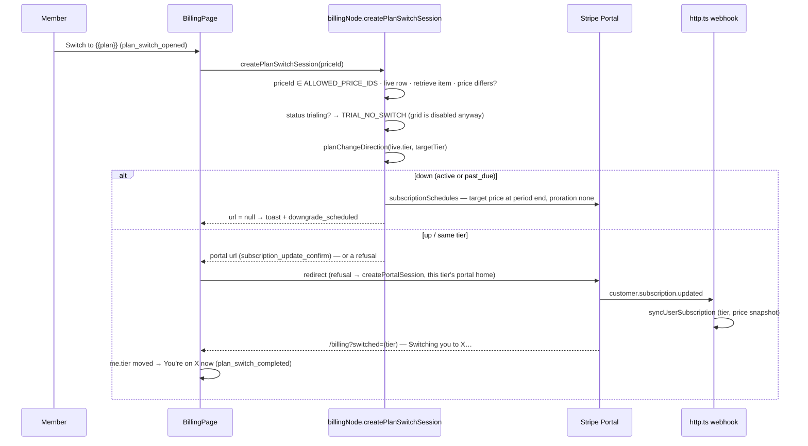

### Scheduled downgrade — no credit at the period end (B07)

**The gap this closes.** The Customer Portal prorates with `always_invoice` (D7), and its
`schedule_at_period_end` conditions defer a switch **only between prices that share a product**. Starter, Growth and
Pro are three products, so a cross-tier downgrade taken in the portal applied at once and **credited** the unused
period — money back, against the no-refund line in the Terms. Putting all six prices on one product is not a fix and is
not available: Stripe answers `400 For each product, its price must have unique billing intervals`, because a portal
product entry holds exactly one monthly and one annual price (tried, refused and reverted 2026-09-09 — do not
re-propose it). The fix is to stop asking the portal: **we write the downgrade ourselves as a Stripe subscription
schedule**, and the portal keeps only the upgrades and interval switches it handles correctly.

**`scheduleDowngrade(ctx, sub, targetPriceId, targetTier)`** (private, `billingNode.ts`) is the whole write, shared by
R09's "Schedule Starter" and the plan grid's cheaper-tier button:

1. **Resolve the interval from the target price**, not from the subscription — `intervalForPriceId(process.env,
   priceId)` (`convex/lib/stripePrices.ts`), because the grid can send a monthly member to an annual price. No match
   throws `Unknown price interval`.
2. **Get the schedule.** `subscriptionSchedules.create({ from_subscription })` when the subscription carries none, or
   `retrieve` when it does. A subscription holds **at most one** schedule, so a double tap — or a re-target to a
   different cheaper plan — rewrites the same one instead of racing a second. That is the whole idempotency story.
3. **Update it with two phases**, built by the pure `buildDowngradePhases` (below): phase 0 is the period already paid
   for, unchanged; phase 1 is the target price for one interval. `proration_behavior: 'none'` on phase 1 is what makes
   the swap settle no money, and the same value at the top level says the current-phase rewrite settles none either.
   `end_behavior: 'release'` hands the subscription back when the last phase ends.
4. **Mirror it** onto our row through `internal.billing.setPendingDowngrade` — `pendingTier` plus `pendingAt`, taken
   from **Stripe's own** `phases[1].start_date` (seconds→ms), never from our arithmetic. Returns `{ url: null }`.

**`convex/lib/downgrade.ts`** holds every decision that can be tested without Stripe, and nothing else:

- `planChangeDirection(fromTier, toTier)` → `'up' | 'down' | 'same'`, ranked through `tierToRank`
  (`convex/lib/planLimits.ts`). **Never** compares `unit_amount`: the R13 decoy ladder means a cheaper amount is not a
  lower tier.
- `buildDowngradePhases(schedule, targetPriceId, targetInterval)` → exactly two phases. It finds the phase whose
  `start_date` matches `current_phase.start_date` — the **current** phase, not `phases[0]`, which differ on a schedule
  that has already run one — and throws `ConvexError('Schedule has no current phase')` when there is none, rather than
  guessing. A Stripe `update` **unsets whatever it omits**, so the current phase is repeated field by field: items
  (price ids unwrapped from expanded objects, `quantity` defaulted to 1), `start_date`, `end_date`, discounts (carried
  as `discount` id → `coupon` → `promotion_code`, whichever the phase actually has) and metadata, with empty
  collections omitted so Stripe is not sent `[]`. `trial_end` is seen and deliberately **not** carried: re-asserting a
  spent trial on a paid phase is the one repetition that would be wrong.
- `resolvePendingDowngrade(existing, incoming)` → `'none' | 'keep' | 'clear' | 'applied'`, the webhook's decision
  (below).

**The webhook closes the loop.** `customer.subscription.updated` fires when the schedule is attached, again when the
price swaps, and again on release — no new event type is needed. `http.ts` passes `sub.schedule` through as
`stripeScheduleId`, and `syncUserSubscription` calls `resolvePendingDowngrade` **before** it patches the row, because
the decision depends on the tier the row still holds:

| Incoming vs. our row                               | Outcome     | Effect                                                          |
|----------------------------------------------------|-------------|-----------------------------------------------------------------|
| no `pendingTier` on our row                        | `'none'`    | nothing to do                                                   |
| tier **changed**                                   | `'applied'` | clear the mirror **and** schedule `releaseSubscriptionSchedule` |
| tier unchanged, no `stripeScheduleId` on the event | `'clear'`   | the schedule is gone (released elsewhere) — clear the mirror    |
| tier unchanged, schedule still attached            | `'keep'`    | the attach event itself — leave the mirror alone                |

`'applied'` is checked **before** `'clear'` on purpose: the release event that follows a landed swap carries no
schedule id, and reading it as `'clear'` would look identical to an undo.

**Why the release matters.** `end_behavior: 'release'` fires only when the **last** phase ends — a year away on an
annual plan — so a spent schedule would otherwise sit on the subscription for a whole cheaper period, making every
later flow believe a downgrade is still pending. `releaseSubscriptionSchedule` (an `internalAction`, scheduled with
`runAfter(0)`) releases it the moment the swap lands; Stripe's own `end_behavior` is the backstop, not the mechanism.
Release failures are logged through `scrubError` and swallowed — `release` is valid only for a `not_started` or
`active` schedule, and every other status means the work is already done — but the mirror is cleared either way, so a
Stripe hiccup can never strand the UI in "pending".

**Undo.** `undoScheduledDowngrade` releases the schedule and clears the mirror, and the `cancel` flow does the same
before opening the portal. Both go through one `releaseScheduleOn(ctx, sub)` helper, so "no schedule attached" is a
silent success on every path.

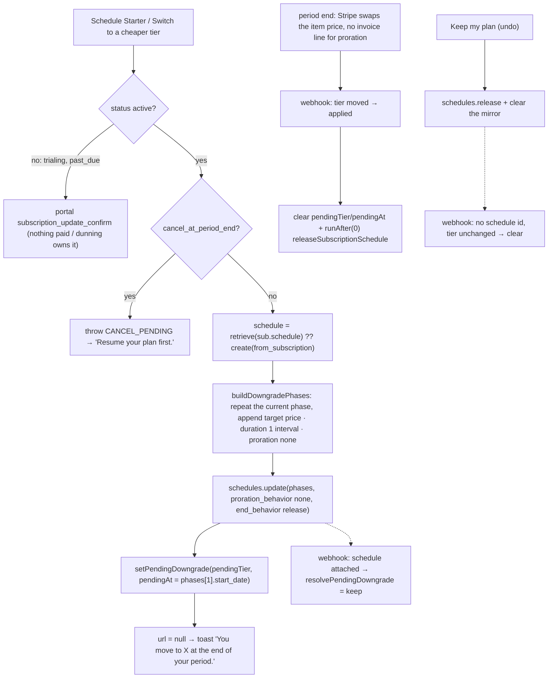

### Stripe Dashboard setup

> **Status (2026-09-08 — the test-mode sandbox was DELETED; everything below must be recreated).** Every Stripe object
> named by the earlier audits is gone: the products and all seven Prices (`price_1TBM…`, `price_1UDY…`), webhook
> endpoint
> `we_1TFRqXJyGKdozmOnUc5udijk`, portal configuration `bpc_1TFSe4JyGKdozmOn3gJylzOY`. Confirmed by `GET` under a working
> key: **0 products, 0 prices, 0 webhook endpoints, 0 portal configurations**. Every `STRIPE_*_PRICE_ID` and the
> `STRIPE_WEBHOOK_SECRET` in all four env copies now name an object that does not exist, so checkout fails with
> `No such price` and no webhook is delivered at all.
>
> **A usable key already exists — no new one has to be issued.** The stores hold **two different** keys: the Convex
> **deployment** env (`npx convex env get STRIPE_SECRET_KEY`, tail `N0Os`) still authenticates against an empty test
> environment, while `.env.local` and `convex/.env.local` both carry the sandbox's dead key (tail `SJfF`,
> `api_key_expired`). The deployment copy is the one the backend actually reads, so it is also the one to hand the
> provisioning script — which writes it back into the two local files and repairs them in the same pass.
>
> `scripts/stripe-provision.mjs` recreates the whole set in one pass, against whichever environment the key belongs to.
> The table below is its specification; run it from the repo root as `node scripts/stripe-provision.mjs --key sk_test_…`
> (add `--site https://<deployment>.convex.site` if `CONVEX_SITE_URL` is not in `.env.local`; `--check` runs only its
> form-encoder self-test and exits, no key needed).
>
> It creates the three plan products with a monthly and an annual Price each, the one-time featured-post Price, the
> webhook endpoint with exactly the six events
> `convex/http.ts` handles, and it updates the **default** Customer Portal configuration — never a new one, because
> `billingPortal.sessions.create` passes no `configuration` and so always uses the account default. On an account that
> has **no** default yet it writes no configuration at all and says so: a new one would be ignored, and Stripe has no
> delete for portal configurations, only `active: false`, so the stray object would sit in a live account forever.
> Each object carries a fixed `Idempotency-Key`, so a re-run **within 24h** repairs a half-finished
> run instead of duplicating it; after that window a re-run creates a second set that has to be archived by hand.
> Finally it writes the ids into `.env.local`, `convex/.env.local` and the `VITE_` copies in `app/.env.local`, and
> prints
> the `npx convex env set` lines for the fourth copy — the deployment env, the only one the backend actually reads.
>
> **Two traps the script encodes**, worth keeping if it is ever replaced. ✅ **Resolved 2026-09-08: `products` was
> never dropped.** `features.subscription_update.products` is an **expandable** field, so Stripe leaves it out of the
> configuration body unless the request asks for it, and every read-back that reported it missing had simply never
> asked. Two successive diagnoses were wrong for the same reason — first the form encoder, then the Dashboard — and
> the second was built on the first one's evidence instead of a fresh test. The script now retrieves it as
> `…/billing_portal/configurations/{id}?expand[0]=features.subscription_update.products`, which returns all three
> products and all six prices. The distinguishing probe: expanding a real-but-unexpanded path returns **200 with a
> larger body**, while a nonsense path returns **`400 This property cannot be expanded`**. Verify every config write
> with a `GET` — but **expand the field you mean to check, or the check cannot pass no matter what was stored**.
> And `unit_amount` is in **cents** while
> `recurring[interval]` is what separates $100/yr from a
> catastrophic $100/mo — every Price is read back after creation. A third, latent: a Price that is its product's
> `default_price` cannot be archived until the product is repointed, so the script sets `default_price` to the monthly
> up front.
>
> **Decision D7 is SETTLED (Henriko, 2026-09-09): `PRORATION = 'always_invoice'` + `schedule_at_period_end`.**
> `features[subscription_update][schedule_at_period_end]` separates the two directions, which one `proration_behavior`
> never could. An update matching `decreasing_item_amount` or `shortening_interval` is **scheduled at the end of the
> period** rather than applied now, so it never prorates and never credits; Stripe shipped the field for this precise
> problem. `SCHEDULE_AT_PERIOD_END` in the script carries both conditions and reads them back by `GET`: **drop them
> and every downgrade silently credits**, which is what the no-refund line in the Terms exists to prevent. That half
> holds whatever `PRORATION` is set to.
>
> ⚠️ **Why not `create_prorations`**, the value this replaced and the one an earlier note here wrongly described as
> charging immediately. Stripe's wording: it "creates proration invoice items when applicable. These proration items
> are only invoiced immediately under certain conditions" — otherwise they ride the **next** scheduled invoice. A
> member could therefore upgrade Starter → Pro on day 2, hold Pro for the rest of the month, cancel before renewal
> and never be billed the difference. `always_invoice` finalises that invoice at the moment of the switch instead.
> Its one historic drawback, immediately invoicing a **downgrade's** credit, is exactly what `schedule_at_period_end`
> removes for every switch it covers.
>
> **Applying it to an environment that already exists is one Dashboard control, not a re-provision**: Settings →
> Billing → Customer portal → *When customers change plans or quantities* → keep **Prorate charges and credits** and
> set **Charge timing** to **Invoice prorations immediately**. ✅ Applied and read back 2026-09-09: that pair does
> write `always_invoice`, and it left `products`, both `schedule_at_period_end` conditions and
> `trial_update_behavior` untouched. Record the mapping, because the Dashboard's three radios plus a timing dropdown
> are more combinations than the API's three enum values: *Prorate charges and credits* + *at the end of the billing
> period* = `create_prorations`, the same radio + *immediately* = `always_invoice`, *No charges or credits* = `none`.
> A Dashboard save rewrites the whole `subscription_update` object, so **read it back after any portal edit** — that
> is the only proof a control did what its label says and clobbered nothing next to it.
>
> ⛔ **Scheduling covers INTERVAL switches only, and that ceiling is structural — do not try to widen it by
> restructuring the products.** Stripe defers a downgrade only **between prices that have the same product**, so the
> obvious fix is one product carrying all six prices. It is not available: the portal rejects the configuration
> outright with **`400 For each product, its price must have unique billing intervals`**. A product entry may list one
> monthly price and one annual price and no more. The portal's data model *is* "product = plan, prices = billing
> intervals", which is exactly the three-product layout, so the two constraints close the door between them.
> **Proven 2026-09-09** by provisioning a single `LinkIntoTheSSI` product with all six prices and watching the portal
> write fail; every earlier note here claiming one product would close the gap was wrong, and reasoning from the
> `schedule_at_period_end` docs alone is what produced it — the portal's own constraint is documented nowhere near
> them. The lesson is 2026-09-08k's, unlearned and re-learned: **a design that depends on an API accepting something
> is not settled until that write returns 200.**
>
> So the portal's own behaviour is: Starter annual → Starter monthly **defers** to period end and never credits, while
> a cross-tier downgrade **applies at once and issues a prorated credit**, against the no-refund line in the Terms.
>
> ✅ **Closed 2026-09-09 by taking cross-tier downgrades off the portal** — see "Scheduled downgrade" above for the
> build. Both paths that could reach one — `createPlanSwitchSession` (the plan grid) and
> `createCancelFlowSession(flow:'downgrade')` — used to build a `subscription_update_confirm` deep link, and a
> portal-driven update obeys the portal's `proration_behavior`. They now write our own `subscriptionSchedules` phases
> instead, swapping the item price at `current_period_end` with `proration_behavior: 'none'`: the member keeps what
> they paid for, the tier moves on the period-end webhook, and nothing prorates. Stripe's own portal guide warns that
> its Manage-downgrades feature "automatically creates and attaches a subscription schedule to the subscription" and to
> follow subscription-schedule best practices "to prevent unexpected subscription overwrites" — which is exactly why
> our schedule **owns** that flow rather than racing the portal for it. The portal Dashboard rows below are unchanged
> and still required for upgrades and interval switches.
>
> ✅ **The portal home was the second half of the same gap, closed 2026-09-09 with per-tier configurations.** Taking
> the deep link away changed what *our* pages build, not what the portal *offers*: one configuration served every
> member, and its `subscription_update.products` listed all three products and all six prices, so a member who opened
> "Manage subscription" could pick Starter there, be credited under `always_invoice`, and overwrite the schedule we
> had attached. `products` is a property of the **configuration**, so it cannot vary by member any other way — and
> Stripe's answer is multiple configurations plus a `configuration` on the session. See "Per-tier portal
> configurations" below.
>
> ✅ **Proven against Stripe in test mode, 2026-09-09 — 22 of 22 read-backs passed.** `pnpm verify` exits 0 (convex
> 514/514, app 433/433), but a passing suite proves our logic, not that Stripe issues no credit. What closed it was a
> **test-mode** downgrade on a test clock, read back three times. **(A)** scheduled: schedule
> `sub_sched_1UDqjVFPUrUP5vm6evplA46r`, two phases, item still on Growth `price_1UDaHSFPUrUP5vm6LcFMOYki`, phase 1
> `proration_behavior: "none"` with `start_date` 1791572425 == `current_period_end`, `end_behavior: "release"`,
> customer `balance: 0`, no new invoice. **(C)** undo: schedule `status: "released"`, `subscription.schedule`
> undefined, price unchanged, `balance: 0`, still no new invoice. **(B)** after advancing past the period end: item
> on Starter `price_1UDaHRFPUrUP5vm6HUZUaCNW`, 2 invoices vs 1, **exactly one line**, that line the Starter price,
> **no negative line**, **no proration line**, `balance: 0`, invoice total 1000. Objects: clock
> `clock_1UDqjQFPUrUP5vm6jwlppvOO`, customer `cus_VEJMLnIOhrpAcI`, subscription `sub_1UDqjSFPUrUP5vm6dWCHMk5I`
> (Growth $15/mo, period end 2026-10-09T19:00:25Z), all deleted with the clock. Every Stripe write is Henriko's —
> the assistant's tooling permits Stripe reads and refuses writes.
>
> ✅ **The platform half is proven too, 2026-09-09 — 47 of 47 checks passed** (`scripts/billing-scenarios.mjs`, nine
> scenarios, driven against a live `npx convex dev` so webhook-delivered state is real). Clock
> `clock_1UDrvcFPUrUP5vm6A4Olt8aH`, customer `cus_VEKaspMgxpOUf5`, subscription `sub_1UDrvrFPUrUP5vm6nIDoaSEs`,
> schedule `sub_sched_1UDrwRFPUrUP5vm6ssJb3cd8`, probe member `jn74289zwmbcjaa40dxggf8vy98e3dqw` — everything but the
> probe member deleted with the clock, and the probe member is never reused. The two partial runs it took to get
> there are what found the `currentPeriodEnd` and spent-schedule bugs recorded below; both were real, and neither
> was reachable from the proof run.
>
> ✅ **Then 59 of 59, same day, after the merge.** `stripe-downgrade-proof.mjs` was folded into this script — its
> money assertions (+11) and its read-only `--user` audit, plus a new check that the Checkout metadata survives the
> swap — and the merged run is green end to end. Clock `clock_1UDsKIFPUrUP5vm61Vg609m5`, customer
> `cus_VEL02p9tr6P2lQ`, subscription `sub_1UDsKQFPUrUP5vm6OK2Tow7U`, schedule `sub_sched_1UDsKmFPUrUP5vm6KS8ZRs3R`,
> probe member `jn79w33vqh4t81c1evfz7qm9bn8e2x22`. The money half read **2 invoices before, 3 after**, the applied
> invoice **one line at `price_1UDaHRFPUrUP5vm6HUZUaCNW`, total 1000 == the Starter price, no negative line, no
> proration line**, and `customer.balance` **0 at all three steps**. `--user` was then run against the kept clock and
> reported the same subscription from the other side: item on Starter $10.00/month, balance 0, our row `tier starter,
> status active, pendingTier none`, schedule already handed back.
>
> ⚠️ One branch of `--user` is still unexercised: the **schedule-attached** shape. S8 releases the schedule before the
> run ends, so a kept clock always audits clean. Reaching it means auditing a run mid-flight, between S5 and S7.
>
> **One script covers this as of 2026-09-09.** `scripts/billing-scenarios.mjs` carries both halves. There used to be a
> second, `stripe-downgrade-proof.mjs`; its money assertions and its read-only audit were ported in and the file was
> **deleted**, because everything else it did was a strictly weaker version of the same run: it drove the Stripe API
> directly against a **synthetic** customer, which is the single thing that made it unable to prove anything about our
> own code.
>
> **Why the synthetic customer was the ceiling.** A test clock can only be attached to a customer **at creation**, so a
> clock run must build its own customer — and `syncUserSubscription` finds the member by `users.by_stripe_customer`, so
> a customer no row points at is invisible to us and the entire webhook half never runs. `billing-scenarios.mjs` goes
> the other way round: it creates the clock customer **first**, then points a **disposable probe member** at it, minted
> fresh each run. That detail is not fussiness — `setStripeCustomerId` cannot unset, so a repointed real member would
> be left holding a dead customer id, and `createCheckoutSession` only mints a fresh one when the field is empty. Fresh
> rather than reused because `findLiveSubscription` scans `by_user` **oldest-first**: one aborted run would otherwise
> leave an `active` row that shadows every later run's own subscription.
>
> **The mechanism half — nine scenarios**, driven through our own public actions via the Convex CLI and asserted on
> **our rows**, not only Stripe's objects: the webhook creating the row; the trial gate (`TRIAL_NO_SWITCH` from both
> entry points); the cancel-pending mirror and `resumeSubscription`; the scheduled downgrade's `pendingTier` /
> `pendingAt` mirror; the `PENDING_DOWNGRADE` / `ALREADY_ON_PLAN` / `Invalid price ID` guards; the undo; the applied
> swap, with `releaseSubscriptionSchedule` handing the subscription back; and a portal home session proving a per-tier
> configuration matched.
>
> **The money half — the assertion B07 actually asks for**, and it does **not** follow from the mechanism half.
> Customer balance and invoice count are checked at each step (S5 while merely scheduled, S7 after the undo), and the
> applied renewal invoice is checked line by line in S8: **exactly one line**, that line the Starter price, **no
> negative line**, **no proration line**, total == the Starter price, `balance: 0`. A credit does not arrive as an
> invoice line — Stripe parks it as a **negative `customer.balance`** and silently consumes it on the next invoice a
> period later — so an invoice-only check cannot see one. The gap is not theoretical: drop the top-level
> `proration_behavior: 'none'` from `scheduleDowngrade`'s phase-0 rewrite and **every mechanism check still passes**
> while `no new invoice` fails. Keep the phase assertions matching `lib/downgrade.buildDowngradePhases` whenever that
> function changes.
>
> The probe subscription is stamped with `metadata.convexUserId` exactly as Checkout stamps it (`billingNode.ts:72`).
> It earns that twice: `--user` searches on it, and `buildDowngradePhases` must carry it through the phase-0 rewrite or
> that rewrite silently **unsets** it, quietly breaking every Dashboard support lookup after a downgrade. S8 asserts it
> survived the swap.
>
> `--user <convexUserId>` is a **read-only** audit — all GETs plus one sandboxed readonly query, safe against a
> member's live test-mode subscription at any time, and the only half the assistant can run unaided (the tooling
> permits Stripe reads and refuses writes). It reports the item price and its tier, period end, customer balance and
> test clock, and **our row beside them** — the thing the old script structurally could not read, and the only way to
> tell a genuinely pending downgrade from a **spent** schedule (attached on Stripe, nothing pending on our row). With
> no deployment reachable it degrades to a Stripe-only report rather than failing.
>
> The full run needs `npx convex dev` running, because it asserts on webhook-delivered state. Deliberately **not**
> covered: `past_due` dunning, `invoice.payment_failed`, the featured-post checkout, the duplicate-subscription guard,
> and `endTrialEarly`'s 50-interaction trigger.
>
> ⚠️ Spawn the Convex CLI as `node node_modules/convex/bin/main.js run …`, never `npx convex`. On Windows `npx.cmd`
> without a shell is `EINVAL` (the CVE-2024-27980 fix), and with `shell: true` the JSON argument's quotes are mangled
> before the CLI ever sees them. `--inline-query` binds `ctx`; top-level `await` and `return` both work in it.
>
> 🐞 **Fixed 2026-09-09, found by the first run of `billing-scenarios.mjs`: `currentPeriodEnd` was never populated.**
> `current_period_end` moved from the **subscription** onto the subscription **item** in the 2025 API versions, and
> the webhook mapping read only `sub.current_period_end` — so on a modern account it was always `undefined`, and with
> it `users.subscriptionEndsAt` and the renewal date BillingPage shows the member. Every test still passed, because
> nothing asserted against a real payload. `syncArgs` now reads the item as a fallback and moved from `http.ts` into
> `stripe.ts` so it can be unit-tested (`http.ts` registers routes at module scope and cannot be imported by a test).
> **Same shape as the `expand` trap above**: an API-version move that reads back as a missing field rather than an
> error. When a Stripe field comes back empty, check whether it moved before assuming it is unset.
>
> 🐞 **Fixed 2026-09-09, found by the second run: a spent schedule locked the member out of every upgrade.**
> `releaseSubscriptionSchedule` is a **one-shot** scheduled action and Convex does not retry actions, so a single
> Stripe refusal leaves the schedule attached until phase 1's own `end_behavior` fires — a whole period later, a year
> on annual. In that state `scheduleIdOf(sub)` still reads "a downgrade is pending" while `pendingTier`, the only
> thing BillingPage renders, says nothing is: `createPlanSwitchSession` refused every upgrade with
> `PENDING_DOWNGRADE`, whose toast asks the member to undo a downgrade the page shows no undo button for — and
> upgrades are the revenue direction. Closed by `isSpentSchedule` (`convex/lib/downgrade.ts`): a schedule with no
> `pendingTier` is released in place instead of raised, so the next upgrade self-heals it. **`pendingTier` is the
> mirror this design trusts — a schedule id never was**, and that guard was the last place still disagreeing.
>
> ⚠️ The webhook-scheduled release **cannot be asserted under a test clock.** Stripe locks writes while a clock
> advances (`Test clock advancement underway - cannot perform modifications`), and the swap webhook necessarily fires
> inside that window, so the action runs and is refused a second later. `billing-scenarios.mjs` re-runs it once the
> clock is ready; that the sync scheduled it at all is proven by `pendingTier cleared by the sync`, which is the same
> `applied` branch. The dead end above is unit-tested rather than scripted, because proving it live would need an
> upgrade portal session — and `portalSession` mints its own component-managed customer, which does not own the clock
> subscription.
>
> ⚠️ **A stale `STRIPE_SECRET_KEY` in the deployment env is invisible until something makes an OUTBOUND Stripe call
> from Convex.** It is the first of the four copies above — the only one the deployed backend reads, and the only one
> no file edit reaches (`npx convex env set`). Webhooks come *in* and are verified with the **webhook** secret, so
> they keep working perfectly while every billing action fails. Found 2026-09-09 with one character appended to the
> deployment copy while the same key in `.env.local` was correct. Compare lengths without printing the secret:
> `v=$(npx convex env get STRIPE_SECRET_KEY | tr -d '\r\n'); echo "len=${#v}"`, against the file's own.
>
> ⓘ **Audited 2026-09-09: the test-mode account holds zero subscriptions**, `henriko202`
> (`jn79ck3zw08kdnta8veypzevch8dez99`) included — the 2026-09-08 sandbox deletion took them with it. So there is
> nothing to audit read-only; both scripts build their own clock, which is the only way to reach these read-backs
> today.
>
> ✅ **The per-tier configurations are live in test mode, 2026-09-09.** `scripts/stripe-provision.mjs` created them
> and verified each with an expanded GET: `bpc_1UDpubFPUrUP5vm6zvLYdQmT` **(starter)** 6 prices
> `[starter growth pro]`, `bpc_1UDpucFPUrUP5vm6zvnopyaj` **(growth)** 4 prices `[growth pro]`,
> `bpc_1UDpucFPUrUP5vm6NcmUkhlo` **(pro)** 2 prices `[pro]` — each `always_invoice`, both
> `schedule_at_period_end` conditions, `continue_trial` — and `bpc_1UDaHWFPUrUP5vm6E6Qgebvt` **(default)** with plan
> switching **off**. The 6 / 4 / 2 ladder is the whole point: no configuration lists a price cheaper than its own
> tier, and the script fails the run if one does. **Live mode is still unprovisioned**, where the same command with
> `--key sk_live_…` throws `PORTAL_NOT_CONFIGURED` on every portal open until it is run.
>
> ✅ **`customer.subscription.trial_will_end` is subscribed in test mode, 2026-09-09** — the same run re-applied all
> **6 events** to `we_1UDaHWFPUrUP5vm6nEKJh0Fq`. The day-7 mailer's webhook dependency is met; it is `EVENTS` in the
> script, so it cannot drift back out. Live mode still needs the run.
>
> ⚠️ **Live, first run 2026-09-09 — the prices landed, the portal did not, and the run itself broke Starter.** Against
> `whimsical-elk-440` (`--site https://whimsical-elk-440.convex.site`) all **7 live prices** were created and verified
> by GET: Starter `price_1UDZc6FPUrUP5vm6sKd0wo7Y` / `price_1UDZc5FPUrUP5vm6HNDZTwDA`, Growth
> `price_1UDZc9FPUrUP5vm6Vz3kp5Rx` / `price_1UDZc9FPUrUP5vm67AY2Xjce`, Pro `price_1UDZc7FPUrUP5vm6zmmIRSiA` /
> `price_1UDZc5FPUrUP5vm6VvVuAvKw`, featured `price_1UDZc8FPUrUP5vm6WN0Nen2e`. Webhook
> `we_1UDshDFPUrUP5vm6Pc1lrDKd` was **reused**, so Stripe returned no signing secret and the printed `convex env set`
> block held only **8** vars — `STRIPE_WEBHOOK_SECRET` was absent while the prod deployment had **no Stripe vars at
> all**. Without it `@convex-dev/stripe` (which is where the signature is verified — `convex/http.ts` never names the
> secret) rejects every live webhook, so a member would pay and never change tier, with the 400 visible only to
> Stripe. Reveal it by hand in Developers → Webhooks. **And the portal step misfired:** `bpc_1UDshDFPUrUP5vm6TXlHDIH2`
> printed as both **(starter)** and **(default)** — one object, stamped `is_default` by Stripe because the account
> held no configuration before this run — so the default handler stripped the six prices the tier loop had just given
> it. Fixed in the script by releasing the `lits_tier` stamp on a stray default before the tier loop (see "Per-tier
> portal configurations" below) — but the **re-run did not apply it**, for a second and independent reason. Every
> `POST` that creates something carried a **fixed `Idempotency-Key`** (`lits-portal-starter`, `lits-product-pro`,
> `lits-webhook`, …). **Stripe caches an idempotent response for 24 hours and replays it for any later request
> carrying that key, without performing the write.** So the loop, having correctly decided Starter needed a fresh
> configuration, POSTed one — and Stripe replayed the previous run's response, handing back
> `bpc_1UDshDFPUrUP5vm6TXlHDIH2`: the very object the release was escaping, still stripped. The run reported it
> honestly (`✗ … (starter): expected 6 prices, read 0`, `"products":[]`) and left the account **fail-closed** — no
> Starter configuration at all, so `PORTAL_NOT_CONFIGURED` rather than a silent leak. Keys are now **scoped to the run**
> (`idem()` appends a per-run nonce): duplicates across runs are prevented by the identity lookups, never by the key,
> whose only job is making one run's write safe to retry. Also caught on the same pass: prod `APP_URL` carried a
> **trailing slash**, and every consumer
> concatenates (`${APP_URL}/billing` in `convex/notifications.ts:36`, the checkout and portal `return_url` in
> `convex/billingNode.ts`), so each Stripe redirect built `//billing` — a path React Router does not match, i.e. a
> blank page after a successful payment.
>
> ✅ **Live Stripe is fully provisioned, 2026-09-09, on the third run.** Four distinct configurations, each verified by
> the expanded GET: `bpc_1UDt62FPUrUP5vm658EHwvYN` **(starter)** 6 prices `[starter growth pro]`,
> `bpc_1UDshEFPUrUP5vm6wGL0ONvO` **(growth)** 4 `[growth pro]`, `bpc_1UDshEFPUrUP5vm6qFlCJaQ2` **(pro)** 2 `[pro]`,
> and `bpc_1UDshDFPUrUP5vm6TXlHDIH2` **(default)** with plan switching off — each tier config `always_invoice`, both
> `schedule_at_period_end` conditions, `continue_trial`. Exit 0, no problem list. **D7 needs no Dashboard step in
live**:
> `always_invoice` was written and read back by the script itself, so the "Charge timing → Invoice prorations
> immediately" control only applies to an environment being changed without a re-provision. Prod deployment env holds
> all **9** Stripe vars plus `APP_URL` with no trailing slash.
>
> ⚠️ **Provisioning live Stripe is only half of going live — the deployment has to match.** Caught the same day:
> immediately after the run above, `npx convex function-spec --prod` listed **2 of 10** `billingNode` exports (only
> `createCheckoutSession` and `endTrialEarly`) and still carried `billing.js:createPortalSession`, which had moved to
> `billingNode.ts` earlier that day. **That combination is worse than either half alone:** the old
> `createPortalSession` routes through the Convex Stripe component, which *cannot name a configuration* — the whole
> reason for the move — so Stripe falls back to the account default, and the run above deliberately set that default's
> `subscription_update.enabled` to `false`. For as long as it lasted, **no member of any tier could switch plans in the
> portal**, where before provisioning the default still allowed it. The four configurations were correct and
> unreachable. ✅ **Closed by `npx convex deploy` the same day:** prod now lists all **10** `billingNode` exports,
> `billing.js:createPortalSession` is gone, and the deployment went from 137 to **165** functions. The check worth
> repeating after any live Stripe change: `npx convex function-spec --prod` and confirm the functions that read the new
> configuration actually exist there.
>
> **Dev, re-provisioned 2026-09-08.** Starter `price_1UDaHRFPUrUP5vm6HUZUaCNW` / `price_1UDaHRFPUrUP5vm6qGEST6gp`,
> Growth `price_1UDaHSFPUrUP5vm6LcFMOYki` / `price_1UDaHSFPUrUP5vm6c947d4vE`, Pro `price_1UDaHTFPUrUP5vm6UaxMSuu4` /
> `price_1UDaHTFPUrUP5vm6PFtCbiGy`, featured `price_1UDaHUFPUrUP5vm614jy6LNX`, webhook `we_1UDaHWFPUrUP5vm6nEKJh0Fq` —
> all seven prices verified by read-back. **The portal step is green too**, once it was read correctly: portal
> `bpc_1UDaHWFPUrUP5vm6E6Qgebvt` is now `is_default: true`, carries all **three products and six prices** (visible
> only under `expand`, above), `proration_behavior: always_invoice`, both `schedule_at_period_end` conditions,
> `trial_update_behavior: continue_trial`, cancellation at period end with reasons on, `invoice_history` on and
> `subscription_pause` off. Every field §8 asked for **on that date** was live in test mode. **Superseded
> 2026-09-09:** `bpc_1UDaHWFPUrUP5vm6E6Qgebvt` is the account *default*, and the 2026-09-09 run turned its
> `subscription_update` **off**, handing every switch to the three tier configurations above. **Re-run 2026-09-09**,
> convergent as designed: the same seven prices matched by amount + interval + currency and re-verified, the same
> webhook endpoint reused (so Stripe returned no signing secret again — keep the `STRIPE_WEBHOOK_SECRET` you hold),
> and all three local `.env` files rewritten — 8 vars to `.env.local`, 8 to `convex/.env.local`, 6 to
> `app/.env.local`. The fourth copy, the deployment env, is unchanged because the price ids did not change. Nothing
> was duplicated and nothing was archived. That
> first run aborted before printing the webhook signing secret (a fatal exit after an unrecoverable value; the
> script now prints it at the moment of creation and downgrades later failures to warnings), so the secret has to be
> revealed by hand in Developers → Webhooks.
>
> **Production is the same command**, with `--key sk_live_…` and an explicit `--site https://<prod>.convex.site`. The
> script is convergent — product matched by name, price by amount + interval + currency, webhook by url, portal by
> `is_default` — so the products that already exist in live are **reused, never duplicated**, and nothing is ever
> archived or deleted. Four live-mode guards:
>
> - It refuses to infer `--site` from a key that starts `sk_live_`. Inheriting the dev site URL from `.env.local`
>   would point production Stripe at the development backend, and the mistake is invisible until a real payment is
    lost.
> - It leaves the local `.env` files untouched — they configure the dev deployment — printing the values and
>   `npx convex env set … --prod` lines instead, then reminding that `APP_URL` and `CONVEX_SITE_URL` must be set on
>   the prod deployment too. Neither is Stripe's to set, and a wrong one fails quietly: the payment succeeds and the
>   member is redirected into the dev app.
> - Every list read is a single `limit=100` page. If Stripe reports `has_more`, the lookups behind it could miss and
>   create **duplicate** products and prices in a live account, so the run reports that instead of guessing.
> - On an account with no default portal configuration — which is any account where the portal has never been saved
>   in the Dashboard — it writes no configuration rather than leaving a permanent stray one behind.
>
> Reusing an existing webhook endpoint means Stripe returns no signing secret, so the live `STRIPE_WEBHOOK_SECRET`
> must be kept or rolled deliberately. Verified 2026-09-09 as far as it can be without a live key: the guards above
> were exercised directly (a `sk_live_` key with no `--site` exits 1 before any network call), and everything past
> them is the same code path both modes run. A hard failure mid-request prints its error and exits 1, then Node on
> Windows adds a `libuv assertion` line as it tears down a pooled socket — noise after the fact, not a second fault.
>
> **Left over after the script runs**, in every environment:
>
> - The automatic-customer-emails pair — trial-ending **OFF**, payment receipt **ON** — is Dashboard-only, not exposed
>   by the API, and still unverified. The two toggles sit on **different pages** (see the table below): the trial
>   reminder under Billing, the receipt under Business. Both matter: Stripe's trial-ending email would double up with
>   `sendTrialEnding`. The trial half _is_ testable in a sandbox — Stripe suppresses automatic customer email there
>   **except** to an address on a verified email domain or belonging to an active team member. The receipt half is
>   not: a test-mode receipt can only be sent by hand from the payment's **Receipt history**.
> - ~~**Live mode is entirely unconfigured** and no live key exists on the development machine.~~ **Done 2026-09-09** —
>   provisioned against `whimsical-elk-440` and green on the third run; see the dated blocks above for the two
>   live-only bugs it surfaced. The emails pair above is still open **in live specifically**: it is per-environment,
    so
>   the sandbox fix does not carry over, and being Dashboard-only it is the one row of this table nothing can verify
>   programmatically.
> - ~~The manual trial check: switch a plan during a trial and confirm `trial_end` survives.~~ **Retired 2026-09-09** —
>   a trial cannot change plan at all (see "No plan switching during a trial" below), and the code now enforces that
>   in four places, so there is nothing left to check.
> - **Archiving `prod_VEBsyAeHkslgPH` "LinkIntoTheSSI"** in the dev sandbox — the abandoned one-product experiment of
>   2026-09-09, with six unused prices under it. Nothing references them: the portal write failed, so the run never
>   reached env propagation and all four copies still name the original prices. Its `default_price` is set, which
>   blocks archiving until the product is repointed. Harmless catalogue clutter until then.
>
> **Writes to the Stripe API are refused to the assistant; reads are allowed.** An audit like this one can be redone at
> any time, but running the provisioning script is Henriko's to do.

None of the following is configurable from code, and **all of it must be applied twice — once in test mode and again in
live mode**. Two of Stripe's defaults are actively wrong for this product (the built-in trial-ending email, which would
double up with ours, and downgrade proration), so treat this as required setup rather than preference.

| Setting                   | Where (Stripe Dashboard)                               | Value                                                                                                                                                                                                                                                               | Why                                                                                                                                                                                                                                                                         |
|---------------------------|--------------------------------------------------------|---------------------------------------------------------------------------------------------------------------------------------------------------------------------------------------------------------------------------------------------------------------------|-----------------------------------------------------------------------------------------------------------------------------------------------------------------------------------------------------------------------------------------------------------------------------|
| Plan switching            | Billing → Customer portal → products/prices            | **Per-tier**, four configurations: Starter lists all six prices, Growth four, Pro two, and the account default has updates **off**. Written by the script.                                                                                                          | A card holder upgrades or switches interval in the portal; `createCheckoutSession` refuses a second subscription (`ALREADY_SUBSCRIBED`), so a price missing here is a dead end for them. `createPlanSwitchSession` deep-links there; a cheaper tier is scheduled instead.   |
| Payment-method updates    | Billing → Customer portal                              | Allowed                                                                                                                                                                                                                                                             | The only route a `past_due` member has to fix a failed card and clear the engagement gate.                                                                                                                                                                                  |
| Cancellation              | Billing → Customer portal                              | Allowed                                                                                                                                                                                                                                                             | The cancel path that the checkout copy, the Terms and every billing email point at has to actually exist. No roach motel.                                                                                                                                                   |
| Proration                 | Billing → Customer portal → subscription updates       | **`always_invoice`** + **`schedule_at_period_end`** — an upgrade is invoiced the moment it happens; a same-product downgrade defers to period end and never credits. Set by the script.                                                                             | Decision D7, **settled 2026-09-09**. `create_prorations` let a mid-period upgrade ride to the next invoice, so it could be used and cancelled unbilled. `schedule_at_period_end` defers only **same-product** switches; cross-tier downgrades bypass the portal (⛔ above). |
| Cancellation mode         | Billing → Customer portal → Cancellations              | **On**, mode **at end of billing period**, cancellation **reasons on**                                                                                                                                                                                              | R09's `subscription_cancel` flow lands here. Period-end is the only mode consistent with the no-refund policy; Stripe's reason picker is separate from our single free-text question.                                                                                       |
| Subscription updates      | Billing → Customer portal → Subscriptions              | Update **on**, listing the member's own tier **and the tiers above it** — six prices on Starter, four on Growth, two on Pro; proration as the row above                                                                                                             | The R08 / R20 plan switch uses `subscription_update_confirm`; a cheaper tier is never listed, so the portal home cannot offer the credited downgrade. A price missing here sends "Switch to X" to the portal home.                                                          |
| Pausing                   | Billing → Customer portal → Subscriptions              | **Off**                                                                                                                                                                                                                                                             | A paused subscription is neither live nor canceled: `toSubscriptionStatus` maps Stripe's `paused` to `none`, which silently revokes engagement while the member believes they are on hold.                                                                                  |
| Trial-ending email        | Settings → Billing → Subscriptions and emails          | **OFF**                                                                                                                                                                                                                                                             | Toggle **Send a reminder email 7 days before a free trial ends**, under _Email notifications and customer management_. Ours handles it (`sendTrialEnding`, above). Both enabled = two warnings for one event.                                                               |
| Payment receipt           | Settings → Business → Customer emails                  | **ON**                                                                                                                                                                                                                                                              | A different page from the row above: under _Payments_, toggle **Successful payments**. The receipt for the first charge is Stripe's job; we send no receipt of our own.                                                                                                     |
| Starter prices (R13)      | Products → Starter                                     | Create a **$10 monthly** and a **$100 annual** Price (2 months free) in every environment; repoint `STRIPE_STARTER_PRICE_ID` / `STRIPE_STARTER_ANNUAL_PRICE_ID` and the `VITE_STRIPE_STARTER_*` copies. `scripts/stripe-provision.mjs` does all of this in one run. | The client's labels (`app/src/lib/planPrices.ts`, `landing/components/Pricing.tsx`) already say $10/$100.                                                                                                                                                                   |
| Featured post Price (R17) | Products → "Featured post"                             | One-time **$5** Price (not recurring) per environment; set `STRIPE_FEATURED_POST_PRICE_ID` in the Convex env.                                                                                                                                                       | Never add it to the subscription price ids.                                                                                                                                                                                                                                 |
| Webhook events            | Developers → Webhooks → `<convex site>/stripe/webhook` | `customer.subscription.created` / `.updated` / `.deleted`, **`customer.subscription.trial_will_end`**, `invoice.payment_failed`, `checkout.session.completed`                                                                                                       | Six events, written by the script (`EVENTS`). Without `trial_will_end` subscribed the day-7 reminder never fires and the 7-day path charges unannounced. ✅ test mode 2026-09-09.                                                                                           |

**Payment methods for the $5 add-on** are deliberately **not** a Dashboard setting: `billingNode.purchaseFeaturedPost`
pins `payment_method_types: ['card']` on the one-time Checkout. A delayed-notification method (boleto, OXXO, SEPA debit)
would complete `unpaid` — dropped by `isFeaturedPostCheckout` — and settle later through
`checkout.session.async_payment_succeeded`, which nothing handles, so the member would be charged and never fulfilled.
Enabling one for this purchase means adding that webhook handler, and a pending-payment UI, first.

### Per-tier portal configurations

`features.subscription_update.products` is a property of the **configuration**, not of the session and not of the
customer — so a single configuration shows the same price list to every member, and that list had to contain all six
prices for upgrades to work. Any Growth or Pro member opening "Manage subscription" could therefore pick Starter
there, be credited under `always_invoice`, and overwrite a schedule we had attached. Nothing about our own code paths
could close that: the offer is made by Stripe, on Stripe's page.

None of the cheaper repairs survive contact with the requirements. Removing Starter from the one configuration kills
Starter annual ↔ monthly for Starter members. Dropping `'price'` from `default_allowed_updates` kills upgrades
outright. Driving upgrades ourselves with `subscriptions.update` means owning SCA — `requires_action`, hosted invoice
URLs, a pending-payment UI — for a flow the portal already handles correctly.

Stripe's own answer is **multiple configurations**, plus a `configuration` parameter on
`billingPortal.sessions.create`. So there are four:

| Configuration   | `metadata.lits_tier` | `subscription_update.products`        | Reached by                                  |
|-----------------|----------------------|---------------------------------------|---------------------------------------------|
| Starter         | `starter`            | Starter + Growth + Pro (**6** prices) | a member whose `users.tier` is `starter`    |
| Growth          | `growth`             | Growth + Pro (**4** prices)           | `growth`                                    |
| Pro             | `pro`                | Pro only (**2** prices)               | `pro`, `contact`, and anything unrecognised |
| account default | *(none)*             | `enabled: false`                      | portal links Stripe itself emails           |

Each configuration offers its own tier **and the tiers above it, never a cheaper one**, so the credited cross-tier
downgrade is not reachable from any of them. The Starter configuration is byte-identical to the single configuration
that existed before — Starter is the floor, so nothing below it can leak — which is what makes the whole change
additive rather than a behaviour change for Starter members.

The account default matters because a portal link **Stripe** sends (the "manage subscription" line on a receipt) opens
the default configuration and carries no tier, so it cannot be routed. It gets `subscription_update: { enabled: false }`
— invoice history, payment method and cancellation still work there, plan switching does not.

⚠️ **The `*(none)*` in that row is an invariant the script has to enforce, not one it can assume.** Stripe stamps
`is_default` on the **first** configuration an account ever holds, and never lets it move afterwards: there is no
`is_default` parameter on `POST /v1/billing_portal/configurations/:id` and no Dashboard control for it. So on an account
where the portal has never been saved in the Dashboard, the first object this script creates becomes the default —
`PORTAL_TIERS` is cheapest-first, so that is **Starter**. Both handlers then write to one object: the tier loop gives it
six prices, the default block strips `subscription_update` to close the receipt-link gap, and the strip runs last. The
run prints `✓ … (starter): 6 prices` and `✓ … (default): plan switching off` **with the same `bpc_` id**, and the first
line is stale by the time the second prints — Starter members are left with no upgrade path in the portal at all. Since
the default cannot be moved, the script instead stops the default from *being* a tier config: before the tier loop it
unsets `metadata.lits_tier` on any default that carries one, and the loop then builds that tier a fresh configuration.
Test mode never reached this, because saving portal settings in the Dashboard once — which the missing-default message
asks for — creates a default of its own first. **Live hit it on 2026-09-09**; see the dated block in "Stripe Dashboard
setup" above.

**Selection is a runtime metadata lookup, not configuration.** `portalConfigurationId` in `convex/billingNode.ts`
lists the active configurations and matches `metadata.lits_tier` against the member's tier. Storing three more ids in
env would mean three more values to propagate across the four `.env` copies §8 already warns about, and a stale one
fails silently. If no configuration matches, it throws `PORTAL_NOT_CONFIGURED` and the portal does not open — a hard
refusal, because the only fallback available is the account default, and the account default is the gap.

The decision itself is pure and lives in `convex/lib/portalConfig.ts`, so it is unit-tested where the action is not:
`portalTierFor(tier)` clamps anything that is not `starter` or `growth` to `pro` (fail-closed: an unknown tier is
offered the fewest downgrades, never the most), and `tiersOfferedTo(tier)` returns own-and-above from the
`PORTAL_TIERS` ladder. Subscription **status is deliberately not an input** — `trialing` and `past_due` members get
the same configuration as `active` ones, since a restricted list is the safe answer in every state.

This is also why `createPortalSession` lives in `billingNode.ts` and not `billing.ts`: the Convex Stripe component's
`createCustomerPortalSession` cannot name a configuration, so the action calls the Stripe SDK directly. It still
requires only `stripeCustomerId` — a churned member keeps invoice access.

`scripts/stripe-provision.mjs` writes all four and then verifies each with an **expanded** GET, failing the run on a
missing price, a **forbidden** price (one cheaper than the configuration's tier — that is the bug itself coming back,
not cosmetic drift), the wrong proration behaviour, or a missing `schedule_at_period_end` condition.

**No plan switching during a trial (product rule, Henriko 2026-09-09).** A trial runs on the plan it started on. The
member's only moves are to convert early (`endTrialEarly`, `trial_end: 'now'`), to cancel, or to let it run out — never
to change tier or interval. This retires the old "confirm `trial_end` survives a mid-trial price change" check: there
is no mid-trial price change to survive.

**Enforced 2026-09-09, in four places.** `createPlanSwitchSession` and `createCancelFlowSession` both throw
`TRIAL_NO_SWITCH` when `sub.status === 'trialing'`, before any price is resolved. The plan grid disables every button
and labels it `billing.trialNoSwitch` ("Unavailable during your trial"), and the member's own tier now carries the **"
Current plan" badge while trialing** — it used to be withheld precisely so a Switch button would render in its
place. `CancelInterstitial` hides "Schedule Starter" for a trialing member, so the only saves it offers are the note
and "Keep my plan". `trial_update_behavior: 'continue_trial'` stays in every portal configuration as the backstop for
the portal home, which is now the one surface our own gates cannot reach.

**Resend sending domain — ✅ done** (verified against the Resend API, 2026-09-08): `notifications.linkintothessi.com`
reports `verified` in region `sa-east-1`, and `EMAIL_FROM` is `noreply@` that domain. Domains are account-level in
Resend, not per-key, so this holds for production as long as production uses the same Resend account. Without a
verified domain every billing notice no-ops (loudly logged, but not delivered).

---

## 9. Plan Limits System

> **Trial users.** Because the trial is a real Stripe subscription for the tier chosen on the
> landing page (see §8), `users.tier` is set to that tier by the webhook from the moment the card
> is added. Trial users therefore receive **the chosen tier's limits naturally** — no `effectiveTier`
> shim or special-case lookup is needed.

Three enforced limits per tier, stored in `planLimits` and looked up via
`lib/planLimits.getPlanLimitsHelper`:

- **`interactionsPerPost`** — the cap counts **total engagement** (the LinkedIn‑seeded `likeCount + commentCount` at
  import **plus** in‑app taps): once `likeCount + commentCount ≥ interactionsPerPost`, the post is flagged
  `interactionLimitReached = true` and **filtered out of the feed** (its engagement budget is spent). The flag is a
  **one‑way flip** — never un‑set — and is evaluated at every point a post's counts are written: **at insert** by all
  three post writers (`jobs/syncPosts.upsertPost`, `jobs/processQueue`, so an already‑over‑cap import never enters the
  feed), on the **30‑min Apify engagement refresh** (`jobs/syncPosts.applyEngagementCounts`, so a post that crosses the
  cap on external LinkedIn growth drops out), and on each **in‑app increment** (`interactions.ts`). The manual submit
  path (`posts.submitPost`) instead **rejects up front** with a user‑facing message when the pasted post's current
  LinkedIn engagement already meets the cap, rather than silently creating a hidden post.
- **`postsPerWeek`** — max posts admitted to `posts` within a **rolling 7‑day window** (counted via
  `by_author_and_publishedAt`). Overflow either **throws** (manual submit) or is **queued** to
  `postQueue` (Apify path).
- **`featuredPerMonth`** — max `posts.featurePost` calls per **UTC calendar month**, tracked in
  `featuredPostUsage` (keyed by `(userId, month)`, `month = currentUtcMonthKey()`). Overflow **throws** — there is no
  queueing path for featuring (unlike `postsPerWeek`). See [§10](#10-posts--content-pipeline) for the mutation.

**Near the cap (R15).** One ratio governs every "this post is about to run out" nudge: `UPGRADE_NUDGE_RATIO = 0.8` in
`lib/interactionLimit.ts` — *"from this share of the cap a post is 'near' it"*. `isNearInteractionLimit(likeCount,
commentCount, interactionsPerPost)` is true when total engagement has reached
`Math.ceil(interactionsPerPost * UPGRADE_NUDGE_RATIO)` **and is still strictly below the cap**. The band is half-open on
purpose: a post that already hit the limit is **not** "near" it — it is `interactionLimitReached`, a different state
with different copy — and a non-positive cap returns `false` rather than producing a nonsense threshold. In practice the
band opens at **20** on starter (25), **40** on growth (50) and **160** on pro/contact (200).

The recap nudges on **one** post at most: `pickNearCapPost(posts, cap)` (`lib/recap.ts`) skips anything already flagged
`interactionLimitReached`, keeps only posts inside the band, and returns the **most engaged** survivor — the one closest
to dropping out of the feed. One post, one ask, per recap ([§11](#11-feed--engagement),
[§14](#14-frontend--authenticated-app-app)).

### Seed values (and hardcoded safety‑net defaults)

| Tier    | interactionsPerPost | postsPerWeek | featuredPerMonth | tierToRank |
|---------|:-------------------:|:------------:|:----------------:|:----------:|
| starter |         25          |      1       |        0         |     1      |
| growth  |         50          |      2       |        1         |     2      |
| pro     |         200         |      5       |        3         |     3      |
| contact |         200         |      5       | 9999 (sentinel)  |     4      |

**Featured-post cap bonus (backlog/R17).** `FEATURED_CAP_BONUS` (`convex/lib/planLimits.ts`) = starter 25 · growth 50 ·
pro 100 · contact 0. A post whose featured slot was bought carries it as `posts.interactionCapBonus`;
`effectiveInteractionCap(planCap, bonus)` (`convex/lib/interactionLimit.ts`) is the cap such a post is measured
against. Plan + bonus never exceeds the next tier's plain cap (25+25 ≤ 50, 50+50 ≤ 200; `planLimits.test.ts`), so the
add-on never outranks an upgrade.

`contact`'s 9999 (`UNLIMITED_FEATURED_SENTINEL` in `lib/postLimit.ts`, shared with the app's `isUnlimitedFeatured` pill
check) is a "Custom/effectively‑unlimited" sentinel, not a real cap. For `interactionsPerPost` and
`postsPerWeek`, actual enterprise deals get a per‑user override row (below) with whatever number was negotiated.
`featuredPerMonth` is **not** part of that admin‑editable override today — a contact per‑user row always coalesces to
the 9999 sentinel (see the lookup precedence note below); a bespoke featured cap needs a direct DB edit.

These live in exactly **one place** (backlog/B27): the `DEFAULTS` const in `lib/planLimits.ts`. Everything that needs a
full tier-default row — the read fallback (below), the explicit seed mutation, and the admin self-heal — builds it from
`DEFAULTS` via the pure helper `lib/planLimits.ts:buildTierDefaultRow(tier)`
(`{ tier, ...DEFAULTS[tier] }`), so the numbers can't drift apart the way two hand-maintained copies could.

- **`migrations/seedPlanLimits.ts`** — idempotent `internalMutation`, kept for explicit (re-)seeding of a fresh
  environment: `npx convex run migrations/seedPlanLimits:seedPlanLimits --prod` (repo root only). Skips any tier that
  already has a default row (no `userId`).
- **`admin.updateTierDefault`** — **auto-initializes** the same way (see [§12](#12-admin--moderation)): if the tier has
  no default row yet when an admin edits it, it inserts one via `buildTierDefaultRow(tier)` and then patches it with the
  admin's new values, instead of throwing. Running `seedPlanLimits` is therefore **no longer a hard prerequisite** for
  the admin edit path — it remains available for pre-populating an environment (e.g. before any admin has touched the
  screen) or for bulk re-seeding.
- **`lib/planLimits.ts`'s `DEFAULTS`** — also the safety‑net fallback read‑side (below) when a DB row is missing.

### Lookup precedence (`getPlanLimitsHelper(ctx, userId, tier)`)

- **`contact`:** (1) per‑user override row (`by_user` `.unique()`) → else (2) the contact **default**
  row (`by_tier` `.take(20).find(r => r.userId === undefined)` — a JS‑side filter, _not_ `.unique()`, because `by_tier`
  also matches override rows) → else (3) hardcoded `DEFAULTS.contact`.
- **all other tiers:** the single `by_tier` `.unique()` row → else `DEFAULTS[tier]`.
- `getPlanLimits` is an `internalQuery` wrapper so **actions** (no `ctx.db`) reach this via
  `ctx.runQuery`.
- **`featuredPerMonth` specifically** is `v.optional(v.number())` on the schema (widen‑then‑coalesce, no backfill
  migration): whichever DB row is selected above, the helper returns
  `row.featuredPerMonth ?? DEFAULTS[tier].featuredPerMonth`, so pre‑existing rows written before this field existed
  (including a contact override row auto‑seeded by `admin.setUserTier` on a tier promotion) keep working without needing
  to be individually patched.

`tierToRank(tier?)`: `contact→4, pro→3, growth→2, starter→1, undefined/unknown→1`. Used to stamp
`posts.authorTierRank`.

### Upgrade at the limit (R08)

The ladder helper `nextTier(tier): 'growth' | 'pro' | null` (`lib/planLimits.ts`) names the tier one step above the
member's own — `starter→growth`, `growth→pro`, and `null` at the top (`pro`/`contact`). `null` is a deliberate signal,
not an absence: it tells every caller to render a **contact line**, never a checkout link — Pro members get the
Enterprise contact line, contact‑tier members (already on a negotiated/custom limit) get a "we'll adjust it" line, both
`mailto:${SUPPORT_EMAIL}` (decided 2026‑09‑05; the ladder therefore never needs a `'contact'` return value from
`nextTier` itself).

**`posts.getTierLimits`** (public query, no auth) returns `Record<Tier, PlanLimits>` — the tier‑ **default** row for
all four tiers in one call, so a UI can name the *next* tier's real numbers ("Growth gives you 7 posts a week")
instead of a hard‑coded one. `getWeeklyUsage`/`getFeaturedUsage` can't do this — they only ever answer for the
caller's own tier. Its lookup is split into the exported `findTierDefaultRow(ctx, tier)` (unit‑tested directly with a
fake `ctx`, same pattern as `feed.ts`'s `fetchFeedPage`): unlike `getPlanLimitsHelper`'s JS‑side `.find()` (above), the
`userId === undefined` check is pushed **into** the `by_tier` query itself via `.filter()` before `.take(20)` — a
contact tier with more than 20 per‑user override rows sharing that index value used to be able to push the one true
default row past the cap, silently falling back to `DEFAULTS.contact` for every caller (fixed 2026‑09‑06). Falls back
to `DEFAULTS[tier]` when no default row exists. A contact‑tier per‑user override is deliberately **not** resolved
here — the contact tier always renders the custom‑limit line, never a number, so its own negotiated numbers are
irrelevant to this query.

**The two limit codes** (`WEEKLY_LIMIT:<n>` / `FEATURED_LIMIT:<n>`, thrown at `posts.submitPost` and
`posts.featurePost` — see [§6](#6-backend-architecture--conventions)) and `getTierLimits` back the shared
`app/src/components/UpgradeAtLimit.tsx` component: one sentence naming the next tier's numbers plus one link, shown at
the four moments a member can actually hit a cap (weekly post cap, featured cap, a post spending its interaction
budget, and the Pro/Contact‑gated visibility setting) — see [§14](#14-frontend--authenticated-app-app) for the
component and its placements, and [§11](#11-feed--engagement) for the interaction‑cap moment specifically.

**Two doors, one checkout (R20).** The post-cap email ([§8](#8-subscriptions--billing)) deep-links to the same
`/billing?plan=<next>` surface, tagged `src=cap_email`, and it picks its next tier with the same `nextTier` ladder and
the same "only if the next cap is actually higher" rule. The in-app `UpgradeAtLimit` and the email are therefore two
doors onto one checkout, not two upgrade paths that can disagree.

---

## 10. Posts & Content Pipeline

Posts enter the `posts` table through **three paths**, all funneling into the single
`jobs/syncPosts.upsertPost` mutation:

1. **Manual submission** — user pastes a LinkedIn post URL (`posts.submitPost`).
2. **Apify cron** — daily, **only when an admin enabled `apifySyncEnabled`**, for active subscribers.
3. **On‑activation sync** — `scheduler.runAfter(0)` triggered by the Stripe webhook when a subscription becomes
   `active`.

`upsertPost` is the gatekeeper: on an **existing** URN it only patches `likeCount/commentCount/hidden`
(no limit re‑check); on **insert** it performs an **atomic weekly‑limit check** in the same transaction and either
inserts, throws, or (Apify path) diverts to `postQueue`. The weekly‑limit decision is the pure helper `lib/postLimit.ts`
`isWeeklyLimitReached(recentCount, postsPerWeek)`.

### Manual post submission (`posts.submitPost`, action)

```mermaid
flowchart TD
    S["submitPost(sessionToken, postUrl)"] --> RS["resolveLinkedInShortlink(postUrl)<br/>lnkd.in → linkedin.com (manual redirect, per‑hop host check)"]
    RS -->|off‑allowlist / not linkedin . com| X1
    RS -->|resolvedUrl| P["parseLinkedInPostUrl(resolvedUrl)"]
    P -->|unrecognized| X1["throw 'Unrecognized LinkedIn post URL'"]
    P -->|ok| AU["requireAuthAction → user (+ token)"]
    AU -->|no token| X2["throw 'No LinkedIn access token'"]
    AU --> ADM{"admin override?<br/>(isAdmin AND ALLOW_ADMIN_SHARE_ANY_POST=true)"}
    ADM -->|yes: skip throttles| F["fetch(resolvedUrl) HTML → extractPostUrn<br/>(namespace-preserving: data-attributed-urn, else -{ns}-{id}- slug of submitted/canonical URL)"]
    ADM -->|no| RL["rateLimit submitPost: 10/hour"]
    RL --> WL{"recent posts (7d) ≥ postsPerWeek?"}
    WL -->|yes| X3["throw 'WEEKLY_LIMIT:<n>'"]
    WL -->|no| F
    F -->|no urn| X4["throw 'Could not find urn'"]
    F -->|urn| EMB["fetch(/embed/feed/update/{urn}) → isEmbeddablePostHtml?<br/>(main-feed-activity-embed-card__ marker — applies to admins too)"]
    EMB -->|auth‑walled (non‑public )|X5["throw 'post not publicly visible'"]
EMB -->|embeddable|OWN{"admin override?"}
OWN -->|yes: skip ownership|PC["parsePostContent(html) → text + media; appendMediaLinks"]
OWN -->|no|V["verifyPostOwnership(postAuthorName vs OIDC name; vanity fallback)"]
V --> PC
PC --> ENG["parsePostEngagement(html) → likeCount, commentCount"]
ENG --> ART{"post links an article?<br/>(extractArticleUrl finds the /pulse/… anchor)"}
ART -->|no| UP
ART -->|yes|AF["fetch(articleUrl) → parseArticle → article<br/>(best‑effort, SSRF‑guarded, non‑fatal)"]
AF --> UP
UP["upsertPost(authorId = submitter, likeCount, commentCount,<br/>hidden = false, sourceUrl=resolvedUrl, article?)"]
UP --> R["return { postId }"]
```

**Ownership verification** (`linkedin/verifyPostOwnership.ts`) anchors on the member's LinkedIn **name**, not an
editable field. **Primary:** the post page's JSON‑LD `author.name` (parsed by `parsePostAuthor`) must match the member's
OIDC `name` (from login; case‑/accent‑insensitive) — both come from LinkedIn and neither is editable in‑app, so it
cannot be spoofed via a settings field. **Fallback:** the older vanity heuristic (the URL's `vanityName` vs the stored
`linkedinPublicIdentifier`) runs **only** when the post page carried no author block — not attacker‑triggerable, since a
submitter can't make LinkedIn omit the author. On a name‑verified post, `submitPost` also auto‑fills the member's
`linkedinPublicIdentifier` (**set‑once**) from the author's profile URL via `users.setDerivedPublicIdentifier` — a
trustworthy, never‑typed seed for the Apify scrape. **No LinkedIn API call** is made.

**Admin override (testing only, dev‑gated).** The override is active **only** when the submitter is an admin **and** the
`ALLOW_ADMIN_SHARE_ANY_POST` env var is `'true'` — a flag set exclusively on the local / dev Convex deployment
(`isAdminShareOverrideEnabled`). In production the var is absent, so admins submit posts under exactly the same rules as
everyone else. When active, `submitPost` skips **both** the posting throttles (hourly rate limit + weekly per‑plan
limit) **and** the ownership check, so a dev admin may share **any** post in any volume. The ownership step is replaced
by a synthesized
`OwnershipResult` with `strategy: 'admin-override'`, empty `content` (it falls back to the HTML‑parsed text), and
`publishedAt = now`. The post is still attributed to the **admin** (`authorId = submitter`), because `posts.authorId`
must reference a real `users` row; the original LinkedIn author — who typically has no account — cannot be the
`authorId`.

**Engagement counts.** Manual submissions seed `likeCount` / `commentCount` from
`parsePostEngagement(html)`, which reads schema.org `interactionStatistic` (`InteractionCounter`)
out of the same page HTML already fetched for content — no extra API call. Best‑effort: missing data degrades to `0`.
This mirrors the Apify path, which reads `engagement.likes/comments`.

**Content extraction** (`linkedin/parsePostContent.ts`) is best‑effort and non‑fatal (unrecognized HTML yields
`{ text: '', media: [] }`). From the already‑fetched page HTML it parses:

- **Text** — from JSON‑LD blocks (`articleBody` → `description` → `text`), falling back to the
  `og:description` meta tag.
- **Media** — typed as `image | article | document` (`PostMedia`), de‑duplicated, gathered from:
  `og:image` meta tags and JSON‑LD `image` (→ image); the **shared‑article anchor in the post body**
  (`extractArticleUrl`) plus a JSON‑LD `@type=Article` `url` fallback (→ article); JSON‑LD
  `associatedMedia.contentUrl` and **direct `.pdf` links found in the page** (→ document).
  `findPdfLinks` tests only the path segment (before `?`/`#`) for the `.pdf` extension but **returns the full URL
  including its query string**, so signed/expiring document tokens are preserved (the
  `4603f40` fix).

**Post URN** (`extractPostUrn`). The submitted post's URN is read from the fetched page HTML, **preserving its
namespace** (`ugcPost` / `share` / `activity`). Namespace matters: LinkedIn addresses one post under all three with
**different ids**, and the embed endpoint auth‑walls a post addressed under the wrong one (see `buildEmbedUrl` — forcing
`activity` broke share/ugcPost embeds). Priority: **(1)** the legacy `data-attributed-urn="…"` attribute (authoritative
when present); **(2)** a `-{namespace}-{id}-` slug from a candidate URL — the submitted/redirected URL first (it carries
the `ugcPost`/`share` id LinkedIn minted for sharing), then the page's `<link rel="canonical">`, then `og:url`; **(3)**
last resort, a bare activity id (`/feed/update/urn:li:activity:{id}` or a plain slug) → `urn:li:activity:{id}`. Only
https `linkedin.com` candidate URLs are trusted (the URN seeds the embed URL and the dedup key). LinkedIn's newer
`/posts/…` markup **no longer emits** `data-attributed-urn`, which is why the URL‑slug path exists. A format‑validated
URN (or a `'Could not find a valid LinkedIn post URN'` throw) is the result.

**Embeddability gate** (`isEmbeddablePostHtml`). LinkedIn serves a post to the **logged‑out** embed iframe
(`/embed/feed/update/{urn}/`) only when its audience is public ("Anyone"). A restricted‑audience post —
Connections‑only, or some "new position" occasion posts — instead returns an auth‑wall stub ("This post is
unavailable"), which every feed viewer would see as a dead embed. Since that stub is **server‑rendered**, `submitPost`
detects it with a second plain
`fetch` of the embed URL and requires the `main-feed-activity-embed-card__` CSS‑class marker (present on every rendered
card — text, image, or video — and **locale‑independent**, unlike the wall copy). A miss throws *"This LinkedIn post is
not publicly visible…"*, telling the member to set the post's audience to **Anyone** and resubmit — so the shared feed
never carries a walling embed. The probe runs **after** URN extraction (it needs the URN) and **applies to everyone,
including admins under the share-any-post override** — unlike ownership/throttles (curation conveniences), a walling
embed is a dead card in the feed no matter who submits it, so the gate is deliberately *not* skipped for admins. Note:
post **type** (`activity` vs `ugcPost`) and **author kind** (personal vs company page) do *not*
decide this — public `activity` posts and public personal posts embed fine; only the audience setting does. Not wrapped
in `try/catch` (matching the page fetch above): a transient LinkedIn error propagates to the client, who can retry.

**Interaction‑cap gate** (`hasReachedInteractionLimit`). After parsing the post's current LinkedIn engagement,
`submitPost`
rejects a post whose `likeCount + commentCount` already meets the author's `interactionsPerPost` cap (total‑engagement
semantics, §9) with a user‑facing *"…already has N reactions and comments, which meets your plan's limit…"* — such a
post would insert as `interactionLimitReached` and never appear in the feed, so the submitter is told up front rather
than silently getting a hidden post. **Skipped under the admin share‑override** (the cap is left unresolved there),
consistent with the hourly/weekly throttles it shares that bypass.

**Shared‑article link** (`extractArticleUrl`). A LinkedIn post that links an article (e.g. a Pulse post) does **not**
expose the article URL in its JSON‑LD — the post is typed `SocialMediaPosting`, whose only URLs are the post's own
`@id`, the author profile, and the cover image. The article link lives only in the post body as an
`<a data-test-id="article-content">` element (also carrying a
`feed-article-content` class/tracking name). `extractArticleUrl` selects that anchor — ignoring the page's "more from
this author" `/pulse/…` links, which lack those markers — strips tracking query/hash to a clean canonical URL, and
re‑validates the LinkedIn host (it is fetched server‑side, so the SSRF guard applies). The earlier assumed
`sharedContent.url` field does not exist in real LinkedIn HTML and was removed.

`appendMediaLinks(text, media)` composes the stored `content`: the trimmed body, then (if any media)
a blank line, then one `[type] url` line per media item — self‑describing for future use. The structured `mediaUrls`
array (the bare URLs) is **persisted but not currently displayed** anywhere; the feed/My Posts UI shows the post via the
LinkedIn embed, not this stored text (see
[§11](#11-feed--engagement) / [§14](#14-frontend--authenticated-app-app)).

**Article enrichment** (`parseArticle`). When `extractArticleUrl` finds a shared article, `submitPost`
does one extra **best‑effort, SSRF‑guarded** `fetch` of that article page and runs `parseArticle` to capture
`{ url, title?, summary?, text?, author?, imageUrls }` into the post's `article` field (`lib/articleValidator.ts`):

- **`text`** — the **full article body** as plain text. The guest SSR page renders the whole body (despite the post
  JSON‑LD's `isAccessibleForFree:false` flag) inside `<div
data-test-id="article-content-blocks">` as a flat list of `publishing-text-block` elements.
  `extractArticleBody` isolates that container (up to `</article>`) — excluding the header, sign‑in modal, comments, and
  "more articles" cards — and renders each `<p>` / `<h1‑6>` / `<pre>` / list in document order: paragraphs (blank‑line
  separated), headings on their own line, `- ` bullets, and
  ` ` ``‑fenced code blocks (internal whitespace preserved, entities decoded).
- **`title` / `summary` / `author`** — from the article's `@type:Article` JSON‑LD (where LinkedIn unusually maps `name`
  →title and `headline`→summary), with `og:` tag fallbacks.
- **`imageUrls`** — cover (`og:image` / JSON‑LD) plus inline body images (`media.licdn.com` URLs inside
  `article-content-blocks`), de‑duplicated.

Non‑fatal: no article link, a network error, or a parse miss simply leaves `article` undefined. The data is **not
displayed**; it seeds a future AI‑comment feature. The Apify cron path does not populate
`article`.

### Hiding & deleting a post (`posts.setPostHidden` / `posts.deletePost`, mutations)

Authors manage their own shared posts from My Posts; **admins may act on any post** (moderation). Both mutations
authorize via the pure `canModifyPost(user, post)` helper (`post.authorId === user._id ||
user.isAdmin`).

- **Hide / unhide** (`setPostHidden`) flips the `hidden` flag. Hidden posts leave the public feed (`getFeed` keys on
  `hidden === false`) but stay in the author's My Posts (so they can unhide). Un‑hiding a soft‑deleted post is rejected.
- **Delete** (`deletePost`) is a **soft delete**: it stamps `deletedAt` and sets `hidden: true`. The post disappears
  from the feed **and** from My Posts (`getMyPosts` filters `deletedAt === undefined`), but the row is intentionally
  **kept**. Idempotent.

**Invariant — neither operation changes the weekly post count.** The rolling 7‑day count (`countPostsSince`, and the
atomic check in `upsertPost`) counts **every** `posts` row in the window regardless of `hidden`/`deletedAt`, so keeping
the row means hiding or deleting a post never frees up a posting slot. A hard delete is the only thing that would break
this, which is why delete is soft. On account deletion the privacy cascade still purges these rows by `authorId` (they
are not exempt).

### Featuring a post (`posts.featurePost` / `posts.unfeaturePost`, mutations)

Authors feature/unfeature their own posts from **My Posts**; **admins may act on any post** (same `canModifyPost`
authorization as hide/delete). Featuring pins a post to the top of the feed (`lib/feedRank.ts` —
see [§11](#11-feed--engagement))
and is gated by a per‑tier **monthly quota** (`planLimits.featuredPerMonth`, see [§9](#9-plan-limits-system)).

- **Feature** (`featurePost`) rejects with a thrown error when the caller's `featuredPostUsage` row for the current UTC
  month already has `usedCount ≥ featuredPerMonth` (`lib/postLimit.ts:isFeaturedLimitReached`), and rejects a
  soft‑deleted post the same way `setPostHidden` does. On success it patches the post
  (`isFeatured: true, featuredAt: Date.now()`, plus recomputed `feedRank`/`inFeed` via `computeFeedFields` — **never**
  hand‑rolled) and **upserts/increments** the `featuredPostUsage` row for `(userId, currentUtcMonthKey())` — both writes
  happen inside the same mutation.
- **Unfeature** (`unfeaturePost`) patches `isFeatured: false, featuredAt: undefined` (+ recomputed feed fields) and
  **does not** decrement `featuredPostUsage.usedCount` — featuring permanently consumes one monthly slot by design, so
  unfeature‑then‑refeature cannot be used to bypass the cap.
- **Idempotency / concurrency.** Both mutations short‑circuit as a no‑op when the post is already in the target state
  (`if (post.isFeatured) return` / `if (!post.isFeatured) return`) **before** touching `featuredPostUsage`. This is the
  actual fix for double‑incrementing under Convex's OCC retry: without the guard, a mutation retried against post‑commit
  state after losing a write race would re‑run the whole feature flow — including the usage increment — a second time
  even though the post was already featured by the call it raced against.
- **Month key.** `featuredPostUsage.month` is a deterministic **UTC** `"YYYY-MM"` string
  (`lib/postLimit.ts:currentUtcMonthKey`), not derived from any server-local clock — the quota resets at the same
  instant worldwide regardless of where the Convex function executes.
- **Featuring a capped post spends the slot without returning it to the feed.** `featurePost` passes the post's
  existing `interactionLimitReached` straight into `computeFeedFields` — it does not re-decide the cap — so featuring
  a post that already reached its interaction cap still increments `featuredPostUsage` while the post stays out of the
  feed. My Posts therefore disables the plain Feature/Unfeature toggle on a capped, unfeatured post
  (`myPosts.featuredCappedTitle`); only the paid path below re-decides `interactionLimitReached` against the bigger cap.

**Bought slots.** A post with `featuredPurchase` was featured by the $5 add-on ([§8](#8-subscriptions--billing)).
`featurePost` re-features it without reading or writing `featuredPostUsage`; `unfeaturePost` is unchanged and refunds
nothing (the hint under the buy button says so). Fulfilment itself is `posts.applyPurchasedFeature`, not `featurePost`.

### Apify sync + queue pipeline

The daily cron calls `jobs/syncPosts.syncAllPosts`, which is **just a router**: it does nothing unless
`appSettings.apifySyncEnabled` is true, in which case it delegates to
`syncPostsApify.syncAllPostsViaApify`.

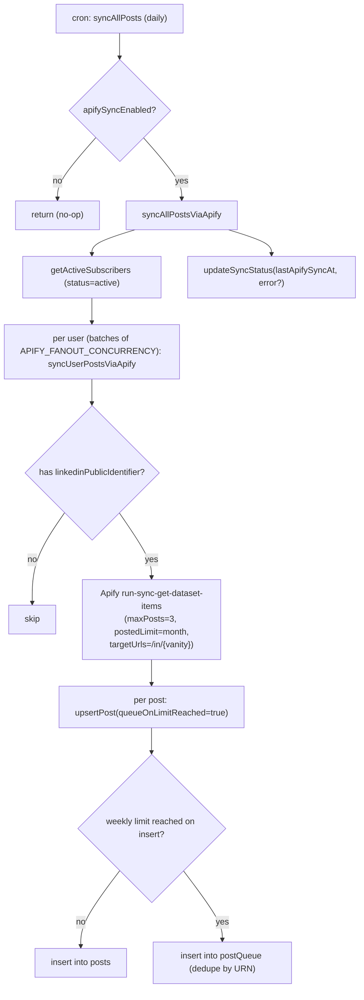

> Because `getActiveSubscribers` returns only `active` users, the Apify path's `hidden` is
> effectively always `false` on the cron. `submitPost` sets `hidden` via `postCreatedHidden`: carded
> members (trialing/active) post visibly (Plan 2B), while a no-card member (`none`/`past_due`) — e.g. a
> new member’s onboarding first post — is created hidden and revealed when they add a card.

> **Bounded fan-out:** both `syncAllPostsViaApify` and `scrapeAllProfilesViaApify` fan out through
> `settledInBatches` (`lib/concurrency.ts`) at `APIFY_FANOUT_CONCURRENCY` (5) — capping how many paid,
> rate-limited per-user Apify runs execute at once instead of an unbounded `users.map()`, while keeping
> the previous `Promise.allSettled` "one failure can't sink the sweep" semantics.

### Queue drain (`jobs/processQueue.processPostQueue`, daily cron)

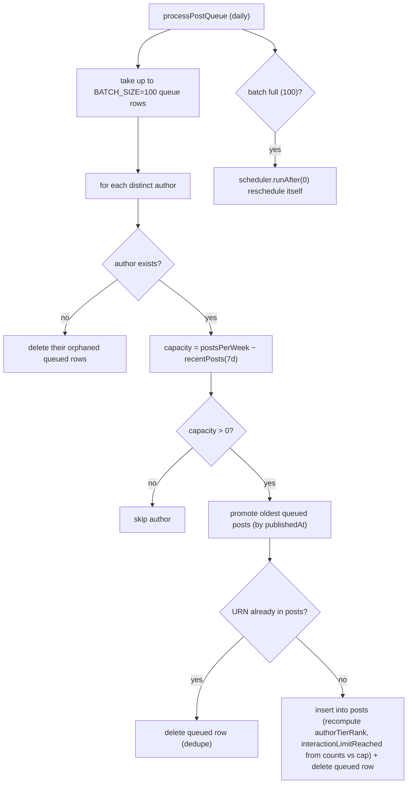

### Post‑related functions

| Function                                    | Kind              | Purpose                                                                                                             |
|---------------------------------------------|-------------------|---------------------------------------------------------------------------------------------------------------------|
| `posts.submitPost`                          | action (public)   | Manual submission (above).                                                                                          |
| `posts.getMyPosts`                          | query (public)    | Author's posts incl. hidden, **excl. soft‑deleted**, sorted by `publishedAt` desc (bounded to the 500 most‑recent). |
| `posts.setPostHidden`                       | mutation (public) | Hide/unhide a post (author or admin via `canModifyPost`). Doesn't change the weekly count.                          |
| `posts.deletePost`                          | mutation (public) | Soft‑delete a post (author or admin). Row kept → weekly count unchanged. Idempotent.                                |
| `posts.featurePost`                         | mutation (public) | Feature a post (author or admin), quota‑gated by `featuredPerMonth`. Idempotent; recomputes feed fields.            |
| `posts.unfeaturePost`                       | mutation (public) | Unfeature a post (author or admin). No quota refund. Idempotent; recomputes feed fields.                            |
| `posts.getWeeklyUsage`                      | query (public)    | `{ postsThisWeek, postsPerWeek }` over the same rolling 7‑day window submitPost enforces.                           |
| `posts.getFeaturedUsage`                    | query (public)    | `{ usedCount, featuredPerMonth }` for the current UTC month — backs the My Posts quota pill.                        |
| `posts.countRecentPosts`                    | internalQuery     | Count posts since a timestamp (shared by enforcement + usage pill).                                                 |
| `jobs/syncPosts.upsertPost`                 | internalMutation  | Insert/update gatekeeper with atomic weekly‑limit + optional queueing.                                              |
| `jobs/syncPosts.syncAllPosts`               | internalAction    | Cron router → Apify (if enabled).                                                                                   |
| `jobs/syncPostsApify.syncUserPostsViaApify` | internalAction    | Scrape one user's recent posts via Apify REST.                                                                      |
| `jobs/syncPostsApify.syncAllPostsViaApify`  | internalAction    | Fan‑out over active subscribers; records sync status.                                                               |
| `jobs/processQueue.processPostQueue`        | internalMutation  | Drain overflow queue when capacity opens.                                                                           |

---

## 11. Feed & Engagement

### Feed resolution (`feed.getFeed`, query)

Args: `paginationOpts` (Convex cursor pagination), `sessionToken`. Returns a `PaginationResult` —
`{ page: enriched[], isDone, continueCursor }` (posts include a **token‑stripped** author projection). The client
consumes it via `usePaginatedQuery` in `FeedPage.tsx`.

The viewer's tier sets the filter via `buildFeedFilter`:

- **starter:** no filters.
- **growth:** auto‑filter to the viewer's **own** `industry` + `country`.
- **pro / contact:** filter by the viewer's **saved preference** —
  `users.feedFilterIndustries` / `feedFilterCountries`, read straight off the viewer doc (no client‑supplied args). Each
  dimension ORs over its list; the two dimensions are **ANDed**; an empty/absent list means that dimension isn't
  filtered. Set via `users.setFeedFilter` (see below); because `getFeed` reads these fields, saving re‑runs the query
  reactively and the feed re‑filters live. Two surfaces write the same fields (kept in sync automatically): the
  `FeedPage` **"Filter feed"** panel (apply‑on‑change) and a **"What you see in your feed"** card in **Settings**
  (dirty‑flag + Save, mirroring the "Who can see your posts" card) — both Pro/Contact only.

The viewer-side filter above (`feedFilterIndustries`/`feedFilterCountries`) is separate from the **author-side**
allowlist enforced at step `F2` in the diagram below (`posts.visibilityIndustries` /
`visibilityCountries`, checked against the viewer's own `industry`/`country`) — one is "what I want to see", the other
is "who I allow to see me". The author-side allowlist is a **Pro/Contact** feature:
`users.setPostVisibility` (tier-gated server-side, validated against `INDUSTRIES`/`COUNTRY_CODES`)
sets `users.defaultVisibilityIndustries`/`defaultVisibilityCountries`, which every post writer (`posts.submitPost`,
`jobs/processQueue.ts`, `jobs/syncPostsApify.ts`) copies onto the new post at **insert time** — editing the Settings
default does not retroactively change posts already written. Absent/empty on either field ⇒ visible to everyone (same
invariant `F2` already relied on before this was wired up to a UI).

The feed also checks each post against its **author's current interaction cap** on every query.
`getPlanLimitsHelper` resolves limits once per author on the page, including Contact overrides and tier defaults.
A post is excluded when `likeCount + commentCount >= effectiveInteractionCap(interactionsPerPost, interactionCapBonus)`
or its stored `interactionLimitReached` flag is true. For an author with a cap of 50 and no bonus, both 50 and 80 total
interactions exclude the post. The viewer's cap does not affect this check. Purchased bonuses still extend the cap.
This check covers stale `inFeed` flags after count updates or plan changes, using the latest counts stored in Convex.
It runs before the per-post viewer-state reads and preserves the index page's cursor and pagination metadata.

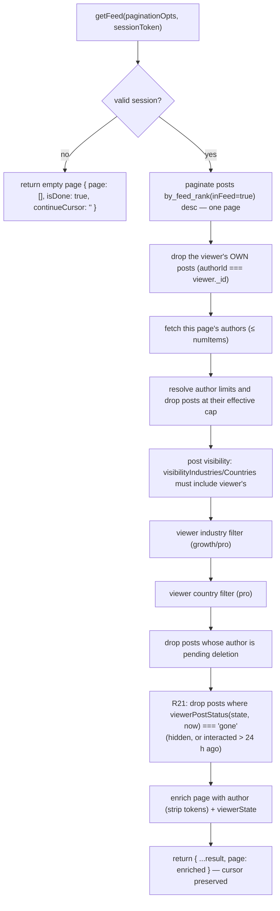

**Per-viewer hygiene (R21).** Before enriching, `fetchFeedPage` reads the viewer's own `userPostState` row for each item
remaining after the author-cap check — one `by_user_and_post` `.unique()` point read per item, so at most `numItems`
extra indexed reads per page — and then:

- **drops** every post whose `viewerPostStatus(state, now)` is `'gone'`: hidden through "Hide now", or last interacted
  with more than `INTERACTED_TTL_MS` (**24 h**) ago;
- **attaches** `viewerState: { reacted, commented, hidesAt } | null` (`toFeedViewerState`) to each surviving item, which
  is what the card's done footer renders.

Everything else is untouched: sort order, `inFeed`, the like/comment counts, the interaction cap, `search`, the refresh
cron and the author's own My Posts all behave exactly as before. This is **presentation for one viewer**, never a global
state — the author still sees their post, and so does everyone who has not handled it.

`now` is the query's own `Date.now()` (the same convention `getFeed` and `getRecap` already use), so a tab left open
past the 24-hour mark keeps showing the card until the query re-runs. That is deliberate: a card that vanishes under the
reader's cursor is worse than one that lingers a few minutes.

Because this filter can empty a whole page while the index walk still reports `CanLoadMore`, the client contract
changed: `FeedPage` keeps calling `loadMore` while the page is empty and the status is `CanLoadMore` (bounded — see
"24-hour feed hygiene" below). An auto-load keyed on the last rendered item would never fire, because an all-filtered
page renders no items to scroll to.

> `getFeed` walks the `by_feed_rank` index with `.paginate()`: `inFeed === true` pre-encodes the
> hidden / interaction-limit / soft-delete filters, and descending `feedRank` (featured → author
> tier → recency, see [`lib/feedRank.ts`](../convex/lib/feedRank.ts)) **is** the sort — so each call
> reads only one page and applies just the viewer-/author-dependent filters in memory — including dropping
> the viewer's **own** posts (`authorId === viewer._id`), since the feed is for others' content. The denormalized
> fields are kept in sync by every post writer (`computeFeedFields`). Heavy viewer filters can yield
> short pages; the client's **Load more** (`usePaginatedQuery`) requests the next page. Design + rollout:
> [feed-cursor-pagination-plan.md](./feed-cursor-pagination-plan.md).
>
> Because `feedRank`/`inFeed` are `v.optional` (widen→backfill), `by_feed_rank`'s `eq(inFeed, true)` can
> never match a row where the field is still `undefined`. `convex/migrations/backfillFeedFields.ts` is
> the batched, self-rescheduling backfill that stamps both fields on every `posts` row via the same
> `computeFeedFields` — it must run (or be re-run) before trusting the index against any posts written
> by a path that bypasses the live writers (e.g. a future bulk import). Pre-launch there is no prod data,
> so today it's a no-op; see the `ponytail:` comment in the migration.

**Feed eligibility and the trial (Plan 2B).** The pure `isAuthorFeedEligible(author, now)` helper (`feed.ts`)
excludes **banned** authors (`isBanned` — moderation; their posts leave the feed and search on ban and return on unban,
with no post mutation) and authors with `deletionScheduledAt` set, and drops a **canceled** author once their paid
period ends:
`subscriptionStatus === 'canceled'` stays eligible only while `now < subscriptionEndsAt` (the paid‑through instant
stamped by `cancelUserSubscription`); a missing/elapsed `subscriptionEndsAt` → not eligible. This is the sole feed
effect of a cancellation — the member keeps full engage access (see Card gate below). Everyone else (trialing / active)
is eligible. Trialing authors are **not** excluded: because trialing users must have a card on file (the trial is a real
Stripe subscription for the chosen tier — see §8), their posts belong in the feed as a reciprocity incentive. The gate
is applied at query time in both `getFeed` and `search` (which already load the page's authors), so no cron or post
mutation is needed. `submitPost` sets `hidden` via
`postCreatedHidden(user)` — visible for carded members, hidden for no-card members (`none`/`past_due`, e.g. a new
member's onboarding first post). Existing hidden posts from before Plan 2B are not backfilled (pre-launch, no prod
data). The `syncUserSubscription` webhook un-hides the author's posts when they **gain a card**
(`unhideHidden: canEngage(status)`) — so a trial start (subscribe), not just an `active` transition, reveals it.

**Card gate on engagement.** `commentOnPost` and `reactToPost` call `assertCanEngage(user)` (from
`convex/lib/access.ts`) immediately after resolving the caller — `submitPost` does NOT: a no-card member may submit (the
post is created hidden via `postCreatedHidden`), only reactions/comments are card-gated. Engagement is granted for
`subscriptionStatus ∈ {trialing, active, canceled}` — **cancellation never revokes access**; only `none` (never
subscribed) and `past_due` (failed payment) receive a `PAYMENT_REQUIRED` error. Admins (`isAdmin`) always bypass the
gate. The frontend mirror `useCardGate()` (`app/src/hooks/useCardGate.ts`) uses the same status set and must stay in
sync. The in-app UI for this gate (hidden-post banner, tap-bound `CardGateDialog`, progress bar, CTA) is **Plan 2C**
— shipped, reordered by **R04 (Option A)**; see [§14 "Trial UI (Plan 2C)"](#trial-ui-plan-2c). R04 is copy and
routing only: this backend gate is unchanged.

**Per-post engageability gate.** The card gate answers *"may this member engage at all?"*; a second gate answers *"is
**this post** engageable?"*. All three engagement entry points — `commentOnPost`, `reactToPost` (below) and
`generateComment` ([§11A](#11a-ai-reaction--comment-assistance)) — resolve the target post through one shared internal
query, `internal.interactions.getEngageablePost({ postId, viewerId })`, which loads the post + viewer + author and runs
the pure `feed.assertPostEngageable(post, viewer, author, now)`. That helper throws on a spent budget
(`interactionLimitReached` → *"reached its interaction limit"*), and otherwise mirrors the feed's own access rule
(`isPostVisibleToViewer`): a `hidden`/soft-deleted post, one outside the viewer's `visibilityIndustries` /
`visibilityCountries` allow-lists, or one from an ineligible author is rejected as *"not available."* A raw
`ctx.db.get(postId)` bypasses the `inFeed` search index, so these actions **must** re-check — sharing one gate is what
keeps the three from diverging (a post the feed hides can never be engaged, or AI-drafted against, through any of them).
The three are Convex **actions** with no `ctx.db`, so they reach the gate via `ctx.runQuery`.

### Sort priority (effective order)

1. **Featured** posts first (newest first).
2. Then by **author tier rank** desc (contact → pro → growth → starter).
3. Then by **`publishedAt`** desc (newest first).

### Interactions (comment / react)

Both are **actions**, but they **no longer call LinkedIn** — LinkedIn exposes no member API to react/comment on another
member's post. Engagement is a **client‑side handoff**: the client opens the post on LinkedIn. For comments it first
writes the AI draft to the clipboard, confirming with a toast (`ui/toast.tsx`) **only once the copy succeeds**; the
button **spinner** + toast then stay on screen for a ~1.5s beat (`HANDOFF_DELAY_MS`) — the app keeps focus so they're
visible — **after which**
`openLinkedIn` (`lib/handoff.ts`) opens the post (`buildPostUrl` → stored `sourceUrl`, else a reconstructed
`/feed/update/<urn>/` permalink) in a new tab, falling back to same-tab if the browser blocks the deferred popup. The
user performs the real action there. The action then **counts it optimistically** (per the product decision to count on
tap): gate, rate‑limit, then run **one mutation** (`incrementCommentCount` / `incrementLikeCount`) that patches the
post's count — which may flip `interactionLimitReached` — **and inserts the `userInteractions` row in the same
transaction**, stamping `authorId` from the post. There is no separate best‑effort logger any more: the row and the
counter commit together or not at all, so the aggregate and the log cannot drift. That log is what the **recap** and
**history** pages read (below) and what the DSR export ships ([§13B](#13b-privacy--compliance)). **Reactions are
deduped**: `incrementLikeCount` sets `userPostState.reactedAt` on the first reaction and no-ops on
repeats (no count, billing, or log) — a member holds at most one reaction per post; the action relays the mutation's
`counted` flag so the client can tell a first tap from a repeat. The AI **comment draft** is saved to
`userPostState.commentDraft` on generate and reloaded into `CommentBox` on open (reuse or regenerate). Counts propagate
to all viewers in real time via Convex reactivity. The interaction‑limit flip decision is the pure helper
`lib/interactionLimit.ts`
`shouldFlipInteractionLimit(likeCount, commentCount, interactionsPerPost, alreadyReached)`; both increment mutations
first **guard on the flag** (`if (post.interactionLimitReached) return`) so a concurrent tap that already tripped the
cap can't overshoot the count on the OCC retry. The same cap counts LinkedIn‑seeded engagement too — it is seeded at
import and re‑evaluated on the Apify refresh, and blocks an already‑over‑cap post at submit — see the
`interactionsPerPost`
bullet under [§9](#9-plan-limits-system).

**Author‑facing post‑cap state (R08 + R20).** `interactionLimitReached` is silent on the viewer side (the post just
stops appearing in the feed) but is surfaced to its **author** in My Posts: a spent‑budget post gets a `Badge
variant="warning"` reading `myPosts.interactionCapBadge` ("Reached {{limit}} interactions and left the feed") plus the
shared `UpgradeAtLimit limit="interactionCap"` naming the next tier's higher cap. **In-app that is still the whole
story** — deliberately no toast and no notice surfaced on the next feed visit, so a member who never revisits My Posts
is never interrupted elsewhere. What **R20** added is out of band: the author gets **one email at the moment of the
flip** (`interactions.flipCapIfReached` → `notifications.sendPostCapReached`), because a post leaving the feed is a
thing that happened to their account, not an in-page state they can be expected to go looking for. See
[§8 "Post-cap email (R20)"](#post-cap-email-r20) for the send rules and the copy,
[§14](#14-frontend--authenticated-app-app) (`MyPostsPage`) for the in-app placement, and
[§9](#9-plan-limits-system) for `UpgradeAtLimit` itself.

**The bonus applies only where a post already exists (backlog/R17).** The three sites that decide whether an *existing*
post is capped — `interactions.flipCapIfReached`, the Apify refresh's `jobs/syncPosts.applyEngagementCounts`,
and the recap's `lib/recap.pickNearCapPost` (below) — all call
`effectiveInteractionCap(limits.interactionsPerPost, post.interactionCapBonus)` (`convex/lib/interactionLimit.ts`)
rather than the plan's plain `interactionsPerPost`, so a bought post is measured against its own bigger cap everywhere
it can leave or stay in the feed. The three creation-time checks (submit rejection, the Apify insert, the queue
promotion — [§9](#9-plan-limits-system)) keep the plain plan cap: a post has no `interactionCapBonus` until it is
featured by a purchase. Because `posts.applyPurchasedFeature` re-decides `interactionLimitReached` against the new,
bigger cap at fulfilment ([§8 "Post-cap email (R20)"](#post-cap-email-r20)), a bought post can leave the feed a second
time once it reaches that bigger number, and `flipCapIfReached` sends a second, independent `post_cap_reached` email
at the new number — not a repeat of the first.

| Action                                             | Validation                                                                 | Rate limit | Effect (no LinkedIn call)                |
|----------------------------------------------------|----------------------------------------------------------------------------|------------|------------------------------------------|
| `commentOnPost(postId, commentText, sessionToken)` | text ≤ 3000 chars                                                          | 20/hour    | count + `userInteractions` row (one txn) |
| `reactToPost(postId, reactionType, sessionToken)`  | `reactionType ∈ {LIKE,PRAISE,EMPATHY,INTEREST,APPRECIATION,ENTERTAINMENT}` | 30/hour    | same, deduped — repeat tap is a no-op    |
| `hidePost(postId, sessionToken)`                   | `canHide` — the viewer must have reacted/commented                         | –          | **R21** — stamps `hiddenAt`; idempotent  |

> The feed's reaction control is a **single button** that *displays* the AI‑suggested reaction
> (`posts.suggestedReaction`, default `LIKE`) + count as a visual cue (reaction name in its tooltip)
> — see [§11A](#11a-ai-reaction--comment-assistance). There is **no in‑app reaction picker**: the deep
> link can't carry a chosen reaction type, so clicking just opens the post on LinkedIn and records the
> suggested type as a best guess. `reactionType` still uses LinkedIn's enum values (Like/Celebrate/
> Love/Insightful/Support/Funny), so a future API integration needs no remap.

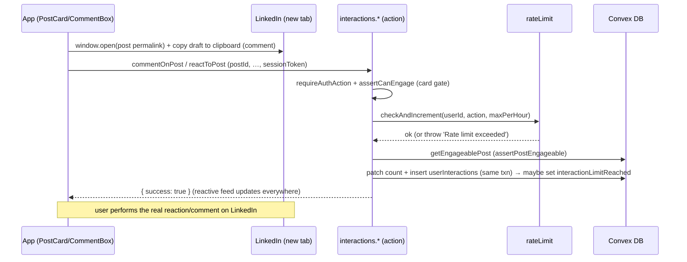

### 24-hour feed hygiene (R21)

A post the viewer has already handled is done work. It stays on screen for **24 hours** as a "done" card — so the tap
has a visible result, and so a mis-tap is still recoverable in context — and then leaves *that viewer's* feed.
"Hide now" makes it leave immediately. All of it is per-viewer: nothing about the post, its counts, its cap or the
author's view of it changes.

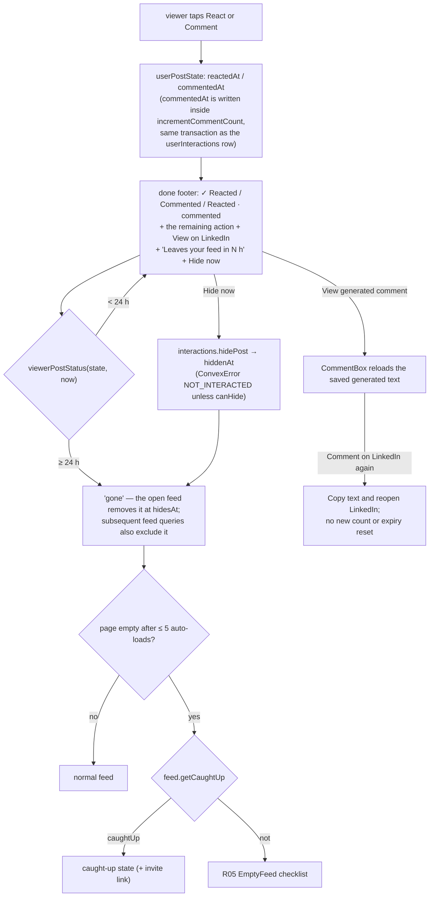

**The stamps.** `reactedAt` was already there (it is the reaction dedupe). R21 adds `commentedAt`, written by
`incrementCommentCount` **in the same transaction as the log row**, so the moment the viewer tapped Comment is recorded
exactly once and cannot drift from the interaction log. `lastInteractedAt(row)` takes the later of the two — carefully,
without a `?? 0` sentinel, which `Math.max` would otherwise floor at zero and swallow the missing side.

**The three states** come from one pure module, `convex/lib/feedHygiene.ts`:

- `viewerPostStatus(row, now)` → `'fresh'` (no row, or a row with neither stamp — the normal card), `'done'`
  (interacted, inside `INTERACTED_TTL_MS` = 24 h), `'gone'` (hidden, or the window elapsed).
- `canHide(row)` — Hide exists **only** on a post the viewer interacted with. It is not a way to curate untouched posts,
  so `interactions.hidePost` throws `ConvexError('NOT_INTERACTED')` otherwise. Hiding is idempotent (a second call
  changes nothing) and there is **no unhide** — `/history` keeps the record either way.
- `toFeedViewerState(row)` — the `{ reacted, commented, hidesAt }` the card renders. It deliberately takes **no `now`**:
  `hidesAt` is an absolute instant (`lastInteractedAt + INTERACTED_TTL_MS`), and the client turns it into "in N h".

The card's remaining action stays live: a viewer who reacted still sees the Comment button, and vice versa.
Commented posts also offer **View generated comment**. This opens the saved AI draft read-only with **Comment on
LinkedIn again**, which copies the text and reopens the post without recording another interaction
or resetting the 24-hour window. A missing saved draft gets an explicit empty state and still permits reopening
LinkedIn. Clipboard failure leaves the text available for manual copying.

`FeedPage` filters out cards at `viewerState.hidesAt`, including while the feed stays open without database updates.
One shared clock refreshes the countdown every minute, at the nearest expiry, and when the tab regains focus or
changes visibility. The countdown rounds up and stays between 1 and 24 hours while a card is visible. Hiding is
reactive: Convex removes the card without a reload.

**`feed.getCaughtUp({ sessionToken })` → `{ caughtUp }`** answers the question an empty page cannot: *did I clear the
feed, or is there nothing here?* It is `true` when the viewer's newest `userInteractions` row (`by_user`, descending,
`.first()`) is younger than 24 h — older interactions have already left the feed and prove nothing about today. A banned
viewer is always `false`, because `getFeed` hands them an empty page regardless and "caught up" would be a lie about a
feed they are not being shown. `FeedPage` subscribes to it **only** while the feed is empty, after auto-loading up to
`MAX_EMPTY_LOADS` (**5**) further pages that also came back empty — a budget per *run* of empty pages, reset whenever a
page comes back with posts. Empty because everything was handled → the caught-up state (which carries the R19 invite
link); empty because nothing exists → the R05 `EmptyFeed` checklist.

`post_hidden { after }` — hours between the interaction and the tap on Hide now — is the only event R21 emits; see
[§17](#17-security-posture).

### Reading the log back — recap & history (R15 / R16)

`userInteractions` ([§5](#5-data-model)) is the authoritative record, and exactly two public queries read
it. Both call `requireAuth` and then index on **the caller's own id** — there is no admin or cross-member variant, so a
member can only ever read their own engagement.

**`interactions.getRecap({ sessionToken, window, now })`** — `window` is `'7d' | '30d'`. `now` comes **from the client,
floored to the hour** (`floorToHour`, `convex/lib/recap.ts`): stable args across re-renders mean Convex can share one
subscription instead of re-subscribing on every tick. `windowBounds` derives `{ since, prevSince, until }`; the current
window is `[since, ∞)` — deliberately open-ended, so an interaction inside the partial hour counts immediately — and
the previous window is `[prevSince, since)`, which is what makes the period-over-period delta possible from a single
read. It returns:

- `made` / `received`, each `{ current, previous }` as `{ reactions, comments, posts, total }` (`countInteractions`).
  "Made" reads `by_user`, "received" reads `by_author`, and `excludeSelf` drops rows where actor and author are the same
  member, so reacting to your own post never inflates the received side.
- `truncated` — both reads are `.order('desc').take(RECAP_ROW_CEILING)` with `RECAP_ROW_CEILING = 2000`. Newest-first
  means truncation drops the **oldest** rows first, and the flag is set when either side hit the ceiling so the page can
  say so (`recap.truncated`) rather than quietly under-reporting.
- `plan: { tier, ...limits, nextTier }` — the caller's resolved limits ([§9](#9-plan-limits-system)) plus the tier
  above.
- `posts[]` — the member's own posts created since `since` (`by_author`, newest first, `RECAP_POST_CEILING = 200`),
  filtered to live ones (not soft-deleted, not hidden), each with a `EXCERPT_LENGTH = 140`-char excerpt, both counts,
  `isFeatured` and `interactionLimitReached`. This is the per-post usage list.
- `nearCapPost` — `pickNearCapPost` over that same list, or `null` ([§9](#9-plan-limits-system) for the 0.8 band).

**`interactions.listMyInteractions({ sessionToken, since, paginationOpts })`** — the history page's paginated feed:
`by_user`, `.order('desc')`, `.paginate(...)`, **`since = 0` meaning all time**. Every row is mapped through the pure
`toHistoryRow` (`convex/lib/history.ts`), which joins the post and its author and sets **`removed`** when the post is
soft-deleted **or** hidden; a post row that no longer exists at all yields `post: null`, and the page renders the same
"removed" badge for it. The client pages 20 at a time.

### Rate limiting (`lib/rateLimit.ts` + `@convex-dev/rate-limiter`)

A **fixed window** keyed on `(userId, action)`, enforced by the **`@convex-dev/rate-limiter`** component (mounted in
`convex.config.ts`; its counter state lives in the component's own isolated tables, not an app table).
`lib/rateLimit.ts`
wraps it behind three unchanged entry points — `checkRateLimit` (throws), `tryConsumeRateLimit` (returns a boolean), and
the `checkAndIncrement` internal mutation that actions call via `ctx.runMutation`. No named limits are pre‑registered:
every call passes an **inline config** (`kind: 'fixed window'`, `rate = maxPerWindow`, `period = windowMs`), so each
caller keeps its own window; `WINDOW_MS` defaults to 1h. The component performs the check **and** consume atomically in
one transaction, closing the read‑modify‑write race the former hand‑rolled `rateLimits` table admitted (two concurrent
taps could both read `count = N-1` and both write `N`). `checkRateLimit` accepts an optional `windowMs` + `windowLabel`
(defaults to 1h / "hour") for non‑hourly windows. Limits: `submitPost` 10/h,
`commentOnPost` 20/h, `reactToPost` 30/h, `generateComment` 30/h, `profile_refresh` 2/day. The `profile_refresh` budget
is **shared** by the manual Refresh button and the auto-scrape on identifier change; the latter uses the non-throwing
`tryConsumeRateLimit` so an exhausted budget never blocks saving the identifier. **Admins (`user.isAdmin`) bypass the
rate limit on `commentOnPost`, `reactToPost`, `generateComment`, and `profile_refresh`** — those call sites
unconditionally skip the check for admins. **`submitPost` is the exception:** its rate‑limit, weekly‑limit, and
ownership bypass apply **only under the dev‑gated admin override** (`ALLOW_ADMIN_SHARE_ANY_POST` — see
[§10 — Manual post submission](#manual-post-submission-postssubmitpost-action)). In production that var is unset, so an
admin submits posts under exactly the same limits as everyone else.

---

## 11A. AI Reaction & Comment Assistance

OpenRouter (OpenAI-compatible) powers two assists: (1) predicting each submitted post's most-likely reaction, and (2)
drafting comments on demand. The model is Google's open **Gemma**
(`google/gemma-4-26b-a4b-it`), served via OpenRouter's privacy-constrained provider routing. All calls go through one
seam —
`convex/ai/openrouter.ts` `callOpenRouter(messages, { action })` — which mirrors `linkedin/client.ts`
(auth + log-real-error→throw-sanitized). The prompts are **multimodal**: the post's images (`posts.imageUrls`, the
image-typed media captured at submit) + the linked article's images are attached as vision input, and the **full article
body** (`posts.article.text`) is sent as text — so the model must be **vision-capable** (`OPENROUTER_MODEL` must point
at a multimodal model). Non-image media (documents/links)
are listed as text context, not attached.

> **Compliance — AI inference runs via OpenRouter with zero data retention (dynamic provider routing).**
> `OPENROUTER_API_KEY` enables the AI features (unset ⇒ reactions no-op to `LIKE`, Generate reports "AI
> unavailable"). The seam (`convex/ai/openrouter.ts`) constrains routing **in code** to providers that honour
> **zero data retention** (`zdr: true`) and **no data collection / no training** (`data_collection: "deny"`) —
> not env-overridable — and OpenRouter selects among the qualifying providers (no `:floor` price-routing
> suffix on the model slug; the `data_collection`/`zdr` pin is what governs provider selection). The model is
> Google's open **Gemma** (`google/gemma-4-26b-a4b-it`), verified against OpenRouter's live catalog and served
> by **DeepInfra** at fp8. **OpenRouter** (US) is the named sub-processor; the **downstream
> inference provider (e.g. DeepInfra) and its region are selected per request, not pinned** — so region is not
> guaranteed and the controller relies on OpenRouter's DPA flowing down to its providers. Documented in
> `docs/compliance/`: ROPA **Activity 13** (`DATA-INVENTORY.md`), the **OpenRouter** rows in `SUBPROCESSORS.md`,
> **item 10** in `GAP-ASSESSMENT.md`, and the public `/privacy` disclosure. **Human/legal before go-live:**
> execute OpenRouter's DPA, confirm ZDR/no-training flows down to its providers, and assess the transfer
> position given the non-pinned region (add region constraints if needed). **Flagged for legal review:**
> DeepInfra's zero-retention posture has a documented exception for Google-family models — Google logs
> prompts/responses for abuse-monitoring purposes independent of DeepInfra's ZDR commitment.

### Reaction prediction (async, best-effort)

Both post-creation paths schedule `internal.ai.reactions.predictReaction` immediately after the upsert, so OpenRouter
latency/cost/failure never touch either caller: `posts.submitPost` (manual submit) and
`jobs/syncPostsApify.syncUserPostsViaApify` — the single Apify sync function shared by all three §10 triggers (daily
cron fan-out, Stripe on-activation, admin manual sync). Both call the shared gatekeeper
`jobs/syncPosts.upsertPost`, which now returns `{ postId, created }` — `created` is `true` **only** on a genuine insert,
never on the update branch (an already-known URN being re-synced) or the queue branch (over the weekly limit, routed to
`postQueue`). `submitPost` always schedules (its insert is always new); the Apify caller gates on
`created === true` via the pure, unit-tested `shouldPredictReaction` helper — so a daily cron re-run over already-synced
posts never re-schedules a prediction (no duplicate OpenRouter spend). Apify predicts for **all**
newly-inserted posts, including trial-`hidden` ones — no special-case; a few wasted predictions for a never-converting
trial user is an accepted ceiling.

The prediction reads the post, builds the reaction prompt (content + article), calls OpenRouter, coerces the reply with
`parseReaction` (whole-word match against the 6-enum allow-list, **default `LIKE`**), and patches
`posts.suggestedReaction`. Any failure — including a missing `OPENROUTER_API_KEY` — is swallowed (logged); the post
keeps the default `LIKE`, and the sync itself never fails because of it. Apify-synced posts carry no `article`/
`imageUrls` context (that enrichment is manual-submit-only — see above), so their prompt is text-only.

**Known gap — queued posts:** a post that overflows the weekly limit is routed to `postQueue` instead of `posts`
(`created: false`, no prediction). When `jobs/processQueue.processPostQueue` later promotes it into `posts`, that insert
does **not** go through `upsertPost` and is not wired to `predictReaction` — a promoted post keeps the default `LIKE`
unless a later Apify re-sync happens to touch it (which also doesn't predict, by design — that would be the update
branch). See `backlog/B09-ai-reaction-apify-posts.md`.

No proactive throttle guards the resulting OpenRouter burst (`convex/ai/openrouter.ts`'s `callOpenRouter` has no rate
limiting of its own): the daily cron, ≤3 new posts/user, and the `created`-only gate above already bound a single run to
at most a few predictions per newly-active user, and any OpenRouter failure/429 is swallowed by the same best-effort
handling. The `@convex-dev/rate-limiter` component is now mounted (it backs the per‑user limits above), so it can be
applied to this OpenRouter prediction burst too if usage growth ever makes that bound too loose.

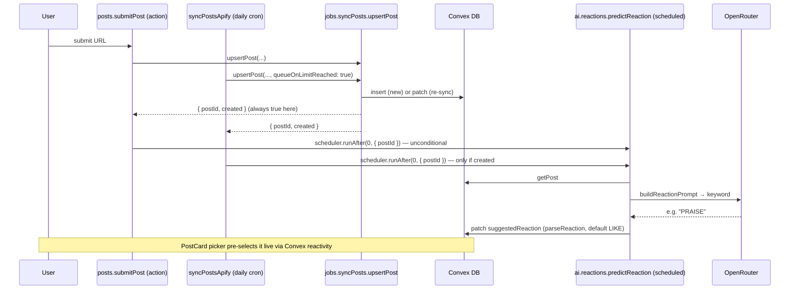

The feed's reaction control (`PostCard`) is a **picker** pre-selecting `suggestedReaction ?? 'LIKE'`; the viewer
confirms or changes before `reactToPost` sends the chosen reaction (§11).

### Comment drafting (on-demand)

`api.ai.comments.generateComment({ sessionToken, postId, language? })` → `{ comment }`. It auth-checks, then **
`assertCanEngage`** — AI drafting requires an active subscription (the same card-on-file gate as `commentOnPost`:
`none`/`past_due` are blocked, all tiers otherwise pass, admins bypass), so the OpenRouter spend is never reachable
without a subscription. It then rate-limits (30/h, admins exempt), loads the post through the shared
`internal.interactions.getEngageablePost` gate (so a hidden / limit-reached / not-visible post is rejected exactly as in
`commentOnPost` / `reactToPost` — see the per-post engageability gate in §11) plus the author's public name/headline
(`internal.users.getPublicAuthor`), resolves the language, builds the comment prompt (≤2 paragraphs, concise, no
hashtags/@-mentions; article + media URLs included), calls OpenRouter, and returns the draft. The draft is **persisted
per (user, post)** on `userPostState` (`internal.interactions.saveCommentDraft`) so `CommentBox` can reload it on reopen
for reuse/regeneration — per-post scope avoids the cross-post text reuse that would trip LinkedIn spam detection.
`CommentBox` prefills the textarea (Generate / Regenerate) for the user to edit, then posts via the unchanged
`commentOnPost`.

**Generating a draft counts as nothing** (R15 decision, 2026‑09‑05). `generateComment` writes no `userInteractions`
row, bumps no `commentCount`, and moves no trial counter — only the member's **Comment** tap does, inside
`incrementCommentCount` ([§11](#11-feed--engagement)). The app cannot observe a draft landing on LinkedIn, so a draft
the member never posts is not an interaction; keeping the generator counter-free also stops a 30-per-hour budget from
being turned into engagement on someone else's post cap. The recap and the history
([§14](#14-frontend--authenticated-app-app))
therefore never show a number the member did not create with a tap.

### Comment language

All **ISO 639-1** codes (`convex/lib/languages.ts`, codes-only + `Intl.DisplayNames`, mirroring
`profileOptions.ts`) plus an **`auto`** sentinel ("match the post"). Stored as `users.commentLanguage`
(`v.string()`, validated in the handler — same pattern as `country`/`industry`). The default chain is **per-comment
select → saved `commentLanguage` → `auto`**, all via the pure `resolveCommentLanguage`
(shared by the action and both selects). Settings has a default picker (`setCommentLanguage`); the comment box picker
overrides per-comment without writing back.

### Files

`convex/ai/{openrouter,prompts,reactions,comments}.ts`, `convex/lib/{reactions,languages}.ts`,
`posts.submitPost` (schedule hook), `jobs/syncPosts.ts` (`upsertPost`'s `{ postId, created }` signal),
`jobs/syncPostsApify.ts` (schedule hook + `shouldPredictReaction` gate), `interactions.reactToPost` (enum fix),
`users.{setCommentLanguage, getPublicAuthor}`, `getMe` (exposes `commentLanguage` via `toSafeMe`); frontend
`PostCard` (picker), `CommentBox` (draft + language), `SettingsPage` ("AI Comments"), i18n `reactions.*` /
`comment.*`.

---

## 11B. Search & Command Palette

A ⌘K / Ctrl-K **command palette** searches posts and people and offers quick navigation actions. It replaces the former
non-functional top-bar search placeholder.

### Backend (`convex/search.ts`, `search` query)

- Two full-text **search indexes** on `convex/schema.ts`: `posts.search_content` (`searchField: 'content'`,
  `filterFields: ['inFeed']`) and `users.search_name` (`searchField: 'name'`).
- The `search` query takes `{ sessionToken, queryText }` and returns `{ posts, people }`. It **requires a valid
  session** (returns empty on missing/invalid token or a query under 2 chars).
- **Feed-parity visibility (security-critical):** post results reuse the exact same rules as `feed.getFeed` through the
  single shared gate `feed.isPostVisibleToViewer(post, viewer, author, now)` — the `search_content` index is pinned to
  `inFeed === true`, then that gate drops the **viewer's own posts**, applies the per-viewer `visibilityIndustries` /
  `visibilityCountries` allow-lists, and enforces `isAuthorFeedEligible(author)`. Because feed and search call the same
  predicate, search can never surface a post the feed would hide (and never the searcher's own posts). Search does
  **not**
  apply the feed's tier-based industry/country _preference_ filter — that is a "what I want to see" layer, not an access
  rule. People results are **not** viewer-filtered (searching for yourself is fine), but they **are
  eligibility-filtered**:
  the same `isAuthorFeedEligible(person, now)` predicate the post results apply drops **banned, pending-deletion, and
  canceled-and-lapsed** members — so a moderated (or gone) person is hidden from people-search exactly as their posts
  are hidden from post-search. Note this also hides a canceled member once they lapse (`now ≥ subscriptionEndsAt`),
  matching the feed's own author eligibility. Both searches **over-fetch** (`take(MAX × 3)`) then filter and slice to
  the cap, so the eligibility/visibility drops don't starve the result count.
- **Safe projections:** posts expose only `{ _id, content, sourceUrl, author }` (author via `toFeedAuthor`); people via
  the pure allow-list `toSearchPerson` → `{ _id, name, headline, profilePictureUrl, linkedinPublicIdentifier }` — never
  tokens, email, admin/ban state, or other PII. The filtering runs in the extracted `searchPostsAndPeople(ctx, viewer,
  …)` helper (thin `search` wrapper owns auth), unit-tested over a 10-post fixture with a mock `ctx` in
  `convex/search.test.ts` (including a people-eligibility case); `feed.getFeed`'s `fetchFeedPage` is tested the same way
  in `convex/feed.test.ts`.

### Frontend (`app/src/components/shell/CommandPalette.tsx`)

- Reuses the `cmdk` wrapper in `app/src/components/ui/command.tsx` (`CommandDialog` + `Command` root). `AppShell` owns
  the open state and a global ⌘K/Ctrl-K keydown listener (`preventDefault` so it doesn't collide with browser find); the
  `TopBar` search button opens it via `onOpenSearch`. The top-bar shortcut hint is OS-aware — `getModifierKey`
  (`TopBar.tsx`, from `navigator.platform`) shows **⌘** on macOS/iOS and **Ctrl** elsewhere.
- Input is debounced ~180ms; the Convex query runs reactively via `useQuery(..., 'skip')` and only fires at ≥2 chars.
  Idle (no query) shows **Quick actions** (nav items + toggle theme + sign out); typing shows **People** / **Posts**
  groups, or a localized "No results". `shouldFilter={false}` — results are already filtered server-side, so cmdk's
  substring filter must not re-hide full-text matches. Selecting a person/post opens their LinkedIn permalink in a new
  tab (the compliant embed → permalink handoff).
- The palette's nav quick-actions are not a second hand-maintained list: `CommandPalette.tsx` flat-maps the same
  `NAV_GROUPS` the sidebar renders (`app/src/components/shell/navItems.ts`), so **Recap** and **History**
  ([§14](#14-frontend--authenticated-app-app)) appeared in ⌘K the moment they were added to that array, and a nav item
  can never exist in one surface but not the other.
- Palette strings live under `shell.*` in `app/src/i18n/locales/{en,pt,es}.json`.

> Search indexes cannot be exercised under the project's no-`convex-test` convention — the `search` query is verified by
> a manual runtime smoke test; only the pure `toSearchPerson` projection is unit-tested.

---

## 12. Admin & Moderation

Admin is gated by the **`users.isAdmin`** boolean, which is **only settable by direct database edit** — no application
code writes it. Every admin function calls `assertAdmin(user)` after
`requireAuth`, throwing `'Forbidden: admin access required'` otherwise.

### Admin functions (`convex/admin.ts`)

| Function                                                                 | Kind     | Purpose                                                                                                                                                                                                              |
|--------------------------------------------------------------------------|----------|----------------------------------------------------------------------------------------------------------------------------------------------------------------------------------------------------------------------|
| `checkIsAdmin`                                                           | query    | `true/false` (soft‑fails to `false`) — drives the client route guard.                                                                                                                                                |
| `getSettings`                                                            | query    | App settings (3 Apify flags + post‑sync & profile‑scrape last‑run status).                                                                                                                                           |
| `toggleApifySync(enabled)`                                               | mutation | Master switch for the Apify post‑sync cron.                                                                                                                                                                          |
| `toggleApifyEnabled(enabled)`                                            | mutation | Master Apify kill-switch.                                                                                                                                                                                            |
| `toggleApifyProfileScrape(enabled)`                                      | mutation | Toggle the LinkedIn profile scrape.                                                                                                                                                                                  |
| `syncAllPosts`                                                           | mutation | **Manual trigger** → schedule a post sync for all active subscribers. Throws if post sync is disabled. See [Manual Apify sync triggers](#manual-apify-sync-triggers).                                                |
| `syncUserPosts(userId)`                                                  | mutation | **Manual trigger** → schedule a post sync for one user. Throws if disabled or the user has no LinkedIn URL.                                                                                                          |
| `syncAllProfiles`                                                        | mutation | **Manual trigger** → schedule a profile scrape for all users with a LinkedIn URL. Throws if profile scrape is disabled.                                                                                              |
| `syncUserProfile(userId)`                                                | mutation | **Manual trigger** → schedule a profile scrape for one user. Throws if disabled or the user has no LinkedIn URL.                                                                                                     |
| `listUsers`                                                              | query    | Up to 1000 users (newest first), **without** tokens/Stripe IDs; includes the public `linkedinPublicIdentifier` slug so the Users tab can gate the per‑row sync actions.                                              |
| `survivalMetrics(days: 7\|28)`                                           | query    | **R18** — the Survival panel's only data source: `{ days, since, generatedAt, cohort, payingByTier }`, from the database alone. No PostHog, no new table, no snapshot cron. Cohort maths lives in `lib/survival.ts`. |
| `setUserTier(userId, tier)`                                              | mutation | Change tier (any of the 4) from the Users tab; promoting to `contact` auto‑seeds a per‑user `planLimits` override from contact defaults.                                                                             |
| `setUserSubscriptionStatus(userId, status)`                              | mutation | Admin override of `subscriptionStatus` (any of the 5) from the Users tab. Manual override; a later Stripe webhook can overwrite it.                                                                                  |
| `listContactUsersWithLimits`                                             | query    | Every contact‑tier user (`by_tier`) with **effective** limits (override ?? contact default) + `hasOverride`. Powers the read‑only Plan Limits tab.                                                                   |
| `listPlanLimits`                                                         | query    | All `planLimits` rows, enriched with `userName` for overrides. Also prefills the Users‑tab contact‑limits modal.                                                                                                     |
| `updateTierDefault(tier, …)`                                             | mutation | Edit a tier's **default** row (filters out per‑user overrides). Self‑heals (backlog/B27): inserts the row from `buildTierDefaultRow` first if the tier was never seeded, instead of throwing. Backend‑only (no UI).  |
| `setContactUserLimit(userId, …)`                                         | mutation | Upsert a contact per‑user override (validates ≥ 1; target must be contact tier). Edited from the Users tab.                                                                                                          |
| `removeContactUserLimit(userId)`                                         | mutation | Delete a contact override (revert to tier default).                                                                                                                                                                  |
| `banUser(userId, reason?)`                                               | mutation | Set ban fields. **Cannot self‑ban** (`assertNotSelfBan`) — guarantees ≥ 1 admin remains; banning _other_ admins is allowed.                                                                                          |
| `unbanUser(userId)`                                                      | mutation | Clear all ban fields.                                                                                                                                                                                                |
| `getSettingsInternal` / `updateSyncStatus` / `updateProfileScrapeStatus` | internal | Used by the Apify jobs — read flags; record post‑sync / profile‑scrape last‑run + error.                                                                                                                             |

`validateLimitArgs` enforces `interactionsPerPost ≥ 1` and `postsPerWeek ≥ 1`. `effectiveContactLimits`
(pure, unit‑tested) resolves a contact user's display limits as `override ?? contact default ?? hardcoded`.

### Survival panel (R18)

`admin.survivalMetrics({ sessionToken, days: 7 | 28 })` answers one question — *who survives the first week* — and
answers it **from the database only**. Every number is one an admin could re-derive by hand from `users`,
`subscriptions` and `userInteractions`; nothing is read from PostHog, and no survival event is emitted anywhere. There
is **no new table and no snapshot cron**: the panel is a live query and tolerates being a few minutes stale.

**Read budget.** `users` is walked once — `.order('desc').take(1000)`, the same newest-1000 slice `listUsers` reads —
and filtered in memory to `createdAt >= since`. Since the list is newest-first, a 7- or 28-day cohort is always inside
that window. Then, **per cohort member, four indexed reads**: the `subscriptions` rows (`by_user`, `.order('desc')`,
`.take(5)`), the member's *oldest* `userInteractions` row (`by_user`, `.first()` — `by_user` is ordered by
`_creationTime`, so `.first()` is the earliest), and one range read for each return window. Those ranges need **no new
index**: they bound the `_creationTime` tail Convex appends to `userInteractions.by_user`, and `createdAt` and
`_creationTime` are written in the same mutation. A `ponytail:` comment in `admin.ts` marks the ceiling — precompute
nightly if a 28-day cohort ever passes ~1500 members.

**Cohort definitions**, exactly as `summarizeCohort` (`convex/lib/survival.ts`) implements them:

| Metric                            | Definition                                                                                                        |
|-----------------------------------|-------------------------------------------------------------------------------------------------------------------|
| `signups`                         | Members whose `createdAt` falls inside the window.                                                                |
| `startedTrial`                    | The member has **any** `subscriptions` row.                                                                       |
| `activated`                       | Their first interaction is less than **24 h** after `createdAt` (`ACTIVATION_WINDOW_MS`).                         |
| `medianMinutesToFirstInteraction` | Whole minutes, over the members who have a first interaction at all; `null` when nobody does.                     |
| `returnedDay1`                    | Any interaction in the half-open window `[createdAt + 24 h, createdAt + 48 h)`.                                   |
| `returnedDays2to7`                | Any interaction in `[createdAt + 24 h, createdAt + 8 d)` — it **contains** day 1, it is not disjoint from it.     |
| `trialsEnded`                     | Started a trial **and** `subscriptionStatus` is `active`, `canceled` or `past_due` (i.e. it left `trialing`).     |
| `converted`                       | Started a trial **and** `subscriptionStatus` is `active`.                                                         |
| `canceled`                        | `subscriptionStatus === 'canceled'`, **or** the live subscription row has `cancelAtPeriodEnd` — over all signups. |

Because `returnedDays2to7` contains day 1, the panel labels it **"Returned days 1–7"** — the window is the useful
signal (*did they come back at all after the first day*), and renaming the field would silently break comparability
with numbers already read, so only the label changed.

**Eligible denominators — why `summarizeCohort` takes a `now`.** Alongside the counts, the summary returns
`activatedEligible` (rows with `createdAt + ACTIVATION_WINDOW_MS <= now`), `returnedDay1Eligible` (`createdAt + 48 h <=
now`) and `returnedDays2to7Eligible` (`createdAt + 8 d <= now`) — the rows whose window has actually **closed**. The UI
divides each count by its own eligible base, never by `signups`. Dividing by `signups` right-censors the metric: it
counts every member still *inside* a window as a miss, so in a 7-day cohort — where nobody is 8 days old — "returned"
would read **0 %** however those members behaved, and a cohort that all signed up yesterday would report 0 % across the
board. Each windowed **count** is taken over the same closed rows as its base, so a share can never pass 100 %: a member
who signed up an hour ago and already tapped has activated in fact, but they join the count and the base together the
moment their 24 h window closes, never the count alone (which would print "3 of 1 · 300%"). `signups`, `startedTrial`,
`trialsEnded`, `converted` and `canceled` need no such base, because nothing about them is pending. When a base is `0`,
`share()` renders **"–"**,
never "0 %" — "not enough data yet" and "nobody did it" are opposite answers, and this panel exists to tell the founder
whether anyone reaches value at all.

**Why the trial metrics are keyed on the subscription row, not on a date.** `stripe.syncUserSubscription` erases
`users.trialEndsAt` once a subscription becomes active — a marker that deletes itself the moment it would prove a
conversion. A date-based definition of "trial ended" or "converted" could therefore never count a single conversion, so
the panel reads the **subscription row's status** instead. This is the same reasoning that makes `trialEligible` count
rows rather than read `trialEndsAt` ([§8](#8-subscriptions--billing)).

`payingByTier` is deliberately **not** cohort-scoped: it counts `subscriptionStatus === 'active'` members per tier
across the whole newest-1000 window, so the panel shows the current book of business next to the window's funnel. A
paying member with no `tier` counts as `starter`, the app's default. Its heading says **"newest 1000 members"** rather
than "all members", because the `.take(1000)` slice is exactly what it is computed over.

The UI is `SurvivalTab` — see [§14](#14-frontend--authenticated-app-app).

### Manual Apify sync triggers

Four admin‑only mutations let an admin run a sync on demand instead of waiting for the daily cron. Each **respects the
same toggles the crons honor**: it schedules the (slow, paid) job and returns immediately, but only when its feature
flag (+ the master kill‑switch) is on — otherwise it throws
`"<feature> is disabled — enable it in Settings first."` The UI also gates each control, but the **server check is
authoritative** (a stale client or a direct API call still can't run a disabled integration). All four triggers share a
single `assertApifyTriggerEnabled` precondition (auth + admin assertion + flag check) so the server gate is defined once
in `admin.ts`.

| Trigger                   | Schedules                                           | Surface (admin panel)                               |
|---------------------------|-----------------------------------------------------|-----------------------------------------------------|
| `syncAllPosts`            | `jobs/syncPosts.syncAllPosts` (post‑sync router)    | "Sync all now" on the **Apify Post Sync** card      |
| `syncUserPosts(userId)`   | `jobs/syncPostsApify.syncUserPostsViaApify`         | "Sync posts" in the **Users**‑tab row menu          |
| `syncAllProfiles`         | `jobs/scrapeProfileApify.scrapeAllProfilesViaApify` | "Sync all now" on the **Apify Profile Scrape** card |
| `syncUserProfile(userId)` | `jobs/scrapeProfileApify.scrapeUserProfile`         | "Sync profile" in the **Users**‑tab row menu        |

The per‑user triggers additionally require the target to have a `linkedinPublicIdentifier`
(otherwise the menu item is disabled and the server throws). Outcome is observable via each card's
`Last sync` / `Last profile sync` line (and the user's data updating reactively) — there is no per‑item progress view.
Because these are flag‑gated, they do **not** by themselves "switch Apify on" — only the toggles do, and doing so in
production triggers the compliance hard gate (see [§13B](#13b-privacy--compliance)).

### Ban model — **reactive, not a forced logout**

`banUser` **only patches the user row** (`isBanned/bannedAt/bannedBy/bannedReason`). It does **not**
delete sessions. Enforcement is:

1. **Server:** the next `requireAuth`/`requireAuthAction` calls `assertNotBanned` → throws
   `'Account suspended'` (blocks all protected mutations/actions).
2. **Client:** Convex's reactive `getMe` query (which uses `resolveSession`, not `requireAuth`, so it still returns the
   user with `isBanned: true`) pushes the flag to any open tab → `RequireAuth`
   swaps the whole shell for `<BannedScreen>`.
3. **Content:** the banned author's posts are dropped from every other member's feed and search at read time via
   `isAuthorFeedEligible` (see §11) — no post mutation, so an **unban** restores them automatically.

An **unban** restores access on the **same** session token — no re‑login required.

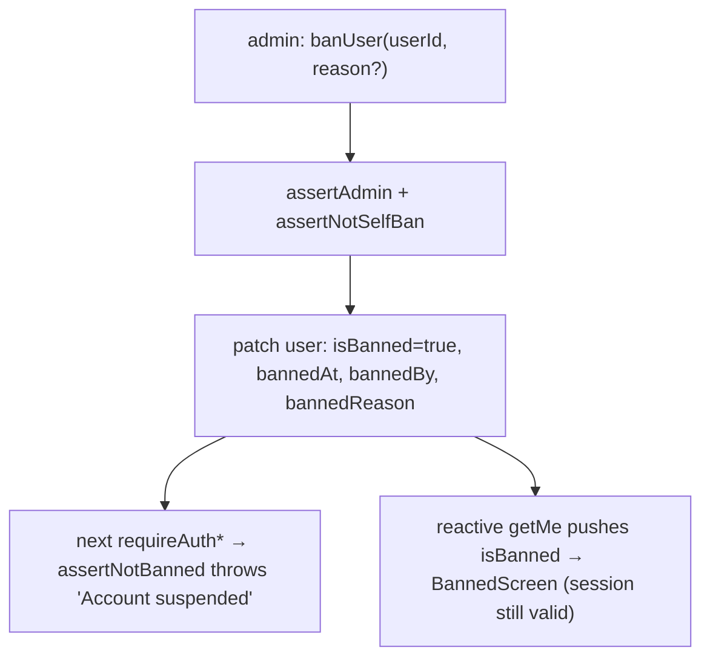

---

## 12A. Feedback

Authenticated users submit free-text feedback (≤4000 chars) tagged with a single category via a floating button
(bottom-right of every authenticated page). Admins read and reply by email from the **Feedback** tab in the admin panel.
Each feedback item can receive **multiple admin replies** stored as a thread in the `feedbackResponses` table.

**Data:**

- `feedback` table — `userId?` (submitter; cleared on account deletion), `category` (one of
  `feature_request | bug | comment | criticism | praise | question | suggestion | cancellation | other`),
  `message`, `status` (`new | responded | archived`), `createdAt`. Index: `by_user`.

  `cancellation` (added 2026-09-07 for R09) is the one category a member never picks: it is written **only** by
  `CancelInterstitial`'s optional "why are you leaving?" note ([§8](#8-subscriptions--billing),
  [§14](#14-frontend--authenticated-app-app)) and is deliberately **absent** from `FeedbackModal`'s category list, so
  the label stays a reliable signal of *when* the note was written rather than a self-declared mood. The note is a
  courtesy: `CancelInterstitial` swallows a `submitFeedback` failure so the cancel itself never depends on it.

- `feedbackResponses` table — append-only reply log; each row is one admin reply.
  `feedbackId` (FK → `feedback`), `responderId` (FK → `users`, the admin who replied),
  `text` (reply text), `createdAt` (ms). Index: `by_feedback [feedbackId, createdAt]`
  (chronological per item).

**Backend** (`convex/feedback/`):

- `feedback.ts` — `submitFeedback` (user; validates, throttles **10/hour**, admins exempt),
  `listFeedback` (admin; newest-first, enriched with submitter name/email and full reply thread from
  `feedbackResponses`), `respondToFeedback` (admin; inserts a new
  `feedbackResponses` row, patches `status=responded`, writes a `feedback.responded` audit log, schedules the email if
  `sendEmail=true`), `archiveFeedback` / `reopenFeedback`, and the internal `getReplyData` + `sendFeedbackReply` action
  (keyed by `responseId`).
- `emails.ts` — `feedbackReplyEmail` builder (HTML-escapes user/admin text).
- Replies use `lib/email.ts:sendEmail` with `Reply-To` = `FEEDBACK_REPLY_TO` so users reply to a human inbox. The admin
  chooses **per reply** whether to send an email (`sendEmail`
  boolean arg to `respondToFeedback`).

**Frontend** (`app/src/components/`): `FeedbackButton` + `FeedbackModal` (user, i18n en/pt/es); `FeedbackTab` +
`RespondFeedbackModal` (admin, English). Respond is disabled when the submitter has no email on file.

**Privacy:** `feedback` rows are **anonymized, not deleted**, on account erasure (`cascadeDeleteUser` clears `userId`;
content retained). `feedbackResponses` rows are retained attached to the anonymized feedback after account deletion.
Both are included in the DSR export bundle (`gatherFeedbackResponses` collects `feedbackResponses` for the user's
feedback items).

```mermaid
flowchart TD
    U[User clicks floating Feedback button] --> M[FeedbackModal: pick category + message ≤4000]
M -->|submitFeedback|V{Valid & under 10/hour?}
V -->|no|E[Error shown in modal]
V -->|yes|DB[(feedback row · status=new)]
A[Admin opens Feedback tab] --> L[listFeedback]
L --> R[RespondFeedbackModal]
R -->|respondToFeedback|P[insert feedbackResponses row · patch status=responded · audit log]
P -->|sendEmail = true|S[schedule sendFeedbackReply by responseId]
S -->|sendEmail · Reply - To = FEEDBACK_REPLY_TO|MAIL[(User receives email)]
DEL[Account deletion cascade] -.anonymize .-> DB2[feedback.userId = undefined · content kept]
DB2 -. responses retained .-> FR[(feedbackResponses rows kept)]
```

---

## 12B. Message of the Day (MOTD)

Admins author markdown announcements shown to authenticated users at the very top of the app. Default presentation is a
**dismissible top banner**; flagging a MOTD **important** escalates it to a **blocking modal** that closes only via an
OK button. Bodies are **per-locale markdown** (`en`
required as the fallback; others optional and extensible with no schema migration), with optional **start/expiry
scheduling**. Dismissal is **session-scoped** and re-shows on the next login.

**Data:** `motds` table (see [§5](#5-data-model)). The active MOTD is the newest `enabled` row whose
`[startAt, expiresAt)` window covers "now" — `selectActiveMotd` (pure, unit-tested).

**Backend** (`convex/motd/motd.ts`):

- `getActiveMotd` (viewer query) — `resolveSession`; returns `{ _id, bodies, important }` for the active MOTD or `null`
  (non-throwing). Reads `enabled=true` newest-first via `by_enabled_and_created`, then `selectActiveMotd`.
- `listMotds` (admin) — all MOTDs newest-first, bounded `take(200)`.
- `createMotd` / `updateMotd` / `deleteMotd` / `toggleMotdEnabled` (admin) — `requireAuth` +
  `assertAdmin`. Writes go through the pure `validateMotdInput` (trims bodies, drops empty locales, requires `en`, caps
  each body at 5000 chars, requires `expiresAt > startAt`). No audit log — admin content, not a personal-data action.

**Frontend** (`app/src/components/`):

- `MarkdownView` — shared safe renderer (`react-markdown` + `remark-gfm`, no raw HTML; links open in a new tab;
  dangerous URL protocols stripped).
- `Motd` — subscribes to `getActiveMotd`, resolves the body for the active language (`bodies[lang] ?? bodies.en`),
  renders the banner or (when `important`) the blocking `Modal`
  (`dismissOnBackdrop={false}`, `dismissOnEscape={false}`, OK button). Mounted in `RequireAuth`
  above `AppShell`. New i18n keys: `motd.dismiss`, `motd.ok` (en/pt/es).
- `MotdTab` — admin authoring (list + create/edit form with per-locale textareas, important/enabled toggles, optional
  `datetime-local` start/expiry, live `MarkdownView` preview). Added as the **MOTD** tab in `AdminPage` (admin chrome is
  English-only, like the other admin tabs).

**Dismissal & re-login mechanic:** dismissal is stored in `sessionStorage` under `motdDismissed` as
`{ token, motdId }`. The MOTD is hidden only when both the stored token equals the current
`sessionToken` **and** the stored `motdId` equals the active MOTD's id. A page reload keeps the same token (stays
dismissed); a re-login rotates the token via `AuthSuccessPage` (stored token no longer matches → re-shows); a newly
published MOTD has a new id → re-shows even mid-session.

```mermaid
flowchart TD
    A[Admin: MOTD tab] -->|createMotd / updateMotd / toggleMotdEnabled| DB[(motds table)]
    V[Authenticated user loads app] --> Q[getActiveMotd]
    Q --> SEL{selectActiveMotd: newest enabled in date window?}
    SEL -->|none| NONE[Render nothing]
    SEL -->|found| D{sessionStorage motdDismissed matches token + motdId?}
    D -->|yes| NONE
    D -->|no| I{important?}
    I -->|no| BANNER[Top banner · ✕ dismiss]
I -->|yes|MODAL[Blocking modal · OK dismiss]
BANNER -->|dismiss|W[Write motdDismissed = token + motdId]
MODAL -->|dismiss|W
RELOGIN[Re-login rotates sessionToken] -. stored token no longer matches .-> SEL
```

---

## 13. Scheduled Jobs (Crons)

`convex/crons.ts` is the **only** file Convex reads for scheduled work. The two post‑ingest jobs run at fixed wall‑clock
times in UTC (`crons.cron`); the feed‑engagement refresh, session/OAuth cleanup, account‑deletion, and retention jobs
run on fixed intervals from deploy time (`crons.interval`).

| Cron name                      | Schedule            | Target                                             | Effect                                                                                                                                                                                                                                                                                                                                                                                                                                                                                                                                                                                                                                                                                                                                                                                                                                                                                       |
|--------------------------------|---------------------|----------------------------------------------------|----------------------------------------------------------------------------------------------------------------------------------------------------------------------------------------------------------------------------------------------------------------------------------------------------------------------------------------------------------------------------------------------------------------------------------------------------------------------------------------------------------------------------------------------------------------------------------------------------------------------------------------------------------------------------------------------------------------------------------------------------------------------------------------------------------------------------------------------------------------------------------------------|
| `sync LinkedIn posts`          | daily **03:00 UTC** | `jobs/syncPosts.syncAllPosts`                      | Apify sync **iff** `apifySyncEnabled` (else no‑op). Ingests each active subscriber's latest posts (profile scrape) and inserts new rows.                                                                                                                                                                                                                                                                                                                                                                                                                                                                                                                                                                                                                                                                                                                                                     |
| `refresh feed engagement`      | every **30 min**    | `jobs/refreshFeedEngagement.refreshFeedEngagement` | Refresh `likeCount`/`commentCount` on **all feed‑eligible posts** (`inFeed=true`, `.take(500)`) via **one batched Apify run** — `targetUrls` = each post's URL (`sourceUrl` or a `/feed/update/{urn}/` reconstruction). Same `isApifyPostSyncEnabled` gate as the daily sync, so it is **dev/local‑only** (Apify dormant in prod). Counts‑only (`scrapeComments`/`scrapeReactions` off); matches results back by `shareUrn` and, like `upsertPost`'s update branch, does **not** re‑evaluate `interactionLimitReached` from external engagement. Items with no `engagement` object are skipped (never overwrites real counts with 0). ponytail: `run‑sync` blocks per tick — chunk `targetUrls` if a feed ever exceeds a few hundred posts.                                                                                                                                                  |
| `process post queue`           | daily **04:00 UTC** | `jobs/processQueue.processPostQueue`               | Promote queued posts when authors regain weekly capacity.                                                                                                                                                                                                                                                                                                                                                                                                                                                                                                                                                                                                                                                                                                                                                                                                                                    |
| `cleanup expired sessions`     | every **6h**        | `sessions.deleteExpiredSessions`                   | Purge expired sessions (≤ 200/run).                                                                                                                                                                                                                                                                                                                                                                                                                                                                                                                                                                                                                                                                                                                                                                                                                                                          |
| `cleanup expired oauth states` | every **1h**        | `sessions.deleteExpiredOAuthStates`                | Purge expired CSRF nonces (≤ 200/run).                                                                                                                                                                                                                                                                                                                                                                                                                                                                                                                                                                                                                                                                                                                                                                                                                                                       |
| `process account deletions`    | every **24h**       | `privacy/deletion.processAccountDeletions`         | Hard-delete accounts past their 30-day deletion grace window (cascade + Stripe cancel + completion email). Reads due accounts via `by_deletion_and_last_login`; processes **one account per run** in bounded cascade passes, self-rescheduling until the due-set is empty.                                                                                                                                                                                                                                                                                                                                                                                                                                                                                                                                                                                                                   |
| `refresh LinkedIn tokens`      | every **6h**        | `linkedin/tokenRefresh.refreshExpiringTokens`      | Renews tokens entering their pre-expiry window (`tokenExpiresAt` in `[now, now+7d)` **and** a refresh token on file) via `linkedin.oauth.refreshAccessToken` + `linkedin.auth.updateTokens`. Reads via `by_token_expiry`, **cursor-paginated** (≤100/page, mirrors `migrations/backfillFeedFields.ts`'s pattern) rather than a single `.take(100)` snapshot — the cursor is captured before any refresh attempt and advances every run regardless of per-user outcome, so a full 6h tick pages through the **entire** pre-expiry window even if rows near the front keep failing. Each user's refresh is try/caught independently (one `invalid_grant` skips that user, never aborts the batch or stalls the cursor). **Runs more often than `enforce data retention` below on purpose** — see ordering note. Best-effort/mostly dormant in practice: see [§7](#7-authentication--identity). |
| `enforce data retention`       | every **24h**       | `privacy/retention.enforceDataRetention`           | Null expired LinkedIn tokens; expire/purge old export files + audit logs (>24mo); flag dormant accounts (24mo, non-subscribers) for deletion. Indexed reads; batched, self-rescheduling on the token/audit sweeps.                                                                                                                                                                                                                                                                                                                                                                                                                                                                                                                                                                                                                                                                           |

> **Ordering: refresh before retention.** `refresh LinkedIn tokens` only acts on tokens that are **not yet** expired
> (the pre-expiry window); `enforce data retention` only nulls tokens that **already are** expired. Because the
> refresh cron's cursor pages through the **whole** pre-expiry window on every 6h tick (not just the first 100 rows
> — see the cron table row above), every refreshable token gets at least one refresh attempt within that same tick,
> well inside retention's 24h cadence — so a refreshable token cannot be nulled by retention before the refresh
> cron has had a chance at it. Retention itself never attempts a refresh; it stays a pure minimization/cleanup job
> (see [§13B](#13b-privacy--compliance)).

---

## 13A. Profile Enrichment (LinkedIn Profile Scrape)

A dedicated Apify actor (`APIFY_TASK_ID_PROFILE_SCRAPE`) enriches a user with `country` **and
`headline`** (fill-when-empty), `location`, and `primaryLocale`. Industry is **not** scraped (absent from the payload) —
it's user-edited in Settings. The scrape is **triggered**, not cron-scheduled:

- on `users.setDerivedPublicIdentifier` — when a name‑verified post's author URL first **auto‑derives** the vanity
  (set‑once), the scrape fires if it is **enabled** and the shared 2/day budget allows it (charged on the same
  `profile_refresh` counter as the button — and the flag is checked _before_ the budget, so a disabled scrape never
  charges it), and
- on the user-pressed **"Refresh from LinkedIn"** button (`refreshProfileFromLinkedIn`, ≤ 2/day), and
- on the **post sync** (`syncUserPostsViaApify` — subscription activation + hourly cron) **when the user has no
  `country` yet**, which bounds the (paid) scrape to ~once per user even though posts sync repeatedly.
- on an **admin manual trigger** — `admin.syncUserProfile(userId)` for one user, or
  `admin.syncAllProfiles`, which fans out via `jobs/scrapeProfileApify.scrapeAllProfilesViaApify`
  over every user with a `linkedinPublicIdentifier`. Both are flag‑gated; see
  [§12](#12-admin--moderation).

These triggers all schedule the internal action `jobs/scrapeProfileApify.scrapeUserProfile`, which bails if the Apify
env vars (`APIFY_API_TOKEN`/`APIFY_TASK_ID_PROFILE_SCRAPE`) are unset, or unless
`apifyEnabled && apifyProfileScrapeEnabled` (gate helpers in `lib/apify.ts`). It calls the Apify actor, parses
`location.countryCode` → `country`, `location.linkedinText` → `location`,
`primaryLocale.language` → `primaryLocale`, and the dataset `headline` → `headline`
(fill-when-empty), and writes via `users.applyScrapedProfile` (country and headline only if the user has none;
location/locale always refresh). Results propagate to Settings via the reactive `getMe`, which also seeds the UI
language once.

The **headline** has two sources: the **dev-only** Apify scrape (fill-when-empty, truncated to the
`MAX_HEADLINE_LENGTH` cap) and the **user-editable Settings field** (`users.updateProfile`, always wins, rejected if
over the cap; the Settings input mirrors the cap via `maxLength`). In production the Settings field is the only live
source — the Apify scrape is a local-dev testing tool (the
`appSettings.apifyProfileScrapeEnabled` flag is a dev/prod switch). The UI shows `headline ??
industry`.

```mermaid
flowchart TD
    T1["setDerivedPublicIdentifier (vanity auto-derived from verified post)"] --> CHG{"changed & scrape enabled & within 2/day budget?"}
    CHG -->|no| SKIP["skip auto-scrape (no budget charged)"]
    CHG -->|yes| SCH["scheduler.runAfter(0)"]
    T2["Settings: Refresh from LinkedIn"] --> RF["refreshProfileFromLinkedIn"]
    RF --> G0{"public identifier set?"}
    G0 -->|no| ERRP["throw: set your LinkedIn URL first"]
    G0 -->|yes| GF{"apifyEnabled && profileScrapeEnabled?"}
    GF -->|no| ERR["throw: refresh unavailable"]
    GF -->|yes| RL{"<= 2 refreshes today?"}
    RL -->|no| ERRL["throw: rate limit"]
    RL -->|yes| SCH
    SCH --> ACT["scrapeUserProfile (internal action)"]
    ACT --> GATE{"apifyEnabled && profileScrapeEnabled?"}
    GATE -->|no| STOP["return (no-op)"]
    GATE -->|yes| PID{"has linkedinPublicIdentifier?"}
    PID -->|no| STOP
    PID -->|yes| API["Apify run-sync-get-dataset-items (queries=[vanity])"]
    API --> PARSE["parseProfileScrapeResult -> {country?, location?, primaryLocale?, headline?}"]
    PARSE --> APPLY["applyScrapedProfile: country + headline fill-when-empty; location/locale refresh"]
    APPLY --> REACT["reactive getMe -> Settings updates + i18n seed"]
```

---

## 13B. Privacy & Compliance

> Implements the design spec `docs/superpowers/specs/2026-06-15-privacy-compliance-design.md`.
> **Phase 1 (Foundations)** is in place; later phases (DSR export/deletion, consent & retention,
> data minimization & retention, and legal/transparency artifacts) extend this section.

### Foundations (Phase 1)

- **Email capture.** `linkedin/auth.upsertUser` now stores `email` from the OIDC userinfo (previously fetched and
  discarded) and forwards the address to Stripe (`billing.ts`
  `getOrCreateCustomer`). Email is stored under legitimate interest / legal obligation — a contact channel for
  data‑subject rights and breach notification — **not** marketing consent.
- **Login + policy stamping.** `upsertUser` sets `lastLoginAt` on every login and stamps new users with the current
  `POLICY_VERSION` (`lib/policy.ts`) in `acknowledgedPolicyVersion`, so newly created accounts are never immediately
  re‑prompted to re‑accept the policy.
- **New tables** (see [§5](#5-data-model)): `consentRecords` (append‑only consent log),
  `dataExportRequests` (asynchronous Subject‑Access‑Request jobs), `auditLogs` (accountability —
  `lib/audit.ts` exposes `writeAuditLog` for in‑mutation use and the `logAudit` internal mutation for actions).
- **Transactional email.** `lib/email.ts` wraps Resend via `sendEmail` and **no‑ops when
  `RESEND_API_KEY`/`EMAIL_FROM` are unset**, so privacy flows never fail merely because email is not configured.
  See [§16](#16-environment-variables).
- **Transactional billing email.** Three billing notices are sent to `users.email` — trial near-end (40 of 50), trial
  ending (3 days before day 7), and duplicate-subscription cancelled — all built in `convex/lib/billingEmails.ts` and
  delivered by `convex/notifications.ts` (see [§8](#8-subscriptions--billing)). Legal basis: **performance of a
  contract** (and, for the pre-charge reminders, the card-network trial rules that require the amount, the date and the
  cancellation route to be stated before the first charge) — **not** consent, and **not** marketing. They are therefore
  **not** gated on the `marketing` consent purpose and a member cannot opt out of them while holding a subscription;
  the copy is unit-tested to carry no promotional verbs and no urgency (`convex/lib/billingEmails.test.ts`). New
  personal data: **none beyond what already exists** — `users.language` records a UI-language choice so the notice is
  written in the member's own language, and the price snapshot on `subscriptions` is contract data returned by Stripe.
  Delivery is not written to `auditLogs`; a skipped send (email not configured) is logged as a backend error instead.
- **Post-cap notice (R20).** A fourth transactional notice joins the three above: one email per post when it reaches the
  plan's interaction cap and leaves the feed (see [§8](#8-subscriptions--billing)). Same legal basis — **performance of
  a contract**, a factual notice about the member's own account, not marketing — same `billingEmails.ts` module, same
  transactional-copy guard test, and likewise not gated on the `marketing` consent purpose. **New personal data: none.**
  It reads `users.email`, the member's own post and their own plan limits; nothing new is stored, and the recipient's
  address never leaves the existing Resend path.
- **New personal-data fields (R19 / R21).** Four optional fields were added, all covered by the **existing** row-level
  DSR export and erasure cascade with **no new code path** (they live on `users` and `userPostState`, both already
  gathered table-by-table and both already cascaded — the privacy tests stay green as written):
    - `users.inviteCode` — an opaque 8-character code the member generates for themselves. It identifies a link, not a
      person, and it is only ever shown to the member who owns it.
    - `users.referredByCode` — the code the member joined through. It is **another member's opaque code, not an
      identifier of that person**: the inviter's *name* is never stored on the invitee's row. `getMe` resolves the
      inviter's **first name only**, at render time, for the one-line gift notice on Billing.
    - `userPostState.commentedAt` / `hiddenAt` — per-viewer engagement timestamps of exactly the same kind as the
      `reactedAt` already in that table, used only for the 24-hour feed-hygiene window ([§11](#11-feed--engagement)).
- **Featured-post purchase record (R17)** — `posts.featuredPurchase` (session id, amount, date) and
  `interactionCapBonus` live on the post: exported with it, deleted with it at erasure. The invoice/receipt stays in
  Stripe under the customer (Stripe is a sub-processor already listed). Audit rows `post.featured_purchased` /
  `post.featured_purchase_orphaned` carry `postId`, session id, amount and bonus, no content.
- **The landing stores the invite code in `sessionStorage['ref']`** for the life of the tab (`RefCarrier`, see
  [§15](#15-frontend--landing-site-landing)), so a language switch — which drops the query string — does not lose it.
  This is **functional storage, not tracking**: one self-supplied code, no identifier, no cross-site read, cleared when
  the tab closes. **No change to the cookie banner or the consent model.**
- **Terms §5 trial clause updated (R19).** The free-trial paragraph now reads "7-day free trial (14 days when you join
  through a member's invite link)" and ends the term at "or when the trial period ends, whichever comes first", in
  en/pt/es. Like the rest of the legal pages these remain **drafts pending legal review** (see
  [§15](#15-frontend--landing-site-landing)).
- **Apify stays disabled at launch.** The LinkedIn scrape (post sync + profile enrichment) remains **off in production**
  (kill‑switches in `appSettings`; `APIFY_*` env vars unset). It is therefore **not** disclosed as a processing
  activity. **Hard gate:** the day Apify is switched on in production, the privacy‑policy disclosure, the legal basis,
  and a sub‑processor entry must be added in the same change.

### Data-Subject Rights (Phase 2a)

Backend for self-service **access/portability** and **erasure**. Both resolve identity with
`resolveSession` (NOT `requireAuth`) so a **banned user can still exercise their rights**.

**Data export (right of access / portability)** — `convex/privacy/export.ts`:

- `requestDataExport` (mutation, rate-limited 1/day) inserts a `dataExportRequests` row and schedules
  `generateExport`.
- `generateExport` (action) gathers the user's own rows **table-by-table with pagination**
  (`gatherUserTablePage`, 500/page, looped on the cursor until `isDone`) so a very active user's posts/interactions/
  post-state can't exceed a single query's read limit and permanently fail the export; the user doc comes from
  `getExportUser` and feedback replies from `gatherFeedbackResponses` (keyed by feedbackId). It then assembles a JSON
  bundle via the pure `buildExportBundle` — which **strips token secrets** and **redacts other actors** from audit
  entries — stores it in Convex file storage, marks the row `ready` with a **7-day** `expiresAt`, and emails the user
  (`exportReadyEmail`).
- `getExportStatus` / `getExportDownloadUrl` return the status and a short-lived **owner-only** download URL
  (`ctx.storage.getUrl`); expired links return null.

**Account deletion (right to erasure)** — `convex/privacy/deletion.ts`:

- `requestAccountDeletion` (mutation, idempotent) sets `deletionRequestedAt` + `deletionScheduledAt`
  (+30 days) + `deletionReason='user_request'`, **revokes all sessions**, audits, and schedules
  `onDeletionRequested` (cancels the user's Stripe subscriptions immediately via the Stripe SDK — stop billing during
  grace — and sends `deletionScheduledEmail`).
- The shared feed **excludes pending-deletion authors** via the pure `isAuthorFeedEligible` helper (`feed.ts`) — their
  posts disappear immediately and **reappear automatically on cancel**, with no post mutation.
- `cancelAccountDeletion` clears the deletion fields (the user must re-subscribe for paid features).
- `processAccountDeletions` (daily cron) erases accounts past their grace window, **one account per invocation**. The
  pure `cascadeDeleteUser` deletes up to a bounded batch of rows **per table per pass** — every owned row (posts,
  postQueue, subscriptions, sessions, featuredPostUsage, planLimits, consentRecords, dataExportRequests + their storage
  files) — and **pseudonymizes
  `auditLogs`** (nulls `targetUserId`/`actorId`, keeps action/metadata). **Posts are handled specially**: before a post
  is deleted, the cross-user rows referencing it (`userInteractions`/`userPostState` from OTHER users who reacted or
  commented — located via each table's `by_post` index) are drained first, and the post is only deleted once none
  remain, so erasure never leaves those rows dangling at a deleted post. **Rate‑limit counters** live in the
  `@convex-dev/rate-limiter` component's isolated tables (not reachable by the by‑index db drains), so on the terminal
  pass `processAccountDeletions` calls `resetUserRateLimits` to clear every per‑action counter for the key. The `users`
  row is deleted **last**, so a half-drained account stays "due" and the cron re-selects it until every table is clear —
  keeping each pass within one transaction's budget even for an author with an unbounded number of posts. On the final
  pass it writes an
  `account.deleted` system audit entry, then emails
  `deletionCompletedEmail`. **Billing invoices are retained inside Stripe** for tax/accounting law.
- A schema-derived completeness test asserts the cascade covers every user-referencing table, so a future table cannot
  silently orphan personal data.
- **`userInteractions.authorId` (added 2026-09-07) needs no cascade step of its own.** Every row carrying an author id
  is, by construction, attached to that author's post, so the existing `by_post` drain above removes it when the post
  goes; and every row the *actor* owns is already removed by the `by_user` drain. The two existing paths therefore cover
  the new field between them — the DSR export is likewise unchanged, since it exports the member's rows via `by_user`.

```mermaid
flowchart TD
    R["User: Delete my account"] --> REQ["requestAccountDeletion (resolveSession — banned OK)"]
    REQ --> S1["set deletionRequestedAt, deletionScheduledAt=+30d, reason=user_request"]
    REQ --> S2["revoke ALL sessions"]
    REQ --> SCH["schedule onDeletionRequested"]
    SCH --> ST["cancel Stripe subs (SDK) + deletion-scheduled email"]
    S1 --> FEED["feed excludes author via isAuthorFeedEligible (no post mutation)"]
    S1 --> GRACE{"within 30 days?"}
    GRACE -->|" re-auth (Phase 2b screen) "| CANCELSCR["cancelAccountDeletion"]
    CANCELSCR --> RESTORE["clear fields → feed auto-restores"]
    GRACE -->|" elapsed "| CRON["processAccountDeletions cron"]
    CRON --> CASCADE["cascadeDeleteUser (bounded passes, re-run until drained): delete owned rows + export files; drain cross-user interaction/state rows on each post before deleting it (by_post); pseudonymize auditLogs; delete user last"]
    CASCADE --> DONE["deletion-completed email; Stripe retains invoices"]
```

### Consent & Retention (Phase 3a)

Backend for **granular consent** recording, **re-consent** prompting, and automated **data retention/dormancy**
enforcement. The Phase 3b frontend — `ConsentToggles`, `PolicyUpdateScreen`,
`CookieNotice`, and the `/cookies` landing page — is documented in [§14](#14-frontend--authenticated-app-app)
and [§15](#15-frontend--landing-site-landing).

**Consent recording** — `convex/privacy/consent.ts`:

- `consentRecords` is **append-only** — individual purpose changes are each a new row, never an update, preserving a
  full audit trail.
- `recordConsent` (mutation, `resolveSession`) inserts a new `consentRecords` row for a given
  `purpose` + `granted` value, then writes an audit log entry.
- `getConsents` (query, `resolveSession`) returns the **latest record per purpose** for the current user via the pure
  helper `latestConsentByPurpose` (groups by purpose, keeps the most recent `_creationTime`).
- Purposes at launch: `marketing` and `analytics` — both **off by default** (no row = no consent; the pure helper
  returns `false` for absent purposes).

**One-time new-user consent prompt** — `convex/privacy/consent.ts`:

- `completeConsentPrompt` (mutation, `resolveSession`) is called once when a new user completes the first-login
  `ConsentPromptScreen`. It records both `marketing` and `analytics` consent choices (each as an append-only
  `consentRecords` row), stamps `users.consentPromptedAt` with the current timestamp, and writes a
  `consent.prompt_completed` audit log entry. An unset
  `consentPromptedAt` field is the signal that causes `RequireAuth` to show `ConsentPromptScreen`
  on the next login — see [§14](#14-frontend--authenticated-app-app).

**Re-consent / policy acknowledgement**:

- `acknowledgePolicy` (mutation, `resolveSession`) stamps `users.acknowledgedPolicyVersion` with the current
  `POLICY_VERSION` constant (from `lib/policy.ts`) and writes an audit log entry. This allows the backend to detect
  users who have not yet acknowledged an updated policy.
- `getMe` already exposes `acknowledgedPolicyVersion` (and `consentPromptedAt`) so the Phase 3b frontend can prompt
  re-acceptance or the one-time consent prompt without a separate query.

**Data retention & dormancy** — `convex/privacy/retention.ts`:

The `enforceDataRetention` cron (daily — see [§13](#13-scheduled-jobs-crons)) runs four sequential batched sweeps using
pure predicate helpers for testability. The token-expiry and dormancy sweeps read through indexes (`by_token_expiry`,
`by_deletion_and_last_login`) rather than scanning the whole `users` table, and each processed row leaves its index
range (token fields incl. `tokenExpiresAt` cleared; dormant rows gain `deletionScheduledAt`). The cron
**self-reschedules** (`runAfter(0)`) whenever the token or audit sweep fills its batch, so a large backlog drains across
runs; rescheduling keys only off those two strictly-draining sweeps to guarantee termination (the export and dormancy
sweeps make bounded progress per run):

| Sweep                 | Predicate                                                                                                     | Action                                                                                                           |
|-----------------------|---------------------------------------------------------------------------------------------------------------|------------------------------------------------------------------------------------------------------------------|
| LinkedIn token expiry | `isTokenExpired(user)` — `tokenExpiresAt` in the past                                                         | Nulls `linkedinAccessToken`, `linkedinRefreshToken`, `tokenExpiresAt`, `tokenScope` on the `users` row.          |
| Export file expiry    | `isExportExpired(req)` — status `ready` + `expiresAt` in the past                                             | Deletes the file from Convex storage, sets status → `expired`.                                                   |
| Audit log purge       | `isAuditExpired(log)` — older than ~24 months                                                                 | Deletes the `auditLogs` row entirely.                                                                            |
| Dormancy              | `isDormant(user)` — `lastLoginAt` (or `_creationTime`) >24 months ago **and** no active/trialing subscription | Sets `deletionScheduledAt` (+30 days from now) + `deletionReason='dormancy'` and sends a dormancy-warning email. |

The dormancy path **reuses the Phase 2a deletion cascade**: once `deletionScheduledAt` is set,
`processAccountDeletions` (the existing daily cron) handles the hard delete after the 30-day grace window. A dormant
user who re-logs in sees `CancelDeletionScreen` (same interstitial as a voluntary deletion request) and can cancel via
`cancelAccountDeletion` — no new UI needed.

```mermaid
flowchart TD
    CRON["enforceDataRetention (daily cron)"] --> TOK["Sweep 1: isTokenExpired?"]
    TOK -->|yes| NULLTOK["null LinkedIn token fields"]
    TOK -->|no| EXP
    NULLTOK --> EXP["Sweep 2: isExportExpired?"]
    EXP -->|yes| DELFILE["storage.delete + status=expired"]
    EXP -->|no| AUD
    DELFILE --> AUD["Sweep 3: isAuditExpired? (>24mo)"]
    AUD -->|yes| DELLOG["delete auditLogs row"]
    AUD -->|no| DORM
    DELLOG --> DORM["Sweep 4: isDormant? (>24mo inactive, no sub)"]
    DORM -->|yes| FLAG["set deletionScheduledAt=+30d, reason=dormancy + warning email"]
    DORM -->|no| END["done"]
    FLAG --> GRACE{"within 30d grace?"}
    GRACE -->|" re-login → CancelDeletionScreen "| CANCEL["cancelAccountDeletion → clear fields"]
    GRACE -->|" elapsed "| PDA["processAccountDeletions cron → cascadeDeleteUser"]
```

---

## 14A. Design System

The app (`app/`) uses a "warm premium" branded theme — the landing site's identity (gold, cream, ink-navy) expressed as
a calm working surface, in light (default) and dark.

- **Tokens:** semantic CSS variables in `app/src/index.css` (`:root` = light, `.dark` = dark), mapped to shadcn names
  via `@theme inline`. Components consume tokens only — no hardcoded palette colors.
- **Two-gold rule:** `--primary` (bright gold `#c9963e`) for fills/borders/focus/underlines;
  `--gold-text` (`#8a6418` light / `#e8c474` dark) for text, links, and small icons (bright gold fails WCAG on white).
  Note: gold used as text *on* the gold tint (active nav, Featured pill)
  uses the slightly darker `#7a5816` in light mode to pass WCAG AA.
- **Typography:** DM Sans (`--font-sans`, body/UI) + Cormorant Garamond (`--font-display`, page titles), both
  self-hosted via `@fontsource` (no Google CDN; `font-display: swap`). Numeric data uses `tabular-nums`.
- **Theme:** `app/src/lib/theme.ts` + `app/src/components/ThemeProvider.tsx` resolve light/dark/system. The choice is
  persisted to the cross-site `theme` cookie (source of truth)
  **and** mirrored in `localStorage` for speed/back-compat. Cookie read/write is handled by
  `app/src/lib/cookies.ts`. See [§14B](#14b-cross-site-theme--language-persistence) for the cross-site persistence
  architecture.
- **Primitives:** `app/src/components/ui/` (Button, Input, Badge, Avatar, Table) are shadcn-style (cva + `cn`);
  `app/src/components/PageHeader.tsx` provides the serif H1 + gold underline used by every screen.
- **Modal footers:** `DialogFooter` uses plain inset actions with no tinted strip or negative margins. Billing,
  admin, feedback, MOTD, and deletion dialogs share it. Actions stack on mobile with 44px minimum button heights,
  wrap on desktop, and allow long labels to wrap. Card-gate pricing remains below the actions inside the dialog.
  When the built-in close icon is visible, `DialogContent` reserves space on the right of its header so titles and
  descriptions wrap clear of the icon. Dialogs without that icon retain the full header width.

---

## 14B. Cross-site Theme & Language Persistence

The authenticated app (`app/`) and the landing site (`landing/`) share user preferences via **cookies scoped to the
registrable parent domain** (`.linkintothessi.com` in production). This allows a user who toggled dark mode on the
landing to arrive in the app already in dark mode — and vice versa — without any server round-trip.

### Cookie specification

| Cookie  | Values                        | Domain scope                                                                                              | Path | SameSite | Max-Age |
|---------|-------------------------------|-----------------------------------------------------------------------------------------------------------|------|----------|---------|
| `theme` | `light` \| `dark` \| `system` | `VITE_COOKIE_DOMAIN` / `NEXT_PUBLIC_COOKIE_DOMAIN` (`.linkintothessi.com` prod; unset = host-only in dev) | `/`  | `Lax`    | ~1 year |
| `lang`  | `en` \| `pt` \| `es`          | same                                                                                                      | `/`  | `Lax`    | ~1 year |

**Dev behaviour:** when the domain env var is unset, the cookie is written without a `Domain`
attribute (host-only). Because dev runs `localhost:3000` (landing) vs `localhost:5174` (app), cookies are **not** shared
across origins in dev — cross-site sync is prod-only. Each site honours its own cookie in isolation.

### Source files

| Site    | File                                 | Responsibility                                                                                                                                                                                                                                                                                                                                                                                                                                            |
|---------|--------------------------------------|-----------------------------------------------------------------------------------------------------------------------------------------------------------------------------------------------------------------------------------------------------------------------------------------------------------------------------------------------------------------------------------------------------------------------------------------------------------|
| App     | `app/src/lib/cookies.ts`             | SSR-safe cookie read (`document.cookie` parse) + `serializeCookie` + `getCookie`/`setCookie`. Reads `VITE_COOKIE_DOMAIN`.                                                                                                                                                                                                                                                                                                                                 |
| App     | `app/src/lib/theme.ts`               | `getStoredTheme`/`setStoredTheme` — reads cookie first, falls back to `localStorage` mirror; `applyTheme` sets `.dark` on `<html>`, `color-scheme` meta, `<meta name="theme-color">`.                                                                                                                                                                                                                                                                     |
| App     | `app/src/i18n/index.ts`              | `cookie` detector added to i18next-browser-languagedetector detection order (before `localStorage`).                                                                                                                                                                                                                                                                                                                                                      |
| Landing | `landing/lib/cookies.ts`             | Same SSR-safe cookie I/O for Next.js. Reads `NEXT_PUBLIC_COOKIE_DOMAIN`.                                                                                                                                                                                                                                                                                                                                                                                  |
| Landing | `landing/lib/theme.ts`               | `resolveTheme` / `applyTheme` + cookie get/set.                                                                                                                                                                                                                                                                                                                                                                                                           |
| Landing | `landing/app/[lang]/layout.tsx`      | Carries the inline no-flash `<script>` in `<head>` that applies the theme **before first paint**, resolving with the **same** precedence as `lib/theme.ts` `getStoredTheme` (**cookie → localStorage → system**) so the pre-paint theme matches what `ThemeToggle`'s post-hydration effect applies (a mismatch — e.g. pref in the localStorage mirror but cookie absent — is what caused the refresh flash). Sets `suppressHydrationWarning` on `<html>`. |
| Landing | `landing/components/ThemeToggle.tsx` | `'use client'` 3-state toggle (system → light → dark → system); updates cookie + DOM immediately.                                                                                                                                                                                                                                                                                                                                                         |
| Landing | `landing/components/Nav.tsx`         | Mounts `<ThemeToggle>` in the nav bar.                                                                                                                                                                                                                                                                                                                                                                                                                    |

### Theme resolution flow

```mermaid
flowchart TD
    A["Page load / toggle"] --> B{"theme cookie\npresent?"}
    B -->|yes| C["use cookie value\n(light | dark | system)"]
    B -->|no| D["check localStorage mirror\n(key 'theme')"]
    D -->|found| C
    D -->|not found| E["system default\n(prefers-color-scheme)"]
    C --> F{"resolved =\nsystem?"}
    E --> F
    F -->|yes| G["read prefers-color-scheme\nmedia query"]
    F -->|no| H["use resolved value\n(light or dark)"]
    G --> H
    H --> I["applyTheme:\ntoggle .dark on html\nset color-scheme\nset meta[theme-color]"]
    I --> J["write cookie + localStorage mirror"]
```

### Palette unification (landing → app)

The landing's Tailwind v4 migration (Plan 1 Phase B) replaced the previous dark-navy-only palette with a full light/dark
split that mirrors the app's design-system tokens:

| Landing token                   | Light     | Dark                         |
|---------------------------------|-----------|------------------------------|
| `--ink` (page bg)               | `#f2eee6` | `#0e1320`                    |
| `--cream` (body text)           | `#1c1813` | `#f5f0e8`                    |
| `--gold` (accent fill)          | `#c9963e` | `#d8a94e`                    |
| `--gold-text` (text on bg)      | `#8a6418` | `#e8c474`                    |
| `--lnblue`                      | `#0077b5` | `#0077b5` (constant — brand) |
| `--on-gold` (text on gold fill) | `#1c1813` | `#1c1813` (constant)         |

`@custom-variant dark (.dark)` in `landing/app/globals.css` flips every token block when `.dark`
is on the root element. `@theme inline` (not plain `@theme`) ensures opacity utilities like
`text-cream/50` stay reactive to the `.dark` override in dark mode.

---

## 14. Frontend — Authenticated App (`app/`)

React 19 + Vite 6 SPA. Dev server runs on **port 5174**. Convex reactivity via `convex/react`.

### Bootstrap (`main.tsx`)

Imports `./i18n` (side‑effect init) → `./index.css` → mounts
`<StrictMode><ThemeProvider><ConvexProvider client={new ConvexReactClient(VITE_CONVEX_URL)}><BrowserRouter><ErrorBoundary><App/>`.
`ErrorBoundary` (`components/ErrorBoundary.tsx`) is a top‑level render‑crash guard — without it a render error in
`App` blanks the whole page; the boundary shows a friendly, i18n'd fallback (reload button) and reports the error via
`console.error` (see [§17](#17-security-posture) Observability).
`index.html` ships a strict **CSP** meta tag allowing `frame-src https://www.linkedin.com` (post embeds) and
`connect-src` to `*.convex.cloud` (wss) + `*.stripe.com`.

### Routing & session handling (`App.tsx`)

Declarative `react-router-dom` routes. The session token lives in **`sessionStorage`** (key
`sessionToken`) — there's no React context/store; each page reads it directly. A `<ScrollToTop/>`
sibling of `<Routes>` resets `window.scrollTo(0, 0)` on every pathname change (skipped when the URL carries an in-page
`#anchor`) — the declarative router doesn't restore scroll on its own, and the app uses a page-scroll model (the window
is the scroller; see AppShell), so without it a scrolled feed would carry its scroll into the next page.

| Path            | Page              |                               Guarded                               |
|-----------------|-------------------|:-------------------------------------------------------------------:|
| `/auth/success` | `AuthSuccessPage` | – (reads `#session=` hash → stores token + plan/interval → `/feed`) |
| `/feed`         | `FeedPage`        |                                 ✓                                  |
| `/my-posts`     | `MyPostsPage`     |                                 ✓                                  |
| `/recap`        | `RecapPage`       |                                 ✓                                  |
| `/history`      | `HistoryPage`     |                                 ✓                                  |
| `/settings`     | `SettingsPage`    |                                 ✓                                  |
| `/billing`      | `BillingPage`     |                                 ✓                                  |
| `/admin`        | `AdminPage`       |       ✓ (server‑gated via `checkIsAdmin`; not linked in nav)       |
| `/privacy-data` | `PrivacyDataPage` |                                 ✓                                  |
| `*`             | → `/feed`         |                                  –                                  |

`RequireAuth` calls `getMe`; the interception order is:

1. **loading** (`getMe` undefined) → `<LoadingSpinner>`
2. **`me === null`** → if the user explicitly signed out (`isSignedOut()` / persistent `localStorage.signedOut`) →
   redirect to the **landing site** (`VITE_LANDING_URL`, §7) so sign‑out sticks; otherwise hard‑redirect to
   `${VITE_CONVEX_SITE}/auth/linkedin` (auto‑OAuth; LinkedIn's SSO makes it a one‑hop login).
3. **`isBanned`** → `<BannedScreen>`
4. **`me.deletionScheduledAt` set** (account pending deletion, within grace window) → `<CancelDeletionScreen>`
5. **`me.acknowledgedPolicyVersion !== POLICY_VERSION`** (policy updated since last login) → `<PolicyUpdateScreen>`
6. **`!me.consentPromptedAt`** (new user who has not yet completed the one-time consent prompt) →
   `<ConsentPromptScreen>`
7. **`!me.firstPostPromptedAt`** (every new member — the submitted first post is created hidden for a no-card member;
   **everyone lands on the feed** (R04), where a `CardGateBanner` names the hidden post and a card-less member's post
   is revealed the moment they add a card) → `<FirstPostPromptScreen>`
8. **user ok** → `<AppShell>` (sidebar + top bar) + `<Motd/>` + **`<ReconnectBanner/>`** (persistent top‑of‑app banner,
   shown when `me.tokenExpiresAt` is null or within 7 days — the user‑facing counterpart to B01a's refresh cron;
   see [§7](#7-authentication--identity)) + the requested page

```mermaid
flowchart TD
    L["index.html → main.tsx"] --> I["i18n init + ConvexProvider + Router"]
    I --> RT{"route guarded?"}
    RT -->|no e . g . /auth/success| LAND["read #session + plan + interval → store → /feed"]
    RT -->|yes| RA["RequireAuth: getMe(sessionToken)"]
    RA -->|undefined loading| SP["LoadingSpinner"]
    RA -->|null| OAUTH["window.location = VITE_CONVEX_SITE/auth/linkedin"]
    RA -->|isBanned| BAN["BannedScreen"]
    RA -->|deletionScheduledAt set| CDEL["CancelDeletionScreen"]
    RA -->|" acknowledgedPolicyVersion ≠ POLICY_VERSION "| RECON["PolicyUpdateScreen → acknowledgePolicy → reload"]
    RA -->|" !consentPromptedAt "| CONSENT["ConsentPromptScreen → completeConsentPrompt → reload"]
    RA -->|" !firstPostPromptedAt "| FIRSTPOST["FirstPostPromptScreen → submitPost (hidden if no card) → reload into feed · or dismiss → reload"]
    RA -->|user ok| SHELL["AppShell (Sidebar + TopBar) + Motd + ReconnectBanner + page → page issues Convex queries"]
```

### Gate screens & support contact

Gate screens (currently `BannedScreen`) and `BillingPage` surface the monitored support address via a shared constant
`SUPPORT_EMAIL` defined in `app/src/lib/support.ts`. `BannedScreen` links to it in a "Contact support" button;
`BillingPage` links to it from the Enterprise card CTA and the "Need more?" footer line. This constant must be kept in
sync with the compliance docs and live support inbox.

### Pages

- **AuthSuccessPage** — reads `#session`, `plan`, and `interval` from the URL hash (the OAuth callback appends them as
  hash parameters, e.g. `#session=UUID&plan=growth&interval=annual`); stores the session token in `sessionStorage` (key
  `sessionToken`); stores `plan` and `interval`
  in `sessionStorage` (keys `chosenPlan` / `chosenInterval`) when present; clears the persistent
  `signedOut` marker (§7); and navigates to `/feed`. No Convex calls.
- **FeedPage** — `getFeed`; a `PostComposer` (calls `submitPost`); for **Pro/Contact** viewers (gated on `getMe.tier`)
  a collapsible **`FeedFilterPanel`** — two `ChipMultiSelect` pickers (industries / countries) whose add/remove/clear
  each call `setFeedFilter`; the saved arrays come from `getMe`, so the feed re-filters reactively (no local state).
  When a filter hides everything, the empty state shows `feed.emptyFiltered` (a plain recovery line — adjust or clear
  the filter). An unfiltered empty feed instead renders **`EmptyFeed`** (R05 — never ships a blank feed: no placeholder
  posts, no invented counts): a headline, one line of body copy, and one primary button (`feed.emptyCta`, "Share your
  first post") that scrolls to and focuses the composer's `id="post-url-input"` input (no ref plumbing). Once the
  member has a post of their own but no other posts are available, the body says so and the single action becomes the
  existing `feed.inviteLink` deep-link to `/settings#invite`; this addresses the unavailable "react twice" step by
  helping the member bring another relevant poster into the feed. `feed.emptyBody` itself says
  "yours can be the first" and no longer claims "real posts from real members" (an unverifiable proof line, reviewed
  out 2026‑09‑06). Below, exactly one progress element — never both: a gated member with any own post
  (`hasOwnPost = hasAnyPost` from
  `useOwnPostState` — not `hasHiddenPost`, which can already read `false` on the very first render if the post
  hasn't synced as hidden yet) sees the same `CardGateBanner` described below instead of a checklist, so the copy
  never implies a gated member's post is live; everyone else sees a `data-testid="activation-checklist"` 3-step
  list — signed in with LinkedIn (always done), shared a first post (done when `hasOwnPost`), reacted to two posts (done
  when `getTrialProgress.made >= 2`) — that disappears once all three are done. The checklist renders only
  while `trialStatus` is `'trialing'` or `'none'` (the query's own `status` field, passed straight through):
  `bumpTrialInteraction` only increments `trialInteractionsMade` during an active trial, so for a converted, canceled
  or past‑due member `made` is a frozen snapshot that can never move again and the "react twice" step would dangle
  permanently; a member who has **not started** yet (`none`) is the opposite case — every step is still ahead of them
  (spec §7.2), and the two undone lines are the open loop that makes starting the trial worth it (re‑admitted
  2026‑09‑06 after the review; Henriko closed the question the same day: the launch feed is pre‑seeded by three or
  four real members posting through the normal composer, so `EmptyFeed` and its checklist are a safety net, not a
  launch state, and the status gate stands as built). `getTrialProgress` itself is only queried
  while the feed is empty (`posts.length === 0`), not on every feed load. Then a list of
  `PostCard`s, each rendering the post as a **LinkedIn embed** (Option B — see `PostCard` below; raw post text is not
  shown); reactions via `reactToPost` (hard‑coded `LIKE`); inline `CommentBox` toggled per card. Uses `useCardGate()`
  and passes the resulting `gated` boolean to every `<PostCard>`. The
  `react()` call is wrapped in try/catch: a `PAYMENT_REQUIRED` error surfaces an inline gate hint (previously the call
  failed silently). A gated member with a hidden own post sees a **`CardGateBanner`** above the composer
  (`useOwnPostState(gated || posts.length === 0)` — one `getMyPosts` subscription, enabled whenever the R04 banner or
  the R05 checklist could need it); any gated tap on a `PostCard`
  (`onGated`) opens a shared **`CardGateDialog`** naming the benefit instead of a disabled control — see
  [§14 "Trial UI (Plan 2C)"](#trial-ui-plan-2c) for the full R04 flow. **R21 (24-hour feed hygiene)** adds three things
  here: each `PostCard` receives the server's `post.viewerState` and an `onHide` handler calling
  `interactions.hidePost` (a `NOT_INTERACTED` error is swallowed — the viewer's row is already gone, so the card leaves
  on the next update anyway — and any other error is toasted through `friendlyError`), and the tap fires
  `post_hidden { after }` with the whole hours since the interaction; an **auto-load loop** keeps calling `loadMore`
  while the page is empty and the status is `CanLoadMore`, bounded at `MAX_EMPTY_LOADS` (**5**, ≈100 posts) before the
  manual **Load more** button takes over, because the per-viewer filter can empty a page the index walk still considers
  full — the budget covers one *run* of empty pages, so any page that comes back with posts resets the counter to `0`,
  otherwise a session that spent all five once would show the empty state beside a **Load more** button the next time
  the feed legitimately empties (the viewer hides their last remaining cards) instead of settling into the caught-up
  state; and an empty state renders **only when the status is `Exhausted`** — while pages can still load (the auto-load
  chase, or its budget spent with the manual **Load more** showing) nothing renders above that button, so the checklist
  never flashes between two empty pages and "You're caught up" never sits next to "Load more".
  `feed.getCaughtUp` is subscribed to only while `posts.length === 0`, and its answer picks between the R21 caught-up
  state and the R05 checklist inside `EmptyFeed`: a new `caughtUp?: boolean` prop returns early with
  `feed.caughtUpTitle` / `feed.caughtUpBody` (`data-testid="caught-up"`) plus the **R19** `/settings#invite` link —
  having nothing left to do is exactly when an invite ask is welcome — while the R05 checklist keeps its single
  composer action and carries **no** invite link. The early return is guarded by `caughtUp && !gated`, so a gated
  member keeps the card gate: an empty feed they cannot engage with is not "caught up".
- **MyPostsPage** — `getMe` + `getWeeklyUsage` + `getFeaturedUsage` + `getTierLimits` + `getMyPosts` + `submitPost` +
  `setPostHidden` + `deletePost` + `featurePost` + `unfeaturePost`. Two usage pills next to the profile header — weekly
  ("N of M posts this week") and monthly featured ("N of M featured this month") — both fully localized via the
  `myPosts` i18n namespace — each turns **amber** at its cap; the weekly one also disables the composer (`atLimit`).
  At the weekly cap the composer's `limitHint` is the shared `UpgradeAtLimit limit="weeklyPosts"` (R08); at the
  featured cap the same component (`limit="featured"`) renders under the pill row. Each post's owner action bar gets a
  **Feature/Unfeature** toggle (`aria-pressed`, disabled + `title` reason once the monthly cap is reached) alongside
  the existing Hide/Unhide + Delete; a featured post also shows the shared `feed.featured` ("★ Featured") badge. A post
  with `interactionLimitReached` (its engagement budget spent — [§9](#9-plan-limits-system)/[§11](#11-feed--engagement))
  additionally shows a `Badge variant="warning"` (`myPosts.interactionCapBadge`) plus `UpgradeAtLimit
  limit="interactionCap"` — passive and in‑page only, no toast. **Delete** opens a themed `Modal` confirmation
  (`myPosts.deleteConfirm`, ghost Cancel + destructive Confirm) instead of a native `window.confirm` ([[B18]]). Renders
  each post via the shared `LinkedInEmbed` with an app footer (stats, relative time, "View on LinkedIn").
- **The $5 add-on (backlog/R17)** lives on this page as one shared `BuyFeaturedButton` — a ghost button reading
  `myPosts.buyFeatured` ("Feature for {{price}}"), or `myPosts.buyFeaturedRoom` ("Add room for {{price}}") when
  `post.isFeatured` (the capped-row case below, already featured for free — buying only adds room, so the label must
  not offer to feature it again), plus a visible `myPosts.buyFeaturedHint` naming the new cap and the
  no-refund rule, and `myPosts.buyFeaturedTrial` ("Charged today, separate from your trial.") while the member is
  still trialing. It renders in exactly one of two places per card, never both: the capped-post row
  (`myPosts.buyFeaturedCapped` plus the button, source `cap`, under the interaction-cap badge and its
  `UpgradeAtLimit`) or the plain Feature slot on an unfeatured, uncapped card once the monthly quota is spent or the
  page is in buy mode (source `quota` / `billing`). It is hidden entirely for a bought post, an unlimited-featured
  tier, or a card-gated member ([§8](#8-subscriptions--billing) "Entry points"). Two one-shot query params drive the
  return trip: `?feature=buy` (from the Billing add-on line) puts every eligible card's control in buy mode, and
  `?featured=paid&post=<id>` (Stripe's `success_url`) shows `myPosts.confirmingPayment` ("Confirming your
  payment…") on that one card — and suppresses every buy control on it, since `featuredPurchase` is exactly the
  field that has not arrived yet — until its `featuredPurchase` lands reactively. The toast is **not** gated on
  that: one `myPosts.featuredPaidToast` and `featured_purchase_completed` fire off the param itself as soon as
  `newCap` and the post list have loaded, independent of the webhook, through a ref latch so they cannot repeat.
  The toast alone also needs the id to name a post still in the list, so a purchase orphaned by a deleted post
  never promises room on it. Both params are stripped via
  `setSearchParams({}, { replace: true })`. A bought post's badge reads `myPosts.featuredPaidBadge` ("Featured · paid ·
  cap {{cap}}") instead of the plain `feed.featured`, interpolating `effectiveInteractionCap(planCap,
  post.interactionCapBonus)`. Right after a submit, the order-bump toast is `myPosts.postAddedBuy` when the featured
  quota is already at its cap, `postAddedFeature` otherwise. Off this page, the same add-on surfaces as text only: the
  `UpgradeAtLimit limit="featured"` line's `upgrade.featuredAddon` sentence, and Billing's own `billing.featuredAddon`
  line linking to `/my-posts?feature=buy`.
- **RecapPage** (`/recap`, R15) — the in-app answer to "did any of this do anything?". Queries
  `interactions.getRecap` + `posts.getWeeklyUsage` + `posts.getFeaturedUsage`, plus `useTrialProgress` for the
  `TrialMeter` shown only while trialing. `now` is `floorToHour(Date.now())` captured **once** in state, so the query
  args don't change on every render and Convex keeps a single subscription. The `PageHeader` and its `WindowToggle`
  (7d / 30d) **stay mounted through loading**: `useQuery` returns `undefined` on *every* arg change, not just the first,
  so gating the whole page on it would unmount the toggle each time it is used and throw away keyboard focus — the
  loading state is an in-content `role="status" aria-live="polite" aria-busy="true"` placeholder instead. Content:
    - Two tiles, **"You made"** and **"Your posts received"** — a large total, a pluralized breakdown
      (`recap.reactionsCount` / `commentsCount` / `postsCount`, i18next `_one`/`_other`), and a **signed** delta against
      the previous window (`Intl.NumberFormat` with `signDisplay: 'exceptZero'`) rendered **only when the previous
      window
      was non-zero**, so a first-ever week never gets a fake "+12 vs the previous 7 days". `recap.celebrate` appears
      only
      when this window actually beat a non-zero previous one.
    - `recap.truncated` under the tiles when the server hit `RECAP_ROW_CEILING` — the page says it is showing the most
      recent N rather than silently under-reporting.
    - `nearCapPost` → the post's excerpt plus `UpgradeAtLimit limit="interactionCap" nearCap={{ total, cap }}`. **One**
      post, one ask ([§9](#9-plan-limits-system)).
    - Plan usage — `PlanUsagePills` beside the heading, then one row per post: the excerpt links to LinkedIn
      (`buildPostUrl`), `feed.featured` and `myPosts.interactionCapBadge` badges where they apply, and a
      `role="progressbar"` bar whose `aria-labelledby` points at the visible "N of M interactions" line
      (`aria-valuemin`/`max`/`now`), so the bar is a labelled control rather than decoration. A capped post renders
      100%.
    - The empty state (nothing made, nothing received, no posts in the window) is one card and one button back to
      `/feed` — no zeros dressed up as a dashboard.
    - A footer on **both** branches (empty and not): `recap.honest` ("These are the interactions recorded here. We don't
      read or predict your SSI."), `recap.salesNav` — the **only SSI link left anywhere in the app**, and it is
      conditional ("Have Sales Navigator? Your SSI is still at" → `linkedin.com/sales/ssi`) because LinkedIn moved the
      SSI
      page behind Sales Navigator in August 2026 — and a link to `/history`.
    - **The invite line (R19)**, last in the footer and **only when `recap.received.current.total > 0`**:
      `recap.inviteLine` ("People are finding you. Invite a peer who needs that too: they start with a
      {{days}}-day trial", `days` = the `INVITED_TRIAL_PERIOD_DAYS` constant) plus a link to **`/settings#invite`**,
      where
      the code actually lives. The condition is the point — the ask is made from
      strength, in the one moment the member has just seen proof it works, and a member whose posts got nothing this
      window is never asked to recruit.
        - Fires `recap_viewed { window, nearCap }` once per **loaded window**, latched on a `useRef` holding the last
          reported `recap.window` (StrictMode-safe, and a 7d↔30d toggle reports each side once).
- **HistoryPage** (`/history`, R16) — every recorded interaction, newest first, via `usePaginatedQuery` on
  `interactions.listMyInteractions` with **20 per page** and a `feed.loadMore` button. The `WindowToggle` here offers
  **7d / 30d / all** (default 30d); `all` passes `since: 0` and the other two reuse `windowBounds` over the same
  hour-floored `now`. Each row shows the reaction **emoji `aria-hidden` next to its text label** so assistive tech reads
  the word and never the glyph; a comment is shown **verbatim**, clamped to `line-clamp-6` with a Show more/less toggle
  once it passes 280 characters or 6 lines. Below it: the post excerpt, `history.by`, a `feed.viewOnLinkedIn` link, and
  a `history.removed` badge when the post was soft-deleted or hidden — the **same badge alone** when the post row is
  gone entirely, so a deleted target never renders as a blank row. The timestamp is a real `<time dateTime=…>` carrying
  `timeAgo` (`lib/relativeDay.ts`) with the absolute date in `title`. **No analytics event by design** — reviewing your
  own log is not a funnel step (spec §10).
- **SettingsPage** — `getMe` + `updateProfile` + `refreshProfileFromLinkedIn` + `setCommentLanguage` +
  `setPostVisibility` (the standalone LinkedIn‑identity section was **removed** — the auto‑derived vanity is
  internal‑only now, seeding Apify; the "Refresh from LinkedIn" button remains gated on it). Industry and country are
  **searchable, virtualized comboboxes**
  (`VirtualizedCombobox`, built on the shadcn `command`/`popover`
  primitives + `@tanstack/react-virtual`; country names via `Intl.DisplayNames`); a read-only **Location** row appears
  when `me.location` is present (populated by the profile scrape); a **"Refresh from LinkedIn"** button re-scrapes the
  profile (disabled without a public identifier; shows the server error inline when the scrape flag is off). Pro/contact
  see a **"who can see your posts"** card: two multi-select **chip pickers** (industries, countries), each the shared **
  `ChipMultiSelect`** component (a `VirtualizedCombobox` with already-picked options excluded, plus removable `Badge`
  chips — the same component the Feed filter reuses) — same dirty-flag-gated Save pattern as the other Settings fields
  (see [§11](#11-feed--engagement) for the underlying `defaultVisibilityIndustries`/`defaultVisibilityCountries`
  model). Starter/growth instead see the shared `UpgradeAtLimit limit="visibility"` (R08) naming the next tier. Below
  it, Pro/contact also see a mirror **"What you see in your feed"** card — same two chip pickers + Save, writing
  `feedFilterIndustries`/`feedFilterCountries` via
  `setFeedFilter` (the same fields the Feed-page `FeedFilterPanel` writes, so the two stay in sync). Last on the page,
  for **every** tier, the **Invite a peer** section (**R19**) at the stable anchor **`id="invite"`** — this is the one
  place the invite link exists, and the recap footer and the caught-up feed state both deep-link to **
  `/settings#invite`**, which a `useLocation()` effect scrolls into view (keyed on `hash` *and* `me`, because the
  section does not exist until the page renders past its loading spinner). It reads `users.getInviteSummary` and, on the
  **first visit only**, calls `users.getOrCreateInviteCode` to mint the code — guarded by a `useRef` so StrictMode's
  double effect and a slow round-trip still mint once; an `INVITE_CODE_RETRY` failure clears the guard and shows the
  error inline (`settings.inviteError`, localized) rather than leaving a dead button. The link is rendered read-only as
  **`${LANDING_URL}/${lang}?ref=<code>`** (any trailing slash on `VITE_LANDING_URL` is stripped — this is the first
  place that appends a path to it), selects itself on focus, and **Copy link** writes it to the clipboard, reads "Link
  copied" for two seconds (one feedback, on the button the eye is already on — no toast), and fires **`invite_copied`**.
  When there is no Clipboard API — LinkedIn's in-app webview, any non-secure context, or a
  denied permission — it falls back to selecting the text and saying so (`settings.inviteCopyManual`); that fallback
  fires **no event**. Underneath, the joined count: `settings.inviteNone`, the `_one`/`_other` plural, or
  `settings.inviteJoinedMany` ("100+") once the query's bounded `.take(101)` is exceeded. No skeleton input renders
  while the code mints — an empty box reads as broken, so the button carries the waiting state.
- **BillingPage** — `getMe` + `getSubscriptionInfo` + `getTrialProgress` + `billingNode.createCheckoutSession` +
  `billingNode.createPortalSession` + `createPlanSwitchSession` + `resumeSubscription` + `undoScheduledDowngrade` +
  `users.clearBillingNotice`. Every Stripe action is on `billingNode` since 2026-09-09 — `createPortalSession` moved
  there with the per-tier portal configurations (§8). `getTrialProgress` returns
  `{ made, received, combined, threshold, reached, nearThreshold, status, trialEndsAt }` (see §8/§11).

    - **Card holder vs pre-card.** `hasCard` is `subscriptionStatus ∈ {trialing, active, past_due}` — **not**
      `stripeCustomerId`, which `toSafeMe` strips before the client ever sees it (and which a member who abandoned a
      checkout would hold anyway, with nothing for the portal to show). A card holder's plan CTAs read
      "Switch to {{plan}}" and deep-link into the **Customer Portal's confirm step** for the price on that button
      (`handlePlanSwitch` → `billingNode.createPlanSwitchSession`, §8) — **except a move down a tier**, which the
      server schedules for the period end and answers with no url at all: the page then toasts
      `billing.pendingScheduled` and fires `downgrade_scheduled { from, to }` instead of navigating. A refused deep
      link (price not yet allowed in the portal, the plan they already hold) falls back to the portal home with no
      error toast, while `PENDING_DOWNGRADE` and `CANCEL_PENDING` toast the one thing that clears them
      (`billing.pendingUndoFirst`, `billing.pendingResumeFirst`) rather than opening a portal that would fight the
      schedule. The plan buttons are disabled while a portal session is minted. **During a trial every plan button is
      disabled outright** and labelled `billing.trialNoSwitch` ("Unavailable during your trial") — a trial runs on the
      plan it started on (§8) — and the member's own tier carries the **"Current plan" badge while trialing**, which
      it used to be denied precisely so a Switch button would render there. `TRIAL_NO_SWITCH` from the server toasts
      the same string, for the stale tab that gets past the disabled button. Everyone else goes to checkout.
      `canceled` is deliberately **not**
      a card holder — they re-subscribe through checkout, without a trial, enforced server-side (§8). The
      billing-info card and the **Manage Subscription** button now render for all three card-holder statuses, so a
      trialing or `past_due` member can actually reach the portal; previously only `active` could.
    - **`ALREADY_SUBSCRIBED`.** When the server refuses a second live subscription (§8), `handleUpgrade` toasts
      `billing.alreadySubscribed` and opens the portal. The member sees a door, never the error prefix.
    - **The plan the visitor chose.** `targetPlan` calls the shared `resolveTargetPlan(searchParams)` helper
      (`lib/targetPlan.ts`, which also exports `PLAN_IDS`/`isPlanId` — the single validation source, reused by
      `CardGateDialog`/`CardGateBanner` for their own trial-CTA links, R04): `?plan=` → `sessionStorage.chosenPlan`
      (stashed by `AuthSuccessPage` out of the OAuth hash) → `'growth'`. The interval
      toggle resolves the **same way, one step longer** (`?interval=` → `sessionStorage.chosenInterval` → the interval
      the member is billed on, off `getSubscriptionInfo.priceInterval` → `'annual'`), so a direct
      `/billing?plan=pro&interval=monthly` link honours both halves of the landing's choice and a monthly member
      comparing plans is quoted monthly prices. It is a derivation, not synced state: `pickedInterval` (URL, stash, or
      a click) `?? liveInterval ?? 'annual'`, so the row arriving after first paint never overwrites a click, and
      `chargedInterval` (the pre-charge amount) is `liveInterval ?? billingInterval` — the row, never the toggle. A
      pre-card
      member sees **one primary card** for that plan with a **"See all plans"** toggle that reveals the full grid; card
      holders always see the grid, because a switcher needs the comparison. The lead is `billing.chosenPlanLead` when
      the plan came from the URL or the stash and `billing.newUserLead` otherwise. A chosen plan is labelled **"Your
      choice"**; the Growth fallback is labelled **"Best for targeted feeds"**. Every pre-card CTA says "Start
      {{plan}} trial" without promising a fixed duration — **unless the member has no trial left**, see the next bullet.
      `chosenPlan` / `chosenInterval` are removed from `sessionStorage` once
      a checkout URL is in hand, so a later visit in the same tab does not re-nudge. The monthly/annual toggle and the
      Enterprise card stay visible in every layout.
    - **How long the trial can last, everywhere on the page (R19).**
      `const trialDays = me?.trialDays ?? TRIAL_PERIOD_DAYS` —
      the server's own answer (`getMe` → `toSafeMe.trialDays`, itself `trialDaysFor(user)`, §8), with the 7-day
      constant only as the pre-load fallback. The disclosure interpolates it as an upper bound alongside
      `TRIAL_INTERACTION_THRESHOLD`: card required; free until 50 interactions made or received, as recorded in the app,
      or for up to
      `{{days}}` days, whichever comes first. CTA and chosen-plan labels omit duration rather than implying the full
      period is guaranteed. Directly under the pre-card lead, an invited member also gets the gift line
      `billing.giftFrom` — "{{name}} invited you, so your trial can last up to {{days}} days instead of {{base}} days" —
      rendered only
      when `me.inviterName` is set (`getMe` resolves the inviter's **first name only** through
      `by_invite_code`, §7), only inside the `!hasCard` block, **and** only while `canTrial` (below): it is a statement
      of fact about the offer, so it disappears the moment there is a card, and it never claims the trial has started.
        - **No trial left ⇒ no trial promise (`canTrial`).** `const canTrial = me?.trialEligible !== false` — the
          server's
          own row-count answer (§8), never a status guess. `!hasCard` is `trialing || active || past_due` inverted, so
          it
          covers a **canceled** member re-subscribing _and_ a member whose Stripe subscription went `incomplete`/
          `paused`
          (both read as `'none'` with a row on file), and one trial per account means checkout gives all of them
          nothing.
          Each of the three trial promises in the pre-card block therefore has an honest twin, swapped on `canTrial`:
          `billing.chosenPlanLead` → **`billing.noTrialChosenPlanLead`**, `billing.newUserTrialNote` → **
          `billing.noTrialNote`**, and the plan-card CTA `billing.startTrialCta` → **`billing.noTrialCta`**
          ("Subscribe to {{plan}}"). None of the three carries `{{days}}` — there is no trial length to quote. The copy
          deliberately mirrors `NO_TRIAL_MESSAGE` in `convex/lib/checkoutCopy.ts`, the line Stripe prints under its own
          pay
          button two clicks later, so the page and the checkout never contradict each other. `billing.newUserLead` needs
          no
          twin: "select a plan below" is true either way. The default is optimistic (`!== false`) because `me` is
          `undefined` for one render and the majority case is a genuinely new visitor.
            - **Reused by `UpgradeAtLimit` (R08).** The shared `UpgradeAtLimit` component ([§9](#9-plan-limits-system),
              [§14](#14-frontend--authenticated-app-app)) links a starter/growth member at a cap straight to
              `/billing?plan=${nextTier}&interval=${chargedInterval}` — the same `?plan=`/`?interval=` deep link this
              page
              already reads via `resolveTargetPlan`/the interval toggle above, so it needs no bespoke routing. It never
              re‑derives `hasCard` itself: landing on this page with a card already on file still routes the click
              through
              `handlePlanClick`'s existing portal‑switch branch (above), so a card holder always ends up in the Customer
              Portal regardless of which cap sent them here.
            - **Trial banner, tier-aware and exact.** `billing.trialBanner` interpolates the member's **real** plan name
              (`billing.plans.<tier>.name`), the real threshold (`progress.threshold`, falling back to
              `TRIAL_INTERACTION_THRESHOLD` while the query loads) and the trial's end **date** (`me.trialEndsAt`,
              localized
              via
              `i18n.language`; `billing.trialBannerNoDate` when the row has no date) — "your {{plan}} plan starts at
              {{threshold}} interactions or on {{date}}", the same promise `shell.trialGoal` and `feed.cardGateCost`
              make,
              never
              a typed "50" or a relative "after 7 days" that is stale from day two. It sits above the X/50 progress
              meter.
              The
              banner's SSI link‑out (`billing.ssiLink`) was removed 2026‑09‑06, and the sidebar's SSI link‑out followed
              on
              2026‑09‑07: the whole app now holds **exactly one** SSI link, the qualified Sales Navigator line in the
              recap
              footer (`recap.salesNav`, R15). From 40 of 50 (`progress.nearThreshold`,
              §8) it swaps to `billing.nearThresholdBanner` —
              "{{remaining}} interactions from your plan starting · {{plan}}, {{price}}". **There is no `warning` colour
              token
              in this design system:** the near-threshold state is emphasised with `border-primary bg-accent
      text-accent-foreground`, the gold-border pattern `ChangeTierModal` already uses (the `Badge` `warning` variant
              itself resolves to accent). Do not "fix" it into a raw amber hex — see [§14A](#14a-design-system).
                - **Duplicate-canceled notice.** When `me.billingNotice === 'duplicate_canceled'` (§8) a dismissible
                  notice
                  renders
                  above the plans; **Dismiss** calls `users.clearBillingNotice`.
                - **Unchanged states.** The red **"Your subscription has ended"** banner still shows only for genuinely
                  ended
                  subscriptions (`canceled` or an expired trial — never `none`); the "what you'll miss" loss-framing
                  block
                  still
                  appears on the Starter card while trialing; the "Current plan" badge marks an `active` subscriber's
                  own
                  tier,
                  and
                  the page lead names it with the localized `billing.plans.<tier>.name` (never the capitalized raw id);
                  the
                  "Renews on {date}" / "Access until {date}" line still comes from
                  `getSubscriptionInfo.currentPeriodEnd`
                  ([[B21]]; §8 "Renewal / access-end date"). Checkout/portal failures surface through `toast()`
                  (`billing.checkoutFailed` / `billing.portalFailed`), never a native `alert()` ([[B18]]).
                - **Enterprise** card (all states) and the footer "Need more?" line both deep-link to the support email
                  (via
                  the
                  `SUPPORT_EMAIL` constant).
            - **Checkout return (R07 — celebrate activation; see §8 for the full flow).** A `?success=true` redirect
              latches
              `justSubscribed` (read once, during render, then the param is stripped). While `justSubscribed` is true
              and
              `me.subscriptionStatus` is still `none` (or `canceled`, for a re‑subscriber), an inline banner shows
              `billing.activating` (or `billing.activatingPlan` — a re‑subscriber gets no trial), swapping to
              `billing.activatingTimeout` (with the Manage button) after ~20s with no webhook flip. The moment the
              status
              becomes `trialing` or `active`, `CheckoutSuccessDialog` (shadcn `Dialog`) opens exactly once: body
              `billing.successBody` ("your {{plan}} trial is live") when trialing, `billing.successBodyActive` ("your
              {{plan}}
              plan is live") when active; then `billing.successPostLive` only for a trialing member who already had a
              post (reusing FeedPage's `useOwnPostState`, R04, latched before the flip — a re‑subscriber's posts were
              never
              hidden); then `billing.successOutcome`, which sends the member to their first relevant conversation
              without
              promising a LinkedIn result; then the plan's own use-case description. A card holder who arrives via an
              upgrade-at-the-limit link (`?plan=` in the URL, R08) sees **"Your choice"** on that plan. A no-card
              visitor
              with no explicit choice sees Growth's objective **"Best for targeted feeds"** rationale. Neither badge
              appears
              on the plan the member already holds or on an unselected plan.
            - **Cancel, downgrade and resume (R09 — see [§8](#8-subscriptions--billing) for the backend).** The
              subscription
              card carries exactly one of two controls, chosen on `subscriptionInfo.cancelAtPeriodEnd`: **"Cancel
              plan"**
              (`billing.cancel.link`) opens the single `CancelInterstitial` dialog, or — once the cancel is pending —
              **"
              Resume
              plan"** (`billing.cancel.resume`) calls `billingNode.resumeSubscription` and toasts
              `billing.cancel.resumed` / `billing.cancel.resumeFailed`. A pending cancel also swaps the date line to
              `billing.cancelsOn` (styled `text-destructive`) and adds `billing.cancel.postsLeave` naming the day the
              member's
              posts leave the feed. Nothing here polls: `getSubscriptionInfo` is reactive, so the webhook flip
              re-renders
              the
              card on its own.
            - **The pending downgrade (B07 — see [§8](#8-subscriptions--billing)).** `getSubscriptionInfo` also surfaces
              `pendingTier` / `pendingAt`, and the card reads them **only when no cancel is pending** — a cancellation
              outranks a downgrade, and the schedule is released when the cancel flow opens, so the two states can never
              both be shown. The date line becomes `billing.pendingChange` / `billing.pendingFrom` ("Starter from
              <date>", `pendingAt` falling back to the period end), a **"Keep {{plan}}"** button (`billing.pendingKeep`,
              naming the tier they are on now) calls `billingNode.undoScheduledDowngrade` and
              toasts `billing.pendingKept`, and the footnote becomes `billing.pendingUntil`. The "Cancel plan" link
              stays
              reachable beside the undo — the cancel flow releases the schedule itself, so it is never a dead end. Both
              buttons share `resumeLoading`, since neither can be pressed while the other runs.
                - **The `?canceled=true` return.** Stripe's hosted cancel flow redirects back to
                  `/billing?canceled=true`.
                  The
                  page
                  latches `justCanceled` during render (the same pattern as `justSubscribed`, so a mid-flight refresh
                  can't
                  lose
                  it), then fires **`cancel_completed { plan }`** exactly once — gated on a `useRef` latch, not state,
                  so it
                  is
                  StrictMode-safe and never re-renders — and only **after** `cancelAtPeriodEnd` has actually flipped, so
                  the
                  event
                  records a confirmed cancel rather than a visit to the URL. The param is stripped with
                  `setSearchParams({}, { replace: true })` in the same effect.
                - **The `?switched=<tier>` return (R08 / R20).** The plan-switch deep link
                  ([§8](#8-subscriptions--billing))
                  returns with the tier it was aimed at. **A scheduled downgrade appends
                  no marker** — it never leaves the app, so it can never reach the 20-second wait below or report a
                  false
                  timeout for a tier that was never going to move on this visit. The page latches it during render
                  (`landing`,
                  the `justSubscribed` pattern), shows **"Switching you to X…"** while `me.tier` still
                  differs — the same 20-second timeout and Manage escape valve as the R07 activation, a Sentry exception
                  on
                  timeout — and, once the tier matches, **"You're on X now."** plus exactly one **
                  `plan_switch_completed { plan }`** (a `useRef` latch), stripping the param only then (the F4 rule).
                  Card-less members ignore the marker: their default tier could otherwise "complete" a switch that never
                  happened. Three keys per locale: `billing.switching`, `billing.switched`, `billing.switchTimeout`.
                  The **`?downgraded=<tier>` counterpart was deleted on 2026-09-09** along with the last path that
                  produced it: `cancel_alternative_completed { from }` is now fired by `CancelInterstitial` the moment
                  the
                  scheduling action resolves, so the save funnel no longer depends on a return leg that no longer
                  exists.
        - **The two funnel events (R18/R20).** `handleUpgrade` fires **`checkout_started { plan, interval }`** before it
          calls `createCheckoutSession`, marking the card-entry step so the survival panel's signup → trial gap can be
          read
          as a card-gate leak rather than an activation leak. Separately, the post-cap email's single link lands here as
          `/billing?plan=…&interval=…&src=cap_email` ([§8](#8-subscriptions--billing)); a `useRef`-latched effect — the
          same
          StrictMode-safe pattern as `cancel_completed` above — fires **`cap_email_billing_opened { plan }`** once per
          landing, resolving the plan through the same `resolveTargetPlan(searchParams)`. `src` is read, never stripped:
          it
          is inert for routing, and leaving it lets a refresh stay identifiable in the URL.
        - Covered by `app/src/pages/BillingPage.test.tsx` (60 tests: plan-click routing incl. the portal deep link and
          its
          fallback, `ALREADY_SUBSCRIBED` → portal,
          Manage-button visibility, chosen-plan and chosen-interval resolution order incl. the billed-interval seed and
          the
          click-before-row case, the localized current-plan label,
          the near-threshold swap, the charged interval and Stripe-snapshot amount, the duplicate notice, the R07
          checkout-return celebration/activating states incl. the canceled re‑subscriber path, the R08 card‑holder
          plan highlight, the R09 cancel/resume swap plus the `?canceled=true` latch, the R19 `{{days}}` trial length
          and
          gift line, the R20 `src=cap_email` event, the `?switched=` landing and the stale `?downgraded=` being ignored,
          and the trial gate — no Switch button, every plan button disabled, and a click firing nothing).
- **AdminPage** — gated by `checkIsAdmin`: `<LoadingSpinner>` while it resolves, then a declarative
  `<Navigate to="/" replace />` early return for non‑admins ([[B19]] — replaced an earlier `navigate()` call made
  directly in the render body, which was both a React anti‑pattern and left a one‑paint fall‑through where the full
  admin JSX rendered before the redirect took effect). This is a **UX nicety only**: `checkIsAdmin` soft‑fails to
  `false` and every `api.admin.*` function independently enforces `assertAdmin` server‑side (§12), so a stale or
  bypassed client redirect can't grant access. `/admin` is **intentionally URL‑only** (see routing table above) — a
  small internal surface, deliberately not added to `navItems.ts`/`Sidebar`. Six tabs (the `TabsList` is
  `overflow-x-auto`, so the row scrolls instead of wrapping on a narrow screen):
  **Settings** (three Apify toggles: master kill-switch, post sync, and profile scrape + last‑sync status), **Plan
  Limits** (`PlanLimitsTab` — **read‑only**: tier defaults + every contact user's effective limits, with an "override"
  tag), **Users** (`UsersTab` — per‑user row actions:
  **Change tier**, **Change status**, **Edit limits** (contact tier only), and **Ban/Unban**), **Feedback**
  (`FeedbackTab` — newest-first list of all user-submitted feedback; status filter pills New/Responded/Archived/All;
  per‑row actions **Respond…** (opens `RespondFeedbackModal` — sends an email reply via
  `api.feedback.feedback.respondToFeedback`; Respond button and textarea are disabled with a warning when the submitter
  has no email on file), **Archive**
  (`archiveFeedback`), **Reopen** (`reopenFeedback`)), **MOTD** (`MotdTab` — authoring the in-app banner; see
  [§12B](#12b-message-of-the-day-motd)), and **Survival** (`SurvivalTab`, **R18**).
    - **Survival** (`/admin?tab=survival`) is the funnel panel: a 7-day / 28-day toggle over one
      `admin.survivalMetrics` query ([§12](#12-admin--moderation)), then a single table of **count + "Of" + share** per
      step — signups, started trial, activated, median minutes to first interaction, returned day 1, returned days 1–7,
      trials ended, converted, canceled — each row header carrying its definition in a `title` tooltip — followed by
      **paying members by tier (newest 1000 members)**. An empty cohort renders **"No signups in the last N days."** in
      place of the funnel table (the tier table is not cohort-bound, so it stays), and the footer prints the window's
      two edges (`since` – `generatedAt` as `YYYY-MM-DD HH:MM` UTC) so its "UTC" note refers to something visible. The
      **"Of"**
      column is the denominator that row's share actually used, so the percentage is interpretable: the three
      time-windowed rows divide by their **eligible** base (`activatedEligible` / `returnedDay1Eligible` /
      `returnedDays2to7Eligible` — the members whose window has closed, §12; count and base come from the same rows,
      so a share never exceeds 100 %), `converted` divides by `trialsEnded`, and
      the rest by `signups`. Shares come from the exported pure `share(part, base)` helper, which renders **"–"** when
      the base is `0` — never "0 %" and never `NaN%`, because an empty base means *not enough data yet* rather than
      *nobody did it*; it is exported so the zero-base case is unit-testable without rendering the tab. A
      `<LoadingSpinner>` is the **only** non-data state — `useQuery` has no error channel, so there is nothing to
      render an error state from, and an empty cohort is a real answer rather than a failure. The footer states the
      reading rules that the numbers are meaningless without: **UTC**, cohort = members who signed up in the window,
      newest 1000 members, and what "Of" counts.
- **PrivacyDataPage** (`/privacy-data`, guarded) — data‑subject rights self‑service UI (Phase 2b
    - 3b). Three sections: (1) **Consent preferences** (`ConsentToggles` — see below) — marketing and analytics toggles,
      OFF by default, reading `api.privacy.consent.getConsents` and writing
      `api.privacy.consent.recordConsent` on toggle change. (2) **Data export**: "Request export" button calls
      `api.privacy.export.requestDataExport`; polls status via
      `api.privacy.export.getExportStatus`; shows a download link via
      `api.privacy.export.getExportDownloadUrl` once ready. (3) **Delete account**: a type‑`DELETE`
      confirm `Modal` wrapping `api.privacy.deletion.requestAccountDeletion`; on success replaces the section with a
      "scheduled for {date}" info panel. Cross‑reference: §13B (backend mutations/actions these calls hit).

### Reusable components

`AppShell` (authenticated shell: persistent sidebar on desktop, modal drawer on mobile) composed of:
`Sidebar` (feed / my‑posts / **recap** / **history** in the Main group, billing / settings / **privacy** in Manage —
all from the shared `navItems.ts`; **no admin link**), `TopBar` (search, theme toggle,
language menu, user menu trigger), `UserMenu` (profile & settings + sign‑out via
`performSignOut`), `LanguageMenu` (Radix dropdown replacing the old native `<select>`),
`PostComposer` (dark/light themes, `atLimit`, its `limitHint` a `ReactNode` so callers can pass `UpgradeAtLimit`),
`UpgradeAtLimit` (R08 — one sentence + one link, shown at the moment a member actually hits a cap: reads `getMe`
(tier), `getTierLimits` (the next tier's real numbers) and `getSubscriptionInfo` (billing interval, mapped
`'year'→'annual'`/`'month'→'monthly'` exactly as `BillingPage` does); `starter`/`growth` link to
`/billing?plan=${nextTier}&interval=${interval}` labeled `upgrade.cta`, while `pro`/`contact` (where `nextTier` is
`null`) render a `mailto:${SUPPORT_EMAIL}` contact line instead — never a checkout link for either. Renders nothing
while any of its three queries is still loading. Also calls `useCardGate()`: a **gated** viewer (`status` not
`trialing`/`active`/`canceled`) sees the shared card-gate CTA instead of the next-tier sentence — "upgrade to Growth"
is a non sequitur for someone who can't engage with the product at all yet — with the usual `past_due` copy/CTA swap
(above) for a failed-charge member (fixed 2026‑09‑06); that gated CTA fires `card_gate_cta_clicked` (with `source` =
the limit), not `upgrade_at_limit_clicked`, so the gate funnel stays one event pair across every surface. Two
limit‑specific rules: the **visibility** upsell resolves `next` to `pro` for a Starter member (visibility control is
Pro‑only — `SettingsPage`'s `isPro` — so the generic Starter→Growth ladder would sell a plan that doesn't unlock it);
and the **featured** ask is only rendered by `MyPostsPage` when the member's plan includes featured posts at all
(`featuredPerMonth > 0`) — on Starter (0/month) `usedCount >= featuredPerMonth` is 0 ≥ 0 on every visit, so the ask
used to fire on page load, an interruption rather than a limit moment; Starter meets the featured ask where it binds,
the Feature button's own disabled state (the interim `upgrade.featuredNotIncluded` key is gone). When `limit ===
'featured'` and the member is not canceled, one more line renders after the upgrade copy: `upgrade.featuredAddon`,
naming the one-time US$5 add-on (backlog/R17) — the downsell after the upsell, text only, never shown to a canceled
member (who has no buy control on My Posts either, `canBuy()` — [§14](#14-frontend--authenticated-app-app)
MyPostsPage). An
optional **
`nearCap?: { total, cap }`** prop (R15, recap only) switches the `interactionCap` copy from the past-tense
`upgrade.interactionCap` ("this post left the feed…") to `upgrade.interactionCapNear` ("your post is at {{total}} of
{{cap}} interactions…") — the same component covering both sides of the [§9](#9-plan-limits-system) 0.8 band, so
"about to run out" and "ran out" can never drift apart in copy or in link target. Fires
`captureEvent('upgrade_at_limit_clicked', { limit, plan, near })` on click, where **`near` is simply
`nearCap !== undefined`**, so one event distinguishes a warning from an obituary. Placed at five moments:
`PostComposer`'s weekly‑cap hint, the featured‑cap pill row, a spent‑budget post's
interaction‑cap badge (all three in `MyPostsPage`), `SettingsPage`'s Starter/Growth visibility upsell, and the
`RecapPage` near-cap card (the only `nearCap` caller) — see
[§9](#9-plan-limits-system) for the backing `nextTier`/`getTierLimits` and [§11](#11-feed--engagement) for the
interaction‑cap moment specifically), `CommentBox` (calls `commentOnPost`; only mounts once `PostCard`'s
gated Comment tap has been let through — a gated member never reaches it, so its own `gated?: boolean` prop is now
purely a defense-in-depth disable of submit/generate; still replaces a raw `PAYMENT_REQUIRED` error with a friendly
message + a `<Link to="/billing">` prompt), `Modal`,
`BannedScreen`, `BanUserDialog`, `UsersTab` (filter/search + per‑row modals + `banUser`/`unbanUser`),
`FeedbackTab` (status filter pills + per‑row `RowActionsMenu` + `RespondFeedbackModal`),
`RespondFeedbackModal` (shows original message read-only + reply textarea; Respond disabled when submitter has no email
on file; calls `respondToFeedback`),
`ChangeTierModal` / `ChangeStatusModal` (admin `setUserTier` / `setUserSubscriptionStatus`),
`ContactLimitsModal` (per‑user contact `setContactUserLimit`/`removeContactUserLimit`, prefilled from
`listPlanLimits`), `PlanLimitsTab` (**read‑only**: tier defaults + contact users via
`listContactUsersWithLimits`),
`SurvivalTab` (R18 — the admin funnel table over `admin.survivalMetrics`; see the AdminPage entry above and
[§12](#12-admin--moderation). Exports its `share(part, base)` helper so the zero-base case is testable on its own),
`RowActionsMenu`, `LoadingSpinner`,
`CancelDeletionScreen` (grace‑window full‑screen interstitial shown by `RequireAuth` when
`me.deletionScheduledAt` is set; "Keep my account" button calls
`api.privacy.deletion.cancelAccountDeletion` then `window.location.reload()`; also offers a Sign out link — mirrors the
`BannedScreen` layout),
`ConsentToggles` (Phase 3b — rendered inside `PrivacyDataPage`; a pair of labelled toggles for
`marketing` and `analytics` consent purposes, both **OFF by default**; reads
`api.privacy.consent.getConsents` on mount, calls `api.privacy.consent.recordConsent` on each toggle change;
cross-reference: §13B for the append-only backend),
`PolicyUpdateScreen` (Phase 3b — full‑screen interstitial injected by `RequireAuth` when
`me.acknowledgedPolicyVersion !== POLICY_VERSION`; "I acknowledge" button calls
`api.privacy.consent.acknowledgePolicy` then `window.location.reload()`; ensures every existing user re-accepts after a
policy update before reaching the app — see the `RequireAuth` interception order above and §13B),
`ConsentPromptScreen` (first-login full-screen prompt shown by `RequireAuth` when
`me.consentPromptedAt` is unset; presents **Communication & analytics preferences** — marketing and analytics toggles,
both **OFF by default** — and a "Save & continue" button that calls
`api.privacy.consent.completeConsentPrompt({ sessionToken, marketing, analytics })` then
`window.location.reload()`; new users whose `acknowledgedPolicyVersion` is pre-stamped at signup but `consentPromptedAt`
is unset hit this prompt on first login — see the `RequireAuth`
interception order above and §13B),
`FirstPostPromptScreen` (first-login full-screen **skippable** onboarding step shown by `RequireAuth` when
`me.firstPostPromptedAt` is unset — shown to every new member immediately after the consent gate; presents the shared
`PostComposer` under a
"Share your best recent post" heading, plus an "I'll do this later" link. Submitting a post calls
`api.posts.submitPost` — which stamps `firstPostPromptedAt` server-side via `users.markFirstPostPrompted` and creates
the post hidden for a no-card member (`postCreatedHidden`); the screen no longer branches on card status — **everyone
reloads straight into the feed** (R04: the card ask arrives after the product, not instead of it), where a card-less
member's hidden post is named by `CardGateBanner` and revealed the moment they add a card. The skip link calls
`api.users.dismissFirstPostPrompt` then reloads. Never blocks entry: a member without a post URL handy can skip. See the
`RequireAuth` interception order above),
`WindowToggle` (R15/R16 — the segmented 7d / 30d / all control shared by Recap and History; generic over
`ToggleWindow` so Recap can offer only two of the three, `role="group"` with `aria-pressed` per option and `min-h-10`
so every option is a 40px tap target; labels come from `recap.window.*` in **both** pages, so History reuses the recap
namespace rather than duplicating three strings),
`PlanUsagePills` (R15 — the weekly-post and featured-post badges lifted out of `MyPostsPage` so Recap shows the exact
same pills from the exact same `getWeeklyUsage` / `getFeaturedUsage` shapes; each turns `warning` at its cap using the
same `>=` boundary the server enforces, and the contact/enterprise unlimited sentinel renders as
`myPosts.featuredPillUnlimited` rather than a raw 9999),
`CancelInterstitial` (R09 — the **one** screen between "Cancel plan" and Stripe's hosted flow; see the BillingPage
entry above and [§8](#8-subscriptions--billing)), plus the two LinkedIn‑embed components:

- **`LinkedInEmbed`** — the **single shared** embed component used by **both** the Feed (`PostCard`)
  and **My Posts**. Renders a LinkedIn post in an `iframe` (`height:100%`) inside an `overflow:hidden`
  container of fixed `containerHeight` (default **400**), then overlays an optional opaque `footer` (the app's own
  controls) at the bottom to cover LinkedIn's native action bar. The height is a **heuristic**, not a precise clip: the
  embed is cross‑origin and emits **no resize message**, so a post's real height is unknowable. `containerHeight` is
  tuned a bit **below** the typical post height so the common (media) post **overflows** and its native bar falls below
  the fold (hidden); only unusually short posts can end above the footer and let their native bar peek. Making the
  iframe taller than the container does **not** help — `overflow:hidden` already clips everything below
  `containerHeight`
  regardless of iframe height (there is no `iframeHeight` prop). `iframe` is sandboxed
  (`allow-scripts allow-same-origin`) and lazy‑loaded. Its exported
  `buildEmbedUrl(urn)` **preserves the stored URN namespace** (`urn:li:activity|share|ugcPost`)
  with raw (un‑encoded) colons as LinkedIn requires; only bare/legacy ids fall back to wrapping as
  `activity`.
- **`PostCard`** — the Feed's post renderer (**Option B layout**): an app‑owned header (Featured badge via
  `feed.featured` + author avatar/name/headline) **above** a `LinkedInEmbed`, whose
  `footer` is the app's in‑app **Like/Comment bar** (`type="button"` actions calling `onReact` /
  `onComment`) overlaying the clipped native bar, plus a **View on LinkedIn ↗** link. That link is rendered **only when
  `post.sourceUrl` is present** and points **directly at `sourceUrl`** (the exact URL the user submitted) — there is no
  URN reconstruction, because LinkedIn's `ugcPost`/`activity`/
  `share` IDs differ for the same post and a reconstructed `/feed/update/<urn>/` link can resolve wrongly.
  (`MyPostsPage` keeps a `buildLinkedInUrl` with a reconstruction fallback for cron‑synced posts.) **`PostCard` does not
  render `post.content` or `mediaUrls`** — the post body comes entirely from the embed. Accepts a `gated?: boolean` prop
  (from `FeedPage` via `useCardGate()`) and an `onGated?: (source: GateSource) => void` callback (R04): every control
  stays enabled and keeps its real accessible name, but when gated, tapping React, Comment, or "View on LinkedIn ↗"
  calls `onGated` with its own source (`'react'` / `'comment'` / `'linkedin'`) instead of the real handler (`onReact`/
  `onComment`/navigating) — no disabled control, no dead click. "View on LinkedIn ↗" stays the same `<a>`
  in both branches (same `href`/`target`/`rel`); the gated branch just adds `preventDefault` + `onGated('linkedin')`.
  `FeedPage` renders a single shared `CardGateDialog` for whichever control fired `onGated`, driven by the source it
  reported. **R21** adds a `viewerState?: FeedViewerState | null` prop (the server's `{ reacted, commented, hidesAt }`,
  attached per post by `feed.getFeed` — [§11](#11-feed--engagement)) and an `onHide?: () => void`. When it is present
  the card renders its **done footer**: a "✓ you reacted / commented / both" line (`feed.doneReacted` /
  `feed.doneCommented` / `feed.doneBoth`), `feed.leavesIn` with the whole hours left (rounded up and bounded to
  1–24), and a ghost **Hide now** button. The reaction control disappears after reacting. After commenting, **View
  generated comment** replaces the initial Comment action and toggles `CommentBox` in read-only review mode.
  Its label uses the same 13px text size as the Reacted/commented status.
  That mode reloads `interactions.getCommentDraft`, hides generation controls, and offers **Comment on LinkedIn
  again**. Reopening copies the draft and hands off to LinkedIn without calling `commentOnPost` again.
  `FeedPage` supplies the shared `now` prop and removes expired cards before virtualization, so countdowns and
  empty-feed handling update while the page remains open. English, Portuguese, and Spanish include the saved-comment
  action, loading, empty-state, and close labels.

> As of `1fcc123`, `MyPostsPage` uses this shared `LinkedInEmbed` directly (its old local
> `buildEmbedUrl` that force‑normalized to `activity` was removed, eliminating the previous
> duplicate). `MyPostsPage` keeps only `buildLinkedInUrl` (prefers the stored `sourceUrl`, falls back
> to a `/feed/update/<urn>/` link) and `timeAgo` for its embed footer's "View on LinkedIn ↗" link.

### Trial UI (Plan 2C)

The trial UI layer sits on top of the authenticated app and enforces a soft **card-gate** — it does not replace backend
enforcement (`assertCanEngage`), it mirrors it in the UI.

#### `useCardGate()` hook (`app/src/hooks/useCardGate.ts`)

Shared hook consumed by `FeedPage`, `Sidebar`, and `BillingPage`. Reads `api.users.getMe` (same
`sessionToken` pattern as every other page) and derives:

```
gated  ⇔  me loaded  AND  !me.isAdmin  AND  status ∉ { trialing, active, canceled }
```

Admins are never gated. Returns `{ gated, isTrialing, status, isAdmin, me }`.

#### Card-gate on the feed (R04 — value before the card)

The card ask now arrives **after** a new member has seen the product, not **instead of** it: `FirstPostPromptScreen`
always reloads into the feed (§14 above), and a gated member browses a fully live feed rather than a wall of disabled
controls. `FeedPage` calls `useCardGate()` and passes `gated` plus an `onGated` callback to every `<PostCard>`. When
`gated`:

- **No control is ever `disabled`.** The React, Comment, and "View on LinkedIn ↗" controls in `PostCard` keep their
  real accessible name and stay clickable; a tap calls `onGated` instead of `onReact`/`onComment`/navigating (see the
  `PostCard` bullet above). A dead click was considered worse than a dialog.
- `onGated` opens a shared **`CardGateDialog`** (`app/src/components/CardGateDialog.tsx`, `feed.cardGateTitle`/
  `cardGateBody` copy — leads with the result, never billing mechanics). Its `source` prop
  (`GateSource = 'react' | 'comment' | 'linkedin' | 'aiDraft'`; each `PostCard` control reports its own source —
  `'aiDraft'` is reserved for `CommentBox`'s AI-draft control, which is structurally unreachable while gated and
  untouched by R04) only tags the `card_gate_opened` PostHog event, not the copy. Its
  primary CTA is `feed.cardGateCta` ("Start free trial") — **never** "Add a payment method" — linking to
  `/billing?plan={{resolveTargetPlan()}}` and firing `card_gate_cta_clicked`; a secondary "Not now" closes it.
  (`captureEvent`, consent-gated, no-op pre-init.) Under the footer, one muted line says what the CTA costs
  (`feed.cardGateCost` — card required; free until `{{threshold}}` interactions made or received, as recorded in the
  app, or for up to
  `{{days}}` days, whichever comes first; then the selected plan starts; cancel anytime — the
  threshold interpolated from `TRIAL_INTERACTION_THRESHOLD`, never typed into the copy; R04's "the line under it says
  what it costs"). Covered by `app/src/components/CardGateDialog.test.tsx` (event fired once with the tap source, CTA
  href + cost line, `past_due` swap with no cost line, `trialEligible: false` swap with no trial promise at all).
  When the gating reason is `status === 'past_due'` — a member who
  already has a card on file but whose charge failed — both `CardGateDialog` and `CardGateBanner` (below) swap in a
  `PastDue`-suffixed copy pair (`feed.cardGateBodyPastDue`/`hiddenPostBannerPastDue`, `feed.cardGatePastDueCta`)
  pointing at "Update payment" instead of the trial CTA: that member already trialed, so re-offering a trial
  they've already used would be wrong (fixed 2026‑09‑06).
- **No trial left ⇒ no trial promise, on the gate too (`canTrial`, 2026‑09‑07).** `past_due` is only the _visible_
  half of the problem above: `'none'` is **not** proof of trial eligibility either. `toSubscriptionStatus` maps Stripe's
  `incomplete`/`incomplete_expired`/`paused` to `'none'` with the `subscriptions` row already inserted, and
  `admin.setUserSubscriptionStatus` can patch a member with rows back to `'none'` — both are `trialEligible === false`
  at checkout ([§8](#8-subscriptions--billing)) while reading to the client as brand-new members, so they were shown
  trial copy and then charged immediately. **`useCardGate()` therefore returns `canTrial`
  (`me?.trialEligible !== false`, the same name and predicate `BillingPage` uses) — derived once in the hook, never
  re-derived by the three surfaces
  that consume it**, so `CardGateDialog`, `CardGateBanner` and `UpgradeAtLimit`'s gated branch cannot drift apart.
  Five strings swap behind it, two of them **reusing the `billing.*` twins that already exist** rather than minting
  feed-namespaced copies — the gate then cannot contradict the Billing page or Stripe's own pay-button line:

  | Trial copy              | `canTrial === false` twin                                          | Surface                                                             |
                                | ----------------------- | ------------------------------------------------------------------ | ------------------------------------------------------------------- |
  | `feed.cardGateBody`     | `feed.cardGateBodyNoTrial` (new)                                   | Dialog + `UpgradeAtLimit`                                           |
  | `feed.hiddenPostBanner` | `feed.hiddenPostBannerNoTrial` (new)                               | `CardGateBanner`                                                    |
  | `feed.cardGateCta`      | `billing.noTrialCta` (reused)                                      | all three                                                           |
  | `feed.cardGateCost`     | `feed.cardGatePriceNoTrial` (new) + `billing.noTrialNote` (reused) | Dialog cost line                                                    |
  | —                       | `feed.cardGatePriceNoTrial` (new)                                  | `CardGateBanner` under the button, `UpgradeAtLimit` before the link |

  None of the new keys carries `{{days}}`: with no trial there is no length to quote. The cost line matters most — it
  is the disclosure the member is billed against one click later, and `{!pastDue && …}` meant a no-trial member read
  "Free for 7 days" directly under a button that charges them. The fixed line then still named **no amount** (review
  finding M6, closed 2026-09-07): "Subscribe to Growth" with no trial is an ask to pay, so every no-trial surface now
  quotes the plan's two prices — "The Growth plan is US$15/mo or US$150/yr." — both intervals, because the gate link
  carries `?plan=` but no interval. The figures come from `PLAN_PRICES` in `app/src/lib/planPrices.ts` (moved out of
  `BillingPage.tsx` together with `Interval` / `isInterval`, so the grid and the gate cannot quote different numbers;
  the Stripe webhook snapshot still wins on the Billing page itself). The banner and the inline ask carry the price
  line only (their trial twins have no cost line at all), the dialog keeps `billing.noTrialNote` after it. `past_due`
  still wins the branch where it applies (that member is fixing a card, not subscribing). The default is optimistic
  (`!== false`), because `me` is `undefined` for one render and the majority case is a genuinely new member. Covered
  by `CardGateDialog.test.tsx`, `UpgradeAtLimit.test.tsx` and `EmptyFeed.test.tsx` (the banner's own twin).
- **The trial length is never typed into disclosure copy (R19).** `CardGateDialog` and `BillingPage` read
  `me.trialDays ?? TRIAL_PERIOD_DAYS` and interpolate it as an **upper bound** (`up to {{days}} days`) beside the
  interaction threshold. CTA labels no longer promise a fixed duration. `feed.cardGateCost`,
  `billing.newUserTrialNote`, `billing.trialBannerNoDate`, `billing.giftFrom` and `recap.inviteLine` carry the dynamic
  duration; `billing.trialBanner` stays on the exact `{{date}}` — a real end date beats
  a duration whenever the row has one. `TRIAL_PERIOD_DAYS` is imported from `convex/lib/trialMilestone.ts` purely as
  the pre-load fallback, so an **invited** member (14 days, §8) is quoted their real length on every one of these
  surfaces without a second copy variant existing anywhere.
- A gated member whose own onboarding post was created hidden (`postCreatedHidden`) sees a **`CardGateBanner`** above
  the composer, driven by the shared **`useOwnPostState(enabled)`** hook (`CardGateBanner.tsx`) — one
  `api.posts.getMyPosts` subscription, `'skip'`ped unless `enabled`, exposing `{ hasHiddenPost, hasAnyPost }`. The
  banner is suppressed until the feed itself has posts, so it never stacks with the empty state.
  `getMyPosts`/`postCreatedHidden`/the reveal-on-`syncUserSubscription` logic are all unchanged server-side (§11) —
  R04 only reorders and re-copies the client.
- `CommentBox` still disables its own submit/generate buttons on `gated` as defense-in-depth (it is no longer
  reachable by a gated tap at all, since `onComment` is now gated at the `PostCard` level); a `PAYMENT_REQUIRED`
  response from the backend still replaces the raw error text with the gate message + a `<Link to="/billing">`.
- The `react()` call in `FeedPage` is still wrapped in try/catch as a race-condition fallback (client thought the
  member wasn't gated, server disagreed): a `PAYMENT_REQUIRED` error surfaces the `feed.cardGate` inline hint rather
  than failing silently.

#### Gated Billing nav accent (`Sidebar`)

`Sidebar` calls `useCardGate()` (through `useTrialProgress`). When `gated`, the **Billing** nav item takes
`text-primary` — a static gold accent, no motion. It pulsed (`animate-pulse`) until 2026‑09‑06: the gate already binds
at the tap (`CardGateDialog`) and in the feed's `CardGateBanner`, so a permanent pulse was a third attention‑grabber
that made the administrative step (billing) the most salient thing on every screen — RCD's attention hierarchy says
salience goes to what retains, one attention point per screen (R04's Don't). Guarded by `Sidebar.test.tsx`.

**The sidebar footer is now `<UserMenu />` and nothing else.** The persistent "View your SSI on LinkedIn ↗" link, its
"Requires LinkedIn Sales Navigator" qualifier and the placeholder `Recap` link that pointed at `/feed` were all
**removed on 2026‑09‑07** (R15): Recap is a real page with a real nav entry now, and the SSI link-out no longer earns
footer space on every screen when the SSI page sits behind Sales Navigator. The app keeps exactly **one** SSI link, in
the recap footer, and it is conditional on already having Sales Navigator — a free member is never told to go check a
score they cannot see. The two nav keys that labelled the link and its qualifier were deleted from all three locales in
the same change (listed by name in the **i18n** subsection's key log below).

#### Trial progress where the work happens — shell card + mobile pill (R06)

The X/N interaction meter used to render **only** on `BillingPage`, one click away from the feed where interactions
actually happen. `TrialMeter` (`app/src/components/TrialMeter.tsx`) pulls that meter (the `billing.trialProgress`
caption + progress bar) out into its own default-export component — `BillingPage` now renders `<TrialMeter progress=
{progress} />` instead of the inline markup it used to own, a pure extraction with no visual change (`BillingPage.test
.tsx`'s 19 tests cover it unmodified). `TrialMeter` takes one prop, `progress: { made, received, combined, threshold,
nearThreshold, trialEndsAt? }` — the same shape `getTrialProgress` already returns — so any caller can reuse it.

Two new callers mount it where the taps happen:

- **`TrialProgressCard`** (`app/src/components/shell/TrialProgressCard.tsx`) — rendered by `Sidebar` directly above
  `<nav>`, only while `isTrialing` (from `useCardGate()`) and `getTrialProgress` has resolved. Wraps `TrialMeter` with
  the plan-start sentence (`shell.trialGoal`, names the tier and `trialEndsAt` date every time the number appears),
  the made/received breakdown (`shell.trialMadeReceived` — plain text, **not** a link: D3 keeps it a status line, not
  a second CTA), and, once `nearThreshold` is true, an extra `shell.trialNearEnd` line plus a `<Link to="/billing">`.
  Styled to match `BillingPage`'s own trial banner exactly (`bg-accent text-accent-foreground`; `border-primary`
  instead of `border-border` in the amber/near-threshold state — this design system has no separate `warning` token).
  Because `Sidebar`'s `<nav>` is `flex-1 overflow-y-auto` inside a fixed-height column, the card growing (its tallest
  variant is the near-threshold state, with the extra line + link) only shrinks `<nav>`'s own scrollable area — it
  never pushes the footer (now just `UserMenu`) below the fold; verified at 1280×768 in the card's amber
  state. `trialEndsAt` is optional (`convex/http.ts` sets it only once Stripe reports `trial_end`), so when it's
  missing the card renders `shell.trialGoalNoDate` (the same sentence minus the "or on {{date}}" clause) instead of
  interpolating an empty date — never a dangling "or on .".
- **`TopBar`** — a compact pill (`shell.trialPill`, `{{combined}}/{{threshold}}`) linking to `/billing`, shown only
  `lg:hidden` (the sidebar card already covers desktop) so the meter still travels with a trialing member on mobile,
  where the sidebar is a closed-by-default drawer. Carries a `title` tooltip (`shell.trialStartsAt`, interpolating
  `{{threshold}}` rather than a hardcoded "50 interactions" — fixed 2026‑09‑06 so a non-default threshold doesn't lie
  in the tooltip) naming the `trialEndsAt` date when present, omitted (no `title` attribute) when it isn't. Also
  carries an explicit `aria-label` (`shell.trialPillAriaLabel`, "Trial progress: {{combined}} of {{threshold}}
  interactions") — the pill's only visible text is the terse `12/50` fraction, which reads poorly as an accessible
  name on its own.

`Sidebar` and `TopBar` both get their `isTrialing` flag and `getTrialProgress` subscription from one shared hook,
`app/src/hooks/useTrialProgress.ts` — it wraps `useCardGate()` (adding the `sessionToken`-gated `getTrialProgress`
query on top) and returns everything `useCardGate()` already returns plus `progress`, so neither call site re-derives
`sessionToken` or re-implements the `'skip'` gating by hand.

Both new call sites read `api.users.getTrialProgress` themselves (`'skip'`ped unless `isTrialing`), the same query
`BillingPage` already used — no new backend surface.

#### BillingPage — trial progress, chosen-tier CTA, downgrade prompt

See the **BillingPage** bullet in the Pages section above for the full state-dependent layout. Backend query:
`api.users.getTrialProgress` (defined in `convex/users.ts`; mirrors `getMe`'s session-resolution pattern; returns
`{ made, received, combined, threshold, reached, nearThreshold, status, trialEndsAt }`). Cross-reference: §8
(subscription state machine) and §9 (plan limits). Its meter is now the shared `TrialMeter` component described above.

The date-countdown half of the trial UI is now **live**: `trialEndsAt` is populated from Stripe (see §8), so
`getTrialDaysRemaining(trialEndsAt)` and `isTrialExpired` on `BillingPage` render real values instead of always `0`/
`false`. Previously only the X/50 interaction meter worked; both halves of the "50 interactions OR 7 days" rule now
render correctly.

---

### i18n (`i18n/index.ts`)

`i18next` + `react-i18next` + browser language detector. Resources `en`/`pt`/`es`, fallback `en`. **Detection order:**
`cookie` (`lang`) → `localStorage` → `?lang=` querystring → `navigator`. The
`lang` cookie is the cross-site source of truth (see [§14B](#14b-cross-site-theme--language-persistence));
`localStorage` is a same-origin mirror. The `LanguageMenu` (Radix dropdown in `TopBar`) persists the choice to both
cookie and `localStorage`. On the first authenticated load, if neither the cookie nor `localStorage` `i18nextLng` key is
present, the UI language is seeded once from
`me.primaryLocale` (the scraped LinkedIn language); the `LanguageMenu` switcher still overrides it thereafter.

**Copy standard (2026-09-09):** all three app dictionaries were reviewed together. Product UI now names the action or
state directly instead of using motivational language: trial surfaces state the exact interaction/date trigger, feed
surfaces describe what is recorded rather than calling it an "SSI habit", plan cards list concrete limits, and recap
copy states that the app neither reads nor estimates SSI. Brazilian Portuguese and neutral Latin-American Spanish use
the same meaning and placeholders as English; legal retention, deletion, export, and consent statements remain
substantively unchanged. This was a value-only pass, so the key and leaf counts below did not change.

**Conversion copy standard (2026-09-10):** trial durations are upper bounds, not promises. Decisive surfaces pair
"Start trial" with the card requirement and exact first trigger: 50 interactions made or received as recorded in the
app, or up to the
member's `trialDays`, whichever comes first. Pricing describes the observable cap consequence (when a post leaves the
feed), scopes visibility controls to the shared feed, and uses `US$` on client-side fallback labels. Explicit plan
choices use `billing.selected`; only the unchosen Growth fallback uses the reasoned `billing.recommended`. The
cancellation downsell gained `billing.cancel.alternativeNoDate` so both dated and no-date states disclose Starter's
price, current limits, timing, and lost filter before **Schedule Starter**. These two new keys exist in all three
locales with identical placeholders.

**Namespaces added in Phase 2b:** `privacy.*` — covers all labels, headings, status messages, and confirmation copy used
by `PrivacyDataPage` and `CancelDeletionScreen`; present in `en`, `pt`, and
`es` translation files.

**Keys added in Phase 3b:** `privacy.consent.*` (toggle labels, descriptions, and status copy for
`ConsentToggles`) and `privacy.policyUpdate.*` (heading, body, and button copy for
`PolicyUpdateScreen`); all three locales (`en`/`pt`/`es`).

**Keys added with new-user consent prompt:** `privacy.consentPrompt.*` (heading, body, toggle labels, and "Save &
continue" button copy for `ConsentPromptScreen`); all three locales (`en`/`pt`/`es`).

**Keys added with Plan 2C trial UI:** a sidebar SSI link-out label (**deleted 2026‑09‑07** with the footer link itself
— see the R15/R16/R09 entry below);
`feed.cardGate` (gate tooltip and CommentBox billing prompt); `billing.trialProgress`
(X / N interactions meter, uses `{{combined}}` and `{{threshold}}` interpolation),
`billing.ssiLink` (SSI link-out label in the trial banner — removed 2026‑09‑06, see §14 BillingPage),
`billing.whatYouLlMiss` (inline loss-framing block shown on
the Starter card while trialing), `billing.trialBanner` (updated to mention the 50-interaction milestone alongside the
7-day window); all three locales (`en`/`pt`/`es`).

**Keys added with B16 (hardcoded-English cleanup):** extracted the remaining inline English strings so every user-facing
surface now routes through `t()`. `MyPostsPage` — `timeAgo()` now uses i18next plurals (`myPosts.daysAgo_one`/`_other`
via `t(key, { count })` for "N day (s) ago", plus `myPosts.today` for the zero-day case) instead of string
concatenation; new `myPosts.tierPlan`, `weeklyUsageHint`, `weeklyUsage`,
`weeklyLimitReached`, `heading`, `emptyState`, `hiddenFromFeed`, `visibleInFeed`, `hide`, `unhide`, `delete`,
`deleteConfirm` (the `window.confirm` text — the confirm mechanism itself was later replaced with a themed `Modal`,
see [[B18]]), `updateError`, `deleteError`. `PostComposer` — new `composer.*` namespace (`shareLabel`, `placeholder`,
`hint`, `submitting`, `submit`, `submitError`); shared by `FeedPage`, `MyPostsPage`, and `FirstPostPromptScreen`, all of
which now render this copy localized. Gate screens — new `bannedScreen.*` (badge, heading, body, `reasonLabel`,
`contactSupport`; the support *address* stays the `SUPPORT_EMAIL` constant per the Gate screens subsection above) and
new `cancelDeletion.*` (badge, heading, `bodyWithDate`/`bodyNoDate` with `{{date}}` interpolation, `cancelling`,
`keepAccount`); both screens' "Sign out" button now reuses `nav.signOut` instead of a duplicate key. `PostCard` and
`MyPostsPage`'s "View on LinkedIn ↗" label is now the single shared `feed.viewOnLinkedIn` key. `BillingPage` — the
checkout/portal-session `alert()` error text now uses `billing.checkoutFailed`/`billing.portalFailed` (with
`{{error}}` interpolation), and the Enterprise card's price now reads `billing.customPrice`. `LinkedInEmbed`'s iframe
`title` (accessibility label, not just decorative) now reads `linkedInEmbed.title` — preserved as a real, non-empty
translated string in all three locales. A duplicated defensive guard — `throw new Error('Not signed in')`, copy-pasted
across `FeedPage`, `MyPostsPage`, `BillingPage`, and `FirstPostPromptScreen`'s post-submit/checkout handlers, surfaced
verbatim in `PostComposer`'s or `BillingPage`'s error UI on the rare session-expiry race — was found while sweeping
these same files and fixed at all four call sites with one shared `auth.notSignedIn` key (this string wasn't in B16's
original inventory, which predates the sweep). Every new key has a genuine `pt`/`es`
translation (not an English copy); language-neutral glyphs (`↗`, `→`, `↑`) and the LinkedIn URL placeholder are kept
as-is in the values. Admin UI strings remain out of scope — see [[B17]] below.

**[[B17]] — dead `admin.*` namespace removed:** the locale files carried an `admin` namespace (`title`, `forbidden`,
`apifySync`, `apifySyncDescription`, `enable`, `disable`, `lastSync`) that no code ever read — a repo-wide grep for
`t('admin.…')` matched nothing; `AdminPage` and its tabs (`UsersTab`, `PlanLimitsTab`, `FeedbackTab`, …) hardcode
English throughout. Decision: the admin console is intentionally English-only internal tooling, not worth localizing, so
the dead namespace was **deleted** from `en.json`/`pt.json`/`es.json` rather than wiring the UI to it. All three locale
files remain structurally identical (249 leaf keys each at the time, verified by a recursive key-diff — there is no
automated parity
test).

**Dead `login.*` namespace removed (2026-09-06):** the locale files also carried a `login` namespace (`title`,
`tagline`,
`signInButton`) written for a sign-in screen the app never had. No route renders one: `RequireAuth` in `App.tsx`
redirects an
unauthenticated visitor to the landing site (`LANDING_URL`) after an explicit sign-out and straight into LinkedIn OAuth
(`AUTH_URL`) otherwise, so no component read the keys. The only reader was `i18n.test.ts`, which used
`login.signInButton`
as its language-switch probe; it now probes `feed.title` ("Your Feed" / "Seu feed" / "Tu feed"), which differs per
locale
and therefore also proves the `en` fallback that the old `login.title` probe (identical in all three files) could not.
Deleted from `en.json`/`pt.json`/`es.json`; the three files stay structurally identical (246 leaf keys each, recursive
key-diff).

**Trial-correctness keys (2026-09-06):** the BillingPage rework added **nine** `billing.*` keys — `switchPlan`,
`startTrialCta`, `seeAllPlans`, `hideAllPlans`, `chosenPlanLead`, `alreadySubscribed`, `nearThresholdBanner`,
`duplicateCanceledNotice`, `dismiss` — and `billing.trialBanner` gained a `{{plan}}` interpolation so the banner names
the member's real tier instead of hard-coding Growth. Three dead keys went the other way:
`billing.plans.{starter,growth,pro}.cta` were never read (the CTA label is now derived from `switchPlan` /
`startTrialCta`), so they were deleted; `billing.plans.contact.cta` stays, because the Enterprise card still uses it.
Net **252 leaf keys** per file, still verified by recursive key-diff — there is still no automated parity test. The
outbound **billing emails are not i18n keys**: they are built server-side in `convex/lib/billingEmails.ts`, which keeps
its own three-language copy (including localized plan names) because Convex actions have no access to the browser's
i18next instance — see [§8](#8-subscriptions--billing).

**R04 keys (2026-09-06):** the card-gate reorder (§14 "Trial UI (Plan 2C)") added five `feed.*` keys —
`cardGateTitle`, `cardGateBody`, `cardGateCta`, `cardGateLater`, `hiddenPostBanner` — read by the new
`CardGateDialog`/`CardGateBanner` components. No keys were removed. Net **257 leaf keys** per file, still verified by
recursive key-diff.

**R06 keys (2026-09-06):** the shell trial card + mobile pill (§14 "Trial progress where the work happens") added
seven keys — the sidebar SSI qualifier (**deleted 2026‑09‑07**), `nav.recap`, `shell.trialGoal`, `shell.trialStartsAt`,
`shell.trialNearEnd`,
`shell.trialMadeReceived`, `shell.trialPill`. No keys were removed. Net **273 leaf keys** per file (266 after R08's
`upgrade.*`/`errors.*` addition, +7 here), still verified by recursive key-diff — there is still no automated parity
test.

**R06 fix round 1 (2026-09-06):** a review pass on the R06 card found `TrialProgressCard` rendering a broken
"...or on ." sentence whenever `trialEndsAt` was undefined (a real state — `convex/http.ts` sets it only once Stripe
reports `trial_end`). Added one key, `shell.trialGoalNoDate` (the `shell.trialGoal` sentence minus the date clause),
selected whenever `trialEndsAt` is missing. Net **274 leaf keys** per file, still verified by recursive key-diff.

**R15 / R16 / R09 keys (2026-09-07):** the recap page, the history page and the cancel flow added three namespaces and
two loose keys, and removed two:

- **`recap.*` — 25 leaf keys (23 direct entries).** Includes the three i18next plural pairs `reactionsCount_one`/
  `_other`,
  `commentsCount_one`/`_other` and `postsCount_one`/`_other`, and the `recap.window.{7d,30d,all}` sub-object (one
  entry, three leaves) that **History reuses** for its own toggle rather than duplicating three strings under
  `history.*`.
- **`history.*` — 9 keys** (`title`, `lead`, `commented`, `by`, `removed`, `showMore`, `showLess`, `empty`,
  `emptyCta`).
- **`billing.cancel.*` — 19 keys** (`link`, `title`, `trialBody`/`trialBodyNoDate`, `body_one`/`body_other`,
  `bodyNoPosts`, `bodyNoDate`, `alternative`, `alternativeNoDate`, `alternativeCta`, `question`, `questionPlaceholder`,
  `keep`, `continue`,
  `resume`, `postsLeave`, `resumed`, `resumeFailed`). The `*NoDate` and `bodyNoPosts` variants exist because
  `currentPeriodEnd` and a member's live-post count are both genuinely optional — no sentence ever interpolates an
  empty date or a bare "0 posts".
- **`upgrade.interactionCapNear`** — the pre-cap wording of the interaction-cap ask ([§9](#9-plan-limits-system)) — and
  **`nav.history`**.
- **Removed: `nav.viewSsi` and `nav.viewSsiNote`**, together with the sidebar footer link they labelled (see "Gated
  Billing nav accent" above).

**R21 / R19 keys (2026-09-07):** feed hygiene and invite-a-peer added **20** keys and removed none:

- **R21 — 7 `feed.*` keys.** The done footer (`doneReacted`, `doneCommented`, `doneBoth` — three separate sentences
  rather than one string with a conditional clause, because the three read naturally only when written out),
  `leavesIn` (`{{hours}}`), `hideNow`, and the caught-up empty state (`caughtUpTitle`, `caughtUpBody`).
- **R19 — 14 keys.** `settings.invite*` (11: `inviteTitle`, `inviteBody`, `inviteLinkLabel`, `inviteCopy`,
  `inviteCopied`, `inviteCopyManual`, the `inviteJoined_one`/`_other` plural pair, `inviteJoinedMany` for the "100+"
  ceiling, `inviteNone`, and `inviteError` for a failed mint), the shared `feed.inviteLink` label reused by both deep
  links, `billing.giftFrom`, and `recap.inviteLine`. `inviteBody` and `inviteLine` name the niche — "a peer from your
  industry" (pt-BR "um colega da sua área", es "un colega de tu sector") — per R19's invite-by-niche rule.
- **No new keys for R18 or R20.** The admin console is deliberately English-only ([[B17]] above), and the post-cap
  email is built server-side in `convex/lib/billingEmails.ts` with its own three-language copy — Convex actions have
  no i18next instance ([§8](#8-subscriptions--billing)).
- **Six existing values gained a `{{days}}` placeholder** rather than new keys, so the trial length is never typed
  into copy — see "Trial UI (Plan 2C)" above for the list.

**No-trial-left keys (2026-09-07):** three `billing.*` keys were added so the pre-card block stops promising a trial
to a member who has already used theirs — `noTrialNote`, `noTrialCta` and `noTrialChosenPlanLead`, each the honest twin
of an existing key, each swapped on `getMe.trialEligible` (§8, §14). None carries `{{days}}`: with no trial there is no
length to quote, which is also why they are twins rather than plural/conditional variants of the originals. No keys
were removed.

**Card-gate no-trial keys (2026-09-07):** the same fix reached the card gate, and needed only **two** new keys —
`feed.cardGateBodyNoTrial` and `feed.hiddenPostBannerNoTrial`. The gate's other two trial promises (`feed.cardGateCta`
and the `feed.cardGateCost` disclosure line) reuse `billing.noTrialCta` and `billing.noTrialNote` above rather than
minting `feed.*` copies of sentences that already exist in all three locales: a second copy of a **billing disclosure**
is a second thing to keep in sync with `NO_TRIAL_MESSAGE`, and the gate contradicting the checkout is exactly the bug
being fixed. Cross-namespace `t()` is already the pattern here — `UpgradeAtLimit` reads `billing.plans.*.name`. Neither
new key carries `{{days}}`, for the same reason as the three above. No keys were removed.

**State the counting method with the number.** All three files hold **409 keys with arrays counted once** — the same
files are **419 string leaves**, the difference being the three `billing.plans.*.features` arrays (4 + 4 + 5 items). En,
pt and es show **zero drift** under a recursive key-diff in either counting mode, and the same diff compares the
`{{placeholder}}` set of every leaf — a translated string that drops or renames one is a runtime hole no key-diff
alone would catch. There is still no automated parity test, so both are run by hand whenever keys change.

---

## 15. Frontend — Landing Site (`landing/`)

Standalone **Next.js 15 (App Router)**, React 19, **Tailwind CSS 4** (CSS-first, migrated from v3 in Plan 1 Phase B).
Pure marketing — **no API/Convex calls**; all content (pricing, FAQ, section copy) is hard‑coded in module constants
and the locale dictionaries. There is no statistics block any more — see the SSI explainer below (R10).

### Audience & awareness (R11 / R12)

Every string on this site is written for **one** ICP, defined by buying criteria rather than demographics:

| Criterion         | The one ICP                                                                           |
|-------------------|---------------------------------------------------------------------------------------|
| **Who**           | Someone whose next piece of work depends on the right people finding them on LinkedIn |
| **Trigger**       | Income or next role depends on being found, and nothing is arriving                   |
| **Pain**          | Good at the work, but easy to miss when the LinkedIn profile is inactive              |
| **Prior attempt** | Posted more. Applied, or pitched. Cold DMs. Silence                                   |
| **Proof needed**  | A clear record of their own activity, without invented scores or promised results     |

The employed specialist and the independent consultant are the **same buyer** here: only *what arrives* differs (an
offer or a client). Two rules follow, and they are why this subsection exists:

- **Never name two audiences.** "For professionals and freelancers" is forbidden — the unifying word is the outcome,
  *the right people come to you*.
- **Never list job titles.** A page that talks to everyone convinces no one.

`hero.subLine2` ("You choose every action. Nothing is automated.") is the **omission filter**: it deliberately repels
automation seekers and quota-carrying sales teams.

**Awareness level: problem-aware, SSI-unaware.** The visitor feels invisible and has never heard of the SSI. Two
consequences bind the page:

1. Section order is fixed at Hero → PainBeat → HowItWorks → SSIExplainer. The SSI is the **mechanism reveal**, not the
   promise, and `SSIExplainer` is where the acronym is first taught. Its intro lists the four scored areas without
   claiming that SSI controls search ranking or profile discovery.
2. The hero **must not lead with the SSI** — "raise your SSI" is solution-aware copy for an audience that isn't.
   `hero` and `painBeat` speak only in outcomes; the acronym's first appearance is two sections down.

### Locale routing (Plan 2 — i18n)

All pages live under `app/[lang]/` where `lang ∈ { en, pt, es }` (default `en`).
`pt` is **Brazilian Portuguese**; `es` is **neutral Latin-American Spanish**.

#### Middleware (`landing/middleware.ts`)

`middleware.ts` canonicalizes the production hostname and then handles locale routing:

- **Canonical-host redirect** — every `linkintothessi.com` request is 308-redirected to the equivalent
  `www.linkintothessi.com` URL, preserving the path and query string, including for static assets.
- **Locale redirect** — a request with no known locale prefix is 307-redirected to `/<lang>/original-path`, choosing
  `<lang>` in priority order below. A request that already carries a locale prefix passes through untouched.
- **Bypass** — on `www`, API routes, Next internals, `favicon.ico`, and paths containing a file extension pass through
  without locale routing.

```mermaid
flowchart TD
    REQ["Incoming request"] --> APEX{"apex hostname?"}
    APEX -->|yes| WWW["308 to same path/query\non www"]
    APEX -->|no| BYPASS{"API, Next internal,\nor static asset?"}
    BYPASS -->|yes| PASS["pass through\n(serve as-is)"]
    BYPASS -->|no| HAS{"has /en|pt|es\nprefix?"}
    HAS -->|yes| PASS["pass through\n(serve as-is)"]
    HAS -->|no| CK{"lang cookie\npresent?"}
    CK -->|yes| USE["use cookie value"]
    CK -->|no| AL{"Accept-Language\nmatches en/pt/es?"}
    AL -->|yes| USE
    AL -->|no| DEF["default: en"]
    USE --> REDIR["307 redirect to\n/<lang>/original-path"]
    DEF --> REDIR
```

The `Accept-Language` matcher is hand-rolled (no `negotiator`/`@formatjs/intl-localematcher` deps)
— it checks the first token of each `Accept-Language` entry against the three supported locales, in header priority
order. The matcher sees every path so apex assets are canonicalized too; the middleware itself bypasses locale routing
for `/api`, `/_next`, `favicon.ico`, and paths containing a file extension after the hostname check.

##### Flash-free refresh (no-flash script)

The theme is applied **before first paint** by the inline `<head>` script in the root layout, not by a per-theme
prerender. The script resolves the theme with the **same** precedence as `lib/theme.ts` `getStoredTheme` (**cookie →
localStorage → system**) and toggles `.dark` + `color-scheme` on `<html>`. Matching that precedence is the whole fix:
`ThemeToggle`'s post-hydration effect also resolves via `getStoredTheme`, so when the pre-paint script uses the same
order they always agree and no frame flips. The earlier bug was an asymmetry — the script read the **cookie only** and
fell through to `system` (= OS) whenever the pref lived in the localStorage mirror with no cookie (cleared, or host-only
in dev), while hydration later applied the localStorage value; the two disagreeing produced the ~0.5s refresh flash. (A
render-blocking stylesheet does **not** out-race the inline script — rendering is blocked too, so the script always runs
before first paint — which is why no server-side per-theme prerender is needed and the pages stay statically cacheable
at `/<lang>`.)

#### Root layout (`app/[lang]/layout.tsx`)

`app/[lang]/layout.tsx` is the **single** root layout — there is no `app/layout.tsx`. It:

- Awaits `params` (`const { lang } = await params` — Next 15 `params` is a `Promise`).
- Renders `<html lang={lang}>` (theme-less) with `suppressHydrationWarning` and the self-hosted font `variable`
  classes; the no-flash inline `<head>` script sets the `.dark` class + `color-scheme` before paint (see above).
- Sets a static `<meta name="theme-color">` (`ThemeToggle`'s post-hydration `applyTheme` updates it for the resolved
  theme).
- Renders `<CookieNotice>` (banner).
- Calls `generateStaticParams` returning the three locales (`{en,pt,es}`) so every locale is **statically pre-rendered**
  at build time.

#### Dictionary (`landing/i18n/`)

UI strings live in `i18n/dictionaries/{en,pt,es}.json` — **88 keys with arrays counted once**, or **152 string leaves**
when every string inside every array is counted individually (measured 2026‑09‑10 over `en.json`; **state which method
you mean whenever you quote a number here**, because the two differ by more than 40%). Note the second method descends
_into_ the objects an array holds: `pricing.plans` is three entries but twenty-seven leaves. All three files carry the
same key set — zero drift under a recursive key-diff, run by hand: there is no automated parity test on this side
either. Groups:
`meta`, `nav`,
`hero`, `painBeat`, `howItWorks`, `ssiExplainer`, `proof`, `features`, `tiers`, `pricing`, `faq`,
`finalCta`, `footer`, `cookieNotice`, `themeToggle`, `languageSelector`). The server utility
`i18n/getDictionary.ts` imports the correct JSON at request time and returns a typed `Dictionary`
(type derived from `en.json`). `i18n/config.ts` exports the `locales` array and `Locale` type.

Server components (`app/[lang]/page.tsx`, legal pages) call
`getDictionary(lang)` and pass the relevant dict slice as props to child components.

#### Client components and `LanguageSelector`

The six client components — `Nav`, `Pricing`, `FAQ`, `CookieNotice`, `ThemeToggle`, and
`LanguageSelector` — receive their dict slice (and `lang`) as props; they do not call
`getDictionary` directly (server-only utility).

`LanguageSelector` (`landing/components/LanguageSelector.tsx`) is mounted in `Nav`. When the user picks a locale it:

1. Writes the **shared `lang` cookie** (same cookie name, domain, and SameSite attributes as the app's i18n cookie
   detector — see §14B) via `landing/lib/cookies.ts`.
2. Navigates to the same path under the chosen locale prefix (e.g. `/en/pricing` →
   `/pt/pricing`) using `router.push`.

Because the cookie domain is `.linkintothessi.com` in production, the chosen language immediately carries over to the
authenticated app on next load (the app reads the `lang` cookie via its i18next cookie detector — §14B). In dev the
cookie is host-only so sync is prod-only.

#### SEO: `hreflang` + per-locale metadata

Each `page.tsx` exports `generateMetadata(params)` returning per-locale `title`, `description`, and OpenGraph fields
sourced from `dict.meta`. It also injects `alternates.languages` with the three `hreflang` alternate URLs (`/en/…`,
`/pt/…`, `/es/…`) plus `x-default` pointing to `/en/…`.

### Routes

Every URL carries a locale prefix. The canonical forms are:

| Route             | Purpose                                                                                                                     |
|-------------------|-----------------------------------------------------------------------------------------------------------------------------|
| `/<lang>`         | Home — composes `Nav → Hero → PainBeat → HowItWorks → SSIExplainer → Proof → Features → Pricing → FAQ → FinalCTA → Footer`. |
| `/<lang>/privacy` | Privacy Policy — **required for LinkedIn app review**.                                                                      |
| `/<lang>/terms`   | Terms of Service — **required for LinkedIn app review**.                                                                    |
| `/<lang>/cookies` | Cookie & Storage Policy (`CookiesPage`) — documents essential-only storage (no tracking cookies); linked from `Footer`.     |

A bare `/` (or any path without a locale prefix) is 307-redirected by middleware to the detected locale (see middleware
section above). Static generation covers all 4 route types × 3 locales = **12 pages**, plus `ƒ Middleware`. Pricing is a
section of the Home page (`Pricing` component), not a standalone route.

`app/[lang]/layout.tsx` renders `<CookieNotice>` (see below) and contains the no-flash theme script. **Notable section
content** (encodes the business rules):
`Hero` leads with the immediate product value — "Relevant LinkedIn posts. / One focused feed." Its visible subline
qualifies the buying situation ("Your next opportunity depends on LinkedIn") and states the actual flow: find relevant
posts in the shared feed, use a comment draft, and complete each action on LinkedIn. It makes no claim that the app
controls LinkedIn's ranking. `PainBeat` says an
inactive profile is easy to miss without assigning intent to the algorithm. `HowItWorks` describes the three-step flow
(connect → join conversations → track activity) and keeps SSI out until the explainer.
`SSIExplainer` teaches the four 25-point areas and closes with a **one-line source caption** (`ssiExplainer.sourceLine`

+ `sourceLabel`) linking LinkedIn's own page at
  `https://business.linkedin.com/sales-solutions/social-selling`. The three-stat panel it used to carry — "45% more
  opportunities", "5× profile views", "+51% recruiter contact" — was **removed on 2026‑09‑07 (R10)**: those figures come
  from LinkedIn's marketing for *sales teams on Sales Navigator*, not from evidence about an individual member raising
  their own score, so presenting them as this product's proof was a claim we could not stand behind. The `stats` key is
  gone from all three dictionaries; the pillar copy that remains is descriptive, never promissory. `Proof`
  is an honest pre-launch block: a founder note, one card, and an early-access line — no fabricated counts, no
  testimonials. The card describes the member's weekly activity recap and says the product adds no score or unverifiable
  result (`proofCardHeadline` / `proofCardBody`). `proofCardNote` tells Sales Navigator members that they can check SSI
  on LinkedIn and **links nowhere**. The former `proofCardLink` to `linkedin.com/sales/ssi` was deleted: the SSI page
  became a Sales
  Navigator feature in August 2026, so sending a free visitor there sends them to a paywall.
  `Features` markets exactly three shipped capabilities (industry feed, AI-assisted comment/reaction, post targeting),
  mechanism-framed and tier-labelled, with Pro visibility explicitly scoped to the Link Into The SSI feed and no
  "coming soon"
  items. `Pricing` is a `'use client'` component. Three cards, annual price shown, one axis line under the price (
  "Posts stay in the feed until 25/50/200 reactions and comments" — the only number the three plans are compared on),
  then the feature list (featured
  posts on Growth/Pro after "Everything in …", posts/week last). Monthly pricing sits behind a text link ("Prefer to pay
  monthly? See monthly prices" / "Back to annual · 2 months free") that flips a local `annual` boolean; the CTA carries
  `?plan=<id>&interval=<annual|monthly>` exactly as before. **Pricing structure (backlog/R13):** Starter $10 → Growth
  $15 → Pro $50. At $5 → $15 → $50 every step was ~3× for a linear feature gain, so no card read as the deal; at $10 →
  $15 Growth costs 1.5× Starter for double the cap (50 vs 25), double the posts (2 vs 1) and a featured post, and Pro is
  3.3× Growth for 4× the cap — Growth is the deal by construction, which is why it wears the "Best for targeted feeds"
  badge. No
  free plan, no fourth card, no struck-through prices. Trial copy says a card is required and access is free until 50
  interactions made or received or up to 7 days, whichever comes first; cancellation remains available at any time (the
  card-capture and milestone-gate mechanics are implemented
  in Plan 2). Each tier's trial CTA (`Start <Plan> trial`) links directly to OAuth and appends
  `?plan=<starter|growth|pro>&interval=<monthly|annual>` so the chosen tier is carried through the OAuth flow and
  pre-selected in `BillingPage`'s no-card CTA (see §7 and §14). `FAQ` is objection-led (safety first) with honest
  trial-scope and SSI answers; no "no credit card required" or "3-day free trial" claims. Two answers were rewritten on
  2026‑09‑07: the **SSI answer** now names the four areas (professional brand, the right people, insights,
  relationships), says outright that **we do not read or predict that score**, promises **no timeline** (the old copy's
  "most members see it move within 1–2 weeks" was an unevidenced forecast), and closes by noting the SSI page has been a
  **Sales Navigator feature since August 2026**, so free and Premium members no longer see it — what the product offers
  instead is the feed and the in-app recap. The **cancel answer** dropped its "in one click" claim (R09): the click
  count
  belongs to Stripe's hosted portal and would go stale the first time Stripe changed that flow, so it now says only that
  cancelling happens from the subscription page and access lasts to the end of the current period.
  `finalCta.subheadline` repeats the exact billing trigger (up to seven days or 50 interactions, whichever happens
  first) instead of calling the full period free. `Footer` links to
  `/<lang>/privacy`, `/<lang>/terms`, `/<lang>/cookies`, and `mailto:contact@linkintothessi.com`.

### Legal pages — pt/es drafts

The legal pages (`/privacy`, `/terms`, `/cookies`) now have per-locale content modules:

```
app/[lang]/privacy/content/{en,pt,es}.tsx
app/[lang]/terms/content/{en,pt,es}.tsx
app/[lang]/cookies/content/{en,pt,es}.tsx
```

Each `page.tsx` imports the content module matching `lang` and renders it. The pt and es modules are **Brazilian
Portuguese / Latin-American Spanish translations** of the English source — they preserve the hand-styled JSX markup and
all `[PLACEHOLDER]` tokens (`NEANDERTECH SERVICOS DE TECNOLOGIA LTDA`,
`AV SETE DE SETEMBRO, 2775, REBOUÇAS - 80230-010 - Curitiba, Paraná - Brazil`, `contact@linkintothessi.com`,
`Henriko Alberton`,
`Brazil`, policy version strings) **verbatim**. The legal pages render **no** literal draft/DRAFT banner element in any
locale — the only related copy is an inline "drafted and inserted by qualified legal counsel" note in the Terms
liability section (not a rendered banner; cross-ref [[B29]]). All three locales remain **drafts pending legal review**
as an internal status — translation does not constitute legal sign-off.

### Free-trial clause (Terms §5)

All three locale modules of `/terms` now state the trial explicitly inside the existing "Subscriptions & Billing"
section: a **7-day free trial** on a new account — **"(14 days when you join through a member's invite link)"** —
a **payment method required to start it**, billing beginning at **50
interactions (made plus received) or when the trial period ends, whichever comes first**, an **email before the first
charge**,
cancellation at any time before the trial ends from the Subscription page, and **one free trial per account** — a
repeat subscription is billed immediately, which is also stated at checkout. The same paragraph corrects the billing
basis from "monthly" to **"monthly or annually, according to the plan and interval you choose"**, which is what the six
Stripe prices have actually offered since the annual interval shipped.

**Updated 2026-09-07 for R19.** Two changes, both in all three locales: the parenthetical naming the invited length,
and the second half of the milestone sentence, which used to read "or after **7 days**" and now reads "or **when the
trial period ends**". A referral gift that made the Terms silently wrong for the invited half of new accounts would be
the worst kind of stale legal copy, and the length-agnostic phrasing means the clause survives any future change to
either constant. Only the length is gifted — **one free trial per account** still binds, and the invited member is
still charged at 50 interactions if they get there first.

The wording deliberately matches the Stripe `custom_text` under the pay button and the billing emails
([§8](#8-subscriptions--billing)) — one rule, three surfaces, no drift; the `custom_text` builder
(`convex/lib/checkoutCopy.ts`) takes the day count as an argument for exactly this reason. Like the rest of the legal
pages it remains a **draft pending legal review**, and this clause in particular is new wording that has not been
reviewed.

### What-you-buy and delivery clauses (Terms §2 and §5, 2026‑09‑08)

Two paragraphs added to all three locale modules so the Terms answer the same question Stripe's account-activation form
asks ("What products or services will you offer through Stripe?"). **Terms §2, "What you buy":** the member buys access
to the software; the subscription covers the shared feed, the reaction and comment suggestions, and the plan's account
features; **we sell no reactions, comments, connections or followers, and deliver no engagement to any account**; and
because the SSI depends on what the member does on LinkedIn, the Service promises **no score, no ranking and no
result**. **Terms §5, "Plans and delivery":** four plans (Starter, Growth, Pro, custom Enterprise by contact), the
current price visible on the home page and again at checkout, delivery as a **hosted web application** opened when the
subscription starts, and **no physical goods**.

Why this wording and not prices: Stripe restricts businesses that sell social-media engagement as the product, so a
"LinkedIn growth" service invites that question at review. The disclaimer is a true statement of what this product is,
already backed by §3 (no LinkedIn write scopes) and §4 (acceptable use), and it now sits where a reviewer reads. Plan
**names** appear but plan **prices** do not: prices live in `landing/components/Pricing.tsx` and
`app/src/lib/planPrices.ts`, and a third copy in three locale modules of the Terms is a fourth place for the $5-vs-$10
kind of drift to hide. The `Last updated` line moved to **September 2026** in all three locales. Still a draft pending
legal review, this wording included.

### Privacy Policy: OIDC wording and Stripe's controller role (2026‑09‑08)

Two changes in all three locale modules of `/privacy`, made alongside the Terms clauses above so the three pages tell a
Stripe reviewer one story.

**§2 "No scraping"** used to end "or through the LinkedIn API under your authorised consent", which was looser than
Terms §3 and read as though the app calls LinkedIn on the member's behalf. It now names **OpenID Connect sign-in** and
the four fields it returns, and repeats that the Service holds no permission to post, comment or react and writes
nothing to the member's LinkedIn account.

**§4 gained "Stripe's own role."** Stripe is a processor for the payments it runs for us **and an independent
controller** of the payment data it collects directly, which it uses for fraud prevention and its own regulatory
duties; that half is governed by Stripe's privacy policy, now linked. The card number reaches Stripe and never reaches
us. Listing Stripe only as a sub-processor understated a relationship the member should see before they pay.

**`POLICY_VERSION` bumped `2026-06-15` → `2026-09-08`** (`convex/lib/policy.ts`), per the rule in that file: a material
privacy change re-prompts every member whose `acknowledgedPolicyVersion` differs, through `<PolicyUpdateScreen>`
([§14](#14-frontend--authenticated-app-app)). No test pins the constant, and pre-launch there is no production cohort to
re-prompt, so the bump costs nothing today.

⚠️ **That constant has a fourth copy the compiler cannot see.** Each `/privacy` locale module renders a literal
`<p>Policy version: …</p>`, and the landing site has **no convex dependency** (its `tsconfig` scopes `include` to
`landing/`, and nothing there imports across the package boundary), so the string cannot be imported. All three were
still printing `2026-06-15` after the constant moved, which would have told a member the site was serving the policy
they had already re-accepted. Bump **four** places together: the constant plus `en.tsx`, `pt.tsx` and `es.tsx`; a
comment in `en.tsx` now names the source of truth. Wiring a cross-package import for one string would mean a workspace
dependency, a `tsconfig` change and a Next build change, which costs more than the copy it removes.

⚠️ **Still deferred, and now the closest thing to a launch blocker on this page:** `/privacy` §4 lists six
sub-processors and **omits Sentry and PostHog**. That omission is correct while both SDKs sit inert without prod keys,
and the public-copy update plus a second `POLICY_VERSION` bump are recorded as launch-time steps in
`docs/compliance/SUBPROCESSORS.md` ("Human action required"). Setting the prod `VITE_` keys in Cloudflare and leaving
this copy alone would make the policy wrong on the day traffic starts.

### CookieNotice (Phase 3b)

`CookieNotice` is a **client component** rendered in `landing/app/[lang]/layout.tsx`. It displays a dismissible
first-visit banner informing visitors that the site uses only essential storage (no tracking). Dismissal is persisted
in **
`localStorage`** (key `cookieNoticeDismissed`). The component uses **`useSyncExternalStore`** with a no-op server
snapshot so it hydrates safely without an SSR/client mismatch — the notice is invisible on the server render and appears
only after hydration confirms the key is absent. The banner is **not** shown to returning visitors (key already set) and
disappears without page reload on dismiss.

### Why the legal pages exist

LinkedIn requires a publicly reachable **privacy policy** and **terms of service** before approving an app that reads a
user's posts and publishes comments/reactions on their behalf. `/privacy` states tokens are stored securely server‑side
and never exposed; `/terms` records the user's grant of permission to act on their behalf and the
monthly‑billing/cancellation policy.

As of Phase 4, `/privacy` and `/terms` have been rewritten as full **GDPR / LGPD / US-state**
drafts (covering lawful basis, data-subject rights, international transfers, and CCPA/CPRA disclosures). Both pages are
**DRAFTs pending legal review** — bracketed placeholders (`NEANDERTECH SERVICOS DE TECNOLOGIA LTDA`,
`AV SETE DE SETEMBRO, 2775, REBOUÇAS - 80230-010 - Curitiba, Paraná - Brazil`, etc.) must be filled and a lawyer must
sign off before they are regulator-ready. `/cookies` documents the essential-storage-only cookie policy (Phase 3b).
See [`docs/compliance/README.md`](compliance/README.md) for the consolidated legal to-do list.

### CTAs → app

Every conversion CTA (Nav, Hero, the three Pricing cards, FinalCTA) is a plain `<a>` whose `href` is the shared **
`SIGN_IN_URL`** (`landing/lib/links.ts`) — i.e.
`${NEXT_PUBLIC_CONVEX_SITE}/auth/linkedin`, sending visitors **straight into LinkedIn OAuth** (it falls back to
`NEXT_PUBLIC_APP_URL` if the Convex site URL is unset). Going directly to OAuth (rather than the app root) is what lets
a previously‑signed‑out visitor — whom the app bounces back to this site (§7) — actually log in instead of ping‑ponging.
Internal nav (logo, footer, section anchors,
`/pricing`) uses Next `<Link>`.

The `?plan=…&interval=…` parameters those hrefs carry (`Nav`, `Hero`, `FinalCTA` pin Growth/annual; each `Pricing` card
passes its own tier and the visitor's chosen interval) are **no longer decorative**. The OAuth callback forwards them
into the
app's `#session=…&plan=…&interval=…` hash, `AuthSuccessPage` stashes them in `sessionStorage`, and `BillingPage` now
resolves its single primary plan card from `?plan=` → `sessionStorage.chosenPlan` → Growth (see
[§14](#14-frontend--authenticated-app-app)). A visitor who picked Pro on the Pricing table is offered Pro, not Growth —
the decision they already made is not re-opened.

#### `RefCarrier` — carrying an invite code onto the CTAs (R19)

`landing/components/RefCarrier.tsx` is a client component mounted once in `landing/app/[lang]/layout.tsx` (beside
`CookieNotice`) that **renders nothing**. Its only job is to move an invite code from the URL a member shared —
`https://<landing>/<lang>?ref=<code>` — onto whichever sign-in CTA the visitor eventually clicks, so
`convex/http.ts` can read `ref` at the OAuth start and attribute the new account ([§7](#7-authentication--identity)).
There is no invite landing page and no interstitial: the referred visitor sees the ordinary marketing site.

- **`window.location.search`, not `useSearchParams`.** This site is a **static export**; `useSearchParams` forces a
  Suspense boundary and reads nothing useful at build time, so the component reads the live URL after mount.
- **The regex is duplicated on purpose.** `INVITE_CODE_RE = /^[a-z0-9]{8}$/` is a copy of the one in
  `convex/lib/invite.ts`, because the landing bundle must not import from `convex/`. **Keep the two in sync** — a
  comment in each file says so. Validating on the way in means a hand-typed or mangled `?ref=` never reaches the
  backend as anything but "absent".
- **`sessionStorage['ref']` survives the locale switch.** The language menu navigates to a different `/[lang]` path
  and drops the query, as does any internal `<Link>`. A valid code from the URL is therefore stored once and read
  back on later mounts, so the attribution survives a visitor who lands in `en`, switches to `pt`, reads the pricing
  and then signs in. It is scoped to the tab and never leaves the browser except as the `ref` parameter on the
  sign-in URL — see [§13B](#13b-privacy--compliance) for why this is functional storage and does not
  change the consent banner.
- **Two passes, because Pricing rebuilds its hrefs.** An eager pass on every mount and `usePathname()` change stamps
  the code onto every `a[href*="/auth/linkedin"]` with `URL.searchParams.set`, which **preserves the existing
  `plan`/`interval`** rather than replacing the query. But the `Pricing` cards recompute their `href` from local
  `annual` state on each click of the annual/monthly text link (`seeMonthly` / `seeAnnual`; annual by default), and
  that state change does not touch `pathname` — React's re-render silently drops the stamp. A **capture-phase `click`
  listener on `document`** therefore re-stamps the anchor
  immediately before the click is handled. The eager pass is still needed: it is the only one a middle-click or a
  "copy link address" ever sees, since neither fires an ordinary `click`.
- **An origin check guards both passes.** `href*="/auth/linkedin"` is a loose substring selector and the click
  listener is document-wide, so `stamp` parses the resolved `href` and returns unless its origin equals
  `new URL(SIGN_IN_URL).origin`. When `NEXT_PUBLIC_CONVEX_SITE` is unset, `SIGN_IN_URL` is the app root and nothing
  matches — the component is inert rather than wrong. A malformed `href` is left exactly as it was.
- **`middleware.ts` keeps the query.** The locale redirect uses `request.nextUrl.clone()` and only rewrites
  `pathname`, so `/?ref=<code>` arrives at `/en?ref=<code>` with the parameter intact.
- **CTA labels do not promise a fixed duration.** The static landing dictionaries cannot know whether a visitor has a
  7- or 14-day upper bound, and either trial can end first at 50 recorded interactions. Buttons therefore say "Start
  trial" / "Start <Plan> trial"; the adjacent disclosure gives the default upper bound and interaction trigger. After
  sign-in, `billing.giftFrom` and the Billing disclosure use the invited member's real `trialDays` value as "up to
  {{days}} days".

**CTA inventory** (labels name the action without promising a fixed trial duration; plan cards also name the plan):

| Location               | Label (`en`)        | Trigger line beside it                       | `href`                                          |
|------------------------|---------------------|----------------------------------------------|-------------------------------------------------|
| `Nav`                  | Start trial         | (none, by design)                            | `${SIGN_IN_URL}?plan=growth&interval=annual`    |
| `Hero`                 | Start my trial      | `ctaDisclaimer` (cost) + `ctaTrust` (safety) | `${SIGN_IN_URL}?plan=growth&interval=annual`    |
| `Pricing` (Starter)    | Start Starter trial | `trialNote`, shared under the grid           | `${SIGN_IN_URL}?plan=starter&interval=<picked>` |
| `Pricing` (Growth)     | Start Growth trial  | (same)                                       | `${SIGN_IN_URL}?plan=growth&interval=<picked>`  |
| `Pricing` (Pro)        | Start Pro trial     | (same)                                       | `${SIGN_IN_URL}?plan=pro&interval=<picked>`     |
| `Pricing` (Enterprise) | Talk to us          | `enterpriseNote` + the toggled price         | `mailto:contact@linkintothessi.com`             |
| `FinalCTA`             | Start my trial      | `ctaTrust` (safety), then `earlyAccess`      | `${SIGN_IN_URL}?plan=growth&interval=annual`    |

`<picked>` is the interval the visitor chose via the annual/monthly text link (`seeMonthly` / `seeAnnual`; annual by
default); `Nav`, `Hero` and `FinalCTA` pin Growth/annual. The Enterprise floor follows that same choice —
`enterprisePriceMonth` (US$100/mo) or `enterprisePriceYear` (US$1,000/yr, the page's own ×10 annual rule) — because a
monthly floor quoted under an annual grid read as "$100" against Starter's "$100/yr", making the anchor tier look
like the cheapest number on the page. Enterprise itself is still negotiated per account (§8); the floor is an anchor,
not a Price. `ctaTrust` ("Official LinkedIn sign-in · We receive only your name, photo and email · We never post for
you") is the fear answered beside the button, and every clause of it is
verifiable: OIDC-only scopes are asserted in `convex/linkedin/oauth.test.ts`, and the platform performs no API writes
on the member's behalf ([§1](#1-product-overview--business-model)).

**Readability standard (2026-09-09).** Body, card, plan, FAQ, proof, footer, and CTA-support copy uses the semantic
`text-cream-muted` token instead of low-opacity `text-cream/30`–`/60`. The token measures **4.85:1 in light mode** and
**6.07:1 in dark mode** against the main page background. Trust and billing lines render at 13px with compact line
height rather than 12px with letter spacing; ordinary card copy renders at 16px. Cormorant remains the large display
face, while card-level headings use DM Sans at 600 so its finer strokes do not disappear at 20–24px. Decorative
italics were removed, headings use balanced wrapping, and touched links/buttons have visible keyboard focus outlines.

Because the two CTA-support lines answer the top objection and carry the card-required disclosure, **they must stay
visible
above the fixed `CookieNotice` on a first mobile visit**, and the headline must stay clear of the opaque `Nav` — the
visitor who most needs those lines is exactly the one who still has the banner on screen. Two fixed overlays eat the
viewport: `Nav` (`fixed top-0`, `h-16`, 65px) and the notice at the bottom. `Hero` is `min-h-screen … justify-center`,
so it centres its content in the **whole** viewport unless told otherwise, and the deficit is vertical, not
horizontal — `pt`/`es` wrap both the headline and `subLine1` a line longer than `en`. The compact layout applies to all
viewports below 720px tall and, separately, to narrow screens below 641px wide and 851px tall. The second condition
catches common 375×812 phones without shrinking a 1280×800 desktop hero.

| Where          | Short-viewport override                                                    | Why                                                                 |
|----------------|----------------------------------------------------------------------------|---------------------------------------------------------------------|
| `Hero` section | `pt-18` + `pb-32` (paired with the existing `pb-24 sm:pb-0`)               | `justify-center` then centres inside the band, not the raw viewport |
| `Hero` content | `space-y-3`, `h1` → `text-2xl`, `subLine1` → `text-base`, CTA `gap-2 pt-0` | Keeps translated trust and billing lines inside the available band  |
| `CookieNotice` | `py-2`, `text-xs`, `gap-2` under the same two media conditions as the Hero | Its locale-dependent height remains part of the layout calculation  |

The notice is the reason a padding-only fix fails: its height varies by locale, so any single `pb` value either clips
the headline into the `Nav` or lets the disclosure slide under the bar. Tightening the bar itself removes the guess.
Measured clearances (headline-to-`Nav`, block-to-notice) after the 2026-09-09 copy and type pass:

| Viewport | `en`      | `pt`     | `es`     |
|----------|-----------|----------|----------|
| 360×640  | +22/+38   | +7/+6    | +7/+6    |
| 375×667  | +45/+61   | +12/+28  | +12/+28  |
| 375×812  | +117/+133 | +84/+100 | +84/+100 |

A landscape phone (≥`sm` wide, ≤720px tall) resolves to the height query, not `sm:text-5xl` — verified at 800×600 (h1
24px, +62/+142). **Re-measure at all three viewports in all three locales** after touching `hero.*` copy, the
spacing here, or `cookieNotice.text`; every gap must be positive.

### Styling

**Tailwind v4 CSS-first** — `landing/app/globals.css` uses `@tailwindcss/postcss`, `@theme inline`,
`:root` (light) and `.dark` (dark) token blocks, plus `@custom-variant dark (.dark)`. The palette (`--ink`, `--cream`,
`--gold`, `--gold-text`, `--lnblue`, `--on-gold`, `--on-lnblue`, decorative
`--ring-line`, `--ring-gold`, `--glow-*`) is unified with the app's design system (see §14A/§14B). No
`tailwind.config.ts` remains (deleted in the v3→v4 migration). Cormorant Garamond (display) + DM Sans (body) are
**self-hosted via `next/font/google`** in `app/[lang]/layout.tsx` (exposed as `--font-cormorant`/`--font-dm-sans`, wired
into `--font-display`/`--font-body`) — no runtime `@import` from Google, keeping the CSP free of external font hosts;
glassmorphic scrolled nav, radial glows, decorative `circle-ring` elements. The hero is a headline + CTA over the
decorative rings (no SSI gauge, no slot-machine animation). No mobile hamburger menu. `ThemeToggle` (3-state
system/light/dark) is mounted in `Nav`.

---

## 16. Environment Variables

Canonical inventory (built by grepping every `process.env.*` / `import.meta.env.*` site). `.env*`
files are git‑ignored; the `.env*.example` files document the required set.

### Convex backend — set in the **Convex dashboard** (Settings → Environment Variables)

| Variable                         |                Required                 | Consumed in                                         | Purpose                                                                                                                                                                                                                                                                                                                                                                                                                                   |
|----------------------------------|:---------------------------------------:|-----------------------------------------------------|-------------------------------------------------------------------------------------------------------------------------------------------------------------------------------------------------------------------------------------------------------------------------------------------------------------------------------------------------------------------------------------------------------------------------------------------|
| `LINKEDIN_CLIENT_ID`             |                   ✓                    | `linkedin/oauth.ts`                                 | OAuth client id (authorize URL + token exchange **and** the token-refresh call — no separate var).                                                                                                                                                                                                                                                                                                                                        |
| `LINKEDIN_CLIENT_SECRET`         |                   ✓                    | `linkedin/oauth.ts`                                 | OAuth client secret (server‑side token exchange **and** refresh — `refreshAccessToken` reuses the same env pair, nothing new was added for the refresh cron).                                                                                                                                                                                                                                                                             |
| `LINKEDIN_REDIRECT_URI`          |                   ✓                    | `linkedin/oauth.ts`                                 | Must be `https://<deployment>.convex.site/auth/linkedin/callback` (Convex, **not** the app).                                                                                                                                                                                                                                                                                                                                              |
| `APP_URL`                        |   – (default `http://localhost:5173`)   | `http.ts`, `billing*.ts`, `notifications.ts`        | Browser redirect base: OAuth success/error + Stripe success/cancel/portal URLs. Production: `https://www.app.linkintothessi.com` with no trailing slash.                                                                                                                                                                                                                                                                                  |
| `STRIPE_STARTER_PRICE_ID`        |              ✓ (billing)               | `lib/stripePrices.ts`                               | Monthly price id → `starter` tier; checkout allowlist + price→tier map.                                                                                                                                                                                                                                                                                                                                                                   |
| `STRIPE_GROWTH_PRICE_ID`         |              ✓ (billing)               | `lib/stripePrices.ts`                               | Monthly price id → `growth` tier.                                                                                                                                                                                                                                                                                                                                                                                                         |
| `STRIPE_PRO_PRICE_ID`            |              ✓ (billing)               | `lib/stripePrices.ts`                               | Monthly price id → `pro` tier.                                                                                                                                                                                                                                                                                                                                                                                                            |
| `STRIPE_STARTER_ANNUAL_PRICE_ID` |              ✓ (billing)               | `lib/stripePrices.ts`                               | Annual price id → `starter` tier ($100/yr). Create in Stripe Dashboard alongside the monthly price.                                                                                                                                                                                                                                                                                                                                       |
| `STRIPE_GROWTH_ANNUAL_PRICE_ID`  |              ✓ (billing)               | `lib/stripePrices.ts`                               | Annual price id → `growth` tier ($150/yr).                                                                                                                                                                                                                                                                                                                                                                                                |
| `STRIPE_PRO_ANNUAL_PRICE_ID`     |              ✓ (billing)               | `lib/stripePrices.ts`                               | Annual price id → `pro` tier ($500/yr).                                                                                                                                                                                                                                                                                                                                                                                                   |
| `STRIPE_FEATURED_POST_PRICE_ID`  |             ✓ (R17 add-on)             | `lib/stripePrices.ts`                               | One-time $5 featured-post Price (backlog/R17). Not a tier; never in `ALLOWED_PRICE_IDS`.                                                                                                                                                                                                                                                                                                                                                  |
| `STRIPE_SECRET_KEY`              |              ✓ (billing)               | `billingNode.ts` + _(read by `@convex-dev/stripe`)_ | Stripe API secret — used directly in `billingNode.ts` for checkout + trial-end; also consumed by the Stripe component for customer/webhook ops. **Unset ⇒ `billingNode.ts:14` throws `'STRIPE_SECRET_KEY is not configured'`** on any checkout/portal/trial-end call.                                                                                                                                                                     |
| `STRIPE_WEBHOOK_SECRET`          |              ✓ (billing)               | _(read by `@convex-dev/stripe`)_                    | Verifies webhook signatures at `/stripe/webhook`. **Unset/mismatched ⇒ the signature check fails, the event is rejected, and subscriptions silently stop syncing** (Stripe retries/alerts on repeated 4xxs, but nothing in-app surfaces this to a user).                                                                                                                                                                                  |
| `APIFY_API_TOKEN`                |                ✓ (sync)                | `jobs/syncPostsApify.ts`                            | Bearer token for Apify REST. If unset, sync no‑ops.                                                                                                                                                                                                                                                                                                                                                                                       |
| `APIFY_TASK_ID`                  |                ✓ (sync)                | `jobs/syncPostsApify.ts`                            | Apify actor (`harvestapi~linkedin-profile-posts`) — **already a real value in the `.example`, not a placeholder; no change needed.**                                                                                                                                                                                                                                                                                                      |
| `APIFY_TASK_ID_PROFILE_SCRAPE`   |           ✓ (profile scrape)           | `jobs/scrapeProfileApify.ts`                        | LinkedIn **profile** scraper actor (country/location/primary-locale enrichment). **Already a real value in the `.example`; no change needed.**                                                                                                                                                                                                                                                                                            |
| `RESEND_API_KEY`                 |        – (email no‑ops if unset)        | `lib/email.ts`                                      | Resend API key for transactional email (DSR confirmations + breach notices).                                                                                                                                                                                                                                                                                                                                                              |
| `EMAIL_FROM`                     |        – (email no‑ops if unset)        | `lib/email.ts`                                      | From‑address for transactional email (e.g. `noreply@linkintothessi.com`).                                                                                                                                                                                                                                                                                                                                                                 |
| `CONVEX_DEPLOYMENT`              |                ✓ (CLI)                 | Convex CLI                                          | Selects the deployment for `convex dev`/`deploy`.                                                                                                                                                                                                                                                                                                                                                                                         |
| `ALLOW_ADMIN_SHARE_ANY_POST`     | – (**dev/testing only**, unset in prod) | `posts.ts` (`submitPost`)                           | When `'true'`, lets an admin bypass post‑ownership verification + posting throttles in `submitPost`. Set **only** on the local/dev deployment (`npx convex env set ALLOW_ADMIN_SHARE_ANY_POST true`).                                                                                                                                                                                                                                     |
| `FEEDBACK_REPLY_TO`              |              – (optional)               | `convex/feedback/feedback.ts`                       | `Reply-To` address on feedback reply emails so users can reply to a human. Unset ⇒ no header (email still sends).                                                                                                                                                                                                                                                                                                                         |
| `OPENROUTER_API_KEY`             |  ✓ (AI features; AI no‑ops if unset)   | `convex/ai/openrouter.ts`                           | OpenRouter bearer token for AI reaction prediction + comment drafting. Unset ⇒ reactions default to `LIKE`, comment drafting reports "AI unavailable".                                                                                                                                                                                                                                                                                    |
| `OPENROUTER_MODEL`               | – (default `google/gemma-4-26b-a4b-it`) | `convex/ai/openrouter.ts`                           | Optional model slug override. Provider routing (ZDR + no-data-collection pin governs selection, no price-floor suffix) is enforced in code, not via env. Blank ⇒ falls back to this valid, verified-live default (not broken — see [§11A](#11a-ai-reaction--comment-assistance) for the DeepInfra/Google zero-data-retention caveat: Google logs Gemma prompts/responses for abuse-monitoring independent of DeepInfra's ZDR commitment). |
| `OPENROUTER_SITE_URL` / `…_NAME` |              – (optional)               | `convex/ai/openrouter.ts`                           | Optional attribution (HTTP‑Referer / X‑Title) for OpenRouter's public rankings. Unset ⇒ not sent.                                                                                                                                                                                                                                                                                                                                         |

> **Danger — silent mis-billing on an unmapped price id.** `resolveTier` (`convex/lib/stripePrices.ts:22-28`)
> **silently returns `starter`** (a `console.error` line only — no throw) for any price id that is blank or
> missing from the map `buildPriceMap` builds once at module load from the six `STRIPE_*_PRICE_ID` vars
> (`stripePrices.ts:30-31`; if none are set, the map — and `ALLOWED_PRICE_IDS` — is an empty `Set`). The
> Stripe webhook handlers (`convex/http.ts`, `customer.subscription.created`/`.updated`) feed the live
> Stripe price id from the event straight into this via `getTierFromPriceId`, so **a missing or mistyped env
> var for one tier doesn't fail the webhook — it quietly syncs that subscriber's tier as `starter`**, with
> no thrown error and no admin-visible signal beyond the log line. This is the one variable-misconfiguration
> failure mode on this page that is **not** loud. (Checkout itself *does* fail loud — `billingNode.ts:26`
> throws `'Invalid price ID'` if the id the client sends isn't in `ALLOWED_PRICE_IDS` — but that only guards
> the checkout path, not the webhook-sync path above.) This defaulting is a known, accepted behavior today
> (see [§8](#8-subscriptions--billing)); hardening it to throw/alert instead is a deliberate behavior change,
> out of scope for this doc — flagged here for a future decision. The featured-post Price is outside
> this list by construction (see [§8](#8-subscriptions--billing)).
>
> **Price-id parity, app ↔ backend.** Every `VITE_STRIPE_*_PRICE_ID` below (the app build) must hold the
> **exact same** Stripe price id as its corresponding `STRIPE_*_PRICE_ID` above (Convex) — the app only
> *sends* the id, the backend is what validates/maps it. A mismatch either breaks checkout outright
> (`'Invalid price ID'`) or, worse, checks a user out on a price whose id the backend's map resolves to a
> *different* tier than the one they paid for. The three `_ANNUAL_` pairs also require the annual price to
> be **created in Stripe first** (Dashboard → Product → Add price → Annual) — they don't exist until then.

### Frontend build-time env — set in **Cloudflare** (each Worker's build settings)

Both frontends inline these at **build time** (Vite/Next bake them into the output), so they live in the Cloudflare
Workers Builds env, not at runtime. `<prod>` = the production Convex deployment slug.

**Landing Worker (`NEXT_PUBLIC_*`):**

| Var                         | Value                                |
|-----------------------------|--------------------------------------|
| `NEXT_PUBLIC_APP_URL`       | `https://www.app.linkintothessi.com` |
| `NEXT_PUBLIC_CONVEX_SITE`   | `https://<prod>.convex.site`         |
| `NEXT_PUBLIC_COOKIE_DOMAIN` | `.linkintothessi.com`                |

**App Worker (`VITE_*`):**

| Var                                             | Value                                                                                                          |
|-------------------------------------------------|----------------------------------------------------------------------------------------------------------------|
| `VITE_CONVEX_URL`                               | `https://<prod>.convex.cloud`                                                                                  |
| `VITE_CONVEX_SITE`                              | `https://<prod>.convex.site`                                                                                   |
| `VITE_LANDING_URL`                              | `https://www.linkintothessi.com`                                                                               |
| `VITE_COOKIE_DOMAIN`                            | `.linkintothessi.com`                                                                                          |
| `VITE_STRIPE_*_PRICE_ID` (+ `_ANNUAL_PRICE_ID`) | the 6 Stripe price ids — **must equal the matching Convex `STRIPE_*_PRICE_ID`** (see danger/parity note above) |

### App (`app/`) — Vite, `VITE_` prefix (embedded in the browser bundle)

| Variable                              |                    Required                     | Consumed in                  | Purpose                                                                                                                                                                             |
|---------------------------------------|:-----------------------------------------------:|------------------------------|-------------------------------------------------------------------------------------------------------------------------------------------------------------------------------------|
| `VITE_CONVEX_URL`                     |                       ✓                        | `main.tsx`                   | `.convex.cloud` URL for `ConvexReactClient` (data transport). **Left as the placeholder ⇒ every query/mutation/action fails — the app cannot reach the backend at all.**            |
| `VITE_CONVEX_SITE`                    |                       ✓                        | `App.tsx`                    | `.convex.site` base for the `/auth/linkedin` sign‑in redirect. **Left as the placeholder ⇒ sign-in redirects to a dead host and OAuth cannot start.**                               |
| `VITE_LANDING_URL`                    |       – (default `http://localhost:3000`)       | `lib/session.ts`             | Marketing/landing site URL; **sign‑out redirects here** (separate Next.js origin).                                                                                                  |
| `VITE_COOKIE_DOMAIN`                  | – (unset in dev; `.linkintothessi.com` in prod) | `lib/cookies.ts`             | Cookie `Domain` attribute for cross-site `theme`/`lang` cookies. Unset = host-only cookie (no cross-site sync in dev).                                                              |
| `VITE_STRIPE_STARTER_PRICE_ID`        |                 ✓ (billing UI)                 | `BillingPage.tsx`            | Monthly price id for Starter checkout. Must match `STRIPE_STARTER_PRICE_ID` in Convex.                                                                                              |
| `VITE_STRIPE_GROWTH_PRICE_ID`         |                 ✓ (billing UI)                 | `BillingPage.tsx`            | Monthly price id for Growth checkout. Must match `STRIPE_GROWTH_PRICE_ID` in Convex.                                                                                                |
| `VITE_STRIPE_PRO_PRICE_ID`            |                 ✓ (billing UI)                 | `BillingPage.tsx`            | Monthly price id for Pro checkout (missing → button disabled). Must match `STRIPE_PRO_PRICE_ID` in Convex.                                                                          |
| `VITE_STRIPE_STARTER_ANNUAL_PRICE_ID` |                 ✓ (billing UI)                 | `BillingPage.tsx`            | Annual price id for Starter ($100/yr). Must match `STRIPE_STARTER_ANNUAL_PRICE_ID` in Convex.                                                                                       |
| `VITE_STRIPE_GROWTH_ANNUAL_PRICE_ID`  |                 ✓ (billing UI)                 | `BillingPage.tsx`            | Annual price id for Growth ($150/yr). Must match `STRIPE_GROWTH_ANNUAL_PRICE_ID` in Convex.                                                                                         |
| `VITE_STRIPE_PRO_ANNUAL_PRICE_ID`     |                 ✓ (billing UI)                 | `BillingPage.tsx`            | Annual price id for Pro ($500/yr). Must match `STRIPE_PRO_ANNUAL_PRICE_ID` in Convex.                                                                                               |
| `VITE_SENTRY_DSN`                     |        – (prod only; unset ⇒ Sentry off)        | `observability/sentry.ts`    | Sentry DSN for frontend error monitoring. Unset ⇒ `initSentry()` no‑ops (dev + any build without it). Necessary/security purpose — not consent‑gated; PII scrubbed in `beforeSend`. |
| `VITE_POSTHOG_KEY`                    |      – (prod only; unset ⇒ analytics off)       | `observability/analytics.ts` | PostHog project key for product analytics. Unset ⇒ `initPostHog()` no‑ops. Capture is **also** gated on the user's `analytics` consent (opt‑out by default).                        |
| `VITE_POSTHOG_HOST`                   |     – (default `https://eu.i.posthog.com`)      | `observability/analytics.ts` | PostHog ingestion host. Defaults to EU Cloud; set `https://us.i.posthog.com` for US Cloud.                                                                                          |

### Landing (`landing/`) — Next.js, `NEXT_PUBLIC_` prefix

| Variable                    |                       Required                       | Consumed in      | Purpose                                                                                                                                                               |
|-----------------------------|:----------------------------------------------------:|------------------|-----------------------------------------------------------------------------------------------------------------------------------------------------------------------|
| `NEXT_PUBLIC_APP_URL`       |         – (default `http://localhost:5173`)          | `lib/links.ts`   | App base URL; **fallback** for CTA links when `NEXT_PUBLIC_CONVEX_SITE` is unset. The `.example` ships the canonical prod URL (`https://www.app.linkintothessi.com`). |
| `NEXT_PUBLIC_CONVEX_SITE`   | – (CTAs fall back to `NEXT_PUBLIC_APP_URL` if unset) | `lib/links.ts`   | Convex `.site` base; CTAs link to `${NEXT_PUBLIC_CONVEX_SITE}/auth/linkedin` to start OAuth directly.                                                                 |
| `NEXT_PUBLIC_COOKIE_DOMAIN` |   – (unset in dev; `.linkintothessi.com` in prod)    | `lib/cookies.ts` | Cookie `Domain` attribute for cross-site `theme`/`lang` cookies. Unset = host-only cookie (no cross-site sync in dev).                                                |

> **Port caveat:** the Vite dev server actually runs on **5174** (`app/vite.config.ts`), but every
> default fallback / `.env.example` assumes **5173**. Align `LINKEDIN_REDIRECT_URI`/`APP_URL` with the
> port you actually run locally.

---

## 17. Security Posture

The codebase follows a consistent, defensible security model:

- **Secrets & internal fields never reach clients.** `toSafeMe` (`users.getMe`) strips token **values** (access +
  refresh) **and** `stripeCustomerId`/`bannedBy`/`bannedAt`/raw `isAdmin` — but intentionally **keeps
  `tokenExpiresAt`** (an expiry timestamp, not a secret) so the client can drive a reconnect‑before‑expiry banner
  ([§7](#7-authentication--identity)). The feed sends authors through an **allow‑list** projection (`toFeedAuthor` —
  only `_id`/name/headline/picture/industry/country/tier), so other users' `isAdmin`, Stripe id,
  `linkedinId`, ban state, etc. are never exposed.
  `users.getWithTokens` is an `internalQuery` (server‑only). The OAuth client secret lives only in Convex env and is
  used only in server‑side token exchange.
- **Clients never pass a `userId`.** Identity is always resolved server‑side from an **opaque UUID session token** via
  `lib/auth.ts`. The only thing a client can do is present a valid token.
- **CSRF protection** on OAuth: a single‑use `state` nonce (10‑min TTL) stored before redirect and **deleted before**
  the expiry check on callback (replay‑safe).
- **Sessions:** random UUID, 30‑day TTL, stored in **`sessionStorage`** (cleared on tab close). The token is delivered
  to the SPA in the OAuth redirect's **URL fragment** (`#session=…`, never a query string), and `AuthSuccessPage` scrubs
  it from history after reading — so it can't leak via server/proxy access logs or the `Referer` header. `logout`
  invalidates one session,
  `forceLogoutAll` invalidates all; expired sessions are purged by cron.
- **Generic client‑facing errors.** Every LinkedIn/OAuth/Stripe/Apify failure logs the real error server‑side
  (`console.error`) and returns a sanitized message — no stack traces or upstream bodies leak to clients.
- **SSRF guard on outbound fetches.** `submitPost` fetches a user‑supplied URL, so
  `parseLinkedInPostUrl` rejects any non‑`https` scheme or non‑`linkedin.com` host **before** the fetch, and the URN
  scraped from the returned page is format‑validated before any downstream use. **`lnkd.in` shortlinks** are accepted
  via `resolveLinkedInShortlink`, which follows the shortener redirect **manually** (`redirect: 'manual'`) and
  re‑validates **every hop** against the host allowlist (`lnkd.in` + `linkedin.com` only, https only, 5‑hop budget)
  before requesting it — the redirect **target** is never fetched until it is proven to be a `linkedin.com` URL, so a
  shortlink cannot steer the server‑side fetch off‑LinkedIn. The follow‑up **article‑enrichment fetch** runs the URL
  extracted from the page HTML through the same host allowlist (`isAllowedLinkedInUrl`, which shares
  `ALLOWED_LINKEDIN_HOST` with `parseLinkedInPostUrl`) **before** fetching, so a malicious/derived link cannot redirect
  the server‑side fetch off‑LinkedIn. The **Apify sync path** applies the same discipline to untrusted scraper output
  (`jobs/syncPostsApify.ts`): a scraped post `sourceUrl` is stored only when it passes `isAllowedLinkedInUrl` (else
  dropped to `undefined`), and stored `mediaUrls`/`imageUrls` are filtered to **https‑only** (`isHttpsUrl`, which is
  host‑agnostic because LinkedIn media is served from `licdn.com`, not `linkedin.com`). This closes two sinks:
  `sourceUrl`
  reaches client navigation (`PostCard` href, `CommandPalette` `window.open`, `handoff` `window.location.href`) where a
  `javascript:`/`data:` URL would be click‑to‑execute, and `imageUrls` are fetched by the AI vision provider.
- **Payments fail safe.** The Stripe webhook signature is verified by `@convex-dev/stripe` before any handler runs;
  checkout/portal require auth and an allow‑listed price id; `toSubscriptionStatus`
  maps any non‑access status (`incomplete`/`unpaid`/`paused`/unknown) to a **non‑active** state so a half‑finished or
  lapsed subscription never grants access; `getTierFromPriceId` fails to `starter`.
- **Rate limiting** (fixed window per `userId+action`, via the `@convex-dev/rate-limiter` component — atomic
  check+consume, no race): submitPost 10/h, comment 20/h, react 30/h, profile scrape 2/day (shared by manual Refresh +
  auto‑scrape on identifier change). **Admins are exempt** from every rate limit.
- **Privilege escalation guarded:** `isAdmin` is **DB‑edit only** — excluded from every write path (`upsertUser`, etc.).
  Admin endpoints re‑check `assertAdmin` on the server‑resolved user, never on a client‑supplied id. `banUser` cannot
  self‑ban (always leaves ≥ 1 admin).
- **Input validation:** the LinkedIn vanity is **auto‑derived** (LinkedIn‑authoritative, never user‑typed) — post
  ownership is verified by matching the post's author name to the member's OIDC `name` (§11), not a user‑set field;
  `commentOnPost`
  caps text at 3000 chars; `reactToPost` constrains the reaction enum; `commentOnPost`, `reactToPost`, **and**
  `generateComment` reject `hidden` / soft‑deleted / interaction‑limit‑reached / not‑visible posts through the single
  shared `assertPostEngageable` gate (§11), so the three engagement paths can't diverge; `banUser` caps the reason at
  500 chars; checkout validates the price id against an allowlist before any work; the ⌘K `search` query ignores inputs
  over 200 chars (resource guard); MOTD authoring rejects body keys outside the supported `en`/`pt`/`es` locales.
- **CSP + security headers (served at the Cloudflare HTTP layer).** The **app** generates `dist/_headers`
  at build (`app/scripts/gen-headers.mjs`): `script-src` is locked to the **SHA-256 hash** of the one pre-paint inline
  theme script (no `'unsafe-inline'`), plus `frame-src https://www.linkedin.com` and a
  `connect-src` allowlist (Convex `.cloud`/`.site` + Stripe). The **landing** sets its CSP via
  `next.config.js` `headers()` with `script-src 'self' 'unsafe-inline'` (it renders only static copy, so the pages stay
  prerendered/cached; the strict hashed CSP is reserved for the app, which renders untrusted data). In **dev only**
  (`NODE_ENV !== 'production'`) the landing adds `'unsafe-eval'` to `script-src` because `next dev` evals every module
  (eval-source-map devtool + Fast Refresh) — without it the client bundle throws and nothing hydrates; the deployed
  Worker (built with `NODE_ENV=production`) never gets this relaxation. Landing fonts are **self-hosted** via
  `next/font/google` (served from `'self'`), so no external font/style host is whitelisted. Both retain
  `style-src 'unsafe-inline'` (Radix + inline styles), and both add
  `frame-ancestors 'none'`, `Strict-Transport-Security` (HSTS, 2y + preload), `X-Content-Type-Options: nosniff`,
  `Referrer-Policy: strict-origin-when-cross-origin`, and `Permissions-Policy`. The old `<meta>` CSP was removed from
  `app/index.html` (a `<meta>` CSP cannot set `frame-ancestors`/HSTS — that needs HTTP headers).
- **Referer minimization on remote images.** The shared `Avatar` (`app/src/components/ui/avatar.tsx`) — the single
  `` that renders LinkedIn/Apify‑hosted `profilePictureUrl` everywhere in the app — sets
  `referrerPolicy="no-referrer"`, so a member's browser never leaks the app URL (which can identify the profile being
  viewed) to the third‑party image host. Defense‑in‑depth on top of the page‑level `Referrer-Policy` header.

### Observability & Error Monitoring

Three layers: a zero‑dependency dev log tail, prod error monitoring (Sentry), and consent‑gated product analytics
(PostHog). **All three are inert in dev** — the SDKs no‑op unless their prod keys are set — and the backend log redactor
(`scrubError`) runs everywhere regardless. (This supersedes the earlier "B05 minimal" posture: the
`@convex-dev/sentinel` component is still **not published to npm** (registry 404), so instead of that component we use
the Sentry + PostHog SDKs directly, wired to respect the existing consent model.)

- **Dev — native log tail (no dependency):** `pnpm watch:errors` streams the **dev** deployment's function logs live
  (`npx convex logs`); `pnpm watch:errors:prod` tails **prod** (`--prod`). Convex already surfaces every function
  failure + `console.error` line (the `scrubError` output below), so this is the day‑to‑day "watch the backend" tool —
  no service, no sub‑processor.
- **Prod frontend errors — Sentry (`@sentry/react`):** `initSentry()` (`app/src/lib/observability/sentry.ts`), called
  from `main.tsx`, is a **hard no‑op unless `import.meta.env.PROD` and `VITE_SENTRY_DSN` are both set**. It
  auto‑captures
  `window.onerror`/`unhandledrejection`; `ErrorBoundary.componentDidCatch`
  ([§14](#14-frontend--authenticated-app-app)) calls `captureException` to report React render crashes, and
  `BillingPage`'s R07 activation-timeout path (§8, §14) calls the same helper when a checkout's webhook never lands
  within ~20s — a genuinely lost webhook must be visible even though the member is never told the word. Treated
  as a **necessary security/reliability** function — runs regardless of analytics consent — so PII is stripped **before
  send**: `sendDefaultPii:false`, plus a `beforeSend` that drops `request.cookies`/`request.headers` and any `user`
  identity and runs the message + exception values through the same `scrubError` redactor. No performance tracing
  (`tracesSampleRate:0`).
- **Prod backend errors — Sentry via Convex (no code):** Convex functions can't host the Sentry SDK; the backend path is
  Convex's native **Exception Reporting** integration (runbook below). `scrubError` remains the pre‑log redactor, so the
  same redaction applies to what Convex forwards.
- **Product analytics — PostHog (`posthog-js`), consent‑gated:** `initPostHog()`
  (`app/src/lib/observability/analytics.ts`) is a **no‑op unless PROD and `VITE_POSTHOG_KEY` are set**, and initialises
  **opted‑out** (`opt_out_capturing_by_default`, `disable_session_recording` — **no session replay**).
  `<AnalyticsConsentGate>` (mounted in the authenticated shell in `App.tsx`) reads the signed‑in user's live `analytics`
  consent (`privacy.consent.getConsents`) and calls `syncAnalyticsConsent(userId, consents)`: `shouldCaptureAnalytics`
  (pure, unit‑tested) opts capture **in + `identify(user._id)`** only when the user granted `analytics` consent, and
  opts **out + `reset()`** on withdrawal or sign‑out. Users are identified by their **opaque Convex `_id` only** — no
  name/email. EU ingestion host by default (`VITE_POSTHOG_HOST` = `eu.i.posthog.com`).
- **The complete event list.** Every product event goes through the one `captureEvent(name, props)` helper, so all of
  them inherit the consent gate above and every one is a **no‑op until `initPostHog` has run** (i.e. silent in dev and
  in prod without a key). Props are ids and enum‑ish strings only — never a name, email or post body. As of
  2026‑09‑09 there are eighteen, and this is all of them:
    - `card_gate_opened` — `CardGateDialog` on open. Props: `source` (which tap opened it).
    - `card_gate_cta_clicked` — `CardGateBanner`, `CardGateDialog`, and a **gated** `UpgradeAtLimit`. Props: `plan`,
      plus `source` from `UpgradeAtLimit` only. Pairs with the event above as the single gate funnel across all three
      surfaces.
    - `checkout_success_viewed` — `CheckoutSuccessDialog` on open (R07). Props: `plan`.
    - `upgrade_at_limit_clicked` — `UpgradeAtLimit`, from both the `/billing` link and the Pro/contact `mailto` branch
      (R08). Props: `limit`, `plan`, and **`near`** (R15) — `true` when the ask was the pre‑cap warning rather than the
      post‑cap one.
    - `recap_viewed` — `RecapPage`, **once per loaded window** (R15). Props: `window` (`7d`/`30d`), `nearCap` (boolean).
    - `cancel_started` — `CancelInterstitial` on open (R09). Props: `plan`, `trial`.
    - `cancel_alternative_taken` — `CancelInterstitial`'s "Schedule Starter" (R09). Props: `from` (the tier left
      behind).
        - `cancel_alternative_completed` — the save actually landing (R09). Props: `from` (the tier left behind — the
          same
          prop as `cancel_alternative_taken`, so the interstitial's save rate is that one funnel). **One firing point
          since
          2026-09-09:** `CancelInterstitial`, the moment the scheduled downgrade returns no url (B07 — there is no
          return
          leg to wait for, in any subscription status). The second firing point, `BillingPage` on a `?downgraded=<tier>`
          return, went away with the immediate portal downgrade it belonged to.
        - `downgrade_scheduled` — `BillingPage.handlePlanSwitch`, when a **plan-grid** move down a tier comes back with
          no
          url because the server scheduled it for the period end (**B07**). Props: `from` (the tier they hold now,
          defaulting to `starter` so the prop is never undefined), `to` (the tier they will move to). The grid's own
          counterpart to `cancel_alternative_completed`: it records the intent that the period-end webhook later
          fulfils,
          which is why it fires here and not on a tier change.
            - `cancel_completed` — `BillingPage`, on the `?canceled=true` return **after** `cancelAtPeriodEnd` has
              actually
              flipped, latched to fire once (R09). Props: `plan`.
            - `checkout_started` — `BillingPage.handleUpgrade`, immediately before `createCheckoutSession` (**R18**).
              Props:
              `plan`, `interval`. This is the card-entry step, so the survival panel's signup → started-trial gap can be
              read
              as a card-gate leak rather than an activation leak.
            - `cap_email_billing_opened` — `BillingPage`, when the post-cap email's link lands with `?src=cap_email`
              (**R20**), `useRef`-latched to fire once per landing. Props: `plan` (from the same `resolveTargetPlan`).
            - `plan_switch_opened` — `BillingPage.handlePlanClick`, on a **card holder's** plan click, right before the
              Customer
              Portal's confirm flow opens — or its home, on the fallback (the portal path never fires
              `checkout_started`). **A
              trialing card holder cannot fire it at all** since 2026-09-09: every plan button is disabled during a
              trial (§8), so the event now means "a member with a settled subscription asked to change plan".
              Props: `plan`, and `source` — `cap_email` when
              the landing carried `?src=cap_email`, otherwise `billing`. The step after `cap_email_billing_opened`, so
              the
              R20
              funnel no longer ends at the landing.
                - `plan_switch_completed` — `BillingPage`, on the `?switched=<tier>` return **after** the webhook has
                  moved
                  `me.tier` onto that plan, latched to fire once (**R08 / R20**). Props: `plan`. The cap-email funnel's
                  last
                  step;
                  a wait that times out fires a Sentry exception instead, never this event.
                    - `post_hidden` — `FeedPage`, after `interactions.hidePost` resolves (**R21**). Props: **`after`** —
                      whole
                      hours
                      between the interaction and the tap, derived from `INTERACTED_TTL_MS - (hidesAt - now)`. The one
                      number
                      R21
                      wants: whether people clear a handled post immediately or leave it to age out.
                    - `invite_copied` — `SettingsPage`, after the invite link reaches the clipboard (**R19**). **No
                      props** —
                      the
                      code
                      itself would be a user identifier, and the count is the whole signal. It fires on the
                      Clipboard-API
                      path
                      only:
                      the manual-selection fallback (no Clipboard API, non-secure context, denied permission) is not a
                      copy
                      that
                      happened, so it stays silent rather than inflating the number.
                    - `featured_purchase_started` — `MyPostsPage`, on the buy tap, before `purchaseFeaturedPost` runs
                      (**R17**).
                      Props: `source` (`'cap' | 'billing' | 'quota'`).
                    - `featured_purchase_completed` — `MyPostsPage`, on the `?featured=paid` return leg as soon as
                      `newCap`
                      and
                      the post list have loaded — off the param itself, **not** the post's `featuredPurchase`, which
                      arrives
                      later
                      with the webhook — through the same ref-latch pattern as the other return-leg events (**R17**).
                      **No
                      props.**

  `HistoryPage` fires **nothing**, by design: reviewing one's own log is not a funnel step. No event marks the moment a
  scheduled downgrade **applies** either — that is a Stripe webhook landing days later, with no client to fire from;
  `downgrade_scheduled` and `cancel_alternative_completed` record the decision instead. And the **survival panel reads
  the database, not PostHog** ([§12](#12-admin--moderation)): its cohort maths runs over `users`,
  `subscriptions` and `userInteractions`, so it is complete for every member — including the analytics-consent
  refusers PostHog never sees — and it works with no analytics key configured at all. The events above answer *why* a
  step leaked; the panel answers *how many*.
- **Backend `console.error` redaction (`scrubError`):** the backend catch seams route their logged context through
  `convex/lib/scrubError.ts`, a pure, dependency‑free helper (no Convex function, no codegen). It **default‑denies**
  any key name containing `token`/`access`/`refresh`/`secret`/`authorization`/`email`/`apikey` (case‑insensitive
  substring, including a string body that parses as JSON), replacing the value with `[REDACTED]`, and **caps the logged
  string to 500 characters**. Wired at: the OAuth‑callback `catch` and the Stripe `onEvent` log in `convex/http.ts`; the
  `!res.ok` body log in `convex/ai/openrouter.ts` ([§11A](#11a-ai-reaction--comment-assistance)); the token‑exchange/
  `refreshAccessToken` paths in `convex/linkedin/oauth.ts` ([§7](#7-authentication--identity)); and the Resend
  send‑failure log in `convex/lib/email.ts` ([§13B](#13b-privacy--compliance)). The **same redactor feeds Sentry's
  `beforeSend`**, so both sinks share one redaction path.

```mermaid
flowchart TD
    subgraph Dev["Dev — native, no sub-processor"]
        D1["pnpm watch:errors / :prod"] --> D2["npx convex logs — live failure + console.error tail"]
    end
    subgraph App["app/ — prod only, SDKs inert without keys"]
        A1["window.onerror / unhandledrejection"] --> S1["Sentry.init (beforeSend: scrubError, no PII)"]
        A2["ErrorBoundary.componentDidCatch"] --> S1
        A3["AnalyticsConsentGate reads analytics consent"] --> P1{"analytics consent?"}
        P1 -- granted --> P2["PostHog opt_in + identify(user._id)"]
        P1 -- withdrawn/none --> P3["PostHog opt_out + reset"]
    end
    subgraph Backend["convex/ — server"]
        B1["console.error catch seams"] --> B2["scrubError redact + 500-char cap"]
        B2 --> B3["Convex function logs"]
        B3 --> B4["Convex Exception Reporting → Sentry (prod, dashboard-configured)"]
    end
    S1 --> SENTRY["Sentry (US or EU)"]
    B4 --> SENTRY
    P2 --> POSTHOG["PostHog (EU Cloud default)"]
```

**Enabling Sentry on the backend (runbook).** In the **Convex Dashboard**, select the deployment (prod first) →
**Settings → Integrations → Exception Reporting** → add the Sentry **DSN** → save. Convex then forwards function
exceptions to Sentry. Repeat for the dev deployment if you also want dev backend errors captured there.

**Launch checklist (do at go‑live, not before — the SDKs stay inert until then):**

1. Create the Sentry project (s) and the PostHog project (prefer EU region/cloud); execute both DPAs.
2. Set `VITE_SENTRY_DSN`, `VITE_POSTHOG_KEY`, `VITE_POSTHOG_HOST` in the app's **Cloudflare** build env; redeploy.
3. Wire the backend Sentry DSN via the Exception Reporting runbook above.
4. In PostHog: enable IP discard/anonymization; confirm session replay is off.
5. **Compliance:** bump `POLICY_VERSION` (`convex/lib/policy.ts`) to re‑prompt users (adding a sub‑processor is a
   material change), and update the public **Privacy Policy** (§2/§4/§10) and **Cookie & Storage Policy** (en/pt/es) to
   disclose Sentry (necessary/security) + PostHog (consent‑gated analytics). See `docs/compliance/SUBPROCESSORS.md`.

> **Open security‑relevant gaps / hardening backlog:** the LinkedIn token‑refresh flow (`linkedin/tokenRefresh`,
> §19) is dormant at the current Standard‑tier OAuth (no `refresh_token` is issued), so tokens still
> silently expire ~60 days — the proactive reconnect banner (§7/§14) is the mitigation; the ban is reactive (a banned
> user's in‑flight reads still resolve until
> the next protected call / reactive push); `linkedinPublicIdentifier` is now
> **auto‑derived** (set‑once) from a name‑verified post's author URL — LinkedIn‑authoritative, never
> user‑typed, so it can't be spoofed via a settings field; LinkedIn actions still use the user's own
> token. See [§19](#19-known-discrepancies-dead-code--roadmap).

### Compliance Documentation

The `docs/compliance/` folder contains six **DRAFT** documents (pending legal review) that accompany the technical
controls described in [§13B](#13b-privacy--compliance):

| File                                                    | Contents                                                                                                  |
|---------------------------------------------------------|-----------------------------------------------------------------------------------------------------------|
| [`DATA-INVENTORY.md`](compliance/DATA-INVENTORY.md)     | Record of Processing Activities (ROPA) — GDPR Art. 30                                                     |
| [`SUBPROCESSORS.md`](compliance/SUBPROCESSORS.md)       | Sub-processor list (Convex, Stripe, LinkedIn, Resend, OpenRouter, Sentry, PostHog; Apify hard-gate noted) |
| [`RETENTION-POLICY.md`](compliance/RETENTION-POLICY.md) | Retention windows per data category and automated-enforcement references                                  |
| [`GAP-ASSESSMENT.md`](compliance/GAP-ASSESSMENT.md)     | Multi-framework gap assessment (GDPR / UK GDPR / LGPD / CCPA-CPRA)                                        |
| [`BREACH-RUNBOOK.md`](compliance/BREACH-RUNBOOK.md)     | Personal data breach incident-response runbook (72-hour notification)                                     |
| [`DPA-TEMPLATE.md`](compliance/DPA-TEMPLATE.md)         | Data Processing Agreement template (GDPR Art. 28 / LGPD Art. 37)                                          |

See [`docs/compliance/README.md`](compliance/README.md) for the index and the consolidated human / legal to-do list
(bracketed placeholders, lawyer sign-off, sub-processor DPA signing, DPO/rep assessment, and the Apify hard gate).

---

## 18. Configuration, Tooling & Testing

### Monorepo & scripts (root `package.json`)

pnpm workspaces (`pnpm-workspace.yaml`): `landing`, `app`, `convex`. Root scripts orchestrate via
`pnpm --filter`:

| Script                                         | Does                                                                                |
|------------------------------------------------|-------------------------------------------------------------------------------------|
| `dev:landing` / `dev:app` / `dev:convex`       | Run each workspace's dev server (`dev:convex` first runs `convex ai-files update`). |
| `build:landing` / `build:app` / `build:convex` | `next build` / `tsc && vite build` / `convex deploy`.                               |
| `lint` / `lint:fix`                            | `eslint . --max-warnings 0` (zero warnings tolerated) / `--fix`.                    |
| `format` / `format:check`                      | Prettier write / check.                                                             |

### Lint / format / TS

- **ESLint 9** flat config across all workspaces; `@typescript-eslint/no-explicit-any` is a **warn**
  (and `--max-warnings 0` makes any `any` fail CI), off in tests; React rules for `app/`+`landing/`;
  `no-console` off in `convex/`. Ignores `_generated`, `convex-mocks`, config files, agent dirs.
- **Prettier:** no semicolons, single quotes, `arrowParens: avoid`, no trailing commas, 120 cols,
  `singleAttributePerLine`, `prettier-plugin-tailwindcss`.
- **What Prettier owns:** code and config only. `.prettierignore` excludes all hand-written prose (`docs/`, `plans/`,
  `README.md`, `AGENTS.md`, `CLAUDE.md`) plus generated and build output (`convex/_generated`, `landing/.open-next/`,
  `dist`, `.next`, `pnpm-lock.yaml`). Prose is excluded
  because its Markdown tables are aligned for the **display width** of `✓ ✗ —`, which Prettier re-pads
  by codepoint count and thereby misaligns; `docs/PLATFORM.md`'s tables are the reason the rule exists.
  Do not delete these entries to "fix" `format:check` — reformatting prose is the bug, not the fix.
  Prettier does not read `.gitignore`, so gitignored build output must be listed here as well.
- **TS base** (`tsconfig.base.json`): `strict`, `ES2020`, `moduleResolution: bundler`. App builds gate on `tsc`; Vite
  runs an in‑dev type‑check overlay (`vite-plugin-checker`).

### Testing (Vitest everywhere)

- **Convex:** `convex/vitest.config.ts` aliases `convex/server` →
  `convex-mocks/_test/__mocks__/convex_server_generics.ts`, so backend handlers are testable as **plain functions** (the
  mock returns function definitions unchanged; `cronJobs`/`httpRouter` are no‑ops; a `components` Proxy yields
  `undefined`). Run: `pnpm --filter convex test`. Coverage spans schema, auth, oauth, feed, posts, processQueue, admin,
  parsePostUrl/Content, verifyPostOwnership.
    - **Scheduling paths became testable on 2026-09-09.** The mock now stubs `anyApi`, which `_generated/api.js`
      re-exports as **both** `api` and `internal`. Until then `internal` was `undefined`, so every
      `ctx.scheduler.runAfter(0, internal.foo.bar, …)` call site threw the moment a test reached it — which quietly put
      every scheduling branch in the backend out of reach. Each property path resolves to the **same** object every
      time (the real `anyApi` mints a fresh reference per access), so a test can assert *which* function was queued:
      `expect(fn).toBe(internal.billingNode.endTrialEarly)`. See `convex/interactions.trialMilestone.test.ts`.
- **App:** Vitest config inline in `vite.config.ts` (`jsdom`, `setupFiles` import
  `@testing-library/jest-dom` + `../i18n`). Component tests for PostCard, PostComposer, LinkedInEmbed, Modal,
  BannedScreen, BanUserDialog, UsersTab, PlanLimitsTab, AdminPage, MyPostsPage, SettingsPage, i18n. Run:
  `pnpm --filter app test`.
- **All:** `pnpm -r test`.
- **CI/deploy:** no `.github/` workflows — deploys run via **Cloudflare Workers Builds** (Git push-to-`master`:
  landing = `opennextjs-cloudflare build`/`deploy`, app = `vite build` + `wrangler deploy`); Convex via
  `npx convex deploy`. New deploy config: `app/wrangler.jsonc`, `landing/wrangler.jsonc`, `landing/open-next.config.ts`,
  `app/scripts/gen-headers.mjs`; root scripts `deploy:app`/`deploy:landing`/`preview:landing`. Each Wrangler config owns
  both its canonical `www` Custom Domain and its legacy hostname; deployment provisions DNS/TLS, while the Worker keeps
  the legacy hostname attached solely for its path- and query-preserving 308.

### Pre-launch requirements

Before opening sign-ups:

- **Minimum live posts in feed:** at least 15 live posts must be present in the feed (see [[B24]] Phase D, task D2).
  Posts are submitted through the normal composer by Henriko and real members; never ship a blank feed. Decided
  2026‑09‑06: three or four of Henriko's own contacts load posts through the composer before sign‑ups open, so the first
  cohort never meets `EmptyFeed`; the dev seed stays out of production.
- **Dev seed never runs against production:** `convex/seed.ts` (the development seeding tool) must **never** run
  against the production Convex deployment. All production posts come from real user submissions only.

---

## 19. Known Discrepancies, Dead Code & Roadmap

### README ↔ code mismatches (trust the code)

The root `README.md` was **reconciled to the code on 2026‑08‑30** (Cloudflare hosting, Apify ingestion, handoff
engagement, live all‑tier AI, 7‑day trial, 16 tables, session‑token OAuth redirect, Next.js 15, dev port 5174). The
former mismatch list (5 tables, hourly LinkedIn‑API sync, `?userId=` redirect, Next.js 14, port 5173, phantom
`syncConnections.ts`/`LoginPage.tsx` in the project tree) is resolved. Two code facts the README intentionally omits,
for the record:

- **Token refresh** is dormant for essentially every user: the app's OIDC Standard‑tier scopes mean LinkedIn never
  issues a `refresh_token` (see [§7](#7-authentication--identity)); the reconnect banner (`ReconnectBanner.tsx`, task
  B01b) is the real mitigation.

### Dead / vestigial code

- `linkedin/types.ts` legacy `LinkedInProfile`/`LinkedInConnectionElement`/`LinkedInConnectionsResponse`
  are unused remnants of the abandoned `r_network` connections feature.
- `landing/tailwind.config.ts` was **deleted** in the Tailwind v3→v4 migration (Plan 1 Phase B); its `slotRoll` keyframe
  and the `fadeUp`/`shimmer` keyframes had zero usages and were not ported.

### Stubs / planned

- ~~Post‑visibility controls~~ — **resolved** (task B06): `users.setPostVisibility` (Pro/Contact-gated, validated
  against `INDUSTRIES`/`COUNTRY_CODES`) sets `users.defaultVisibilityIndustries`/`defaultVisibilityCountries`; every
  post writer copies them onto `posts.visibilityIndustries`/`visibilityCountries` at insert time, which `feed.getFeed`
  already enforced (see [§11](#11-feed--engagement)). Settings UI is chip pickers built on `VirtualizedCombobox` +
  `Badge`.
- ~~AI comment generator~~ — **resolved**: `CommentBox` calls `api.ai.comments.generateComment` (live OpenRouter
  integration, gated on an active subscription via `assertCanEngage`, rate-limited, not tier-gated); see
  [§11A](#11a-ai-reaction--comment-assistance).
- ~~Featured posts quota~~ — **resolved** (task B07): `posts.featurePost`/`unfeaturePost` are wired to
  `planLimits.featuredPerMonth` and `featuredPostUsage`
  (see [§9](#9-plan-limits-system)/[§10](#10-posts--content-pipeline)); My Posts exposes a Feature/Unfeature toggle +
  quota pill.
- ~~LinkedIn token refresh~~ — **resolved**: the refresh action/cron/mutation (backend half, task B01a) are built and
  documented in [§7](#7-authentication--identity)/[§13](#13-scheduled-jobs-crons), though the path is dormant for
  essentially every user (no `refresh_token` at this OAuth tier). The reconnect banner (frontend half, task B01b,
  `app/src/components/ReconnectBanner.tsx`) — the actual user‑facing mitigation for expiry — is now built too.
- ~~Feed backfill migration missing~~ — **resolved**: `convex/migrations/backfillFeedFields.ts` now stamps
  `feedRank`/`inFeed` on every `posts` row (see §11). Pre-launch there is no prod data so it's a no-op today; narrowing
  the schema's `feedRank`/`inFeed` from `v.optional` to required is a separate future item.
- ~~`BannedScreen.SUPPORT_EMAIL` placeholder~~ — **resolved** (task B14): the real support address
  `contact@linkintothessi.com` now lives in `app/src/lib/support.ts` (`SUPPORT_EMAIL`), consumed by `BannedScreen`
  and `BillingPage` (see [§14 "Gate screens & support contact"](#gate-screens--support-contact)).
- **Placeholder constant** — `STRIPE_WEBHOOK_SECRET=whsec_your_secret` is a placeholder value in the **tracked**
  `convex/.env.local.example`; real `.env.local` files are gitignored (see `.gitignore`) and are never committed.

### Roadmap (from README + specs in `docs/`)

LinkedIn MDP/Partner access (unlock mutual‑connections + home‑feed APIs), SSI‑trend analytics dashboard.

---

## 20. Glossary

- **SSI** — LinkedIn Social Selling Index, 0–100, four 25‑point pillars. The product's north‑star metric.
- **URN** — LinkedIn's resource identifier (e.g. `urn:li:activity:…`, `urn:li:ugcPost:…`,
  `urn:li:share:…`). Used as the post dedupe key; namespaces are **not interchangeable**, which is why `sourceUrl` is
  preserved.
- **Public identifier / vanity name** — the `linkedin.com/in/<name>` slug; **auto‑derived (set‑once)** from a
  name‑verified post's `author.url` and used to seed the Apify profile/post scrape. Post‑ownership verification is
  **name‑based** (the post's JSON‑LD author name vs the member's OIDC `name`), not vanity‑based.
- **Apify** — third‑party scraping platform; the `harvestapi~linkedin-profile-posts` actor fetches a user's recent
  posts.
- **MDP / Partner access** — LinkedIn Marketing/Member Data Partner program; required for the connections and home‑feed
  APIs the product does **not** currently use.
- **Tier rank** — denormalized numeric tier on a post (4 contact … 1 starter) for feed sorting without a join.
- **Member API call** — an authenticated request to `api.linkedin.com` made as the user (Bearer = the user's token). All
  member‑API calls route through the single `linkedin/client.ts`
  `callMemberApi` seam; the OAuth token exchange (client‑secret flow) is separate.

---

## 21. Maintaining This Document

This document is **canonical** and must not be allowed to drift. The rule in `CLAUDE.md` requires that **any code change
or push updates the relevant section (s) here in the same change**. Practical checklist when you touch the codebase:

| If you change…                                                                                                                                                                                                                                              | Update section(s)                                                                                                                                                                                                                                                                                                                        |
|-------------------------------------------------------------------------------------------------------------------------------------------------------------------------------------------------------------------------------------------------------------|------------------------------------------------------------------------------------------------------------------------------------------------------------------------------------------------------------------------------------------------------------------------------------------------------------------------------------------|
| `convex/schema.ts` (tables/fields/indexes)                                                                                                                                                                                                                  | [§5 Data Model](#5-data-model) (+ ER diagram)                                                                                                                                                                                                                                                                                            |
| Auth/session/OAuth (`http.ts`, `linkedin/*`, `sessions.ts`, `lib/auth.ts`)                                                                                                                                                                                  | [§7](#7-authentication--identity) (+ flow) and [§17](#17-security-posture)                                                                                                                                                                                                                                                               |
| Billing/Stripe (`billing.ts`, `billingNode.ts`, `stripe.ts`, `notifications.ts`, `lib/trialMilestone.ts`, `lib/checkoutCopy.ts`, `lib/billingEmails.ts`, `http.ts` webhooks, tiers)                                                                         | [§8](#8-subscriptions--billing) (+ flow), [§1 tiers](#1-product-overview--business-model)                                                                                                                                                                                                                                                |
| Cancel / downgrade / resume (`billingNode.createCancelFlowSession`, `billingNode.resumeSubscription`, `app/src/components/CancelInterstitial.tsx`)                                                                                                          | [§8](#8-subscriptions--billing), [§14](#14-frontend--authenticated-app-app)                                                                                                                                                                                                                                                              |
| Scheduled downgrade / no credit at period end (`convex/lib/downgrade.ts`, `billingNode` schedule helpers, `billing.setPendingDowngrade`, `stripe.syncUserSubscription`)                                                                                     | [§5](#5-data-model) subscriptions fields, [§8](#8-subscriptions--billing) scheduled-downgrade subsection + webhook table, [§14](#14-frontend--authenticated-app-app) BillingPage + CancelInterstitial + PostHog                                                                                                                          |
| Customer Portal configurations (`convex/lib/portalConfig.ts`, `billingNode.portalConfigurationId` / `portalSession` / `createPortalSession`, the portal block in `scripts/stripe-provision.mjs`)                                                            | [§8](#8-subscriptions--billing) per-tier portal configurations + Dashboard table, [§14](#14-frontend--authenticated-app-app) BillingPage                                                                                                                                                                                                 |
| Billing scenario runs (`scripts/billing-scenarios.mjs`)                                                                                                                                                                                                     | [§8](#8-subscriptions--billing) the nine scenarios — add one whenever a billing guard, mirror field or webhook effect is added                                                                                                                                                                                                           |
| Post-cap email (`lib/postCapNotice.ts`, `interactions.flipCapIfReached`, `notifications.sendPostCapReached`, `lib/billingEmails.postCapReachedEmail`)                                                                                                       | [§8](#8-subscriptions--billing), [§9](#9-plan-limits-system), [§11](#11-feed--engagement)                                                                                                                                                                                                                                                |
| Featured post add-on (`billingNode.purchaseFeaturedPost`, `http.ts` `checkout.session.completed`, `posts.applyPurchasedFeature` / `assertFeaturedPurchasable`, `lib/featuredPurchase.ts`, `MyPostsPage` `BuyFeaturedButton`)                                | [§5](#5-data-model) posts fields, [§8](#8-subscriptions--billing) add-on subsection + webhook table, [§9](#9-plan-limits-system) effective cap, [§10](#10-posts--content-pipeline) featuring, [§11](#11-feed--engagement) cap sites, [§14](#14-frontend--authenticated-app-app) My Posts + PostHog, [§16 env](#16-environment-variables) |
| Invite / referral (`lib/invite.ts`, `users.getOrCreateInviteCode` / `getInviteSummary`, `trialDaysFor`, `landing/components/RefCarrier.tsx`)                                                                                                                | §5, §7, §8, §13B, §14, §15 (cross-cutting — the prose in each links back)                                                                                                                                                                                                                                                                |
| Plan limits (`lib/planLimits.ts`, `seedPlanLimits.ts`, `admin.ts`)                                                                                                                                                                                          | [§9](#9-plan-limits-system)                                                                                                                                                                                                                                                                                                              |
| Posts/sync/queue (`posts.ts`, `jobs/*`, `linkedin/parse*`, `crons.ts`)                                                                                                                                                                                      | [§10](#10-posts--content-pipeline) (+ flows), [§13](#13-scheduled-jobs-crons)                                                                                                                                                                                                                                                            |
| Feed/interactions/rate limits (`feed.ts`, `interactions.ts`, `lib/rateLimit.ts`)                                                                                                                                                                            | [§11](#11-feed--engagement) (+ flows)                                                                                                                                                                                                                                                                                                    |
| 24-hour feed hygiene (`lib/feedHygiene.ts`, `interactions.hidePost`, `feed.getCaughtUp`, `app/src/components/PostCard.tsx`, `EmptyFeed.tsx`)                                                                                                                | [§11](#11-feed--engagement), [§14](#14-frontend--authenticated-app-app)                                                                                                                                                                                                                                                                  |
| Recap & History (`convex/lib/recap.ts`, `convex/lib/history.ts`, `interactions.getRecap` / `listMyInteractions`, `app/src/pages/RecapPage.tsx`, `app/src/pages/HistoryPage.tsx`)                                                                            | [§11](#11-feed--engagement), [§14](#14-frontend--authenticated-app-app)                                                                                                                                                                                                                                                                  |
| Search / command palette (`convex/search.ts`, `schema.ts` search indexes, `app/src/components/shell/CommandPalette.tsx`, `TopBar.tsx`, `AppShell.tsx`)                                                                                                      | [§11B Search & Command Palette](#11b-search--command-palette)                                                                                                                                                                                                                                                                            |
| Admin/moderation (`admin.ts`, ban UI)                                                                                                                                                                                                                       | [§12](#12-admin--moderation)                                                                                                                                                                                                                                                                                                             |
| Survival panel (`lib/survival.ts`, `admin.survivalMetrics`, `app/src/components/SurvivalTab.tsx`)                                                                                                                                                           | [§12](#12-admin--moderation), [§14](#14-frontend--authenticated-app-app)                                                                                                                                                                                                                                                                 |
| Feedback (`convex/feedback/`, `app/src/components/Feedback*`, `app/src/components/RespondFeedbackModal.tsx`, admin Feedback tab)                                                                                                                            | [§12A](#12a-feedback)                                                                                                                                                                                                                                                                                                                    |
| MOTD (`convex/motd/`, `app/src/components/Motd*`, `app/src/components/MarkdownView*`, admin MOTD tab)                                                                                                                                                       | [§12B](#12b-message-of-the-day-motd)                                                                                                                                                                                                                                                                                                     |
| App UI (`app/src/**`)                                                                                                                                                                                                                                       | [§14](#14-frontend--authenticated-app-app)                                                                                                                                                                                                                                                                                               |
| Design tokens / theme / primitives (`app/src/index.css`, `app/src/lib/theme.ts`, `app/src/components/ThemeProvider.tsx`, `app/src/components/ui/`, `app/src/components/PageHeader.tsx`)                                                                     | [§14A Design System](#14a-design-system)                                                                                                                                                                                                                                                                                                 |
| Cross-site theme/lang cookies (`app/src/lib/cookies.ts`, `app/src/lib/theme.ts`, `app/src/i18n/index.ts`, `landing/lib/cookies.ts`, `landing/lib/theme.ts`, `landing/app/[lang]/layout.tsx`, `landing/middleware.ts`, `landing/components/ThemeToggle.tsx`) | [§14B Cross-site Theme & Language Persistence](#14b-cross-site-theme--language-persistence)                                                                                                                                                                                                                                              |
| Landing (`landing/**`)                                                                                                                                                                                                                                      | [§15](#15-frontend--landing-site-landing)                                                                                                                                                                                                                                                                                                |
| Any `process.env` / `import.meta.env` usage                                                                                                                                                                                                                 | [§16 Environment Variables](#16-environment-variables)                                                                                                                                                                                                                                                                                   |
| Observability/error handling (`app/src/components/ErrorBoundary.tsx`, `convex/lib/scrubError.ts`, backend `console.error` seams)                                                                                                                            | [§17 Observability & Error Monitoring](#17-security-posture), [§14](#14-frontend--authenticated-app-app)                                                                                                                                                                                                                                 |
| Tooling/tests/deploy                                                                                                                                                                                                                                        | [§18](#18-configuration-tooling--testing)                                                                                                                                                                                                                                                                                                |
| Resolving a stale item / removing dead code                                                                                                                                                                                                                 | [§19](#19-known-discrepancies-dead-code--roadmap)                                                                                                                                                                                                                                                                                        |

When you add a **new subsystem**, add a new numbered section and a Table‑of‑Contents entry, and add a flow chart
(Mermaid) if it introduces a multi‑step flow.

---

_Last updated: 2026‑09‑10. **Revenue copy now matches the product and the billing state.** The landing and app
dictionaries were reviewed as one funnel in en, pt-BR and es-419. Fixed-duration CTA promises were removed: buttons
say "Start trial", while adjacent disclosures say free until 50 interactions made or received as recorded in the app,
or for up to the member's 7/14-day bound, whichever comes first. The landing now qualifies the ICP in the hero subline
and leads with the provable shared-feed/draft/recap mechanism. Pro visibility is
explicitly scoped to the shared feed, post limits name when posts leave that feed, Growth's badge explains the use case,
and explicit choices read "Your choice". `EmptyFeed` offers the invite action when a member has posted but has nothing
to respond to. `CancelInterstitial` now shows Starter's effective date, interval price, live limits and lost filtering
before **Schedule Starter**, with a no-date fallback. PT/ES retain `Enterprise`; all fallback prices use `US$`. Two i18n
keys were added (`billing.selected`, `billing.cancel.alternativeNoDate`), while the unused `hero.eyebrow` key was
removed:
app **409 keys / 419 string leaves**, landing **88 / 152**, with identical key and placeholder sets across locales.
Sections updated: §8, §14, §15, §21. Gates: convex **539/539**, app **445/445**, `pnpm verify` exit 0._

Prior: 2026‑09‑09 — **The portal home stopped offering the credited downgrade, and a trial can no longer
change plan.** Taking cross-tier downgrades off our own code paths (below) left the other half of the same gap open:
the Customer Portal's own "Update plan" still listed all three products, so any Growth or Pro member could pick
Starter there, be credited under `always_invoice`, and overwrite the schedule we had attached.
`features.subscription_update.products` belongs to the **configuration**, so it cannot vary by member any other way —
Stripe's answer is **multiple configurations** plus a `configuration` on the session, and there are now four: Starter
(all six prices), Growth (four), Pro (two), and the account default with `subscription_update` **off**, since a portal
link Stripe itself emails carries no tier. Each offers its own tier and the ones **above** it, never a cheaper one;
the Starter configuration is byte-identical to the single configuration that existed before, which is what makes the
change additive. Selection is a runtime `metadata.lits_tier` lookup (`portalConfigurationId`), not three more env vars
to propagate across four `.env` copies, and it **fails closed**: no match throws `PORTAL_NOT_CONFIGURED` rather than
falling back to the account default, which is the gap itself. The decision is pure and unit-tested in the new
`convex/lib/portalConfig.ts` (`portalTierFor` clamps anything unknown to `pro`; `tiersOfferedTo` returns own-and-above;
status is deliberately not an input). `createPortalSession` **moved from `billing.ts` to `billingNode.ts`** — the
Convex Stripe component cannot name a configuration — leaving `billing.ts` internal-only, with no Stripe client at
all. `scripts/stripe-provision.mjs` writes all four and verifies each with an **expanded** GET, failing on a
**forbidden** price as loudly as on a missing one: an extra price there is the bug coming back, not drift. Alongside
it, two rules settled: **`past_due` now schedules exactly like `active`** (an immediate switch there still credits,
and dunning owns the invoice either way), and **no plan switching during a trial** (Henriko) — `TRIAL_NO_SWITCH` from
both actions, every plan button disabled and labelled `billing.trialNoSwitch`, the "Current plan" badge now shown
during a trial (it used to be withheld so a Switch button would render), and `CancelInterstitial` hiding "Move to
Starter"; `trial_update_behavior: 'continue_trial'` stays as the portal-home backstop. With no status left taking the
immediate portal downgrade, **`?downgraded=` is dead**: the marker, its `BillingPage` landing branch and the second
`cancel_alternative_completed` firing point were deleted, leaving that event to `CancelInterstitial` alone. One new
i18n key (**401/401/401** by recursive key diff, placeholder sets identical). Sections updated: §8 (new "Per-tier
portal configurations" subsection + Dashboard table + both flow charts), §14, §17, §21. Gates: convex **514/514**,
app **433/433** (one net test fewer — the two `?downgraded=` landing tests collapsed into one that asserts the marker
is now ignored), `pnpm verify` exit 0. **Provisioned in test mode the same day** by Henriko:
`bpc_1UDpubFPUrUP5vm6zvLYdQmT` (starter, 6 prices), `bpc_1UDpucFPUrUP5vm6zvnopyaj` (growth, 4),
`bpc_1UDpucFPUrUP5vm6NcmUkhlo` (pro, 2), plus the default with switching off — and the same run re-applied all six
webhook events, so **`customer.subscription.trial_will_end` is finally subscribed** and the day-7 mailer has its
trigger. **Live mode is still unprovisioned**, where the same command throws `PORTAL_NOT_CONFIGURED` until it runs.
Every Stripe write is Henriko's._

Prior: 2026‑09‑09 — **The cross-tier downgrade credit is closed (B07).** A Growth or Pro member moving to
Starter was **credited** the unused period on the spot, against the no-refund line in the Terms, because the Customer
Portal prorates with `always_invoice` and its `schedule_at_period_end` conditions defer a switch only between prices
that **share a product** — and Starter/Growth/Pro are three products. The one-product workaround is not available
(Stripe: `400 For each product, its price must have unique billing intervals`; built, refused and reverted the same
day — do not re-propose it), so **cross-tier downgrades left the portal**. `billingNode` now writes them itself as a
Stripe **subscription schedule**: two phases, the paid period repeated verbatim and the target price starting at
`current_period_end` with `proration_behavior: 'none'` and `end_behavior: 'release'`. Both paths that could reach a
downgrade route through it — `createCancelFlowSession(flow:'downgrade')` and `createPlanSwitchSession` on a move down
a tier — and both now answer `{ url: string | null }`, `null` meaning "scheduled, nowhere to send you". Upgrades and
same-tier interval switches keep the portal untouched; `trialing` and `past_due` keep the immediate switch, since a
trial has paid nothing to credit and dunning owns an unpaid invoice. All the decidable logic lives in the new pure
`convex/lib/downgrade.ts` (`planChangeDirection` by `tierToRank`, **never** by price amount; `buildDowngradePhases`,
which repeats the current phase field by field because a Stripe `update` unsets what it omits, carries discounts and
metadata, drops `trial_end`, and refuses a schedule with no current phase; `resolvePendingDowngrade`), tested with
plain vitest and no Stripe fixtures. `subscriptions` gained `pendingTier` / `pendingAt` as a **UI mirror only** —
Stripe's schedule stays the source of truth — set from Stripe's own `phases[1].start_date` and cleared by the
webhook. `http.ts` passes `sub.schedule` through as `stripeScheduleId`; `syncUserSubscription` resolves the mirror
**before** it patches the row and, once the swap has landed, schedules `releaseSubscriptionSchedule` — necessary
because `end_behavior: 'release'` fires only when the **last** phase ends, a year away on an annual plan. `BillingPage`
shows `Starter from <date>`, a **"Keep {{plan}}"** undo (`undoScheduledDowngrade`) beside the still-reachable
cancel link, and toasts `PENDING_DOWNGRADE` / `CANCEL_PENDING` as the one instruction that clears them; the cancel
flow releases the schedule before opening the portal, so a cancellation always outranks a pending downgrade. The
scheduled path **never appends `?switched=` or `?downgraded=`**, which is what keeps it out of that landing state's
20-second false-timeout Sentry report — the trap this design was shaped around. `CancelInterstitial` hides its Starter
alternative once one is pending and completes the save itself (`cancel_alternative_completed`) when no url comes back;
the plan grid fires a new **`downgrade_scheduled { from, to }`**, the eighteenth event. Eight `billing.pending*` keys
per locale. `portalFlowSession` and `singleItem` are gone, split into `liveSubscriptionFor` / `portalSession` /
`retrieveWithItem`. Sections updated: §5, §8, §14, §17, §21. Gates: convex **509/509**, app **433/433**,
`pnpm verify` exit 0, i18n **400/400/400** by recursive key diff with identical placeholder sets. ⚠️ **Not yet proven
against Stripe:** the test-mode downgrade that must show a period-end swap with **no credit line** is Henriko's to
run — every Stripe write is hand-off only. Until those read-backs land, this is code that compiles and tests, not
behaviour that is verified.
Prior: 2026‑09‑08 — **Legal pages aligned with Stripe live-mode activation.** Henriko filled Stripe's
"What products or services will you offer through Stripe?" form, and the public pages had to say the same thing.
`/terms` gained two clauses in all three locales: **§2 "What you buy"** (the member buys software access; we sell no
reactions, comments, connections or followers; we promise no SSI score, ranking or result) and **§5 "Plans and
delivery"** (four plans by name, price on the home page and at checkout, hosted web application, no physical goods).
Plan **names** ship, plan **prices** do not — they already live in `Pricing.tsx` and `planPrices.ts`, and a third copy
across three locale modules is a fourth place for the $5-vs-$10 drift to hide. `/privacy` gained the matching
precision: §2 now names **OpenID Connect sign-in** and its four fields instead of "the LinkedIn API under your
authorised consent", and §4 gained **"Stripe's own role"**, since Stripe is our processor *and* an independent
controller of the payment data it collects for fraud prevention and its own regulatory duties. `POLICY_VERSION` bumped
**`2026-06-15` → `2026-09-08`**, which re-prompts members through `<PolicyUpdateScreen>`; nothing pins the constant and
there is no production cohort yet. Both `Last updated` lines moved to September 2026. ⚠️ `/privacy` §4 still omits
**Sentry and PostHog** — correct while both SDKs sit inert, wrong the moment prod `VITE_` keys land in Cloudflare, and
recorded as a launch-time step in `SUBPROCESSORS.md`. Sections updated: §15, §21. Gates: convex **486/486**, app
**421/421**, `pnpm verify` exit 0, 12 SSG pages, clauses confirmed in the prerendered HTML of all three locales.
Prior: 2026‑09‑08 — **The three non-code items left after R01–R21: the mobile hero overlap, the Stripe
Dashboard audit and the Resend domain — plus two test files HEAD could not parse.** With the revenue backlog at 21/21
this wave closed what was left around it. **The hero overlap (landing).** The 2026‑09‑06 note said `pt`/`es` trust
lines sat under the `CookieNotice` at 375×812; re-measured, that viewport is fine (+50px) — the copy changed under the
note. The bug is real one size down: at **375×667** `pt` ran 22px under the notice **and** its headline ran under the
opaque `Nav`, because `min-h-screen … justify-center` centres in the raw viewport while two fixed overlays eat 206px
of it, and `pb-24` shrank the box from the bottom only, pushing the headline up into the nav. Fixed with one
`[@media(max-height:720px)]` query shared by `Hero` and `CookieNotice` — paired `pt-16`/`pb-32` so centring happens
inside the band, a tighter type ramp, and a shorter notice, since the bar is **89px in `en` but 105px in `pt`/`es`**
and no single `pb` can reserve a height that varies by locale. All nine locale × viewport combinations now clear at
both ends (table in §15); 375×812 is untouched. **Two unparseable test files.** `convex/lib/postCapNotice.test.ts` and
`app/src/pages/RecapPage.test.tsx` were committed in `60b779b` as `describe('X', ;() => {` — a stray semicolon that
made Prettier, and therefore `pnpm verify`, fail outright and silently removed both files from the run. Removing the
two characters restores exactly the counts this document already claimed for that batch (convex 486, app 421), which
is the evidence the corruption landed after the batch was verified, not before. **Stripe Dashboard (§8).** Audited
against the live API in test mode rather than assumed: cancellation, payment-method updates and pausing are already
correct; `checkout.session.completed` **is** subscribed; proration is already `none`. The one-time $5 featured Price
exists and `STRIPE_FEATURED_POST_PRICE_ID` is now set on `dev:shocking-dragon-458`, so `purchaseFeaturedPost` no longer
throws `FEATURED_PRICE_UNSET`. The remaining three were **Stripe writes this environment refuses the assistant**, so
Henriko ran them: Starter is now **$10/mo `price_1UDYvO…` and $100/yr `price_1UDYvP…`**, repointed across the Convex
deployment env and all three `.env.local` files — *including `convex/.env.local`, a fourth copy left behind by a CLI run
from inside `convex/`, which still held the $5 id* — so Stripe and the landing finally agree; the webhook now carries
exactly the six events `http.ts` handles, `trial_will_end` among them; and `trial_update_behavior` is `continue_trial`.
**Two are still open**, both on the portal: `subscription_update.products` is `null` because Stripe answered **200 while
silently dropping** a `products[0][prices][]=…` list (its form encoding needs an explicit nested index — verify that row
by `GET`, not by status code), and the old $5/$50 Prices are still active and want archiving. Live mode is untouched and
has no key on the dev machine. **Resend — done.** `notifications.linkintothessi.com` reports
`verified` (region `sa-east-1`) against the Resend API, so the pre-launch caveat in §8 is retired. Sections updated:
§8, §15, §21. Gates: convex **486/486**, app **421/421**, `pnpm verify` exit 0. Prior:
2026‑09‑08 — **Decoy pricing, the $5 featured-post add-on and a ROPA refresh (R13 / R17).** One theme
across two features and the record that has to keep up with them: make the ladder read as a ladder, then sell the
member who is already at the cap the one thing they want, without pretending it is a plan. **The ladder (R13).**
Starter is **$10/mo and $100/yr** — priced as the decoy that makes Growth's $15 the obvious buy rather than the step
up — and the plan grid now leads with **annual**, monthly behind one centered text link (`dict.seeMonthly`) instead
of the old equal-weight pill toggle, so the smaller number is never the anchor. Every card opens with the same **value
axis** line (`plan.axis`) and lists features killer-first, and `app/src/lib/planPrices.ts` is the one
`PLAN_PRICES` table the grid and the card gate both quote from, so the two can never disagree (§1, §15, §16). **The
add-on (R17).** `posts` gained `interactionCapBonus` and `featuredPurchase` (`{ checkoutSessionId, amountCents,
paidAt }`), both optional, no backfill. The bonus is **per tier and stored on the post at purchase time** —
`FEATURED_CAP_BONUS` = starter 25 / growth 50 / pro 100 / contact 0 (`lib/planLimits.ts`) — so changing the table
later never alters what a member already paid for, and $5 can never buy past the tier above. Every per-post cap now
runs through `effectiveInteractionCap(planCap, bonus)` (`lib/interactionLimit.ts`), and the rules around it are
load-bearing: the effective cap must never enter a **plan-vs-plan** comparison (`capNoticeMode` takes `planCap`, named
so in the signature — a bought Starter post's 25 + 25 would otherwise tie Growth's 50 and hide the upgrade the member
can actually use), and `interactionLimitReached` is one-way in production, with `purchasedFeaturePatch` the only thing
that un-flips it, so a post that left the feed at 25 comes back pinned (§9, §11).
`billingNode.purchaseFeaturedPost` opens a `mode: 'payment'` Checkout Session on `FEATURED_POST_PRICE_ID` with
`metadata.kind = 'featured_post'` and `payment_method_types: ['card']` — deliberately card-only, because an
asynchronous method (boleto, OXXO, SEPA debit, Konbini) would return the member to a paid URL with nothing bought
until `checkout.session.async_payment_succeeded`, which has no handler. `checkout.session.completed` lands on
`posts.applyPurchasedFeature`, idempotent on the session id, writing the `post.featured_purchased` audit row and never
touching `featuredPostUsage`; a post deleted between checkout and webhook keeps the purchase record and logs
`post.featured_purchase_orphaned` for a manual refund, and a second, different session logs
`post.featured_purchase_duplicate` (§5, §8, §13B). The member's two legs are `?feature=buy` — Billing hands off to My
Posts, because a featured post is a post and the choice belongs where the posts are — and `?featured=paid&post=<id>`,
where that one card reads "Confirming your payment…" until `featuredPurchase` arrives; the named-event list reaches
**seventeen** with `featured_purchase_started` and `featured_purchase_completed` (§14, §17). **The record (ROPA
refresh).** `docs/compliance/DATA-INVENTORY.md` was brought back to the code it describes: the one-time purchase in
the billing activity, `posts.imageUrls`, `userInteractions.authorId` and the Recap / History / feed-hygiene reads of
that log, the tier-gated visibility setters, and the admin survival panel named as a derived-on-read consumer of the
interaction rows. The Privacy Policy's payments paragraph gained one line in all three locales — a one-off purchase is
charged by Stripe, appears on the Stripe receipt, and its record lives on the post — and the Terms' §5 billing clause
gained a **one-time purchases** paragraph (en/pt/es): $5, once, one post, no renewal, no refund once that post has
been featured. That text is factual only and still needs a legal read (§13B, §15). **Round-3 fix wave, fourteen items
over the finished batch.** The one that mattered: the buy control still rendered under "Confirming your payment…", so
a member could open a **second $5 Checkout Session for the same post** — and the server could not refuse it, because
`ALREADY_PURCHASED` keys on the very field that has not arrived yet during that window. The guard went into `canBuy`,
the single predicate every buy placement routes through, and the paid toast now waits for the post list as well and
fires only while the id still names a post, so the orphaned case can no longer promise room on a post that will never
be featured. `applyPurchasedFeature`'s body was extracted to `applyPurchasedFeatureHandler(ctx, args)` — the repo's
mock-db convention, since there is no `convex-test` here — with no behaviour change, and the money path now carries
seven unit tests. Locale counts, always with the method: app en/pt/es **392 keys with arrays counted once** (402
string leaves), landing **88** (156 leaves), zero drift under a recursive key-diff, still no automated parity test;
this wave added none. **Nothing here is live until the §8 Stripe steps are applied** — the new $10/$100 Starter
Prices, the one-time $5 Price behind `STRIPE_FEATURED_POST_PRICE_ID`, and `checkout.session.completed` on the
endpoint. Until then the landing advertises $10 while Stripe still charges $5. The $100 collision this batch shipped
with — the new $100/yr Starter against the fixed "Enterprise from $100/mo" anchor, which on the annual grid made the
top tier read as the cheapest number on the page — is **closed**: that floor now follows the interval toggle (
`enterprisePriceMonth` / `enterprisePriceYear`, §15), so the anchor is quoted in whatever period the visitor is
comparing in. Sections updated: §1, §5, §8, §9, §11, §13B, §14, §15, §16, §17,
§21. Gates: convex 486/486, app 421/421, `pnpm verify` exit 0. Prior:
2026‑09‑07 — **Survival panel, the post-cap email, 24-hour feed hygiene and invite-a-peer (R18 / R20 /
R21 / R19).** One theme across four features: see where members actually fall out, then close the three leaks that were
costing the most — a spent post nobody was told about, a feed that kept showing work already done, and growth that had
no channel at all. **The panel (R18).** `convex/lib/survival.ts` is pure cohort maths — `returnWindows`,
`summarizeCohort`, `payingByTier` — behind one admin query, `admin.survivalMetrics({ days: 7 | 28 })`, rendered by the
new `SurvivalTab` (`/admin?tab=survival`) as count + "Of" + share per step. The trial metrics are keyed on the **
`subscriptions` row**, not on `users.trialEndsAt`, because `stripe.syncUserSubscription` erases that field the
moment a subscription goes active — a cohort built on it would under-count every conversion it is meant to measure.
The query costs roughly **four indexed reads per cohort member** over the newest 1000 members, with a `ponytail:`
comment naming the precompute-nightly upgrade path if a 28-day cohort ever passes ~1500 (§12, §14). One new client
event, `checkout_started`, marks the card-entry step so a card-gate leak reads differently from an activation leak.
**The post-cap email (R20).** Both counters now flip the cap through one shared `flipCapIfReached`, which patches
`interactionLimitReached`, recomputes the feed fields and schedules `notifications.sendPostCapReached` — **one flip,
one email**, because the flip is the edge and a post can only cross it once. The action re-reads everything at send
time (`convex/lib/postCapNotice.ts`: `shouldSendCapNotice` needs an email, `trialing`/`active`, and no pending cancel;
`capNoticeMode` picks `upgrade` / `proContact` / `contactCustom`), and every mode sends **exactly one link** — the
upgrade mode drops the My Posts line rather than offer a second door, and the non-upgrade modes close with a
plain-text support address, not a `mailto:`. `SUPPORT_EMAIL` moved to `convex/lib/support.ts` so the backend email
and the app can share one constant, with `app/src/lib/support.ts` now a re-export (§8, §9, §11). **Feed hygiene (R21).**
`userPostState` gained `commentedAt` and `hiddenAt` (widen-only, no backfill), and `convex/lib/feedHygiene.ts`
turns them into three pure answers: `viewerPostStatus` (`fresh` / `done` / `gone` at `INTERACTED_TTL_MS` = 24 h),
`canHide`, and `toFeedViewerState`. `feed.getFeed` reads the viewer's row per page item, drops `gone`, and attaches
`viewerState` so `PostCard` can render a done footer with "leaves in N h" and a **Hide now** button (
`interactions.hidePost`). Because the per-viewer filter can empty a page the index walk still considers full,
`FeedPage` auto-loads up to `MAX_EMPTY_LOADS` (5) pages before handing back to the manual button, shows **no** empty
state while it is settling, and asks the new `feed.getCaughtUp` which empty state is the true one (§5, §11, §14).
**Invite a peer (R19).** No invites table and no counters — `users` is the log: `inviteCode` and `referredByCode` with
a `by_invite_code` / `by_referred_by_code` index pair, plus `oauthStates.ref` to carry the code across the OAuth
round-trip. `landing/components/RefCarrier.tsx` stamps `?ref=<code>` onto the sign-in CTAs (origin-checked, with a
capture-phase click pass because Pricing rebuilds its hrefs on the interval toggle), `http.ts` validates it against
`INVITE_CODE_RE` and passes it into the OAuth state, and `upsertUserHandler` stamps `referredByCode` **on insert
only** — and only when the inviter exists and is **not banned**. The gift is length, not money:
`trialDaysFor(user)` returns `INVITED_TRIAL_PERIOD_DAYS` (14) instead of `TRIAL_PERIOD_DAYS` (7), feeding Stripe's
`trial_period_days`, the checkout `custom_text`, and every `{{days}}` string in the app — six existing keys gained the
placeholder rather than a second copy variant. One free trial per account still binds, and the Terms §5 clause was
updated in all three locales to say so (§5, §7, §8, §13B, §14, §15). **Deviations worth knowing.**
`users.getInviteSummary` returns `{ inviteCode, joined }` — the inviter's own code and the count, **not** an
`invited` figure; `trialDaysFor` takes the **user object**, not a code string; the banned-inviter check is a real
guard, not an implied one; and the admin console has **six** tabs, not four — MOTD was already shipped and simply
never listed here. Locale counts, always with the method: app en/pt/es **373 keys with arrays counted once** (383
string leaves, after the three `billing.noTrial*` keys, the two `feed.*NoTrial` keys and `settings.inviteError`), zero
drift under a recursive key-diff and identical `{{placeholder}}` sets per key, still no automated parity test; the
landing dictionaries are untouched by this batch. **§16 needs no new environment variable** — the only change there is
`notifications.ts`
joining `APP_URL`'s "Used by" list. **Final review, six corrections, all honesty bugs.** `summarizeCohort` now takes a
`now` and returns three **eligible denominators**, so the panel's shares stop being right-censored — a 7-day cohort no
longer reports 0 % returned for a reason that is not about behaviour — and a base of `0` reads "–", not "0 %"; the
post-cap email's upgrade line now promises the author's **next** posts (nothing un-flips `interactionLimitReached`, so
"keeps collecting" was a false promise sitting in front of a charge) and its subject quotes the post's **own** total
rather than the plan's cap, which a downgrade can drop below it; the R19 gift line is gated on `getMe.trialEligible`
(the subscription-row count, the same rule checkout enforces) so a canceled re-subscriber — or anyone else who already
spent their trial — is not told about a trial they cannot have; two admin
labels now describe what they show ("Returned days 1–7", "newest 1000 members"); and `FeedPage`'s empty-page budget
resets on a non-empty page. **Post-review wave** (a code reviewer and a Revenue-Centric-Design reviewer over the whole
uncommitted tree; every Important item fixed, one deferred to a decision): `summarizeCohort` takes every windowed
**count** over the same closed rows as its base, so a share can never pass 100 % (a fresh signup who already tapped no
longer prints "3 of 1 · 300%"); `getMe` answers `trialEligible` from a `.take(1)`, not a `.collect()`; the Survival rows
carry their definitions in `title` tooltips, an empty cohort says "No signups in the last N days." instead of printing
zeros, and the footer shows the window it means; a thirteenth event, `plan_switch_opened { plan, source }`, closes the
cap-email funnel for card holders (§17); the R19 copy names the niche ("a peer from your industry"); `FeedPage` renders
an empty state only when the feed is `Exhausted`, so "You're caught up" never sits next to **Load more**; Copy link
gives one feedback (the button label, no toast); the invite-mint error is localized (`settings.inviteError`); and
`feed.leavesIn` says "within". **Plan-switch deep link (decided the same day, after the review):** a card holder's
"Switch to X" no longer opens the Customer Portal **home** four clicks from the plan the cap email named —
`billingNode.createPlanSwitchSession({ sessionToken, priceId })` opens Stripe's `subscription_update_confirm` step for
the exact price on the button (checked against `ALLOWED_PRICE_IDS`; `ALREADY_ON_PLAN` when it is the price they already
hold), sharing one private `portalFlowSession` frame with the R09 cancel/downgrade flows; a refused deep link falls back
to the portal home with no toast, the plan buttons are disabled while a session is minted, and the return leg
`/billing?switched=<tier>` is a landing state (added the same evening): "Switching you to X…" until the webhook moves
the tier (20-second timeout, Manage escape valve), then "You're on X now." and a fourteenth event,
`plan_switch_completed { plan }`, once — three `billing.switch*` keys per locale. The
R09 downgrade now returns as `/billing?downgraded=<tier left behind>` and lands on the same state with the same copy,
ending in a fifteenth event, `cancel_alternative_completed { from }` — the one R09 had deferred — so the interstitial's
save rate is one funnel. Last, the plan-grid interval toggle is now **seeded from the interval the member is billed on**
(`pickedInterval ?? liveInterval ?? 'annual'`, a derivation rather than synced state, so a URL interval or a click
always wins and the row arriving late never overwrites a pick) — a monthly member is no longer quoted annual prices
for a switch. And `billingIntervalParam` (the cap email's `?interval=`) now falls back to **annual** when the row has no
interval — it fell back to monthly, the one place that disagreed with the page and the in-app link — with
`UpgradeAtLimit` reusing it instead of keeping its own copy. And the no-trial card gate now **names the amount**
(review finding M6): `billing.noTrialCta` asked a member with no trial left to "Subscribe to Growth" with no price
anywhere on the dialog, the banner or `UpgradeAtLimit`'s inline ask, so all three now quote the plan's two prices
from one new `feed.cardGatePriceNoTrial` key ("The Growth plan is US$15/mo or US$150/yr." — both intervals, because the
gate link carries none), read from `PLAN_PRICES` in the new shared `app/src/lib/planPrices.ts` (moved out of
`BillingPage.tsx` with `Interval` / `isInterval`, so the grid and the gate cannot quote different figures); locales
377 arrays-as-one / 387 leaves. It depends on the same open Portal rows in
[§8](#8-subscriptions--billing). Sections updated:
§5, §7, §8, §9, §11, §12, §13B, §14, §15, §16, §17, §21. Gates: convex 459/459, app 394/394, `pnpm verify` exit 0.
**R17 (buy a featured post) is deliberately still TODO**, held until R13 settles the ladder math. Prior:
2026‑09‑07 — **Recap, History, the cancel flow, landing proof and the conversion email (R15 / R16 / R09 /
R10 / R14).** One theme across five features: show a member what their engagement actually did, give them an honest way
out, and stop making claims the product cannot back. **The log (R15).** `userInteractions` gained an optional
`authorId` and a `by_author` index, and the row is now written **inside** `incrementLikeCount` /
`incrementCommentCount`, in the same transaction as the counter patch — the best‑effort `recordInteraction` mutation is
**deleted**, so a counter can never disagree with the log it is counted from. Rows written before this change carry no
`authorId` and are therefore absent from every "received" count; there is no backfill (§5, §11). Two new pure modules
read the log back — `convex/lib/recap.ts` (`floorToHour`, `windowBounds`, `countInteractions`, `excludeSelf`,
`pickNearCapPost`, and the `RECAP_ROW_CEILING` = 2000 / `RECAP_POST_CEILING` = 200 / `EXCERPT_LENGTH` = 140 ceilings)
and `convex/lib/history.ts` (`toHistoryRow`) — behind two new queries, `interactions.getRecap` and
`interactions.listMyInteractions`. **The pages.** `/recap` (`app/src/pages/RecapPage.tsx`) is the first paid touch: a
7d/30d toggle, made/received tiles carrying a signed delta against the previous window, a per‑post
`role="progressbar"` usage bar, at most **one** near‑cap upgrade ask, and a footer that says out loud what the numbers
are not — including the app's only remaining SSI link, qualified with Sales Navigator. `/history`
(`app/src/pages/HistoryPage.tsx`) is the receipt list — 7d/30d/all time, 20 rows a page, comments verbatim behind a
Show‑more clamp, a `removed` badge when the post was deleted or hidden — and fires **no** analytics event, by design.
Both routes live in the shared `navItems.ts`, so the sidebar and the ⌘K palette picked them up in one edit (§11B); the
sidebar's own SSI link‑out (`nav.viewSsi` / `nav.viewSsiNote`) was **deleted** in the same change and its footer is now
`<UserMenu />` alone. **The nudge (R15).** `lib/interactionLimit.ts` gained `UPGRADE_NUDGE_RATIO` = 0.8 and
`isNearInteractionLimit` — true from `ceil(cap × 0.8)` up to but **not** including the cap, since a post already at the
cap is a different state with different copy — and `UpgradeAtLimit` gained an optional `nearCap` prop plus a `near`
field on `upgrade_at_limit_clicked` (§9, §14, §17). **The way out (R09).** `billingNode` gained
`createCancelFlowSession` (Stripe Customer Portal `flow_data`: `subscription_cancel`, or `subscription_update_confirm`
onto the Starter price at the **subscription's own interval**, read from the retrieved Stripe item and falling back to
the stored `priceInterval`) and `resumeSubscription`, which is **idempotent** — a subscription that is not cancelling
returns `null` without ever calling Stripe, so there is no "nothing to resume" error to raise. The new
`CancelInterstitial` (`app/src/components/CancelInterstitial.tsx`) names in real numbers what the member is about to
lose before the portal opens, offers a Starter downgrade to anyone above Starter, and asks one optional question
stored as feedback category `cancellation` (§12A — written only here, deliberately not selectable in `FeedbackModal`,
and swallowed on failure so the note can never block the cancel). Three events (`cancel_started`,
`cancel_alternative_taken`, `cancel_completed` — the last latched by a ref so a StrictMode double‑render cannot
double‑count) join the consent‑gated list in §17. The matching **Stripe Dashboard** portal rows — cancellations on and
at the end of the billing period with reasons, subscription updates listing all six prices, pausing off — are
documented in §8 and remain Henriko's manual step. **The claims (R10).** The landing SSI panel's three unverifiable
statistics are **gone**, replaced by a one‑line source caption pointing at LinkedIn's own Social Selling page; the
Proof card links nowhere and carries `proofCardNote` ("Have Sales Navigator? Your SSI is still on LinkedIn."); the
FAQ's SSI answer names the four areas, states plainly that the app neither reads nor predicts the score, and notes
that the SSI page became a Sales Navigator feature in August 2026; the cancel answer dropped "in one click"; and
`finalCta.subheadline` is now "Seven days free. Real engagement from day one." (§15). **The conversion email (R14).**
`syncUserSubscription` decides it, not a cron: when the incoming webhook moves this subscription row from `trialing`
to `active` (`isTrialConversion`, evaluated before the row is patched and scheduled after the user doc is), it
schedules `notifications.sendTrialConverted`, built by the new pure `trialConvertedEmail` and pointing at `/recap`
rather than at an upsell. It skips when the member has no email, when the status is no longer `active` at send time,
when no live subscription row survives, or when nothing at all was recorded during the trial (§8). Locale counts,
always with the method: app en/pt/es **347 keys with arrays counted once** (357 string leaves), landing **88** (154
leaves), zero drift on either side, still no automated parity test. Sections updated: §5, §8, §9, §11, §11B, §12A,
§13B, §14, §15, §17, §21. Gates green (convex 403/403, app 337/337; `pnpm verify` exit 0). **Same‑day follow‑up —
webhook ordering (the R14 review's deferred item).** Stripe does not deliver events in order, and `syncUserSubscription`
used to patch `subscriptions.status` with whatever arrived, so a late `trialing` update could rewind a converted row and
make the next `active` event re‑send the conversion email. Every applied event now stamps the row with its own
`event.created` (`subscriptions.lastEventAt`, ms; `http.ts` passes it as `eventCreated`), and `syncUserSubscription` +
`markPastDue` skip an event strictly older than the stamp via the pure `isStaleEvent` (`lib/trialMilestone.ts`, three
tests) — the duplicate decision still runs for a stale `created`, and same‑second events apply in arrival order. The
review then added the missing `canceled`‑row guard to `markPastDue`, so a dunning‑end failure delivered after the
`deleted` cannot resurrect a voided row to `past_due`. Optional field, no backfill (§5, §8). Gates green (convex
406/406, app 337/337; `pnpm verify` exit 0). Prior: 2026‑09‑06 — **Trial
correctness (R01–R03).** The 7‑day card‑required trial is now consumable exactly once
per member, the early‑charge rule is disclosed everywhere the member can meet it, and the plan chosen on the landing
site is honoured. `createCheckoutSession` reads every `subscriptions` row and refuses a second live one
(`ALREADY_SUBSCRIBED` → the Customer Portal), makes `trial_period_days` conditional on `trialEligible(rowCount)`, and
adds `locale` + `custom_text.submit.message` (pure `lib/checkoutCopy.ts`, three languages) plus `users.language`
persistence. `bumpTrialInteraction` swapped `.first()` (the OLDEST row — a canceled one after a re‑subscribe) for
`.collect()` + `pickTrialingSubscription`, and now schedules a 40‑of‑50 notice. New `convex/notifications.ts` (I/O only)
sends three transactional notices built by the pure `lib/billingEmails.ts` with **localized plan names**; both trial
mailers skip when `subscriptions.cancelAtPeriodEnd` is set, because Stripe keeps `status: 'trialing'` after a mid‑trial
cancel. `http.ts` gained the price‑snapshot + `cancelAtPeriodEnd` passthrough, duplicate detection on
`customer.subscription.created` (voids the **newer** subscription with `prorate: false`, plus an in‑app notice and an
email) and a `customer.subscription.trial_will_end` handler. Schema: `users.language`, `users.billingNotice`,
`subscriptions.priceAmount`/`priceCurrency`/`priceInterval`/`cancelAtPeriodEnd`. `BillingPage` routes card holders
(`trialing | active | past_due`) to the Customer Portal, shows one primary plan card (`?plan=` →
`sessionStorage.chosenPlan` → Growth) behind a "See all plans" toggle, interpolates the real tier into the trial banner,
and emphasises the 40‑of‑50 state with the gold `border-primary bg-accent` pattern (**there is no `warning` colour token
in this design system**). App locales are 252 keys in parity (the three dead `billing.plans.{starter,growth,pro}.cta`
keys were dropped); the Terms §5 free‑trial clause landed in en/pt/es and the billing basis was corrected to "monthly or
annually". Sections updated: §1, §5 (users + subscriptions), §8 (checkout guard, trial‑notification table,
duplicate‑subscription race, **new Stripe Dashboard setup** subsection), §13B, §14, §15, §21. **Same‑day code review (
RCD lens)** then moved the duplicate decision **inside `syncUserSubscription`'s transaction** (newest by the new
`subscriptions.stripeCreated`, never by webhook arrival; the duplicate's own row never defines the user doc; a stale
live event for a `canceled` row is ignored; only the `created` handler acts on the returned duplicate),
`cancelUserSubscription` now follows any surviving live row instead of downgrading blindly, and the near‑threshold
banner + trial‑ending email quote Stripe's own price snapshot and the 50‑or‑7‑days rule; the two R03 minors followed
(`?interval=` read URL‑first like `?plan=`, and the "Current plan" lead localized via `billing.plans.<tier>.name`).
Gates green (convex 381/381, app 246/246; prettier + lint + typecheck clean). **Backfill: Card‑gate before trial (
R04).** Shipped earlier and already described in full in §8 and §14 ("Trial UI (Plan 2C)") and §11, but never
summarized here — added now for changelog completeness. A gated member browses a fully live feed instead of a wall of
disabled controls: every React/Comment/"View on LinkedIn" tap still fires, but for a gated member it calls `onGated`
instead of acting, opening the shared `CardGateDialog` (`app/src/components/CardGateDialog.tsx`) rather than disabling
anything. `FirstPostPromptScreen` always reloads into the feed regardless of card status; a card‑less member's
onboarding post is created hidden and a `CardGateBanner` (`app/src/components/CardGateBanner.tsx`) names it above the
feed. Five new `feed.*` keys (`cardGateTitle`, `cardGateBody`, `cardGateCta`, `cardGateLater`, `hiddenPostBanner`); app
locales **257** keys in parity at the time. **Same‑day: Upgrade at the limit (R08).**
`lib/planLimits.ts` gained `nextTier(tier)` (ladder helper; `null` at the top means "render a contact line, never a
checkout link") and a `Tier` alias replacing three repeated union literals; `posts.ts` gained the public
`getTierLimits` query (tier‑default numbers for all four tiers, mirroring `getPlanLimitsHelper`'s `by_tier`
tier‑default‑row predicate rather than `.collect()`-ing the whole table) and swapped the weekly/featured plan‑limit
throws from English prose to prefixed `WEEKLY_LIMIT:<n>`/`FEATURED_LIMIT:<n>` codes (§6). The new shared
`app/src/components/UpgradeAtLimit.tsx` (+ `app/src/lib/errors.ts`'s `mapLimitError`) turns those into one
loss‑framed sentence and one link at four moments — the weekly‑cap composer hint, the featured‑cap pill row, a
spent‑budget post's interaction‑cap badge (`MyPostsPage`), and the Starter/Growth visibility upsell (`SettingsPage`)
— reusing `BillingPage`'s own `?plan=`/`?interval=` deep link and `hasCard` portal‑switch decision rather than
re‑deriving either. App locales are **266** keys in parity (10 new `upgrade.*`/`errors.*`/`myPosts.interactionCapBadge`
keys added, the dead `settings.upgradePrompt` key removed). Sections updated: §6, §8, §9, §11, §14. Gates green (convex
383/383, app 261/261; prettier + lint + typecheck clean). **Same‑day: Trial progress where the work happens (R06).** The
X/N interaction meter used to live only on `BillingPage`. `TrialMeter`
(`app/src/components/TrialMeter.tsx`) pulls the meter (caption + bar) out as a shared component — `BillingPage` now
renders it instead of owning the markup, a pure extraction verified against its own unmodified 19‑test suite. Two new
callers put it where interactions actually happen: `TrialProgressCard` (`app/src/components/shell/TrialProgressCard
.tsx`), rendered by `Sidebar` above `<nav>` while `isTrialing`, adds the plan‑start sentence, the made/received line
(plain text, not a link), and — once `nearThreshold` — an extra line plus a `/billing` link, styled to match
`BillingPage`'s own amber banner; and a `TopBar` pill (`lg:hidden`, `{{combined}}/{{threshold}}`, links to `/billing`)
so the meter still reaches a trialing member on mobile where the sidebar is a closed drawer. Both read the existing
`getTrialProgress` query — no new backend surface. `Sidebar`'s footer also gained `nav.viewSsiNote` ("Requires
LinkedIn Sales Navigator") under the SSI link and a `Recap` link to `/feed` (R06/R15 decision D4). Seven new keys
(`nav.viewSsiNote`, `nav.recap`, `shell.trialGoal`, `shell.trialStartsAt`, `shell.trialNearEnd`,
`shell.trialMadeReceived`, `shell.trialPill`); app locales now **273** keys in parity. Verified at 1280×768 that the
sidebar card in its tallest (amber) state does not push the footer below the fold — `<nav>`'s `flex-1 overflow-y-auto`
absorbs the extra height. Sections updated: §14. Gates green (convex 383/383, app 269/269; prettier + lint + typecheck
clean). **Same‑day, fix round 1 (R06 review):** two review findings fixed. `TrialProgressCard` rendered a broken
"...or on ." sentence when `trialEndsAt` was undefined (reachable — `convex/http.ts` only sets it once Stripe reports
`trial_end`); it now selects a new `shell.trialGoalNoDate` key (no date clause) in that case, so the sentence is
always grammatical and never interpolates an empty `{{date}}`. `Sidebar` and `TopBar` also each hand‑rolled the same
`sessionToken` + `getTrialProgress` subscription block; both now call one shared hook,
`app/src/hooks/useTrialProgress.ts`, which wraps `useCardGate()` and adds `progress` to what it already returns. App
locales now **274** keys in parity. Sections updated: §14. Gates green (convex 383/383, app 271/271; prettier + lint

+ typecheck clean). **Backfill: Checkout‑return celebration (R07).** Also shipped earlier and already described in
  full in §8 ("The return leg") and §14, but likewise missing from this changelog until now. The Stripe success URL is
  `${appUrl}/billing?success=true`; `BillingPage` latches `justSubscribed` off that param on first render (not inside a
  `useEffect`, so a refresh mid‑activation can't lose it) and shows an "Activating your trial…" state
  (`billing.activating`) until the webhook‑driven `subscriptionStatus` moves off `none`, with a 20‑second
  `ACTIVATION_TIMEOUT_MS` fallback (`billing.activatingTimeout`) if the webhook is slow. Once card‑backed,
  `CheckoutSuccessDialog` (shadcn `Dialog`) opens exactly once — `billing.successTitle` ("You're in."),
  `billing.successBody` (the member's plan), and `billing.successPostLive` when `useOwnPostState` (R04) shows they
  already had a post — with `billing.successCta`/`successStay` actions. Seven new `billing.*` keys (`successTitle`,
  `successBody`, `successPostLive`, `successCta`, `successStay`, `activating`, `activatingTimeout`); app locales **281**
  keys in parity at the time. **Same‑day: Never ship a blank feed (R05), plus three follow‑ups.** An empty *unfiltered*
  feed used
  to render `feed.empty`, which advertised a nonexistent invite feature; that key is **deleted**. New
  `app/src/components/EmptyFeed.tsx` renders a headline (`feed.emptyTitle`), one line of body copy (`feed.emptyBody`),
  and exactly one primary button (`feed.emptyCta`, "Share your first post") that scrolls to and focuses the composer's
  new `id="post-url-input"` (`PostComposer.tsx`) — no ref plumbing. Below it, **one progress element, never two**: a
  gated member with a hidden own post sees the existing `CardGateBanner` instead of a checklist (so the copy can never
  claim a gated member's post is live); everyone else sees a `data-testid="activation-checklist"` 3‑step list — signed
  in with LinkedIn (always done, opens at 1 of 3), shared a first post (`hasOwnPost`), reacted to two posts
  (`getTrialProgress.made >= 2`) — that disappears once every step is done. No placeholder posts, no invented counts.
  `FeedPage.tsx` now also subscribes to `getTrialProgress` (`'skip'` without a session) and widens `useOwnPostState`'s
  `enabled` guard from `gated` to `gated || posts.length === 0`, so a non‑gated member's own checklist reflects their
  real post too, not only a gated member's hidden one. New tests: `EmptyFeed.test.tsx` (4 cases, isolated) and the
  **first** `FeedPage.test.tsx` (2 cases — empty‑unfiltered renders `EmptyFeed`, empty‑filtered still renders
  `feed.emptyFiltered` — string‑ref `useQuery`/`usePaginatedQuery`/`react-router-dom` mocks, the same
  by‑function‑identity
  convention as `BillingPage.test.tsx`/`MyPostsPage.test.tsx`). **Item A** (threshold literal): `TrialProgressCard`'s
  two
  goal sentences (`shell.trialGoal`/`shell.trialGoalNoDate`) hardcoded the literal `50` in all three locales; both now
  interpolate `{{threshold}}` from `progress.threshold`, with a new `TrialProgressCard.test.tsx` case asserting a
  non‑50 threshold renders correctly (and that `50` does **not** leak in). **Item B** (activation‑timeout coverage):
  `BillingPage.test.tsx` gained a `vi.useFakeTimers()` case for the existing 20s `ACTIVATION_TIMEOUT_MS` path — lands on
  `?success=true` with `subscriptionStatus: 'none'`, advances 20s, asserts the timeout copy and the Manage Subscription
  button render; real timers are restored in an `afterEach`. App locales are **287** keys in parity in all three files
  (recursive leaf‑count diff; `feed.empty` removed, `feed.emptyTitle`/`emptyBody`/`emptyCta` and
  `feed.checklist.{title,signedIn,firstPost,reactTwice}` added). **Item C** (backlog, `backlog/` is gitignored so these
  edits never show in `git status`): R04, R05, R06, R07 and R08 flipped `TODO` → `DONE`;
  `R15-interactions-recap-page.md`
  records three deferrals this batch left open — the R04/R05 empty‑feed and card‑gate paths still point at `/feed`
  rather than a dedicated recap route, the SSI mention already carries the Sales Navigator qualifier LinkedIn now
  requires, and `UpgradeAtLimit` shipped without the `nearCap` boolean R15 item 16 will need; `B24-cloudflare-phase-d
-deploy.md`'s D2 gained a step naming the minimum live‑post count (**at least 15**) before opening sign‑ups, since dev
  seed data (`convex/seed.ts`) must never run against prod. Sections updated: §14, §21. Gates green (convex 383/383, app
  283/283; prettier + lint + typecheck clean). **Same‑day: code‑review fix round (R04/R05/R06/R07/R08).** Fifteen
  findings from a review of the five features above. **Correctness:** `UpgradeAtLimit` now also calls `useCardGate()`
  and shows the shared gate CTA (with the `past_due` update‑payment swap) instead of a next‑tier sentence for a gated
  viewer, and a plan with zero included featured posts showed `upgrade.featuredNotIncluded` instead of "+0 more" (F1,
  F2; F1 superseded the same day — see the next entry); `BillingPage`'s checkout‑return celebration now latches
  `hasAnyPost` instead of `hasHiddenPost` (race‑independent
  — see "The return leg" above) and strips `?success=true` only once the celebration has fired, not on mount, so a
  mid‑activation refresh can't lose it (F3, F4); `CardGateDialog`/`CardGateBanner` gained the `past_due` copy/CTA swap
  described above (F5); the `TopBar` trial pill's tooltip interpolates `{{threshold}}` instead of a hardcoded "50
  interactions" and gained an `aria-label` since its visible text is a bare fraction (F6, F13); `mapLimitError`'s regex
  now accepts any limit value, not just integers, since `admin.ts`'s `validateLimitArgs` never enforced one (F7);
  `posts.getTierLimits` gained `findTierDefaultRow` (§9) fixing the `.take(20)` JS‑filter cap‑miss (F11); `EmptyFeed`'s
  activation checklist now only renders while `trialStatus === 'trialing'` — `made` freezes forever outside a trial, so
  the "react twice" step no longer dangles permanently for a converted/canceled/never‑trialed member (F12; `none`
  re‑admitted the same day, see the next entry) — and its own
  gate‑banner‑vs‑checklist decision also switched to `hasAnyPost` (F15); `FeedPage`'s `getTrialProgress` subscription is
  now skipped whenever the feed already has posts, not just without a session, since `EmptyFeed` is the only reader
  (F14). **Docs/cleanup:** this entry plus two backfilled entries above (F10) close the gap where R04 and R07 had full
  prose in §8/§14 but no changelog paragraph; the §14 gate formula's `canceled` omission was fixed (F9); the dead
  `myPosts.weeklyLimitReached` key (never read) was deleted (F8). Every correctness fix (F1–F5, F7, F11, F12, F14, plus
  F15 covered by the same `EmptyFeed` cases as F12) landed with a new test asserting the specific failure the fix
  prevents; `EmptyFeed.test.tsx` also picked up a `../convex`/`convex/react` mock it lacked, needed once F5 gave
  `CardGateBanner` its own `useQuery` call. App locales are **291** keys in parity (five new `feed.cardGateBodyPastDue`/
  `cardGatePastDueCta`/`hiddenPostBannerPastDue` + `shell.trialPillAriaLabel` + `upgrade.featuredNotIncluded` keys
  added,
  `myPosts.weeklyLimitReached` removed; recursive leaf‑count + placeholder‑set diff, still no automated parity test).
  Sections updated: §8, §9, §14, §21. Gates green (convex 385/385, app 294/294; prettier + lint + typecheck clean).
  **Same‑day: RCD + code review round (R04/R05/R06/R07/R08).** Three parallel reviewers (code, revenue‑centric design,
  i18n) over the batch above. **Truth defects fixed:** `BillingPage`'s celebration fired on any status other than
  `none` — a canceled member re‑subscribing (repeat‑trial guard: no trial, lands on `active`) saw "your Starter trial is
  live" while their row still read `canceled`, i.e. before the webhook; activating now covers `none`/`canceled` (with
  `billing.activatingPlan` for the latter), the dialog opens only on `trialing`/`active`, its body is
  `billing.successBody` vs the new `billing.successBodyActive`, and "your first post is live" is trialing‑only. The
  Settings visibility upsell named Growth and linked the Growth checkout for Starter, though visibility is Pro‑only —
  `UpgradeAtLimit` resolves `next` to `pro` for that limit. The featured upsell rendered on every My Posts load for
  Starter (0 ≥ 0) — `MyPostsPage` now gates it on `featuredPerMonth > 0` and the interim `upgrade.featuredNotIncluded`
  key/branch is deleted. **RCD:** `EmptyFeed` shows the checklist for `none` as well as `trialing` (spec §7.2 — a
  never‑started member has every step ahead of them; converted/lapsed still hide it), drops the "Share your first post"
  button and swaps to `feed.emptyBodyPosted` once the member has a post, and `feed.emptyBody` no longer says "real posts
  from real members" (fabricated‑proof smell); `CardGateDialog` gained the cost line under its CTA (`feed.cardGateCost`,
  threshold interpolated from `TRIAL_INTERACTION_THRESHOLD`, hidden for `past_due`);
  `CheckoutSuccessDialog` gained `billing.successOutcome`; `shell.trialNearEnd` names the plan; a card holder arriving
  at `/billing?plan=` from an upgrade link sees the target plan highlighted. **Minors:** `toLocaleDateString` now takes
  `i18n.language` in `TrialProgressCard`/`TopBar`/`BillingPage`; the sidebar Recap link closes the mobile drawer
  (`onNavigate`); `UpgradeAtLimit`'s gated CTA fires `card_gate_cta_clicked`; an orphaned docblock in `convex/posts.ts`
  moved back onto `getTierLimits`; pt copy: "post"→"publicação" in `feed.emptyCta`/`feed.checklist.firstPost`,
  `upgrade.weeklyPosts` (pt/es) now reads as a sentence, `upgrade.cta` (pt) takes the article. New
  `CardGateDialog.test.tsx`; every fix landed with a test. App locales **295** keys in parity (+`feed.emptyBodyPosted`,
  `feed.cardGateCost`, `billing.successBodyActive`, `billing.successOutcome`, `billing.activatingPlan`;
  −`upgrade.featuredNotIncluded`). Left for Henriko (documented decisions, not defects): the pulsing Billing nav while
  gated (R04's Don't and Evidence contradict each other), Recap → `/feed` (spec D4), and the R05 checklist as a
  ratified R05 element. Sections updated: §8, §11, §14, §21. Gates green (convex 385/385, app 306/306; prettier +
  lint + typecheck clean). **Same‑day follow‑up: three of those decisions resolved with Henriko, RCD lens.** (1) The
  gated
  Billing nav no longer pulses — `Sidebar` keeps the static `text-primary` accent (one attention point per screen: the
  gate already binds at the tap via `CardGateDialog` and in `CardGateBanner`; a permanent pulse gave the most salience
  to
  administrative friction, and `animate-pulse` ignores reduced‑motion). (4) `billing.successOutcome` no longer says "the
  next role" — "That presence is what gets the right people to find you" (en/pt/es), per the R11 one‑ICP rule that never
  names what arrives (offer vs client); spec §6 amended. (5) `billing.trialBanner` interpolates `{{threshold}}` and the
  localized trial end `{{date}}` (new `billing.trialBannerNoDate` fallback) instead of a typed "50 interactions … after
  7 days" — precise numbers signal truth, and "after 7 days" is stale from day two — and the banner's `billing.ssiLink`
  link‑out is deleted (SSI is paywalled behind Sales Navigator; the sidebar keeps the one qualified link). Locales stay
  at **295** keys (−`billing.ssiLink`, +`billing.trialBannerNoDate`). Tests: +1 `Sidebar.test.tsx`, +1
  `BillingPage.test.tsx`. Still open for Henriko: Recap → `/feed` (spec D4). The R05 checklist question closed the same
  day: Henriko decided the launch feed is pre‑seeded by three or four of their own contacts through the normal composer
  (§21 launch checklist; `EmptyFeed` is a safety net, the `trialing | none` status gate stands), the invite stays a
  feature (R19, never an empty‑state line), and the gitignored revenue backlog was brought in line — README status rows
  and doc status lines for R01–R08, R11, R12 read DONE with acceptance boxes ticked against code; only R02's two
  Stripe‑Dashboard‑dependent boxes (Stripe's own trial‑ending email OFF, payment receipts ON) stay open.
  Sections updated: §14, §21. Gates green (convex 385/385, app 308/308; prettier + lint + typecheck clean). Prior:
  2026‑08‑31 — migrated per‑user rate
  limiting to the **
  `@convex-dev/rate-limiter`** component. The former
  hand‑rolled `rateLimits` table (a read‑modify‑write that admitted a double‑spend under concurrent taps) is **removed
  from the schema**; counter state now lives in the component's own isolated tables. `convex.config.ts` mounts
  `app.use(rateLimiter)`; `lib/rateLimit.ts` was rewritten to delegate to it while keeping its three entry points
  identical (`checkRateLimit`, `tryConsumeRateLimit`, and the `checkAndIncrement` internal mutation), so **none of the
  eight call sites changed** — every call passes an inline `{ kind: 'fixed window', rate, period }` config, preserving
  each caller's window and limit (`submitPost` 10/h, `commentOnPost` 20/h, `reactToPost` 30/h, `generateComment` 30/h,
  `profile_refresh` 2/day). Erasure: the counters live outside the schema, so the pure `cascadeDeleteUser` can't reach
  them — `processAccountDeletions` now calls the new `resetUserRateLimits` (loops the component's `reset` over
  `RATE_LIMIT_ACTIONS`) on the terminal deletion pass, keeping erasure complete. The `rateLimits` OWNED entry was
  dropped
  from the cascade and its fixtures/asserts removed from `deletion.test.ts`; `rateLimit.test.ts` was rewritten from
  table‑logic assertions to wiring assertions (inline config, throw‑message, boolean passthrough, per‑action reset).
  Docs
  updated: §11 rate‑limiting subsection, the schema section (table → component note), the ERD (dropped the
  `rateLimits` relation), the erasure list + §14, the workspace‑deps + file‑tree + security‑summary component mentions.
  All gates green (convex 349/349, typecheck + lint clean). Prior: Updated to reflect the Convex backend audit's five
  deferred hardening items, now **implemented** (all were previously deferred‑with‑reason). (1) **Fetch timeouts on
  every
  external seam** — a shared
  `convex/lib/fetchWithTimeout.ts` (AbortController + `setTimeout`, chosen over the unproven‑in‑runtime static
  `AbortSignal.timeout`) now wraps LinkedIn member‑API + OAuth (`linkedin/client.ts`, `linkedin/oauth.ts`), shortlink
  resolution (`linkedin/parsePostUrl.ts`, 10s), submit page/embed/article fetches (`posts.ts`), OpenRouter
  (`ai/openrouter.ts`, 60s for legitimate LLM latency), Apify (`lib/apify.ts`, 5min for synchronous run‑sync), and
  transactional email (`lib/email.ts`) — a hung upstream can no longer wedge an action to its platform ceiling. (2) **
  `res.ok` on the submit fetches** (`posts.ts`) — a non‑2xx from LinkedIn's anti‑bot (429/999/5xx) now throws a
  retryable
  "could not reach LinkedIn, try again" instead of a misleading "post not found / change your audience"; a **200 with
  wall
  HTML** (a genuinely restricted‑audience post) still routes to the existing audience message via
  `isEmbeddablePostHtml`, so working submits are unchanged. (3) **DSR export pagination** (`privacy/export.ts`) — the
  old
  `gatherUserData` internalQuery ran 7+ unbounded `.collect()`s in one transaction and would permanently fail the export
  (a missed GDPR access right) for a very active user; replaced by `getExportUser` + a per‑table `gatherUserTablePage`
  (cursor‑looped at 500 rows/page by the action) + `gatherFeedbackResponses`, so no single query approaches the
  16384‑doc
  read limit. (4) **Bounded Apify fan‑out** (`jobs/syncPostsApify.ts`, `jobs/scrapeProfileApify.ts`) — the uncapped
  `Promise.allSettled(users.map(...))` is now `settledInBatches(users, APIFY_FANOUT_CONCURRENCY=5, …)`
  (`convex/lib/concurrency.ts`), so a large user base can't spawn hundreds of concurrent scrape sub‑actions in one tick.
  (5) **Cross‑user orphan cleanup on erasure** — new `by_post` indexes on `userInteractions` + `userPostState`
  (`schema.ts`); the erasure cascade (`privacy/deletion.ts`) now drains **other** users' interaction/state rows that
  reference a deleted user's posts (bounded `POST_ORPHAN_BATCH=10` posts/pass) **before** deleting each post, so no
  dangling rows point at a vanished post id. New helpers ship with unit tests (`fetchWithTimeout.test.ts`,
  `concurrency.test.ts`); all gates green (convex 351/351, typecheck + lint clean). Prior: Updated to reflect the
  observability & error‑monitoring wiring (§17 "Observability & Error Monitoring", §16 app env table). The
  `/convex-sentinel` skill's premise — the `@convex-dev/sentinel` Convex component — is **still not published to npm**
  (registry 404), so instead of that component the Sentry + PostHog SDKs are wired directly, respecting the existing
  consent model. Three layers: (1) **dev** — a zero‑dependency native log tail,
  `pnpm watch:errors` / `watch:errors:prod` (`npx convex logs [--prod]`), added to the root `package.json`; (2) **prod
  frontend errors — Sentry** (`@sentry/react`, `app/src/lib/observability/sentry.ts`): `initSentry()` (called from
  `main.tsx`) is a **hard no‑op unless `import.meta.env.PROD` and `VITE_SENTRY_DSN` are both set**, so it is inert in
  dev
  and in any keyless build; treated as a **necessary/security purpose** (not consent‑gated); PII is stripped in
  `beforeSend` before an event leaves the browser (`sendDefaultPii:false`, `tracesSampleRate:0`, request cookies/headers
  and user identity dropped, message + exception values run through the **same** `convex/lib/scrubError.ts` redactor the
  backend uses); `ErrorBoundary.componentDidCatch` now calls `captureException(error, info.componentStack)`; (3) **prod
  backend errors — Sentry via Convex** (no code): Convex Dashboard → Settings → Integrations → **Exception Reporting** →
  DSN (runbook in §17). Product analytics is the separate **consent‑gated** path — **PostHog** (`posthog-js`,
  `app/src/lib/observability/analytics.ts`): `initPostHog()` is a no‑op unless PROD + `VITE_POSTHOG_KEY`, initialises
  **opted‑out** (`opt_out_capturing_by_default`, `disable_session_recording` — no replay), and a new null‑render
  `AnalyticsConsentGate` (mounted in `App.tsx`, queries `api.privacy.consent.getConsents`) syncs the user's `analytics`
  consent → `syncAnalyticsConsent` opt‑in + `identify(user._id)` (the **opaque Convex id only** — no name/email) when
  granted, opt‑out + `reset()` otherwise; EU ingestion host by default (`VITE_POSTHOG_HOST` = `eu.i.posthog.com`).
  Because
  both SDKs are **inert until their prod keys are set** in Cloudflare, the current public privacy/cookies copy (
  "optional
  analytics … off by default") is accurate today; the public‑copy update **and** the `POLICY_VERSION`
  (`convex/lib/policy.ts`) bump / re‑prompt are recorded as **launch‑time** steps (SUBPROCESSORS.md "Human action
  required") for when the keys go live — not done now, since doing so would misrepresent current processing. Three
  `VITE_*` rows added to the §16 app table; `SUBPROCESSORS.md` gained Sentry + PostHog rows; `DATA-INVENTORY.md` gained
  Activity 14 (Product Analytics & Error Monitoring; adds no schema fields). Prior: Updated to reflect the Convex
  backend
  audit's interaction‑cap consistency fix. The per‑post interaction cap (`interactionsPerPost`) now counts **total
  engagement** (LinkedIn‑seeded + in‑app) at **every**
  point a post's counts are written, not only on in‑app taps: seeded at insert by all three post writers
  (`jobs/syncPosts.upsertPost`, `jobs/processQueue`) so an already‑over‑cap Apify import never enters the feed;
  re‑evaluated on the 30‑min Apify engagement refresh (`jobs/syncPosts.applyEngagementCounts`) so a post that crosses
  the
  cap on external growth drops out; and rejected **up front at manual submit** (`posts.submitPost`) with a user‑facing
  message instead of silently creating a hidden post. Both in‑app increment mutations (`interactions.ts`) now guard on
  the
  flag before writing (`if (post.interactionLimitReached) return`) so a concurrent tap can't overshoot the count on the
  OCC retry. The flip stays one‑way. §9 (`interactionsPerPost` bullet), §10 (submit‑flow "Interaction‑cap gate"), §10
  (queue drain), and §11 (Interactions) updated. Same pass also hardened, without behavior change: `linkedin/oauth.ts`
  now
  guards its `LINKEDIN_*` env vars explicitly (clear error instead of a `"undefined"`‑poisoned request),
  `users.getActiveSubscribers`
  is bounded `.take(500)` with a non‑silent cap (mirrors `getUsersWithLinkedin`), and `feedback.listFeedback` batches
  its
  submitter/responder lookups instead of a per‑row/per‑response `get()` fan‑out. Prior: Updated to reflect the landing
  theme-flash (FOUC) refresh fix. Symptom: on refresh, when the OS scheme differed from the stored theme, the page
  painted
  the OS theme for ~0.5s before flipping to the stored one. Root cause: the inline no-flash `<head>` script read the
  theme
  from the **cookie only**, while `ThemeToggle`'s post-hydration effect resolves via `lib/theme.ts` `getStoredTheme`
  (**cookie → localStorage → system**). When the pref lived in the localStorage mirror but the cookie was absent
  (cleared
  or host-only in dev), the pre-paint script fell through to
  `system` (= OS) while hydration later applied the localStorage value — the two resolvers disagreed, producing the
  flash.
  Fix: the no-flash script now resolves with the **same** cookie → localStorage → system precedence, so pre-paint and
  post-hydration agree and no frame flips. This is a one-file change in `landing/app/[lang]/layout.tsx` (the `NO_FLASH`
  string). An earlier `app/[theme]/[lang]/` server-prerender refactor was tried and **reverted** — it was unnecessary: a
  render-blocking stylesheet does not out-race an inline `<head>` script (rendering is blocked too, so the script always
  runs before first paint), so no per-theme prerender is needed and routes stay `app/[lang]/` with a locale-only
  `middleware.ts`. §4 tree and §15 describe `app/[lang]/`; the stale standalone `/pricing` route (now a Home section)
  was
  dropped from the route table. Prior: Updated to reflect the plan‑limits self‑heal fix (task B27,
  backlog/B27-seed-plan-limits.md, approach B): `admin.updateTierDefault` threw `No default row found for tier —
run seedPlanLimits first` in any environment where the one‑time `migrations/seedPlanLimits.ts` mutation had never been
  run, blocking the admin edit path entirely. It now self‑heals — inserts the missing tier‑default row before patching
  it,
  the same idempotent `userId === undefined` check `seedPlanLimits` already used, so it still can't duplicate a row or
  touch a contact per‑user override. The seed values and the read‑side safety‑net (`DEFAULTS` in
  `lib/planLimits.ts`) were already two hand‑maintained copies of the same numbers (matched, but only by discipline —
  the
  backlog doc flagged the drift risk); the new self‑heal insert would have been a third. They're now **one**:
  `DEFAULTS` plus a new pure helper, `buildTierDefaultRow(tier)`
  (`{ tier, ...DEFAULTS[tier] }`), that both `seedPlanLimits` and `updateTierDefault` call. New
  `lib/planLimits.test.ts` unit‑tests the helper (every field present per tier, values match `DEFAULTS`, `userId`
  never set). `seedPlanLimits` is unchanged in behavior and kept for explicit/bulk re‑seeding — it's just no longer a
  hard
  prerequisite for the admin edit path. §9's seed‑values subsection and §12's `updateTierDefault` table row are updated;
  approach A (adding the seed run to the [[B24]] deploy checklist) was **not** taken. Prior: Updated to reflect the
  featured‑posts feature (task B07, backlog/B07-featured-posts-feature.md): the feed already boosted featured posts
  (`lib/feedRank.ts`) and `PostCard`
  already rendered the "★ Featured" badge, but nothing ever set `isFeatured: true` and the `featuredPostUsage` quota
  table
  was unwired — this closes that gap. `planLimits` schema gained `featuredPerMonth: v.optional(v.number())`
  (widen‑then‑coalesce, no backfill migration); `lib/planLimits.ts`'s `DEFAULTS` and every return path in
  `getPlanLimitsHelper` now populate it (`row.featuredPerMonth ?? DEFAULTS[tier].featuredPerMonth`), seed values
  `starter:0, growth:1, pro:3, contact:9999` (9999 = Custom/enterprise sentinel, `UNLIMITED_FEATURED_SENTINEL` in
  `lib/postLimit.ts`, moved from 999 on 2026-09-05; unlike `interactionsPerPost`/
  `postsPerWeek`, this field is **not** exposed in the admin per‑user override UI — a contact row always coalesces to
  9999,
  and a bespoke featured cap needs a direct DB edit today, see §1/§9); `migrations/seedPlanLimits.ts` seeds the same
  values. New pure helpers
  `lib/postLimit.ts:isFeaturedLimitReached` (boundary `usedCount >= featuredPerMonth`) plus `isUnlimitedFeatured`/
  `UNLIMITED_FEATURED_SENTINEL` (the pill's "unlimited" rule, 2026-09-05) and `currentUtcMonthKey` (UTC
  `"YYYY-MM"`, so the quota resets at the same instant worldwide, not at each user's local midnight) — both unit‑tested
  including the UTC month/year rollover boundary. New `posts.featurePost`/`unfeaturePost` mutations (author or admin via
  the existing `canModifyPost`) and `posts.getFeaturedUsage` query: featuring is quota‑gated against
  `featuredPostUsage` (keyed by `(userId, month)`), patches `isFeatured`/`featuredAt` **and** recomputes
  `feedRank`/`inFeed` via the existing `computeFeedFields` helper (never hand‑rolled — see §10/§11), and
  upserts/increments the usage row in the same mutation; unfeaturing does **not** refund the quota (product decision —
  featuring permanently consumes a monthly slot). Both mutations short‑circuit as a no‑op when the post is already in
  the
  target state — the actual fix for double‑incrementing usage under Convex's OCC retry semantics, not just an
  optimization (see §10). `jobs/syncPosts.upsertPost` is unchanged (still inserts `isFeatured: false`; the mutation is
  now the sole
  writer of `true`). MyPostsPage gained a second usage pill ("N of M featured this month", or "N featured this month ·
  unlimited" when `isUnlimitedFeatured(featuredPerMonth)` (cap >= 9999) — the raw 9999 sentinel is never shown to the
  user) next to the existing weekly
  pill, and each post's action bar gained a Feature/Unfeature toggle (`aria-pressed`, disabled + `title`
  reason at the cap, reusing the existing `feed.featured` badge when a post is featured) — new `myPosts.*` i18n keys
  (en/pt/es). `admin.ts`'s plan‑limits UI was deliberately left untouched: it uses its own inline type shapes rather
  than
  `lib/planLimits.ts`'s module‑private `PlanLimits` type, so the optional field needed no changes there — an unseeded
  contact‑override row (e.g. one `admin.setUserTier` auto‑creates on promotion) is exactly the "missing field" case the
  coalesce already handles. §1's tier table, §9's seed table + lookup precedence, §5's `featuredPostUsage`/`planLimits`
  table docs, §10's new "Featuring a post" subsection + mutation reference table, §14's MyPostsPage description, and
  §19's
  dead‑code/stub entries are all updated. Prior: Updated to reflect post‑visibility controls (task B06,
  backlog/B06-post-visibility-controls-ui.md): `users` schema gained `defaultVisibilityIndustries`/
  `defaultVisibilityCountries` (Pro/Contact‑only **user‑default** model — not per‑post; see §5); new
  `users.setPostVisibility` mutation patches them, gated server‑side to `tier === 'pro' \| 'contact'` and validating
  each
  entry against the canonical `INDUSTRIES`/`COUNTRY_CODES` lists (rejects unknown values, upper‑cases country codes —
  see
  §11). All three post writers (`posts.submitPost`, `jobs/processQueue.ts`, `jobs/syncPostsApify.ts`) now copy the
  author's stored defaults onto `posts.visibilityIndustries`/`visibilityCountries` at insert time instead of hardcoding
  `[]`; `feed.getFeed`'s enforcement of those fields was already built and is unchanged. SettingsPage's
  "Coming soon" placeholder is replaced with two chip‑picker fields — `VirtualizedCombobox` (already‑selected options
  excluded from the list) plus removable `Badge` chips, no new dependency — sharing the same dirty‑flag/Save pattern as
  the page's other fields (see §14). A downgrade does **not** clear stored defaults or retroactively touch posts already
  written — only the setter is tier‑gated (see §1, §19). New i18n keys `settings.visibilityIndustries` /
  `visibilityCountries` / `visibilityAddIndustry` / `visibilityAddCountry` / `visibilityRemove` (en/pt/es);
  `settings.visibilityComingSoon` removed. Prior: Updated to reflect the LinkedIn reconnect banner (task B01b,
  backlog/B01-linkedin-token-refresh.md, steps 6-7 — the frontend half; B01a below is the backend half):
  new `app/src/components/ReconnectBanner.tsx` — a pure, exported `shouldShowReconnect(me, now)` gate
  (`tokenExpiresAt == null` → "expired"; `tokenExpiresAt < now + 7d`, including already past, → "expiring"
  with a day count; otherwise renders nothing; no `me` → nothing) plus the presentational banner, mounted in `App.tsx`'s
  `RequireAuth` alongside `Motd`, authenticated region only. "Reconnect" re‑runs
  `/auth/linkedin` via the same `AUTH_URL` (`app/src/lib/session.ts`) `RequireAuth`'s own auto‑OAuth redirect uses. No
  dismiss (`// ponytail:` noted in the component). New i18n keys:
  `reconnectBanner.expiredMessage`, `reconnectBanner.expiringMessage` (`_one`/`_other`),
  `reconnectBanner.reconnect` (en/pt/es). §7 and §19's "not built yet" notes for B01b are now resolved. Prior: Updated
  to
  reflect the LinkedIn token-refresh backend (task B01a, backlog/B01-linkedin-token-refresh.md): `linkedin/oauth.ts`
  gained `refreshAccessToken`
  (`grant_type=refresh_token`, same log‑real/throw‑sanitized + no‑new‑env discipline as
  `exchangeCodeForTokens`); `linkedin/auth.ts` gained `updateTokens`/`updateTokensHandler` (patches only the three token
  fields, preserves the existing refresh token when LinkedIn's response omits one); new `linkedin/tokenRefresh.ts` (pure
  `isInRefreshWindow` predicate + `getUsersPendingRefresh`
  internalQuery + `refreshExpiringTokens` internalAction, cursor-paginated — mirrors
  `migrations/backfillFeedFields.ts` — so a full sweep of the pre-expiry window never stalls behind rows stuck at the
  front, with per-user failure isolation); `crons.ts` gained the `refresh LinkedIn
tokens` cron (every 6h, ahead of the 24h `enforce data retention` cron); `users.toSafeMe`/`getMe` now keep
  `tokenExpiresAt` (not a secret) instead of stripping it, for the still-unbuilt reconnect banner (task B01b) to
  consume.
  Ground truth reconfirmed: the app's OIDC Standard-tier scopes mean LinkedIn essentially never issues a
  `refresh_token`,
  so this backend is correct but dormant for nearly every user — the real mitigation is the reconnect banner, out of
  scope
  for this change. See §7, §13, §16, §17, §19. Prior: Updated to reflect locale-routed i18n + pt/es legal drafts (Plan
  2):
  §15 restructured — added "Locale routing" subsection (middleware flow, root layout, dictionary pattern,
  LanguageSelector, hreflang/per-locale metadata, updated route table with locale prefix, legal content modules with
  pt/es
  drafts); also updated route table and footer link paths. Prior: Updated to reflect cross-site theme + lang persistence
  (Plan 1 Phase A+B):
  §14B added (cross-site cookie persistence, Mermaid flow, palette unification); §14A updated (cookie-primary theme);
  §15
  updated (Tailwind v4, light/dark, ThemeToggle); §16 updated (VITE\_COOKIE\_DOMAIN, NEXT\_PUBLIC\_COOKIE\_DOMAIN);
  §2/§3/§4 updated (landing now Tailwind 4); §19 updated (tailwind.config.ts deleted); i18n cookie detector noted. Prior
  history: Generated from a full read of the codebase at branch
  `feat/initial-setup` (HEAD `f9e48dc`). Reflects the LinkedIn iframe + content‑capture feature (commits `d1b40a2` →
  `1fcc123`): Feed/My Posts render posts via the single shared `LinkedInEmbed`
  (Option B layout, no raw post text), `submitPost` persists parsed content + structured `mediaUrls`, and
  `buildEmbedUrl`
  preserves the URN namespace. Also reflects the Profile Enrichment feature (Task 14): Apify-driven LinkedIn profile
  scrape populating `location`, `primaryLocale`, and
  `country` on the `users` table; user-editable `industry`/`country` dropdowns in Settings; admin toggles for the master
  Apify kill-switch and profile scrape; and i18n seeding from
  `me.primaryLocale` on first authenticated load. Also reflects **Privacy & Compliance Phase 1 (Foundations)**: email
  capture from LinkedIn OIDC (stored + forwarded to Stripe), `lastLoginAt` and
  `acknowledgedPolicyVersion` on `users`, the new `consentRecords`/`dataExportRequests`/`auditLogs`
  tables, the `lib/policy.ts`/`lib/audit.ts`/`lib/email.ts` modules, and the `RESEND_API_KEY`/
  `EMAIL_FROM` env vars — see [§13B](#13b-privacy--compliance). Also reflects **Privacy & Compliance Phase 2a (Backend
  DSR)**: self-service data export (`convex/privacy/export.ts` — rate-limited
  `requestDataExport` mutation + `generateExport` action, 7-day signed download URL) and the 30-day account-deletion
  lifecycle (`convex/privacy/deletion.ts` — `requestAccountDeletion` / `cancelAccountDeletion` /
  `processAccountDeletions` daily cron; feed exclusion via `isAuthorFeedEligible`; `cascadeDeleteUser`
  with auditLog pseudonymization; Stripe subscription cancellation during grace period). The
  `process account deletions` cron is documented in [§13](#13-scheduled-jobs-crons). Also reflects **Privacy &
  Compliance
  Phase 2b (Frontend DSR)**: the new guarded `/privacy-data` route (`PrivacyDataPage` — export request/status/download +
  delete-with-confirm modal calling
  `api.privacy._`), `CancelDeletionScreen`(grace-window interstitial wired into`RequireAuth`), the updated `RequireAuth`
  interception order (loading → null → isBanned → deletionScheduledAt → app), the **"Privacy"** link added to`Sidebar`,
  and the new `privacy._`i18n namespace (en/pt/es)
  — see [§14](#14-frontend--authenticated-app-app). Also reflects **Privacy & Compliance Phase 3a (Consent +
  Retention/Dormancy + Re-consent Backend)**: append-only`consentRecords`table with`recordConsent`/
  `getConsents`(latest-per-purpose via`latestConsentByPurpose`); `marketing`and`analytics`purposes off by default;
  `acknowledgePolicy`stamping`users.acknowledgedPolicyVersion`
  for Phase 3b re-consent prompts (`getMe`exposes the field); and the new`enforce data retention`
  daily cron (`convex/privacy/retention.ts`) sweeping expired LinkedIn tokens, expiring/purging old export files,
  purging
  audit logs >24 months, and flagging dormant accounts (24 months inactive, non-subscriber) with
  `deletionScheduledAt='dormancy'`+ warning email — reusing the Phase 2a`processAccountDeletions`
  cascade and`CancelDeletionScreen`for the grace window. See
  [§13](#13-scheduled-jobs-crons) and [§13B](#13b-privacy--compliance). Also reflects **Privacy & Compliance Phase 3b (
  Consent UI + Re-consent + Cookies Frontend)**:`ConsentToggles`(marketing + analytics toggles, off by default, inside
  `PrivacyDataPage`) and `PolicyUpdateScreen`(full-screen`RequireAuth`
  interstitial when`acknowledgedPolicyVersion !== POLICY_VERSION`, calls
  `acknowledgePolicy`) in the authenticated app — see [§14](#14-frontend--authenticated-app-app);
  `CookiesPage` (`/cookies`route, essential-storage-only policy) and`CookieNotice`(dismissible first-visit banner,
  `localStorage`-persisted, SSR-safe via `useSyncExternalStore`) in the landing site, with `Footer`updated to link
  `/cookies`— see [§15](#15-frontend--landing-site-landing); new i18n keys`privacy.consent._`and`privacy.policyUpdate._`
  in
  all three locales (en/pt/es). Also reflects **Privacy & Compliance Phase 4 (Legal / Transparency Docs)**: six DRAFT
  compliance documents created under`docs/compliance/` (`DATA-INVENTORY.md`ROPA,`SUBPROCESSORS.md`,
  `RETENTION-POLICY.md`, `GAP-ASSESSMENT.md`, `BREACH-RUNBOOK.md`, `DPA-TEMPLATE.md`) with an index and consolidated
  human/legal to-do list in `docs/compliance/README.md`; `/privacy`and`/terms`
  landing pages rewritten as full GDPR/LGPD/US-state DRAFT notices (pending legal review); §17 updated with compliance
  documentation table; §15 updated to reflect the rewritten legal pages. Also reflects **new-user consent prompt**
  (`ConsentPromptScreen`+`completeConsentPrompt`+`users.consentPromptedAt`):
  one-time first-login full-screen prompt for Communication & analytics preferences (marketing + analytics toggles, OFF
  by
  default); `RequireAuth` interception order extended with step 6 (`!consentPromptedAt → ConsentPromptScreen`);
  `consentPromptedAt`field added to the`users`table (§5);`completeConsentPrompt`mutation documented in §13B; new
  `privacy.consentPrompt._` i18n keys in all three locales.\*
