# Link Into The SSI — Platform Documentation

> **Canonical, end‑to‑end reference for how this platform works** — architecture, data
> model, business logic, every backend function, both frontends, environment variables,
> security posture, deployment, and flow charts.
>
> This document is **source‑of‑truth derived from the actual code**, not from prior docs.
> Where the root `README.md` disagrees with the code, the code wins; those conflicts are
> catalogued in [§19 Known Discrepancies & Dead Code](#19-known-discrepancies-dead-code--roadmap).
>
> **Keep this document up to date.** Per the rule in `CLAUDE.md`, whenever a feature is
> added/changed or any code is pushed, update the relevant section (s) here in the same change.
> See [§21 Maintaining This Document](#21-maintaining-this-document).

---

## Table of Contents

1. [Product Overview & Business Model](#1-product-overview--business-model)
2. [System Architecture](#2-system-architecture)
3. [Tech Stack](#3-tech-stack)
4. [Repository Layout](#4-repository-layout)
5. [Data Model](#5-data-model)
6. [Backend Architecture & Conventions](#6-backend-architecture--conventions)
7. [Authentication & Identity](#7-authentication--identity)
8. [Subscriptions & Billing](#8-subscriptions--billing)
9. [Plan Limits System](#9-plan-limits-system)
10. [Posts & Content Pipeline](#10-posts--content-pipeline)
11. [Feed & Engagement](#11-feed--engagement)
    11A. [AI Reaction & Comment Assistance](#11a-ai-reaction--comment-assistance)
    11B. [Search & Command Palette](#11b-search--command-palette)
    11C. [Profile Auto-fill (Industry & Country)](#11c-profile-auto-fill-industry--country)
12. [Admin & Moderation](#12-admin--moderation)
    12A. [Feedback](#12a-feedback)
    12B. [Message of the Day (MOTD)](#12b-message-of-the-day-motd)
    12C. [Sign-in Funnel Metrics](#12c-sign-in-funnel-metrics)
13. [Scheduled Jobs (Crons)](#13-scheduled-jobs-crons)
    13A. [Profile Enrichment (LinkedIn Profile Scrape)](#13a-profile-enrichment-linkedin-profile-scrape)
    13B. [Privacy & Compliance](#13b-privacy--compliance)
14. [Frontend — Authenticated App (`app/`)](#14-frontend--authenticated-app-app)
    14A. [Design System](#14a-design-system)
    14B. [Cross-site Theme & Language Persistence](#14b-cross-site-theme--language-persistence)
15. [Frontend — Landing Site (`landing/`)](#15-frontend--landing-site-landing)
    15A. [Promotional Video (`video/`)](#15a-promotional-video-video)
16. [Environment Variables](#16-environment-variables)
17. [Security Posture](#17-security-posture)
    17A. [Backend Error Reporting](#17a-backend-error-reporting)
18. [Configuration, Tooling & Testing](#18-configuration-tooling--testing)
19. [Known Discrepancies, Dead Code & Roadmap](#19-known-discrepancies-dead-code--roadmap)
20. [Glossary](#20-glossary)
21. [Maintaining This Document](#21-maintaining-this-document)

---

## 1. Product Overview & Business Model

**Link Into The SSI** helps people stay active in relevant LinkedIn conversations so more of the right people can come
across their work — one ICP, defined by buying criteria rather than job title (see
[§15](#15-frontend--landing-site-landing)). The product premise:

1. A user signs in with **LinkedIn OAuth** (OpenID Connect), so the app can identify them and show their posts in the
   shared feed.
2. The user joins a **shared real‑time feed** of posts from all other subscribers.
3. They **engage** (comment, react) on those posts — initiated in the app, completed on LinkedIn. LinkedIn exposes **no
   member API** to react/comment on another member's post, so the app surfaces the post plus an AI‑drafted comment and
   **hands off** to LinkedIn (opens the post, copies the draft to the clipboard); the user performs the action there
   under their own identity. The app counts the engagement **optimistically on tap** — it cannot confirm the LinkedIn
   action. See [§11](#11-feed--engagement).
4. LinkedIn's **Social Selling Index (SSI)** scores four parts of that activity from 0 to 25: professional brand,
   finding the right people, engaging with insights, and building relationships. The app does not access or predict the
   score and promises no change or timeline.

**Network effect:** more users → richer feed → more relevant conversations available to each member.

**Monetization** is subscription‑based via Stripe across four tiers (Starter / Growth / Pro / Contact‑Custom).
Higher tiers unlock feed targeting (by industry/country), post‑visibility controls, featured posts, and higher
engagement/post‑volume limits. See
[§8](#8-subscriptions--billing) and [§9](#9-plan-limits-system).

### Subscription tiers (business view)

The negotiated `contact` tier is displayed as **Custom** in all three locales. Its description focuses on higher
usage rather than teams or agencies. Billing, upgrade prompts, and the landing contact line use the same name;
the internal tier id, negotiated limits, contact links, and prices are unchanged.

| Capability                          | Starter |               Growth                |     Pro     |       Contact (Custom)       |
|-------------------------------------|:-------:|:-----------------------------------:|:-----------:|:----------------------------:|
| Price                               | $10/mo  |               $15/mo                |   $50/mo    |            Custom            |
| Access shared feed                  |   ✓    |                 ✓                  |     ✓      |              ✓              |
| 7‑day trial (card required)         |   ✓    | ✓ (tier chosen on landing, see §8) |     ✓      |              —               |
| Feed filtered by industry + country |   ✗    |       ✓ (auto from profile)        | ✓ (custom) |         ✓ (custom)          |
| Control who sees your posts         |   ✗    |                 ✗                  |     ✓      |              ✓              |
| Interactions counted per post (cap) |   25    |                 50                  |     200     | 200 (per‑user override‑able) |
| Posts admitted to feed / week       |    1    |                  2                  |      5      |  5 (per‑user override‑able)  |
| Featured posts / month              |    0    |                  1                  |      3      | 5 (9999 = explicit override) |
| AI comment generator                |   ✓    |                 ✓                  |     ✓      |              ✓              |

The numeric limits (interactions/post, posts/week, featured‑posts/month) are all **enforced**
values read from the `planLimits` table via `getPlanLimitsHelper` (see
[§9](#9-plan-limits-system)); the AI comment generator is **live** for every tier — gated on an active subscription (the
same `assertCanEngage` card-on-file gate as engaging), rate-limited, but never tier-gated
(see [§11A](#11a-ai-reaction--comment-assistance)). Contact tier's featured‑posts cap defaults to a finite **5**,
like every other tier. `UNLIMITED_FEATURED_SENTINEL` (9999, `lib/postLimit.ts`) now remains only for **explicit
overrides**: a per‑user `planLimits` row — or a direct DB edit of a tier‑default row — can still carry the sentinel, in
which case the app's `isUnlimitedFeatured` check renders the pill as "unlimited" and never prints 9999. Unlike the
other two caps, `featuredPerMonth` is **not** exposed in the admin per‑user override UI (`setContactUserLimit` only
edits `interactionsPerPost`/`postsPerWeek`), so a bespoke featured cap for one enterprise account currently requires a
direct DB edit to that user's `planLimits` row (no admin control yet). A one‑off migration patches pre‑existing
tier‑default rows still at the old 9999 seed to 5 — see [§9](#9-plan-limits-system). See
[§19](#19-known-discrepancies-dead-code--roadmap).

**Trial model (Plan 2B).** New users start at `subscriptionStatus: 'none'` with no app-side trial. The trial begins when
they add a card via Stripe Checkout, which creates a real subscription in
`trialing` status for the **plan the member chose** — the one they picked on the landing site, carried through OAuth as
`?plan=`/`?interval=` and re-offered as the single primary card on `/billing`, with **Growth** as the fallback for
anyone arriving cold (see §14). Billing starts at **50 combined interactions (made + received)
OR 7 days, whichever comes first**: the 7-day side is Stripe's own `trial_period_days`; the 50-interaction milestone
fires `endTrialEarly` (server-side) to convert the trial immediately. Because the trial is a real Stripe subscription,
trialing users get the **chosen tier's plan limits naturally** — no tier mapping shim is needed. **Engaging** with
others (comment / react) is **card-gated server-side** via `assertCanEngage` in `convex/lib/access.ts`, which requires
an engage‑granting `subscriptionStatus ∈ {trialing, active, canceled}`; only `none` (never subscribed) and `past_due`
(failed payment) receive a `PAYMENT_REQUIRED` error. **Cancellation never revokes access** — a canceled member keeps
engaging; instead their own posts stop showing in the feed once their paid period ends (see §Feed). The app-facing UI
for this gate (hidden-post banner, tap-bound gate dialog, X/50 progress bar, SSI link-out, downgrade prompt) is **Plan
2C**, reordered by **R04 (Option A)** so the ask binds at the tap instead of on a disabled control — shipped;
see [§14 "Trial UI (Plan 2C)"](#trial-ui-plan-2c).

**One trial per account, forever.** `createCheckoutSession` grants `trial_period_days` only to a member who has never
held a `subscriptions` row, and refuses a second _live_ subscription outright (`ALREADY_SUBSCRIBED` → the Customer
Portal). A returning subscriber checks out **without** a trial and is billed on day one — stated on the Billing page
_before_ the checkout (`getMe.trialEligible` swaps every trial promise on the Billing page **and on the card gate** for
its honest twin, §14) and again under
Stripe's pay button, not discovered on the statement. Members are warned before the first charge on both paths (at 40 of
50
interactions, and 3 days before day 7). See [§8](#8-subscriptions--billing).

---

## 2. System Architecture

The repository is a **pnpm monorepo** with **three deployable packages sharing one Convex backend**:

| Package    | Stack                                                                                         | Deploy target                          | Domain (prod)                                |
|------------|-----------------------------------------------------------------------------------------------|----------------------------------------|----------------------------------------------|
| `landing/` | Next.js 15 (App Router), React 19, Tailwind 4 (CSS-first)                                     | **Cloudflare** Workers (OpenNext)      | `www.linkintothessi.com`                     |
| `app/`     | React 19 + Vite 6, TypeScript, Tailwind 4, react‑i18next                                      | **Cloudflare** Workers (Static Assets) | `www.app.linkintothessi.com`                 |
| `convex/`  | Convex (serverless, real‑time, TS‑native) + `@convex-dev/stripe` + `@convex-dev/rate-limiter` | **Convex** managed                     | `<deployment>.convex.cloud` / `.convex.site` |

Cloudflare **hosts both frontends** (Workers) and provides DNS/CDN/TLS. External services: **LinkedIn**
(OAuth + posting), **Stripe** (billing), **Apify** (LinkedIn post scraping).

The landing Worker declares both `www.linkintothessi.com` and `linkintothessi.com` as Custom Domains in
`landing/wrangler.jsonc`. The `www` hostname is canonical; every apex request receives a path- and query-preserving
**308** redirect to `www` before locale routing runs.

The app Worker likewise declares `www.app.linkintothessi.com` and `app.linkintothessi.com` as Custom Domains in
`app/wrangler.jsonc`. Its Worker entrypoint (`app/src/cloudflare-worker.ts`) runs before Static Assets, permanently
redirects the old app hostname to `www.app` while preserving path/query, and delegates canonical-host requests to the
`ASSETS` binding so SPA fallback remains active.

### Deployment & integration topology

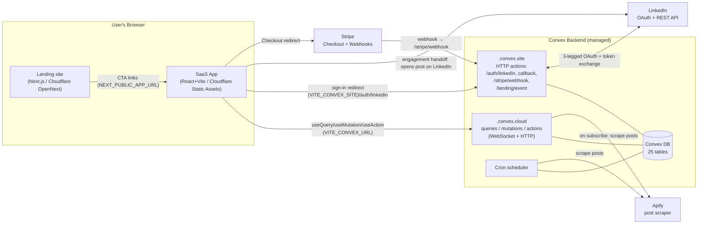

### Why OAuth runs through `.convex.site` (key design decision)

The LinkedIn `redirect_uri` points at **Convex** (`https://<deployment>.convex.site/auth/linkedin/callback`), **never**
at the React app. LinkedIn returns the authorization `code` to Convex, which exchanges it for tokens **server‑side**, so
the **client secret and the user's access/refresh tokens never touch the browser**. Convex then issues an opaque session
token and redirects the browser back to the app. This is the backbone of the [security model](#17-security-posture).

---

## 3. Tech Stack

- **Backend:** [Convex](https://convex.dev) `^1.33–1.34` — real‑time serverless TypeScript. Queries (reactive reads),
  mutations (transactional writes), actions (side‑effects/external fetch), HTTP actions, and cron jobs. Stripe via the
  official `@convex-dev/stripe` component.
- **App (`app/`):** React **19**, Vite **6**, TypeScript (strict), Tailwind CSS **4**,
  `react-router-dom` **7**, `convex/react` client, `i18next` **25** (en/pt/es), plus **shadcn/ui**
  primitives (`cmdk`, `@radix-ui/react-popover`, `lucide-react`) + `@tanstack/react-virtual` for the searchable
  industry/country comboboxes (`@/*` alias → `app/src`; theme tokens in `index.css`).
- **Landing (`landing/`):** Next.js **15** (App Router), React **19**, Tailwind CSS **4** (CSS-first,
  `@tailwindcss/postcss`), TypeScript.
- **Promo video (`video/`):** [Remotion](https://www.remotion.dev) **4.0.529**, React **19**, TypeScript. Renders the
  ad MP4s locally: 30 s in three formats (square for LinkedIn, 16:9 for YouTube, 9:16 for Shorts and TikTok) and a
  15 s cut in 4:5 and 9:16 for Meta and in 16:9 for Facebook and YouTube in-stream; nothing is deployed
  ([§15A](#15a-promotional-video-video)).
- **Payments:** Stripe (Checkout + Customer Portal + webhooks).
- **Post ingestion:** Apify REST API (`harvestapi~linkedin-profile-posts` actor) + manual user‑pasted post URLs.
- **Testing:** Vitest across all workspaces; React Testing Library + jsdom for the app; a custom
  `convex-mocks` shim for backend unit tests.
- **Tooling:** ESLint 9 (flat config, `--max-warnings 0`), Prettier (no‑semicolons, single‑quotes, 120 cols), pnpm
  workspaces.

---

## 4. Repository Layout

```
/
├── landing/                     # Next.js marketing site → Cloudflare Workers (OpenNext)
│   ├── app/
│   │   ├── globals.css          # Tailwind v4 CSS-first: @theme inline, :root/:dark tokens
│   │   └── [lang]/              # lang ∈ {en,pt,es} (default en)
│   │       ├── layout.tsx       # root <html>; inline no-flash script (cookie→localStorage→system)
│   │       ├── page.tsx         # home (composes section components)
│   │       ├── privacy/         # +content/{en,pt,es}.tsx — LinkedIn app-review requirement
│   │       ├── terms/           # +content/{en,pt,es}.tsx — LinkedIn app-review requirement
│   │       └── cookies/         # +content/{en,pt,es}.tsx — cookie & storage policy
│   ├── middleware.ts            # bare / or unprefixed path → locale redirect (cookie→Accept-Language→en)
│   ├── components/              # Nav, Hero, SSIExplainer, HowItWorks, Positioning, Features,
│   │                            #   Pricing, FAQ, FinalCTA, Footer, CookieNotice,
│   │                            #   ThemeToggle (3-state light/dark/system), LanguageSelector
│   ├── lib/
│   │   ├── cookies.ts           # SSR-safe cookie read/write (Next/process.env)
│   │   └── theme.ts             # resolveTheme / applyTheme / cookie get/set
│   └── next.config.js
│
├── app/                         # React + Vite SaaS dashboard → Cloudflare Workers (Static Assets)
│   ├── index.html               # mount point + pre-hydration theme guard (CSP is generated into dist/_headers
│   │                            #   by scripts/gen-headers.mjs, not an index.html meta tag)
│   ├── src/cloudflare-worker.ts # canonical-host 308, then delegation to the ASSETS binding
│   ├── vite.config.ts           # dev port 5174, inline Vitest config
│   └── src/
│       ├── main.tsx             # ConvexProvider + BrowserRouter bootstrap
│       ├── App.tsx              # routes + RequireAuth guard
│       ├── convex.ts            # re-export of convex/_generated/api
│       ├── pages/               # AuthSuccess, Feed, MyPosts, Settings, Billing, Admin
│       ├── components/          # PostCard, PostComposer, CommentBox, LinkedInEmbed,
│       │                        #   AppShell, Sidebar, TopBar, UserMenu, LanguageMenu,
│       │                        #   Modal, BannedScreen, BanUserDialog,
│       │                        #   UsersTab, PlanLimitsTab, RowActionsMenu, LoadingSpinner
│       └── i18n/                # i18next init + locales/{en,pt,es}.json
│
├── convex/                      # Convex backend (shared by both apps)
│   ├── schema.ts                # 25-table database schema
│   ├── convex.config.ts         # registers @convex-dev/stripe + @convex-dev/rate-limiter components
│   ├── crons.ts                 # the ONLY file Convex reads for scheduled jobs
│   ├── observability.ts         # runScheduled (every cron's entry) + the failed-run sweep → Sentry (§17A)
│   ├── http.ts                  # LinkedIn OAuth + Stripe webhook HTTP routes
│   ├── users.ts                 # getMe, subscription info, public identifier, logout
│   ├── sessions.ts              # session tokens + OAuth-state CSRF storage
│   ├── feed.ts                  # tier-gated feed query
│   ├── interactions.ts          # comment + react engagement counters (optimistic; client hands off to LinkedIn)
│   ├── posts.ts                 # submitPost, getMyPosts, weekly usage
│   ├── billing.ts               # Stripe Checkout + Customer Portal sessions
│   ├── stripe.ts                # webhook-driven subscription sync mutations
│   ├── admin.ts                 # admin queries/mutations (users, plan limits, ban)
│   ├── lib/
│   │   ├── auth.ts              # requireAuth / requireAuthAction / resolveSession / assertNotBanned
│   │   ├── planLimits.ts        # plan-limit lookup + tierToRank
│   │   ├── rateLimit.ts         # wraps @convex-dev/rate-limiter (fixed-window, per user+action)
│   │   └── sentry.ts            # backend errors → Sentry: one fetch per event, no SDK (§17A)
│   ├── linkedin/
│   │   ├── oauth.ts             # auth URL builder + token exchange + userinfo
│   │   ├── auth.ts              # upsertUser mutation
│   │   ├── parsePostUrl.ts      # /posts/… + /feed/update/… parser & lnkd.in shortlink resolver
│   │   ├── parsePostContent.ts  # HTML → text/media + shared-article link (extractArticleUrl) + article enrichment (parseArticle)
│   │   ├── verifyPostOwnership.ts
│   │   └── types.ts             # LinkedIn API response interfaces
│   ├── jobs/
│   │   ├── syncPosts.ts         # upsertPost mutation + feed-engagement refresh
│   │   ├── syncPostsApify.ts    # Apify scrape (per-user + fan-out)
│   │   └── processQueue.ts      # drains postQueue → posts when capacity opens
│   └── migrations/
│       └── seedPlanLimits.ts    # explicit (re-)seed of tier-default plan limits — optional, updateTierDefault self-heals
│
├── convex-mocks/                # Vitest mock for `convex/server` (backend unit tests)
├── video/                       # Remotion promo ad + sound, 30 s and 15 s, pt + en, 4 formats → video/out/*.mp4 (§15A)
├── docs/                        # planning/spec markdown + THIS document
├── README.md                    # quickstart (reconciled to code 2026-08-30 — see §19)
├── CLAUDE.md / AGENTS.md        # agent instructions
└── pnpm-workspace.yaml, tsconfig.base.json, eslint.config.js, .prettierrc
```

---

## 5. Data Model

All state lives in **Convex** (`convex/schema.ts`). There are **26 tables**. Every document also carries Convex‑managed
`_id` (`Id<table>`) and `_creationTime` (ms epoch) fields implicitly.

Convex `v.id('table')` fields are **logical foreign keys** — there is **no DB‑enforced referential integrity**;
consistency is maintained in application code.

### Entity relationships

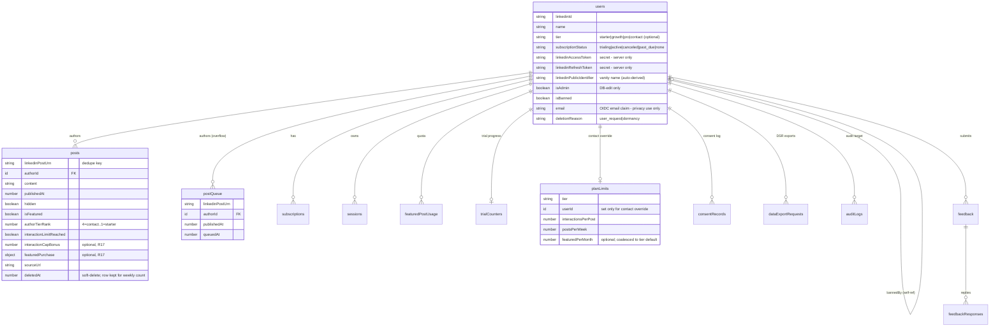

**R19 adds no table and no relationship line:** `users.referredByCode` → `users.inviteCode` is a self‑reference resolved
by the `by_invite_code` / `by_referred_by_code` indexes on **string codes**, not a `v.id('users')` foreign key — so an
inviter's erasure leaves the invitee's stamp behind as an inert code that resolves to nobody.

**R22 adds a table but still no relationship line:** `rankingSnapshots` is an aggregate board like `survivalSnapshots`.
Its top lists carry `v.id('users')` values so reads can join them, but there is no foreign key and no cascade; banned,
pending-deletion and opted-out members are dropped at read time, never at write time (see [§11](#11-feed--engagement)).

### Table reference

#### `users` — central identity / subscription / OAuth / admin record

One row per authenticated LinkedIn member. Inserted on first login (`linkedin/auth.ts:upsertUser`), patched thereafter
(profile, subscription, ban). Read almost everywhere.

| Field                         | Type                                                   | Req | Meaning                                                                                                                                                                                                                                                                                                                                                                                                             |
|-------------------------------|--------------------------------------------------------|:---:|---------------------------------------------------------------------------------------------------------------------------------------------------------------------------------------------------------------------------------------------------------------------------------------------------------------------------------------------------------------------------------------------------------------------|
| `linkedinId`                  | string                                                 | ✓  | LinkedIn member id (`sub` from OIDC). Lookup key (`by_linkedin_id`).                                                                                                                                                                                                                                                                                                                                                |
| `name`                        | string                                                 | ✓  | Display name.                                                                                                                                                                                                                                                                                                                                                                                                       |
| `headline`                    | string                                                 |  –  | LinkedIn headline.                                                                                                                                                                                                                                                                                                                                                                                                  |
| `profilePictureUrl`           | string                                                 |  –  | Avatar URL.                                                                                                                                                                                                                                                                                                                                                                                                         |
| `industry`                    | string                                                 |  –  | Drives feed targeting (Growth/Pro).                                                                                                                                                                                                                                                                                                                                                                                 |
| `country`                     | string                                                 |  –  | Drives feed targeting (Growth/Pro).                                                                                                                                                                                                                                                                                                                                                                                 |
| `profileEditedAt`             | number                                                 |  –  | Stamped by `users.updateProfile` (the Settings save) when the call carries `industry` or `country`. While absent, the auto-fills may write an **empty** `industry` (AI, from the member's own post) or `country` (browser time zone or language) via `users.fillGuessedProfileHandler`: valid codes only, never overwrites; once set, neither fill writes again. [§11C](#11c-profile-auto-fill-industry--country)   |
| `location`                    | string                                                 |  –  | Scraped LinkedIn display location (e.g. "Curitiba, Paraná, Brazil"). Read-only (profile scrape only).                                                                                                                                                                                                                                                                                                               |
| `primaryLocale`               | string                                                 |  –  | Scraped LinkedIn primary-locale **language** (e.g. "en"). Seeds the UI i18n language; not user-editable.                                                                                                                                                                                                                                                                                                            |
| `language`                    | string                                                 |  –  | UI language the member last chose (`'en'`/`'pt'`/`'es'`). The app persists every change through `users.setLanguage` (`app/src/hooks/useLanguageSync.ts`); `billingNode.createCheckoutSession` keeps a backstop write via `internal.users.setLanguageFromCheckout`. Read by the billing mailers. Distinct from `primaryLocale`. See [§8](#8-subscriptions--billing).                                                 |
| `billingNotice`               | string                                                 |  –  | One-shot billing notice key, rendered as a dismissible banner on `/billing` (only `'duplicate_canceled'` today). Set by the duplicate-subscription webhook, cleared by `users.clearBillingNotice`. Absent ⇒ no notice; a voided subscription is never silent.                                                                                                                                                       |
| `commentLanguage`             | string                                                 |  –  | Default language for AI-drafted comments: an ISO 639-1 code or `'auto'`. Absent ⇒ resolves to `'auto'` (match the post). User-set in Settings. Distinct from `primaryLocale`. See [§11A](#11a-ai-reaction--comment-assistance).                                                                                                                                                                                     |
| `defaultVisibilityIndustries` | string[]                                               |  –  | Pro/Contact-only. Industry-code allowlist copied onto every post this user authors from now on (`posts.visibilityIndustries`, set at insert time — not retroactive). Absent/empty ⇒ new posts are visible to everyone. Set via `users.setPostVisibility` (tier-gated server-side); a downgrade does **not** clear it. See [§11](#11-feed--engagement).                                                              |
| `defaultVisibilityCountries`  | string[]                                               |  –  | Pro/Contact-only. Country-code allowlist copied onto every post this user authors from now on (`posts.visibilityCountries`, set at insert time — not retroactive). Same semantics as `defaultVisibilityIndustries` above.                                                                                                                                                                                           |
| `feedFilterIndustries`        | string[]                                               |  –  | Pro/Contact-only. Industry-code allowlist that filters the viewer's **own** feed (`feed.getFeed` reads it off the viewer doc). Absent/empty ⇒ that dimension isn't filtered. Set via `users.setFeedFilter` (tier-gated server-side); a downgrade does **not** clear it. A "what I want to see" preference — distinct from the author-side `defaultVisibility*`. See [§11](#11-feed--engagement).                    |
| `feedFilterCountries`         | string[]                                               |  –  | Pro/Contact-only. Country-code allowlist filtering the viewer's own feed. ANDed with `feedFilterIndustries` (each list ORs internally). Same source/semantics as `feedFilterIndustries` above.                                                                                                                                                                                                                      |
| `leaderboardOptOut`           | boolean                                                |  –  | **R22** — set via `users.setLeaderboardOptOut`. Absent ⇒ the member appears in the site‑wide rankings. Hides only from rankings; the mutual interaction lists are unaffected.                                                                                                                                                                                                                                       |
| `digestEmailsEnabled`         | boolean                                                |  –  | **R24** — 3-day activity-digest preference. Absent ⇒ enabled (opt-out, not opt-in). Read/written by `users.getEmailPreferences` / `users.setDigestEmailsEnabled` (Settings → Emails) and set to `false` by the one-click endpoint and `users.unsubscribeByToken`. See [§8](#8-subscriptions--billing).                                                                                                              |
| `lastDigestAt`                | number                                                 |  –  | **R24** — timestamp of the member's last **successful** digest send (ms). Stamped only after `sendEmail` resolves without throwing, so a failed send retries on the next daily sweep; absent ⇒ due immediately.                                                                                                                                                                                                     |
| `tier`                        | `'starter'\|'growth'\|'pro'\|'contact'`                |  –  | Subscription tier. **Optional** → users with no tier are absent from the `by_tier` index.                                                                                                                                                                                                                                                                                                                           |
| `subscriptionStatus`          | `'trialing'\|'active'\|'canceled'\|'past_due'\|'none'` | ✓  | Stripe‑mirrored status; also admin‑overridable via `setUserSubscriptionStatus`. New users start at `none`; `trialing` begins on card-add (Stripe trial for the chosen tier — see §8); trialing users' posts are now **visible** in the feed. Engage access is granted for `{trialing, active, canceled}` — cancellation never revokes it (see `canEngage`).                                                         |
| `trialEndsAt`                 | number                                                 |  –  | Trial expiry (ms).                                                                                                                                                                                                                                                                                                                                                                                                  |
| `subscriptionEndsAt`          | number                                                 |  –  | Paid‑through instant (ms; Stripe `current_period_end`), mirrored on every sync + cancel. A **canceled** author's posts stay in the feed until `now ≥ subscriptionEndsAt`, then drop out (`isAuthorFeedEligible`). Does not affect engage access.                                                                                                                                                                    |
| `stripeCustomerId`            | string                                                 |  –  | Resolves Stripe webhooks → user (`by_stripe_customer`).                                                                                                                                                                                                                                                                                                                                                             |
| `linkedinAccessToken`         | string                                                 |  –  | **Secret.** Used to act as the user on LinkedIn. Never sent to clients.                                                                                                                                                                                                                                                                                                                                             |
| `linkedinRefreshToken`        | string                                                 |  –  | **Secret.** Refresh flow exists (dormant — Standard-tier OAuth issues no refresh_token; reconnect banner mitigates). See §7/§13.                                                                                                                                                                                                                                                                                    |
| `tokenExpiresAt`              | number                                                 |  –  | Access‑token expiry (ms).                                                                                                                                                                                                                                                                                                                                                                                           |
| `linkedinPublicIdentifier`    | string                                                 |  –  | LinkedIn vanity name, **auto‑derived (set‑once)** from the `author.url` of a name‑verified submitted post (`users.setDerivedPublicIdentifier`); never user‑typed. Seeds the Apify profile/post scrape. NOT the ownership check (that matches the post's author name against the OIDC `name`).                                                                                                                       |
| `isAdmin`                     | boolean                                                |  –  | **Set only by direct DB edit.** No application write path touches it.                                                                                                                                                                                                                                                                                                                                               |
| `isBanned`                    | boolean                                                |  –  | Ban flag; set/cleared by `banUser`/`unbanUser`.                                                                                                                                                                                                                                                                                                                                                                     |
| `bannedAt`                    | number                                                 |  –  | Ban timestamp.                                                                                                                                                                                                                                                                                                                                                                                                      |
| `bannedBy`                    | `id('users')`                                          |  –  | Admin who banned (self‑reference).                                                                                                                                                                                                                                                                                                                                                                                  |
| `bannedReason`                | string                                                 |  –  | User‑visible reason on the banned screen.                                                                                                                                                                                                                                                                                                                                                                           |
| `email`                       | string                                                 |  –  | Email from LinkedIn OIDC `email` claim. Used for DSR confirmations and breach notification. Not used for marketing.                                                                                                                                                                                                                                                                                                 |
| `deletionRequestedAt`         | number                                                 |  –  | When the user requested account deletion (ms). Erasure-audit-trail field — kept for compliance even though no query reads it back (`deletionScheduledAt` drives the actual cron/idempotency logic).                                                                                                                                                                                                                 |
| `deletionScheduledAt`         | number                                                 |  –  | When the hard-delete cron will purge this account (ms). Presence signals pending erasure.                                                                                                                                                                                                                                                                                                                           |
| `deletionReason`              | `'user_request'\|'dormancy'`                           |  –  | Why the deletion was scheduled.                                                                                                                                                                                                                                                                                                                                                                                     |
| `lastLoginAt`                 | number                                                 |  –  | Timestamp of most recent login (ms); updated on every `upsertUser` call. Powers the dormancy retention check.                                                                                                                                                                                                                                                                                                       |
| `acknowledgedPolicyVersion`   | string                                                 |  –  | Privacy-policy version string the user last accepted. Drives the re-consent prompt when it diverges from the current policy version.                                                                                                                                                                                                                                                                                |
| `consentPromptedAt`           | number                                                 |  –  | When the user completed the one-time consent prompt (ms). Unset ⇒ `ConsentPromptScreen` is shown on next login.                                                                                                                                                                                                                                                                                                     |
| `firstPostPromptedAt`         | number                                                 |  –  | When the first‑post onboarding step was resolved (ms) — set once by submitting any post (`posts.submitPost` → `users.markFirstPostPrompted`) or skipping (`users.dismissFirstPostPrompt`). Unset ⇒ `FirstPostPromptScreen` is shown after the consent gate (to every new member; the onboarding post is created hidden for no-card members, and everyone — card or not — lands on the feed afterward, per **R04**). |
| `inviteCode`                  | string                                                 |  –  | **R19** — the member's own invite code: 8 characters of `[a-z0-9]`, minted lazily by `users.getOrCreateInviteCode` on the first visit to Settings › Invite and **never reissued** (links people already shared must keep working). Unique by construction — the minting mutation checks `by_invite_code`, retries a collision once, then throws `ConvexError('INVITE_CODE_RETRY')`.                                 |
| `referredByCode`              | string                                                 |  –  | **R19** — the inviter's code this member joined through. Stamped **insert‑only** by `linkedin/auth.upsertUserHandler`, after a `by_invite_code` lookup proves the code belongs to a real member who is **not banned**; an unknown or banned‑inviter code is dropped, never stored, and an existing member logging in with a `ref` is unchanged. Drives `trialDaysFor` (14 days, not 7) and the Billing gift line.   |
| `createdAt`                   | number                                                 | ✓  | Creation timestamp (ms).                                                                                                                                                                                                                                                                                                                                                                                            |

Indexes: `by_linkedin_id [linkedinId]`, `by_stripe_customer [stripeCustomerId]`, `by_tier [tier]`,
`by_subscription_status [subscriptionStatus]` (active-subscriber fan-out for the Apify sync),
`by_token_expiry [tokenExpiresAt]` (retention cron targets expired tokens directly),
`by_deletion_and_last_login [deletionScheduledAt, lastLoginAt]` (compound — serves both the hard-delete sweep, ranging
the leading field, and the dormancy sweep, `eq(deletionScheduledAt,
undefined)` + range on `lastLoginAt`), `by_invite_code [inviteCode]` (**R19** — inviter lookup at
signup attribution and for `getMe`'s gift line), `by_referred_by_code [referredByCode]` (**R19** — the
"N joined through your link" count, bounded at `.take(101)`).

#### `posts` — the shared feed

Inserted by `jobs/syncPosts.upsertPost` (manual + Apify) and `jobs/processQueue` (queue promotion). Patched by
`stripe.ts` **and** `admin.setUserTier` (re‑stamp `authorTierRank` + `feedRank` on tier change, via the shared
`restampUserPostsTierRank` helper — which schedules a batched, self‑rescheduling re‑stamp so a high‑volume author never
exceeds one mutation's write budget), `interactions.ts`
(`interactionLimitReached`), and `posts.ts` (`setPostHidden` → `hidden`; `deletePost` → `deletedAt`). Every post writer
keeps the denormalized `feedRank` / `inFeed` fields in sync through the single
`computeFeedFields` helper (`lib/feedRank.ts`).

| Field                     | Type          | Req | Meaning                                                                                                                                                                                                                                                                                                                              |
|---------------------------|---------------|:---:|--------------------------------------------------------------------------------------------------------------------------------------------------------------------------------------------------------------------------------------------------------------------------------------------------------------------------------------|
| `linkedinPostUrn`         | string        | ✓  | LinkedIn URN; dedupe key (`by_urn`).                                                                                                                                                                                                                                                                                                 |
| `authorId`                | `id('users')` | ✓  | Post author.                                                                                                                                                                                                                                                                                                                         |
| `content`                 | string        | ✓  | Post text (composed text + appended media links).                                                                                                                                                                                                                                                                                    |
| `publishedAt`             | number        | ✓  | Publish time (ms); primary sort + 7‑day window key.                                                                                                                                                                                                                                                                                  |
| `likeCount`               | number        | ✓  | Reaction count. Seeded from LinkedIn on submit/sync (`parsePostEngagement` / Apify), then incremented on in‑app reactions.                                                                                                                                                                                                           |
| `commentCount`            | number        | ✓  | Comment count. Seeded from LinkedIn on submit/sync, then incremented on in‑app comments.                                                                                                                                                                                                                                             |
| `mediaUrls`               | string[]      | ✓  | Extracted media URLs (images, documents, and the shared‑article link when the post links a LinkedIn article).                                                                                                                                                                                                                        |
| `imageUrls`               | string[]      |  –  | Image‑typed media URLs only (subset of `mediaUrls`), captured at manual submit and sent to the AI as **vision input** (see [§11A](#11a-ai-reaction--comment-assistance)). Absent on synced/legacy posts.                                                                                                                             |
| `isFeatured`              | boolean       | ✓  | Pinned to top of feed.                                                                                                                                                                                                                                                                                                               |
| `featuredAt`              | number        |  –  | First feature timestamp and permanent per-post entitlement marker. It is retained when the post is unfeatured, so re-featuring never consumes another plan allowance; the feed orders featured posts by `publishedAt`, not this field (see [§10](#10-posts--content-pipeline)).                                                      |
| `visibilityIndustries`    | string[]      | ✓  | Author allowlist — only viewers in these industries see it. Copied from `users.defaultVisibilityIndustries` at insert time (empty when the author has none set); never edited after write — see [§11](#11-feed--engagement).                                                                                                         |
| `visibilityCountries`     | string[]      | ✓  | Author allowlist — only viewers in these countries see it. Copied from `users.defaultVisibilityCountries` at insert time (empty when the author has none set).                                                                                                                                                                       |
| `hidden`                  | boolean       | ✓  | `true` = excluded from feed (trial posts, un‑hidden on activation; also author/admin **Hide** via `setPostHidden`).                                                                                                                                                                                                                  |
| `authorTierRank`          | number        |  –  | Denormalized tier rank at write time (4=contact, 3=pro, 2=growth, 1=starter). Defaults to 1 in feed sort when absent.                                                                                                                                                                                                                |
| `interactionLimitReached` | boolean       |  –  | `true` once `likeCount+commentCount ≥ interactionsPerPost + interactionCapBonus` (the effective cap — see the row below); filtered out of feed.                                                                                                                                                                                      |
| `interactionCapBonus`     | number        |  –  | Per‑tier bonus added to the post's interaction cap when its featured slot is bought (starter +25, growth +50, pro +100, contact 0); written once at fulfilment so a later plan change can't move it. See [§8](#8-subscriptions--billing).                                                                                            |
| `featuredPurchase`        | object        |  –  | The one‑time Checkout purchase record (`checkoutSessionId`, `amountCents`, `paidAt`) written once by the `checkout.session.completed` webhook. Present ⇒ this post was bought, not earned by tier — re‑featuring is free and a redelivered webhook is a no‑op. See [§8](#8-subscriptions--billing).                                  |
| `sourceUrl`               | string        |  –  | Original submitted URL (preserved for correct back‑links; powers PostCard's "View on LinkedIn"). Absent for cron‑synced posts.                                                                                                                                                                                                       |
| `article`                 | object        |  –  | Best‑effort enrichment for a linked article (`{ url, title?, summary?, text?, author?, imageUrls }`, where `text` is the **full body**); see `lib/articleValidator.ts`. Feeds the AI reaction/comment prompts; not displayed. Absent when the post shares no article or enrichment failed.                                           |
| `suggestedReaction`       | enum          |  –  | AI‑predicted most‑likely reaction (`LIKE\|PRAISE\|EMPATHY\|INTEREST\|APPRECIATION\|ENTERTAINMENT`), set async after a **new** post is inserted (manual submit or Apify sync — a re‑synced/queued‑then‑promoted post does not get one). Absent ⇒ the UI picker treats it as `LIKE`. See [§11A](#11a-ai-reaction--comment-assistance). |
| `deletedAt`               | number        |  –  | Soft‑delete marker (`deletePost`). Excluded from feed + My Posts, but the row is **kept** so it still counts toward the weekly limit.                                                                                                                                                                                                |
| `feedRank`                | number        |  –  | Denormalized single feed sort key (featured→tier→recency); see `lib/feedRank.ts`. Backs the `by_in_feed_and_feed_rank` cursor index. Optional during rollout.                                                                                                                                                                        |
| `inFeed`                  | boolean       |  –  | `true` iff visible **and** under its interaction limit **and** not soft‑deleted. The filter column of `by_in_feed_and_feed_rank`.                                                                                                                                                                                                    |

Indexes: `by_author [authorId]`, `by_urn [linkedinPostUrn]`,
`by_author_and_publishedAt [authorId, publishedAt]`, and `by_in_feed_and_feed_rank [inFeed, feedRank]` which backs the
**live
cursor‑paginated feed** — `getFeed` reads via this index (`eq(inFeed, true)`, `feedRank`
desc). The older `by_featured`, `by_published`, and `by_feed` indexes were **removed** once the feed migrated to
`by_in_feed_and_feed_rank` (they had no remaining `withIndex` callers, and every index adds write amplification on this
high‑write
table). See
[feed-cursor-pagination-plan.md](feed-cursor-pagination-plan.md).

#### `subscriptions` — Stripe subscription mirror

Written by `stripe.ts` (`syncUserSubscription`, driven by the Stripe webhooks); read by `users.getSubscriptionInfo`
and by the internal readers in `billing.ts` (`listUserSubscriptions`, `getBillingContext`,
`getUserBySubscriptionId`) that back the checkout guard, the duplicate-subscription guard and the billing mailers
(see [§8](#8-subscriptions--billing)).

| Field                  | Type                                    | Req | Meaning                                                                                                                                                                                                                                                                                        |
|------------------------|-----------------------------------------|:---:|------------------------------------------------------------------------------------------------------------------------------------------------------------------------------------------------------------------------------------------------------------------------------------------------|
| `userId`               | `id('users')`                           | ✓  | Subscriber.                                                                                                                                                                                                                                                                                    |
| `stripeSubscriptionId` | string                                  | ✓  | Stripe sub id (`by_stripe_id`).                                                                                                                                                                                                                                                                |
| `tier`                 | `'starter'\|'growth'\|'pro'\|'contact'` | ✓  | Subscribed tier.                                                                                                                                                                                                                                                                               |
| `status`               | string                                  | ✓  | **Free‑form** raw Stripe status (not a constrained union here).                                                                                                                                                                                                                                |
| `currentPeriodEnd`     | number                                  |  –  | Period end (ms).                                                                                                                                                                                                                                                                               |
| `priceAmount`          | number                                  |  –  | Price snapshot from the webhook payload (`items.data[0].price.unit_amount`), in **minor units** (e.g. `15000`). Lets a billing email state the exact amount with no second Stripe call and no hardcoded price table that drifts the day pricing changes. Absent ⇒ the email renders no amount. |
| `priceCurrency`        | string                                  |  –  | ISO 4217, lowercase as Stripe sends it (e.g. `'usd'`).                                                                                                                                                                                                                                         |
| `priceInterval`        | string                                  |  –  | `'month'` or `'year'`, from `price.recurring.interval`.                                                                                                                                                                                                                                        |
| `cancelAtPeriodEnd`    | boolean                                 |  –  | Mirrors any scheduled cancel: `cancel_at_period_end` **or** `cancel_at` (the portal's shape; `isCancelPending`). **Stripe keeps `status: 'trialing'` after a mid-trial cancel**, so this alone stops the trial mailers and the 50-interaction conversion ([§8](#8-subscriptions--billing)).    |
| `stripeCreated`        | number                                  |  –  | Stripe's own `created` (ms). The duplicate-subscription guard voids the **newest** live row by this stamp, never by webhook arrival order, which Stripe does not guarantee (see [§8](#8-subscriptions--billing)). Absent on a row ⇒ it counts as the oldest and is never the one voided.       |
| `lastEventAt`          | number                                  |  –  | Stripe `created` (ms) of the newest webhook **event** applied to this row. `syncUserSubscription` / `markPastDue` skip an event older than it, so a late retry can never rewind `status` or re‑send the trial‑converted email (see [§8](#8-subscriptions--billing)). Absent ⇒ never stale.     |
| `pendingTier`          | `'starter'\|'growth'`                   |  –  | backlog/B07 — the tier a scheduled cross-tier downgrade moves to at the period end. Set when `billingNode` attaches the Stripe subscription schedule, cleared when the swap lands or the schedule is released. A mirror for the UI: the schedule on Stripe is the source of truth.             |
| `pendingAt`            | number                                  |  –  | backlog/B07 — when that pending change applies (ms), taken from the schedule second phase `start_date`. Absent ⇒ `BillingPage` falls back to `currentPeriodEnd`, which is the same instant on every schedule we write.                                                                         |

Indexes: `by_user [userId]`, `by_stripe_id [stripeSubscriptionId]`.

#### `planLimits` — tier limits + per‑user contact overrides

Tier‑default rows have **no `userId`**; override rows (contact tier only) set `userId`. Seeded by
`migrations/seedPlanLimits.ts`; read by `lib/planLimits.ts`; CRUD‑managed by `admin.ts`.

| Field                 | Type                                    | Req | Meaning                                                                                                                                                                                                                                                                          |
|-----------------------|-----------------------------------------|:---:|----------------------------------------------------------------------------------------------------------------------------------------------------------------------------------------------------------------------------------------------------------------------------------|
| `tier`                | `'starter'\|'growth'\|'pro'\|'contact'` | ✓  | Tier this row applies to.                                                                                                                                                                                                                                                        |
| `userId`              | `id('users')`                           |  –  | **Only** set for contact per‑user overrides.                                                                                                                                                                                                                                     |
| `interactionsPerPost` | number                                  | ✓  | Max likes+comments counted per post before lockout.                                                                                                                                                                                                                              |
| `postsPerWeek`        | number                                  | ✓  | Max posts admitted to feed per rolling 7 days.                                                                                                                                                                                                                                   |
| `featuredPerMonth`    | number                                  |  –  | Max `posts.featurePost` calls per UTC calendar month, enforced against `featuredPostUsage`. Optional — `getPlanLimitsHelper` coalesces a missing value to the tier's hardcoded default so unseeded/legacy rows keep working (widen‑then‑coalesce, no backfill migration needed). |

Indexes: `by_tier [tier]` (matches default **and** override rows — callers filter `userId===undefined`
in JS), `by_user [userId]`.

#### `postQueue` — weekly‑limit overflow buffer

Posts that couldn't be inserted because the author hit their weekly limit. Drained by the
`processQueue` cron when capacity reopens. Written by `syncPosts.upsertPost` (Apify path only).

| Field                                                                                     | Type          | Req  | Meaning                                          |
|-------------------------------------------------------------------------------------------|---------------|:----:|--------------------------------------------------|
| `linkedinPostUrn`                                                                         | string        |  ✓  | Dedupe key (`by_urn`).                           |
| `authorId`                                                                                | `id('users')` |  ✓  | Author (`by_author`).                            |
| `content`, `publishedAt`, `likeCount`, `commentCount`, `mediaUrls`, `hidden`, `sourceUrl` | —             | ✓/– | Snapshot carried so promotion needs no re‑fetch. |
| `queuedAt`                                                                                | number        |  ✓  | Enqueue timestamp (ms).                          |

On promotion, `authorTierRank` is recomputed and `interactionLimitReached` is derived from the queued engagement counts
against the author's cap (`hasReachedInteractionLimit`) — an already‑over‑cap queued post is promoted flagged (out of
feed).

#### `sessions` — app's own auth tokens

Random UUID tokens issued by `sessions.redeemAuthCode` when the SPA redeems a login code (see §7). **15‑day sliding
TTL** — the window is renewed on authenticated use once it passes the halfway mark, so active users stay logged in
while an idle (or stolen‑but‑unused) token dies 15 days after its last use. `SESSION_TTL_MS` in `convex/sessions.ts` is
the single source of truth; renewal lives in
`resolveSession` (mutation ctx) / `requireAuthAction` (via
`sessions.slide`).

| Field       | Type          | Req | Meaning                                                                                                                 |
|-------------|---------------|:---:|-------------------------------------------------------------------------------------------------------------------------|
| `token`     | string        | ✓  | Opaque session token (`by_token`).                                                                                      |
| `userId`    | `id('users')` | ✓  | Session owner (`by_userId`).                                                                                            |
| `expiresAt` | number        | ✓  | Expiry (ms). `by_expires_at` backs the indexed expired-session cleanup cron (range scan, not a full-table `.filter()`). |

#### `oauthStates` — CSRF nonces + PKCE challenge

Single‑use OAuth `state` values; ~10‑minute TTL; deleted only when the nonce + expiry + PKCE challenge validate (a
failed probe leaves the row for TTL cleanup). The row also carries the plan-selection the user
made on the landing page — and, since **R19**, the inviter's code — so both survive the OAuth redirect round-trip. A
callback that fails before the state validates stamps `failure` on the row once, for the sign-in funnel counters
([§12C](#12c-sign-in-funnel-metrics)).

| Field       | Type                         | Req | Meaning                                                                                                                                                                                                                                                                               |
|-------------|------------------------------|:---:|---------------------------------------------------------------------------------------------------------------------------------------------------------------------------------------------------------------------------------------------------------------------------------------|
| `state`     | string                       | ✓  | Random nonce (`by_state`).                                                                                                                                                                                                                                                            |
| `expiresAt` | number                       | ✓  | Expiry (ms). `by_expires_at` backs the indexed expired-state cleanup cron.                                                                                                                                                                                                            |
| `challenge` | string                       |  –  | PKCE-style SHA‑256 challenge (43‑char base64url) of the initiating browser's verifier — the binding that makes a handed-over login code inert. Optional **only** for deploy safety: rows minted before 2026‑09‑10 carry none and are rejected. See [§7](#7-authentication--identity). |
| `plan`      | `'starter'\|'growth'\|'pro'` |  –  | Tier chosen on the landing Pricing page before starting OAuth. Absent when OAuth is initiated without a plan selection (e.g. direct app link).                                                                                                                                        |
| `interval`  | `'monthly'\|'annual'`        |  –  | Billing interval chosen alongside `plan`. Absent when `plan` is absent.                                                                                                                                                                                                               |
| `ref`       | string                       |  –  | **R19** — invite code from the landing `?ref=`, checked by `isInviteCode` in `http.ts` before storing. See [§7](#7-authentication--identity).                                                                                                                                         |
| `failure`   | `oauthFailureValidator`      |  –  | Why a callback stopped before the state validated: `denied`, `linkedin_error`, `lost_cookie` or `rejected`. Set **once** by `authMetrics.recordOAuthFailure`, so a replay counts nothing; the row stays consumable for the real browser. See [§12C](#12c-sign-in-funnel-metrics).     |

#### `authCodes` — single-use login-code handoff

Minted by the OAuth callback (2‑minute TTL) and redeemed by the SPA with the PKCE verifier. The code travels in the
success redirect's fragment (`#code=…`) — the session token never does; redeem deletes the row on success, and a code
alone is inert without the verifier, which never leaves the initiating browser. Erasure‑cascaded with the owning user;
deliberately **not** part of the DSR export (a transient bearer credential). See [§7](#7-authentication--identity).
`isNew` is optional only for deploy safety: a code minted before it existed counts as a returning member
([§12C](#12c-sign-in-funnel-metrics)).

| Field       | Type                         | Req | Meaning                                                                                               |
|-------------|------------------------------|:---:|-------------------------------------------------------------------------------------------------------|
| `code`      | string                       | ✓  | Random UUID minted by the callback (`by_code`).                                                       |
| `userId`    | `id('users')`                | ✓  | Member the code will log in (`by_userId` — erasure cascade).                                          |
| `challenge` | string                       | ✓  | SHA‑256(verifier) base64url stored at login start — redeem re-derives it from the presented verifier. |
| `plan`      | `'starter'\|'growth'\|'pro'` |  –  | Pricing selection carried through OAuth (the redirect fragment also carries it for the SPA).          |
| `interval`  | `'monthly'\|'annual'`        |  –  | Billing interval carried alongside `plan`.                                                            |
| `isNew`     | boolean                      |  –  | `true` when this sign-in created the member; redeem bumps `signed_in_new`, else `_returning`.         |
| `expiresAt` | number                       | ✓  | Expiry (ms; `Date.now() + 2 min`). `by_expires_at` backs the indexed expired-code cleanup cron.       |

#### Rate‑limit counters — the `@convex-dev/rate-limiter` component

There is **no app `rateLimits` table**. Per‑user, per‑action fixed‑window counters live in the **
`@convex-dev/rate-limiter`** component's own isolated tables (mounted in `convex.config.ts`, consumed through
`lib/rateLimit.ts`). Keys are `(action, userId)` — plus the anonymous OAuth‑start and landing‑beacon dimensions
(`oauthStart`/`landingEvent` on the `global` key, `oauthStartClient`/`landingEventClient` per client bucket, §7);
each caller's window is passed inline. See **§11 — Rate limiting**.
Erasure clears a user's counters via `resetUserRateLimits` (see **§14 — Privacy & Compliance**).

#### `appSettings` — singleton global settings

Accessed via `.first()` (treated as a singleton; no index).

| Field                       | Type    | Req | Meaning                                                                                                   |
|-----------------------------|---------|:---:|-----------------------------------------------------------------------------------------------------------|
| `apifySyncEnabled`          | boolean | ✓  | Master toggle for the Apify post‑sync cron.                                                               |
| `apifyEnabled`              | boolean |  –  | **Master Apify kill-switch.** Absent ⇒ enabled. When false, all Apify (post sync + profile scrape) halts. |
| `apifyProfileScrapeEnabled` | boolean |  –  | Gates the LinkedIn profile scrape. Absent ⇒ disabled (opt-in; paid actor).                                |
| `lastApifySyncAt`           | number  |  –  | Last post‑sync timestamp (cron or manual "Sync all posts").                                               |
| `lastApifySyncError`        | string  |  –  | Last post‑sync error message.                                                                             |
| `lastProfileScrapeAt`       | number  |  –  | Last profile‑scrape fan‑out timestamp (manual "Sync all users").                                          |
| `lastProfileScrapeError`    | string  |  –  | Last profile‑scrape fan‑out error message.                                                                |

#### `featuredPostUsage` — per‑user monthly featured‑post quota

One row per `(userId, month)` that granted a plan feature entitlement to at least one previously unfeatured post.
Read and written by `posts.featurePost` / `posts.getFeaturedUsage` (backend/B07); the deletion cascade
(`privacy/deletion.ts`) also owns rows here. Each post increments usage only on its first feature: `featuredAt` is
retained through unfeature/re-feature, so that post can reuse the same allowance permanently.

| Field       | Type          | Req | Meaning                                                                                                                                                                |
|-------------|---------------|:---:|------------------------------------------------------------------------------------------------------------------------------------------------------------------------|
| `userId`    | `id('users')` | ✓  | Featuring user.                                                                                                                                                        |
| `month`     | string        | ✓  | UTC calendar month key, `"YYYY-MM"` (`lib/postLimit.ts:currentUtcMonthKey`) — UTC so the quota resets at the same instant for every user regardless of local timezone. |
| `usedCount` | number        | ✓  | Posts featured so far this month. Compared against `planLimits.featuredPerMonth` (`lib/postLimit.ts:isFeaturedLimitReached`).                                          |

Index: `by_user_id_and_month [userId, month]` — read with `.unique()` since a user has at most one row per month.

#### `consentRecords` — append-only consent/withdrawal log (GDPR)

One row per consent event. Current effective consent for a given `(userId, purpose)` pair is the **most recent** row for
that pair. `getConsents` reads the newest row per purpose directly with `by_user_and_purpose_and_created_at`
(`.order('desc').first()` per purpose) and resolves the map in pure code (`latestConsentByPurpose`) — there is no shared
row-count window that a frequently-toggled purpose could push the other purpose's latest grant out of. The `purpose`
union is intentionally narrow at launch (`'marketing' | 'analytics'`).

| Field           | Type                       | Req | Meaning                                                |
|-----------------|----------------------------|:---:|--------------------------------------------------------|
| `userId`        | `id('users')`              | ✓  | User who granted or withdrew consent.                  |
| `purpose`       | `'marketing'\|'analytics'` | ✓  | Consent purpose.                                       |
| `granted`       | boolean                    | ✓  | `true` = consent granted; `false` = consent withdrawn. |
| `policyVersion` | string                     | ✓  | Policy version in effect at time of consent event.     |
| `createdAt`     | number                     | ✓  | Event timestamp (ms).                                  |

Indexes: `by_user [userId]` (DSR export + account-deletion cascade),
`by_user_and_purpose_and_created_at [userId, purpose, createdAt]` (newest row per purpose for `getConsents`).

#### `dataExportRequests` — asynchronous data-export (Subject Access Request)

Tracks the lifecycle of data-export jobs. The generated bundle is stored in Convex file storage (`fileStorageId`); the
download link is short-lived (`expiresAt`). A retention cron purges expired records and their associated storage
objects.

| Field           | Type                                      | Req | Meaning                                                                         |
|-----------------|-------------------------------------------|:---:|---------------------------------------------------------------------------------|
| `userId`        | `id('users')`                             | ✓  | Requesting user (`by_user`).                                                    |
| `status`        | `'pending'\|'ready'\|'failed'\|'expired'` | ✓  | Job state.                                                                      |
| `requestedAt`   | number                                    | ✓  | When the request was received (ms).                                             |
| `fileStorageId` | `id('_storage')`                          |  –  | Convex storage id for the generated export bundle. Set when `status = 'ready'`. |
| `expiresAt`     | number                                    |  –  | When the download link/bundle expires (ms).                                     |

Indexes: `by_user [userId]`, `by_status [status]` — the latter lets the retention cron pull `'ready'`
exports via index instead of a full‑table `.filter()` scan.

#### `auditLogs` — accountability log (GDPR Art. 5 (2))

Append-only record of DSR actions, consent changes, and admin access to personal data. A pseudonymized subset is
retained past account deletion (actorId and targetUserId nulled out, action/metadata preserved).

| Field          | Type                        | Req | Meaning                                                                                                       |
|----------------|-----------------------------|:---:|---------------------------------------------------------------------------------------------------------------|
| `actor`        | `'user'\|'admin'\|'system'` | ✓  | Who triggered the action.                                                                                     |
| `actorId`      | `id('users')`               |  –  | Convex user id of the actor (absent for system-triggered events or after pseudonymization).                   |
| `action`       | string                      | ✓  | Structured action name (e.g. `'consent.granted'`, `'dsr.export_requested'`, `'admin.view_user'`).             |
| `targetUserId` | `id('users')`               |  –  | The user this action was performed on, if applicable.                                                         |
| `metadata`     | string                      |  –  | JSON-encoded additional context (e.g. `purpose`, `policyVersion`). Stored as string to avoid schema coupling. |
| `createdAt`    | number                      | ✓  | Event timestamp (ms).                                                                                         |

Indexes: `by_target [targetUserId]`, `by_created [createdAt]`.

#### `feedback` — user-submitted product feedback

One row per feedback submission. `userId` is cleared on account deletion (anonymization, not deletion). Replies live
entirely in the separate `feedbackResponses` table below (one row per admin reply) — the row itself never carries the
reply text.

| Field       | Type                                                                                                            | Req | Meaning                                  |
|-------------|-----------------------------------------------------------------------------------------------------------------|:---:|------------------------------------------|
| `userId`    | `id('users')`                                                                                                   |  –  | Submitter (cleared on account deletion). |
| `category`  | `'feature_request'\|'bug'\|'comment'\|'criticism'\|'praise'\|'question'\|'suggestion'\|'other'\|'cancellation'` | ✓  | Feedback category.                       |
| `message`   | string                                                                                                          | ✓  | Free-text feedback body (≤4000 chars).   |
| `status`    | `'new'\|'responded'\|'archived'`                                                                                | ✓  | Triage state.                            |
| `createdAt` | number                                                                                                          | ✓  | Submission timestamp (ms).               |

Index: `by_user [userId]`.

`cancellation` was added 2026‑09‑07 for the cancel flow (R09): it is written **only** by `CancelInterstitial`
([§8](#8-subscriptions--billing), [§14](#14-frontend--authenticated-app-app)) and is deliberately **not** offered in
`FeedbackModal`'s own category list — a member never picks it by hand. See [§12A](#12a-feedback).

#### `feedbackResponses` — append-only admin reply thread

Each row is one admin reply to a feedback item. Multiple rows per feedback item are allowed (threaded replies).

| Field         | Type             | Req | Meaning                     |
|---------------|------------------|:---:|-----------------------------|
| `feedbackId`  | `id('feedback')` | ✓  | Parent feedback item.       |
| `responderId` | `id('users')`    | ✓  | Admin who wrote this reply. |
| `text`        | string           | ✓  | Reply text.                 |
| `createdAt`   | number           | ✓  | Reply timestamp (ms).       |

Index: `by_feedback_id_and_created_at [feedbackId, createdAt]` (chronological per feedback item).

#### `motds` — admin Message of the Day

Admin-authored announcements. Exactly one is shown at a time: the newest `enabled` row. `enabled` is **materialized
schedule state** — admin writes derive it from the `[startAt, expiresAt)` window via the pure
`convex/motd/motd.ts:resolveMotdEnabled`, and the 5-minute `reconcileMotdWindows` cron re-derives it (enable a reached
`startAt`, disable a passed `expiresAt`) — so the viewer query needs no wall clock. An explicit quick-toggle disable
(`toggleMotdEnabled({ enabled: false })`) also **clears `startAt`/`expiresAt`** in the same patch, so the reconcile cron
cannot re-enable a row the admin just switched off. Hard-deleted on removal (admin content, not personal data).

| Field       | Type                     | Req | Meaning                                                                                                                                                        |
|-------------|--------------------------|:---:|----------------------------------------------------------------------------------------------------------------------------------------------------------------|
| `bodies`    | `record<string, string>` | ✓  | Locale code → markdown body. `en` required (validation) and is the fallback for missing locales.                                                               |
| `important` | boolean                  | ✓  | `false` → dismissible top banner; `true` → blocking modal (closable only via OK).                                                                              |
| `enabled`   | boolean                  | ✓  | Materialized schedule state: admin intent AND the `[startAt, expiresAt)` window (`resolveMotdEnabled`); maintained by the admin writes + 5-min reconcile cron. |
| `startAt`   | number                   |  –  | Optional scheduled start (ms). Absent ⇒ active immediately.                                                                                                    |
| `expiresAt` | number                   |  –  | Optional "limited date" (ms). Absent ⇒ never expires.                                                                                                          |
| `createdBy` | `id('users')`            | ✓  | Admin who created it.                                                                                                                                          |
| `createdAt` | number                   | ✓  | Creation timestamp (ms); also the tie-breaker for "newest active".                                                                                             |
| `updatedAt` | number                   | ✓  | Last-edit timestamp (ms).                                                                                                                                      |

Index: `by_enabled_and_created [enabled, createdAt]` — the viewer query walks `enabled=true` newest-first.

#### `userInteractions` — per-user engagement log

One row per reaction, comment, or **first AI comment draft** a user made on a post, written **inside**
`incrementLikeCount` / `incrementCommentCount` / `saveCommentDraft` (`convex/interactions.ts`) in the **same
transaction**
as any counter patch, so the log and the aggregate (`posts.likeCount` / `commentCount`) can never drift. This log is the
authoritative source for the **recap** (§11, `interactions.getRecap`) and the **history page** (§11,
`interactions.listMyInteractions`), and it powers the **DSR export** (§13B — included in the user's data bundle, deleted
in the erasure cascade).

| Field       | Type                                    | Req | Meaning                                                                         |
|-------------|-----------------------------------------|:---:|---------------------------------------------------------------------------------|
| `userId`    | `id('users')`                           | ✓  | Who reacted / commented / drafted (the "made" side).                            |
| `postId`    | `id('posts')`                           | ✓  | The target post.                                                                |
| `authorId`  | `id('users')`                           |  –  | The post's author at write time (the "received" side). Never set on `ai_draft`. |
| `kind`      | `'reaction' \| 'comment' \| 'ai_draft'` | ✓  | Which interaction this row records.                                             |
| `reaction`  | enum                                    |  –  | Reaction value (set when `kind === 'reaction'`).                                |
| `comment`   | string                                  |  –  | Submitted comment text (`'comment'`) or the generated draft (`'ai_draft'`).     |
| `createdAt` | number                                  | ✓  | Interaction timestamp (ms).                                                     |

`authorId` is **optional** because the field was added on 2026‑09‑07: rows written before that date carry no author and
are therefore invisible to the `by_author` read, i.e. excluded from every "received" count. Dev data is disposable and
prod has none, so no backfill was run (see [§19](#19-known-discrepancies-dead-code--roadmap) on the widen-not-backfill
convention). `ai_draft` rows (added 2026‑09‑11) never carry an `authorId`: generating a draft is the viewer's own
activity, not engagement the author received, so it stays out of `by_author` and the "received" recap entirely.

Indexes: `by_user [userId]` (DSR export, a user's activity, the history page), `by_post [postId]` (erasure cascade —
§13B), `by_author [authorId]` (the recap's "received" side).

#### `userPostState` — per- (user, post) engagement state

One lazily-created row per (user, post), distinct from the append-only `userInteractions` log. Holds **current** state:
`reactedAt` (set on the user's first reaction so a repeat doesn't double-count / double-bill — a member holds at most
one reaction per post), `commentedAt` / `hiddenAt` (the **R21** 24-hour feed-hygiene stamps, see
[§11](#11-feed--engagement)), `commentDraft` (the text the comment box reloads: the last AI draft, replaced by the
member's submitted text on submit) and `aiDraftedAt` (set on the first AI draft, the per-post dedupe for the counted
`ai_draft` interaction). Per-user data: included in the DSR export and deleted in the erasure cascade (§13B).

| Field          | Type          | Req | Meaning                                                                  |
|----------------|---------------|:---:|--------------------------------------------------------------------------|
| `userId`       | `id('users')` | ✓  | Owner of the state row.                                                  |
| `postId`       | `id('posts')` | ✓  | The target post.                                                         |
| `reactedAt`    | number        |  –  | Set on the first reaction; presence = already counted (dedup).           |
| `commentedAt`  | number        |  –  | **R21** — set by `incrementCommentCount` on the Comment tap.             |
| `hiddenAt`     | number        |  –  | **R21** — set by `interactions.hidePost`. No unhide.                     |
| `commentDraft` | string        |  –  | Text the comment box reloads (AI draft, replaced by the submitted text). |
| `aiDraftedAt`  | number        |  –  | First AI draft for this post — the counted `ai_draft` dedupe.            |

`commentedAt`, `hiddenAt` and `aiDraftedAt` are **widen-only, with no backfill**: rows written before their date
(2026‑09‑07
for the R21 stamps, 2026‑09‑11 for `aiDraftedAt`) have none, so a pre-existing reaction shows the R21 done footer only
because `reactedAt` was already there, comments recorded before that date do not, and a post whose draft was generated
before that date is not counted as an `ai_draft` interaction.

Indexes: `by_user_and_post [userId, postId]` — the dedup/draft lookups, the per-page R21 viewer-state read, and the
by-user DSR/erasure scan; `by_post [postId]` — erasure of other members' state on a deleted member's posts
(`privacy/deletion.ts`).

#### `trialCounters` — high-churn trial interaction counters

One row per trialing member, written by `incrementLikeCount` / `incrementCommentCount`
(`convex/interactions.ts`) in the **same transaction** as the `userInteractions` row. Kept off the
`users` document (plan 018): the counters were previously patched onto `users` on every interaction
while trialing, and a `users` patch invalidates every query that reads the member — `getMe` on every
authenticated request, and every open feed page containing one of their posts (`feed.getFeed` reads
post authors). The row is created lazily on the member's first trial interaction. The counters were
migrated off the legacy `users.trialInteractionsMade` / `users.trialInteractionsReceived` fields (those fields and
`migrations/moveTrialCounters.ts` no longer exist); this table is the only source
of truth. Readers:
`users.getTrialProgress` (the trial meter) and `internal.billing.getBillingContext` (the trial
emails).

| Field      | Type          | Req | Meaning                                         |
|------------|---------------|:---:|-------------------------------------------------|
| `userId`   | `id('users')` | ✓  | Trialing member (`by_user`).                    |
| `made`     | number        | ✓  | Interactions the member made while trialing.    |
| `received` | number        | ✓  | Interactions others made on the member's posts. |

Index: `by_user [userId]` — one row per member (read with `.unique()`; absent ⇒ 0/0). Included in the
DSR export and deleted in the erasure cascade ([§13B](#13b-privacy--compliance)).

#### `notifications` — in-app inbox (R23)

One row per **reaction or comment a member received on their post**, written by `incrementLikeCount` /
`incrementCommentCount` (`convex/interactions.ts`) in the **same transaction** as the post's counter patch and the
`userInteractions` insert, so the inbox, the aggregate and the log can never drift. Self‑interactions never write a
row; a repeat reaction can't either (the dedupe returns before any write). `readAt` absent ⇒ unread. The inbox is
private to its recipient — every read path authenticates through `requireAuth`, so a banned member cannot read theirs
at all, while the rows themselves stay in place ([§11](#11-feed--engagement)). `by_created_at` serves the 180‑day
retention purge; the DSR export and the erasure cascade cover both the recipient and the actor side
([§13B](#13b-privacy--compliance)). RCD widened `kind` with **`'record'`**: one self‑addressed row
(`recipientId = actorId =` the author) when the author's own post sets a new all‑time interaction best, carrying the
new `total` ([§11](#11-feed--engagement)).

| Field         | Type                                  | Req | Meaning                                                                |
|---------------|---------------------------------------|:---:|------------------------------------------------------------------------|
| `recipientId` | `id('users')`                         | ✓  | The post's author — who receives the notification.                     |
| `actorId`     | `id('users')`                         | ✓  | Who reacted or commented (the author themself on a `record` row).      |
| `postId`      | `id('posts')`                         | ✓  | The engaged post.                                                      |
| `kind`        | `'reaction' \| 'comment' \| 'record'` | ✓  | Which event this row records.                                          |
| `reaction`    | enum                                  |  –  | Reaction value (set when `kind === 'reaction'`).                       |
| `excerpt`     | string                                |  –  | Comment text, flattened and capped at 140 chars (`lib/recap.excerpt`). |
| `total`       | number                                |  –  | The new interaction total (set when `kind === 'record'`).              |
| `createdAt`   | number                                | ✓  | When the interaction happened (ms); the inbox's ordering key.          |
| `readAt`      | number                                |  –  | Set by `markRead` / `markAllRead`; absent ⇒ unread.                    |

Indexes: `by_recipient_and_created_at [recipientId, createdAt]` — the inbox page (newest first);
`by_recipient_and_read_at [recipientId, readAt]` — the unread count and the mark‑all drain; `by_actor [actorId]` —
erasure when the member is the actor; `by_created_at [createdAt]` — the retention purge.

#### `userRecords` — per‑post interaction bests (RCD)

One row per (author, post) that ever crossed the record floor (**5** combined interactions, `lib/recordPost.ts`).
`total` is the highest count seen so far — it tracks growth even during the cooldown — and `notifiedAt` is when the
last record notification was sent, which enforces the **7‑day** re‑notify cooldown. Upserted in the same transaction
as the counter bump that set the best (`interactions.maybeNotifyRecord`); **never written below the floor**. A row is
the author's own data (there is no counterparty), so the erasure cascade drains it by `by_user` and the DSR export
includes it ([§13B](#13b-privacy--compliance)).

| Field        | Type          | Req | Meaning                                                     |
|--------------|---------------|:---:|-------------------------------------------------------------|
| `userId`     | `id('users')` | ✓  | The post's author — the record holder.                      |
| `postId`     | `id('posts')` | ✓  | The post whose best this row tracks.                        |
| `total`      | number        | ✓  | Highest combined interaction count seen for that post.      |
| `notifiedAt` | number        | ✓  | When the last record notification for the post was written. |

Index: `by_user [userId]` — the author's records, read on every counter bump for that author's posts.

#### `survivalSnapshots` — nightly admin survival-panel aggregates

One row per cohort window (`7` and `28`), replaced in place by the `rebuild survival snapshots` cron
(`jobs/survivalSnapshot.ts`). This is a stored aggregate — neither user data nor an operational log; R22's
`rankingSnapshots` below is the other aggregate board. It holds the `summarizeCohort` output and the whole-table
`payingByTier` counts so `admin.survivalMetrics` reads one row instead of re-reading the cohort reactively
([§12](#12-admin--moderation)). No FK — the cohort counts deliberately carry no `userId`.

| Field          | Type      | Req | Meaning                                                                                                                                                                                                                                                  |
|----------------|-----------|:---:|----------------------------------------------------------------------------------------------------------------------------------------------------------------------------------------------------------------------------------------------------------|
| `days`         | `7 \| 28` | ✓  | The cohort window. Indexed `by_days`; the job replaces this row.                                                                                                                                                                                         |
| `generatedAt`  | number    | ✓  | Rebuild timestamp (ms) — the panel's "as of" caption.                                                                                                                                                                                                    |
| `since`        | number    | ✓  | Window start = `generatedAt − days × 24 h` (ms).                                                                                                                                                                                                         |
| `cohort`       | object    | ✓  | `CohortSummary` from `lib/survival.summarizeCohort`: counts + eligible denominators (§12). `onboarded` is optional in the schema so pre-upgrade rows keep validating; `toSurvivalMetrics` reads a missing value as `0` until the next rebuild writes it. |
| `payingByTier` | object    | ✓  | Active members per tier across the **whole** table.                                                                                                                                                                                                      |

Indexes: `by_days [days]` — the query's one-row lookup and the job's replace.

#### `rankingSnapshots` — daily site‑wide ranking board (R22)

One row per window (`7d` / `30d`) per daily generation, written by the two ranking‑snapshot crons
(`jobs/rankingSnapshot.ts`) and read by `rankings.getSiteRankings` ([§11](#11-feed--engagement)). Only user **ids** are
stored: the read joins `users` and drops banned, pending‑deletion and opted‑out members there. Each rebuild keeps the
newest **4** generations per window, so the board can show movement against the previous one. Both meta fields are
optional: generations written before the enrichment keep validating and the read defaults them to `0`. An admin can
force a rebuild for both windows through `admin.rebuildRankingSnapshotsNow` (Settings → Rankings board).

The job is a **single bounded pass** (the spec's cursor chain was not built): it reads the newest
`SNAPSHOT_ROW_CEILING` (**10,000**) `userInteractions` and `posts` rows, tallies in memory, writes one generation and
sets `partial` when either read hit that ceiling — a truncated board, never a wrong one. Both counts distributions are
additionally capped at `MAX_DISTRIBUTION` (**8,000**, headroom under Convex's 8,192-element array cap); dropping the
tail also sets `partial`, and a position beyond the cap reads as no position because `positionOf` returns `null` for a
count that is absent from the stored distribution. A live count **above** every stored count is different: it takes
position 1, because the member overtook the stored leader after the rebuild (`positionOf`'s fallback).

| Field                        | Type        | Req | Meaning                                                                                                                                                                                                   |
|------------------------------|-------------|:---:|-----------------------------------------------------------------------------------------------------------------------------------------------------------------------------------------------------------|
| `window`                     | `7d \| 30d` | ✓  | Board window. Indexed with `generatedAt`; a rebuild appends a generation, it never replaces one.                                                                                                          |
| `generatedAt`                | number      | ✓  | Rebuild timestamp (ms) — the generation's ordering key.                                                                                                                                                   |
| `since`                      | number      | ✓  | Window start = `generatedAt − window` (ms). A member's live count for the board is read against this instant.                                                                                             |
| `topPosters`                 | object[]    | ✓  | Up to 300 `{ userId, count, lastAt, reactionsReceived? }` — authors of posts published in the window (hidden and soft‑deleted posts excluded); `reactionsReceived` sums the in‑window posts' `likeCount`. |
| `topInteractors`             | object[]    | ✓  | Up to 300 `{ userId, count, lastAt, postsTouched? }` — made‑side interactions in the window (`ai_draft` and self‑interactions excluded); `postsTouched` counts distinct posts.                            |
| `posterCountsDescending`     | number[]    | ✓  | Every poster's count, descending. Lets the read place a member outside the top 300 exactly.                                                                                                               |
| `interactorCountsDescending` | number[]    | ✓  | Every interactor's count, descending — the distribution behind the caller's exact position.                                                                                                               |
| `partial`                    | boolean     | ✓  | `true` when either scan hit `SNAPSHOT_ROW_CEILING` **or** a counts distribution was capped at `MAX_DISTRIBUTION`.                                                                                         |

Index: `by_window_and_generated_at [window, generatedAt]` — the newest‑first read and the generation trim (keep 4).

#### `landingMetrics` — daily landing funnel counters

One row per **(UTC day, event)** — the landing site's first‑party funnel count. `landingMetrics.recordLandingEvent`
(internal) upserts the row (`count + 1`), deriving the day server‑side from `Date.now()`; only the cookieless beacon
`POST /landing/event` may call it ([§15](#15-frontend--landing-site-landing)). The five frozen event names are
`pricing_view` plus `cta_click_{hero|nav|pricing|final}`. The beacon carries no client‑side identifier; the only
visitor‑derived value is the daily‑rotated HMAC in `landingVisitors` (`uniqueCount` counts its first‑true flags for
that day). `landingMetrics.getMetrics` (admin‑only, [§12](#12-admin--moderation)) range‑reads the window through the
index and projects it via the pure `summarizeLandingMetrics` (the totals and unique sums plus all four placements
with zeros included), alongside `uniqueTrackingEnabled`.

| Field         | Type                                                                                      | Req | Meaning                                                                                                     |
|---------------|-------------------------------------------------------------------------------------------|:---:|-------------------------------------------------------------------------------------------------------------|
| `day`         | `"YYYY-MM-DD"` (UTC)                                                                      | ✓  | Server‑derived day bucket. Leading half of the compound index.                                              |
| `event`       | `pricing_view \| cta_click_hero \| cta_click_nav \| cta_click_pricing \| cta_click_final` | ✓  | The frozen event name.                                                                                      |
| `count`       | number                                                                                    | ✓  | Events recorded for that (day, event) — increments by one per beacon.                                       |
| `uniqueCount` | number                                                                                    |  –  | Visitors whose flag for this event first became true that day. Optional (legacy rows lack it); read as `0`. |

Index: `by_day_and_event [day, event]` — the upsert's exact lookup and the admin window's `q.gte('day', sinceDay)`
range. No separate `by_day` index: the compound index's day prefix serves the range (dead indexes are a tracked issue).

#### `landingVisitors` — daily unique‑visitor dedup rows

One row per **(UTC day, visitor key)**. The key is
`hex(HMAC‑SHA256(secret, "landing-visitor:" + day + ":" + ip + ":" + ua)).slice(0, 32)`, computed **server‑side in the
HTTP action** (`convex/lib/landingVisitorKey.ts`) from the first `x-forwarded-for` hop and the `user-agent` header —
never a raw IP or user‑agent (besides the hash, the only visitor‑derived mutation argument is the IP the rate-limit
mutation reduces to a bucket without storing it), and never anything the browser sent. The five boolean flags mark which
events the visitor became unique for
that day, so a
visitor who clicked hero and pricing counts once under **each** event but never twice for one. Uniqueness deliberately
resets at the UTC day boundary, and the daily `prune landing visitors` cron deletes every row from before the current
UTC day, so none outlives 48 hours ([§12](#12-admin--moderation), [§13](#13-scheduled-jobs-crons)) — only the integer
aggregates in `landingMetrics`
survive. `secret` is `LANDING_METRICS_SECRET || UNSUBSCRIBE_SECRET` (an empty value counts as unset); with no secret (or
no IP) there is no key, totals still count and uniques do not ([§16](#16-environment-variables)).

| Field             | Type    | Req | Meaning                                                                   |
|-------------------|---------|:---:|---------------------------------------------------------------------------|
| `day`             | string  | ✓  | The UTC day the hash was derived for. Leading half of the compound index. |
| `visitorKey`      | string  | ✓  | 32‑char lowercase hex HMAC of day+IP+User‑Agent, truncated.               |
| `pricingView`     | boolean | ✓  | Visitor counted as unique for `pricing_view` that day.                    |
| `ctaClickHero`    | boolean | ✓  | Visitor counted as unique for `cta_click_hero` that day.                  |
| `ctaClickNav`     | boolean | ✓  | Visitor counted as unique for `cta_click_nav` that day.                   |
| `ctaClickPricing` | boolean | ✓  | Visitor counted as unique for `cta_click_pricing` that day.               |
| `ctaClickFinal`   | boolean | ✓  | Visitor counted as unique for `cta_click_final` that day.                 |

Index: `by_day_and_visitor_key [day, visitorKey]` — serves both the in‑transaction dedup lookup (exact day+key) and
the prune's `q.lt('day', cutoffDay)` range. One compound index, no second index (dead indexes are a tracked issue).
Write path: `landingMetrics.recordLandingEvent` (insert on first sight, else patch the event's flag to true) in the
same transaction as the `landingMetrics` upsert.

#### `authMetrics` — daily sign-in funnel counters

One row per **(UTC day, event)** holding a count, and nothing that identifies a member, a browser or an attempt. Every
write goes through `lib/authMetrics.bumpAuthMetric`, inside the transaction of the sign‑in step it counts, so a step
that rolls back counts nothing: `sessions.createOAuthState`, `createAuthCode` and `redeemAuthCode` bump the success
events, and the internal `authMetrics.recordOAuthFailure` / `recordOAuthError` (called only by the OAuth callback) the
failures. `authMetrics.getMetrics` (admin‑only) range‑reads the window. See [§12C](#12c-sign-in-funnel-metrics).

| Field   | Type                       | Req | Meaning                                                                                                                                                                                                                     |
|---------|----------------------------|:---:|-----------------------------------------------------------------------------------------------------------------------------------------------------------------------------------------------------------------------------|
| `day`   | `"YYYY-MM-DD"` (UTC)       | ✓  | Server‑derived day bucket. Leading half of the compound index.                                                                                                                                                              |
| `event` | `authMetricEventValidator` | ✓  | One of the ten events: `started`, `linkedin_ok_new`, `linkedin_ok_returning`, `signed_in_new`, `signed_in_returning`, `denied`, `linkedin_error`, `lost_cookie`, `rejected`, `error` ([§12C](#12c-sign-in-funnel-metrics)). |
| `count` | number                     | ✓  | Steps counted for that (day, event); every bump adds one.                                                                                                                                                                   |

Index: `by_day_and_event [day, event]` — the bump's exact lookup and the admin window's `q.gte('day', sinceDay)` range,
as on `landingMetrics`. No retention job: the rows are integer counts only.

---

## 6. Backend Architecture & Conventions

### Convex function kinds used here

| Kind         | Reactive? | DB access                           | External fetch | Used for                                                           |
|--------------|-----------|-------------------------------------|----------------|--------------------------------------------------------------------|
| `query`      | ✓ (live) | `ctx.db` read                       | ✗             | reads (feed, getMe, usage)                                         |
| `mutation`   | –         | `ctx.db` read/write (transactional) | ✗             | writes (upsert, ban, plan limits)                                  |
| `action`     | –         | via `ctx.runQuery/runMutation`      | ✓             | LinkedIn/Stripe/Apify calls (submitPost, comment, react, checkout) |
| `internal*`  | –         | as above                            | as above       | server‑only; not callable from clients                             |
| `httpAction` | –         | via `ctx.run*`                      | ✓             | OAuth routes + Stripe webhook + landing beacon (`http.ts`)         |
| cron         | –         | mutation/action                     | as above       | scheduled jobs (`crons.ts`)                                        |

### Auth helper pattern (every protected function uses it)

Clients **never** pass a `userId`. They pass a `sessionToken`; the server resolves it. All helpers live in
`convex/lib/auth.ts`:

- `resolveSession(ctx, token)` → `Doc<'users'> | null` — resolves token → user **without** ban enforcement. Used by
  `getMe` so a banned user gets an `isBanned` signal (not `null`). In a **mutation** ctx it also slides the session's
  expiry forward once past the halfway mark (a query ctx is read‑only and skips the write). Its `Date.now()` is a
  deliberate **security exception** to the Convex "no wall clock in queries" guideline: session expiry MUST be
  server-authoritative — a client-supplied `now` would let a caller extend their own session (see
  [§11](#11-feed--engagement) for the documented query-clock exceptions).
- `requireAuth(ctx, token)` → `Doc<'users'>` — for queries/mutations. Throws `'Unauthorized'` if the token is
  missing/expired/invalid; throws `'Account suspended'` if banned.
- `requireAuthAction(ctx, token)` → `Doc<'users'>` — same for actions (resolves via
  `ctx.runQuery(internal.sessions.getByToken)` + `internal.users.getWithTokens`, returning the token‑bearing record).
  Slides the session forward (past halfway) via `ctx.runMutation(internal.sessions.slide)`, since actions can't write
  directly.
- `assertNotBanned(user)` — the single definition of "what a ban blocks"; called by both
  `requireAuth*`.

### Error‑handling convention (system‑wide)

- **Reads soft‑fail:** `getMe`, `getFeed`, `getMyPosts`, `getWeeklyUsage`, `getSubscriptionInfo`,
  `checkIsAdmin` catch auth errors and return `null` / `[]` / `false` rather than throwing.
- **Writes hard‑fail:** mutations/actions throw on the unhappy path.
- **User‑facing messages throw `ConvexError(message)`** — its payload is the one thing Convex delivers to the client
  intact in **production** (plain `Error` messages are redacted there). Used for validation, ownership/authorization,
  not‑found, and plan‑limit/gate messages across every function the app surfaces to a user or admin: `submitPost` and
  the
  `posts` mutations, `reactToPost`/`commentOnPost`, `generateComment`, `createCheckoutSession`/`createPortalSession`,
  `updateProfile`/`setPostVisibility`/`setCommentLanguage`/`refreshProfileFromLinkedIn`, the admin mutations (sync,
  `setContactUserLimit`, `setUserTier`, `setUserSubscriptionStatus`, ban/unban, `validateLimitArgs`), the
  `feedback` mutations, the `motd` validation/not‑found guards, `linkedin/verifyPostOwnership`, the `lib/auth.ts`
  `requireAuth`/`requireAuthAction`/`assertNotBanned` guards, `admin.assertAdmin` + the Apify‑trigger flag gate, the DSR
  `Unauthorized` guards (`privacy/consent.ts`, `privacy/export.ts`, `privacy/deletion.ts`), and the
  `assertCanEngage`/`assertCanRefresh` gate helpers. The card‑gate sentinel
  `assertCanEngage` throws `ConvexError('PAYMENT_REQUIRED: …')` so the feed can still detect it by prefix in production.
  `posts.submitPost`/`featurePost` use the same `PREFIX:value` shape for the weekly/featured plan-limit throws —
  `` `WEEKLY_LIMIT:${postsPerWeek}` `` / `` `FEATURED_LIMIT:${featuredPerMonth}` `` — carrying the numeric cap rather
  than
  English prose, so a production redaction can't strip the number the UI needs; the client's `mapLimitError` (below)
  matches the prefix and localizes it (see [§9 "Upgrade at the limit"](#9-plan-limits-system)).
- **Internal invariants and external‑call failures throw plain `Error`** (e.g. `Failed to upsert post`, missing
  `STRIPE_SECRET_KEY`) — deliberately redacted in production and **logged server‑side with the real error**, surfaced to
  clients as generic sanitized messages (see [§17](#17-security-posture)).
- **Frontend display:** catch sites never render `err.message` directly — Convex frames it as
  `[CONVEX …] Server Error Uncaught Error: <msg> at handler (…) Called by client` (and redacts `<msg>` in production).
  All UI catch handlers pass the error through `friendlyError(err, fallback)`
  (`app/src/lib/errors.ts`), which unwraps `ConvexError.data`, strips the frame off dev messages, and falls back to a
  caller‑supplied string when nothing readable remains. The composer's and My Posts' catch sites additionally pipe that
  result through `mapLimitError(msg, t)` (same file), which recognizes the `WEEKLY_LIMIT:<n>`/`FEATURED_LIMIT:<n>`
  prefixes above and swaps them for the localized `errors.weeklyLimit`/`errors.featuredLimit` copy naming the cap;
  anything else (an already‑friendly message, or a code it doesn't recognize) passes through untouched.
- **Reporting follows the same split:** a `ConvexError` is an answer the backend chose, anything else is a fault.
  `friendlyError` hands every non‑`ConvexError` to Sentry (`captureException`) before it picks the message, so a
  production "Server Error" still arrives with the request ID that finds its lines in the Convex logs. The one
  exception is the Convex client's "Connection lost while action was in flight", which a dropped WebSocket gives any
  action in flight: the member's network, so Sentry's `ignoreErrors` drops it ([§17](#17-security-posture)). The
  backend reports the faults no browser sees ([§17A](#17a-backend-error-reporting)).

### LinkedIn member‑API calls

All authenticated requests to `api.linkedin.com` (Bearer = the user's token) route through the single
`linkedin/client.ts` `callMemberApi` seam, which owns the `Authorization` header, the
`Content-Type` header (when a body is present), and the log-real-error → throw-sanitized error policy. Only the OAuth
token exchange (`exchangeCodeForTokens`) calls LinkedIn directly — it targets
`www.linkedin.com` with a `client_secret` form‑POST and is a different auth shape.

### Type‑shim landscape

The former `convex/convexTypes.ts` hand‑mirror of `DataModel`/`ctx`/`db` shapes has been **removed**; all backend code
now imports generated `Doc<>`/`Id<>`/`QueryCtx`/`MutationCtx`/`ActionCtx` from
`convex/_generated/`. Two intentional patterns remain:

1. **Test mock seam.** `convex/lib/audit.ts` and `convex/linkedin/auth.ts` import
   `internalMutationGeneric`, and the jobs (`jobs/syncPostsApify.ts`, `jobs/scrapeProfileApify.ts`,
   `jobs/refreshFeedEngagement.ts`) import `internalActionGeneric`, from `convex/server` (the
   registration generic the `convex-mocks` Vitest alias replaces). The jobs additionally cast
   `ctx as unknown as ActionCtx` using the **generated** `ActionCtx`, and each fan‑out handler
   annotates its return type (`Promise<void>`) to break the same‑file `internal.*` type cycle that the
   precise generated ctx would otherwise introduce. `convex/lib/audit.ts` also exports the shared
   structural `AuditDb` type (`insert(table, doc): Promise<string>`); every `writeAuditLog` call site
   casts `ctx.db` to it, so the audit‑write seam has exactly one definition.
2. `app/src/convex.ts` — re‑exports `{ api }` from `convex/_generated/api` for a stable app‑side import path.

---

## 7. Authentication & Identity

LinkedIn **3‑legged OAuth 2.0 (OIDC)**, brokered entirely by Convex HTTP actions so secrets stay server‑side. After
OAuth the app uses its **own opaque session tokens**.

- **Scopes requested** (`convex/linkedin/oauth.ts`): `openid profile email` — the only Standard‑tier product (Sign In
  with LinkedIn / OIDC), so **every** LinkedIn member can authenticate. No
  `w_member_social*` / `r_basicprofile`: the app makes **no LinkedIn API writes** (react/comment happen on LinkedIn via
  the handoff, §11), and those scopes are Development‑tier/ungranted — requesting them throws
  `unauthorized_scope_error` for anyone without a role on the app (i.e. breaks login for all non‑team users).
- **OAuth endpoints:** authorize `https://www.linkedin.com/oauth/v2/authorization`, token
  `https://www.linkedin.com/oauth/v2/accessToken`, userinfo `https://api.linkedin.com/v2/userinfo`
  (OIDC; replaces the deprecated `/v2/me`).
- **CSRF + PKCE binding:** a random `state` is stored in `oauthStates` (10‑min TTL) before redirect and is single‑use
  validated on callback — the browser nonce, expiry, and PKCE challenge are checked **before** the row is deleted, so a
  failed (wrong‑nonce/expired/challenge‑less) probe cannot burn the legitimate browser's in‑flight state; only a fully
  valid presentation consumes it, and expired rows are TTL‑cleaned. It is **bound to the initiating browser** by a
  second random nonce: `/auth/linkedin` sets it as an `HttpOnly; Secure; SameSite=Lax` cookie **namespaced per state**
  (`oauth_nonce_<state>`, 10‑min `Max‑Age`, `Path=/`) so concurrent logins in one browser don't overwrite each other;
  the row stores the matching `browserNonce`, and the callback rejects the flow unless the presented
  `oauth_nonce_<state>` cookie matches — a captured callback URL alone cannot log a victim into the attacker's account.
  That per‑state cookie is cleared (`Max-Age=0`) on every callback redirect. The start route additionally **requires**
  `?vc=<challenge>` (SHA‑256 of the app‑generated verifier, 43‑char base64url) and rejects a direct hit without one with
  a 400; the challenge is stored on the same row, so the login code the callback mints can only be redeemed by the
  browser holding the verifier. `/auth/linkedin` is rate‑limited at **60/hour per client** (best-effort
  `x-forwarded-for`
  key) plus a **global 1800/hour backstop** (`checkOAuthStartBudget`) to bound `oauthStates` growth — the global limit
  is
  what actually does the bounding, since the header is untrusted/spoofable — and every OAuth redirect sets
  `Cache-Control: no-store` so a code‑bearing 302 is never cacheable.
- **Session token:** a random UUID stored in `sessions` (**15‑day sliding TTL** — renewed on authenticated use past the
  halfway mark; `SESSION_TTL_MS` is the source of truth) and **never carried in a URL**. The OAuth callback redirects
  with a single‑use, 2‑minute login code in the fragment (`#code=…`); the SPA redeems it through
  `sessions.redeemAuthCode({ code, verifier })`, presenting the PKCE verifier it generated at `/auth/start` and kept in
  **`sessionStorage`** (key `oauthVerifier`). The token comes back over the Convex transport and is stored in
  `sessionStorage` (key `sessionToken`).
- **Sign‑out:** the app auto‑starts OAuth for any unauthenticated visit (see `RequireAuth`, §14), and LinkedIn keeps its
  own SSO session — so a naive sign‑out is silently re‑authenticated. Sign‑out therefore sets a **persistent `signedOut`
  marker** (`localStorage`, `lib/session.ts`) _before_
  calling `users.logout`, drops the local `sessionToken`, and redirects to the **marketing/landing site**
  (`VITE_LANDING_URL` — the separate Next.js app at its own origin, see §15). The marker does two jobs: **(1)** it wins
  the race against the **reactive** `getMe → null` that `users.logout`
  triggers while the SPA is still mounted (which would otherwise trip `RequireAuth`'s auto‑OAuth and silently re‑log the
  user in via LinkedIn SSO → `/auth/success` → `/feed`); and **(2)** it **persists across the return visit**, so when a
  signed‑out user navigates back to the app
  `RequireAuth` bounces them to the landing site instead of auto‑logging them in. It is cleared on the next successful
  login (`AuthSuccessPage`, and only when a session token was actually captured), so "auto‑redirect for login" resumes
  for fresh/expired sessions. To log back in, the
  landing site's CTAs point at the app's **`/auth/start`** route (`${NEXT_PUBLIC_APP_URL}/auth/start`, §15) — not the
  app root — so a signed‑out visitor doesn't ping‑pong
  between the landing site and the app; `/auth/start` generates the PKCE verifier/challenge and bounces to Convex. All
  three sign‑out buttons (`UserMenu`,
  `BannedScreen`, `CancelDeletionScreen`) route through the shared `performSignOut()` helper in
  `app/src/lib/session.ts`, which `await`s `users.logout` to invalidate the session server‑side.

### OAuth login flow

Login starts in the app at **`/auth/start`**: the browser generates a 32‑byte random verifier (base64url, kept in
`sessionStorage.oauthVerifier`), derives `SHA-256(verifier)` base64url, and navigates to
`${CONVEX_SITE_URL}/auth/linkedin?vc=<challenge>` — plus the optional `plan`, `interval` and `ref` the landing appended
to the start URL (the landing Pricing CTAs, and — for `ref` — `TrialProvider`, now point at
`${NEXT_PUBLIC_APP_URL}/auth/start`, see [§15](#15-frontend--landing-site-landing)). The `/auth/linkedin` start handler
reads that `vc` and rejects a missing/malformed challenge with a 400 — every login is initiated with one — and reads the
optional `plan`, `interval` and `ref` query parameters.
The `plan` value is validated against the allowed tier list (`starter|growth|pro`); `ref` is kept only when
`isInviteCode(ref)` matches `/^[a-z0-9]{8}$/` (`lib/invite.ts`). All of them are stored on the `oauthStates` row via
`sessions.createOAuthState`, so they survive the LinkedIn redirect round-trip. The handler also mints a random
`browserNonce`, stores it on the same row, and sets it as an `HttpOnly; Secure; SameSite=Lax` cookie
(`oauth_nonce_<state>`, 10‑min `Max‑Age`, namespaced per state so concurrent logins don't clobber each other); the
callback requires the matching `oauth_nonce_<state>` cookie and clears it. Every OAuth redirect carries
`Cache-Control: no-store`. The route is rate‑limited **per client (60/hour) with a global 1800/hour backstop**
(`checkOAuthStartBudget`) because its caller is anonymous; the global limit is what actually bounds `oauthStates`
growth. The per-client key is `clientBucket()` of the best-effort `x-forwarded-for` value, one of 4096 FNV-1a buckets
and never the IP itself: the rate-limiter component keeps one row per key until a manual reset, so an IP key would
store every caller's address indefinitely. The browser‑nonce cookie mechanism is unchanged; what changed is token
delivery:
the callback no longer creates a session — it mints a single‑use, 2‑minute **login code** bound to the stored challenge,
and only the browser that holds the verifier can redeem it (below).

**Referral attribution (R19)** is a four-hop chain, and every hop can drop the code without failing the login:

1. The landing's `TrialProvider` renders every trial link with the selected plan, interval, and valid `ref` code.
2. `http.ts` keeps it only when the **shape** matches; anything else becomes `undefined`.
3. The callback passes `referredByCode: oauthState.ref` to `upsertUser`.
4. `upsertUserHandler` stamps it **on insert only**, and only after a `by_invite_code` lookup proves the code belongs to
   a real member who is **not banned** — a banned member's link mints nothing. An **existing** member who signs in
   through someone's link is untouched: attribution is a property of the account's creation, not of a session.

**Where a failed sign-in lands.** Every callback failure redirects to the app's public
`${APP_URL}/auth/error?reason=denied|failed` (nonce cookie cleared, `no-store`). `denied` is reserved for LinkedIn's
`user_cancelled_login` / `user_cancelled_authorize`; every other LinkedIn `error` code, a missing `code`, a missing or
malformed `state`, a missing cookie, a rejected state and a throw after the state was consumed all send `failed`.
`/auth/error` sits outside `RequireAuth` on purpose ([§14](#14-frontend--authenticated-app-app)). The old target,
`APP_URL/?error=oauth_failed`, fell through `*` → `/feed` → `RequireAuth`, whose auto‑OAuth restarted the sign-in, so
a member who had just canceled on LinkedIn was sent straight back to it. Each failure is also counted, best effort, in
the sign-in funnel ([§12C](#12c-sign-in-funnel-metrics)).

```mermaid
sequenceDiagram
    participant U as User (browser)
    participant LP as Landing (TrialProvider / Pricing CTA)
    participant CV as Convex .site (http.ts)
    participant LI as LinkedIn
    participant DB as Convex DB
    participant A as App (React)
    LP ->> A: /auth/start?plan=growth&interval=annual&ref=k3p9x2ab
    Note over LP, A: plan/interval/ref all optional — absent on direct app link
    A ->> A: verifier = 32 random bytes → sessionStorage.oauthVerifier<br/>challenge = SHA-256(verifier) base64url
    A ->> CV: /auth/linkedin?vc=<challenge>&plan=…&interval=…&ref=…
    Note over CV: vc missing/malformed ⇒ 400 Invalid login request.
    CV ->> CV: isInviteCode(ref) ? ref : undefined
    CV ->> DB: checkOAuthStartBudget() — per-client 60/hour + global 1800/hour backstop
    CV ->> DB: createOAuthState(state, browserNonce, challenge, +10min, plan?, interval?, ref?) · bumps started
    CV -->> U: 302 → LinkedIn authorize?scope=…&state<br/>Set-Cookie: oauth_nonce_<state> (HttpOnly; Secure; SameSite=Lax; 10min)
U ->> LI: authenticate & consent
Note over LI, CV: ?error=user_cancelled_* ⇒ recordOAuthFailure(denied) → APP_URL/auth/error?reason=denied<br/>any other ?error= ⇒ recordOAuthFailure(linkedin_error) → APP_URL/auth/error?reason=failed
LI -->> CV: 302 /auth/linkedin/callback?code&state (sends the oauth_nonce_<state> cookie)
CV ->> CV: readCookie(oauth_nonce_<state>) — missing ⇒ reject
CV ->> DB: validateAndConsumeOAuthState(state, browserNonce) → { valid, plan?, interval?, ref?, challenge }
alt invalid / expired state, missing/mismatched nonce cookie, or missing challenge
CV ->> DB: recordOAuthFailure(state, lost_cookie / rejected) — best effort, once per issued state
CV -->> U: 302 → APP_URL/auth/error?reason=failed<br/>Set-Cookie: oauth_nonce_<state> cleared
else valid
Note over CV: a throw from here on ⇒ recordOAuthError + 302 → APP_URL/auth/error?reason=failed
CV ->> LI: exchangeCodeForTokens(code)
LI -->> CV: access_token, refresh_token, expires_in
CV ->> LI: GET /v2/userinfo
LI -->> CV: sub, name, picture
CV ->> DB: upsertUser(…, referredByCode: ref?) → { userId, isNew } (tokens stored server-side)
Note over CV, DB: insert only, and only if by_invite_code finds a non-banned member
CV ->> DB: createAuthCode(code=UUID, userId, challenge, isNew, +2min) · bumps linkedin_ok_new / _returning
CV -->> U: 302 → APP_URL/auth/success#code=UUID&plan=growth&interval=annual<br/>Cache-Control: no-store ; oauth_nonce_<state> cleared
Note over CV, U: every OAuth 302 sets Cache-Control: no-store ; no session token in any URL ; ref is never echoed back
U ->> A: /auth/success captures#code + plan/interval (fragment scrubbed)
A ->> CV: sessions.redeemAuthCode({ code, verifier })
CV ->> DB: SHA-256(verifier) == stored challenge ⇒ insert session + delete code · bumps signed_in_new / _returning
CV -->> A: { sessionToken } over the Convex transport
A ->> A: sessionStorage.sessionToken = token → navigate /feed
Note over U, A: a handed-over#code= link is inert — the verifier never left this browser
end
```

### Session‑authenticated request flow

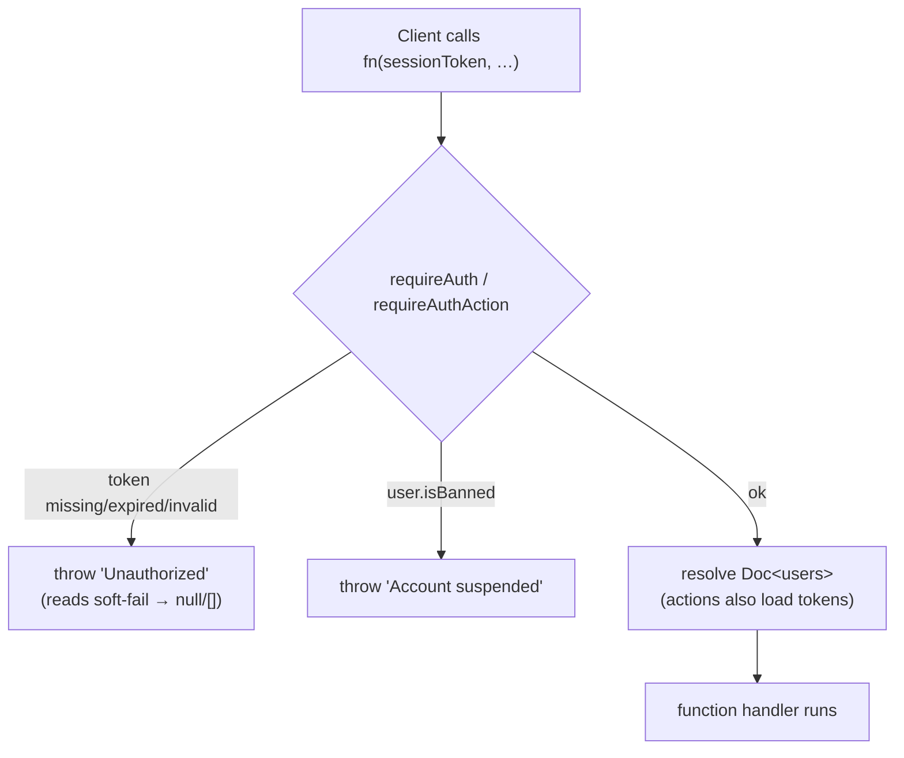

### Identity / user functions (`convex/users.ts`, `linkedin/auth.ts`, `sessions.ts`)

| Function                                                                                 | Kind                                   | Purpose                                                                                                                                                                                                                                                                                                                                                                                                                                                                                                                                                                                                                                                |
|------------------------------------------------------------------------------------------|----------------------------------------|--------------------------------------------------------------------------------------------------------------------------------------------------------------------------------------------------------------------------------------------------------------------------------------------------------------------------------------------------------------------------------------------------------------------------------------------------------------------------------------------------------------------------------------------------------------------------------------------------------------------------------------------------------|
| `linkedin.auth.upsertUser`                                                               | internalMutation                       | Insert on first login (default `subscriptionStatus`, `createdAt`); patch profile + tokens thereafter. `headline` is patched **only when provided** — OIDC login carries none, so a manually-set/scraped headline survives every login instead of being unset. Never writes `isAdmin`. Returns `{ userId, isNew }`: `isNew` (the insert branch) picks the new/returning sign-in counters ([§12C](#12c-sign-in-funnel-metrics)).                                                                                                                                                                                                                         |
| `users.getMe`                                                                            | query (public)                         | Safe profile via `resolveSession` + `toSafeMe` (strips token **values** + raw `isAdmin`; re‑adds `isAdmin:true` only for admins; passes `isBanned`/`bannedReason`; **keeps `tokenExpiresAt`** — not a secret, drives the client's reconnect‑before‑expiry banner). **R19** adds `trialDays` (`trialDaysFor(user)`: 14 or 7) and `inviterName` (first name only, never stored). Also adds **`trialEligible`** — `trialEligible(rowCount)` over the member's `subscriptions` rows (`by_user`), the same rule checkout enforces, so no client has to guess trial eligibility from `subscriptionStatus` (§8).                                              |
| `linkedin.oauth.refreshAccessToken`                                                      | function (server‑only)                 | `grant_type=refresh_token` call to the token endpoint. Same log‑real/throw‑sanitized discipline as `exchangeCodeForTokens`; never logs the token value. Called only by the refresh cron below.                                                                                                                                                                                                                                                                                                                                                                                                                                                         |
| `linkedin.auth.updateTokens`                                                             | internalMutation                       | Patches `linkedinAccessToken`/`tokenExpiresAt` (always) + `linkedinRefreshToken` (only when LinkedIn returns a new one — a non‑rotating provider's omitted `refresh_token` leaves the stored value untouched instead of clearing it). Never writes `isAdmin`, mirroring `upsertUser`.                                                                                                                                                                                                                                                                                                                                                                  |
| `linkedin.tokenRefresh.getUsersPendingRefresh` / `refreshExpiringTokens`                 | internalQuery / internalAction         | Refresh-cron pair — see [§13](#13-scheduled-jobs-crons).                                                                                                                                                                                                                                                                                                                                                                                                                                                                                                                                                                                               |
| `users.getWithTokens`                                                                    | internalQuery                          | Full record **incl. tokens** — server‑only.                                                                                                                                                                                                                                                                                                                                                                                                                                                                                                                                                                                                            |
| `users.getActiveSubscribers`                                                             | internalQuery                          | Cursor‑paginated users with `subscriptionStatus === 'active'` via the `by_subscription_status` index (reads only active subscribers; the fan‑out pages with `continueCursor` until `isDone`).                                                                                                                                                                                                                                                                                                                                                                                                                                                          |
| `users.getSubscriptionInfo`                                                              | query (public)                         | Billing‑page data; reads the Stripe component's live subscriptions + our `subscriptions.tier`.                                                                                                                                                                                                                                                                                                                                                                                                                                                                                                                                                         |
| `users.getTrialProgress`                                                                 | query (public)                         | Trial meter data for `BillingPage`. Returns `{ made, received, combined, threshold, reached, status, trialEndsAt }` — `combined = made + received` from the member's `trialCounters` row; `threshold = TRIAL_INTERACTION_THRESHOLD` (50); `reached` when `combined >= threshold`. Returns `null` if unauthenticated. Mirrors `getMe`'s `resolveSession` pattern.                                                                                                                                                                                                                                                                                       |
| `users.getOrCreateInviteCode`                                                            | mutation (public)                      | **R19** — returns the member's `inviteCode`, minting it on the first call (Settings › Invite). Idempotent afterwards; codes are never reissued. On a `by_invite_code` collision it retries once, then throws `ConvexError('INVITE_CODE_RETRY')`.                                                                                                                                                                                                                                                                                                                                                                                                       |
| `users.getInviteSummary`                                                                 | query (public)                         | **R19** — `{ inviteCode: string \| null; joined: number }`, or `null` when unauthenticated. `inviteCode` is `null` until the mutation above mints it. `joined` counts members carrying the code via `by_referred_by_code` with `.take(101)`, so the read is bounded and the UI can render "100+" past the ceiling.                                                                                                                                                                                                                                                                                                                                     |
| `users.setDerivedPublicIdentifier`                                                       | mutation (internal)                    | Set‑once: fills `linkedinPublicIdentifier` from a name‑verified post's author profile URL; triggers the budget‑guarded Apify profile scrape. Called by `posts.submitPost`.                                                                                                                                                                                                                                                                                                                                                                                                                                                                             |
| `users.dismissFirstPostPrompt`                                                           | mutation (public)                      | Set‑once stamp of `firstPostPromptedAt` when the user **skips** the first‑post onboarding step ("Skip for now").                                                                                                                                                                                                                                                                                                                                                                                                                                                                                                                                       |
| `users.markFirstPostPrompted`                                                            | mutation (internal)                    | Set‑once stamp of `firstPostPromptedAt`; called by `posts.submitPost` after a post persists, so posting from the gate **or** the normal composer clears the onboarding step.                                                                                                                                                                                                                                                                                                                                                                                                                                                                           |
| `users.updateProfile`                                                                    | mutation (public)                      | User edits their own `industry`/`country`/`headline`. `industry`/`country` validate against canonical lists; `headline` is free text, trimmed, capped at `MAX_HEADLINE_LENGTH` (65) chars — rejected if longer; empty string clears any of them.                                                                                                                                                                                                                                                                                                                                                                                                       |
| `users.fillGuessedCountry`                                                               | mutation (public)                      | Fills an **empty** `country` with the browser's guess (`app/src/lib/guessCountry.ts`: the ICU country of the time zone, else the first language tag with a region), sent by `App.tsx`'s `CountryGuess` (rendered past every `RequireAuth` gate) while `!me.country && !me.profileEditedAt`. Shares `fillGuessedProfileHandler` with the industry fill: valid codes only (upper-cased), never overwrites, no-op once `profileEditedAt` is set; `updateProfile` stamps that field whenever the Settings save carries `industry` or `country`. See [§11C](#11c-profile-auto-fill-industry--country).                                                      |
| `users.fillGuessedIndustry`                                                              | internalMutation                       | Called by `ai/industry.guessIndustry` (scheduled by `posts.submitPost` when the submitter has no `industry` and no `profileEditedAt`, never under the admin share-override) with the code `parseIndustryCode` pulled from the model's reply (`NONE` or an unknown code ⇒ nothing is written). Same `fillGuessedProfileHandler` rules as `fillGuessedCountry`: fills an **empty** `industry` only, re-checks `profileEditedAt` in its own transaction (a Settings save that lands while the AI call is in flight wins), and never overwrites.                                                                                                           |
| `users.setPostVisibility`                                                                | mutation (public)                      | **Pro/Contact only** (checked server-side — throws otherwise). Sets `defaultVisibilityIndustries`/`defaultVisibilityCountries`; each entry validated against the canonical `INDUSTRIES`/`COUNTRY_CODES` lists (rejects unknown values), countries upper-cased. Empty arrays are valid (⇒ everyone). Applies to future posts only — see [§11](#11-feed--engagement).                                                                                                                                                                                                                                                                                    |
| `users.setFeedFilter`                                                                    | mutation (public)                      | **Pro/Contact only** (checked server-side — throws otherwise). Sets the viewer's own feed filter `feedFilterIndustries`/`feedFilterCountries`; same validation as `setPostVisibility` (canonical lists, countries upper-cased). Empty arrays clear the filter. `feed.getFeed` reads these off the viewer doc, so saving re-filters the feed reactively — see [§11](#11-feed--engagement).                                                                                                                                                                                                                                                              |
| `users.refreshProfileFromLinkedIn`                                                       | mutation (public)                      | User-triggered profile re-scrape; requires a public identifier; **throws when the profile-scrape flag is off**; rate-limited 2/day; schedules the scrape action.                                                                                                                                                                                                                                                                                                                                                                                                                                                                                       |
| `users.isProfileRefreshEnabled`                                                          | query (public)                         | Whether the dev-only Apify profile scrape is enabled; Settings uses it to **hide** the "Refresh from LinkedIn" button when off (the prod default).                                                                                                                                                                                                                                                                                                                                                                                                                                                                                                     |
| `users.applyScrapedProfile`                                                              | internalMutation                       | Writes scraped fields: `country` + `headline` **fill-when-empty** (scraped headline trimmed + truncated to the `MAX_HEADLINE_LENGTH` cap, never rejected); `location`/`primaryLocale` always refresh.                                                                                                                                                                                                                                                                                                                                                                                                                                                  |
| `users.logout`                                                                           | mutation (public)                      | Deletes the current session token.                                                                                                                                                                                                                                                                                                                                                                                                                                                                                                                                                                                                                     |
| `users.forceLogoutAll`                                                                   | mutation (public)                      | Deletes **all** sessions for the user (compromise response).                                                                                                                                                                                                                                                                                                                                                                                                                                                                                                                                                                                           |
| `sessions.create` / `getByToken` / `deleteByToken`                                       | internal                               | Session lifecycle. The OAuth path no longer calls `create` — `redeemAuthCode` inserts the session directly (same transaction).                                                                                                                                                                                                                                                                                                                                                                                                                                                                                                                         |
| `sessions.deleteAllForUser`                                                              | internalMutation                       | Revoke all sessions for a user (used by `forceLogoutAll`).                                                                                                                                                                                                                                                                                                                                                                                                                                                                                                                                                                                             |
| `sessions.createAuthCode` / `redeemAuthCode`                                             | internalMutation / **public mutation** | PKCE login-code lifecycle. `createAuthCode` stores `{ code, userId, challenge, plan?, interval?, isNew }` with a 2‑minute TTL and bumps `linkedin_ok_*`. `redeemAuthCode({ code, verifier })` re‑derives `SHA-256(verifier)` and compares it to the stored challenge; on match it deletes the single‑use code, inserts the session, bumps `signed_in_*`, and returns `{ sessionToken }`. Any failure throws the generic `ConvexError('Login could not be verified. Please try again.')` (a throwing mutation rolls back its writes, so a failed attempt mints nothing and cannot consume the code). Never logs `code`/`verifier`.                      |
| `sessions.createOAuthState` / `validateAndConsumeOAuthState`                             | internalMutation                       | CSRF nonce lifecycle. `createOAuthState` stores `browserNonce` (the browser-bound, per‑state `oauth_nonce_<state>` cookie value) and the PKCE `challenge` with the state, takes optional `plan`/`interval`/`ref`, and bumps `started`. `validateAndConsumeOAuthState` validates the stored `browserNonce`, expiry, **and** challenge shape **before** deleting — a failed attempt leaves the row for the legitimate browser until TTL cleanup; only success consumes it — then returns `{ valid, plan?, interval?, ref?, challenge }` so the callback can forward the chosen tier **and the R19 invite code** to `upsertUser` and bind the login code. |
| `sessions.deleteExpiredSessions` / `deleteExpiredOAuthStates` / `deleteExpiredAuthCodes` | internalMutation                       | Cron cleanup (batches of 200, self‑rescheduling when full).                                                                                                                                                                                                                                                                                                                                                                                                                                                                                                                                                                                            |

### Dev user impersonation (`convex/dev.ts` + `app/src/components/DevUserSwitcher.tsx`)

A **dev-only** escape hatch for testing the product as any user (rankings, caps, onboarding, new features) without
ever completing OAuth as them. It is gated by the `ALLOW_DEV_IMPERSONATION` env var — set **only** on the local/dev
Convex deployment — and every call throws `ConvexError('Dev impersonation is disabled')` before touching the database
when the var is absent, so the endpoints are inert in production. Same envelope discipline as
`ALLOW_ADMIN_SHARE_ANY_POST` (§10).

- `dev.listUsers` (public query) — compact, bounded (`.take(500)`) list for the switcher: `_id`, `name`, `email`,
  `tier`, `subscriptionStatus`, `isBanned`. No tokens or other secrets cross the wire.
- `dev.impersonate` (public mutation) — mints a fresh 15-day session row for the target `userId` (exactly what the
  OAuth callback and the seed's `seed_<key>` sessions produce) and returns `{ sessionToken, name }`. Clients never
  supply a `userId` for authorization anywhere else; this mutation is the single deliberate exception and only
  exists behind the dev flag.
- `DevUserSwitcher` (rendered from `App.tsx` next to `<Toaster />` only when `import.meta.env.DEV`) — a floating
  "DEV · Impersonate" button on the **bottom-right, stacked above the Feedback button**, opening a panel (right-aligned,
  opening upward) with search, current-user highlight, tier/status/ban
  badges, and a **Back to \<original user\>** row. Selecting a user calls `dev.impersonate`, writes the token to
  `sessionStorage('sessionToken')`, clears the `signedOut` marker and reloads — the same token swap the seed docs
  describe, but for any account. The previous token is kept in `sessionStorage` (`devImpersonatePrevToken`) so a
  single click returns to the real account.

### Dev email tools (`convex/dev.ts` + `app/src/components/DevEmailTools.tsx`)

The same `ALLOW_DEV_IMPERSONATION` gate (dev deployment only — **never set in production**) also backs a set of
dev-only transactional-email tools, so every email can be previewed without waiting for its schedule or its Stripe
event. Both entry points call `isDevImpersonationEnabled(env)` first and then `requireAuthAction(ctx, sessionToken)`,
so without the flag they throw before touching the database and with the flag they still require a valid session.

- `dev.sendTestEmail({ sessionToken, kind, to? })` (public action) — sends one real transactional email to `to`
  when given, else the member's `email` (`no_email` when neither). Kinds: `digest` (the real per-member digest via
  the shared `jobs/digest.composeDigest` helper, forced past `isDigestDue`, never stamping `lastDigestAt`),
  `digest_sample` (fixed three-names-per-list sample rendered in the member's locale), `trial_near_end` /
  `trial_converted` (skipped unless the member is `trialing` / `active`; built from
  `billing.getBillingContext` + `rankings.getGraphSummary`), `post_cap` (the member's newest non-hidden,
  non-deleted post; skipped when none) and `duplicate_canceled`. Returns
  `{ status: 'sent' | 'skipped' | 'no_email', detail? }`; a skipped provider-unconfigured send reports why in
  `detail`.
- `dev.getUnsubscribeLink({ sessionToken })` (public action) — returns the member's signed
  `${APP_URL}/unsubscribe?token=…` link (`signUnsubscribeToken`, the digest job's own signing) for manually testing
  the unsubscribe flow. Sends nothing.
- `DevEmailTools` (rendered from `App.tsx` next to `DevUserSwitcher` only when `import.meta.env.DEV`) — a floating
  "DEV · Emails" button stacked above the impersonation button, opening a panel with an optional **To** override
  (placeholder = the member's email), one button per kind, a **Copy unsubscribe link** action, and an inline status
  line showing the returned status/detail.

### Token lifecycle: issue → refresh window → reconnect fallback

1. **Issue.** Every login (`http.ts` OAuth callback → `linkedin.auth.upsertUser`) stores
   `linkedinAccessToken` / `linkedinRefreshToken` / `tokenExpiresAt` (= `now + expires_in*1000`, LinkedIn's access
   tokens run **~60 days**).
2. **Refresh window (pre‑expiry, best‑effort).** The `refresh LinkedIn tokens` cron (every
   6h, [§13](#13-scheduled-jobs-crons))
   renews any token entering its **last 7 days** before expiry, via `linkedin.oauth.refreshAccessToken` +
   `linkedin.auth.updateTokens`. **This is dormant for essentially every user in practice**: the app's OAuth scopes are
   OIDC Standard‑tier (`openid profile email`, no `offline_access`), and LinkedIn does not issue a
   `refresh_token` for that tier — so `linkedinRefreshToken` is `undefined` on nearly every account and the cron's
   `by_token_expiry` + refresh‑token‑present query matches nothing. The path is kept correct (and unit‑tested) for the
   rare account that does have one, or a future tier change, without being load‑bearing for the common case.
3. **Post‑expiry (today).** If a token is never refreshed, the daily `enforce data retention` cron
   ([§13](#13-scheduled-jobs-crons), [§13B](#13b-privacy--compliance)) **NULLs** it once `tokenExpiresAt` is in the
   past. After that, every LinkedIn‑dependent action fails — e.g. `posts.submitPost` throws `'No LinkedIn access
token. Please sign in again.'`
4. **Reconnect fallback (built, task B01b).** Because step 2 is dormant for most users, the real mitigation is
   `app/src/components/ReconnectBanner.tsx` — a persistent top‑of‑app banner (mounted in `App.tsx` alongside `Motd`,
   authenticated region only) driven by the `tokenExpiresAt` `users.getMe` returns. Pure gate
   `shouldShowReconnect(me, now)`: `tokenExpiresAt == null` → "expired" copy; `tokenExpiresAt < now + 7d` (including
   already past) → "expiring in N day (s)" copy; otherwise renders nothing. No dismiss — it stays up while the condition
   holds. Its "Reconnect" button navigates to the app's `/auth/start` route (`beginOAuthLogin`), the same entry point
   `RequireAuth`'s own auto‑OAuth redirect now uses — the existing OAuth flow already re‑stores a fresh token via
   `upsertUser`. An expired‑token user who still manages to submit sees the `submitPost` error above, but the banner
   means that's no longer their first signal.

---

## 8. Subscriptions & Billing

Stripe is integrated via the **`@convex-dev/stripe`** component, registered in
`convex/convex.config.ts` (`app.use(stripe)`). The component auto‑syncs customers/subscriptions and serves the webhook;
our code adds **Checkout/Portal session creation** and **webhook callbacks**
(`http.ts` → `stripe.ts`) that keep our `users`/`subscriptions` tables in sync.

**Component & SDK versions (plan 023, 2026-09-10).** `convex/package.json` pins `@convex-dev/stripe ^0.1.6`
(was `^0.1.4`) and `stripe ^22.2.1` (was `^20.4.1`; the lockfile resolves `22.6.1` and only that one `stripe`).
The v22 SDK is a true ES6 class and requires Node ≥18 (repo: Node 24) — every construction already used
`new Stripe(key)` (`billingNode.ts`, `privacy/deletion.ts`), so the major was a drop‑in at the call sites; the
v21 `decimal_string → Stripe.Decimal` change touches no field we read or write. **No explicit `apiVersion` is
pinned**: the installed types do not demand one and the component's `apiVersion` option (added in 0.1.5, for both
`StripeSubscriptions` and `registerRoutes`) is optional, so the direct calls and the component both use the SDK's
bundled default, `2026-08-26.dahlia`. The **webhook endpoint's** API version — not the SDK's — decides event
payload shape; the component's 0.1.5 fixes (customer deletions, subscription/invoice upserts, v22 invoice‑parent
metadata, out‑of‑order invoice status) are internal to it. Verified end‑to‑end in test mode:
`scripts/billing-scenarios.mjs`
passed all 69 checks on 2026‑09‑10.

**Rate limits.** Every Stripe-session action is rate-limited per user through `lib/rateLimit.ts`:
`createCheckoutSession`, `purchaseFeaturedPost`, `createCancelFlowSession`, `createPlanSwitchSession`, and
`resumeSubscription` at 10/h; `createPortalSession` and `undoScheduledDowngrade` at 20/h. The deletion cycle is
bounded too — `requestAccountDeletion` 3/day, `cancelAccountDeletion` 10/h — and neither has an admin exemption.

### Price‑ID → tier mapping

`lib/stripePrices.ts` is the single source of truth for the price‑to‑tier mapping. It covers **both monthly and annual**
price IDs (six env vars total — see §16). The pure helpers
`buildPriceMap(env)` and `resolveTier(map, priceId)` are unit‑tested; the module‑level
`ALLOWED_PRICE_IDS` set and `getTierFromPriceId(priceId)` function read `process.env` once at load. Unknown or blank IDs
default to `starter`. `contact` is admin‑assigned, not purchasable via Checkout. The one-time featured-post Price
(`STRIPE_FEATURED_POST_PRICE_ID`, backlog/R17) is exported separately as `FEATURED_POST_PRICE_ID` and is never part of
`buildPriceMap`, so it cannot enter the subscription allowlist or resolve to a tier.

> **Tier pin — admins only.** Stripe webhook tier writes route through the pure, unit‑tested
> `resolveSyncedTier(currentTier, isAdmin, stripeTier)` in `stripe.ts`: an **admin's tier is never
> changed** by Stripe; everyone else follows Stripe. `contact` is **not** pinned — `contact` is
> admin‑assigned (not Stripe‑purchasable), but a contact member who subscribes to a paid plan moves to
> that tier like anyone else. Applied in `syncUserSubscription` and `cancelUserSubscription`.
>
> **Access is never revoked by cancellation** — this is enforced in `lib/access.canEngage`, not in the
> webhook: `canEngage` grants engagement for `subscriptionStatus ∈ {trialing, active, canceled}`, so a
> canceled member keeps commenting / reacting / submitting. Only `none` (never subscribed) and
> `past_due` (failed payment) are gated. What a cancellation _does_ remove is **feed visibility of the
> member's own posts**, and only after their paid period ends: `cancelUserSubscription` stamps
> `subscriptionEndsAt = current_period_end`, and `feed.isAuthorFeedEligible(author, now)` drops a
> canceled author's posts once `now ≥ subscriptionEndsAt`. (The `subscriptions` row still records the
> real Stripe price/status verbatim.)

### Billing intervals

The BillingPage exposes a **monthly / annual toggle**, seeded from the interval the member is already billed on
(`getSubscriptionInfo.priceInterval`) and defaulting to annual for anyone without a subscription row; a `?interval=`
link, the landing's stash, or a click always wins (§14). Annual pricing is 2 months free: Starter $100/yr · Growth
$150/yr ·
Pro $500/yr. The landing shows the annual price on every card and puts the monthly price behind a text link ("Prefer to pay monthly?") — the Good-Better-Best ladder is Starter $
10 → Growth $15 → Pro $50, and Starter is the
decoy that makes Growth the obvious buy (backlog/revenue/R13).

### Featured post add-on (one-time Checkout, backlog/R17)

A member buys one featured slot for **$5** for ONE of their posts. It is a Stripe Checkout in `mode: 'payment'`
on the same customer as the subscription (saved card offered), fulfilled by webhook. It is outside the monthly
featured quota: `featuredPostUsage` is never written, a bought post re-features for free forever, and there is
no refund for un-featuring it (the buy button's tooltip says so before the tap).

**Entry points (all in the app, upgrade named first on every one):** the capped-post row on My Posts
(`buyFeaturedCapped` copy, source `cap`), the Feature slot on an unfeatured card after the monthly quota is exhausted
(source `quota`, or `billing` after arriving through `?feature=buy`), the featured `UpgradeAtLimit` line
(`upgrade.featuredAddon`, text only), and the Billing page line (`billing.featuredAddon` → `/my-posts?feature=buy`).
The deep link never overrides a remaining plan allowance. The buy control itself is withheld —
`MyPostsPage.tsx`'s `canBuy()` is the single gate — on a hidden post (fulfilment keeps `inFeed` false, so the placement
could not happen), on a post that already has a permanent `featuredAt`/`featuredPurchase` entitlement, for a canceled
member (`assertCanEngage` still allows it inside the paid window, but a $5 placement that outlives that window
is a bad sale), and for a card-gated member, a tier with no cap bonus (contact — `FEATURED_CAP_BONUS[tier] === 0`, which
is also what the server's `NOTHING_TO_BUY` keys on), or a tier whose row carries the unlimited sentinel override.

**`billingNode.purchaseFeaturedPost({ sessionToken, postId })`** — `"use node"` action:

1. `requireAuthAction` → `assertCanEngage(user)` (`PAYMENT_REQUIRED:` for no card / past due; trialing passes —
   the trial hint says "Charged today, separate from your trial" — and so do canceled-but-still-engaging
   members and admins, per `canEngage` / `isAdmin` in `lib/access.ts`).
2. `FEATURED_POST_PRICE_ID` unset → `FEATURED_PRICE_UNSET`.
3. `internal.posts.assertFeaturedPurchasable({ postId, userId })` → `POST_NOT_FOUND` (missing, deleted, or not
   the caller's — one answer, no ownership leak), `ALREADY_PURCHASED`, `NOTHING_TO_BUY` (a tier with no cap bonus —
   contact).
4. `getOrCreateCustomer` → `checkout.sessions.create({ mode: 'payment', customer, line_items: [featured price × 1],
metadata: { kind: 'featured_post', convexUserId, postId, ...datafastMetadata(...) }, locale,
success_url: /my-posts?featured=paid&post=<id>, cancel_url: /my-posts })` → `{ url }`. The DataFast keys are present
   only under the member's live `analytics` consent — see §17 "Web analytics".

**Fulfilment — `checkout.session.completed` → `posts.applyPurchasedFeature`:**
`lib/featuredPurchase.isFeaturedPostCheckout`
lets only a paid `payment`-mode session with `metadata.kind === 'featured_post'` through (subscription checkouts
complete through the same event). The mutation takes `postId` as a plain string and `normalizeId`s it. A malformed
id, or a valid id for a post that no longer exists (hard-deleted via the erasure cascade, `privacy/deletion.ts` —
not merely soft-deleted), logs and returns with no audit row, so Stripe never retries. Then, via the pure
`purchasedFeaturePatch`:

| Post state at the webhook                                      | Written                                                                                                                                                                                                                                  | Audit action                                                                          |
|----------------------------------------------------------------|------------------------------------------------------------------------------------------------------------------------------------------------------------------------------------------------------------------------------------------|---------------------------------------------------------------------------------------|
| Already has `featuredPurchase` (redelivery)                    | nothing                                                                                                                                                                                                                                  | —                                                                                     |
| A second, different paid session for an already-purchased post | nothing (the first purchase stands)                                                                                                                                                                                                      | `post.featured_purchase_duplicate` (both session ids + `amountCents` in the metadata) |
| Soft-deleted between Checkout and webhook                      | `featuredPurchase` only (the money exists; nothing to feature)                                                                                                                                                                           | `post.featured_purchase_orphaned`                                                     |
| Live                                                           | `isFeatured: true`, `featuredAt`, `interactionCapBonus = FEATURED_CAP_BONUS[author tier]`, `featuredPurchase`, `interactionLimitReached` re-decided against `planCap + bonus` (a capped post comes back at the top), `feedRank`/`inFeed` | `post.featured_purchased`                                                             |

Every branch above returns `null` — the webhook handler never throws for a redelivery or a duplicate payment, so
Stripe always sees a 200 (a duplicate charge is real money Stripe won't take back on our say-so; the audit row is
where the owner finds it, not a thrown error that would just make Stripe retry the same charge forever).

Cap bonus by the author's tier at fulfilment: starter +25, growth +50, pro +100, contact 0 (nothing to buy).
§9 and §11 describe how the effective cap is applied.

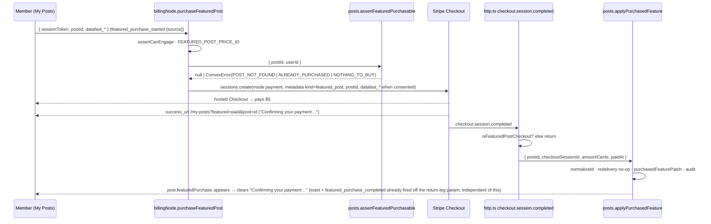

### Checkout (subscribe) flow

Checkout runs through `billingNode.createCheckoutSession` (a `"use node"` Convex action that calls the Stripe Node SDK
directly). The `@convex-dev/stripe` component handles **customer creation/lookup** (`getOrCreateCustomer`) and **webhook
sync**; `billing.ts` is now **internal-only** — `setStripeCustomerId`, `setPendingDowngrade` and three internal
queries, no public action and no Stripe client at all. `createPortalSession` moved to `billingNode.ts` on 2026-09-09
because the component's `createCustomerPortalSession` cannot name a portal configuration (see "Per-tier portal
configurations", §8).

> ⚠️ **The Stripe customer id is mirrored TWICE, and the two paths read different copies.** `createCheckoutSession`
> takes it from the **component's** `customers` table via `getOrCreateCustomer`; `createPortalSession` reads **our**
> `users.stripeCustomerId` (`billingNode.ts:263`). On the checkout path our mirror is write-only — set at
> `billingNode.ts:86` only when absent, never read there — so the two can drift apart silently. **Neither validates the
> id against Stripe.** `getOrCreateCustomer` returns whatever it stored, so a customer that no longer exists produces
> an uncaught `No such customer: 'cus_…'` at `checkout.sessions.create` — the payment step, the worst place to fail —
> and the component ships **no repair path**: it has no delete, and `createOrUpdateCustomer` is keyed by
> `stripeCustomerId`, so writing a fresh id _inserts a second row for the same user_ rather than replacing the stale
> one. Fixing it properly means resolving customers ourselves and bypassing the component. **Deliberately not done**
> (pre-launch, no prod data; the only live trigger is an admin deleting a customer in the Dashboard). Hit in **dev on
> 2026-09-09** after the test sandbox was deleted out from under the stored ids; cleared by hand in the Convex
> dashboard — the component's `customers` row _and_ `users.stripeCustomerId`, since one alone leaves the other path
> broken. Revisit if a live customer is ever deleted, or if it recurs.

Key checkout parameters:

- `trial_period_days: trialDaysFor(user)` — **conditional**, not unconditional: set only when
  `trialEligible(rows.length)` (`lib/trialMilestone.ts`) is true, i.e. the member has never held a subscription row. See
  "One live subscription, one trial" below. The length is `TRIAL_PERIOD_DAYS` (**7**) normally and
  `INVITED_TRIAL_PERIOD_DAYS` (**14**) when `users.referredByCode` is set (**R19**); both constants and `trialDaysFor`
  live in `lib/trialMilestone.ts` — the hard-coded `TRIAL_PERIOD_DAYS` that used to sit in `billingNode.ts` is gone, so
  backend and UI read one source. **The R01 repeat-trial rule still wins:** a member who has already held a subscription
  gets no trial at all, referral or not — a referral lengthens a trial, it never re-grants one.
- `payment_method_collection: 'always'` — card required even during the trial (no free-ride signups).
- `allow_promotion_codes: promotionCodesAllowed(env, priceId)` — Henriko's manual free-month promotion-code campaign,
  **monthly prices only**. A Stripe coupon attaches to the subscription and cannot be price-scoped (`applies_to` lists
  products, and each tier's monthly and annual prices share one product), so an annual Checkout with a 100%-off code
  would zero the whole year ($150 → $0, proven 2026-09-18). No coupons are created or auto-applied in code. **Create
  the coupon as 100% off, duration `once`.** A `once` code is consumed by the first real invoice (the one after the
  trial), so it cannot discount a later annual switch; a `repeating` window discounts any invoice created inside it —
  a prorated annual one included, which is a free year (proven and fixed 2026-09-18, §8). A plan change with a
  discount still attached is detached by the webhook guard (`lib/discountGuard`), and a trialing member cannot switch
  plans at all (trial portal configuration, §8). **Coupons are create-only for their terms** (proven 2026-09-18:
  updating a coupon rejects `applies_to`, `percent_off` and `duration` as unknown parameters; only `name`/`metadata`
  edit). To widen the promo later — e.g. Starter-only → Starter+Growth — create a **new** coupon with the wider
  `applies_to` and a new promotion code; a deactivated code frees its string, so the customer-facing code can stay
  the same (deactivate old, create new). Existing subscriptions keep the discount they already redeemed, and the app
  never names the coupon (only `allow_promotion_codes`), so this is a Stripe-side operation with no code change.
  `max_redemptions` and `first_time_transaction` are create-only too — changing them is the same re-issue, and a new
  code restarts its redemption count.
- `locale: stripeCheckoutLocale(billingLocale)` (`lib/checkoutCopy.ts`) — the hosted page renders in the member's own
  language. Stripe's codes are not ours: our `pt` maps onto Stripe's `pt-BR`.
- `custom_text.submit.message: checkoutSubmitMessage(billingLocale, { trial, days })` — the early-charge rule, stated
  under the pay button, **before** the card. Two deterministic variants (trial / no trial) × three languages, pure and
  unit-tested. `days` is the trial length actually granted, so an invited member reads "after 14 days" on the same
  screen where they are about to enter a card. Never "may end early" — the rule is a fact, not a hedge — and Stripe caps
  the field at 1200 characters.
- `metadata.datafast_visitor_id` / `datafast_session_id` — DataFast revenue attribution
  (`datafa.st/docs/stripe-checkout-api`). The client's `datafastAttribution()` (`lib/observability/datafast.ts`) reads
  the two first-party analytics cookies and the two pages spread them into this action's args
  (`billingNode.datafastMetadata` length-caps them at 100 chars each); **session-level** metadata, because DataFast's
  Stripe integration reads the Checkout Session, not our webhook, and it never touches the subscription's own
  `metadata.convexUserId`. Both keys are **optional and usually absent**: the cookies exist only while the member's
  `analytics` consent stands, and `stopDataFast` deletes them on withdrawal or sign-out, so an empty metadata object is
  the normal no-consent checkout. Nothing reads the keys back — the member sees no change. Attribution begins only once
  Stripe is connected inside DataFast, which stays a compliance-gated dashboard step (§17 launch checklist item 6).

#### One live subscription, one trial

Two pure guards run before the session is created, both reading `internal.billing.listUserSubscriptions` (every
`subscriptions` row the member has ever had — bounded: at most one row per subscription they have ever held):

- **`findLiveSubscription(rows)`** — if any row is `trialing`, `active` or `past_due`, the action throws
  `ConvexError('ALREADY_SUBSCRIBED: You already have a plan. Manage it from the billing portal.')` rather than creating
  a second Stripe subscription. `canceled` is deliberately **not** a live status: a canceled member re-subscribes
  through checkout. The client branches on the prefix (the `PREFIX: sentence` convention of `lib/access.ts`) and opens
  the **Customer Portal** instead — a card holder who wants another plan switches there, never through a second
  checkout (from the plan grid, straight into the portal's confirm step for that price — see "Plan switch" below).
  The blocked path is a door, not an accusation: no "trial abuse" copy, no warning, no penalty state.
- **`trialEligible(rows.length)`** — the trial is granted only to a member with **no subscription row, ever**. It is
  keyed on the row **count**, not on `users.trialEndsAt`, because `syncUserSubscription` overwrites `trialEndsAt` with
  `undefined` for a non-trial subscription: a marker that erases itself would hand a returning member a second free
  trial. A returning subscriber is billed on day one and is told so in `custom_text` before entering the card, never
  discovered on the statement.
- **The same answer reaches the client, from the server (`getMe.trialEligible`).** The UI must never re-derive
  eligibility from `users.subscriptionStatus`: that field is not the rule. `canceled` is only the _common_ ineligible
  state — `toSubscriptionStatus` (`stripe.ts`) maps Stripe's `incomplete`, `incomplete_expired` and `paused` to **
  `'none'`** with the `subscriptions` row already inserted, and `admin.setUserSubscriptionStatus` can patch a member
  with rows back to `'none'` too. Both are ineligible while reading as a brand-new member. `getMe` therefore returns
  the row-count answer itself, and **every** trial promise in the app renders behind it: `BillingPage`'s pre-card block
  and, since 2026‑09‑07, the three **card-gate** surfaces, which are gated on exactly the statuses (`'none'` /
  `past_due`) where this trap lives — `useCardGate().canTrial` (§14).

**Language.** `createCheckoutSession` takes an optional `locale` argument (the app passes `i18n.language`), and
`billingNode.createCheckoutSession` persists the resolved value to `users.language` through
`internal.users.setLanguageFromCheckout` as a backstop. The normal path is the app itself:
`app/src/hooks/useLanguageSync.ts` calls the public `users.setLanguage` on session load — catching a language chosen on
the landing site (or any drift) — and on every in-app switch, so the account is in step before the mailers run; the
cookie remains the client's own source of truth. Resolution order for every transactional notice — billing,
privacy/DSR and feedback alike — is `resolveBillingLocale(users.language, users.primaryLocale)`, falling back to `'en'`;
regional and mis-cased tags (`pt-BR`, `ES`) normalize, unsupported ones fall through to the next candidate.

```mermaid
sequenceDiagram
    participant A as App (BillingPage)
    participant B as billingNode.createCheckoutSession (node action)
    participant DB as Convex DB
    participant SC as Stripe component
    participant S as Stripe Checkout
    A ->> A: captureEvent('checkout_started', { plan, interval })
    A ->> B: createCheckoutSession(priceId, sessionToken, locale, datafast_* when consented)
    B ->> B: validate priceId ∈ ALLOWED_PRICE_IDS
    B ->> B: requireAuthAction(sessionToken)
    B ->> DB: internal.billing.listUserSubscriptions(userId)
    B -->> A: findLiveSubscription? → ConvexError ALREADY_SUBSCRIBED (client opens the portal)
    B ->> B: trial = trialEligible(rows.length); days = trialDaysFor(user); billingLocale = resolveBillingLocale(...)
B ->> SC: getOrCreateCustomer(userId, email, name)
B ->> S: checkout.sessions.create(trial? days, card-required, promo-codes, locale, custom_text, metadata datafast_*)
B ->> DB: setStripeCustomerId (if unset) + users.setLanguageFromCheckout (if changed)
B -->> A: { url }
A ->> S: window.location = url
```

**`checkout_started` (R18).** `BillingPage.handleUpgrade` fires `captureEvent('checkout_started', { plan, interval })`
immediately before `createCheckoutSession`, so the survival panel's funnel can separate a member who never reached the
card from one who reached it and bounced. It fires only on the checkout branch — a card holder clicking a plan goes to
`createPlanSwitchSession` (below), which deep-links into the Customer Portal's confirm flow or, for a move down a
tier, schedules the change for the period end; either way it fires `plan_switch_opened`, and the scheduled path adds
`downgrade_scheduled`. See [§17](#17-security-posture).

`billingNode.createPortalSession` returns a Stripe **Customer Portal** URL (requires an existing `stripeCustomerId`,
not a live subscription — a churned member keeps invoice access). It opens the configuration that matches the
member's tier, so the portal home offers upgrades and interval switches and never a cheaper tier; if no configuration
carries that tier's `metadata.lits_tier` it throws `PORTAL_NOT_CONFIGURED` rather than falling back to the account
default. See "Per-tier portal configurations" in [§8](#8-subscriptions--billing).

**The return leg (R07 — celebrate activation).** The success URL is `${appUrl}/billing?success=true`. `BillingPage`
reads it once — latching a `justSubscribed` flag during render, not in an effect. The webhook (`http.ts` →
`stripe.ts`) can land a moment after the redirect, so while `justSubscribed` is true and `me.subscriptionStatus` is
still pre‑checkout — `none` for a first checkout, or `canceled` for a member re‑subscribing (their row keeps
`canceled` until the webhook lands) — the page shows an inline activating state: `billing.activating` ("your trial…")
for `none`, `billing.activatingPlan` ("your plan…") for `canceled`, because the repeat‑trial guard in `billingNode.ts`
gives a re‑subscriber no second trial. `getMe` is reactive, so it clears itself the instant the row updates — no
polling. After ~20s with no flip it falls back to `billing.activatingTimeout` (a neutral "your
plan will show here shortly", the Manage button visible, never blaming the member or naming a webhook) and reports the
case via `captureException` (§17) so a genuinely lost webhook is visible. Once the status becomes `trialing` or
`active` (only those two — `past_due`/`canceled` are never "you're in"),
`CheckoutSuccessDialog` (shadcn `Dialog`) opens exactly once — title "You're in.", the member's plan, and "your first
post is now in the feed" when they had one (reusing FeedPage's `useOwnPostState`, R04, §14 — specifically `hasAnyPost`,
not `hasHiddenPost`: the hidden-only signal can already read `false` on the very first render before the post has
synced as hidden, while `hasAnyPost` is race-independent since any pre-existing post is definitely live once the
member has converted — latched into state before the flip since the conversion itself is what un-hides it) — plus one
reinforcing line from `billing.plans.<id>.description`. No upsell, no fabricated number. Primary CTA → `/feed`,
secondary closes the dialog. Fires the consent-gated `checkout_success_viewed` PostHog event (§14 `captureEvent`) with
the plan id. A cancelled checkout returns to `/billing` without the parameter and changes nothing. The `?success=true`
param itself is only stripped (`setSearchParams({}, { replace: true })`) **once the celebration has actually fired**,
not on mount: stripping it eagerly would lose it for good if the member refreshes during the activation window (before
`hasCelebrated` flips) — a fresh mount can only re-latch `justSubscribed` by reading that same param, so an early strip
turns a mid-activation refresh into a silently skipped celebration. Once stripped, a later refresh no longer repeats
it.

**50-interaction milestone (Plan 2B).** `billingNode.endTrialEarly` (internalAction) sets
`trial_end: 'now'` on a Stripe subscription, converting the trial to a paid subscription immediately. It is scheduled by
`bumpTrialInteractionHandler` in `interactions.ts` whenever a trialing user's **combined**
`trialCounters` `made + received` first reaches 50 (the `TRIAL_INTERACTION_THRESHOLD` constant,
enforced by the pure `crossesThreshold` helper in
`convex/lib/trialMilestone.ts`). Counters are bumped inside `incrementCommentCount` /
`incrementLikeCount`, in the same transaction as the counter patch and the `userInteractions` row
([§11](#11-feed--engagement)), so the milestone can never disagree with the log it is counted from. The check fires **at
most once** per user: the `subscriptionStatus !== 'trialing'` guard inside
`bumpTrialInteractionHandler` skips any increment once the trial has already converted. The handler is split out of
the mutation so that wiring is unit-tested (`convex/interactions.trialMilestone.test.ts`, 12 cases): the three
predicates it calls were always covered, but nothing pinned that **the 50th interaction is the one that charges the
card**, on the trialing row rather than an older canceled one, exactly once, and never for a cancel-pending trial. Its
`loadSubscriptions` argument is a lazy getter so the `by_user` index is still read only on that one interaction in
fifty. The combined
"50 interactions OR 7 days" rule is therefore split: the 7-day side is Stripe's
`trial_period_days` (from Checkout); the 50-interaction side fires `endTrialEarly` to end it early. Both sides converge
on the same webhook sync path (below) — `endTrialEarly`'s `trial_end: 'now'` is just another
`customer.subscription.updated` event. A clean conversion resets the billing anchor to now and is **invoiced and
charged in the same second** for the full period. Before writing, `endTrialEarly` re-reads the subscription from
Stripe and returns without converting unless it is still `trialing` with no cancel pending (`isCancelPending`). Our
row can lag a cancel by a webhook, and converting a cancelled trial is the one path that does **not** charge: Stripe
bills the period the cancel truncates as **pending prorations**, collected only at the next invoice (the 2026-09-10 🐞
under "Stripe Dashboard setup").

`users.trialEndsAt` (ms) is sourced **verbatim from Stripe's `trial_end`** (epoch seconds × 1000,
`null` → `undefined`) by `syncUserSubscription` — it is not computed locally as `now + 7d`. This keeps it correct across
both the 7-day elapse and the 50-interaction early-end (`trial_end: 'now'`
reads back as a past/`now` timestamp on the next sync). The UI's `status === 'trialing'` gate (`BillingPage`) — not the
value of `trialEndsAt` itself — decides when the countdown is shown, so a stale past `trialEndsAt` left over after
conversion to `active` never misrenders.

**Which subscription the early end targets.** `bumpTrialInteraction` reads **all** of the member's `subscriptions` rows
(`.collect()`) and selects with the pure `pickTrialingSubscription`. It must never use `.first()` on the `by_user`
index: Convex appends `_creationTime` to every index, so `.first()` returns the **oldest** row — after a cancel and
re-subscribe that is the _canceled_ subscription, and calling `endTrialEarly` on it is a silent no-op. Harmless while
every member had exactly one row; a real bug the moment the guard above deliberately permits a second one. A trialing
row with `cancelAtPeriodEnd: true` is skipped as well (`shouldEndTrialEarly`, `convex/lib/trialMilestone.ts`): a member
who cancelled during the trial keeps the trial end date the cancel dialog showed them, exactly as the two trial emails
already skip that case. That flag is set by **either** Stripe field (`isCancelPending`). The portal on API
`2026-02-25.clover` cancels by setting `cancel_at` and leaves `cancel_at_period_end` false, so a mirror of the flag
alone missed every portal cancel.

### Trial notifications

Two trial-end paths exist, and they must never both warn about the same event:

- **50 interactions** — `endTrialEarly` sets `trial_end: 'now'`, so Stripe emits **no** `trial_will_end`. Ours is the
  only warning, and it fires earlier, at **40 of 50** (`TRIAL_WARNING_THRESHOLD`, 80% of the threshold), scheduled from
  `bumpTrialInteraction` through the same `crossesThreshold` helper — so it fires exactly once per member. **RCD:** the
  email also carries the member's real graph — `rankings.getGraphSummary` (bounded 2000 rows per side, all‑time)
  returns distinct people made/received and received reactions/comments, plus their live 7d board position and the gap
  to the next place, which `trialNearEndEmail` renders as factual sentences ("47 interactions with 9 people, 14
  reactions on your posts."). The remaining‑interaction line and the plan start stay; nothing claims features stop at
  trial end.
- **The elapsed-days side** (7 days, or 14 for an invited member — **R19**, see "Checkout (subscribe) flow") — Stripe
  emits `customer.subscription.trial_will_end` three days ahead; `http.ts` schedules
  `internal.billingNotices.sendTrialEnding`. Stripe's own built-in trial-ending email stays **OFF** in the Dashboard
  (see
  "Stripe Dashboard setup" below), so exactly one warning reaches the member. Nothing here reads the trial **length**:
  the warning is driven by Stripe's own event and by the stored `trial_end`, so a 14-day trial needs no extra branch.

| Event                              | Channel                                         | Sender                                                 |
|------------------------------------|-------------------------------------------------|--------------------------------------------------------|
| 40 of 50 combined interactions     | Email + emphasised in-app banner on `/billing`  | Ours — `internal.billingNotices.sendTrialNearEnd`      |
| 3 days before the trial's last day | Email                                           | Ours — `internal.billingNotices.sendTrialEnding`       |
| Trial converted: trialing → active | Email                                           | Ours — `internal.billingNotices.sendTrialConverted`    |
| First successful charge            | Email receipt                                   | **Stripe** (Dashboard setting, kept ON)                |
| Duplicate subscription voided      | Email + dismissible in-app notice on `/billing` | Ours — `internal.billingNotices.sendDuplicateCanceled` |

**The conversion email (R14).** `syncUserSubscription` decides it, not a cron: when the incoming webhook moves _this
subscription row_ from `trialing` to `active`, `isTrialConversion(existing?.status, args.status)` returns true. The call
is made **before** the row is patched (the old status is still readable) and the send is scheduled **after** the user
doc is patched, so the mailer re-reads a settled member. The action is `internal.billingNotices.sendTrialConverted`, the
copy comes from `trialConvertedEmail`, and the mail links to **`/recap`** — the first paid touch points at the receipts,
not at an upsell. It re-reads state and **skips** when the member has no email, when `subscriptionStatus` is no longer
`active` at send time, when `findLiveSubscription` finds no live row, or when `made + received === 0` (the trial
counters on the member's `trialCounters` row, read through `internal.billing.getBillingContext`) —
nothing recorded means nothing to recap, so a zero-activity member gets silence rather than an empty summary. **Known
timing, accepted for launch (2026‑09‑07):** the trigger is `trialing → active` only. Stripe marks the subscription
`active` about an hour before it attempts the trial‑end charge, so a failed first card is not known at send time, and a
trial that converts via `past_due → active` (first charge failed, retry succeeded) gets no email. Revisit after launch —
a first‑paid‑invoice trigger (`invoice.paid`) or a row flag for the first `active` after a `trialing`.

`convex/billingNotices.ts` is I/O only. Every string comes from the pure `lib/billingEmails.ts` — five builders
(`trialNearEndEmail`, `trialEndingEmail`, `trialConvertedEmail`, `duplicateSubscriptionCanceledEmail` and
`postCapReachedEmail`, the last one **not** a trial notice — see "Post-cap email (R20)" below) plus
`formatPriceLabel`, the `INTL_TAG` map and `planName(locale, tier)` — and every branch from `lib/trialMilestone.ts`, so
the copy and the rules are unit-tested without a database. **Plan names are localized:** `planName` mirrors
`billing.plans.*.name` in the app
locales (including the `Custom` tier name), so a raw tier id never reaches a member and
an English plan name never lands inside a Portuguese email. `sendDuplicateCanceled` therefore takes a **tier id**, not a
rendered plan name: `http.ts` deals in tier ids and the mailer localizes, so display copy never passes through the
webhook layer.

Every transactional body now renders through the shared branded shell **`lib/emailLayout.ts`**, with escaping in **
`lib/html.ts`**: a table-based 600 px card (dark header band + wordmark, gold rule, white content card, muted footer)
assembled from `emailParagraph` / `emailLabel` / `emailQuote` / `emailFacts` / `emailNote` / `emailButton` (and
`emailButtonRow` for two side-by-side buttons). The shell is
client-safe by construction — inline styles, no flexbox/grid/CSS variables/canvas/web fonts, one `<style>` block limited
to the mobile padding media query and the link color. The billing builders add localized headings, fact labels and
button labels (Plan/Price/Trial ends, _Manage billing_ / _Gerenciar assinatura_ / _Gestionar suscripción_, …) while
every `text` body stays byte-identical.

Each mailer **re-reads state before sending** and skips when the member is no longer `trialing` — and, critically, when
the row's `cancelAtPeriodEnd` is set. **Stripe keeps `status: 'trialing'` after a member cancels mid-trial**, so that
flag is the only signal that no charge is coming; both trial mailers check it, so we never promise a charge that will
not happen. A member who already cancelled receives nothing.

**The amount is Stripe's own.** No backend module knows a plan's price — `lib/stripePrices.ts` maps price id → tier and
nothing else, and the `$150/yr` strings live on the client. Rather than duplicate a price table that drifts the day
pricing changes, both subscription webhooks persist `items.data[0].price`'s `unit_amount`, `currency` and
`recurring.interval` onto the `subscriptions` row (`priceAmount` / `priceCurrency` / `priceInterval`), and
`formatPriceLabel` renders them with `Intl.NumberFormat` in the member's locale, writing the dollar as `U$` in pt/es and
`$` in en. A missing snapshot degrades to an empty label, never to a wrong number; the builders run the plan name
through `planWithPrice`, so a notice names the plan alone rather than reading "Pro ()".

`sendEmail` (`lib/email.ts`) no-ops when `RESEND_API_KEY` / `EMAIL_FROM` are unset. Every message it does send is
addressed `From: Link Into The SSI <EMAIL_FROM>`, so mail clients show the brand instead of the bare `noreply` local
part; an `EMAIL_FROM` that already carries a display name is forwarded unchanged. For a privacy flow that is a
convenience; for a pre-charge notice it is a compliance hole, so `billingNotices.deliver` logs
`console.error('[billing] notification skipped — email not configured', scrubError(…))`, which surfaces in
`pnpm watch:errors` and the Convex dashboard. If Resend returns a non-2xx, `sendEmail` throws and the scheduled action
fails loudly; there is no retry loop, because the in-app banner is the durable channel.

**Erasure resets the trial.** A member who deletes their account ([§13B](#13b-privacy--compliance)) and signs in again
is a **new** `users` row with a new Stripe customer and no `subscriptions` rows, so `trialEligible` grants a fresh
trial (7 days, or 14 if they sign up again through an invite link). This is accepted deliberately: the alternative —
retaining an identifier of an erased person purely to deny
them a future trial — would sit badly against the erasure right the same section implements.

### Post-cap email (R20)

When a post reaches its author's plan cap it leaves the feed (`interactionLimitReached` → `inFeed: false`). Before R20
that was silent unless the author happened to open My Posts; now they get **one email, once per post**, in their own
language. It is a **state notice, not a broadcast**: the event already happened, and the closing line is the single
thing the author's tier can actually do about it.

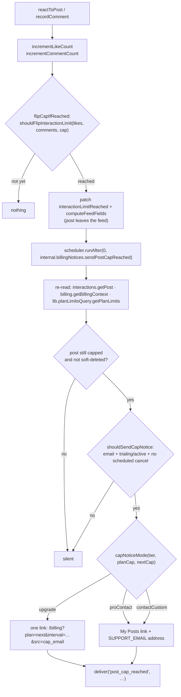

**The subject reports the post's own total, the body reports the cap it hit.** `postCapReachedEmail` takes both
`total` (the post's `likeCount + commentCount`, passed by `sendPostCapReached`) and `cap`. At the flip the two usually
agree, but after a **Growth → Starter downgrade** a post already sitting at 41 flips against a cap of 25 — so the
subject ("your post reached **41** interactions and left the feed") uses the total, and the body names the cap with no
plan attribution ("it reached its cap of **25** interactions") — a bought post's cap already includes its R17 bonus,
so naming a plan there would sometimes be false.

**The board line (RCD follow-up).** After the cap line the email also states where the author sits:
`sendPostCapReached` reads `rankings.getGraphSummary` and `postCapReachedEmail` renders one factual sentence — "You are
#8 on the weekly board, 2 interactions from #7." — dropping the gap clause when `gapToNext` is null and the whole
sentence when the member is unranked. Same transactional voice: no urgency, no extra link.

**The upgrade line promises the author's _next_ posts, never this one coming back — unless it is bought back.** Apart
from `posts.applyPurchasedFeature` (backlog/R17, which re-decides `interactionLimitReached` against the post's new,
bigger `effectiveInteractionCap` at fulfilment), nothing un-flips it: no other writer sets it `false`,
`computeFeedFields` (`lib/feedRank.ts`) preserves it through the tier restamp, and `syncPosts.applyEngagementCounts` is
one-way. A capped post therefore stays out of the feed after a plain upgrade — the bigger cap only applies to the
author's _next_ posts — so the line reads _"On {nextPlan}, your next posts collect up to {nextCap} each:"_ (and the
pt-BR / es equivalents) rather than anything suggesting the post keeps collecting. It is still the email's one
actionable line and still the only link. A locale-wide unit test bans the old "keeps collecting" / "continua recebendo"
/ "sigue recibiendo" phrasings, because that promise sits directly in front of a charge.

**One flip, one email — until a purchase resets it.** Both `incrementLikeCount` and `incrementCommentCount` call a
single helper, `flipCapIfReached` (`convex/interactions.ts`), instead of duplicating the cap check. It patches
`interactionLimitReached` together with the recomputed `computeFeedFields`, then schedules
`internal.billingNotices.sendPostCapReached({ postId })` at 0 ms. Because both callers return early when the post is
**already** capped, an organic flip happens exactly once against a given cap — so the schedule, and therefore the
email, cannot repeat against that same number. `posts.applyPurchasedFeature` (backlog/R17) is the one path that
un-flips `interactionLimitReached`, against the post's new, bigger `effectiveInteractionCap`; from there the same
`flipCapIfReached` (and the Apify-refresh equivalent in `syncPosts.applyEngagementCounts`, [§11](#11-feed--engagement))
can flip it a second time once the bought post reaches that bigger cap, scheduling a second, independent
`post_cap_reached` email at the new number. There is no dedupe flag on the post: the flip _is_ the dedupe, once per cap
it is currently measured against.

**Everything that could make the email wrong is re-checked at send time.** The action re-reads the post
(`internal.interactions.getPost`), the author's billing context (`internal.billing.getBillingContext`) and the effective
limits (`internal.lib.planLimitsQuery.getPlanLimits`, for the author's tier and for `nextTier(tier)`), and drops
silently
when the post is gone, no longer capped, or soft-deleted. `shouldSendCapNotice` (`lib/postCapNotice.ts`) then requires
an address on file **and** a `trialing`/`active` status **and** no `cancelAtPeriodEnd` on the live subscription row
(`findLiveSubscription`). `none`, `past_due` and `canceled` members see the card-gate or expired banners in the app
instead, and a member who has already scheduled a cancel gets nothing — mailing them would read as a retention push,
which R20 forbids.

**`capNoticeMode(tier, cap, nextCap)`** picks the closing line — one pure function rather than the two the spec
imagined:

| Mode            | When                                                                 | Closing line                                                                   |
|-----------------|----------------------------------------------------------------------|--------------------------------------------------------------------------------|
| `upgrade`       | Starter/Growth **and** the next tier's cap is genuinely higher       | Checkout link: `/billing?plan=<next>&interval=<annual\|monthly>&src=cap_email` |
| `proContact`    | Pro, **or** `nextCap` is missing or not greater than the current cap | `SUPPORT_EMAIL`, plain text — "need a higher cap? write to …"                  |
| `contactCustom` | The `contact` tier, whose cap is bespoke                             | The same address, saying the cap is custom                                     |

The `nextCap <= cap` fallback matters: plan limits are admin-editable ([§9](#9-plan-limits-system)), so a
misconfiguration that makes the next tier no better must not produce an email selling it. `interval` comes from the live
subscription's stored `priceInterval` through `billingIntervalParam` (Stripe's `month` → `monthly`, everything else →
`annual`, the billing page's own cold default; `UpgradeAtLimit` runs its in-app link through the same mapper, so the
email and the app never point one member at different prices), so the link lands on the interval the member is already
paying.

**Exactly one link per email.** In `upgrade` mode the checkout link is the only one and the "it stays on My Posts" line
is dropped; in the other two modes the My Posts link is the only link and the support address closes as **plain text,
not a `mailto:`**. `postCapReachedEmail(locale, args)` in `lib/billingEmails.ts` builds the subject (which quotes the
post's **own**
interaction total, never the plan's cap — a downgrade can leave the cap below it) and the body in en/pt/es, quotes the
post's `excerpt(post.content)` (`lib/recap`) so the author knows which post
it is, and is enumerated in the existing "billing emails stay transactional" guard test alongside the trial mailers.
Its HTML renders the excerpt as an escaped quote and the one actionable link as a `lib/emailLayout.ts` button — the
support address only ever closes the non-upgrade modes as plain text in the soft panel.
`SUPPORT_EMAIL` moved to **`convex/lib/support.ts`**, and `app/src/lib/support.ts` is now a re-export of it, so the
email, the banned screen and the upgrade-at-limit mailto cannot drift apart.

Delivery uses the same `deliver()` seam as the trial mailers, so an unconfigured mailer logs
`console.error('[billing] notification skipped — email not configured', …)` rather than failing quietly.

**The billing page knows where the click came from.** The deep link carries `src=cap_email`, and `BillingPage` fires
`cap_email_billing_opened { plan }` once per landing (ref-latched against StrictMode's double effect) —
see [§17](#17-security-posture).

### Webhook‑driven subscription sync

`http.ts` registers handlers for these Stripe events, each delegating to an internal mutation in
`stripe.ts`:

| Stripe event                                | Handler effect                                                                                                                                                                                                                                                                                                                                                                                                                                                                                                                                                                                                                                                                                                                                                                                                                                                                                                                                                                                                                                                                                                                                                                                                                                                                                                    |
|---------------------------------------------|-------------------------------------------------------------------------------------------------------------------------------------------------------------------------------------------------------------------------------------------------------------------------------------------------------------------------------------------------------------------------------------------------------------------------------------------------------------------------------------------------------------------------------------------------------------------------------------------------------------------------------------------------------------------------------------------------------------------------------------------------------------------------------------------------------------------------------------------------------------------------------------------------------------------------------------------------------------------------------------------------------------------------------------------------------------------------------------------------------------------------------------------------------------------------------------------------------------------------------------------------------------------------------------------------------------------|
| `customer.subscription.created` / `updated` | `syncUserSubscription`: set `tier` (via `resolveSyncedTier` — **admin tier never changes**) + `subscriptionStatus`, stamp `subscriptionEndsAt = current_period_end`, stamp `trialEndsAt = sub.trial_end` (seconds→ms, `null` → `undefined`), persist the **price snapshot** (`unit_amount` / `currency` / `recurring.interval` off `items.data[0].price`) and `cancelAtPeriodEnd`, re‑stamp `authorTierRank` on all the user's posts, **upsert** our `subscriptions` row. If status `active` → **un‑hide** the user's hidden posts **and** schedule an immediate Apify sync (only when `isApifyPostSyncEnabled(appSettings)`). Also persists `stripeCreated` + `lastEventAt`, **refuses a stale replay** (a live status for a row already `canceled` — Stripe retries on any non-2xx) **and an out‑of‑order event** (`event.created` older than the row's `lastEventAt`; only the duplicate decision still runs), and when **another row defines the member** (this row is the duplicate, or this is a non-live event while they still hold a live row) leaves the user doc alone. Returns the **duplicate to void**, which only the `created` handler acts on (below). Mirrors `sub.schedule` as `stripeScheduleId`; a landed **scheduled downgrade** clears the pending mirror and releases the schedule (B07). |
| `customer.subscription.deleted`             | `cancelUserSubscription`: mark sub `canceled`. If the member **still holds a live row** (the voided duplicate's own `deleted`, or a period-end cancel landing after a re-subscribe) their `tier` / `subscriptionStatus` / `subscriptionEndsAt` follow that row — nothing is downgraded. Otherwise set user `status = canceled` (access is **not** revoked — see `canEngage`) and `subscriptionEndsAt = the sub's last `current_period_end` (their posts leave the feed after this), downgrade tier→`starter`, **except admins** whose tier is fixed. Re‑stamp posts.                                                                                                                                                                                                                                                                                                                                                                                                                                                                                                                                                                                                                                                                                                                                              |
| `customer.subscription.trial_will_end`      | Schedules `internal.billingNotices.sendTrialEnding` with `sub.trial_end` (seconds→ms). Stripe fires this **3 days before** `trial_end`; it never fires for the 50-interaction path, because `endTrialEarly` sets `trial_end: 'now'`. Ours is therefore the only day-7 warning — Stripe's built-in trial-ending email stays OFF (see "Stripe Dashboard setup").                                                                                                                                                                                                                                                                                                                                                                                                                                                                                                                                                                                                                                                                                                                                                                                                                                                                                                                                                    |
| `invoice.payment_failed`                    | `markPastDue`: set `subscriptionStatus = past_due` (tier unchanged) — this **does** gate engagement until payment clears. Skips an event older than the row's `lastEventAt`, so a retried failure cannot re‑block a member whose payment already cleared, and ignores a failure for a row already `canceled` (Stripe's dunning end delivers the final failure and the `deleted` in either order).                                                                                                                                                                                                                                                                                                                                                                                                                                                                                                                                                                                                                                                                                                                                                                                                                                                                                                                 |
| `checkout.session.completed`                | `isFeaturedPostCheckout` (`lib/featuredPurchase.ts`) lets through only a **paid** `payment`-mode session tagged `metadata.kind === 'featured_post'` — a subscription checkout completes through this same event and is ignored here. `posts.applyPurchasedFeature` normalises `postId`, no-ops on a redelivery (same session id) or logs a `post.featured_purchase_duplicate` audit row for a second paid session on an already-featured post (no refund), and otherwise features the post with its tier's cap bonus. Never throws — Stripe always sees 200. See "Featured post add-on" above.                                                                                                                                                                                                                                                                                                                                                                                                                                                                                                                                                                                                                                                                                                                    |

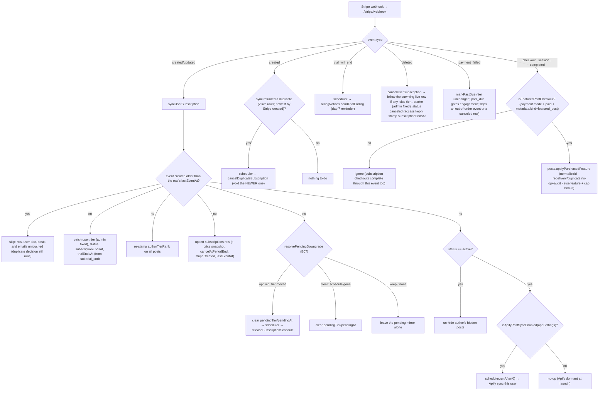

> **Apify dormant guard:** `syncUserSubscription` reads `appSettings` and checks
> `isApifyPostSyncEnabled(settings)` (from `lib/apify.ts`) before scheduling any Apify sync.
> Apify is dormant at launch (compliance gate); billing alone cannot re‑enable it.

### Duplicate-subscription race

The checkout guard runs when the session is **created**; it cannot see a second checkout completed in another tab
between that check and Stripe confirming payment. `syncUserSubscription` closes that window **inside its own
transaction**: after upserting the row it collects the member's rows and, when two are live, `findDuplicateSubscription`
names the **newest by Stripe's own `created`** (persisted as `subscriptions.stripeCreated`) — never by webhook arrival
order, which Stripe does not guarantee. Deciding in the transaction is what makes it safe: two concurrent `created`
syncs conflict on the user doc (OCC), so exactly one of them sees both rows and exactly one cancel is scheduled. The
mutation returns `{ userId, stripeSubscriptionId, keepTier }`, and only the `customer.subscription.created` handler
acts on it (Stripe emits `updated` for the duplicate right after `created`; acting there too would void and notify
twice), scheduling `internal.billingNode.cancelDuplicateSubscription`. The member keeps the plan they already had: their
user doc never follows the duplicate, and the duplicate's own `customer.subscription.deleted` re-derives their state
from
the surviving row (table above):

- `stripe.subscriptions.cancel(id, { prorate: false, invoice_now: false })` — no proration credit and no immediate
  invoice; financially the duplicate never existed.
- `internal.users.setBillingNotice(userId, 'duplicate_canceled')` — raises the dismissible banner on `/billing`
  (`users.billingNotice`; cleared by `users.clearBillingNotice`).
- `internal.billingNotices.sendDuplicateCanceled({ userId, tier })` — the email, in the member's language.

A voided subscription is **never silent**: the member is told in-app **and** by email, in the same pass that cancels it.

A Stripe **retry** of the duplicate's `created` (after a non-2xx) is harmless: once the row is `canceled`,
`syncUserSubscription` ignores any live status for it (a canceled Stripe subscription never comes back), and if the
retry lands before the `deleted` event, `cancelDuplicateSubscription` catches Stripe's already-canceled error and
returns without a second notice.

**Webhook ordering.** Stripe does **not** guarantee the delivery order of webhook events, so every applied `created` /
`updated` / `payment_failed` event stamps the row with its own `event.created` (`subscriptions.lastEventAt`, ms —
`http.ts` passes it as `eventCreated`), and `syncUserSubscription` / `markPastDue` **skip an event strictly older than
that stamp** (`isStaleEvent`, `lib/trialMilestone.ts`): the row, the user doc, the post re‑stamp and every email are
left alone, so a late `trialing` update can no longer rewind a converted subscription and make the next `active` event
re‑send the conversion email. Only the duplicate decision still runs for a stale `created`, on the rows as they are, so
a retried two‑tab `created` can still void its duplicate. Stripe stamps events at second resolution, so equal stamps
apply in arrival order (the checkout `created` and its sibling `updated` share a second); two _distinct_ same‑second
events with different statuses can therefore still land in arrival order, as they always did — that is the known
ceiling. A row or event without a stamp is never treated as stale — no backfill. Replays of the **same** event were
already safe (the row is `active`, so `isTrialConversion` is false). The `canceled`‑row guard is the other half and
lives in **both** writers: `cancelUserSubscription` does not stamp, so it is the status, not the stamp, that rejects a
late live event for a voided row — and `markPastDue` ignores a failure for a row already `canceled`, because Stripe's
dunning end delivers the final `invoice.payment_failed` and the `deleted` in either order, and applying it would leave
the member `past_due` for good.

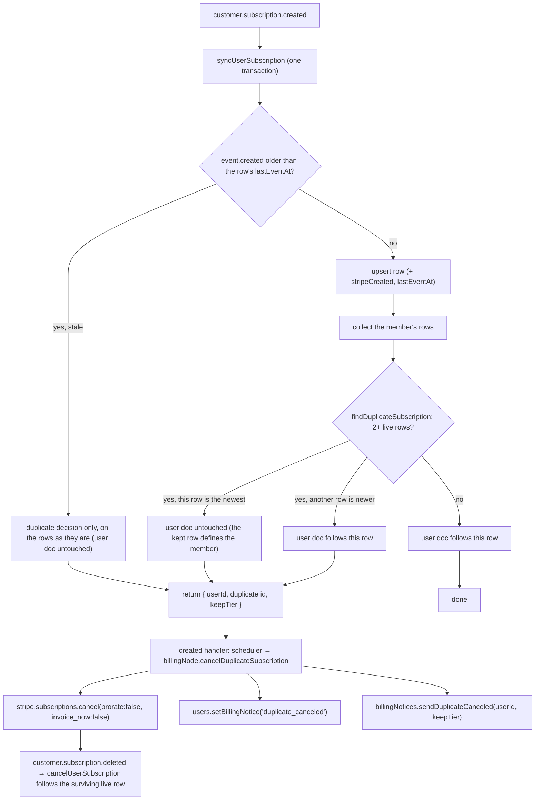

### Status semantics

`toSubscriptionStatus(raw)` (`convex/stripe.ts`) maps the raw Stripe status onto the
`trialing|active|canceled|past_due|none` union with an explicit, **fail-safe** mapping — a status that does not clearly
grant access can never become one that does:

| Stripe status                                | Stored `subscriptionStatus`  | `canEngage` |
|----------------------------------------------|------------------------------|-------------|
| `active`, `trialing`, `canceled`             | passed through unchanged     | yes         |
| `past_due`                                   | passed through unchanged     | no          |
| `unpaid`                                     | `past_due`                   | no          |
| `incomplete`, `incomplete_expired`, `paused` | `none`                       | no          |
| anything else (unknown or empty string)      | `none` (+ a console warning) | no          |

**Default is `none`, never `active`.** `none` and `past_due` are both rejected by `canEngage` (`convex/lib/access.ts`),
so a half-finished, lapsed, paused or unrecognised subscription never grants access. Covered by `convex/stripe.test.ts`.

### Renewal / access-end date (B21)

`subscriptions.currentPeriodEnd` (ms — written on every webhook sync from `sub.current_period_end`, see the table above)
was persisted but never read back anywhere. `getSubscriptionInfo` (`convex/users.ts`) now also returns
`currentPeriodEnd` (sourced from our own `subscriptions` row, not the user table) alongside `cancelAtPeriodEnd`, so
`BillingPage` can render "Renews on {date}" / "Access until {date}" (see §14 BillingPage). It is `undefined` when
there's no non-canceled Stripe subscription at all (never subscribed, or fully canceled) or, transiently, if our own
`subscriptions` row hasn't yet caught up with a brand-new webhook sync — the UI renders nothing for this line in either
case.

### Cancel, downgrade and resume (R09)

`billingNode.createCancelFlowSession({ sessionToken, flow })` (public action, `'use node'`) answers the interstitial's
two buttons and returns **`{ url: string | null }`** — a **hosted Customer Portal** deep link when Stripe owns the next
step, `null` when the change was written here instead. Every path opens with the same two reads: `liveSubscriptionFor`
(auth → the live `subscriptions` row, else `ConvexError('NO_LIVE_SUBSCRIPTION')`) and `retrieveWithItem` (Stripe's copy
of the subscription **and** its single item in one retrieve, else `Subscription has no item`). Portal links are minted
by the shared `portalSession(ctx, user, flow)` helper — customer id from `stripeComponent.getOrCreateCustomer`,
`return_url` of `/billing` — which uses the Stripe SDK directly because the `@convex-dev/stripe` component's
`createCustomerPortalSession` cannot set `flow_data`, the same pattern `createCheckoutSession` already follows. Two
flows here (the plan switch below is the third):

- **`cancel`** → `flow_data.type = 'subscription_cancel'` on the live subscription, returning to
  `/billing?canceled=true`. It **releases any downgrade schedule first**, so the portal acts on a plain subscription: a
  pending downgrade and a pending cancellation both want the period end, and the cancellation wins. A member who then
  abandons the portal has lost the downgrade and can schedule it again.
- **`downgrade`** → Starter at the **same billing interval**. The interval comes from the **retrieved Stripe
  subscription item** (`item.price.recurring?.interval`, narrowed to `month`/`year`), with our own optional
  `subscriptions.priceInterval` snapshot as the fallback; `starterPriceIdFor(process.env, interval)`
  (`convex/lib/stripePrices.ts`) then resolves it to `STRIPE_STARTER_ANNUAL_PRICE_ID` for `year` and
  `STRIPE_STARTER_PRICE_ID` otherwise — **annual stays annual**. The move is always **scheduled, not switched**
  ("Scheduled downgrade" below) and the action returns `null`; there is no longer any status that takes the immediate
  portal switch, so **`?downgraded=` is never produced**. `past_due` schedules like `active` (2026-09-09): Stripe's
  dunning owns the open invoice either way, and an immediate switch there would still credit. `trialing` throws **
  `TRIAL_NO_SWITCH`** — a trial runs on the plan it started on (§8), and the interstitial hides the offer anyway.

`billingNode.resumeSubscription({ sessionToken })` undoes a pending cancellation by clearing whichever field carries it:
`cancel_at_period_end: false` for the flag, `cancel_at: ''` for the portal's `cancel_at` (the flag write does not clear
it). `billingNode.undoScheduledDowngrade({ sessionToken })` undoes a pending downgrade (release the schedule, clear the
mirror). Both are **idempotent**: a subscription that is already not cancelling, or that carries no schedule (stale
tab, double tap), returns `null` **without a Stripe write**. There is no "nothing to resume" error. `downgrade`
additionally throws `ALREADY_STARTER` on the Starter tier, `CANCEL_PENDING` when the subscription is already cancelling
by either field (a schedule would fight the cancellation), and `Starter price not configured` when neither Starter price
env var is set.

Only the scheduled path writes to our tables, and only the `pendingTier` / `pendingAt` mirror (§5). Everything else
rides the existing **`customer.subscription.updated` webhook**, which carries `cancel_at_period_end` or `cancel_at` into
`subscriptions.cancelAtPeriodEnd` (and into the component's own table that `getSubscriptionInfo` reads), so
`BillingPage` swaps its "Cancel plan" link for "Resume plan" reactively, from that one field. A downgrade never
redirects at all now, so it fires `cancel_alternative_completed { from }` — `from` is the tier left behind, pairing
with `cancel_alternative_taken` — in the interstitial the moment the action resolves. `BillingPage`'s
`?downgraded=<tier>` reader, which used to land that return leg in the plan switch's "Switching you to Starter…"
state, **was deleted with it** on 2026-09-09: no path produces the marker, so a stale link is now ignored outright
rather than starting a 20-second wait for a tier that will not move. `?canceled=true` fires
`cancel_completed { plan }` exactly once (a `useRef` latch, so React StrictMode's double effect can't double-count) and
is then stripped from the URL. A trialing member who cancels keeps `status: 'trialing'` with `cancelAtPeriodEnd: true`,
and both trial mailers already skip that state (see "Trial notifications" above). While a trial is cancel-pending, the
50-interaction early end is skipped (see the milestone paragraph above), so the date the interstitial promised holds.
No proration, no refund, no discount — the policy is unchanged.

The app shows **exactly one** interstitial before Stripe (`app/src/components/CancelInterstitial.tsx`, §14): what
leaves the feed (the member's live post count from `posts.getMyPosts` plus their 30-day received total from
`interactions.getRecap`, fetched one-shot through `useQueryOnce` like RecapPage's — see [§11](#11-feed--engagement)),
a **"Schedule Starter"** alternative shown only above the Starter tier **and only while no
downgrade is already pending** (the `pendingTier` prop), and one optional question stored as `feedback` category
`cancellation` (§5, §12A). Stripe's own portal owns the **cancellation's** confirmation step — the interstitial never
confirms the cancellation itself. Before the alternative action, the interstitial names Starter's actual price for the
member's current interval, the effective date (or "end of your current period" fallback), the current Starter weekly
post and per-post interaction limits from `getTierLimits` (falling back to `DEFAULTS.starter`), and the loss of industry
filtering. A **scheduled** downgrade has no confirmation step to own: the action returns no
url, so the interstitial toasts "You move to Starter at the end of your period.", fires
`cancel_alternative_completed { from }` and closes itself.

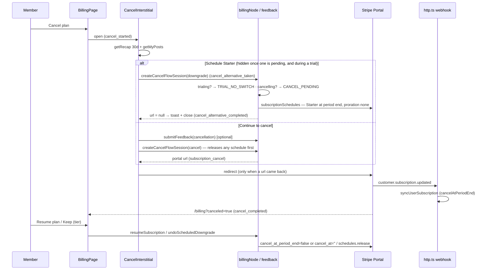

### Plan switch (R08 / R20)

`billingNode.createPlanSwitchSession({ sessionToken, priceId })` (public action, `'use node'`) is the card holder's
"Switch to {{plan}}", aimed at the **price on the button the member clicked** — the plan × the interval toggle, which
the post-cap email's link pre-sets to the member's charged interval (`?plan=&interval=`, R20). It returns the same **
`{ url: string | null }`** as the cancel flow, and the **direction** decides which:

- **Up, or a same-tier interval switch** → the `subscription_update_confirm` portal flow. The member lands on Stripe's
  confirmation for **that** plan (upcoming invoice, proration, 3-D Secure all handled by the portal), never on the
  portal home four clicks away from it, and returns to `/billing?switched=<tier>`.
- **Down a tier** (`planChangeDirection(live.tier, targetTier) === 'down'`, ranked by `tierToRank`, **never** by price
  amount — the R13 decoy ladder makes amounts a liar) → scheduled at the period end, `url: null`, no redirect. See
  "Scheduled downgrade" below. `past_due` schedules exactly like `active` (2026-09-09); a trialing member never
  reaches this point.

Direction is computed from tiers, so the annual↔monthly toggle inside one tier stays a portal switch whichever way it
points. `priceId` is client-chosen, so the action checks it against `ALLOWED_PRICE_IDS` first (exactly as
`createCheckoutSession` does), retrieves the subscription's single item, and throws `ALREADY_ON_PLAN` when the item
already carries that price. Then **`TRIAL_NO_SWITCH` on `trialing`**, before any direction or price is resolved (§8).
It also throws `CANCEL_PENDING` when a downgrade would fight a pending cancellation, and **`PENDING_DOWNGRADE`** when
an upgrade or interval switch is attempted while a schedule is attached: the portal would write the same subscription
the schedule owns, so `BillingPage` asks for the undo first. The portal return leg is
`/billing?switched=<tier>` — the tier resolved from the price through `getTierFromPriceId` — which `BillingPage` reads
back as a landing state (next paragraph). **A scheduled downgrade never appends a marker**, which is what keeps it out
of that state's 20-second Sentry timeout.

On the client, `BillingPage.handlePlanClick` fires `plan_switch_opened { plan, source }` and calls `handlePlanSwitch`,
which redirects to the flow URL **when one comes back**; a `null` url means the change was scheduled, so it toasts
"You move to {{plan}} at the end of your period." and fires `downgrade_scheduled { from, to }` instead.
`PENDING_DOWNGRADE`
and `CANCEL_PENDING` each toast the one-line instruction that clears them ("Undo your scheduled change first.",
"Resume your plan first."); **any other** refusal (`ALREADY_ON_PLAN`, a price not yet allowed in the portal
configuration, a Stripe error) falls back to `handleManageSubscription` — the portal **home**, where every plan is one
more click away — with no error toast; the refusal is logged server-side. The plan buttons are disabled while a portal
session is being minted, so a double tap cannot open two. Back on `/billing?switched=<tier>`, the page latches the tier
during render (the `justSubscribed` pattern) and shows **"Switching you to X…"** while `me.tier` still differs — the
same 20-second timeout and Manage escape valve as the R07 activation, with a Sentry exception if it never lands — then,
once the webhook has moved the tier, **"You're on X now."** and `plan_switch_completed { plan }` exactly once (a
`useRef`
latch), stripping the param only at that point so a refresh mid-wait re-latches it. A card-less member ignores the
marker: their default tier could otherwise "complete" a switch that never happened. The portal flow needs subscription
updates **on** in the configuration this member gets — which lists their own tier and the tiers above it, so every
price a deep link can name is present. The portal runs `always_invoice`, so
an upgrade taken here is invoiced on the spot for the rest of the period, while a **same-product** interval switch
matches `schedule_at_period_end` and lands at the end of the period with no credit — the same economics as the portal
home's own "Update plan", not new ones. **Cross-tier downgrades no longer reach the portal at all**, which is how the
credit they used to pay out was closed; the section below has the whole story.

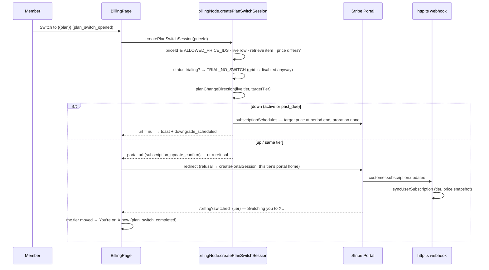

### Scheduled downgrade — no credit at the period end (B07)

**The gap this closes.** The Customer Portal prorates with `always_invoice` (D7), and its
`schedule_at_period_end` conditions defer a switch **only between prices that share a product**. Starter, Growth and
Pro are three products, so a cross-tier downgrade taken in the portal applied at once and **credited** the unused
period — money back, against the no-refund line in the Terms. Putting all six prices on one product is not a fix and is
not available: Stripe answers `400 For each product, its price must have unique billing intervals`, because a portal
product entry holds exactly one monthly and one annual price (tried, refused and reverted 2026-09-09 — do not
re-propose it). The fix is to stop asking the portal: **we write the downgrade ourselves as a Stripe subscription
schedule**, and the portal keeps only the upgrades and interval switches it handles correctly.

**`scheduleDowngrade(ctx, sub, targetPriceId, targetTier)`** (private, `billingNode.ts`) is the whole write, shared by
R09's "Schedule Starter" and the plan grid's cheaper-tier button:

1. **Resolve the interval from the target price**, not from the subscription — `intervalForPriceId(process.env,
priceId)` (`convex/lib/stripePrices.ts`), because the grid can send a monthly member to an annual price. No match
   throws `Unknown price interval`.
2. **Get the schedule.** `subscriptionSchedules.create({ from_subscription })` when the subscription carries none, or
   `retrieve` when it does. A subscription holds **at most one** schedule, so a double tap — or a re-target to a
   different cheaper plan — rewrites the same one instead of racing a second. That is the whole idempotency story.
3. **Update it with two phases**, built by the pure `buildDowngradePhases` (below): phase 0 is the period already paid
   for, unchanged; phase 1 is the target price for one interval. `proration_behavior: 'none'` on phase 1 is what makes
   the swap settle no money, and the same value at the top level says the current-phase rewrite settles none either.
   `end_behavior: 'release'` hands the subscription back when the last phase ends.
4. **Mirror it** onto our row through `internal.billing.setPendingDowngrade` — `pendingTier` plus `pendingAt`, taken
   from **Stripe's own** `phases[1].start_date` (seconds→ms), never from our arithmetic. Returns `{ url: null }`.

**`convex/lib/downgrade.ts`** holds every decision that can be tested without Stripe, and nothing else:

- `planChangeDirection(fromTier, toTier)` → `'up' | 'down' | 'same'`, ranked through `tierToRank`
  (`convex/lib/planLimits.ts`). **Never** compares `unit_amount`: the R13 decoy ladder means a cheaper amount is not a
  lower tier.
- `buildDowngradePhases(schedule, targetPriceId, targetInterval)` → exactly two phases. It finds the phase whose
  `start_date` matches `current_phase.start_date` — the **current** phase, not `phases[0]`, which differ on a schedule
  that has already run one — and throws `ConvexError('Schedule has no current phase')` when there is none, rather than
  guessing. A Stripe `update` **unsets whatever it omits**, so the current phase is repeated field by field: items
  (price ids unwrapped from expanded objects, `quantity` defaulted to 1), `start_date`, `end_date`, discounts (carried
  as `discount` id → `coupon` → `promotion_code`, whichever the phase actually has) and metadata, with empty
  collections omitted so Stripe is not sent `[]`. `trial_end` is seen and deliberately **not** carried: re-asserting a
  spent trial on a paid phase is the one repetition that would be wrong.
- `resolvePendingDowngrade(existing, incoming)` → `'none' | 'keep' | 'clear' | 'applied'`, the webhook's decision
  (below).

**The webhook closes the loop.** `customer.subscription.updated` fires when the schedule is attached, again when the
price swaps, and again on release — no new event type is needed. `http.ts` passes `sub.schedule` through as
`stripeScheduleId`, and `syncUserSubscription` calls `resolvePendingDowngrade` **before** it patches the row, because
the decision depends on the tier the row still holds:

| Incoming vs. our row                               | Outcome     | Effect                                                          |
|----------------------------------------------------|-------------|-----------------------------------------------------------------|
| no `pendingTier` on our row                        | `'none'`    | nothing to do                                                   |
| tier **changed**                                   | `'applied'` | clear the mirror **and** schedule `releaseSubscriptionSchedule` |
| tier unchanged, no `stripeScheduleId` on the event | `'clear'`   | the schedule is gone (released elsewhere) — clear the mirror    |
| tier unchanged, schedule still attached            | `'keep'`    | the attach event itself — leave the mirror alone                |

`'applied'` is checked **before** `'clear'` on purpose: the release event that follows a landed swap carries no
schedule id, and reading it as `'clear'` would look identical to an undo.

**Why the release matters.** `end_behavior: 'release'` fires only when the **last** phase ends — a year away on an
annual plan — so a spent schedule would otherwise sit on the subscription for a whole cheaper period, making every
later flow believe a downgrade is still pending. `releaseSubscriptionSchedule` (an `internalAction`, scheduled with
`runAfter(0)`) releases it the moment the swap lands; Stripe's own `end_behavior` is the backstop, not the mechanism.
Release failures are logged through `scrubError` and swallowed — `release` is valid only for a `not_started` or
`active` schedule, and every other status means the work is already done — but the mirror is cleared either way, so a
Stripe hiccup can never strand the UI in "pending".

**Undo.** `undoScheduledDowngrade` releases the schedule and clears the mirror, and the `cancel` flow does the same
before opening the portal. Both go through one `releaseScheduleOn(ctx, sub)` helper, so "no schedule attached" is a
silent success on every path.

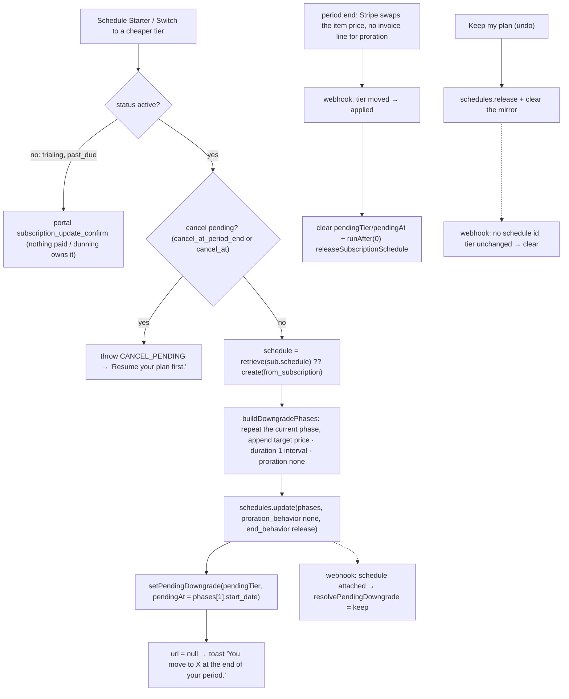

### Stripe Dashboard setup

> **Status (2026-09-08 — the test-mode sandbox was DELETED; everything below must be recreated).** Every Stripe object
> named by the earlier audits is gone: the products and all seven Prices (`price_1TBM…`, `price_1UDY…`), webhook
> endpoint
> `we_1TFRqXJyGKdozmOnUc5udijk`, portal configuration `bpc_1TFSe4JyGKdozmOn3gJylzOY`. Confirmed by `GET` under a working
> key: **0 products, 0 prices, 0 webhook endpoints, 0 portal configurations**. Every `STRIPE_*_PRICE_ID` and the
> `STRIPE_WEBHOOK_SECRET` in all four env copies now name an object that does not exist, so checkout fails with
> `No such price` and no webhook is delivered at all.
>
> **A usable key already exists — no new one has to be issued.** The stores hold **two different** keys: the Convex
> **deployment** env (`npx convex env get STRIPE_SECRET_KEY`, tail `N0Os`) still authenticates against an empty test
> environment, while `.env.local` and `convex/.env.local` both carry the sandbox's dead key (tail `SJfF`,
> `api_key_expired`). The deployment copy is the one the backend actually reads, so it is also the one to hand the
> provisioning script — which writes it back into the two local files and repairs them in the same pass.
>
> `scripts/stripe-provision.mjs` recreates the whole set in one pass, against whichever environment the key belongs to.
> The table below is its specification; run it from the repo root as `node scripts/stripe-provision.mjs --key sk_test_…`
> (add `--site https://<deployment>.convex.site` if `CONVEX_SITE_URL` is not in `.env.local`; `--check` runs only its
> form-encoder self-test and exits, no key needed).
>
> It creates the three plan products with a monthly and an annual Price each, the one-time featured-post Price, the
> webhook endpoint with exactly the six events
> `convex/http.ts` handles, and it updates the **default** Customer Portal configuration — never a new one, because
> `billingPortal.sessions.create` passes no `configuration` and so always uses the account default. On an account that
> has **no** default yet it writes no configuration at all and says so: a new one would be ignored, and Stripe has no
> delete for portal configurations, only `active: false`, so the stray object would sit in a live account forever.
> Each object carries a fixed `Idempotency-Key`, so a re-run **within 24h** repairs a half-finished
> run instead of duplicating it; after that window a re-run creates a second set that has to be archived by hand.
> Finally it writes the ids into `.env.local`, `convex/.env.local` and the `VITE_` copies in `app/.env.local`, and
> prints
> the `npx convex env set` lines for the fourth copy — the deployment env, the only one the backend actually reads.
>
> **Two traps the script encodes**, worth keeping if it is ever replaced. ✅ **Resolved 2026-09-08: `products` was
> never dropped.** `features.subscription_update.products` is an **expandable** field, so Stripe leaves it out of the
> configuration body unless the request asks for it, and every read-back that reported it missing had simply never
> asked. Two successive diagnoses were wrong for the same reason — first the form encoder, then the Dashboard — and
> the second was built on the first one's evidence instead of a fresh test. The script now retrieves it as
> `…/billing_portal/configurations/{id}?expand[0]=features.subscription_update.products`, which returns all three
> products and all six prices. The distinguishing probe: expanding a real-but-unexpanded path returns **200 with a
> larger body**, while a nonsense path returns **`400 This property cannot be expanded`**. Verify every config write
> with a `GET` — but **expand the field you mean to check, or the check cannot pass no matter what was stored**.
> And `unit_amount` is in **cents** while
> `recurring[interval]` is what separates $100/yr from a
> catastrophic $100/mo — every Price is read back after creation. A third, latent: a Price that is its product's
> `default_price` cannot be archived until the product is repointed, so the script sets `default_price` to the monthly
> up front.
>
> **Decision D7 is SETTLED (Henriko, 2026-09-09): `PRORATION = 'always_invoice'` + `schedule_at_period_end`.**
> `features[subscription_update][schedule_at_period_end]` separates the two directions, which one `proration_behavior`
> never could. An update matching `decreasing_item_amount` or `shortening_interval` is **scheduled at the end of the
> period** rather than applied now, so it never prorates and never credits; Stripe shipped the field for this precise
> problem. `SCHEDULE_AT_PERIOD_END` in the script carries both conditions and reads them back by `GET`: **drop them
> and every downgrade silently credits**, which is what the no-refund line in the Terms exists to prevent. That half
> holds whatever `PRORATION` is set to.
>
> ⚠️ **Why not `create_prorations`**, the value this replaced and the one an earlier note here wrongly described as
> charging immediately. Stripe's wording: it "creates proration invoice items when applicable. These proration items
> are only invoiced immediately under certain conditions" — otherwise they ride the **next** scheduled invoice. A
> member could therefore upgrade Starter → Pro on day 2, hold Pro for the rest of the month, cancel before renewal
> and never be billed the difference. `always_invoice` finalises that invoice at the moment of the switch instead.
> Its one historic drawback, immediately invoicing a **downgrade's** credit, is exactly what `schedule_at_period_end`
> removes for every switch it covers.
>
> **Applying it to an environment that already exists is one Dashboard control, not a re-provision**: Settings →
> Billing → Customer portal → _When customers change plans or quantities_ → keep **Prorate charges and credits** and
> set **Charge timing** to **Invoice prorations immediately**. ✅ Applied and read back 2026-09-09: that pair does
> write `always_invoice`, and it left `products`, both `schedule_at_period_end` conditions and
> `trial_update_behavior` untouched. Record the mapping, because the Dashboard's three radios plus a timing dropdown
> are more combinations than the API's three enum values: _Prorate charges and credits_ + _at the end of the billing
> period_ = `create_prorations`, the same radio + _immediately_ = `always_invoice`, _No charges or credits_ = `none`.
> A Dashboard save rewrites the whole `subscription_update` object, so **read it back after any portal edit** — that
> is the only proof a control did what its label says and clobbered nothing next to it.
>
> ⛔ **Scheduling covers INTERVAL switches only, and that ceiling is structural — do not try to widen it by
> restructuring the products.** Stripe defers a downgrade only **between prices that have the same product**, so the
> obvious fix is one product carrying all six prices. It is not available: the portal rejects the configuration
> outright with **`400 For each product, its price must have unique billing intervals`**. A product entry may list one
> monthly price and one annual price and no more. The portal's data model _is_ "product = plan, prices = billing
> intervals", which is exactly the three-product layout, so the two constraints close the door between them.
> **Proven 2026-09-09** by provisioning a single `LinkIntoTheSSI` product with all six prices and watching the portal
> write fail; every earlier note here claiming one product would close the gap was wrong, and reasoning from the
> `schedule_at_period_end` docs alone is what produced it — the portal's own constraint is documented nowhere near
> them. The lesson is 2026-09-08k's, unlearned and re-learned: **a design that depends on an API accepting something
> is not settled until that write returns 200.**
>
> So the portal's own behaviour is: Starter annual → Starter monthly **defers** to period end and never credits, while
> a cross-tier downgrade **applies at once and issues a prorated credit**, against the no-refund line in the Terms.
>
> ✅ **Closed 2026-09-09 by taking cross-tier downgrades off the portal** — see "Scheduled downgrade" above for the
> build. Both paths that could reach one — `createPlanSwitchSession` (the plan grid) and
> `createCancelFlowSession(flow:'downgrade')` — used to build a `subscription_update_confirm` deep link, and a
> portal-driven update obeys the portal's `proration_behavior`. They now write our own `subscriptionSchedules` phases
> instead, swapping the item price at `current_period_end` with `proration_behavior: 'none'`: the member keeps what
> they paid for, the tier moves on the period-end webhook, and nothing prorates. Stripe's own portal guide warns that
> its Manage-downgrades feature "automatically creates and attaches a subscription schedule to the subscription" and to
> follow subscription-schedule best practices "to prevent unexpected subscription overwrites" — which is exactly why
> our schedule **owns** that flow rather than racing the portal for it. The portal Dashboard rows below are unchanged
> and still required for upgrades and interval switches.
>
> ✅ **The portal home was the second half of the same gap, closed 2026-09-09 with per-tier configurations.** Taking
> the deep link away changed what _our_ pages build, not what the portal _offers_: one configuration served every
> member, and its `subscription_update.products` listed all three products and all six prices, so a member who opened
> "Manage subscription" could pick Starter there, be credited under `always_invoice`, and overwrite the schedule we
> had attached. `products` is a property of the **configuration**, so it cannot vary by member any other way — and
> Stripe's answer is multiple configurations plus a `configuration` on the session. See "Per-tier portal
> configurations" below.
>
> ✅ **Proven against Stripe in test mode, 2026-09-09 — 22 of 22 read-backs passed.** `pnpm verify` exits 0 (convex
> 514/514, app 433/433), but a passing suite proves our logic, not that Stripe issues no credit. What closed it was a
> **test-mode** downgrade on a test clock, read back three times. **(A)** scheduled: schedule
> `sub_sched_1UDqjVFPUrUP5vm6evplA46r`, two phases, item still on Growth `price_1UDaHSFPUrUP5vm6LcFMOYki`, phase 1
> `proration_behavior: "none"` with `start_date` 1791572425 == `current_period_end`, `end_behavior: "release"`,
> customer `balance: 0`, no new invoice. **(C)** undo: schedule `status: "released"`, `subscription.schedule`
> undefined, price unchanged, `balance: 0`, still no new invoice. **(B)** after advancing past the period end: item
> on Starter `price_1UDaHRFPUrUP5vm6HUZUaCNW`, 2 invoices vs 1, **exactly one line**, that line the Starter price,
> **no negative line**, **no proration line**, `balance: 0`, invoice total 1000. Objects: clock
> `clock_1UDqjQFPUrUP5vm6jwlppvOO`, customer `cus_VEJMLnIOhrpAcI`, subscription `sub_1UDqjSFPUrUP5vm6dWCHMk5I`
> (Growth $15/mo, period end 2026-10-09T19:00:25Z), all deleted with the clock. Every Stripe write is Henriko's —
> the assistant's tooling permits Stripe reads and refuses writes.
>
> ✅ **The platform half is proven too, 2026-09-09 — 47 of 47 checks passed** (`scripts/billing-scenarios.mjs`, nine
> scenarios, driven against a live `npx convex dev` so webhook-delivered state is real). Clock
> `clock_1UDrvcFPUrUP5vm6A4Olt8aH`, customer `cus_VEKaspMgxpOUf5`, subscription `sub_1UDrvrFPUrUP5vm6nIDoaSEs`,
> schedule `sub_sched_1UDrwRFPUrUP5vm6ssJb3cd8`, probe member `jn74289zwmbcjaa40dxggf8vy98e3dqw` — everything but the
> probe member deleted with the clock, and the probe member is never reused. The two partial runs it took to get
> there are what found the `currentPeriodEnd` and spent-schedule bugs recorded below; both were real, and neither
> was reachable from the proof run.
>
> ✅ **Then 59 of 59, same day, after the merge.** `stripe-downgrade-proof.mjs` was folded into this script — its
> money assertions (+11) and its read-only `--user` audit, plus a new check that the Checkout metadata survives the
> swap — and the merged run is green end to end. Clock `clock_1UDsKIFPUrUP5vm61Vg609m5`, customer
> `cus_VEL02p9tr6P2lQ`, subscription `sub_1UDsKQFPUrUP5vm6OK2Tow7U`, schedule `sub_sched_1UDsKmFPUrUP5vm6KS8ZRs3R`,
> probe member `jn79w33vqh4t81c1evfz7qm9bn8e2x22`. The money half read **2 invoices before, 3 after**, the applied
> invoice **one line at `price_1UDaHRFPUrUP5vm6HUZUaCNW`, total 1000 == the Starter price, no negative line, no
> proration line**, and `customer.balance` **0 at all three steps**. `--user` was then run against the kept clock and
> reported the same subscription from the other side: item on Starter $10.00/month, balance 0, our row `tier starter,
status active, pendingTier none`, schedule already handed back.
>
> ⚠️ One branch of `--user` is still unexercised: the **schedule-attached** shape. S8 releases the schedule before the
> run ends, so a kept clock always audits clean. Reaching it means auditing a run mid-flight, between S5 and S7.
>
> **One script covers this as of 2026-09-09.** `scripts/billing-scenarios.mjs` carries both halves. There used to be a
> second, `stripe-downgrade-proof.mjs`; its money assertions and its read-only audit were ported in and the file was
> **deleted**, because everything else it did was a strictly weaker version of the same run: it drove the Stripe API
> directly against a **synthetic** customer, which is the single thing that made it unable to prove anything about our
> own code.
>
> Since 2026-09-18 `billing-scenarios.mjs` also carries `--coupons`, a separate run with its own clock and probe
> member that proves the promotion-code guard; the free-year finding below is what added it.
>
> **Why the synthetic customer was the ceiling.** A test clock can only be attached to a customer **at creation**, so a
> clock run must build its own customer — and `syncUserSubscription` finds the member by `users.by_stripe_customer`, so
> a customer no row points at is invisible to us and the entire webhook half never runs. `billing-scenarios.mjs` goes
> the other way round: it creates the clock customer **first**, then points a **disposable probe member** at it, minted
> fresh each run. That detail is not fussiness — `setStripeCustomerId` cannot unset, so a repointed real member would
> be left holding a dead customer id, and `createCheckoutSession` only mints a fresh one when the field is empty. Fresh
> rather than reused because `findLiveSubscription` scans `by_user` **oldest-first**: one aborted run would otherwise
> leave an `active` row that shadows every later run's own subscription.
>
> **The mechanism half — nine scenarios**, driven through our own public actions via the Convex CLI and asserted on
> **our rows**, not only Stripe's objects: the webhook creating the row; the trial gate (`TRIAL_NO_SWITCH` from both
> entry points); the cancel-pending mirror and `resumeSubscription`; the scheduled downgrade's `pendingTier` /
> `pendingAt` mirror; the `PENDING_DOWNGRADE` / `ALREADY_ON_PLAN` / `Invalid price ID` guards; the undo; the applied
> swap, with `releaseSubscriptionSchedule` handing the subscription back; and a portal home session proving a per-tier
> configuration matched.
>
> **The money half — the assertion B07 actually asks for**, and it does **not** follow from the mechanism half.
> Customer balance and invoice count are checked at each step (S5 while merely scheduled, S7 after the undo), and the
> applied renewal invoice is checked line by line in S8: **exactly one line**, that line the Starter price, **no
> negative line**, **no proration line**, total == the Starter price, `balance: 0`. A credit does not arrive as an
> invoice line — Stripe parks it as a **negative `customer.balance`** and silently consumes it on the next invoice a
> period later — so an invoice-only check cannot see one. The gap is not theoretical: drop the top-level
> `proration_behavior: 'none'` from `scheduleDowngrade`'s phase-0 rewrite and **every mechanism check still passes**
> while `no new invoice` fails. Keep the phase assertions matching `lib/downgrade.buildDowngradePhases` whenever that
> function changes.
>
> The probe subscription is stamped with `metadata.convexUserId` exactly as Checkout stamps it (`billingNode.ts:72`).
> It earns that twice: `--user` searches on it, and `buildDowngradePhases` must carry it through the phase-0 rewrite or
> that rewrite silently **unsets** it, quietly breaking every Dashboard support lookup after a downgrade. S8 asserts it
> survived the swap.
>
> `--user <convexUserId>` is a **read-only** audit — all GETs plus one sandboxed readonly query, safe against a
> member's live test-mode subscription at any time, and the only half the assistant can run unaided (the tooling
> permits Stripe reads and refuses writes). It reports the item price and its tier, period end, customer balance and
> test clock, and **our row beside them** — the thing the old script structurally could not read, and the only way to
> tell a genuinely pending downgrade from a **spent** schedule (attached on Stripe, nothing pending on our row). With
> no deployment reachable it degrades to a Stripe-only report rather than failing.
>
> The full run needs `npx convex dev` running, because it asserts on webhook-delivered state. The **`past_due` round
> trip** (failed renewal → `invoice.payment_failed` → `past_due` → dunning retries → terminal state, plus the
> pay-the-invoice recovery) has its own `--pastdue` run, see the dated block below. The run walks the ladder week by
> week and asserts its shape (attempts monotonic, retries in distinct later weeks, exhausted inside the window);
> Stripe's exact retry timestamps are still not pinned — a test clock replays scheduled retries with multi-day lag,
> so an exact hour would test Stripe's scheduler rather than our code. Deliberately **not** covered: the
> featured-post checkout, the duplicate-subscription guard, and `endTrialEarly`'s 50-interaction
> trigger. What the trigger then does **is** covered: the run calls `endTrialEarly`
> itself, on a portal-cancelled trial (must not convert) and on a live one (one paid full-price invoice, nothing
> pending).
>
> ⚠️ Spawn the Convex CLI as `node node_modules/convex/bin/main.js run …`, never `npx convex`. On Windows `npx.cmd`
> without a shell is `EINVAL` (the CVE-2024-27980 fix), and with `shell: true` the JSON argument's quotes are mangled
> before the CLI ever sees them. `--inline-query` binds `ctx`; top-level `await` and `return` both work in it.
>
> 🐞 **Fixed 2026-09-09, found by the first run of `billing-scenarios.mjs`: `currentPeriodEnd` was never populated.**
> `current_period_end` moved from the **subscription** onto the subscription **item** in the 2025 API versions, and
> the webhook mapping read only `sub.current_period_end` — so on a modern account it was always `undefined`, and with
> it `users.subscriptionEndsAt` and the renewal date BillingPage shows the member. Every test still passed, because
> nothing asserted against a real payload. `syncArgs` now reads the item as a fallback and moved from `http.ts` into
> `stripe.ts` so it can be unit-tested (`http.ts` registers routes at module scope and cannot be imported by a test).
> **Same shape as the `expand` trap above**: an API-version move that reads back as a missing field rather than an
> error. When a Stripe field comes back empty, check whether it moved before assuming it is unset.
>
> 🐞 **Fixed 2026-09-09, found by the second run: a spent schedule locked the member out of every upgrade.**
> `releaseSubscriptionSchedule` is a **one-shot** scheduled action and Convex does not retry actions, so a single
> Stripe refusal leaves the schedule attached until phase 1's own `end_behavior` fires — a whole period later, a year
> on annual. In that state `scheduleIdOf(sub)` still reads "a downgrade is pending" while `pendingTier`, the only
> thing BillingPage renders, says nothing is: `createPlanSwitchSession` refused every upgrade with
> `PENDING_DOWNGRADE`, whose toast asks the member to undo a downgrade the page shows no undo button for — and
> upgrades are the revenue direction. Closed by `isSpentSchedule` (`convex/lib/downgrade.ts`): a schedule with no
> `pendingTier` is released in place instead of raised, so the next upgrade self-heals it. **`pendingTier` is the
> mirror this design trusts — a schedule id never was**, and that guard was the last place still disagreeing.
>
> 🐞 **Fixed 2026-09-10, found in manual testing: a cancelled trial was converted, and the conversion charged
> nothing.** A member cancelled mid-trial in the portal, then hit 50 interactions. On API `2026-02-25.clover` the
> portal cancels by setting **`cancel_at`** (= trial end) and leaves `cancel_at_period_end` **false**. `syncArgs`
> mirrored only the flag, so the row read "not cancelling", `shouldEndTrialEarly` let it through, and `endTrialEarly`
> set `trial_end: 'now'`. Stripe reset the anchor, and because `cancel_at` now fell mid-period it billed
> 2026-09-10 → 09-16 as a **pending** $10.63 proration instead of invoicing it (the API default is
> `create_prorations`). Un-cancelling a minute later added $39.37 more, also pending. The whole $50 sat as invoice items
> for the renewal, and no charge went through. The 4 clean conversions in the same account were each invoiced and paid
> in the same second, so this was never processing delay. Fixed at the one shared predicate, `isCancelPending`
> (`convex/lib/trialMilestone.ts`): it feeds the row mirror, both `CANCEL_PENDING` guards (which read Stripe's flag
> directly, equally blind), and a re-check inside `endTrialEarly` itself. `resumeSubscription` now clears `cancel_at`
> too, which `cancel_at_period_end: false` never did. The Convex Stripe component's own table was right all along (it
> derives the flag from `cancel_at`), which is why BillingPage showed the cancel while our row missed it. **Same shape
as
> the `current_period_end` move above**: an API version moved a field and it read back as "unset". The scenario script
> had passed because it cancelled with the flag, the one shape the portal no longer sends. It now cancels the trial
> the portal's way, and it checks the conversion by **money**: one paid invoice for the full price and nothing pending.
> `active` never proved a charge, because the broken conversion went `active` too.
>
> 🐞 **Fixed 2026-09-18, found while testing the launch promotion code: a free month became a free year, twice.** The
> promo ("first 10 signups get a free month") rides `allow_promotion_codes` on Checkout — a Stripe discount attached to
> the SUBSCRIPTION, so Stripe applies it to whatever invoice comes next. Proven against test mode with a test clock,
> and now pinned by `scripts/billing-scenarios.mjs --coupons`:
> **(1) a `repeating` coupon** discounted the prorated ANNUAL invoice of a monthly → annual switch taken on day 28
> inside its one-month window: an annual period Oct 2026 → Sep 2027 for **$0**. The promo must be `duration: 'once'`.
> **(2) even a `once` coupon** is unconsumed until the first invoice AFTER a trial (the trial's $0 invoice does not use
> it), so a trialing member could switch to annual from the **portal home** — BillingPage keeps "Manage subscription"
> visible during a trial — and the trial-end invoice was annual, 100% off, **$0** again. `TRIAL_NO_SWITCH` never saw
> this: that guard is on our own actions, and the portal is Stripe's page (`trial_update_behavior: 'continue_trial'`
> is exactly what makes a mid-trial switch painless). **(3) the coupon is not price-scoped at all**: a customer
> choosing the annual plan at Checkout could apply the same code and zero the year — $150 → $0, proven. Stripe's
> `applies_to` lists products only, and one product carries both intervals (the portal requires unique intervals per
> product), so no coupon configuration separates them. **Fix one**: the trial portal configuration above — trialing
> members get `subscription_update: { enabled: false }`, so the portal offers no plan picker at all, and
> `portalHomeKeyFor` gives the same no-switch config to a member whose subscription row has not landed yet, closing
> the checkout-to-webhook window. **Fix two**: `lib/discountGuard` + `billingNode.detachSubscriptionDiscounts` — any
> other price change (tier or interval) with a discount still attached schedules a detach from the webhook, with
> bounded retries on transient Stripe failures. Our own scheduled downgrade applying is exempt, because
> `buildDowngradePhases` carries the discount into the cheaper phase on purpose. **Fix three**:
> `allow_promotion_codes: promotionCodesAllowed(env, priceId)` — the hosted promotion-code field is offered on
> monthly prices only. The scenario's money checks: with a trial, the coupon is detached before trial end and the
> trial-end invoice is **paid in full** ($150), not $0; with no trial (a returning subscriber), the coupon is
> consumed by the invoice created with the subscription, and the same-day switch to annual is **charged** — no
> discount survives on the annual subscription.
>
> Test-mode proof, 2026-09-18: `--coupons` **17/17 checks**, clock `clock_1UHVtlFPUrUP5vm648LrxVht` (deleted),
> subscription `sub_1UHVtrFPUrUP5vm6WhOdwDhi` (trial) + `sub_1UHVu8FPUrUP5vm6DFqxPaHr` (no trial), coupon `YOtAGlVT`
> (deleted), trial configuration `bpc_1UH4xCFPUrUP5vm6SPGbd7oz`. The money reads: the monthly Checkout offered the
> promotion-code field and the annual one hid it (`allow_promotion_codes` true / false); the no-trial first invoice
> was $0, its switch to annual was **paid in full** ($148.77); the trial-end invoice read `paid 15000 vs 15000`,
> discount `[]`. The B07 default run re-passed **69/69** against the same deployment afterwards.
>
> ✅ **The dunning round trip and its terminal state are proven too, 2026-09-18 — `--pastdue` 27/27 checks.** The
> trial renewal charged to `tok_chargeCustomerFail` (4000000000000341 — attaches fine, every charge declines) at
> trial end: Stripe `past_due`, the renewal invoice `open`, and our row and the user both `past_due`. In that state a
> second checkout is refused (`ALREADY_SUBSCRIBED`), a downgrade still schedules (`{url: null}`) and is undoable, and
> the portal home still opens. Paying the open invoice restores `active` on Stripe, the row and the user — the status
> is cleared, never latched. A second subscription is then left to Stripe's **dunning ladder**, walked WEEK BY WEEK
> off Stripe's own `next_payment_attempt`: the attempt count only moves forward (1 → 2 → 3), retries land across
> distinct weeks, every sample with a retry still scheduled is `past_due`, and the ladder exhausts
> (`next_payment_attempt` none) — after which this account's failed-payment setting **cancels** the subscription,
> which the webhook follows into our row and the member (`canceled`, tier falls to starter). **A canceled member's
> route back is then proven on that same account**: a plan switch refuses (`NO_LIVE_SUBSCRIPTION` — the subscription
> is gone) while checkout accepts a fresh subscription. The `unpaid` branch — row keeps Stripe's raw status, the user
> maps to `past_due` — is asserted too, for an account configured to mark-unpaid rather than cancel. Exact retry
> **timestamps** are still not pinned: runs on this account exhausted the ladder at ~2 and ~5 weeks respectively
> (test-clock replay varies), so the assertions pin the shape — monotonic attempts, retries across weeks, exhaustion —
> not the days. Clock `clock_1UHZ3cFPUrUP5vm6gkjpc1mJ` (deleted), subscriptions
> `sub_1UHZ3kFPUrUP5vm6LF2qCPlk` (recovery) and `sub_1UHZ3vFPUrUP5vm6YwevSpzU` (dunning). Raw card numbers are
> refused on this account, so the token — not the number — is the fixture.
>
> ⚠️ The webhook-scheduled release **cannot be asserted under a test clock.** Stripe locks writes while a clock
> advances (`Test clock advancement underway - cannot perform modifications`), and the swap webhook necessarily fires
> inside that window, so the action runs and is refused a second later. `billing-scenarios.mjs` re-runs it once the
> clock is ready; that the sync scheduled it at all is proven by `pendingTier cleared by the sync`, which is the same
> `applied` branch. The dead end above is unit-tested rather than scripted, because proving it live would need an
> upgrade portal session — and `portalSession` mints its own component-managed customer, which does not own the clock
> subscription.
>
> ⚠️ **A stale `STRIPE_SECRET_KEY` in the deployment env is invisible until something makes an OUTBOUND Stripe call
> from Convex.** It is the first of the four copies above — the only one the deployed backend reads, and the only one
> no file edit reaches (`npx convex env set`). Webhooks come _in_ and are verified with the **webhook** secret, so
> they keep working perfectly while every billing action fails. Found 2026-09-09 with one character appended to the
> deployment copy while the same key in `.env.local` was correct. Compare lengths without printing the secret:
> `v=$(npx convex env get STRIPE_SECRET_KEY | tr -d '\r\n'); echo "len=${#v}"`, against the file's own.
>
> ⓘ **Audited 2026-09-09: the test-mode account holds zero subscriptions**, `henriko202`
> (`jn79ck3zw08kdnta8veypzevch8dez99`) included — the 2026-09-08 sandbox deletion took them with it. So there is
> nothing to audit read-only; both scripts build their own clock, which is the only way to reach these read-backs
> today.
>
> ✅ **The per-tier configurations are live in test mode, 2026-09-09.** `scripts/stripe-provision.mjs` created them
> and verified each with an expanded GET: `bpc_1UDpubFPUrUP5vm6zvLYdQmT` **(starter)** 6 prices
> `[starter growth pro]`, `bpc_1UDpucFPUrUP5vm6zvnopyaj` **(growth)** 4 prices `[growth pro]`,
> `bpc_1UDpucFPUrUP5vm6NcmUkhlo` **(pro)** 2 prices `[pro]` — each `always_invoice`, both
> `schedule_at_period_end` conditions, `continue_trial` — and `bpc_1UDaHWFPUrUP5vm6E6Qgebvt` **(default)** with plan
> switching **off**. The 6 / 4 / 2 ladder is the whole point: no configuration lists a price cheaper than its own
> tier, and the script fails the run if one does. **Live mode is still unprovisioned**, where the same command with
> `--key sk_live_…` throws `PORTAL_NOT_CONFIGURED` on every portal open until it is run.
>
> ✅ **`customer.subscription.trial_will_end` is subscribed in test mode, 2026-09-09** — the same run re-applied all
> **6 events** to `we_1UDaHWFPUrUP5vm6nEKJh0Fq`. The day-7 mailer's webhook dependency is met; it is `EVENTS` in the
> script, so it cannot drift back out. Live mode still needs the run.
>
> ⚠️ **Live, first run 2026-09-09 — the prices landed, the portal did not, and the run itself broke Starter.** Against
> `whimsical-elk-440` (`--site https://whimsical-elk-440.convex.site`) all **7 live prices** were created and verified
> by GET: Starter `price_1UDZc6FPUrUP5vm6sKd0wo7Y` / `price_1UDZc5FPUrUP5vm6HNDZTwDA`, Growth
> `price_1UDZc9FPUrUP5vm6Vz3kp5Rx` / `price_1UDZc9FPUrUP5vm67AY2Xjce`, Pro `price_1UDZc7FPUrUP5vm6zmmIRSiA` /
> `price_1UDZc5FPUrUP5vm6VvVuAvKw`, featured `price_1UDZc8FPUrUP5vm6WN0Nen2e`. Webhook
> `we_1UDshDFPUrUP5vm6Pc1lrDKd` was **reused**, so Stripe returned no signing secret and the printed `convex env set`
> block held only **8** vars — `STRIPE_WEBHOOK_SECRET` was absent while the prod deployment had **no Stripe vars at
> all**. Without it `@convex-dev/stripe` (which is where the signature is verified — `convex/http.ts` never names the
> secret) rejects every live webhook, so a member would pay and never change tier, with the 400 visible only to
> Stripe. Reveal it by hand in Developers → Webhooks. **And the portal step misfired:** `bpc_1UDshDFPUrUP5vm6TXlHDIH2`
> printed as both **(starter)** and **(default)** — one object, stamped `is_default` by Stripe because the account
> held no configuration before this run — so the default handler stripped the six prices the tier loop had just given
> it. Fixed in the script by releasing the `lits_tier` stamp on a stray default before the tier loop (see "Per-tier
> portal configurations" below) — but the **re-run did not apply it**, for a second and independent reason. Every
> `POST` that creates something carried a **fixed `Idempotency-Key`** (`lits-portal-starter`, `lits-product-pro`,
> `lits-webhook`, …). **Stripe caches an idempotent response for 24 hours and replays it for any later request
> carrying that key, without performing the write.** So the loop, having correctly decided Starter needed a fresh
> configuration, POSTed one — and Stripe replayed the previous run's response, handing back
> `bpc_1UDshDFPUrUP5vm6TXlHDIH2`: the very object the release was escaping, still stripped. The run reported it
> honestly (`✗ … (starter): expected 6 prices, read 0`, `"products":[]`) and left the account **fail-closed** — no
> Starter configuration at all, so `PORTAL_NOT_CONFIGURED` rather than a silent leak. Keys are now **scoped to the run**
> (`idem()` appends a per-run nonce): duplicates across runs are prevented by the identity lookups, never by the key,
> whose only job is making one run's write safe to retry. Also caught on the same pass: prod `APP_URL` carried a
> **trailing slash**, and every consumer
> concatenates (`${APP_URL}/billing` in `convex/billingNotices.ts:36`, the checkout and portal `return_url` in
> `convex/billingNode.ts`), so each Stripe redirect built `//billing` — a path React Router does not match, i.e. a
> blank page after a successful payment.
>
> ✅ **Live Stripe is fully provisioned, 2026-09-09, on the third run.** Four distinct configurations, each verified by
> the expanded GET: `bpc_1UDt62FPUrUP5vm658EHwvYN` **(starter)** 6 prices `[starter growth pro]`,
> `bpc_1UDshEFPUrUP5vm6wGL0ONvO` **(growth)** 4 `[growth pro]`, `bpc_1UDshEFPUrUP5vm6qFlCJaQ2` **(pro)** 2 `[pro]`,
> and `bpc_1UDshDFPUrUP5vm6TXlHDIH2` **(default)** with plan switching off — each tier config `always_invoice`, both
> `schedule_at_period_end` conditions, `continue_trial`. Exit 0, no problem list. **D7 needs no Dashboard step in
> live**:
> `always_invoice` was written and read back by the script itself, so the "Charge timing → Invoice prorations
> immediately" control only applies to an environment being changed without a re-provision. Prod deployment env holds
> all **9** Stripe vars plus `APP_URL` with no trailing slash.
>
> ⚠️ **Provisioning live Stripe is only half of going live — the deployment has to match.** Caught the same day:
> immediately after the run above, `npx convex function-spec --prod` listed **2 of 10** `billingNode` exports (only
> `createCheckoutSession` and `endTrialEarly`) and still carried `billing.js:createPortalSession`, which had moved to
> `billingNode.ts` earlier that day. **That combination is worse than either half alone:** the old
> `createPortalSession` routes through the Convex Stripe component, which _cannot name a configuration_ — the whole
> reason for the move — so Stripe falls back to the account default, and the run above deliberately set that default's
> `subscription_update.enabled` to `false`. For as long as it lasted, **no member of any tier could switch plans in the
> portal**, where before provisioning the default still allowed it. The four configurations were correct and
> unreachable. ✅ **Closed by `npx convex deploy` the same day:** prod now lists all **10** `billingNode` exports,
> `billing.js:createPortalSession` is gone, and the deployment went from 137 to **165** functions. The check worth
> repeating after any live Stripe change: `npx convex function-spec --prod` and confirm the functions that read the new
> configuration actually exist there.
>
> **Dev, re-provisioned 2026-09-08.** Starter `price_1UDaHRFPUrUP5vm6HUZUaCNW` / `price_1UDaHRFPUrUP5vm6qGEST6gp`,
> Growth `price_1UDaHSFPUrUP5vm6LcFMOYki` / `price_1UDaHSFPUrUP5vm6c947d4vE`, Pro `price_1UDaHTFPUrUP5vm6UaxMSuu4` /
> `price_1UDaHTFPUrUP5vm6PFtCbiGy`, featured `price_1UDaHUFPUrUP5vm614jy6LNX`, webhook `we_1UDaHWFPUrUP5vm6nEKJh0Fq` —
> all seven prices verified by read-back. **The portal step is green too**, once it was read correctly: portal
> `bpc_1UDaHWFPUrUP5vm6E6Qgebvt` is now `is_default: true`, carries all **three products and six prices** (visible
> only under `expand`, above), `proration_behavior: always_invoice`, both `schedule_at_period_end` conditions,
> `trial_update_behavior: continue_trial`, cancellation at period end with reasons on, `invoice_history` on and
> `subscription_pause` off. Every field §8 asked for **on that date** was live in test mode. **Superseded
> 2026-09-09:** `bpc_1UDaHWFPUrUP5vm6E6Qgebvt` is the account _default_, and the 2026-09-09 run turned its
> `subscription_update` **off**, handing every switch to the three tier configurations above. **Re-run 2026-09-09**,
> convergent as designed: the same seven prices matched by amount + interval + currency and re-verified, the same
> webhook endpoint reused (so Stripe returned no signing secret again — keep the `STRIPE_WEBHOOK_SECRET` you hold),
> and all three local `.env` files rewritten — 8 vars to `.env.local`, 8 to `convex/.env.local`, 6 to
> `app/.env.local`. The fourth copy, the deployment env, is unchanged because the price ids did not change. Nothing
> was duplicated and nothing was archived. That
> first run aborted before printing the webhook signing secret (a fatal exit after an unrecoverable value; the
> script now prints it at the moment of creation and downgrades later failures to warnings), so the secret has to be
> revealed by hand in Developers → Webhooks.
>
> **Production is the same command**, with `--key sk_live_…` and an explicit `--site https://<prod>.convex.site`. The
> script is convergent — product matched by name, price by amount + interval + currency, webhook by url, portal by
> `is_default` — so the products that already exist in live are **reused, never duplicated**, and nothing is ever
> archived or deleted. Four live-mode guards:
>
> - It refuses to infer `--site` from a key that starts `sk_live_`. Inheriting the dev site URL from `.env.local`
>   would point production Stripe at the development backend, and the mistake is invisible until a real payment is

    lost.

> - It leaves the local `.env` files untouched — they configure the dev deployment — printing the values and
>   `npx convex env set … --prod` lines instead, then reminding that `APP_URL` and `CONVEX_SITE_URL` must be set on
>   the prod deployment too. Neither is Stripe's to set, and a wrong one fails quietly: the payment succeeds and the
>   member is redirected into the dev app.
> - Every list read is a single `limit=100` page. If Stripe reports `has_more`, the lookups behind it could miss and
>   create **duplicate** products and prices in a live account, so the run reports that instead of guessing.
> - On an account with no default portal configuration — which is any account where the portal has never been saved
>   in the Dashboard — it writes no configuration rather than leaving a permanent stray one behind.
>
> Reusing an existing webhook endpoint means Stripe returns no signing secret, so the live `STRIPE_WEBHOOK_SECRET`
> must be kept or rolled deliberately. Verified 2026-09-09 as far as it can be without a live key: the guards above
> were exercised directly (a `sk_live_` key with no `--site` exits 1 before any network call), and everything past
> them is the same code path both modes run. A hard failure mid-request prints its error and exits 1, then Node on
> Windows adds a `libuv assertion` line as it tears down a pooled socket — noise after the fact, not a second fault.
>
> **Left over after the script runs**, in every environment:
>
> - The automatic-customer-emails pair — trial-ending **OFF**, payment receipt **ON** — is Dashboard-only, not exposed
>   by the API, and still unverified. The two toggles sit on **different pages** (see the table below): the trial
>   reminder under Billing, the receipt under Business. Both matter: Stripe's trial-ending email would double up with
>   `sendTrialEnding`. The trial half _is_ testable in a sandbox — Stripe suppresses automatic customer email there
>   **except** to an address on a verified email domain or belonging to an active team member. The receipt half is
>   not: a test-mode receipt can only be sent by hand from the payment's **Receipt history**.
> - ~~**Live mode is entirely unconfigured** and no live key exists on the development machine.~~ **Done 2026-09-09** —
>   provisioned against `whimsical-elk-440` and green on the third run; see the dated blocks above for the two
>   live-only bugs it surfaced. The emails pair above is still open **in live specifically**: it is per-environment,

    so

> the sandbox fix does not carry over, and being Dashboard-only it is the one row of this table nothing can verify
> programmatically.
>
> - ~~The manual trial check: switch a plan during a trial and confirm `trial_end` survives.~~ **Retired 2026-09-09** —
>   a trial cannot change plan at all (see "No plan switching during a trial" below), and the code now enforces that
>   in four places, so there is nothing left to check.
> - **Archiving `prod_VEBsyAeHkslgPH` "LinkIntoTheSSI"** in the dev sandbox — the abandoned one-product experiment of
>   2026-09-09, with six unused prices under it. Nothing references them: the portal write failed, so the run never
>   reached env propagation and all four copies still name the original prices. Its `default_price` is set, which
>   blocks archiving until the product is repointed. Harmless catalogue clutter until then.
>
> **Writes to the Stripe API are refused to the assistant; reads are allowed.** An audit like this one can be redone at
> any time, but running the provisioning script is Henriko's to do.

None of the following is configurable from code, and **all of it must be applied twice — once in test mode and again in
live mode**. Two of Stripe's defaults are actively wrong for this product (the built-in trial-ending email, which would
double up with ours, and downgrade proration), so treat this as required setup rather than preference.

| Setting                   | Where (Stripe Dashboard)                               | Value                                                                                                                                                                                                                                                                                        | Why                                                                                                                                                                                                                                                                                                                                                                                  |
|---------------------------|--------------------------------------------------------|----------------------------------------------------------------------------------------------------------------------------------------------------------------------------------------------------------------------------------------------------------------------------------------------|--------------------------------------------------------------------------------------------------------------------------------------------------------------------------------------------------------------------------------------------------------------------------------------------------------------------------------------------------------------------------------------|
| Plan switching            | Billing → Customer portal → products/prices            | **Per-tier**, five configurations: Starter lists all six prices, Growth four, Pro two, and both the **trial** configuration and the account default have updates **off**. Written by the script.                                                                                             | A card holder upgrades or switches interval in the portal; `createCheckoutSession` refuses a second subscription (`ALREADY_SUBSCRIBED`), so a price missing here is a dead end for them. `createPlanSwitchSession` deep-links there; a cheaper tier is scheduled instead. A trialing member gets the trial configuration, which lists no plan at all — see the free-year hole below. |
| Payment-method updates    | Billing → Customer portal                              | Allowed                                                                                                                                                                                                                                                                                      | The only route a `past_due` member has to fix a failed card and clear the engagement gate.                                                                                                                                                                                                                                                                                           |
| Cancellation              | Billing → Customer portal                              | Allowed                                                                                                                                                                                                                                                                                      | The cancel path that the checkout copy, the Terms and every billing email point at has to actually exist. No roach motel.                                                                                                                                                                                                                                                            |
| Proration                 | Billing → Customer portal → subscription updates       | **`always_invoice`** + **`schedule_at_period_end`** — an upgrade is invoiced the moment it happens; a same-product downgrade defers to period end and never credits. Set by the script.                                                                                                      | Decision D7, **settled 2026-09-09**. `create_prorations` let a mid-period upgrade ride to the next invoice, so it could be used and cancelled unbilled. `schedule_at_period_end` defers only **same-product** switches; cross-tier downgrades bypass the portal (⛔ above).                                                                                                          |
| Cancellation mode         | Billing → Customer portal → Cancellations              | **On**, mode **at end of billing period**, cancellation **reasons on**                                                                                                                                                                                                                       | R09's `subscription_cancel` flow lands here. Period-end is the only mode consistent with the no-refund policy; Stripe's reason picker is separate from our single free-text question.                                                                                                                                                                                                |
| Subscription updates      | Billing → Customer portal → Subscriptions              | Update **on**, listing the member's own tier **and the tiers above it** — six prices on Starter, four on Growth, two on Pro; proration as the row above. **Off** on the trial configuration and the account default.                                                                         | The R08 / R20 plan switch uses `subscription_update_confirm`; a cheaper tier is never listed, so the portal home cannot offer the credited downgrade. A price missing here sends "Switch to X" to the portal home. A trialing member gets the trial configuration, so the portal cannot change the plan a promotion code is riding on (2026-09-18).                                  |
| Pausing                   | Billing → Customer portal → Subscriptions              | **Off**                                                                                                                                                                                                                                                                                      | A paused subscription is neither live nor canceled: `toSubscriptionStatus` maps Stripe's `paused` to `none`, which silently revokes engagement while the member believes they are on hold.                                                                                                                                                                                           |
| Trial-ending email        | Settings → Billing → Subscriptions and emails          | **OFF**                                                                                                                                                                                                                                                                                      | Toggle **Send a reminder email 7 days before a free trial ends**, under _Email notifications and customer management_. Ours handles it (`sendTrialEnding`, above). Both enabled = two warnings for one event.                                                                                                                                                                        |
| Payment receipt           | Settings → Business → Customer emails                  | **ON**                                                                                                                                                                                                                                                                                       | A different page from the row above: under _Payments_, toggle **Successful payments**. The receipt for the first charge is Stripe's job; we send no receipt of our own.                                                                                                                                                                                                              |
| Starter prices (R13)      | Products → Starter                                     | Create a **$10 monthly** and a **$100 annual** Price (2 months free) in every environment; repoint `STRIPE_STARTER_PRICE_ID` / `STRIPE_STARTER_ANNUAL_PRICE_ID` and the `VITE_STRIPE_STARTER_*` copies. `scripts/stripe-provision.mjs` does all of this in one run. ✅ test mode 2026-09-10. | The client's labels (`app/src/lib/planPrices.ts`, `landing/components/Pricing.tsx`) already say $10/$100.                                                                                                                                                                                                                                                                            |
| Featured post Price (R17) | Products → "Featured post"                             | One-time **$5** Price (not recurring) per environment; set `STRIPE_FEATURED_POST_PRICE_ID` in the Convex env. ✅ test mode 2026-09-10.                                                                                                                                                       | Never add it to the subscription price ids.                                                                                                                                                                                                                                                                                                                                          |
| Webhook events            | Developers → Webhooks → `<convex site>/stripe/webhook` | `customer.subscription.created` / `.updated` / `.deleted`, **`customer.subscription.trial_will_end`**, `invoice.payment_failed`, `checkout.session.completed`                                                                                                                                | Six events, written by the script (`EVENTS`). Without `trial_will_end` subscribed the day-7 reminder never fires and the 7-day path charges unannounced. ✅ test mode 2026-09-09.                                                                                                                                                                                                    |

**Payment methods for the $5 add-on** are deliberately **not** a Dashboard setting: `billingNode.purchaseFeaturedPost`
pins `payment_method_types: ['card']` on the one-time Checkout. A delayed-notification method (boleto, OXXO, SEPA debit)
would complete `unpaid` — dropped by `isFeaturedPostCheckout` — and settle later through
`checkout.session.async_payment_succeeded`, which nothing handles, so the member would be charged and never fulfilled.
Enabling one for this purchase means adding that webhook handler, and a pending-payment UI, first.

### Per-tier portal configurations

`features.subscription_update.products` is a property of the **configuration**, not of the session and not of the
customer — so a single configuration shows the same price list to every member, and that list had to contain all six
prices for upgrades to work. Any Growth or Pro member opening "Manage subscription" could therefore pick Starter
there, be credited under `always_invoice`, and overwrite a schedule we had attached. Nothing about our own code paths
could close that: the offer is made by Stripe, on Stripe's page.

None of the cheaper repairs survive contact with the requirements. Removing Starter from the one configuration kills
Starter annual ↔ monthly for Starter members. Dropping `'price'` from `default_allowed_updates` kills upgrades
outright. Driving upgrades ourselves with `subscriptions.update` means owning SCA — `requires_action`, hosted invoice
URLs, a pending-payment UI — for a flow the portal already handles correctly.

Stripe's own answer is **multiple configurations**, plus a `configuration` parameter on
`billingPortal.sessions.create`. So there are five:

| Configuration   | `metadata.lits_tier` | `subscription_update.products`        | Reached by                                     |
|-----------------|----------------------|---------------------------------------|------------------------------------------------|
| Starter         | `starter`            | Starter + Growth + Pro (**6** prices) | a member whose `users.tier` is `starter`       |
| Growth          | `growth`             | Growth + Pro (**4** prices)           | `growth`                                       |
| Pro             | `pro`                | Pro only (**2** prices)               | `pro`, `contact`, and anything unrecognised    |
| trial           | `trial`              | `enabled: false`                      | a member whose live subscription is `trialing` |
| account default | _(none)_             | `enabled: false`                      | portal links Stripe itself emails              |

Each tier configuration offers its own tier **and the tiers above it, never a cheaper one**, so the credited cross-tier
downgrade is not reachable from any of them. The Starter configuration is byte-identical to the single configuration
that existed before — Starter is the floor, so nothing below it can leak — which is what makes the whole change
additive rather than a behaviour change for Starter members.

The account default matters because a portal link **Stripe** sends (the "manage subscription" line on a receipt) opens
the default configuration and carries no tier, so it cannot be routed. It gets `subscription_update: { enabled: false }`
— invoice history, payment method and cancellation still work there, plan switching does not. The **trial**
configuration exists for the same reason, one level down: a trialing member's portal home is reachable from
BillingPage, and the plan picker there is the one place the "a trial runs on the plan it started on" rule was not
enforced (see the free-year hole below). It has `subscription_update: { enabled: false }` too.

⚠️ **The `*(none)*` in that row is an invariant the script has to enforce, not one it can assume.** Stripe stamps
`is_default` on the **first** configuration an account ever holds, and never lets it move afterwards: there is no
`is_default` parameter on `POST /v1/billing_portal/configurations/:id` and no Dashboard control for it. So on an account
where the portal has never been saved in the Dashboard, the first object this script creates becomes the default —
`PORTAL_TIERS` is cheapest-first, so that is **Starter**. Both handlers then write to one object: the tier loop gives it
six prices, the default block strips `subscription_update` to close the receipt-link gap, and the strip runs last. The
run prints `✓ … (starter): 6 prices` and `✓ … (default): plan switching off` **with the same `bpc_` id**, and the first
line is stale by the time the second prints — Starter members are left with no upgrade path in the portal at all. Since
the default cannot be moved, the script instead stops the default from _being_ a tier config: before the tier loop it
unsets `metadata.lits_tier` on any default that carries one, and the loop then builds that tier a fresh configuration.
Test mode never reached this, because saving portal settings in the Dashboard once — which the missing-default message
asks for — creates a default of its own first. **Live hit it on 2026-09-09**; see the dated block in "Stripe Dashboard
setup" above.

**Selection is a runtime metadata lookup, not configuration.** `portalConfigurationId` in `convex/billingNode.ts`
lists the active configurations and matches `metadata.lits_tier` against the key `portalConfigKeyFor(tier, status)`
returns. Storing five more ids in env would mean five more values to propagate across the four `.env` copies §8
already warns about, and a stale one fails silently. If no configuration matches, it throws `PORTAL_NOT_CONFIGURED`
and the portal does not open — a hard refusal, because the only fallback available is the account default, and the
account default is the gap.

`createPortalSession` (the portal home) uses `portalHomeKeyFor(tier, liveStatus)`: the same lookup plus one rule —
a member with **no live row** gets the trial key, not their tier's. That is not about churn. Checkout sets the member's
customer before they pay, and the `created` webhook writes our row seconds later; a scripted member opening the portal
inside that window would otherwise get a plan picker while their promotion-code coupon is still unconsumed, and a
switch to annual would zero the year. With no live row there is nothing to switch yet, so a churned member loses
nothing.

The decision itself is pure and lives in `convex/lib/portalConfig.ts`, so it is unit-tested where the action is not:
`portalTierFor(tier)` clamps anything that is not `starter` or `growth` to `pro` (fail-closed: an unknown tier is
offered the fewest downgrades, never the most), and `tiersOfferedTo(tier)` returns own-and-above from the
`PORTAL_TIERS` ladder. **Status joined as an input on 2026-09-18**: `portalConfigKeyFor(tier, 'trialing')` returns the
trial key whatever the tier, so the plan picker is gone during a trial; `past_due` keeps its tier configuration, whose
list already withholds every cheaper plan and whose cancel/update rules Stripe's dunning still owns.

This is also why `createPortalSession` lives in `billingNode.ts` and not `billing.ts`: the Convex Stripe component's
`createCustomerPortalSession` cannot name a configuration, so the action calls the Stripe SDK directly. It still
requires only `stripeCustomerId` — a churned member keeps invoice access.

`scripts/stripe-provision.mjs` writes all five and then verifies each with an **expanded** GET, failing the run on a
missing price, a **forbidden** price (one cheaper than the configuration's tier — that is the bug itself coming back,
not cosmetic drift), the wrong proration behaviour, or a missing `schedule_at_period_end` condition. The trial
configuration has no prices to expand: it is verified by `subscription_update.enabled === false`, the same check the
default gets.

**No plan switching during a trial (product rule, Henriko 2026-09-09).** A trial runs on the plan it started on. The
member's only moves are to convert early (`endTrialEarly`, `trial_end: 'now'`), to cancel, or to let it run out — never
to change tier or interval. This retires the old "confirm `trial_end` survives a mid-trial price change" check: there
is no mid-trial price change to survive.

**Enforced 2026-09-09, in four places.** `createPlanSwitchSession` and `createCancelFlowSession` both throw
`TRIAL_NO_SWITCH` when `sub.status === 'trialing'`, before any price is resolved. The plan grid disables every button
and labels it `billing.trialNoSwitch` ("Unavailable during your trial"), and the member's own tier now carries the **"
Current plan" badge while trialing** — it used to be withheld precisely so a Switch button would render in its
place. `CancelInterstitial` hides "Schedule Starter" for a trialing member, so the only saves it offers are the note
and "Keep my plan". `trial_update_behavior: 'continue_trial'` stays in every tier portal configuration (Stripe
requires a value), but as of 2026-09-18 no trialing member reaches one: the **fifth** enforcement point is the trial
portal configuration itself, and the free-year hole below is why it exists.

**Resend sending domain — ✅ done** (verified against the Resend API, 2026-09-08): `notifications.linkintothessi.com`
reports `verified` in region `sa-east-1`, and `EMAIL_FROM` is `noreply@` that domain (sent with the
`Link Into The SSI` display name). Domains are account-level in
Resend, not per-key, so this holds for production as long as production uses the same Resend account. Without a
verified domain every billing notice no-ops (loudly logged, but not delivered).

### 3-day activity digest (R24)

The one **scheduled member email** of the interaction-graph batch: every third day a member gets a factual summary of
their own activity. It is **not** a billing notice and **not** marketing — it is the app's own interaction graph sent by
email, and it carries its own opt-out (`users.digestEmailsEnabled`, Settings → Emails, or the one-click unsubscribe in
the email itself). Preference changes append `auditLogs` rows (`digest_preference_changed`), so the objection is its
own record; `consentRecords` keeps only `marketing`/`analytics` (an opt-out preference is not consent).

**The sweep (`jobs/digest.ts`).** `send activity digests` runs daily at **10:00 UTC** ([§13](#13-scheduled-jobs-crons))
and pages `users` in batches of 50, self-rescheduling with the cursor; each candidate is tested by the pure
`lib/digest.isDigestDue`: `email` present, `digestEmailsEnabled !== false`, not banned, no `deletionScheduledAt`, and
`lastDigestAt` either absent or at least 3 days old (`DIGEST_SPAN_MS`). The cadence is a filter on a daily pass — not a
per-member scheduled chain — which keeps the job idempotent and easy to debug. **If `UNSUBSCRIBE_SECRET` is unset the
sweep logs and returns without sending anything**: no digest goes out without a working opt-out link
([§16](#16-environment-variables)). Due members are processed through `settledInBatches` with a **concurrency of 5**
(`lib/concurrency.ts`, the `jobs/syncPostsApify` pattern) so Resend is not hammered; a single member's send failure
(Resend non-OK, network error, corrupt row) is caught and logged (`scrubError`) per member, so one bad recipient cannot
abort the page or stop the cursor continuation from being scheduled — every later due member still gets their pass that
day.

**The window and the numbers (`getDigestData`).** The personal window is `digestWindow(now, lastDigestAt)` — the last 3
days, or back to the previous digest when one was missed. Made and received tallies come from `by_user` / `by_author`
over `userInteractions` (self-interactions and `ai_draft` excluded, exactly like the rankings); the site tops, the
member's position (`positionOf`) and movement come from the newest `7d` `rankingSnapshots` generation, with movement
measured against the generation closest to `lastDigestAt`, so it means "since your last digest", not "since yesterday".
The member's board-window count is read live (the same way `getSiteRankings` does), so a member outside the snapshot's
top 300 still gets an exact position. All four top lists drop banned and pending-deletion members at read time; the two
site lists additionally drop `leaderboardOptOut` members, mirroring `getSiteRankings` — the two personal mutual lists
keep opted-out people (opt-out is rankings-only). Position and movement are unaffected by the filter. **RCD:** the same
read returns `gapToNext` (the count above minus the live count, `null` at position 1 / unranked) and the site social
proof — `siteTotalInteractions` (the sum of the snapshot's full `interactorCountsDescending`) and
`siteActiveMembers` (its length).

**Content order (`lib/digestEmails.ts`, spec §8).** 1) personal numbers — reactions/comments received and made; 2) who
interacted most with your posts (top 3); 3) who you interacted most with (top 3); 4) site-wide top posters and top
interactors for the stated 7-day window (top 3 each); 5) position and movement; 6) two side-by-side CTA buttons
(`emailButtonRow`) to `/people` and `/rankings`, then the footer with the unsubscribe link, the Settings link and the
support address. The subject carries
the precise personal number (e.g. "3 reactions and 1 comment on your posts"), and falls back to a plain summary title (
"Activity summary" / "Resumo de atividades" / "Resumen de actividades") when the member received zero reactions and
zero comments, so the email never leads with "0 reactions and 0 comments". The builder renders through the shared
`emailLayout` shell and formats the window start with `Intl.DateTimeFormat` (`INTL_TAG`) in en/pt/es. The copy is an
activity summary: no promotional verbs, no urgency, no exclamation marks. **RCD:** above the site tops, when at least
**3 members** were active in the snapshot window, one factual sentence states the totals ("112 interactions between 14
members in the last 7 days.") — suppressed below the floor so a tiny base never reads as a crowd. A temporary factual
announcement line may appear in the footer above the unsubscribe links: `jobs/digest.ts` passes
`digestFeatureNote(now, locale)` only while `now < Date.UTC(2026, 9, 28)` ("New: see who reacted to each of your posts
at linkintothessi.com/people"), plain text with no CTA styling.

**Skip-on-empty.** `settleDigest` returns before building the email when `made + received === 0` — the digest reports
activity, so a member with none gets silence, not an empty summary. `lastDigestAt` is stamped **only** after
`sendEmail` reports a send (`result.sent`); a provider failure leaves the member due, and the next daily sweep retries.
The throw is caught per member, so the failure delays only that member.

**Headers and unsubscribe.** `SendEmailArgs` gained an optional `headers` passthrough (`lib/email.ts`, forwarded to
Resend), and every digest carries `List-Unsubscribe: <${CONVEX_SITE_URL}/unsubscribe/digest?token=…>` and
`List-Unsubscribe-Post: List-Unsubscribe=One-Click` (RFC 8058) — the one-click target must stay on Convex because a
mail client POSTs to it and the SPA cannot receive a POST. The *human* footer link instead points at the app:
`${APP_URL}/unsubscribe?token=…`, so the confirmation page is localized by the app's own i18n. The token is a stateless
HMAC-SHA256 over `digest:<userId>` (`lib/unsubscribeToken.ts`), base64url-encoded and compared in constant time. It
deliberately never expires — an old email in an inbox must keep working — and there is nothing to clean up.

`GET /unsubscribe/digest` changes nothing (mail scanners and chat unfurlers prefetch links): it **302-redirects** to the
app page with the token in the query, and the app page calls `users.unsubscribeByToken` — so unknown/expired tokens are
surfaced by the mutation, never by the redirect. `POST` is the acting path for RFC 8058: it verifies the token, runs the
digest opt-out (`disableDigestByUserId`, idempotent, audited `digest_unsubscribed_email`) and redirects to
`${APP_URL}/unsubscribe?status=ok`, `?status=invalid` for a bad token, or `?status=unavailable` when the secret is
unset. The app page offers two scopes: **Unsubscribe from the digest** (`users.unsubscribeByToken` scope `digest`,
audited `digest_unsubscribed_app`) and **Unsubscribe from all emails** (scope `all`), which also withdraws marketing
consent with an append-only `consentRecords` row (`granted: false`, current `POLICY_VERSION`) — billing and security
emails are unaffected, and the page says so. The shared helper `lib/digestOptOut.ts` owns the patch+audit rule so the
HTTP and app paths cannot drift; `lib/unsubscribePage.ts` no longer exists (the redirect made the server-rendered HTML
page dead). Re-enabling requires a session in Settings → Emails (`users.setDigestEmailsEnabled`). The page and the
endpoint are documented in
[§14](#14-frontend--authenticated-app-app); the env var in [§16](#16-environment-variables).

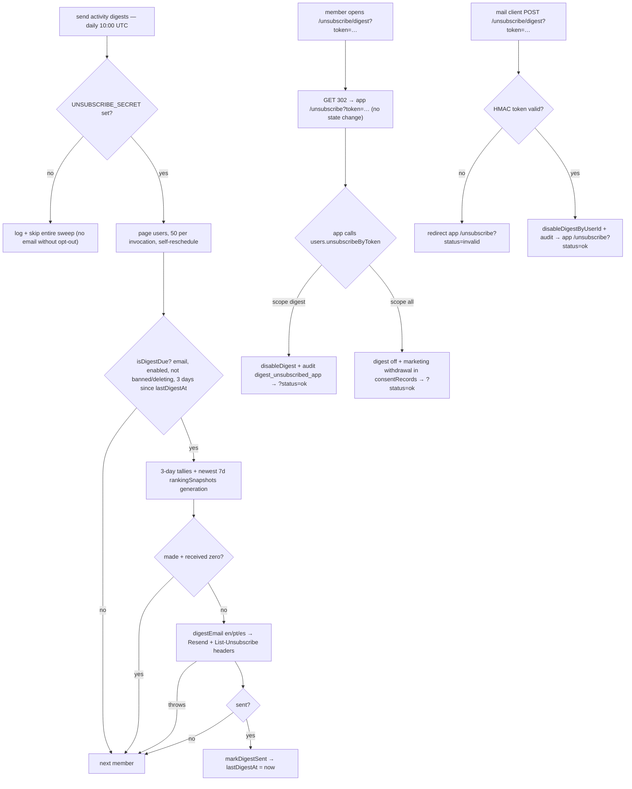

**CAN-SPAM postal address — resolved.** Every digest footer carries the controller's fiscal address
(`AV SETE DE SETEMBRO, 2775, REBOUÇAS - 80230-010 - Curitiba, Paraná - Brazil`): `composeDigest` sets
`includePostalAddress` through `lib/digest.isDigestAddressEnabled(env)` — unset or any value other than `'false'` keeps
the address ([§16](#16-environment-variables), the CAN-SPAM default), `'false'` omits it — and the verbatim constant
lives in `lib/digestEmails.ts` (`docs/compliance/GAP-ASSESSMENT.md`, item 11).

---

## 9. Plan Limits System

> **Trial users.** Because the trial is a real Stripe subscription for the tier chosen on the
> landing page (see §8), `users.tier` is set to that tier by the webhook from the moment the card
> is added. Trial users therefore receive **the chosen tier's limits naturally** — no `effectiveTier`
> shim or special-case lookup is needed.

Three enforced limits per tier, stored in `planLimits` and looked up via
`lib/planLimits.getPlanLimitsHelper`. That module is pure and is imported by the browser, so the
action-facing `ctx.runQuery(internal.lib.planLimitsQuery.getPlanLimits, …)` wrapper lives in the separate
server-only `lib/planLimitsQuery.ts` — registering a function in `planLimits.ts` would pull `convex/server` into the
client bundle (and log Convex's "functions should not be imported in the browser" warning):

- **`interactionsPerPost`** — the cap counts **total engagement** (the LinkedIn‑seeded `likeCount + commentCount` at
  import **plus** in‑app taps): once `likeCount + commentCount ≥ interactionsPerPost`, the post is flagged
  `interactionLimitReached = true` and **filtered out of the feed** (its engagement budget is spent). The flag is a
  **one‑way flip** — never un‑set — and is evaluated at every point a post's counts are written: **at insert** by all
  three post writers (`jobs/syncPosts.upsertPost`, `jobs/processQueue`, so an already‑over‑cap import never enters the
  feed), on the **30‑min Apify engagement refresh** (`jobs/syncPosts.applyEngagementCounts`, so a post that crosses the
  cap on external LinkedIn growth drops out), and on each **in‑app increment** (`interactions.ts`). The manual submit
  path (`posts.submitPost`) instead **rejects up front** with a user‑facing message when the pasted post's current
  LinkedIn engagement already meets the cap, rather than silently creating a hidden post.
- **`postsPerWeek`** — max posts admitted to `posts` within a **rolling 7‑day window** (counted via
  `by_author_and_publishedAt` in all three reads: the `upsertPost` atomic check, `countRecentPosts` →
  `submitPost` pre-check, and the `getWeeklyUsage` pill — so they can't disagree). Overflow either **throws** (manual
  submit) or is **queued** to `postQueue` (Apify path).
- **`featuredPerMonth`** — max `posts.featurePost` calls per **UTC calendar month**, tracked in
  `featuredPostUsage` (keyed by `(userId, month)`, `month = currentUtcMonthKey()`). Overflow **throws** — there is no
  queueing path for featuring (unlike `postsPerWeek`). See [§10](#10-posts--content-pipeline) for the mutation.

**Near the cap (R15).** One ratio governs every "this post is about to run out" nudge: `UPGRADE_NUDGE_RATIO = 0.8` in
`lib/interactionLimit.ts` — _"from this share of the cap a post is 'near' it"_. `isNearInteractionLimit(likeCount,
commentCount, interactionsPerPost)` is true when total engagement has reached
`Math.ceil(interactionsPerPost * UPGRADE_NUDGE_RATIO)` **and is still strictly below the cap**. The band is half-open on
purpose: a post that already hit the limit is **not** "near" it — it is `interactionLimitReached`, a different state
with different copy — and a non-positive cap returns `false` rather than producing a nonsense threshold. In practice the
band opens at **20** on starter (25), **40** on growth (50) and **160** on pro/contact (200).

The recap nudges on **one** post at most: `pickNearCapPost(posts, cap)` (`lib/recap.ts`) skips anything already flagged
`interactionLimitReached`, keeps only posts inside the band, and returns the **most engaged** survivor — the one closest
to dropping out of the feed. One post, one ask, per recap ([§11](#11-feed--engagement),
[§14](#14-frontend--authenticated-app-app)).

### Seed values (and hardcoded safety‑net defaults)

| Tier    | interactionsPerPost | postsPerWeek | featuredPerMonth | tierToRank |
|---------|:-------------------:|:------------:|:----------------:|:----------:|
| starter |         25          |      1       |        0         |     1      |
| growth  |         50          |      2       |        1         |     2      |
| pro     |         200         |      5       |        3         |     3      |
| contact |         200         |      5       |        5         |     4      |

**Featured-post cap bonus (backlog/R17).** `FEATURED_CAP_BONUS` (`convex/lib/planLimits.ts`) = starter 25 · growth 50 ·
pro 100 · contact 0. A post whose featured slot was bought carries it as `posts.interactionCapBonus`;
`effectiveInteractionCap(planCap, bonus)` (`convex/lib/interactionLimit.ts`) is the cap such a post is measured
against. Plan + bonus never exceeds the next tier's plain cap (25+25 ≤ 50, 50+50 ≤ 200; `planLimits.test.ts`), so the
add-on never outranks an upgrade.

`contact`'s featured cap defaults to a finite **5** (changed 2026‑09‑14; it used to be the 9999 sentinel).
`UNLIMITED_FEATURED_SENTINEL` (9999, `lib/postLimit.ts`, shared with the app's `isUnlimitedFeatured` pill check) now
remains only as an **explicit override**: a per‑user row — or a direct DB edit of the tier‑default row — can still carry
it to grant an enterprise account effectively‑unlimited featured posts. For `interactionsPerPost` and
`postsPerWeek`, actual enterprise deals get a per‑user override row (below) with whatever number was negotiated.
`featuredPerMonth` is **not** part of that admin‑editable override today (`setContactUserLimit` edits only the other two
fields); a bespoke featured cap needs a direct DB edit.

**Normalizing pre‑existing rows (one‑off).** An environment seeded before 2026‑09‑14 still has its CONTACT
tier‑default row (no `userId`) at 9999, which `getPlanLimitsHelper` prefers over `DEFAULTS`. Patch it once per
environment after deploying:
`npx convex run migrations/normalizeContactFeaturedLimit:normalizeContactFeaturedLimit` — add `--prod` for production;
run from the repo root. `migrations/normalizeContactFeaturedLimit.ts` patches only tier‑default rows still at/above the
sentinel to 5, leaves per‑user override rows untouched (an admin may have granted unlimited deliberately), and is
idempotent — a re‑run reports `0 row(s) updated`.

These live in exactly **one place** (backlog/B27): the `DEFAULTS` const in `lib/planLimits.ts`. Everything that needs a
full tier-default row — the read fallback (below), the explicit seed mutation, and the admin self-heal — builds it from
`DEFAULTS` via the pure helper `lib/planLimits.ts:buildTierDefaultRow(tier)`
(`{ tier, ...DEFAULTS[tier] }`), so the numbers can't drift apart the way two hand-maintained copies could.

- **`migrations/seedPlanLimits.ts`** — idempotent `internalMutation`, kept for explicit (re-)seeding of a fresh
  environment: `npx convex run migrations/seedPlanLimits:seedPlanLimits --prod` (repo root only). Skips any tier that
  already has a default row (no `userId`).
- **`admin.updateTierDefault`** — **auto-initializes** the same way (see [§12](#12-admin--moderation)): if the tier has
  no default row yet when an admin edits it, it inserts one via `buildTierDefaultRow(tier)` and then patches it with the
  admin's new values, instead of throwing. Running `seedPlanLimits` is therefore **no longer a hard prerequisite** for
  the admin edit path — it remains available for pre-populating an environment (e.g. before any admin has touched the
  screen) or for bulk re-seeding.
- **`lib/planLimits.ts`'s `DEFAULTS`** — also the safety‑net fallback read‑side (below) when a DB row is missing.

### Lookup precedence (`getPlanLimitsHelper(ctx, userId, tier)`)

- **`contact`:** (1) per‑user override row (`by_user` `.unique()`) → else (2) the contact **default**
  row (`by_tier` `.take(20).find(r => r.userId === undefined)` — a JS‑side filter, _not_ `.unique()`, because `by_tier`
  also matches override rows) → else (3) hardcoded `DEFAULTS.contact`.
- **all other tiers:** the single `by_tier` `.unique()` row → else `DEFAULTS[tier]`.
- `getPlanLimits` is an `internalQuery` wrapper so **actions** (no `ctx.db`) reach this via
  `ctx.runQuery`.
- **`featuredPerMonth` specifically** is `v.optional(v.number())` on the schema (widen‑then‑coalesce, no backfill
  migration): whichever DB row is selected above, the helper returns
  `row.featuredPerMonth ?? DEFAULTS[tier].featuredPerMonth`, so pre‑existing rows written before this field existed
  (including a contact override row auto‑seeded by `admin.setUserTier` on a tier promotion) keep working without needing
  to be individually patched.

`tierToRank(tier?)`: `contact→4, pro→3, growth→2, starter→1, undefined/unknown→1`. Used to stamp
`posts.authorTierRank`.

### Upgrade at the limit (R08)

The ladder helper `nextTier(tier): 'growth' | 'pro' | null` (`lib/planLimits.ts`) names the tier one step above the
member's own — `starter→growth`, `growth→pro`, and `null` at the top (`pro`/`contact`). `null` is a deliberate signal,
not an absence: it tells every caller to render a **contact line**, never a checkout link — Pro members get the
Custom contact line, contact‑tier members (already on a negotiated/custom limit) get a "we'll adjust it" line, both
`mailto:${SUPPORT_EMAIL}` (decided 2026‑09‑05; the ladder therefore never needs a `'contact'` return value from
`nextTier` itself).

**`posts.getTierLimits`** (public query, no auth) returns `Record<Tier, PlanLimits>` — the tier‑ **default** row for
all four tiers in one call, so a UI can name the _next_ tier's real numbers ("Growth gives you 7 posts a week")
instead of a hard‑coded one. `getWeeklyUsage`/`getFeaturedUsage` can't do this — they only ever answer for the
caller's own tier. Its lookup is split into the exported `findTierDefaultRow(ctx, tier)` (unit‑tested directly with a
fake `ctx`, same pattern as `feed.ts`'s `fetchFeedPage`): unlike `getPlanLimitsHelper`'s JS‑side `.find()` (above), the
`userId === undefined` check is pushed **into** the `by_tier` query itself via `.filter()` before `.take(20)` — a
contact tier with more than 20 per‑user override rows sharing that index value used to be able to push the one true
default row past the cap, silently falling back to `DEFAULTS.contact` for every caller (fixed 2026‑09‑06). Falls back
to `DEFAULTS[tier]` when no default row exists. A contact‑tier per‑user override is deliberately **not** resolved
here — the contact tier always renders the custom‑limit line, never a number, so its own negotiated numbers are
irrelevant to this query.

**The two limit codes** (`WEEKLY_LIMIT:<n>` / `FEATURED_LIMIT:<n>`, thrown at `posts.submitPost` and
`posts.featurePost` — see [§6](#6-backend-architecture--conventions)) and `getTierLimits` back the shared
`app/src/components/UpgradeAtLimit.tsx` component: one sentence naming the next tier's numbers plus one link, shown at
the four moments a member can actually hit a cap (weekly post cap, featured cap, a post spending its interaction
budget, and the Pro/Contact‑gated visibility setting) — see [§14](#14-frontend--authenticated-app-app) for the
component and its placements, and [§11](#11-feed--engagement) for the interaction‑cap moment specifically.

**Two doors, one checkout (R20).** The post-cap email ([§8](#8-subscriptions--billing)) deep-links to the same
`/billing?plan=<next>` surface, tagged `src=cap_email`, and it picks its next tier with the same `nextTier` ladder and
the same "only if the next cap is actually higher" rule. The in-app `UpgradeAtLimit` and the email are therefore two
doors onto one checkout, not two upgrade paths that can disagree.

---

## 10. Posts & Content Pipeline

Posts enter the `posts` table through **three paths**, all funneling into the single
`jobs/syncPosts.upsertPost` mutation:

1. **Manual submission** — user pastes a LinkedIn post URL (`posts.submitPost`).
2. **Apify cron** — daily, **only when an admin enabled `apifySyncEnabled`**, for active subscribers.
3. **On‑activation sync** — `scheduler.runAfter(0)` triggered by the Stripe webhook when a subscription becomes
   `active`.

`upsertPost` is the gatekeeper: on an **existing** URN it patches `likeCount/commentCount/hidden` (no limit
re‑check), but **only when the row's `authorId` matches the incoming author** — a cross‑author URN write is ignored
(`{ postId: null }`, with a `console.warn`), so one member can never touch another member's post; on **insert** it
performs an **atomic weekly‑limit check** in the same transaction and either inserts, throws, or (Apify path) diverts
to `postQueue`. The weekly‑limit decision is the pure helper `lib/postLimit.ts`
`isWeeklyLimitReached(recentCount, postsPerWeek)`.

### Manual post submission (`posts.submitPost`, action)

```mermaid
flowchart TD
    S["submitPost(sessionToken, postUrl)"] --> AU["requireAuthAction → user (+ token)<br/>(auth before any outbound request)"]
    AU -->|no token| X2["throw 'No LinkedIn access token'"]
    AU -->|user| ADM{"admin override?<br/>(isAdmin AND ALLOW_ADMIN_SHARE_ANY_POST=true)"}
    ADM -->|yes: skip throttles| RS
    ADM -->|no| RL["rateLimit submitPost: 10/hour"]
    RL --> WL{"recent posts (7d) ≥ postsPerWeek?"}
    WL -->|yes| X3["throw 'WEEKLY_LIMIT:<n>'"]
    WL -->|no| RS["resolveLinkedInShortlink(postUrl)<br/>lnkd.in → linkedin.com (manual redirect, per‑hop host check)<br/>(after the throttle: a bad URL consumes budget)"]
    RS -->|off‑allowlist / not linkedin . com| X1
    RS -->|resolvedUrl| P["parseLinkedInPostUrl(resolvedUrl)"]
    P -->|unrecognized| X1["throw 'Unrecognized LinkedIn post URL'"]
    P -->|ok| F["fetch(resolvedUrl) HTML → extractPostUrn<br/>(namespace-preserving: data-attributed-urn, else -{ns}-{id}- slug of submitted/canonical URL)"]
    F -->|no urn| X4["throw 'Could not find urn'"]
    F -->|urn| EMB["fetch(/embed/feed/update/{urn}) → isEmbeddablePostHtml?<br/>(main-feed-activity-embed-card__ marker — applies to admins too)"]
    EMB -->|auth‑walled (non‑public )|X5["throw 'post not publicly visible'"]
EMB -->|embeddable|OWN{"admin override?"}
OWN -->|yes: skip ownership|PC["parsePostContent(html) → text + media; appendMediaLinks"]
OWN -->|no|V["verifyPostOwnership(postAuthorName vs OIDC name; vanity fallback)"]
V --> PC
PC --> ENG["parsePostEngagement(html) → likeCount, commentCount"]
ENG --> ART{"post links an article?<br/>(extractArticleUrl finds the /pulse/… anchor)"}
ART -->|no| UP
ART -->|yes|AF["fetch(articleUrl) → parseArticle → article<br/>(best‑effort, SSRF‑guarded, non‑fatal)"]
AF --> UP
UP["upsertPost(authorId = submitter, likeCount, commentCount,<br/>hidden = false, sourceUrl=resolvedUrl, article?)"]
UP --> R["return { postId }"]
```

**Ownership verification** (`linkedin/verifyPostOwnership.ts`) anchors on the member's LinkedIn **name**, not an
editable field. **Primary:** the post page's JSON‑LD `author.name` (parsed by `parsePostAuthor`) must match the member's
OIDC `name` (from login; case‑/accent‑insensitive). Both signals come from LinkedIn and are not editable in‑app, but
**display names are not unique and the member's own name is editable on LinkedIn**, so a same‑name collision is a known
limitation at OIDC Standard tier — a first‑time attacker with no stored identifier who shares the victim's display name
can still insert the victim's post as their own, and no LinkedIn API call is available to prove authorship. Two guards
narrow it: when the member already has a stored `linkedinPublicIdentifier`, a Format 1 URL whose `vanityName`
contradicts it is rejected even on a name match (Format 2 URLs carry no vanity, so they pass on the name check alone —
a documented bypass); and `upsertPost` never patches a `posts` row whose `authorId` differs from the incoming author —
a cross‑author URN is ignored there and `submitPost` surfaces it as a user‑facing `ConvexError` ("already linked to
another LinkedIn account"). **Fallback:** the older vanity heuristic (the URL's `vanityName` vs the stored
`linkedinPublicIdentifier`) runs **only** when the post page carried no author block — not attacker‑triggerable, since a
submitter can't make LinkedIn omit the author. On a name‑verified post, `submitPost` also auto‑fills the member's
`linkedinPublicIdentifier` (**set‑once**) from the author's profile URL via `users.setDerivedPublicIdentifier` — a
trustworthy, never‑typed seed for the Apify scrape. **No LinkedIn API call** is made.

**Admin override (testing only, dev‑gated).** The override is active **only** when the submitter is an admin **and** the
`ALLOW_ADMIN_SHARE_ANY_POST` env var is `'true'` — a flag set exclusively on the local / dev Convex deployment
(`isAdminShareOverrideEnabled`). In production the var is absent, so admins submit posts under exactly the same rules as
everyone else. When active, `submitPost` skips **both** the posting throttles (hourly rate limit + weekly per‑plan
limit) **and** the ownership check, so a dev admin may share **any** post in any volume. The ownership step is replaced
by a synthesized
`OwnershipResult` with `strategy: 'admin-override'`, empty `content` (it falls back to the HTML‑parsed text), and
`publishedAt = now`. The post is still attributed to the **admin** (`authorId = submitter`), because `posts.authorId`
must reference a real `users` row; the original LinkedIn author — who typically has no account — cannot be the
`authorId`.

**Engagement counts.** Manual submissions seed `likeCount` / `commentCount` from
`parsePostEngagement(html)`, which reads schema.org `interactionStatistic` (`InteractionCounter`)
out of the same page HTML already fetched for content — no extra API call. Best‑effort: missing data degrades to `0`.
This mirrors the Apify path, which reads `engagement.likes/comments`.

**Content extraction** (`linkedin/parsePostContent.ts`) is best‑effort and non‑fatal (unrecognized HTML yields
`{ text: '', media: [] }`). From the already‑fetched page HTML it parses:

- **Text** — from JSON‑LD blocks (`articleBody` → `description` → `text`), falling back to the
  `og:description` meta tag.
- **Media** — typed as `image | article | document` (`PostMedia`), de‑duplicated, gathered from:
  `og:image` meta tags and JSON‑LD `image` (→ image); the **shared‑article anchor in the post body**
  (`extractArticleUrl`) plus a JSON‑LD `@type=Article` `url` fallback (→ article); JSON‑LD
  `associatedMedia.contentUrl` and **direct `.pdf` links found in the page** (→ document).
  `findPdfLinks` tests only the path segment (before `?`/`#`) for the `.pdf` extension but **returns the full URL
  including its query string**, so signed/expiring document tokens are preserved (the
  `4603f40` fix).

**Post URN** (`extractPostUrn`). The submitted post's URN is read from the fetched page HTML, **preserving its
namespace** (`ugcPost` / `share` / `activity`). Namespace matters: LinkedIn addresses one post under all three with
**different ids**, and the embed endpoint auth‑walls a post addressed under the wrong one (see `buildEmbedUrl` — forcing
`activity` broke share/ugcPost embeds). Priority: **(1)** the legacy `data-attributed-urn="…"` attribute (authoritative
when present); **(2)** a `-{namespace}-{id}-` slug from a candidate URL — the submitted/redirected URL first (it carries
the `ugcPost`/`share` id LinkedIn minted for sharing), then the page's `<link rel="canonical">`, then `og:url`; **(3)**
last resort, a bare activity id (`/feed/update/urn:li:activity:{id}` or a plain slug) → `urn:li:activity:{id}`. Only
https `linkedin.com` candidate URLs are trusted (the URN seeds the embed URL and the dedup key). LinkedIn's newer
`/posts/…` markup **no longer emits** `data-attributed-urn`, which is why the URL‑slug path exists. A format‑validated
URN (or a `'Could not find a valid LinkedIn post URN'` throw) is the result. The shape validator is exported as
`isValidPostUrn` (same `urn:li:(ugcPost|activity|share):{digits}` regex) and the **Apify path**
(`jobs/syncPostsApify.syncUserPostsViaApify`) drops scraper items whose `shareUrn` fails it — before the URN becomes a
stored dedup key.

**Embeddability gate** (`isEmbeddablePostHtml`). LinkedIn serves a post to the **logged‑out** embed iframe
(`/embed/feed/update/{urn}/`) only when its audience is public ("Anyone"). A restricted‑audience post —
Connections‑only, or some "new position" occasion posts — instead returns an auth‑wall stub ("This post is
unavailable"), which every feed viewer would see as a dead embed. Since that stub is **server‑rendered**, `submitPost`
detects it with a second plain
`fetch` of the embed URL and requires the `main-feed-activity-embed-card__` CSS‑class marker (present on every rendered
card — text, image, or video — and **locale‑independent**, unlike the wall copy). A miss throws _"This LinkedIn post is
not publicly visible…"_, telling the member to set the post's audience to **Anyone** and resubmit — so the shared feed
never carries a walling embed. The probe runs **after** URN extraction (it needs the URN) and **applies to everyone,
including admins under the share-any-post override** — unlike ownership/throttles (curation conveniences), a walling
embed is a dead card in the feed no matter who submits it, so the gate is deliberately _not_ skipped for admins. Note:
post **type** (`activity` vs `ugcPost`) and **author kind** (personal vs company page) do _not_
decide this — public `activity` posts and public personal posts embed fine; only the audience setting does. Not wrapped
in `try/catch` (matching the page fetch above): a transient LinkedIn error propagates to the client, who can retry.

**Interaction‑cap gate** (`hasReachedInteractionLimit`). After parsing the post's current LinkedIn engagement,
`submitPost`
rejects a post whose `likeCount + commentCount` already meets the author's `interactionsPerPost` cap (total‑engagement
semantics, §9) with a user‑facing _"…already has N reactions and comments, which meets your plan's limit…"_ — such a
post would insert as `interactionLimitReached` and never appear in the feed, so the submitter is told up front rather
than silently getting a hidden post. **Skipped under the admin share‑override** (the cap is left unresolved there),
consistent with the hourly/weekly throttles it shares that bypass.

**Shared‑article link** (`extractArticleUrl`). A LinkedIn post that links an article (e.g. a Pulse post) does **not**
expose the article URL in its JSON‑LD — the post is typed `SocialMediaPosting`, whose only URLs are the post's own
`@id`, the author profile, and the cover image. The article link lives only in the post body as an
`<a data-test-id="article-content">` element (also carrying a
`feed-article-content` class/tracking name). `extractArticleUrl` selects that anchor — ignoring the page's "more from
this author" `/pulse/…` links, which lack those markers — strips tracking query/hash to a clean canonical URL, and
re‑validates the LinkedIn host (it is fetched server‑side, so the SSRF guard applies). The earlier assumed
`sharedContent.url` field does not exist in real LinkedIn HTML and was removed.

`appendMediaLinks(text, media)` composes the stored `content`: the trimmed body, then (if any media)
a blank line, then one `[type] url` line per media item — self‑describing for future use. The structured `mediaUrls`
array (the bare URLs) is **persisted but not currently displayed** anywhere; the feed/My Posts UI shows the post via the
LinkedIn embed, not this stored text (see
[§11](#11-feed--engagement) / [§14](#14-frontend--authenticated-app-app)).

**Article enrichment** (`parseArticle`). When `extractArticleUrl` finds a shared article, `submitPost`
does one extra **best‑effort, SSRF‑guarded** `fetch` of that article page and runs `parseArticle` to capture
`{ url, title?, summary?, text?, author?, imageUrls }` into the post's `article` field (`lib/articleValidator.ts`):

- **`text`** — the **full article body** as plain text. The guest SSR page renders the whole body (despite the post
  JSON‑LD's `isAccessibleForFree:false` flag) inside `<div
data-test-id="article-content-blocks">` as a flat list of `publishing-text-block` elements.
  `extractArticleBody` isolates that container (up to `</article>`) — excluding the header, sign‑in modal, comments, and
  "more articles" cards — and renders each `<p>` / `<h1‑6>` / `<pre>` / list in document order: paragraphs (blank‑line
  separated), headings on their own line, `- ` bullets, and
  ` ` ``‑fenced code blocks (internal whitespace preserved, entities decoded).
- **`title` / `summary` / `author`** — from the article's `@type:Article` JSON‑LD (where LinkedIn unusually maps `name`
  →title and `headline`→summary), with `og:` tag fallbacks.
- **`imageUrls`** — cover (`og:image` / JSON‑LD) plus inline body images (`media.licdn.com` URLs inside
  `article-content-blocks`), de‑duplicated.

Non‑fatal: no article link, a network error, or a parse miss simply leaves `article` undefined. The data is **not
displayed**; it seeds a future AI‑comment feature. The Apify cron path does not populate
`article`.

### Hiding & deleting a post (`posts.setPostHidden` / `posts.deletePost`, mutations)

Authors manage their own shared posts from My Posts; **admins may act on any post** (moderation). Both mutations
authorize via the pure `canModifyPost(user, post)` helper (`post.authorId === user._id ||
user.isAdmin`).

- **Hide / unhide** (`setPostHidden`) flips the `hidden` flag. Hidden posts leave the public feed (`getFeed` keys on
  `hidden === false`) but stay in the author's My Posts (so they can unhide). Un‑hiding a soft‑deleted post is rejected.
- **Delete** (`deletePost`) is a **soft delete**: it stamps `deletedAt` and sets `hidden: true`. The post disappears
  from the feed **and** from My Posts (`getMyPosts` filters `deletedAt === undefined`), but the row is intentionally
  **kept**. Idempotent.

**Invariant — neither operation changes the weekly post count.** The rolling 7‑day count (`countPostsPublishedSince` /
`countRecentPosts`, and the atomic check in `upsertPost`) counts **every** `posts` row in
the window regardless of `hidden`/`deletedAt`, so keeping the row means hiding or deleting a post never frees up a
posting slot. A hard delete is the only thing that would break this, which is why delete is soft. On account deletion
the privacy cascade still purges these rows by `authorId` (they are not exempt).

### Featuring a post (`posts.featurePost` / `posts.unfeaturePost`, mutations)

Authors feature/unfeature their own posts from **My Posts**; **admins may act on any post** (same `canModifyPost`
authorization as hide/delete). Featuring pins a post to the top of the feed (`lib/feedRank.ts` —
see [§11](#11-feed--engagement))
and is gated by a per‑tier **monthly quota** (`planLimits.featuredPerMonth`, see [§9](#9-plan-limits-system)).

- **Card-gated since 2026-09-18.** `featurePost` calls `assertCanEngage(user)` before anything else: a `none`/`past_due`
  member is refused with `PAYMENT_REQUIRED`, the same gate reactions and comments use. `unfeaturePost` stays ungated —
  removing a boost must always work. My Posts keeps the toggle visible but disabled with
  `myPosts.featurePaymentRequired` for a gated member (the buy-$5 control is already hidden by `canBuy`'s `!gated`).
- **First feature** (`featurePost`) rejects with a thrown error when the caller's `featuredPostUsage` row for the
  current UTC month already has `usedCount ≥ featuredPerMonth` (`lib/postLimit.ts:isFeaturedLimitReached`), and rejects
  a soft‑deleted post the same way `setPostHidden` does. On success it patches the post
  (`isFeatured: true, featuredAt: Date.now()`, plus recomputed `feedRank`/`inFeed` via `computeFeedFields` — **never**
  hand‑rolled) and **upserts/increments** the `featuredPostUsage` row for `(userId, currentUtcMonthKey())` — both writes
  happen inside the same mutation.
- **Permanent per-post entitlement.** `lib/postLimit.ts:hasPermanentFeaturedEntitlement` treats either `featuredAt` or
  `featuredPurchase` as proof that the post already owns a slot. Re-feature skips the plan-limit read and usage write;
  `unfeaturePost` patches only `isFeatured: false` plus recomputed feed fields and deliberately retains `featuredAt`.
  The same allowance or purchase can therefore be reused on that post forever without inflating monthly usage.
- **Idempotency / concurrency.** Both mutations short‑circuit as a no‑op when the post is already in the target state
  (`if (post.isFeatured) return` / `if (!post.isFeatured) return`) **before** touching `featuredPostUsage`. This is the
  actual fix for double‑incrementing under Convex's OCC retry: without the guard, a mutation retried against post‑commit
  state after losing a write race would re‑run the whole feature flow — including the usage increment — a second time
  even though the post was already featured by the call it raced against.
- **Month key.** `featuredPostUsage.month` is a deterministic **UTC** `"YYYY-MM"` string
  (`lib/postLimit.ts:currentUtcMonthKey`), not derived from any server-local clock — the quota resets at the same
  instant worldwide regardless of where the Convex function executes.
- **Featuring a capped post spends the slot without returning it to the feed.** `featurePost` passes the post's
  existing `interactionLimitReached` straight into `computeFeedFields` — it does not re-decide the cap — so featuring
  a post that already reached its interaction cap still increments `featuredPostUsage` while the post stays out of the
  feed. My Posts therefore disables the plain Feature/Unfeature toggle on a capped, unfeatured post
  (`myPosts.featuredCappedTitle`); only the paid path below re-decides `interactionLimitReached` against the bigger cap.

**Bought slots.** A post with `featuredPurchase` was featured by the $5 add-on ([§8](#8-subscriptions--billing)).
`featurePost` re-features it without reading or writing `featuredPostUsage`; unfeaturing refunds nothing, but the same
post can be re-featured free forever (explained in the confirmation modal and buy-button tooltip). Fulfilment itself is
`posts.applyPurchasedFeature`, not `featurePost`.

### Apify sync + queue pipeline

The daily cron calls `jobs/syncPostsApify.syncAllPostsViaApify` directly — the old
`jobs/syncPosts.syncAllPosts` router hop was redundant (same runtime; the Apify action re-checks the same
`appSettings.apifySyncEnabled` flag). The fan-out reads active subscribers **one cursor page at a time**
(`numItems: 20`, via the paginated `users.getActiveSubscribers`): it fans each page out at
`APIFY_FANOUT_CONCURRENCY`, then, while `!isDone`, self-reschedules with `runAfter(0)` and the `continueCursor` —
so every page is a fresh action, each read is bounded, and no user past the old 500 cap is silently skipped. The
20-user page keeps one invocation — a bounded fan-out of paid, rate-limited scrapes — inside the action execution
limit. `updateSyncStatus` is written after **every** page with the sweep's running failed count (threaded through the
self-reschedule), so an interrupted sweep still shows the pages processed; the next cron starts from `cursor`
undefined. Scraped URNs are validated with `isValidPostUrn`
(the same `urn:li:(ugcPost|activity|share):{digits}` shape the manual path enforces) and dropped before
`upsertPost` when malformed.

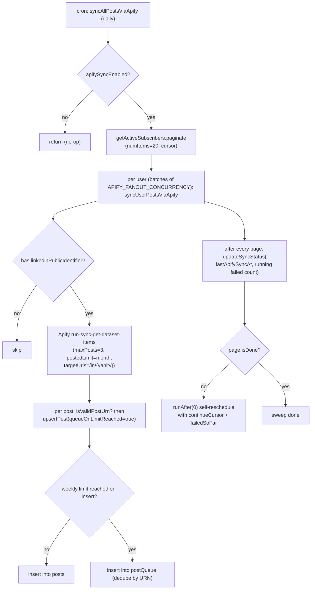

> Because `getActiveSubscribers` returns only `active` users, the Apify path's `hidden` is
> effectively always `false` on the cron. `submitPost` sets `hidden` via `postCreatedHidden`: carded
> members (trialing/active) post visibly (Plan 2B), while a no-card member (`none`/`past_due`) — e.g. a
> new member’s onboarding first post — is created hidden and revealed when they add a card.

> **Bounded fan-out + pagination:** both `syncAllPostsViaApify` and `scrapeAllProfilesViaApify` fan out
> through `settledInBatches` (`lib/concurrency.ts`) at `APIFY_FANOUT_CONCURRENCY` (5) — capping how many paid,
> rate-limited per-user Apify runs execute at once instead of an unbounded `users.map()` — and process one
> cursor page (20 users) per invocation, self-rescheduling until `isDone`. `settledInBatches` never rejects,
> keeping the previous `Promise.allSettled` "one failure can't sink the sweep" semantics. Both actions write their
> admin status row after **every** page (running failed count), so a killed sweep is observable instead of stale.

### Queue drain (`jobs/processQueue.processPostQueue`, daily cron)

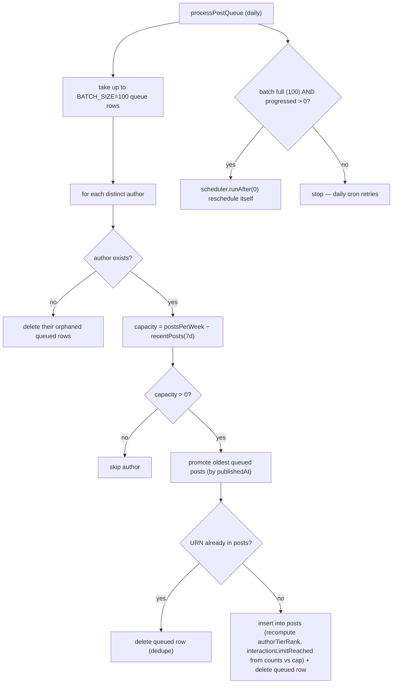

> The `progressed > 0` guard stops the zero-progress spin: a saturated queue head whose authors are all at
> their weekly cap no longer reschedules itself with `runAfter(0)` for up to seven days. Promotion, dedupe
> deletes, and orphan purges each count as progress.

### Post‑related functions

| Function                                    | Kind              | Purpose                                                                                                                                                           |
|---------------------------------------------|-------------------|-------------------------------------------------------------------------------------------------------------------------------------------------------------------|
| `posts.submitPost`                          | action (public)   | Manual submission (above).                                                                                                                                        |
| `posts.getMyPosts`                          | query (public)    | Author's posts incl. hidden, **excl. soft‑deleted**, `publishedAt` desc via `by_author_and_publishedAt` (bounded to the 500 most‑recent).                         |
| `posts.setPostHidden`                       | mutation (public) | Hide/unhide a post (author or admin via `canModifyPost`). Doesn't change the weekly count.                                                                        |
| `posts.deletePost`                          | mutation (public) | Soft‑delete a post (author or admin). Row kept → weekly count unchanged. Idempotent.                                                                              |
| `posts.featurePost`                         | mutation (public) | Feature a post (author or admin), quota‑gated by `featuredPerMonth`. Idempotent; recomputes feed fields.                                                          |
| `posts.unfeaturePost`                       | mutation (public) | Unfeature a post (author or admin). No quota refund. Idempotent; recomputes feed fields.                                                                          |
| `posts.getWeeklyUsage`                      | query (public)    | `{ postsThisWeek, postsPerWeek }` over the same rolling 7‑day window submitPost enforces. Takes a client-supplied `now`; counts via `by_author_and_publishedAt`.  |
| `posts.getFeaturedUsage`                    | query (public)    | `{ usedCount, featuredPerMonth }` for the current UTC month — backs the My Posts quota pill. Takes a client-supplied `now` (month key).                           |
| `posts.countRecentPosts`                    | internalQuery     | Bounded count of posts since a timestamp via `by_author_and_publishedAt` (shared by enforcement + usage pill; takes `since` + `limit`).                           |
| `jobs/syncPosts.upsertPost`                 | internalMutation  | Insert/update gatekeeper with atomic weekly‑limit + optional queueing.                                                                                            |
| `jobs/syncPostsApify.syncUserPostsViaApify` | internalAction    | Scrape one user's recent posts via Apify REST. Validates each scraped URN (`isValidPostUrn`) before upsert.                                                       |
| `jobs/syncPostsApify.syncAllPostsViaApify`  | internalAction    | Cursor‑paged fan‑out over active subscribers (20/invocation, self‑reschedules until `isDone`); writes sync status after every page with the running failed count. |
| `jobs/processQueue.processPostQueue`        | internalMutation  | Drain overflow queue when capacity opens.                                                                                                                         |

---

## 11. Feed & Engagement

### Feed resolution (`feed.getFeed`, query)

Args: `paginationOpts` (Convex cursor pagination), `sessionToken`. Returns a `PaginationResult` —
`{ page: enriched[], isDone, continueCursor }` (posts include a **token‑stripped** author projection). The client
consumes it via `usePaginatedQuery` in `FeedPage.tsx`. The query declares
`returns: paginationResultValidator(feedItemValidator)` (Convex's named paginated‑return validator), so a projection
drift that drops or adds a field fails return validation at runtime instead of reaching the client.

The viewer's tier sets the filter via `buildFeedFilter`:

- **starter:** no filters.
- **growth:** auto‑filter to the viewer's **own** `industry` + `country`; an empty one isn't filtered, and an author
  without the filtered field is left out. Both can be filled automatically
  ([§11C](#11c-profile-auto-fill-industry--country)), so `FeedPage` says what the feed is filtered by: "Showing posts
  from: Software Development · Brazil" (or "every industry and country" when both are empty) with a **Change** link to
  `/settings`.
- **pro / contact:** filter by the viewer's **saved preference** —
  `users.feedFilterIndustries` / `feedFilterCountries`, read straight off the viewer doc (no client‑supplied args). Each
  dimension ORs over its list; the two dimensions are **ANDed**; an empty/absent list means that dimension isn't
  filtered. Set via `users.setFeedFilter` (see below); because `getFeed` reads these fields, saving re‑runs the query
  reactively and the feed re‑filters live. Two surfaces write the same fields (kept in sync automatically): the
  `FeedPage` **"Filter feed"** panel (apply‑on‑change) and a **"What you see in your feed"** card in **Settings**
  (dirty‑flag + Save, mirroring the "Who can see your posts" card) — both Pro/Contact only.

The viewer-side filter above (`feedFilterIndustries`/`feedFilterCountries`) is separate from the **author-side**
allowlist enforced at step `F2` in the diagram below (`posts.visibilityIndustries` /
`visibilityCountries`, checked against the viewer's own `industry`/`country`) — one is "what I want to see", the other
is "who I allow to see me". The author-side allowlist is a **Pro/Contact** feature:
`users.setPostVisibility` (tier-gated server-side, validated against `INDUSTRIES`/`COUNTRY_CODES`)
sets `users.defaultVisibilityIndustries`/`defaultVisibilityCountries`, which every post writer (`posts.submitPost`,
`jobs/processQueue.ts`, `jobs/syncPostsApify.ts`) copies onto the new post at **insert time** — editing the Settings
default does not retroactively change posts already written. Absent/empty on either field ⇒ visible to everyone (same
invariant `F2` already relied on before this was wired up to a UI).

The feed also checks each post against its **author's current interaction cap** on every query.
`getPlanLimitsHelper` resolves limits once per author on the page, including Contact overrides and tier defaults.
A post is excluded when `likeCount + commentCount >= effectiveInteractionCap(interactionsPerPost, interactionCapBonus)`
or its stored `interactionLimitReached` flag is true. For an author with a cap of 50 and no bonus, both 50 and 80 total
interactions exclude the post. The viewer's cap does not affect this check. Purchased bonuses still extend the cap.
This check covers stale `inFeed` flags after count updates or plan changes, using the latest counts stored in Convex.
It runs before the per-post viewer-state reads and preserves the index page's cursor and pagination metadata.

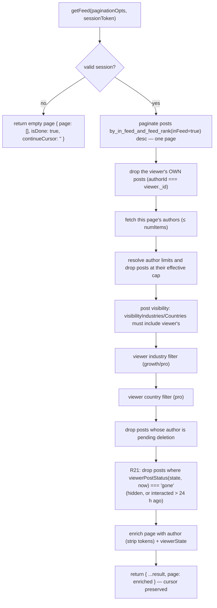

**Per-viewer hygiene (R21).** Before enriching, `fetchFeedPage` reads the viewer's own `userPostState` row for each item
remaining after the author-cap check — one `by_user_and_post` `.unique()` point read per item, so at most `numItems`
extra indexed reads per page — and then:

- **drops** every post whose `viewerPostStatus(state, now)` is `'gone'`: hidden through "Hide now", or last interacted
  with more than `INTERACTED_TTL_MS` (**24 h**) ago;
- **attaches** `viewerState: { reacted, commented, hidesAt } | null` (`toFeedViewerState`) to each surviving item, which
  is what the card's done footer renders.

Everything else is untouched: sort order, `inFeed`, the like/comment counts, the interaction cap, `search`, the refresh
cron and the author's own My Posts all behave exactly as before. This is **presentation for one viewer**, never a global
state — the author still sees their post, and so does everyone who has not handled it.

`now` is the query's own `Date.now()` — a **deliberate exception** to the Convex "no wall clock in queries" guideline
(queries are not re-run merely because time advances) — so a tab left open past the 24-hour mark keeps showing the card
until the query re-runs. That is deliberate: a card that vanishes under the reader's cursor is worse than one that
lingers a few minutes. `getCaughtUp` makes the same exception for its "interacted in the last 24 h" answer, and `search`
makes it for its author-eligibility gate ([§11B](#11b-search--command-palette)) — there the clock is security-relevant
and must not come from the client. Every other time-window query either takes `now` as an argument
(`interactions.getRecap`, `posts.getWeeklyUsage` / `getFeaturedUsage`, `privacy.export.getExportStatus` /
`getExportDownloadUrl`) or has its time-derived state materialized by a cron (MOTD,
[§12B](#12b-message-of-the-day-motd)); `lib/auth.resolveSession`'s clock is the one security exception
([§6](#6-backend-architecture--conventions)).

Because this filter can empty a whole page while the index walk still reports `CanLoadMore`, the client contract
changed: `FeedPage` keeps calling `loadMore` while the page is empty and the status is `CanLoadMore` (bounded — see
"24-hour feed hygiene" below). An auto-load keyed on the last rendered item would never fire, because an all-filtered
page renders no items to scroll to.

> `getFeed` walks the `by_in_feed_and_feed_rank` index with `.paginate()`: `inFeed === true` pre-encodes the
> hidden / interaction-limit / soft-delete filters, and descending `feedRank` (featured → author
> tier → recency, see [`lib/feedRank.ts`](../convex/lib/feedRank.ts)) **is** the sort — so each call
> reads only one page and applies just the viewer-/author-dependent filters in memory — including dropping
> the viewer's **own** posts (`authorId === viewer._id`), since the feed is for others' content. The denormalized
> fields are kept in sync by every post writer (`computeFeedFields`). Heavy viewer filters can yield
> short pages; the client's **Load more** (`usePaginatedQuery`) requests the next page. Design + rollout:
> [feed-cursor-pagination-plan.md](./feed-cursor-pagination-plan.md).
>
> Because `feedRank`/`inFeed` are `v.optional` (widen→backfill), `by_in_feed_and_feed_rank`'s `eq(inFeed, true)` can
> never match a row where the field is still `undefined`. `convex/migrations/backfillFeedFields.ts` is
> the batched, self-rescheduling backfill that stamps both fields on every `posts` row via the same
> `computeFeedFields` — it must run (or be re-run) before trusting the index against any posts written
> by a path that bypasses the live writers (e.g. a future bulk import). Pre-launch there is no prod data,
> so today it's a no-op; see the `ponytail:` comment in the migration.

**Feed eligibility and the trial (Plan 2B).** The pure `isAuthorFeedEligible(author, now)` helper (`feed.ts`)
excludes **banned** authors (`isBanned` — moderation; their posts leave the feed and search on ban and return on unban,
with no post mutation), authors with `deletionScheduledAt` set, and a **`past_due`** author: a failed renewal hides
their posts — and any featured boost on them — until the charge clears, and the status flip back to `active` is the
whole recovery (no post mutation). It then drops a **canceled** author once their paid
period ends:
`subscriptionStatus === 'canceled'` stays eligible only while `now < subscriptionEndsAt` (the paid‑through instant
stamped by `cancelUserSubscription`); a missing/elapsed `subscriptionEndsAt` → not eligible. This is the sole feed
effect of a cancellation — the member keeps full engage access (see Card gate below). Everyone else (trialing / active)
is eligible. Trialing authors are **not** excluded: because trialing users must have a card on file (the trial is a real
Stripe subscription for the chosen tier — see §8), their posts belong in the feed as a reciprocity incentive. The gate
is applied at query time in both `getFeed` and `search` (which already load the page's authors), so no cron or post
mutation is needed. `submitPost` sets `hidden` via
`postCreatedHidden(user)` — visible for carded members, hidden for no-card members (`none`/`past_due`, e.g. a new
member's onboarding first post). Existing hidden posts from before Plan 2B are not backfilled (pre-launch, no prod
data). The `syncUserSubscription` webhook un-hides the author's posts when they **gain a card**
(`unhideHidden: canEngage(status)`) — so a trial start (subscribe), not just an `active` transition, reveals it.

**Card gate on engagement.** `commentOnPost`, `reactToPost` and `posts.featurePost` call `assertCanEngage(user)` (from
`convex/lib/access.ts`) immediately after resolving the caller. `submitPost` has its own, looser gate —
`assertCanSubmitPost` blocks only `past_due` (a post written mid-dunning would be created hidden into a void), while
`none` stays allowed so the onboarding first post can be written hidden. `unfeaturePost` is ungated either way (removing
a boost must always work). Engagement is granted for `subscriptionStatus ∈ {trialing, active, canceled}` —
**cancellation never revokes access**; only `none` (never subscribed) and `past_due` (failed payment) receive a
`PAYMENT_REQUIRED` error. Admins (`isAdmin`) always bypass the gate. The frontend mirror `useCardGate()`
(`app/src/hooks/useCardGate.ts`) uses the same status set and must stay in sync. The in-app UI for this gate
(hidden-post banner, tap-bound `CardGateDialog`, progress bar, CTA) is **Plan 2C** — shipped, reordered by **R04 (Option
A)**; see [§14 "Trial UI (Plan 2C)"](#trial-ui-plan-2c). R04 is copy and routing only: this backend gate is
unchanged.

**Per-post engageability gate.** The card gate answers _"may this member engage at all?"_; a second gate answers _"is
**this post** engageable?"_. All three engagement entry points — `commentOnPost`, `reactToPost` (below) and
`generateComment` ([§11A](#11a-ai-reaction--comment-assistance)) — resolve the target post through one shared internal
query, `internal.interactions.getEngageablePost({ postId, viewerId })`, which loads the post + viewer + author and runs
the pure `feed.assertPostEngageable(post, viewer, author, now)`. That helper throws on a spent budget
(`interactionLimitReached` → _"reached its interaction limit"_), and otherwise mirrors the feed's own access rule
(`isPostVisibleToViewer`): a `hidden`/soft-deleted post, one outside the viewer's `visibilityIndustries` /
`visibilityCountries` allow-lists, or one from an ineligible author is rejected as _"not available."_ A raw
`ctx.db.get(postId)` bypasses the `inFeed` search index, so these actions **must** re-check — sharing one gate is what
keeps the three from diverging (a post the feed hides can never be engaged, or AI-drafted against, through any of them).
The three are Convex **actions** with no `ctx.db`, so they reach the gate via `ctx.runQuery`.

### Sort priority (effective order)

1. **Featured** posts first (newest first).
2. Then by **author tier rank** desc (contact → pro → growth → starter).
3. Then by **`publishedAt`** desc (newest first).

### Interactions (comment / react)

Both are **actions**, but they **no longer call LinkedIn** — LinkedIn exposes no member API to react/comment on another
member's post. Engagement is a **client‑side handoff**: the client opens the post on LinkedIn. For comments it first
writes the AI draft to the clipboard, confirming with a toast (`ui/toast.tsx`) **only once the copy succeeds**; the
button **spinner** + toast then stay on screen for a ~1.5s beat (`HANDOFF_DELAY_MS`) — the app keeps focus so they're
visible — **after which**
`openLinkedIn` (`lib/handoff.ts`) opens the post (`buildPostUrl` → stored `sourceUrl`, else a reconstructed
`/feed/update/<urn>/` permalink) in a new tab, falling back to same-tab if the browser blocks the deferred popup. The
user performs the real action there. The action then **counts it optimistically** (per the product decision to count on
tap): gate, rate‑limit, then run **one mutation** (`incrementCommentCount` / `incrementLikeCount`) that patches the
post's count — which may flip `interactionLimitReached` — **and inserts the `userInteractions` row in the same
transaction**, stamping `authorId` from the post. There is no separate best‑effort logger any more: the row and the
counter commit together or not at all, so the aggregate and the log cannot drift. That log is what the **recap** and
**history** pages read (below) and what the DSR export ships ([§13B](#13b-privacy--compliance)). **Reactions are
deduped**: `incrementLikeCount` sets `userPostState.reactedAt` on the first reaction and no-ops on
repeats (no count, billing, or log) — a member holds at most one reaction per post; the action relays the mutation's
`counted` flag so the client can tell a first tap from a repeat. The AI **comment draft** is saved to
`userPostState.commentDraft` on generate and reloaded into `CommentBox` on open (reuse or regenerate); submitting the
comment replaces it with the member's final text, so the reopened box shows what they actually posted, not the
untouched model output. Generating is itself a counted interaction **once per post**: the first draft inserts an
`ai_draft` row and bumps the trial `made` counter ([§11A](#11a-ai-reaction--comment-assistance)), while regenerations
only refresh the draft — the post's count, cap and `commentedAt` are never touched by a draft. Counts propagate
to all viewers in real time via Convex reactivity. The interaction‑limit flip decision is the pure helper
`lib/interactionLimit.ts`
`shouldFlipInteractionLimit(likeCount, commentCount, interactionsPerPost, alreadyReached)`; both increment mutations
first **guard on the flag** (`if (post.interactionLimitReached) return`) so a concurrent tap that already tripped the
cap can't overshoot the count on the OCC retry. The same cap counts LinkedIn‑seeded engagement too — it is seeded at
import and re‑evaluated on the Apify refresh, and blocks an already‑over‑cap post at submit — see the
`interactionsPerPost`
bullet under [§9](#9-plan-limits-system).

**Author‑facing post‑cap state (R08 + R20).** `interactionLimitReached` is silent on the viewer side (the post just
stops appearing in the feed) but is surfaced to its **author** in My Posts: a spent‑budget post gets a `Badge
variant="warning"` reading `myPosts.interactionCapBadge` ("Reached {{limit}} interactions and left the feed") plus the
shared `UpgradeAtLimit limit="interactionCap"` naming the next tier's higher cap. **In-app that is still the whole
story** — deliberately no toast and no notice surfaced on the next feed visit, so a member who never revisits My Posts
is never interrupted elsewhere. What **R20** added is out of band: the author gets **one email at the moment of the
flip** (`interactions.flipCapIfReached` → `billingNotices.sendPostCapReached`), because a post leaving the feed is a
thing that happened to their account, not an in-page state they can be expected to go looking for. See
[§8 "Post-cap email (R20)"](#post-cap-email-r20) for the send rules and the copy,
[§14](#14-frontend--authenticated-app-app) (`MyPostsPage`) for the in-app placement, and
[§9](#9-plan-limits-system) for `UpgradeAtLimit` itself.

**The bonus applies only where a post already exists (backlog/R17).** The three sites that decide whether an _existing_
post is capped — `interactions.flipCapIfReached`, the Apify refresh's `jobs/syncPosts.applyEngagementCounts`,
and the recap's `lib/recap.pickNearCapPost` (below) — all call
`effectiveInteractionCap(limits.interactionsPerPost, post.interactionCapBonus)` (`convex/lib/interactionLimit.ts`)
rather than the plan's plain `interactionsPerPost`, so a bought post is measured against its own bigger cap everywhere
it can leave or stay in the feed. The three creation-time checks (submit rejection, the Apify insert, the queue
promotion — [§9](#9-plan-limits-system)) keep the plain plan cap: a post has no `interactionCapBonus` until it is
featured by a purchase. Because `posts.applyPurchasedFeature` re-decides `interactionLimitReached` against the new,
bigger cap at fulfilment ([§8 "Post-cap email (R20)"](#post-cap-email-r20)), a bought post can leave the feed a second
time once it reaches that bigger number, and `flipCapIfReached` sends a second, independent `post_cap_reached` email
at the new number — not a repeat of the first.

| Action                                             | Validation                                                                 | Rate limit | Effect (no LinkedIn call)                |
|----------------------------------------------------|----------------------------------------------------------------------------|------------|------------------------------------------|
| `commentOnPost(postId, commentText, sessionToken)` | text ≤ 3000 chars                                                          | 100/hour   | count + `userInteractions` row (one txn) |
| `reactToPost(postId, reactionType, sessionToken)`  | `reactionType ∈ {LIKE,PRAISE,EMPATHY,INTEREST,APPRECIATION,ENTERTAINMENT}` | 100/hour   | same, deduped — repeat tap is a no-op    |
| `hidePost(postId, sessionToken)`                   | any post the viewer can see                                                | –          | **R21** — stamps `hiddenAt`; idempotent  |

> The feed's reaction control is a **single button** that _displays_ the AI‑suggested reaction
> (`posts.suggestedReaction`, default `LIKE`) + count as a visual cue (reaction name in its tooltip)
> — see [§11A](#11a-ai-reaction--comment-assistance). There is **no in‑app reaction picker**: the deep
> link can't carry a chosen reaction type, so clicking just opens the post on LinkedIn and records the
> suggested type as a best guess. `reactionType` still uses LinkedIn's enum values (Like/Celebrate/
> Love/Insightful/Support/Funny), so a future API integration needs no remap.

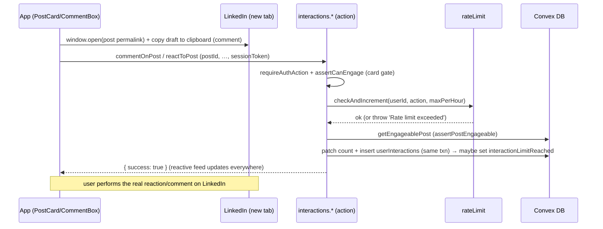

### 24-hour feed hygiene (R21)

A post the viewer has already handled is done work. It stays on screen for **24 hours** as a "done" card — so the tap
has a visible result, and so a mis-tap is still recoverable in context — and then leaves _that viewer's_ feed.
"Hide" makes it leave immediately, on a done card or any other post the viewer wants out of the way (the card asks for
confirmation first, because there is no unhide). All of it is per-viewer: nothing about the post, its counts, its cap or
the author's view of it changes.

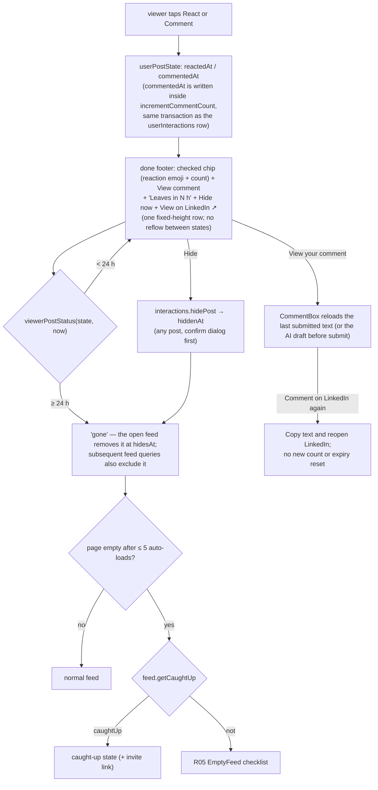

**The stamps.** `reactedAt` was already there (it is the reaction dedupe). R21 adds `commentedAt`, written by
`incrementCommentCount` **in the same transaction as the log row**, so the moment the viewer tapped Comment is recorded
exactly once and cannot drift from the interaction log. `lastInteractedAt(row)` takes the later of the two — carefully,
without a `?? 0` sentinel, which `Math.max` would otherwise floor at zero and swallow the missing side.

**The three states** come from one pure module, `convex/lib/feedHygiene.ts`:

- `viewerPostStatus(row, now)` → `'fresh'` (no row, or a row with neither stamp — the normal card), `'done'`
  (interacted, inside `INTERACTED_TTL_MS` = 24 h), `'gone'` (hidden, or the window elapsed).
- `canHide(row)` — **removed 2026‑09‑11.** Hide is no longer restricted to interacted posts: the feed's hide control
  sits on every card (fresh and done), `FeedPage` confirms it in a destructive-action modal, and then
  `interactions.hidePost` stamps `hiddenAt` on the viewer's row — creating it if the post was untouched. Hiding is
  idempotent (a second call changes nothing) and there is **no unhide** — `/history` keeps the record either way.
- `toFeedViewerState(row)` — the `{ reacted, commented, hidesAt }` the card renders. It deliberately takes **no `now`**:
  `hidesAt` is an absolute instant (`lastInteractedAt + INTERACTED_TTL_MS`), and the client turns it into "in N h".

The card's remaining action stays live: a viewer who reacted still sees the Comment button, and vice versa.
Commented posts also offer **View comment**. This opens the saved text read-only with **Comment on
LinkedIn again**, which copies the text and reopens the post without recording another interaction
or resetting the 24-hour window. The text is the last submitted comment (`incrementCommentCount` writes it to
`commentDraft`), so an edit the member made before posting is what comes back; a post whose only saved text is an AI
draft shows that instead. A missing saved text gets an explicit empty state and still permits reopening
LinkedIn. Clipboard failure leaves the text available for manual copying.

**The footer is fixed-height in every state.** Reacting or commenting swaps its control in place — the React button
becomes a checked chip carrying the same reaction emoji and count (the count stays visible), the Comment count becomes
**View comment** — and the trailing cluster (`Leaves in N h` with a clock icon + Hide / Hide now + View on LinkedIn ↗)
never moves. At `sm` and up this is one 52 px row (`h-13`); below `sm` the trailing cluster drops to a second row, but
the structure is the same in every viewer state, so the overlay always covers the same strip of the embed and a card
that was just reacted to never reflows the feed around it. Long comment labels truncate with an ellipsis instead of
wrapping, and counts use `tabular-nums` so a digit change cannot nudge the row.

`FeedPage` filters out cards at `viewerState.hidesAt`, including while the feed stays open without database updates.
One shared clock refreshes the countdown every minute, at the nearest expiry, and when the tab regains focus or
changes visibility. The countdown rounds up and stays between 1 and 24 hours while a card is visible. Hiding is
reactive: Convex removes the card without a reload.

**`feed.getCaughtUp({ sessionToken })` → `{ caughtUp }`** answers the question an empty page cannot: _did I clear the
feed, or is there nothing here?_ It is `true` when the viewer's newest `userInteractions` row (`by_user`, descending,
`.first()`) is younger than 24 h — older interactions have already left the feed and prove nothing about today. A banned
viewer is always `false`, because `getFeed` hands them an empty page regardless and "caught up" would be a lie about a
feed they are not being shown. `FeedPage` subscribes to it **only** while the feed is empty, after auto-loading up to
`MAX_EMPTY_LOADS` (**5**) further pages that also came back empty — a budget per _run_ of empty pages, reset whenever a
page comes back with posts. Empty because everything was handled → the caught-up state (which carries the R19 invite
link); empty because nothing exists → the R05 `EmptyFeed` checklist.

`post_hidden { interacted, after }` — whether the hide followed an interaction, and the hours between that interaction
and the tap (null when there was none) — is the only event R21 emits; see
[§17](#17-security-posture).

### Reading the log back — recap & history (R15 / R16)

`userInteractions` ([§5](#5-data-model)) is the authoritative record, and exactly two public queries read
it. Both call `requireAuth` and then index on **the caller's own id** — there is no admin or cross-member variant, so a
member can only ever read their own engagement.

**`interactions.getRecap({ sessionToken, window, now })`** — `window` is `'7d' | '30d'`. `now` comes **from the client,
floored to the hour** (`floorToHour`, `convex/lib/recap.ts`): stable args keep the one-shot fetch key quiet across
re-renders. The client fetches this query **one-shot** via `app/src/lib/useQueryOnce.ts`, **not** as a live
subscription — it reads up to 4,000 interaction rows plus 200 posts, and the recap is a review surface, so a live read
set would re-run the whole scan on every like/comment the viewer or their posts receive. UX consequence: the numbers
refresh when the page is (re)opened or the window toggles; the paginated History query keeps its live subscription.
`windowBounds` derives `{ since, prevSince, until }`; the current
window is `[since, ∞)` — deliberately open-ended, so an interaction inside the partial hour counts immediately — and
the previous window is `[prevSince, since)`, which is what makes the period-over-period delta possible from a single
read. It returns:

- `made` / `received`, each `{ current, previous }` as `{ reactions, comments, posts, total }` (`countInteractions`).
  "Made" reads `by_user`, "received" reads `by_author`, and `excludeSelf` drops rows where actor and author are the same
  member, so reacting to your own post never inflates the received side.
- `truncated` — both reads are `.order('desc').take(RECAP_ROW_CEILING)` with `RECAP_ROW_CEILING = 2000`. Newest-first
  means truncation drops the **oldest** rows first, and the flag is set when either side hit the ceiling so the page can
  say so (`recap.truncated`) rather than quietly under-reporting.
- `plan: { tier, ...limits, nextTier }` — the caller's resolved limits ([§9](#9-plan-limits-system)) plus the tier
  above.
- `posts[]` — the member's own posts created since `since` (`by_author`, newest first, `RECAP_POST_CEILING = 200`),
  filtered to live ones (not soft-deleted, not hidden), each with a `EXCERPT_LENGTH = 140`-char excerpt, both counts,
  `isFeatured` and `interactionLimitReached`. This is the per-post usage list.
- `nearCapPost` — `pickNearCapPost` over that same list, or `null` ([§9](#9-plan-limits-system) for the 0.8 band).

**`interactions.listMyInteractions({ sessionToken, since, paginationOpts })`** — the history page's paginated feed:
`by_user`, `.order('desc')`, `.paginate(...)`, **`since = 0` meaning all time**. The query declares
`returns: paginationResultValidator(historyRowValidator)` (the `toHistoryRow` shape), so the row mapping is validated
on every page. The server clamps the client-supplied
`paginationOpts.numItems` into `[1, MAX_HISTORY_PAGE]` (`MAX_HISTORY_PAGE = 100`) before paginating, so a caller can't
request thousands of rows in one query (the validator itself does not cap `numItems`); the optional pagination fields
(`endCursor`, `maximumRowsRead`, …) are preserved. The post/author joins are batched — one `get()` per unique id
instead of two per row. Every row is mapped through the pure `toHistoryRow` (`convex/lib/history.ts`), which joins the
post and its author and sets **`removed`** when the post is soft-deleted **or** hidden; a post row that no longer exists
at all yields `post: null`, and the page renders the same "removed" badge for it. The client pages 20 at a time.

### People, interaction graph and rankings (R22)

The interaction log read back as **people**, not counts. Two public queries in `convex/interactions.ts` (all
`requireAuth`, all indexed on the caller's own id) read the graph; `now` is client‑floored to the hour like `getRecap`,
so a window's args are stable across renders:

- **`listPeopleIInteractedWith({ window, now })`** — "made": `by_user` rows grouped by the post's author
  (`tallyMadeByPerson`). Each person also carries `postsCount`: their visible (not hidden, not soft-deleted) posts
  published inside the window, read per author through `by_author_and_publishedAt` and capped at 500 posts.
- **`listInteractionsByPost({ window, now })`** — "received", grouped by post with the actors nested
  (`tallyReceivedByPost`); a hidden or soft‑deleted post comes back with `removed: true` rather than dropped. This is
  the shape `/people`'s received tab renders.

`ai_draft` rows never count as interactions **between people**, and neither side counts a self‑interaction. Each read is
newest‑first with the recap's **2000‑row ceiling** (`RECAP_ROW_CEILING`) per side per window: truncation drops the
oldest rows first, and `truncated` tells the page (`people.truncated`). The ceiling and its future fix path are
specified in `docs/superpowers/specs/2026-09-14-interaction-graph-notifications-digest-design.md` §6. Banned members
and members pending deletion are dropped from the counterpart join at read time in every personal read
(`listPeopleIInteractedWith`, `listInteractionsByPost`, `rankings.getMyRankings` and the notifications actor join);
an opted‑out member still appears in all of them — opt‑out covers the site boards only.

**The directory (`users.listMembers`) was removed on 2026‑09‑14.** The `/people` page is interactions only; the
member directory and its debounced `api.search.search` box no longer exist (`listMembers` and the
`people.tabs.all` / `people.emptyAll` / `people.search*` copy are gone).

**Rankings.** `rankings.getMyRankings` aggregates the caller's own log live, top 10 each direction, with the same
2000‑row reads and `truncated` flag (surfaced on `/rankings` under the "You" block with `people.truncated`'s copy),
and each person carries `postsCount` (their visible posts in the window, capped at 500 per person like the made list).
`rankings.getSiteRankings` reads the newest stored `rankingSnapshots` generation
and, for movement, the newest one before it; it joins the stored ids to their users and drops banned, pending‑deletion
and opted‑out members **at read time before positions are assigned** — the snapshot stores ids, never names, so a ban
or an opt‑out lands without a rebuild. Every
decorated row carries its **`position`** — the competition rank (`rankPositions` in `lib/ranking.ts`) recomputed over
the post-filter visible list, so a dropped banned/opted-out member leaves no gap and tied counts share the same
number. Each board returns the **top 20** visible rows plus, when the caller's visible‑list position is beyond #12,
five **neighbor** rows around it (`interactorNeighbors` / `posterNeighbors`, clamped at the list ends): the read
selects the display ids first and joins each board's profiles once for just that union, so the snapshot's top 300
stored identities are only read for the filter and the positions until a window is needed. The caller's own
block is computed live: their interaction count for the snapshot's window comes from their `by_user` rows (excluding
`ai_draft` and self) and their posted count from `countVisiblePostsSince` (`lib/postCounts.ts`, the shared 500‑post
cap), and the exact positions come from the snapshot's full `interactorCountsDescending` / `posterCountsDescending`
distributions (`positionOf` in `lib/ranking.ts`), so "you are #87" works beyond the stored identities. A live count
above every stored count takes **position 1** (`positionOf`'s fallback): between rebuilds the member may have overtaken
the stored leader, and beating every stored count is at least first. Positions are competition ranks — equal
counts share the best (lowest) position number (`[9,7,7,5]` → positions `1,2,2,4`) — and `movement` compares the
position with the previous generation (positive = climbed). A `partial: true` board hit the job's 10,000‑row scan
ceiling or the 8,000-count distribution cap and says so. The read also decorates each row with the snapshot's meta:
`reactionsReceived` for posters (summed in‑window `likeCount`) and `postsTouched` for interactors (distinct posts),
defaulting to `0` on generations written before the enrichment. **RCD:** `me` also carries **`gapToNext`** — the count
above minus the member's live count (`null` at position 1 or unranked) — so the UI can say "2 interactions from #7";
reaching that count ties the member above. The same block carries **`postsCount`** (the member's live visible posts in
the window, through the shared 500‑post cap) and **`postsPosition`** (its competition rank over
`posterCountsDescending`, `null` when the member posted nothing in the window). `rankings.getWeeklyTop` is the medal
read: the newest 7d generation's top
three posters and interactors, filtered exactly like `getSiteRankings` (banned / pending-deletion / opted-out drop
**before** positions are assigned), returned as `{ userId, position: 1 | 2 | 3 }` with empty arrays when no snapshot
exists. Personal
rankings are live; the site boards only move when the daily crons rebuild them ([§13](#13-scheduled-jobs-crons)). A
fresh deployment has **no site board** until the first 03:30 / 03:35 UTC run; seed it immediately with
`npx convex run jobs/rankingSnapshot:rebuildRankingSnapshots '{"window":"7d"}'` (and `"30d"` for the other window), or
queue both windows from the admin Settings tab (`admin.rebuildRankingSnapshotsNow`). `/rankings` states the next
03:30 UTC rebuild as a live relative line (`NextUpdate` + `rankings.nextUpdate`).

**The opt‑out (`users.setLeaderboardOptOut`).** One boolean on `users`, **rankings only**: an opted‑out member
disappears from the site boards for everyone else, while the `/people` directory and both mutual interaction lists are
unaffected (their own `me` block still shows their count and position). The mutation is idempotent and audited
(`leaderboard_opt_out_changed`), and the read‑time filter above means the change lands immediately.

**The pre‑2026‑09‑07 `authorId` gap.** `userInteractions.authorId` was added on 2026‑09‑07 and never backfilled
([§5](#5-data-model)): rows older than that are invisible to every `by_author` read, so they contribute nothing to any
"received" tally, nothing to `listPeopleIInteractedWith` (no counterpart to group by) and nothing to the snapshot's
poster attribution. They still carry a `userId`, so `tallySiteActors` counts them on the site interactor side.

### In-app notifications (R23)

One `notifications` row per **received** reaction or comment, written in the **same transaction** as the counter patch
and the `userInteractions` insert — `incrementCommentCount` / `incrementLikeCount` (`convex/interactions.ts`) insert it
right after the log row, so the inbox, the counters and the log can never disagree. The write is skipped when the actor
is the post's author (self-interactions never notify), and a repeat reaction can never notify either (the `reactedAt`
dedupe returns before any write). A comment row carries the flattened 140-char excerpt (`lib/recap.excerpt`); a
reaction row carries the reaction value. **RCD — record notifications.** The same transaction also runs
`interactions.maybeNotifyRecord`: when the author's own post beats its stored best in `userRecords`, passes the **5**
floor and the **7-day** cooldown (`lib/recordPost.isNewRecord`), it writes a self-addressed
`kind: 'record'` row carrying the new `total` and patches the record. Inside the cooldown the best keeps tracking but
no row is written; below the floor nothing is written at all ([§5](#5-data-model)).

Read paths live in `convex/notifications.ts` — the in-app inbox. That filename belonged to the transactional billing
mailer until R23; the mailer is now `convex/billingNotices.ts` (rename note below).

- **`listMine({ sessionToken, paginationOpts })`** — the inbox, newest first through `by_recipient_and_created_at`.
  The client-supplied `numItems` is clamped to `[1, 100]` (`clampHistoryPageSize`, shared with history) before
  `.paginate`.
  Actor and post are joined per unique row at read time; a post that is hidden, soft-deleted or gone entirely comes
  back with `removed: true` rather than dropped (the History treatment), so the row is never a blank. A banned or
  pending-deletion actor's page row drops from the inbox (the stored row itself stays, ready for an unban).
- **`getUnreadCount({ sessionToken })`** — counts only **visible** unread rows (the same actor predicate as `listMine`:
  actor exists, not banned, not pending deletion), so a row hidden from the inbox can never light the badge. Scans at
  most one 100-row `by_recipient_and_read_at` batch with a per-id actor cache and stops at **10**, because the bell
  renders "9+" past nine.
- **`getLatest({ sessionToken })`** — the newest row only (actor name, kind, post URN/URL and `removed`), the client's
  toast seed; the post link lets the toast open the post on click. **RCD:** `listMine` and `getLatest` both carry
  `actorId` and `total`, so a `record` row renders its own sentence (`notifications.record` / `toastRecord`, no actor
  name). Notification rows carry **no medal ring**; the weekly top-3 ring lives only on the feed's `PostCard` author
  (`rankings.getWeeklyTop` + `rankings.topThreeTitle`).
- **`markRead({ sessionToken, ids })`** — idempotent, and ownership-checked: ids pass `normalizeId` first, and a row
  that is not the caller's own (or is already read) is a no-op, so a foreign id can never mark another member's inbox.
- **`markAllRead({ sessionToken })`** — marks one **100-row** batch of the caller's unread rows and, when the batch
  fills, schedules `internal.notifications.markAllReadBatch` (`runAfter(0)`, the same logic without auth) so the
  remainder drains in fresh transactions; the caller's own transaction stays bounded and returns after its batch.

Every read path authenticates through `requireAuth`, whose `assertNotBanned` is the **read-time ban filter**: a banned
member cannot open their inbox (or the bell), while the rows themselves stay in place — a ban never deletes the log.

**The bell, the toast and the page.** `NotificationBell` sits in the `TopBar`: an icon button with the unread badge
and a popover of the five newest rows (`NotificationRow` — actor avatar, an unread dot on unread rows, actor name,
action text, comment excerpt, time, and a trailing `feed.viewOnLinkedIn` affordance with an aria-hidden `ExternalLink`
glyph inside the row's single anchor); clicking a row marks it read and opens the post on
LinkedIn, with **See all** (`/notifications`) and **Mark all as read** in the footer. The toast fires when `getLatest`
returns an id newer than the one already seen — the first **resolved** value only **seeds** a ref (`undefined` while
the query loads is not a resolved value, and a resolved `null` from an empty inbox seeds too), so a reload never
repeats a toast for the row that was already there and a member's first-ever notification still toasts; when the
notification has a live post the toast renders as a button that opens that post (`window.open`, new tab). Browser
notifications are Phase 2, out of this cut. `/notifications`
(`NotificationsPage`) pages 20 at a time, highlights unread rows, draws the **"New since your last visit"** divider
above the first unread row, offers **Mark all as read**, and points an empty inbox back to the feed; a `removed` row
renders without a link (and so without the affordance).

**Retention.** The existing `enforce data retention` cron (`privacy/retention.ts`) purges notifications older than **180
days** in its fourth sweep (`by_created_at`, 100-row batches). The inbox is a convenience copy; the
`userInteractions` log itself is kept.

**The file rename.** The transactional billing email actions used to live in `convex/notifications.ts`. R23 renamed
that file to **`convex/billingNotices.ts`** so the in-app inbox could take the obvious name — the mailer logic itself
is untouched, and every call site moved in the same change: `http.ts` (trial ending), `stripe.ts` (trial converted),
`interactions.ts` (trial near-end and post-cap), `billingNode.ts` (duplicate canceled), plus the milestone test. No
compatibility alias.

### Rate limiting (`lib/rateLimit.ts` + `@convex-dev/rate-limiter`)

A **fixed window** keyed on `(userId, action)`, enforced by the **`@convex-dev/rate-limiter`** component (mounted in
`convex.config.ts`; its counter state lives in the component's own isolated tables, not an app table).
`lib/rateLimit.ts`
wraps it behind three unchanged entry points — `checkRateLimit` (throws), `tryConsumeRateLimit` (returns a boolean), and
the `checkAndIncrement` internal mutation that actions call via `ctx.runMutation`. No named limits are pre‑registered:
every call passes an **inline config** (`kind: 'fixed window'`, `rate = maxPerWindow`, `period = windowMs`), so each
caller keeps its own window; `WINDOW_MS` defaults to 1h. The component performs the check **and** consume atomically in
one transaction, closing the read‑modify‑write race the former hand‑rolled `rateLimits` table admitted (two concurrent
taps could both read `count = N-1` and both write `N`). `checkRateLimit` accepts an optional `windowMs` + `windowLabel`
(defaults to 1h / "hour") for non‑hourly windows. Limits: `submitPost` 10/h,
`commentOnPost` 100/h, `reactToPost` 100/h, `generateComment` 100/h, `profile_refresh` 2/day. The `profile_refresh`
budget
is **shared** by the manual Refresh button and the auto-scrape on identifier change; the latter uses the non-throwing
`tryConsumeRateLimit` so an exhausted budget never blocks saving the identifier. **Admins (`user.isAdmin`) bypass the
rate limit on `commentOnPost`, `reactToPost`, `generateComment`, and `profile_refresh`** — those call sites
unconditionally skip the check for admins. **`submitPost` is the exception:** its rate‑limit, weekly‑limit, and
ownership bypass apply **only under the dev‑gated admin override** (`ALLOW_ADMIN_SHARE_ANY_POST` — see
[§10 — Manual post submission](#manual-post-submission-postssubmitpost-action)). In production that var is unset, so an
admin submits posts under exactly the same limits as everyone else. The anonymous OAuth start route and the landing
event beacon are the only non‑per‑user cases: `enforceOAuthStartBudget` (60/hour) and `enforceLandingEventBudget`
(240/hour) limit each client bucket (`clientBucket` of the best‑effort `x-forwarded-for`, never the IP itself),
alongside global backstops of 1800/hour and 6000/hour ([§7](#7-authentication--identity)).

---

## 11A. AI Reaction & Comment Assistance

OpenRouter (OpenAI-compatible) powers two assists: (1) predicting each submitted post's most-likely reaction, and (2)
drafting comments on demand. The same seam also fills an empty profile industry from the member's own post
([§11C](#11c-profile-auto-fill-industry--country)). The model is Google's open **Gemma**
(`google/gemma-4-26b-a4b-it`), served via OpenRouter's privacy-constrained provider routing. All calls go through one
seam —
`convex/ai/openrouter.ts` `callOpenRouter(messages, { action })` — which mirrors `linkedin/client.ts`
(auth + log-real-error→throw-sanitized). The prompts are **multimodal**: the post's images (`posts.imageUrls`, the
image-typed media captured at submit) + the linked article's images are attached as vision input, and the **full article
body** (`posts.article.text`) is sent as text — so the model must be **vision-capable** (`OPENROUTER_MODEL` must point
at a multimodal model). Non-image media (documents/links)
are listed as text context, not attached.

> **Compliance — AI inference runs via OpenRouter with zero data retention (dynamic provider routing).**
> `OPENROUTER_API_KEY` enables the AI features (unset ⇒ reactions no-op to `LIKE`, Generate reports "AI
> unavailable"). The seam (`convex/ai/openrouter.ts`) constrains routing **in code** to providers that honour
> **zero data retention** (`zdr: true`) and **no data collection / no training** (`data_collection: "deny"`) —
> not env-overridable — and OpenRouter selects among the qualifying providers (no `:floor` price-routing
> suffix on the model slug; the `data_collection`/`zdr` pin is what governs provider selection). The model is
> Google's open **Gemma** (`google/gemma-4-26b-a4b-it`), verified against OpenRouter's live catalog and served
> by **DeepInfra** at fp8. **OpenRouter** (US) is the named sub-processor; the **downstream
> inference provider (e.g. DeepInfra) and its region are selected per request, not pinned** — so region is not
> guaranteed and the controller relies on OpenRouter's DPA flowing down to its providers. Documented in
> `docs/compliance/`: ROPA **Activity 13** (`DATA-INVENTORY.md`), the **OpenRouter** rows in `SUBPROCESSORS.md`,
> **item 10** in `GAP-ASSESSMENT.md`, and the public `/privacy` disclosure. **Human/legal before go-live:**
> execute OpenRouter's DPA, confirm ZDR/no-training flows down to its providers, and assess the transfer
> position given the non-pinned region (add region constraints if needed). **Flagged for legal review:**
> DeepInfra's zero-retention posture has a documented exception for Google-family models — Google logs
> prompts/responses for abuse-monitoring purposes independent of DeepInfra's ZDR commitment.

### Reaction prediction (async, best-effort)

Both post-creation paths schedule `internal.ai.reactions.predictReaction` immediately after the upsert, so OpenRouter
latency/cost/failure never touch either caller: `posts.submitPost` (manual submit) and
`jobs/syncPostsApify.syncUserPostsViaApify` — the single Apify sync function shared by all three §10 triggers (daily
cron fan-out, Stripe on-activation, admin manual sync). Both call the shared gatekeeper
`jobs/syncPosts.upsertPost`, which now returns `{ postId, created }` — `created` is `true` **only** on a genuine insert,
never on the update branch (an already-known URN being re-synced) or the queue branch (over the weekly limit, routed to
`postQueue`). `submitPost` always schedules (its insert is always new); the Apify caller gates on
`created === true` via the pure, unit-tested `shouldPredictReaction` helper — so a daily cron re-run over already-synced
posts never re-schedules a prediction (no duplicate OpenRouter spend). Apify predicts for **all**
newly-inserted posts, including trial-`hidden` ones — no special-case; a few wasted predictions for a never-converting
trial user is an accepted ceiling.

The prediction reads the post, builds the reaction prompt (content + article), calls OpenRouter, coerces the reply with
`parseReaction` (whole-word match against the 6-enum allow-list, **default `LIKE`**), and patches
`posts.suggestedReaction`. Any failure — including a missing `OPENROUTER_API_KEY` — is swallowed (logged); the post
keeps the default `LIKE`, and the sync itself never fails because of it. Apify-synced posts carry no `article`/
`imageUrls` context (that enrichment is manual-submit-only — see above), so their prompt is text-only.

**Known gap — queued posts:** a post that overflows the weekly limit is routed to `postQueue` instead of `posts`
(`created: false`, no prediction). When `jobs/processQueue.processPostQueue` later promotes it into `posts`, that insert
does **not** go through `upsertPost` and is not wired to `predictReaction` — a promoted post keeps the default `LIKE`
unless a later Apify re-sync happens to touch it (which also doesn't predict, by design — that would be the update
branch). See `backlog/B09-ai-reaction-apify-posts.md`.

No proactive throttle guards the resulting OpenRouter burst (`convex/ai/openrouter.ts`'s `callOpenRouter` has no rate
limiting of its own): the daily cron, ≤3 new posts/user, and the `created`-only gate above already bound a single run to
at most a few predictions per newly-active user, and any OpenRouter failure/429 is swallowed by the same best-effort
handling. The `@convex-dev/rate-limiter` component is now mounted (it backs the per‑user limits above), so it can be
applied to this OpenRouter prediction burst too if usage growth ever makes that bound too loose.

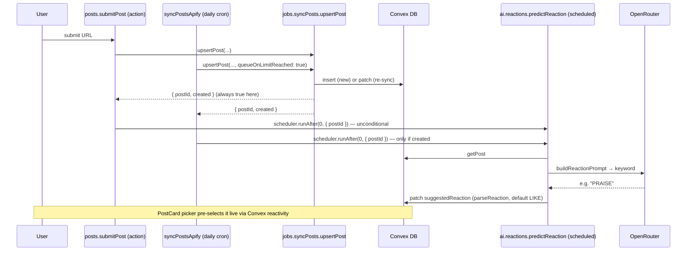

The feed's reaction control (`PostCard`) is a **picker** pre-selecting `suggestedReaction ?? 'LIKE'`; the viewer
confirms or changes before `reactToPost` sends the chosen reaction (§11).

### Comment drafting (on-demand)

`api.ai.comments.generateComment({ sessionToken, postId, language? })` → `{ comment }`. It auth-checks, then **
`assertCanEngage`** — AI drafting requires an active subscription (the same card-on-file gate as `commentOnPost`:
`none`/`past_due` are blocked, all tiers otherwise pass, admins bypass), so the OpenRouter spend is never reachable
without a subscription. It then rate-limits (100/h, admins exempt), loads the post through the shared
`internal.interactions.getEngageablePost` gate (so a hidden / limit-reached / not-visible post is rejected exactly as in
`commentOnPost` / `reactToPost` — see the per-post engageability gate in §11) plus the author's public name/headline
(`internal.users.getPublicAuthor`), resolves the language, builds the comment prompt (≤2 paragraphs, concise, no
hashtags/@-mentions; article + media URLs included), calls OpenRouter, and returns the draft. The draft is **persisted
per (user, post)** on `userPostState` (`internal.interactions.saveCommentDraft`) so `CommentBox` can reload it on reopen
for reuse/regeneration — per-post scope avoids the cross-post text reuse that would trip LinkedIn spam detection.
`CommentBox` prefills the textarea (Generate / Regenerate) for the user to edit, then posts via the unchanged
`commentOnPost`.

**The first draft on a post counts as an interaction** (product decision 2026‑09‑11, replacing the R15 "counts as
nothing" rule of 2026‑09‑05). `saveCommentDraft` writes one `userInteractions` row (`kind: 'ai_draft'`, the draft text
in
`comment`, **no `authorId`**) and calls `bumpTrialInteraction(made)` the first time a draft is generated for that (user,
post); `userPostState.aiDraftedAt` is the dedupe, so regenerating does not add a second row or a second trial
bump. It still bumps no `commentCount` and consumes no author cap: the app cannot observe a draft landing on LinkedIn,
so a draft is the member's own activity, never engagement the author received, and the 100-per-hour generation budget
can still never be turned into engagement on someone else's post cap. The recap and the history
([§14](#14-frontend--authenticated-app-app)) show the draft as its own `ai_draft` entry (Recap: a `drafts` part of the
breakdown; History: an "AI comment drafted" row), separate from the member's comments. Submitting the comment later
overwrites `commentDraft` with the member's final text, so the box reloads what they actually posted.

### Comment language

All **ISO 639-1** codes (`convex/lib/languages.ts`, codes-only + `Intl.DisplayNames`, mirroring
`profileOptions.ts`) plus an **`auto`** sentinel ("match the post"). Stored as `users.commentLanguage`
(`v.string()`, validated in the handler — same pattern as `country`/`industry`). The default chain is **per-comment
select → saved `commentLanguage` → `auto`**, all via the pure `resolveCommentLanguage`
(shared by the action and both selects). Settings has a default picker (`setCommentLanguage`); the comment box picker
overrides per-comment without writing back.

### Files

`convex/ai/{openrouter,prompts,reactions,comments,industry}.ts` (`industry.ts`:
[§11C](#11c-profile-auto-fill-industry--country)), `convex/lib/{reactions,languages}.ts`,
`posts.submitPost` (schedule hook), `jobs/syncPosts.ts` (`upsertPost`'s `{ postId, created }` signal),
`jobs/syncPostsApify.ts` (schedule hook + `shouldPredictReaction` gate), `interactions.reactToPost` (enum fix),
`users.{setCommentLanguage, getPublicAuthor}`, `getMe` (exposes `commentLanguage` via `toSafeMe`); frontend
`PostCard` (picker), `CommentBox` (draft + language), `SettingsPage` ("AI Comments"), i18n `reactions.*` /
`comment.*`.

---

## 11B. Search & Command Palette

A ⌘K / Ctrl-K **command palette** searches posts and people and offers quick navigation actions. It replaces the former
non-functional top-bar search placeholder.

### Backend (`convex/search.ts`, `search` query)

- Two full-text **search indexes** on `convex/schema.ts`: `posts.search_content` (`searchField: 'content'`,
  `filterFields: ['inFeed']`) and `users.search_name` (`searchField: 'name'`).
- The `search` query takes `{ sessionToken, queryText }` and returns `{ posts, people }`. It **requires a valid
  session** (returns empty on missing/invalid token or a query under 2 chars). The handler supplies its own `Date.now()`
  to the eligibility gates below — a deliberate exception to the "no wall clock in queries" guideline that mirrors
  `feed.getFeed`: the lapsed-author check must not trust a client clock, or a direct caller could pass `now: 0` to
  surface canceled-and-lapsed authors. `CommandPalette` sends no time arg, so the query's args only change with the
  debounced text.
- **Feed-parity visibility (security-critical):** post results reuse the exact same rules as `feed.getFeed` through the
  single shared gate `feed.isPostVisibleToViewer(post, viewer, author, now)` — the `search_content` index is pinned to
  `inFeed === true`, then that gate drops the **viewer's own posts**, applies the per-viewer `visibilityIndustries` /
  `visibilityCountries` allow-lists, and enforces `isAuthorFeedEligible(author)`. Because feed and search call the same
  predicate, search can never surface a post the feed would hide (and never the searcher's own posts). Search does
  **not**
  apply the feed's tier-based industry/country _preference_ filter — that is a "what I want to see" layer, not an access
  rule. People results are **not** viewer-filtered (searching for yourself is fine), but they **are
  eligibility-filtered**:
  the same `isAuthorFeedEligible(person, now)` predicate the post results apply drops **banned, pending-deletion, and
  canceled-and-lapsed** members — so a moderated (or gone) person is hidden from people-search exactly as their posts
  are hidden from post-search. Note this also hides a canceled member once they lapse (`now ≥ subscriptionEndsAt`),
  matching the feed's own author eligibility. Both searches **over-fetch** (`take(MAX × 3)`) then filter and slice to
  the cap, so the eligibility/visibility drops don't starve the result count.
- **Safe projections:** posts expose only `{ _id, content, sourceUrl, author }` (author via `toFeedAuthor`); people via
  the pure allow-list `toSearchPerson` → `{ _id, name, headline, profilePictureUrl, linkedinPublicIdentifier }` — never
  tokens, email, admin/ban state, or other PII. The filtering runs in the extracted `searchPostsAndPeople(ctx, viewer,
…)` helper (thin `search` wrapper owns auth), unit-tested over a 10-post fixture with a mock `ctx` in
  `convex/search.test.ts` (including a people-eligibility case); `feed.getFeed`'s `fetchFeedPage` is tested the same way
  in `convex/feed.test.ts`.

### Frontend (`app/src/components/shell/CommandPalette.tsx`)

- Reuses the `cmdk` wrapper in `app/src/components/ui/command.tsx` (`CommandDialog` + `Command` root). `AppShell` owns
  the open state and a global ⌘K/Ctrl-K keydown listener (`preventDefault` so it doesn't collide with browser find); the
  `TopBar` search button opens it via `onOpenSearch`. The top-bar shortcut hint is OS-aware — `getModifierKey`
  (`TopBar.tsx`, from `navigator.platform`) shows **⌘** on macOS/iOS and **Ctrl** elsewhere — and only renders from the
  `sm` breakpoint up; below it the button shows the compact `shell.searchShort` label ("Search"/"Pesquisar"/"Buscar")
  and no modifier hint, since a phone has no Ctrl key.
- Input is debounced ~180ms; the Convex query runs reactively via `useQuery(..., 'skip')` and only fires at ≥2 chars.
  Idle (no query) shows **Quick actions** (nav items + toggle theme + sign out); typing shows **People** / **Posts**
  groups, or a localized "No results". `shouldFilter={false}` — results are already filtered server-side, so cmdk's
  substring filter must not re-hide full-text matches. Selecting a person/post opens their LinkedIn permalink in a new
  tab (the compliant embed → permalink handoff).
- The palette's nav quick-actions are not a second hand-maintained list: `CommandPalette.tsx` flat-maps the same
  `NAV_GROUPS` the sidebar renders (`app/src/components/shell/navItems.ts`), so **Recap** and **History**
  ([§14](#14-frontend--authenticated-app-app)) appeared in ⌘K the moment they were added to that array, and a nav item
  can never exist in one surface but not the other.
- Palette strings live under `shell.*` in `app/src/i18n/locales/{en,pt,es}.json`.

> Search indexes cannot run under the unit mock runner (`convex/vitest.config.ts`, §18 Testing) — the `search` query is
> instead covered by the `convex-test` integration runner (`convex/vitest.integration.config.ts`, added by plan 025);
> the
> pure `toSearchPerson` projection stays unit-tested.

---

## 11C. Profile Auto-fill (Industry & Country)

A Growth feed filters by the viewer's own `industry` and `country` ([§11](#11-feed--engagement)), and a filtered feed
leaves out authors without the filtered field, so an empty profile field costs a member both ways. Most members never
open Settings, so both fields fill themselves while empty, and the member can see and change them:

- **Industry: AI, from the member's own post.** `posts.submitPost` schedules
  `internal.ai.industry.guessIndustry({ userId, postId })` right after `predictReaction` when the submitter has no
  `industry`, no `profileEditedAt`, and the admin share-override is off (under it the post may not be theirs). The
  action reads the post's stored `content` (the ownership-verified text; nothing else about the member is sent) and
  calls OpenRouter through the same ZDR seam as [§11A](#11a-ai-reaction--comment-assistance) with `buildIndustryPrompt`
  (`ai/prompts.ts`: every `INDUSTRIES` entry as a `code: label` line, "the industry the AUTHOR works in", reply the code
  or `NONE`). `parseIndustryCode` (`lib/profileOptions.ts`) takes the first number in the reply, keeps it only if it is
  a valid code, and returns nothing for `NONE`; a valid code goes to `internal.users.fillGuessedIndustry`. Any failure
  (including a missing `OPENROUTER_API_KEY`) is logged and swallowed: the industry stays empty, and the member's next
  post tries again.
- **Country: the browser, no AI and no third party.** `app/src/lib/guessCountry.ts` maps the browser's time zone to a
  country through ICU's own tables: it builds a zone → country map once from
  `new Intl.Locale('und-XX').getTimeZones()` for every code in `COUNTRY_CODES`, and first resolves the input through
  `Intl.DateTimeFormat`, so an alias (`Asia/Kolkata`, `America/Argentina/Buenos_Aires`) matches ICU's canonical id
  (`Asia/Calcutta`, `America/Buenos_Aires`). A zone with no country (`UTC`), or an engine without `getTimeZones`
  (Firefox), falls back to the first `navigator.languages` tag with a valid region (`pt-BR` → `BR`; `es-419` has none).
  `App.tsx`'s `CountryGuess`, rendered in the `AppShell` branch of `RequireAuth` (so after the policy, consent and
  first-post gates), calls the public `users.fillGuessedCountry` while `!me.country && !me.profileEditedAt`.
- **One rule for both writes.** `users.fillGuessedProfileHandler` (pure, unit-tested) returns early once
  `profileEditedAt` is set, fills only an **empty** field, accepts only valid codes (the country upper-cased), and never
  overwrites. `users.updateProfile` (the Settings save) stamps `profileEditedAt` whenever the call carries `industry` or
  `country`, so a field the member cleared stays cleared, and a guess still in flight during the save loses.
- **Visible and changeable.** The Growth feed states its filter with a **Change** link to Settings
  ([§11](#11-feed--engagement)). `PostCard` and `UserMenu` show the industry **label** (`industryLabel`) as the
  subtitle when there is no headline; they used to print the raw code. Labels are English in every locale, like the
  Settings pickers.

```mermaid
flowchart TD
    SUB["posts.submitPost (own, verified post)"] --> Q1{"no industry, no profileEditedAt,<br/>no admin override?"}
    Q1 -->|no| SKIP["no guess"]
    Q1 -->|yes| GI["scheduler.runAfter(0) → ai.industry.guessIndustry"]
    GI --> OR["OpenRouter (ZDR): buildIndustryPrompt(post.content)"]
    OR --> PARSE["parseIndustryCode(reply)"]
    PARSE -->|NONE, invalid or error| EMPTY["industry stays empty"]
    PARSE -->|valid code| FI["users.fillGuessedIndustry"]
    SHELL["RequireAuth: AppShell branch"] --> Q2{"!me.country and !me.profileEditedAt?"}
    Q2 -->|yes| GC["guessCountry(): time zone → ICU country, else language region"]
    GC -->|country| FC["users.fillGuessedCountry"]
    FI --> H["fillGuessedProfileHandler: stop if profileEditedAt; fill only empty fields with valid codes"]
    FC --> H
    H --> FEED["Growth feed: 'Showing posts from: …' + Change → /settings"]
    FEED --> SET["Settings save → updateProfile stamps profileEditedAt → fills stop"]
```

**Compliance.** The AI fill is ROPA Activity 13 (c) (`docs/compliance/DATA-INVENTORY.md`): same legitimate-interest
basis and OpenRouter ZDR route as the other AI assists, and only the post text is sent. The public `/privacy` discloses
both fills, and `POLICY_VERSION` went to `2026-09-25` for them ([§15](#15-frontend--landing-site-landing)). Left for
legal review: the basis for the inference, whether it is profiling (GDPR Art. 4 (4), LGPD Art. 20), and the CCPA
"inferences" category (`GAP-ASSESSMENT.md` item 13).

**Known limits.** The filter is an exact match on one industry code, so a niche code can leave a Growth feed thin
(rolling codes up to their parent group is the upgrade path). On Firefox, which lacks `getTimeZones`, an `en-US`
browser in Brazil is guessed `US` until the member changes it.

---

## 12. Admin & Moderation

Admin is gated by the **`users.isAdmin`** boolean, which is **only settable by direct database edit** — no application
code writes it. Every admin function calls `assertAdmin(user)` after
`requireAuth`, throwing `'Forbidden: admin access required'` otherwise.

### Admin functions (`convex/admin.ts`)

| Function                                                                 | Kind     | Purpose                                                                                                                                                                                                                                                                                                                                                                                                                                                                             |
|--------------------------------------------------------------------------|----------|-------------------------------------------------------------------------------------------------------------------------------------------------------------------------------------------------------------------------------------------------------------------------------------------------------------------------------------------------------------------------------------------------------------------------------------------------------------------------------------|
| `checkIsAdmin`                                                           | query    | `true/false` (soft‑fails to `false`) — drives the client route guard.                                                                                                                                                                                                                                                                                                                                                                                                               |
| `getSettings`                                                            | query    | App settings (3 Apify flags + post‑sync & profile‑scrape last‑run status).                                                                                                                                                                                                                                                                                                                                                                                                          |
| `toggleApifySync(enabled)`                                               | mutation | Master switch for the Apify post‑sync cron.                                                                                                                                                                                                                                                                                                                                                                                                                                         |
| `toggleApifyEnabled(enabled)`                                            | mutation | Master Apify kill-switch.                                                                                                                                                                                                                                                                                                                                                                                                                                                           |
| `toggleApifyProfileScrape(enabled)`                                      | mutation | Toggle the LinkedIn profile scrape.                                                                                                                                                                                                                                                                                                                                                                                                                                                 |
| `syncAllPosts`                                                           | mutation | **Manual trigger** → schedule the `jobs/syncPostsApify.syncAllPostsViaApify` fan‑out for all active subscribers. Throws if post sync is disabled. See [Manual Apify sync triggers](#manual-apify-sync-triggers).                                                                                                                                                                                                                                                                    |
| `syncUserPosts(userId)`                                                  | mutation | **Manual trigger** → schedule a post sync for one user. Throws if disabled or the user has no LinkedIn URL.                                                                                                                                                                                                                                                                                                                                                                         |
| `syncAllProfiles`                                                        | mutation | **Manual trigger** → schedule a profile scrape for all users with a LinkedIn URL. Throws if profile scrape is disabled.                                                                                                                                                                                                                                                                                                                                                             |
| `syncUserProfile(userId)`                                                | mutation | **Manual trigger** → schedule a profile scrape for one user. Throws if disabled or the user has no LinkedIn URL.                                                                                                                                                                                                                                                                                                                                                                    |
| `listUsers`                                                              | query    | Up to 1000 users (newest first), **without** tokens/Stripe IDs; includes the public `linkedinPublicIdentifier` slug so the Users tab can gate the per‑row sync actions.                                                                                                                                                                                                                                                                                                             |
| `survivalMetrics(days: 7\|28)`                                           | query    | **R18** — the Survival panel's only data source: reads the window's nightly `survivalSnapshots` row (rebuilt 03:15 UTC by `jobs/survivalSnapshot.rebuildSurvivalSnapshots`) and returns `{ days, since, generatedAt, cohort, payingByTier }`. `null` until the first rebuild. Cohort maths lives in `lib/survival.ts`.                                                                                                                                                              |
| `getChurnRisk`                                                           | query    | On-demand attention list (no snapshot table, so always fresh): scans up to 1000 non-banned, non-deleting members with 4 bounded indexed reads each and returns those to nudge — `received_no_reply` (received7d > 0, made7d = 0), `silent_7d` (no made/received while `lastLoginAt` is within 7d) or `cooling` (made7d < made30d / 4) — sorted by severity, with one concrete `hook` line each. Rendered by the read-only admin **Attention** tab (its own tab, grouped by reason). |
| `setUserTier(userId, tier)`                                              | mutation | Change tier (any of the 4) from the Users tab; promoting to `contact` auto‑seeds a per‑user `planLimits` override from contact defaults.                                                                                                                                                                                                                                                                                                                                            |
| `setUserSubscriptionStatus(userId, status)`                              | mutation | Admin override of `subscriptionStatus` (any of the 5) from the Users tab. Manual override; a later Stripe webhook can overwrite it.                                                                                                                                                                                                                                                                                                                                                 |
| `listContactUsersWithLimits`                                             | query    | Every contact‑tier user (`by_tier`) with **effective** limits (override ?? contact default) + `hasOverride`. Powers the read‑only Plan Limits tab.                                                                                                                                                                                                                                                                                                                                  |
| `listPlanLimits`                                                         | query    | All `planLimits` rows, enriched with `userName` for overrides. Also prefills the Users‑tab contact‑limits modal.                                                                                                                                                                                                                                                                                                                                                                    |
| `updateTierDefault(tier, …)`                                             | mutation | Edit a tier's **default** row (filters out per‑user overrides). Self‑heals (backlog/B27): inserts the row from `buildTierDefaultRow` first if the tier was never seeded, instead of throwing. Backend‑only (no UI).                                                                                                                                                                                                                                                                 |
| `setContactUserLimit(userId, …)`                                         | mutation | Upsert a contact per‑user override (validates ≥ 1; target must be contact tier). Edited from the Users tab.                                                                                                                                                                                                                                                                                                                                                                         |
| `removeContactUserLimit(userId)`                                         | mutation | Delete a contact override (revert to tier default).                                                                                                                                                                                                                                                                                                                                                                                                                                 |
| `banUser(userId, reason?)`                                               | mutation | Set ban fields. **Cannot self‑ban** (`assertNotSelfBan`) — guarantees ≥ 1 admin remains; banning _other_ admins is allowed.                                                                                                                                                                                                                                                                                                                                                         |
| `unbanUser(userId)`                                                      | mutation | Clear all ban fields.                                                                                                                                                                                                                                                                                                                                                                                                                                                               |
| `getSettingsInternal` / `updateSyncStatus` / `updateProfileScrapeStatus` | internal | Used by the Apify jobs — read flags; record post‑sync / profile‑scrape last‑run + error.                                                                                                                                                                                                                                                                                                                                                                                            |

`validateLimitArgs` enforces `interactionsPerPost ≥ 1` and `postsPerWeek ≥ 1`. `effectiveContactLimits`
(pure, unit‑tested) resolves a contact user's display limits as `override ?? contact default ?? hardcoded`.

### Survival panel (R18)

`admin.survivalMetrics({ sessionToken, days: 7 | 28 })` answers one question — _who survives the first week_ — and
answers it **from the database only**. Every number is one an admin could re-derive by hand from `users`,
`subscriptions`, `posts` and `userInteractions`; nothing is read from PostHog, and no survival event is emitted
anywhere.

**Nightly snapshot.** The cohort maths is too heavy to recompute live: the old query re-read ~4 indexed rows per
cohort member on every reactive invalidation, and its `.order('desc').take(1000)` walk silently capped the cohort.
Instead, `jobs/survivalSnapshot.rebuildSurvivalSnapshots` runs on the `rebuild survival snapshots` cron at **03:15
UTC** (15 minutes after the daily post sync) and writes one row per window to `survivalSnapshots`
([§5](#5-data-model)); `survivalMetrics` reads that single row via `by_days` and returns `null` until the first
rebuild has run (the tab renders **"No snapshot yet — the nightly rebuild has not run."**). Because the row carries
`generatedAt`, the panel is **as-of the last cron**, not live — acceptable for an admin cohort report, and the tab
prints it as an explicit **"Snapshot as of `<generatedAt>` UTC"** caption. Run
`npx convex run jobs/survivalSnapshot:rebuildSurvivalSnapshots` if real-time cohort numbers ever matter. The query
itself has no `Date.now()`, no per-user reads and no 1000 cap.

**Job read budget.** Per window the action pages the whole `users` table (100/page) and filters each page by
`createdAt >= since`, walking to `isDone`. It does **not** stop at the first row older than `since`: `createdAt` is a
user-recorded signup value, not monotonic with the `_creationTime` page order, so a backdated signup could otherwise
end the walk early and drop later in-window rows. For each
cohort member it does the same **five bounded indexed reads** the panel needs: the `subscriptions` rows (`by_user`,
`.order('desc')`, `.take(5)`), one probe for any authored `posts` row (`by_author`, `.first()` — the onboarding
flag), the member's _oldest_ `userInteractions` row (`by_user`, `.first()` — `by_user` is
ordered by `_creationTime`, so `.first()` is the earliest), and one range read for each return window. Those ranges
need **no new index**: they bound the `_creationTime` tail Convex appends to `userInteractions.by_user`, and
`createdAt` and `_creationTime` are written in the same mutation. The job then calls `summarizeCohort(rows, now)` with
its own `Date.now()` clock, so eligible denominators are measured at rebuild time.

**Cohort definitions**, exactly as `summarizeCohort` (`convex/lib/survival.ts`) implements them:

| Metric                            | Definition                                                                                                                                                           |
|-----------------------------------|----------------------------------------------------------------------------------------------------------------------------------------------------------------------|
| `signups`                         | Members whose `createdAt` falls inside the window.                                                                                                                   |
| `startedTrial`                    | The member has **any** `subscriptions` row.                                                                                                                          |
| `onboarded`                       | Has at least one `posts` row (soft-deleted included) **or** at least one `userInteractions` row — the first-post or first-engagement onboarding, with no time bound. |
| `activated`                       | Their first interaction is less than **24 h** after `createdAt` (`ACTIVATION_WINDOW_MS`).                                                                            |
| `medianMinutesToFirstInteraction` | Whole minutes, over the members who have a first interaction at all; `null` when nobody does.                                                                        |
| `returnedDay1`                    | Any interaction in the half-open window `[createdAt + 24 h, createdAt + 48 h)`.                                                                                      |
| `returnedDays2to7`                | Any interaction in `[createdAt + 24 h, createdAt + 8 d)` — it **contains** day 1, it is not disjoint from it.                                                        |
| `trialsEnded`                     | Started a trial **and** `subscriptionStatus` is `active`, `canceled` or `past_due` (i.e. it left `trialing`).                                                        |
| `converted`                       | Started a trial **and** `subscriptionStatus` is `active`.                                                                                                            |
| `canceled`                        | `subscriptionStatus === 'canceled'`, **or** the live subscription row has `cancelAtPeriodEnd` — over all signups.                                                    |

Because `returnedDays2to7` contains day 1, the panel labels it **"Returned days 1–7"** — the window is the useful
signal (_did they come back at all after the first day_), and renaming the field would silently break comparability
with numbers already read, so only the label changed.

**Eligible denominators — why `summarizeCohort` takes a `now`.** Alongside the counts, the summary returns
`activatedEligible` (rows with `createdAt + ACTIVATION_WINDOW_MS <= now`), `returnedDay1Eligible` (`createdAt + 48 h <=
now`) and `returnedDays2to7Eligible` (`createdAt + 8 d <= now`) — the rows whose window has actually **closed**. The UI
divides each count by its own eligible base, never by `signups`. Dividing by `signups` right-censors the metric: it
counts every member still _inside_ a window as a miss, so in a 7-day cohort — where nobody is 8 days old — "returned"
would read **0 %** however those members behaved, and a cohort that all signed up yesterday would report 0 % across the
board. Each windowed **count** is taken over the same closed rows as its base, so a share can never pass 100 %: a member
who signed up an hour ago and already tapped has activated in fact, but they join the count and the base together the
moment their 24 h window closes, never the count alone (which would print "3 of 1 · 300%"). `signups`, `startedTrial`,
`onboarded`, `trialsEnded`, `converted` and `canceled` need no such base, because nothing about them is pending. When
a base is `0`,
`share()` renders **"–"**,
never "0 %" — "not enough data yet" and "nobody did it" are opposite answers, and this panel exists to tell the founder
whether anyone reaches value at all.

**Why the trial metrics are keyed on the subscription row, not on a date.** `stripe.syncUserSubscription` erases
`users.trialEndsAt` once a subscription becomes active — a marker that deletes itself the moment it would prove a
conversion. A date-based definition of "trial ended" or "converted" could therefore never count a single conversion, so
the panel reads the **subscription row's status** instead. This is the same reasoning that makes `trialEligible` count
rows rather than read `trialEndsAt` ([§8](#8-subscriptions--billing)).

`payingByTier` is deliberately **not** cohort-scoped: it counts `subscriptionStatus === 'active'` members per tier
across the **whole** table (the job pages active users through the same `by_subscription_status` index
`users.getActiveSubscribers` uses), so the panel shows the current book of business next to the window's funnel. A
paying member with no `tier` counts as `starter`, the app's default. Its heading says **"all active members"**.

The UI is `SurvivalTab` — see [§14](#14-frontend--authenticated-app-app).

### Landing funnel metrics (`convex/landingMetrics.ts`)

`landingMetrics.getMetrics({ sessionToken, days: 7 | 28 })` is the **Landing** admin tab's only data source. It is
gated by `requireAuth` + `assertAdmin` like every other admin endpoint. It computes `sinceDay` (UTC, `days` calendar
days including today), range-reads `landingMetrics` through `by_day_and_event` (`.take(500)` — the ceiling sits far
above the 5 events × 28 days the schema can hold) and returns `{ days, sinceDay, uniqueTrackingEnabled, pricingViews,
ctaClicks, uniquePricingViewers, uniqueCtaClickers, byPlacement, daily }` from the pure `summarizeLandingMetrics`.
`byPlacement` always lists all four placements in `hero, nav, pricing, final` order, zeros included, each with
`clicks` and `uniqueClicks`; `daily` projects one row per UTC day in the window — `day`, `pricingViews`,
`uniquePricingViewers`, `ctaClicks`, `uniqueCtaClickers` — newest first, zero‑filling days without events (a missing
day would read as unknown, a zero day as zero), while placements stay window‑level. The click‑through percentage is
presentation, derived in the tab as
`share(uniqueCtaClickers, uniquePricingViewers)` (a zero base reads as "not enough data yet", the same distinction
`share()` draws in the Survival panel). `uniqueTrackingEnabled` is exactly "a visitor secret is configured"
(`landingVisitorSecret() !== undefined`) — not whether traffic exists — so the tab can warn while still showing the
totals.

`recordLandingEvent` is an internal mutation (the HTTP beacon is its only caller). It derives the UTC day with
`new Date().toISOString().slice(0, 10)` and upserts the `(day, event)` row with the compound index + `.unique()`, so
concurrent beacons can never insert duplicate day rows. The optional `visitorKey` is the
`hex(HMAC‑SHA256(secret, "landing-visitor:" + day + ":" + ip + ":" + ua)).slice(0, 32)` computed in `http.ts` from the
first `x-forwarded-for` hop and the `user-agent` header; the raw IP/UA are never arguments of this mutation (the IP
reaches only the rate-limit mutation, which stores just its bucket). With it, the
same transaction reads `landingVisitors` via `by_day_and_visitor_key`: absent ⇒ insert the row with the event's flag
true and the other four false (`becameUnique`), present with the flag false ⇒ patch it true (`becameUnique`), present
with the flag true ⇒ not unique. `count` always increments; `uniqueCount` increments only when `becameUnique`.
Concurrent same‑visitor beacons are settled by Convex's serializable isolation — no manual dedup retry logic.
`secret` is `landingVisitorSecret()` (`LANDING_METRICS_SECRET || UNSUBSCRIBE_SECRET`, empty counts as unset); with no
secret or no IP the key is omitted, totals still count and uniques do not. Raw rows are pruned to today's by
`pruneLandingVisitors` (`shouldContinueVisitorPurge` reschedules self‑chaining 200‑row batches, mirroring the session
purges), so with the daily cron the hash is retained at most 48 hours, the "deleted within two days" the public privacy
and cookie pages promise. The beacon route is anonymous, so it is bounded by
`lib/rateLimit.enforceLandingEventBudget` — **240/hour per best-effort client bucket** (`clientBucket` of the
forgeable `x-forwarded-for`, one of 4096 buckets, so the limiter never stores an IP) and **6000/hour global** —
mirroring the OAuth-start budget; neither limit is in `RATE_LIMIT_ACTIONS` (that list exists
for per-user erasure and the beacon has no user). See [§5](#5-data-model) for the tables,
[§15](#15-frontend--landing-site-landing) for the transport and privacy stance, and
[§14](#14-frontend--authenticated-app-app) for the tab. The same tab follows the clicks through LinkedIn in its
**Sign-in** section ([§12C](#12c-sign-in-funnel-metrics)).

### Manual Apify sync triggers

Four admin‑only mutations let an admin run a sync on demand instead of waiting for the daily cron. Each **respects the
same toggles the crons honor**: it schedules the (slow, paid) job and returns immediately, but only when its feature
flag (+ the master kill‑switch) is on — otherwise it throws
`"<feature> is disabled — enable it in Settings first."` The UI also gates each control, but the **server check is
authoritative** (a stale client or a direct API call still can't run a disabled integration). All four triggers share a
single `assertApifyTriggerEnabled` precondition (auth + admin assertion + flag check) so the server gate is defined once
in `admin.ts`.

| Trigger                   | Schedules                                                      | Surface (admin panel)                               |
|---------------------------|----------------------------------------------------------------|-----------------------------------------------------|
| `syncAllPosts`            | `jobs/syncPostsApify.syncAllPostsViaApify` (post‑sync fan‑out) | "Sync all now" on the **Apify Post Sync** card      |
| `syncUserPosts(userId)`   | `jobs/syncPostsApify.syncUserPostsViaApify`                    | "Sync posts" in the **Users**‑tab row menu          |
| `syncAllProfiles`         | `jobs/scrapeProfileApify.scrapeAllProfilesViaApify`            | "Sync all now" on the **Apify Profile Scrape** card |
| `syncUserProfile(userId)` | `jobs/scrapeProfileApify.scrapeUserProfile`                    | "Sync profile" in the **Users**‑tab row menu        |

The per‑user triggers additionally require the target to have a `linkedinPublicIdentifier`
(otherwise the menu item is disabled and the server throws). Outcome is observable via each card's
`Last sync` / `Last profile sync` line (and the user's data updating reactively) — there is no per‑item progress view.
Because these are flag‑gated, they do **not** by themselves "switch Apify on" — only the toggles do, and doing so in
production triggers the compliance hard gate (see [§13B](#13b-privacy--compliance)).

### Ban model — **reactive, not a forced logout**

`banUser` **only patches the user row** (`isBanned/bannedAt/bannedBy/bannedReason`). It does **not**
delete sessions. Enforcement is:

1. **Server:** the next `requireAuth`/`requireAuthAction` calls `assertNotBanned` → throws
   `'Account suspended'` (blocks all protected mutations/actions).
2. **Client:** Convex's reactive `getMe` query (which uses `resolveSession`, not `requireAuth`, so it still returns the
   user with `isBanned: true`) pushes the flag to any open tab → `RequireAuth`
   swaps the whole shell for `<BannedScreen>`.
3. **Content:** the banned author's posts are dropped from every other member's feed and search at read time via
   `isAuthorFeedEligible` (see §11) — no post mutation, so an **unban** restores them automatically.

An **unban** restores access on the **same** session token — no re‑login required.

```mermaid
flowchart TD
    ADM["admin: banUser(userId, reason?)"] --> CHK["assertAdmin + assertNotSelfBan"]
    CHK --> PATCH["patch user: isBanned=true, bannedAt, bannedBy, bannedReason"]
    PATCH --> SRV["next requireAuth* → assertNotBanned throws 'Account suspended'"]
    PATCH --> CLI["reactive getMe pushes isBanned → BannedScreen (session still valid)"]
```

---

## 12A. Feedback

Authenticated users submit free-text feedback (≤4000 chars) tagged with a single category via a floating button
(bottom-right of every authenticated page). Admins read and reply by email from the **Feedback** tab in the admin panel.
Each feedback item can receive **multiple admin replies** stored as a thread in the `feedbackResponses` table.

**Data:**

- `feedback` table — `userId?` (submitter; cleared on account deletion), `category` (one of
  `feature_request | bug | comment | criticism | praise | question | suggestion | cancellation | other`),
  `message`, `status` (`new | responded | archived`), `createdAt`. Index: `by_user`.

  `cancellation` (added 2026-09-07 for R09) is the one category a member never picks: it is written **only** by
  `CancelInterstitial`'s optional "why are you leaving?" note ([§8](#8-subscriptions--billing),
  [§14](#14-frontend--authenticated-app-app)) and is deliberately **absent** from `FeedbackModal`'s category list, so
  the label stays a reliable signal of _when_ the note was written rather than a self-declared mood. The note is a
  courtesy: `CancelInterstitial` swallows a `submitFeedback` failure so the cancel itself never depends on it.

- `feedbackResponses` table — append-only reply log; each row is one admin reply.
  `feedbackId` (FK → `feedback`), `responderId` (FK → `users`, the admin who replied),
  `text` (reply text), `createdAt` (ms). Index: `by_feedback_id_and_created_at [feedbackId, createdAt]`
  (chronological per item).

**Backend** (`convex/feedback/`):

- `feedback.ts` — `submitFeedback` (user; validates, throttles **10/hour**, admins exempt),
  `listFeedback` (admin; newest-first, outer read bounded at `.take(200)`, each item enriched with submitter
  name/email and its reply thread from `feedbackResponses` — 21 rows read, 20 returned: the 21st row is only the
  truncation probe, so a thread of exactly 20 is not flagged; returns `{ rows, repliesTruncated }` and the tab shows a
  note when a thread is truncated), `respondToFeedback` (admin; inserts a new
  `feedbackResponses` row, patches `status=responded`, writes a `feedback.responded` audit log, schedules the email if
  `sendEmail=true`), `archiveFeedback` / `reopenFeedback`, and the internal `getReplyData` + `sendFeedbackReply` action
  (keyed by `responseId`).
- `emails.ts` — `feedbackReplyEmail` builder (one copy record per language, selected by the submitter's
  `resolveBillingLocale` locale; renders through the shared `lib/emailLayout.ts` shell; HTML-escapes user/admin text
  with `lib/html.ts:escapeHtml`; multi-line replies keep their line breaks as `<br>`).
- Replies use `lib/email.ts:sendEmail` with `Reply-To` = `FEEDBACK_REPLY_TO` so users reply to a human inbox. The admin
  chooses **per reply** whether to send an email (`sendEmail`
  boolean arg to `respondToFeedback`).

**Frontend** (`app/src/components/`): `FeedbackButton` + `FeedbackModal` (user, i18n en/pt/es); `FeedbackTab` +
`RespondFeedbackModal` (admin, English). Respond is disabled when the submitter has no email on file. `FeedbackButton`
has two placements: the floating bottom-right pill from `lg` up, and a sidebar row rendered above `UserMenu`
(`placement="sidebar"`, `lg:hidden`) so below `lg` the action lives in the mobile drawer instead of floating over the
feed.

**Privacy:** `feedback` rows are **anonymized, not deleted**, on account erasure (`cascadeDeleteUser` clears `userId`;
content retained). `feedbackResponses` rows are retained attached to the anonymized feedback after account deletion.
Both are included in the DSR export bundle (`gatherFeedbackResponses` collects `feedbackResponses` for the user's
feedback items).

```mermaid
flowchart TD
    U[User taps Feedback: floating pill from lg up, sidebar row in the mobile drawer] --> M[FeedbackModal: pick category + message ≤4000]
M -->|submitFeedback|V{Valid & under 10/hour?}
V -->|no|E[Error shown in modal]
V -->|yes|DB[(feedback row · status=new)]
A[Admin opens Feedback tab] --> L[listFeedback]
L --> R[RespondFeedbackModal]
R -->|respondToFeedback|P[insert feedbackResponses row · patch status=responded · audit log]
P -->|sendEmail = true|S[schedule sendFeedbackReply by responseId]
S -->|sendEmail · Reply - To = FEEDBACK_REPLY_TO|MAIL[(User receives email)]
DEL[Account deletion cascade] -.anonymize .-> DB2[feedback.userId = undefined · content kept]
DB2 -. responses retained .-> FR[(feedbackResponses rows kept)]
```

---

## 12B. Message of the Day (MOTD)

Admins author markdown announcements shown to authenticated users at the very top of the app. Default presentation is a
**dismissible top banner**; flagging a MOTD **important** escalates it to a **blocking modal** that closes only via an
OK button. Bodies are **per-locale markdown** (`en`
required as the fallback; others optional and extensible with no schema migration), with optional **start/expiry
scheduling**. Dismissal is **session-scoped** and re-shows on the next login.

**Data:** `motds` table (see [§5](#5-data-model)). The active MOTD is the newest `enabled` row. `enabled` is
**materialized schedule state**, not a raw admin switch: every admin write stores
`resolveMotdEnabled({ enabled, startAt, expiresAt }, now)` — a requested enable counts only inside the
`[startAt, expiresAt)` window (inclusive start, exclusive expiry) — and the 5-minute `reconcileMotdWindows` cron
re-derives it as time passes. `getActiveMotd` therefore selects on `enabled` alone and never reads a clock. The quick
**Disable** button (`toggleMotdEnabled({ enabled: false })`) additionally clears `startAt`/`expiresAt` in the same
patch, so an explicit off is not re-enabled by the next reconcile tick.

**Backend** (`convex/motd/motd.ts`):

- `getActiveMotd` (viewer query) — `resolveSession`; returns `{ _id, bodies, important }` for the active MOTD or `null`
  (non-throwing). Reads the newest `enabled=true` row via `by_enabled_and_created` order desc (`.first()`), with **no**
  time check — the schedule lives in `enabled` (see the cron below).
- `reconcileMotdWindows` (internalMutation, 5-min cron, [§13](#13-scheduled-jobs-crons)) — bounded `.take(50)` scans of
  enabled + disabled rows; disables enabled rows outside their window (early starts, passed expiries) and enables
  disabled rows with a reached `startAt` (a row disabled via the quick toggle has its `startAt` cleared and stays off).
  Uses the same `resolveMotdEnabled` helper as the admin path, so the two cannot drift.
- `listMotds` (admin) — all MOTDs newest-first, bounded `take(200)`.
- `createMotd` / `updateMotd` / `deleteMotd` / `toggleMotdEnabled` (admin) — `requireAuth` +
  `assertAdmin`. Writes go through the pure `validateMotdInput` (trims bodies, drops empty locales, requires `en`, caps
  each body at 5000 chars, requires `expiresAt > startAt`) and `resolveMotdEnabled` (see above). `toggleMotdEnabled`
  with `enabled: false` also clears the schedule window, otherwise the reconcile cron would immediately undo the
  admin's disable while the window is live. No audit log — admin content, not a personal-data action.
  `reconcileMotdWindows` runs every 5 minutes, so an expiry can linger up to one tick and a reached `startAt`
  activates within one tick.

**Frontend** (`app/src/components/`):

- `MarkdownView` — shared safe renderer (`react-markdown` + `remark-gfm`, no raw HTML; links open in a new tab;
  dangerous URL protocols stripped).
- `Motd` — subscribes to `getActiveMotd`, resolves the body for the active language (`bodies[lang] ?? bodies.en`),
  renders the banner or (when `important`) the blocking `Modal`
  (`dismissOnEscape={false}`, OK button; backdrop clicks never dismiss — see the Modal conventions below). Mounted in
  `RequireAuth` above `AppShell`. New i18n keys: `motd.dismiss`, `motd.ok` (en/pt/es).
- `MotdTab` — admin authoring (list + create/edit form with per-locale textareas, important/enabled toggles, optional
  `datetime-local` start/expiry, live `MarkdownView` preview). Added as the **MOTD** tab in `AdminPage` (admin chrome is
  English-only, like the other admin tabs).

**Dismissal & re-login mechanic:** dismissal is stored in `sessionStorage` under `motdDismissed` as
`{ token, motdId }`. The MOTD is hidden only when both the stored token equals the current
`sessionToken` **and** the stored `motdId` equals the active MOTD's id. A page reload keeps the same token (stays
dismissed); a re-login rotates the token via `AuthSuccessPage` (stored token no longer matches → re-shows); a newly
published MOTD has a new id → re-shows even mid-session.

```mermaid
flowchart TD
    A[Admin: MOTD tab] -->|createMotd / updateMotd / toggleMotdEnabled| DB[(motds table)]
    V[Authenticated user loads app] --> Q[getActiveMotd]
    Q --> SEL{newest enabled row?<br/>schedule materialized by reconcileMotdWindows}
    SEL -->|none| NONE[Render nothing]
    SEL -->|found| D{sessionStorage motdDismissed matches token + motdId?}
    D -->|yes| NONE
    D -->|no| I{important?}
    I -->|no| BANNER[Top banner · ✕ dismiss]
I -->|yes|MODAL[Blocking modal · OK dismiss]
BANNER -->|dismiss|W[Write motdDismissed = token + motdId]
MODAL -->|dismiss|W
RELOGIN[Re-login rotates sessionToken] -. stored token no longer matches .-> SEL
```

---

## 12C. Sign-in Funnel Metrics

Answers one question: **did the people who clicked "Start trial" or "Log in" actually get in, and if not, where did
they stop?** Every step of the LinkedIn sign-in ([§7](#7-authentication--identity)) and every reason one stopped is
counted per UTC day in `authMetrics` ([§5](#5-data-model)). The counts carry no member, browser, IP or attempt id, and
the backend writes every one of them: no sub-processor, no client-side reporting. They are read in the admin **Sign-in**
tab, whose first row is the landing CTA clicks of the same window ([§14](#14-frontend--authenticated-app-app)).

### Events

| Event                                       | Bumped by                        | Counts                                                                                                                                                                                                                                             |
|---------------------------------------------|----------------------------------|----------------------------------------------------------------------------------------------------------------------------------------------------------------------------------------------------------------------------------------------------|
| `started`                                   | `sessions.createOAuthState`      | `/auth/linkedin` passed `checkOAuthStartBudget` and sent the browser to LinkedIn.                                                                                                                                                                  |
| `linkedin_ok_new` / `linkedin_ok_returning` | `sessions.createAuthCode`        | LinkedIn confirmed the member and the callback minted a login code. `_new` when `upsertUser` inserted the member (`isNew`).                                                                                                                        |
| `signed_in_new` / `signed_in_returning`     | `sessions.redeemAuthCode`        | The SPA redeemed the code with the matching verifier and got a session. The code's `isNew` picks the event; a code minted before that field existed counts as returning.                                                                           |
| `denied`                                    | `authMetrics.recordOAuthFailure` | LinkedIn sent `error=user_cancelled_login` or `user_cancelled_authorize`: the member said no.                                                                                                                                                      |
| `linkedin_error`                            | `authMetrics.recordOAuthFailure` | Any other LinkedIn `error` code (say, `unauthorized_scope_error`). Usually a setup problem that breaks every sign-in, so it must not hide among the cancels.                                                                                       |
| `lost_cookie`                               | `authMetrics.recordOAuthFailure` | The callback came back without the `oauth_nonce_<state>` cookie on a live state. Usually a link opened in another app's built-in browser, whose return from LinkedIn lands in a different cookie jar.                                              |
| `rejected`                                  | `authMetrics.recordOAuthFailure` | A missing `code`, a state the consume rejected (wrong cookie, expired, no challenge), or a missing cookie on an **expired** state: the cookie and the row share the 10‑minute lifetime, so a slow return is an expired attempt, not a lost cookie. |
| `error`                                     | `authMetrics.recordOAuthError`   | A throw after the state was consumed: token exchange, userinfo, `upsertUser` or `createAuthCode`.                                                                                                                                                  |

### Counting rules

- **Success counters ride the step's own transaction.** `lib/authMetrics.bumpAuthMetric` upserts the `(day, event)`
  row (compound index + `.unique()`) inside `createOAuthState`, `createAuthCode` and `redeemAuthCode`, so a step that
  rolls back counts nothing: a failed redeem throws, and neither the session nor `signed_in_*` survives it. The helper
  lives in the leaf module `convex/lib/authMetrics.ts` because `lib/auth.ts` imports `sessions.ts`, so the admin
  query's module (which imports `lib/auth.ts`) could not host it without an import cycle.
- **Failures count once per state we issued.** `http.ts`'s `countSignInFailure` passes only a UUID‑shaped state
  (`OAUTH_STATE_RE`). `recordOAuthFailure` looks it up through `by_state` and returns when there is no row (a state we
  never issued, or one already consumed) or when `failure` is already set; otherwise it stamps `failure` and bumps the
  event. It never deletes or consumes the row, so a stray or replayed callback cannot spoil the member's own sign-in,
  and the row is TTL‑cleaned as before.
- **`error` counts only after a consume.** The callback sets `consumed` once `validateAndConsumeOAuthState` succeeds.
  A failure before that is counted by the branch that rejected it, and a state is consumed once, so there is nothing
  to dedupe.
- **Best effort.** `countSignInFailure` wraps every write in `try`/`catch` and logs `scrubError(err)`: a metrics
  failure never changes where the member lands.
- **Bounded by the start budget.** Every counted failure needs an issued state, and every state needs
  `checkOAuthStartBudget` (60/hour per client bucket, 1800/hour global), so anonymous traffic cannot grow the counters
  faster than it can mint states.
- ponytail: one row per (day, event) is a hot row. Concurrent sign-ins conflict on it and Convex's OCC retries absorb
  that at today's volume; shard the counter (`@convex-dev/sharded-counter`) if sign-ins burst to many per second.

### Admin query

`authMetrics.getMetrics({ sessionToken, days: 7 | 28 })` is gated by `requireAuth` + `assertAdmin`. It uses the same
`sinceDay` as `landingMetrics.getMetrics` (UTC, `days` calendar days including today), range‑reads `by_day_and_event`
with `.take(500)` (at most 10 events × 28 days = 280 rows) and returns `{ days, sinceDay, totals, daily }` from the
pure `summarizeAuthMetrics`. `totals` lists all ten events, zeros included. `daily` lists every UTC day of the window
newest first (the shared `landingMetrics.windowDays`), each with `started`, `linkedinOk`, `signedIn` and `failed`: new
and returning members folded together, every failure reason folded into `failed`.

### What the counters cannot tell

- **The last hop has no failure event.** Between `/auth/success` and a session the app reports nothing, so a closed
  tab or a code opened in another browser (no verifier) shows only as the gap between **Back from LinkedIn** and
  **Signed in**. A member who was already signed in is no longer part of that gap: since the 2026‑09‑26 change the
  tab redeems the fresh code like any other, so the sign-in counts as `signed_in_returning`.
- **Early days undercount.** Before that change reached the app, a tab that already held a session dropped the code
  without redeeming it, so a member who signed in again from the landing counted as **Back from LinkedIn** only. The
  counters themselves went live on 2026‑09‑26 (first `started` at 10:39 UTC), so the landing clicks of earlier days
  have no sign-in rows at all and the first row exceeds **Sent to LinkedIn** until those days leave the window (the
  7-day view from 2026‑10‑02, the 28-day view from 2026‑10‑23).
- **`started` is not the landing clicks.** It also counts the sign-ins the app starts on its own (`RequireAuth`'s
  auto‑OAuth when a session expires, the `ReconnectBanner`), so it can exceed the landing CTA clicks. A start the rate
  limiter refused is not counted at all.
- **One attempt can count twice.** A rejected stray callback and the member's own success can land on the same state,
  because the failure stamp does not consume the row.
- **Try again loses the plan.** The error page's button restarts at `/auth/start` without the `plan`, `interval` and
  `ref` the landing link carried, the same loss the old fallbacks had.

```mermaid
flowchart TD
    ST["/auth/start → /auth/linkedin<br/>checkOAuthStartBudget → createOAuthState"] -->|"bump started"| LI["LinkedIn sign-in + consent"]
    LI -->|"?error=user_cancelled_*"| DEN["recordOAuthFailure → denied"]
    LI -->|"any other ?error="| LIE["recordOAuthFailure → linkedin_error"]
    LI -->|"back with ?code"| CB{"callback checks"}
    CB -->|"state missing or malformed"| NC["not counted"]
    CB -->|"no code, or the consume rejects"| REJ["recordOAuthFailure → rejected"]
    CB -->|"no nonce cookie"| EXP{"state expired?"}
    EXP -->|"yes"| REJ
    EXP -->|"no"| LC["recordOAuthFailure → lost_cookie"]
    CB -->|"state consumed"| X["token exchange → userinfo → upsertUser"]
    X -->|"throws"| ERR["recordOAuthError → error"]
    X -->|"createAuthCode"| OK["bump linkedin_ok_new / _returning"]
    OK --> SUC["/auth/success → redeemAuthCode(code, verifier)"]
    SUC -->|"verifier matches"| IN["bump signed_in_new / _returning → /feed"]
    SUC -->|"no code or verifier, or redeem throws"| GAP["nothing counted<br/>(the Back minus Signed in gap)"]
    GAP --> HAS{"tab already holds a session?"}
    HAS -->|"yes: keeps it"| FEED["/feed"]
    DEN --> EPD["/auth/error?reason=denied"]
    LIE --> EPF["/auth/error?reason=failed"]
    NC --> EPF
    REJ --> EPF
    LC --> EPF
    ERR --> EPF
    HAS -->|"no"| EPF
```

---

## 13. Scheduled Jobs (Crons)

`convex/crons.ts` is the **only** file Convex reads for scheduled work. The post‑ingest jobs, the survival‑snapshot
rebuild, the ranking snapshots and the activity digest run at fixed wall‑clock times in UTC (`crons.cron`); the
feed‑engagement refresh, session/OAuth cleanup, account‑deletion, and retention jobs run on fixed intervals from deploy
time (`crons.interval`).

Every job starts through `observability.runScheduled`, an internal mutation that schedules it to run at once. A
scheduled run that fails keeps its error in the `_scheduled_functions` system table, where the half‑hourly sweep in
the table's last row reports it to Sentry ([§17A](#17a-backend-error-reporting)); a cron run that fails leaves no
record. The Target column names the job itself. A new cron must start the same way:
`convex/integration/observability.test.ts` fails on any cron that skips `runScheduled`.

| Cron name                      | Schedule            | Target                                             | Effect                                                                                                                                                                                                                                                                                                                                                                                                                                                                                                                                                                                                                                                                                                                                                                                                                                                                                       |
|--------------------------------|---------------------|----------------------------------------------------|----------------------------------------------------------------------------------------------------------------------------------------------------------------------------------------------------------------------------------------------------------------------------------------------------------------------------------------------------------------------------------------------------------------------------------------------------------------------------------------------------------------------------------------------------------------------------------------------------------------------------------------------------------------------------------------------------------------------------------------------------------------------------------------------------------------------------------------------------------------------------------------------|
| `sync LinkedIn posts`          | daily **03:00 UTC** | `jobs/syncPostsApify.syncAllPostsViaApify`         | Apify sync **iff** `apifySyncEnabled` (else no‑op). Cursor‑paged fan‑out over active subscribers (20/invocation, self‑reschedules until `isDone`; status written after every page with the running failed count). Ingests each active subscriber's latest posts (profile scrape) and inserts new rows.                                                                                                                                                                                                                                                                                                                                                                                                                                                                                                                                                                                       |
| `rebuild survival snapshots`   | daily **03:15 UTC** | `jobs/survivalSnapshot.rebuildSurvivalSnapshots`   | Rebuild the 7‑ and 28‑day admin Survival panel aggregates (`survivalSnapshots`, one row per window): pages users per window (filters each page by `createdAt >= since` and walks to `isDone` — backdated signups break `createdAt` monotonicity), repeats the panel's five bounded per‑user reads, runs `summarizeCohort` / `payingByTier`, and replaces the window's row. See [§12](#12-admin--moderation).                                                                                                                                                                                                                                                                                                                                                                                                                                                                                 |
| `rebuild 7d ranking snapshot`  | daily **03:30 UTC** | `jobs/rankingSnapshot.rebuildRankingSnapshots`     | Rebuild the 7‑day site‑wide ranking board (`rankingSnapshots`, one row per generation): one bounded pass reads the newest 10,000 `userInteractions` + `posts` rows, tallies made‑side interactions (excluding `ai_draft` and self) and window posters (excluding hidden/soft‑deleted posts), writes the top 300 ids per board plus the full counts distributions and `partial`, then keeps the newest 4 generations (`window: '7d'`). See [§11](#11-feed--engagement).                                                                                                                                                                                                                                                                                                                                                                                                                       |
| `rebuild 30d ranking snapshot` | daily **03:35 UTC** | `jobs/rankingSnapshot.rebuildRankingSnapshots`     | Same rebuild for the 30‑day board (`window: '30d'`).                                                                                                                                                                                                                                                                                                                                                                                                                                                                                                                                                                                                                                                                                                                                                                                                                                         |
| `refresh feed engagement`      | every **60 min**    | `jobs/refreshFeedEngagement.refreshFeedEngagement` | Refresh `likeCount`/`commentCount` on **all feed‑eligible posts** (`inFeed=true`, `.take(500)`) via **one batched Apify run** — `targetUrls` = each post's URL (`sourceUrl` or a `/feed/update/{urn}/` reconstruction). Same `isApifyPostSyncEnabled` gate as the daily sync, so it is **dev/local‑only** (Apify dormant in prod). Counts‑only (`scrapeComments`/`scrapeReactions` off); matches results back by `shareUrn` and re‑evaluates `interactionLimitReached` from the refreshed counts (`applyEngagementCounts`), so a post that crosses its cap on external growth drops out of the feed. Items with no `engagement` object are skipped (never overwrites real counts with 0). ponytail: `run‑sync` blocks per tick — chunk `targetUrls` if a feed ever exceeds a few hundred posts.                                                                                              |
| `process post queue`           | daily **04:00 UTC** | `jobs/processQueue.processPostQueue`               | Promote queued posts when authors regain weekly capacity.                                                                                                                                                                                                                                                                                                                                                                                                                                                                                                                                                                                                                                                                                                                                                                                                                                    |
| `send activity digests`        | daily **10:00 UTC** | `jobs/digest.sendDueDigests`                       | R24 3-day activity digest email: pages `users` (50/invocation, self-reschedules), processes due members with bounded concurrency (5), filters with `lib/digest.isDigestDue` (email present, `digestEmailsEnabled !== false`, not banned, no `deletionScheduledAt`, `lastDigestAt` at least 3 days old), builds the member's 3-day tallies and reads the newest `7d` `rankingSnapshots` generation for site tops + position/movement, **skips when `made + received === 0`**, sends the localized digest through Resend with one-click `List-Unsubscribe` headers, and stamps `lastDigestAt` only on success. **Logs and skips the whole sweep when `UNSUBSCRIBE_SECRET` is unset** (no digest without a working opt-out). See [§8](#8-subscriptions--billing) and [§16](#16-environment-variables).                                                                                          |
| `reconcile MOTD windows`       | every **5 min**     | `motd/motd.reconcileMotdWindows`                   | Materialize MOTD schedule transitions into the `enabled` flag (enable a reached `startAt`, disable a passed `expiresAt`; bounded `.take(50)` per state; a quick-toggle disable clears `startAt`/`expiresAt` first so it is not re-enabled) so `getActiveMotd` stays wall-clock-free. See [§12B](#12b-message-of-the-day-motd).                                                                                                                                                                                                                                                                                                                                                                                                                                                                                                                                                               |
| `cleanup expired sessions`     | every **6h**        | `sessions.deleteExpiredSessions`                   | Purge expired sessions in self‑rescheduling 200‑row batches until none remain.                                                                                                                                                                                                                                                                                                                                                                                                                                                                                                                                                                                                                                                                                                                                                                                                               |
| `cleanup expired oauth states` | every **1h**        | `sessions.deleteExpiredOAuthStates`                | Purge expired CSRF nonces in self‑rescheduling 200‑row batches until none remain.                                                                                                                                                                                                                                                                                                                                                                                                                                                                                                                                                                                                                                                                                                                                                                                                            |
| `cleanup expired auth codes`   | every **1h**        | `sessions.deleteExpiredAuthCodes`                  | Purge expired 2‑minute login codes in self‑rescheduling 200‑row batches until none remain.                                                                                                                                                                                                                                                                                                                                                                                                                                                                                                                                                                                                                                                                                                                                                                                                   |
| `prune landing visitors`       | every **24h**       | `landingMetrics.pruneLandingVisitors`              | Delete `landingVisitors` rows whose `day` is before today (UTC) (self‑rescheduling 200‑row batches via `shouldContinueVisitorPurge`), so the daily‑rotated IP+UA hash is retained at most 48 hours; only the integer aggregates in `landingMetrics` survive.                                                                                                                                                                                                                                                                                                                                                                                                                                                                                                                                                                                                                                 |
| `process account deletions`    | every **24h**       | `privacy/deletion.processAccountDeletions`         | Hard-delete accounts past their 30-day deletion grace window (cascade + Stripe cancel + completion email). Reads due accounts via `by_deletion_and_last_login`; processes **one account per run** in bounded cascade passes, self-rescheduling until the due-set is empty.                                                                                                                                                                                                                                                                                                                                                                                                                                                                                                                                                                                                                   |
| `refresh LinkedIn tokens`      | every **6h**        | `linkedin/tokenRefresh.refreshExpiringTokens`      | Renews tokens entering their pre-expiry window (`tokenExpiresAt` in `[now, now+7d)` **and** a refresh token on file) via `linkedin.oauth.refreshAccessToken` + `linkedin.auth.updateTokens`. Reads via `by_token_expiry`, **cursor-paginated** (≤100/page, mirrors `migrations/backfillFeedFields.ts`'s pattern) rather than a single `.take(100)` snapshot — the cursor is captured before any refresh attempt and advances every run regardless of per-user outcome, so a full 6h tick pages through the **entire** pre-expiry window even if rows near the front keep failing. Each user's refresh is try/caught independently (one `invalid_grant` skips that user, never aborts the batch or stalls the cursor). **Runs more often than `enforce data retention` below on purpose** — see ordering note. Best-effort/mostly dormant in practice: see [§7](#7-authentication--identity). |
| `enforce data retention`       | every **24h**       | `privacy/retention.enforceDataRetention`           | Null expired LinkedIn tokens; expire/purge old export files + audit logs (>24mo); purge notifications older than **180 days**; flag dormant accounts (24mo, non-subscribers) for deletion. Indexed reads; batched, self-rescheduling on the token/audit/notification sweeps.                                                                                                                                                                                                                                                                                                                                                                                                                                                                                                                                                                                                                 |
| `report failed scheduled runs` | **:00** and **:30** | `observability.reportFailedRuns`                   | Backend errors to Sentry without the Convex Pro plan ([§17A](#17a-backend-error-reporting)). Reads the `_scheduled_functions` runs created in the half hour that closed 30 minutes earlier (`slotBefore`, so wall-clock ticks read each half hour exactly once), keeps the failed ones (at most 1,000 per slot) and sends one Sentry event per function and first error line, with the number of failed runs. A no-op while `SENTRY_DSN` is unset. Started through `runScheduled` like every job, so a sweep that fails is reported by the next one.                                                                                                                                                                                                                                                                                                                                         |

> **Ordering: refresh before retention.** `refresh LinkedIn tokens` only acts on tokens that are **not yet** expired
> (the pre-expiry window); `enforce data retention` only nulls tokens that **already are** expired. Because the
> refresh cron's cursor pages through the **whole** pre-expiry window on every 6h tick (not just the first 100 rows
> — see the cron table row above), every refreshable token gets at least one refresh attempt within that same tick,
> well inside retention's 24h cadence — so a refreshable token cannot be nulled by retention before the refresh
> cron has had a chance at it. Retention itself never attempts a refresh; it stays a pure minimization/cleanup job
> (see [§13B](#13b-privacy--compliance)).

> **Ordering: ranking boards after the survival panel.** The two ranking rebuilds run at 03:30 / 03:35 UTC, after the
> 03:15 `rebuild survival snapshots` (which itself follows the 03:00 post sync), so the admin funnel numbers and the
> member‑facing boards move at the same predictable time every day.

---

## 13A. Profile Enrichment (LinkedIn Profile Scrape)

A dedicated Apify actor (`APIFY_TASK_ID_PROFILE_SCRAPE`) enriches a user with `country` **and
`headline`** (fill-when-empty), `location`, and `primaryLocale`. Industry is **not** scraped (absent from the payload) —
it's user-edited in Settings. The scrape is **triggered**, not cron-scheduled:

- on `users.setDerivedPublicIdentifier` — when a name‑verified post's author URL first **auto‑derives** the vanity
  (set‑once), the scrape fires if it is **enabled** and the shared 2/day budget allows it (charged on the same
  `profile_refresh` counter as the button — and the flag is checked _before_ the budget, so a disabled scrape never
  charges it), and
- on the user-pressed **"Refresh from LinkedIn"** button (`refreshProfileFromLinkedIn`, ≤ 2/day), and
- on the **post sync** (`syncUserPostsViaApify` — subscription activation + hourly cron) **when the user has no
  `country` yet**, which bounds the (paid) scrape to ~once per user even though posts sync repeatedly.
- on an **admin manual trigger** — `admin.syncUserProfile(userId)` for one user, or
  `admin.syncAllProfiles`, which fans out via `jobs/scrapeProfileApify.scrapeAllProfilesViaApify`
  over every user with a `linkedinPublicIdentifier` — cursor‑paged (20 users/invocation, self‑rescheduling
  until `isDone`, status written after every page with the running failed count). Both are flag‑gated; see
  [§12](#12-admin--moderation).

These triggers all schedule the internal action `jobs/scrapeProfileApify.scrapeUserProfile`, which bails if the Apify
env vars (`APIFY_API_TOKEN`/`APIFY_TASK_ID_PROFILE_SCRAPE`) are unset, or unless
`apifyEnabled && apifyProfileScrapeEnabled` (gate helpers in `lib/apify.ts`). It calls the Apify actor, parses
`location.countryCode` → `country`, `location.linkedinText` → `location`,
`primaryLocale.language` → `primaryLocale`, and the dataset `headline` → `headline`
(fill-when-empty), and writes via `users.applyScrapedProfile` (country and headline only if the user has none;
location/locale always refresh). Results propagate to Settings via the reactive `getMe`, which also seeds the UI
language once.

The **headline** has two sources: the **dev-only** Apify scrape (fill-when-empty, truncated to the
`MAX_HEADLINE_LENGTH` cap) and the **user-editable Settings field** (`users.updateProfile`, always wins, rejected if
over the cap; the Settings input mirrors the cap via `maxLength`). In production the Settings field is the only live
source — the Apify scrape is a local-dev testing tool (the
`appSettings.apifyProfileScrapeEnabled` flag is a dev/prod switch). The UI shows `headline ??
industry`.

```mermaid
flowchart TD
    T1["setDerivedPublicIdentifier (vanity auto-derived from verified post)"] --> CHG{"changed & scrape enabled & within 2/day budget?"}
    CHG -->|no| SKIP["skip auto-scrape (no budget charged)"]
    CHG -->|yes| SCH["scheduler.runAfter(0)"]
    T2["Settings: Refresh from LinkedIn"] --> RF["refreshProfileFromLinkedIn"]
    RF --> G0{"public identifier set?"}
    G0 -->|no| ERRP["throw: set your LinkedIn URL first"]
    G0 -->|yes| GF{"apifyEnabled && profileScrapeEnabled?"}
    GF -->|no| ERR["throw: refresh unavailable"]
    GF -->|yes| RL{"<= 2 refreshes today?"}
    RL -->|no| ERRL["throw: rate limit"]
    RL -->|yes| SCH
    SCH --> ACT["scrapeUserProfile (internal action)"]
    ACT --> GATE{"apifyEnabled && profileScrapeEnabled?"}
    GATE -->|no| STOP["return (no-op)"]
    GATE -->|yes| PID{"has linkedinPublicIdentifier?"}
    PID -->|no| STOP
    PID -->|yes| API["Apify run-sync-get-dataset-items (queries=[vanity])"]
    API --> PARSE["parseProfileScrapeResult -> {country?, location?, primaryLocale?, headline?}"]
    PARSE --> APPLY["applyScrapedProfile: country + headline fill-when-empty; location/locale refresh"]
    APPLY --> REACT["reactive getMe -> Settings updates + i18n seed"]
```

---

## 13B. Privacy & Compliance

> Implements the design spec `docs/superpowers/specs/2026-06-15-privacy-compliance-design.md`.
> **Phase 1 (Foundations)** is in place; later phases (DSR export/deletion, consent & retention,
> data minimization & retention, and legal/transparency artifacts) extend this section.

### Foundations (Phase 1)

- **Email capture.** `linkedin/auth.upsertUser` now stores `email` from the OIDC userinfo (previously fetched and
  discarded) and forwards the address to Stripe (`billing.ts`
  `getOrCreateCustomer`). Email is stored under legitimate interest / legal obligation — a contact channel for
  data‑subject rights and breach notification — **not** marketing consent.
- **Login + policy stamping.** `upsertUser` sets `lastLoginAt` on every login and stamps new users with the current
  `POLICY_VERSION` (`lib/policy.ts`) in `acknowledgedPolicyVersion`, so newly created accounts are never immediately
  re‑prompted to re‑accept the policy.
- **New tables** (see [§5](#5-data-model)): `consentRecords` (append‑only consent log),
  `dataExportRequests` (asynchronous Subject‑Access‑Request jobs), `auditLogs` (accountability —
  `lib/audit.ts` exposes `writeAuditLog` for in‑mutation use and the `logAudit` internal mutation for actions).
- **Transactional email.** `lib/email.ts` wraps Resend via `sendEmail` and **no‑ops when
  `RESEND_API_KEY`/`EMAIL_FROM` are unset**, so privacy flows never fail merely because email is not configured. All
  transactional HTML renders through the shared branded shell `lib/emailLayout.ts` (see
  [§8](#8-subscriptions--billing)); the privacy builders accept an optional `appUrl` and add one CTA button only when it
  is set — `/privacy-data` for the export, the app root for the deletion-scheduled and dormancy warnings.
  See [§16](#16-environment-variables).
- **Transactional billing email.** Three billing notices are sent to `users.email` — trial near-end (40 of 50), trial
  ending (3 days before day 7), and duplicate-subscription cancelled — all built in `convex/lib/billingEmails.ts` and
  delivered by `convex/billingNotices.ts` (see [§8](#8-subscriptions--billing)). Legal basis: **performance of a
  contract** (and, for the pre-charge reminders, the card-network trial rules that require the amount, the date and the
  cancellation route to be stated before the first charge) — **not** consent, and **not** marketing. They are therefore
  **not** gated on the `marketing` consent purpose and a member cannot opt out of them while holding a subscription;
  the copy is unit-tested to carry no promotional verbs and no urgency (`convex/lib/billingEmails.test.ts`). New
  personal data: **none beyond what already exists** — `users.language` records a UI-language choice so the notice is
  written in the member's own language, and the price snapshot on `subscriptions` is contract data returned by Stripe.
  Delivery is not written to `auditLogs`; a skipped send (email not configured) is logged as a backend error instead.
- **Post-cap notice (R20).** A fourth transactional notice joins the three above: one email per post when it reaches the
  plan's interaction cap and leaves the feed (see [§8](#8-subscriptions--billing)). Same legal basis — **performance of
  a contract**, a factual notice about the member's own account, not marketing — same `billingEmails.ts` module, same
  transactional-copy guard test, and likewise not gated on the `marketing` consent purpose. **New personal data: none.**
  It reads `users.email`, the member's own post and their own plan limits; nothing new is stored, and the recipient's
  address never leaves the existing Resend path.
- **New personal-data fields (R19 / R21).** Four optional fields were added, all covered by the **existing** row-level
  DSR export and erasure cascade with **no new code path** (they live on `users` and `userPostState`, both already
  gathered table-by-table and both already cascaded — the privacy tests stay green as written):
    - `users.inviteCode` — an opaque 8-character code the member generates for themselves. It identifies a link, not a
      person, and it is only ever shown to the member who owns it.
    - `users.referredByCode` — the code the member joined through. It is **another member's opaque code, not an
      identifier of that person**: the inviter's _name_ is never stored on the invitee's row. `getMe` resolves the
      inviter's **first name only**, at render time, for the one-line gift notice on Billing.
    - `userPostState.commentedAt` / `hiddenAt` — per-viewer engagement timestamps of exactly the same kind as the
      `reactedAt` already in that table, used only for the 24-hour feed-hygiene window ([§11](#11-feed--engagement)).
- **AI drafts are counted interactions (2026‑09‑11).** The first `generateComment` on a post writes one
  `userInteractions` row (`kind: 'ai_draft'`, the draft text in `comment`, **no `authorId`**) and sets
  `userPostState.aiDraftedAt`; regenerations write nothing. `userInteractions` and `userPostState` are already in the
  DSR export and the erasure cascade, so **no new code path** and no new data category — the draft text is the member's
  own content on rows the export and the cascade already cover.
- **Featured-post purchase record (R17)** — `posts.featuredPurchase` (session id, amount, date) and
  `interactionCapBonus` live on the post: exported with it, deleted with it at erasure. The invoice/receipt stays in
  Stripe under the customer (Stripe is a sub-processor already listed). Audit rows `post.featured_purchased` /
  `post.featured_purchase_orphaned` carry `postId`, session id, amount and bonus, no content.
- **The landing stores the invite code in `sessionStorage['ref']`** for the life of the tab (`TrialProvider`, see
  [§15](#15-frontend--landing-site-landing)), so a language switch — which drops the query string — does not lose it.
  This is **functional storage, not tracking**: one self-supplied code, no identifier, no cross-site read, cleared when
  the tab closes. **No change to the cookie banner or the consent model.**
- **Terms §5 trial clause updated (R19).** The free-trial paragraph now reads "7-day free trial (14 days when you join
  through a member's invite link)" and ends the term at "or when the trial period ends, whichever comes first", in
  en/pt/es. Like the rest of the legal pages these remain **drafts pending legal review** (see
  [§15](#15-frontend--landing-site-landing)).
- **Apify stays disabled at launch.** The LinkedIn scrape (post sync + profile enrichment) remains **off in production**
  (kill‑switches in `appSettings`; `APIFY_*` env vars unset). It is therefore **not** disclosed as a processing
  activity. **Hard gate:** the day Apify is switched on in production, the privacy‑policy disclosure, the legal basis,
  and a sub‑processor entry must be added in the same change.

### Data-Subject Rights (Phase 2a)

Backend for self-service **access/portability** and **erasure**. Both resolve identity with
`resolveSession` (NOT `requireAuth`) so a **banned user can still exercise their rights**.

**Data export (right of access / portability)** — `convex/privacy/export.ts`:

- `requestDataExport` (mutation, rate-limited 1/day) inserts a `dataExportRequests` row and schedules
  `generateExport`.
- `generateExport` (action) gathers the user's own rows **table-by-table with pagination**
  (`gatherUserTablePage`, 500/page, looped on the cursor until `isDone`) so a very active user's posts/interactions/
  post-state can't exceed a single query's read limit and permanently fail the export; the user doc comes from
  `getExportUser` and feedback replies from `gatherFeedbackResponses` (keyed by feedbackId). It then assembles a JSON
  bundle via the pure `buildExportBundle` — which **strips token secrets** and **redacts other actors** from audit
  entries — stores it in Convex file storage, marks the row `ready` with a **7-day** `expiresAt`, and emails the user
  (`exportReadyEmail`, localized from the user doc's `language`/`primaryLocale`).
- `getExportStatus` / `getExportDownloadUrl` return the status and a short-lived **owner-only** download URL
  (`ctx.storage.getUrl`); expired links return null. Both take a client-supplied `now` (queries must not read the wall
  clock); `PrivacyDataPage` latches it once per mount.

**Account deletion (right to erasure)** — `convex/privacy/deletion.ts`:

- `requestAccountDeletion` (mutation, idempotent) sets `deletionRequestedAt` + `deletionScheduledAt`
  (+30 days) + `deletionReason='user_request'`, **revokes all sessions**, audits, and schedules
  `onDeletionRequested` (cancels the user's Stripe subscriptions immediately via the Stripe SDK — stop billing during
  grace — and sends the localized `deletionScheduledEmail`; the locale comes from `getDeletionUser`, which returns the
  user doc's `email`/`language`/`primaryLocale`).
- The shared feed **excludes pending-deletion authors** via the pure `isAuthorFeedEligible` helper (`feed.ts`) — their
  posts disappear immediately and **reappear automatically on cancel**, with no post mutation.
- `cancelAccountDeletion` clears the deletion fields (the user must re-subscribe for paid features).
- `processAccountDeletions` (daily cron) erases accounts past their grace window, **one account per invocation**. The
  pure `cascadeDeleteUser` deletes up to a bounded batch of rows **per table per pass** — every owned row (posts,
  postQueue, subscriptions, sessions, featuredPostUsage, planLimits, consentRecords, dataExportRequests + their storage
  files, trialCounters, notifications by recipient **and** by actor) — and **pseudonymizes
  `auditLogs`** (nulls `targetUserId`/`actorId`, keeps action/metadata). **Posts are handled specially**: before a post
  is deleted, the cross-user rows referencing it (`userInteractions`/`userPostState` from OTHER users who reacted or
  commented — located via each table's `by_post` index) are drained first, and the post is only deleted once none
  remain, so erasure never leaves those rows dangling at a deleted post. **Rate‑limit counters** live in the
  `@convex-dev/rate-limiter` component's isolated tables (not reachable by the by‑index db drains), so on the terminal
  pass `processAccountDeletions` calls `resetUserRateLimits` to clear every per‑action counter for the key. The `users`
  row is deleted **last**, so a half-drained account stays "due" and the cron re-selects it until every table is clear —
  keeping each pass within one transaction's budget even for an author with an unbounded number of posts. On the final
  pass it writes an
  `account.deleted` system audit entry, then emails `deletionCompletedEmail` in the locale computed from the in-scope
  user doc. **Billing invoices are retained inside Stripe** for tax/accounting law.
- A schema-derived completeness test asserts the cascade covers every user-referencing table, so a future table cannot
  silently orphan personal data.
- **`userInteractions.authorId` (added 2026-09-07) needs no cascade step of its own.** Every row carrying an author id
  is, by construction, attached to that author's post, so the existing `by_post` drain above removes it when the post
  goes; and every row the _actor_ owns is already removed by the `by_user` drain. The two existing paths therefore cover
  the new field between them — the DSR export is likewise unchanged, since it exports the member's rows via `by_user`.
- **Notifications are covered on both sides (R23).** `privacy/export.ts` ships `notificationsReceived` (the member's
  inbox, by `recipientId`) and `notificationsActed` (the rows their own engagement wrote into other members' inboxes,
  by `actorId`); `privacy/deletion.ts` drains both indexes — its two `OWNED` entries share a table name and differ only
  by index.
- **The digest preference and its objection trail are covered (R24).** `users.digestEmailsEnabled` and
  `users.lastDigestAt` live on the user doc, so the existing row-level DSR export (`getExportUser` returns the whole
  `users` doc, minus the token secrets redacted by `buildExportBundle`) and the erasure cascade cover them with **no new
  code path**. Preference changes and unsubscribe actions append `auditLogs` rows (`digest_preference_changed`,
  `digest_unsubscribed_email`, `digest_unsubscribed_app`, `unsubscribe_all_email`); the app page's **all emails** scope
  additionally appends a `marketing` withdrawal to the append-only `consentRecords` log (the same log Settings → Privacy
  reads), while the digest-only scope touches no consent because an opt-out preference is not consent. The digest email
  itself is never stored by Link Into The SSI — only the send stamp. See
  [§8](#8-subscriptions--billing) for the sweep and unsubscribe flow.

```mermaid
flowchart TD
    R["User: Delete my account"] --> REQ["requestAccountDeletion (resolveSession — banned OK)"]
    REQ --> S1["set deletionRequestedAt, deletionScheduledAt=+30d, reason=user_request"]
    REQ --> S2["revoke ALL sessions"]
    REQ --> SCH["schedule onDeletionRequested"]
    SCH --> ST["cancel Stripe subs (SDK) + deletion-scheduled email"]
    S1 --> FEED["feed excludes author via isAuthorFeedEligible (no post mutation)"]
    S1 --> GRACE{"within 30 days?"}
    GRACE -->|" re-auth (Phase 2b screen) "| CANCELSCR["cancelAccountDeletion"]
    CANCELSCR --> RESTORE["clear fields → feed auto-restores"]
    GRACE -->|" elapsed "| CRON["processAccountDeletions cron"]
    CRON --> CASCADE["cascadeDeleteUser (bounded passes, re-run until drained): delete owned rows + export files; drain cross-user interaction/state rows on each post before deleting it (by_post); pseudonymize auditLogs; delete user last"]
    CASCADE --> DONE["deletion-completed email; Stripe retains invoices"]
```

### Consent & Retention (Phase 3a)

Backend for **granular consent** recording, **re-consent** prompting, and automated **data retention/dormancy**
enforcement. The Phase 3b frontend — `ConsentToggles`, `PolicyUpdateScreen`,
`CookieNotice`, and the `/cookies` landing page — is documented in [§14](#14-frontend--authenticated-app-app)
and [§15](#15-frontend--landing-site-landing).

**Consent recording** — `convex/privacy/consent.ts`:

- `consentRecords` is **append-only** — individual purpose changes are each a new row, never an update, preserving a
  full audit trail.
- `recordConsent` (mutation, `resolveSession`) inserts a new `consentRecords` row for a given
  `purpose` + `granted` value, then writes an audit log entry.
- `getConsents` (query, `resolveSession`) returns the **latest record per purpose** for the current user by reading the
  newest row for each purpose through `by_user_and_purpose_and_created_at` (`.eq('purpose', …).order('desc').first()`),
  then resolving the map with the pure helper `latestConsentByPurpose` (keeps the most recent `createdAt` per purpose).
  Each purpose gets its **own** indexed read, so a heavily-toggled purpose can never push the other purpose's latest
  grant out of a shared row window; the append-only log itself is untouched.
- Purposes at launch: `marketing` and `analytics` — both **off by default** (no row = no consent; the pure helper
  returns `false` for absent purposes).

**One-time new-user consent prompt** — `convex/privacy/consent.ts`:

- `completeConsentPrompt` (mutation, `resolveSession`) is called once when a new user completes the first-login
  `ConsentPromptScreen`. It records both `marketing` and `analytics` consent choices (each as an append-only
  `consentRecords` row), stamps `users.consentPromptedAt` with the current timestamp, and writes a
  `consent.prompt_completed` audit log entry. An unset
  `consentPromptedAt` field is the signal that causes `RequireAuth` to show `ConsentPromptScreen`
  on the next login — see [§14](#14-frontend--authenticated-app-app).

**Re-consent / policy acknowledgement**:

- `acknowledgePolicy` (mutation, `resolveSession`) stamps `users.acknowledgedPolicyVersion` with the current
  `POLICY_VERSION` constant (from `lib/policy.ts`) and writes an audit log entry. This allows the backend to detect
  users who have not yet acknowledged an updated policy.
- `getMe` already exposes `acknowledgedPolicyVersion` (and `consentPromptedAt`) so the Phase 3b frontend can prompt
  re-acceptance or the one-time consent prompt without a separate query.

**Data retention & dormancy** — `convex/privacy/retention.ts`:

The `enforceDataRetention` cron (daily — see [§13](#13-scheduled-jobs-crons)) runs five sequential batched sweeps using
pure predicate helpers for testability. The token-expiry and dormancy sweeps read through indexes (`by_token_expiry`,
`by_deletion_and_last_login`) rather than scanning the whole `users` table, and each processed row leaves its index
range (token fields incl. `tokenExpiresAt` cleared; dormant rows gain `deletionScheduledAt`). The cron
**self-reschedules** (`runAfter(0)`) whenever the token, audit or notification sweep fills its batch, so a large
backlog drains across runs; rescheduling keys only off those three strictly-draining sweeps to guarantee termination
(the export and dormancy sweeps make bounded progress per run):

| Sweep                 | Predicate                                                                                                     | Action                                                                                                                                             |
|-----------------------|---------------------------------------------------------------------------------------------------------------|----------------------------------------------------------------------------------------------------------------------------------------------------|
| LinkedIn token expiry | `isTokenExpired(user)` — `tokenExpiresAt` in the past                                                         | Nulls `linkedinAccessToken`, `linkedinRefreshToken`, `tokenExpiresAt`, `tokenScope` on the `users` row.                                            |
| Export file expiry    | `isExportExpired(req)` — status `ready` + `expiresAt` in the past                                             | Deletes the file from Convex storage, sets status → `expired`.                                                                                     |
| Audit log purge       | `isAuditExpired(log)` — older than ~24 months                                                                 | Deletes the `auditLogs` row entirely.                                                                                                              |
| Notification purge    | `createdAt` older than 180 days (R23)                                                                         | Deletes the `notifications` row; the `userInteractions` log is kept.                                                                               |
| Dormancy              | `isDormant(user)` — `lastLoginAt` (or `_creationTime`) >24 months ago **and** no active/trialing subscription | Sets `deletionScheduledAt` (+30 days from now) + `deletionReason='dormancy'` and sends a dormancy-warning email in the member's resolved language. |

The dormancy path **reuses the Phase 2a deletion cascade**: once `deletionScheduledAt` is set,
`processAccountDeletions` (the existing daily cron) handles the hard delete after the 30-day grace window. A dormant
user who re-logs in sees `CancelDeletionScreen` (same interstitial as a voluntary deletion request) and can cancel via
`cancelAccountDeletion` — no new UI needed.

```mermaid
flowchart TD
    CRON["enforceDataRetention (daily cron)"] --> TOK["Sweep 1: isTokenExpired?"]
    TOK -->|yes| NULLTOK["null LinkedIn token fields"]
    TOK -->|no| EXP
    NULLTOK --> EXP["Sweep 2: isExportExpired?"]
    EXP -->|yes| DELFILE["storage.delete + status=expired"]
    EXP -->|no| AUD
    DELFILE --> AUD["Sweep 3: isAuditExpired? (>24mo)"]
    AUD -->|yes| DELLOG["delete auditLogs row"]
    AUD -->|no| NOTIF
    DELLOG --> NOTIF["Sweep 4: notification older than 180d?"]
    NOTIF -->|yes| DELNOTIF["delete notifications rows"]
    NOTIF -->|no| DORM
    DELNOTIF --> DORM["Sweep 5: isDormant? (>24mo inactive, no sub)"]
    DORM -->|yes| FLAG["set deletionScheduledAt=+30d, reason=dormancy + warning email"]
    DORM -->|no| END["done"]
    FLAG --> GRACE{"within 30d grace?"}
    GRACE -->|" re-login → CancelDeletionScreen "| CANCEL["cancelAccountDeletion → clear fields"]
    GRACE -->|" elapsed "| PDA["processAccountDeletions cron → cascadeDeleteUser"]
```

---

## 14A. Design System

The app (`app/`) uses a "warm premium" branded theme — the landing site's identity (gold, cream, ink-navy) expressed as
a calm working surface, in light (default) and dark.

- **Tokens:** semantic CSS variables in `app/src/index.css` (`:root` = light, `.dark` = dark), mapped to shadcn names
  via `@theme inline`. Components consume tokens only — no hardcoded palette colors.
- **Two-gold rule:** `--primary` (bright gold `#c9963e`) for fills/borders/focus/underlines;
  `--gold-text` (`#8a6418` light / `#e8c474` dark) for text, links, and small icons (bright gold fails WCAG on white).
  Note: gold used as text _on_ the gold tint (active nav, Featured pill)
  uses the slightly darker `#7a5816` in light mode to pass WCAG AA.
- **Typography:** DM Sans (`--font-sans`, body/UI) + Cormorant Garamond (`--font-display`, page titles), both
  self-hosted via `@fontsource` (no Google CDN; `font-display: swap`). Numeric data uses `tabular-nums`.
- **Theme:** `app/src/lib/theme.ts` + `app/src/components/ThemeProvider.tsx` resolve light/dark/system. The choice is
  persisted to the cross-site `theme` cookie (source of truth)
  **and** mirrored in `localStorage` for speed/back-compat. Cookie read/write is handled by
  `app/src/lib/cookies.ts`. See [§14B](#14b-cross-site-theme--language-persistence) for the cross-site persistence
  architecture.
- **Primitives:** `app/src/components/ui/` (Button, Input, Badge, Avatar, Table) are shadcn-style (cva + `cn`); the
  Table wrapper scrolls horizontally when a table's fixed column widths outgrow their container, so an admin table
  never clips a column on a phone. `app/src/components/PageHeader.tsx` provides the serif H1 + gold underline used by
  every screen. Its layout is
  deterministic: the title/lead block always renders first, and `children` (window toggles, actions) always render on
  their own left-aligned row below it, so control placement never depends on locale or viewport width.
- **Brand mark:** the cut L with a rising node — a bold monogram whose stem top and arm end are sliced on the same
  45°, with a detached node above the cut. `app/src/components/LogoMark.tsx` draws it with `currentColor`, and
  `BrandMark.tsx` places it inside the `--primary` tile beside the wordmark. The landing keeps the same path data in
  `landing/components/LogoMark.tsx`; the two files change together.
- **Modal footers:** `DialogFooter` uses plain inset actions with no tinted strip or negative margins. Billing,
  admin, feedback, MOTD, and deletion dialogs share it. Actions stack on mobile with 44px minimum button heights,
  wrap on desktop, and allow long labels to wrap. Card-gate pricing remains below the actions inside the dialog.
  When the built-in close icon is visible, `DialogContent` reserves space on the right of its header so titles and
  descriptions wrap clear of the icon. Dialogs without that icon retain the full header width.
- **Modal dismissal:** backdrop clicks are inert app-wide — `Modal` and the shared `DialogContent` both
  `preventDefault` Radix's `onInteractOutside`, so only the close icon (`DialogClose`), a cancel/OK action, or Escape
  (unless a caller opts out) dismisses a dialog. Clicks inside the panel never reach the backdrop.

---

## 14B. Cross-site Theme & Language Persistence

The authenticated app (`app/`) and the landing site (`landing/`) share user preferences via **cookies scoped to the
registrable parent domain** (`.linkintothessi.com` in production). This allows a user who toggled dark mode on the
landing to arrive in the app already in dark mode — and vice versa — without any server round-trip.

### Cookie specification

| Cookie  | Values                        | Domain scope                                                                                              | Path | SameSite | Max-Age |
|---------|-------------------------------|-----------------------------------------------------------------------------------------------------------|------|----------|---------|
| `theme` | `light` \| `dark` \| `system` | `VITE_COOKIE_DOMAIN` / `NEXT_PUBLIC_COOKIE_DOMAIN` (`.linkintothessi.com` prod; unset = host-only in dev) | `/`  | `Lax`    | ~1 year |
| `lang`  | `en` \| `pt` \| `es`          | same                                                                                                      | `/`  | `Lax`    | ~1 year |

**Dev behaviour:** when the domain env var is unset, the cookie is written without a `Domain`
attribute (host-only). Because dev runs `localhost:3000` (landing) vs `localhost:5174` (app), cookies are **not** shared
across origins in dev — cross-site sync is prod-only. Each site honours its own cookie in isolation.

Both cookies append `; Secure` whenever they are written over HTTPS (prod); the attribute is omitted on
`http://localhost` in dev so local cookies still work.

### Source files

| Site    | File                                 | Responsibility                                                                                                                                                                                                                                                                                                                                                                                                                                            |
|---------|--------------------------------------|-----------------------------------------------------------------------------------------------------------------------------------------------------------------------------------------------------------------------------------------------------------------------------------------------------------------------------------------------------------------------------------------------------------------------------------------------------------|
| App     | `app/src/lib/cookies.ts`             | SSR-safe cookie read (`document.cookie` parse) + `serializeCookie` + `getCookie`/`setCookie`. Reads `VITE_COOKIE_DOMAIN`.                                                                                                                                                                                                                                                                                                                                 |
| App     | `app/src/lib/theme.ts`               | `getStoredTheme`/`setStoredTheme` — reads cookie first, falls back to `localStorage` mirror; `applyTheme` sets `.dark` on `<html>`, `color-scheme` meta, `<meta name="theme-color">`.                                                                                                                                                                                                                                                                     |
| App     | `app/src/i18n/index.ts`              | `cookie` detector added to i18next-browser-languagedetector detection order (before `localStorage`).                                                                                                                                                                                                                                                                                                                                                      |
| Landing | `landing/lib/cookies.ts`             | Same SSR-safe cookie I/O for Next.js. Reads `NEXT_PUBLIC_COOKIE_DOMAIN`.                                                                                                                                                                                                                                                                                                                                                                                  |
| Landing | `landing/lib/theme.ts`               | `resolveTheme` / `applyTheme` + cookie get/set.                                                                                                                                                                                                                                                                                                                                                                                                           |
| Landing | `landing/app/[lang]/layout.tsx`      | Carries the inline no-flash `<script>` in `<head>` that applies the theme **before first paint**, resolving with the **same** precedence as `lib/theme.ts` `getStoredTheme` (**cookie → localStorage → system**) so the pre-paint theme matches what `ThemeToggle`'s post-hydration effect applies (a mismatch — e.g. pref in the localStorage mirror but cookie absent — is what caused the refresh flash). Sets `suppressHydrationWarning` on `<html>`. |
| Landing | `landing/components/ThemeToggle.tsx` | `'use client'` 3-state toggle (system → light → dark → system); updates cookie + DOM immediately.                                                                                                                                                                                                                                                                                                                                                         |
| Landing | `landing/components/Nav.tsx`         | Mounts `<ThemeToggle>` in the nav bar.                                                                                                                                                                                                                                                                                                                                                                                                                    |

### Theme resolution flow

```mermaid
flowchart TD
    A["Page load / toggle"] --> B{"theme cookie\npresent?"}
    B -->|yes| C["use cookie value\n(light | dark | system)"]
    B -->|no| D["check localStorage mirror\n(key 'theme')"]
    D -->|found| C
    D -->|not found| E["system default\n(prefers-color-scheme)"]
    C --> F{"resolved =\nsystem?"}
    E --> F
    F -->|yes| G["read prefers-color-scheme\nmedia query"]
    F -->|no| H["use resolved value\n(light or dark)"]
    G --> H
    H --> I["applyTheme:\ntoggle .dark on html\nset color-scheme\nset meta[theme-color]"]
    I --> J["write cookie + localStorage mirror"]
```

### Palette unification (landing → app)

The landing's Tailwind v4 migration (Plan 1 Phase B) replaced the previous dark-navy-only palette with a full light/dark
split that mirrors the app's design-system tokens:

| Landing token                   | Light     | Dark                         |
|---------------------------------|-----------|------------------------------|
| `--ink` (page bg)               | `#f2eee6` | `#0e1320`                    |
| `--cream` (body text)           | `#1c1813` | `#f5f0e8`                    |
| `--gold` (accent fill)          | `#c9963e` | `#d8a94e`                    |
| `--gold-text` (text on bg)      | `#8a6418` | `#e8c474`                    |
| `--lnblue`                      | `#0077b5` | `#0077b5` (constant — brand) |
| `--on-gold` (text on gold fill) | `#1c1813` | `#1c1813` (constant)         |

`@custom-variant dark (.dark)` in `landing/app/globals.css` flips every token block when `.dark`
is on the root element. `@theme inline` (not plain `@theme`) ensures opacity utilities like
`text-cream/50` stay reactive to the `.dark` override in dark mode.

---

## 14. Frontend — Authenticated App (`app/`)

React 19 + Vite 6 SPA. Dev server runs on **port 5174**. Convex reactivity via `convex/react`.

### Bootstrap (`main.tsx`)

Imports `./i18n` (side‑effect init) → `./index.css` → mounts
`<StrictMode><ThemeProvider><ConvexProvider client={new ConvexReactClient(VITE_CONVEX_URL)}><BrowserRouter><ErrorBoundary><App/>`.
`ErrorBoundary` (`components/ErrorBoundary.tsx`) is a top‑level render‑crash guard — without it a render error in
`App` blanks the whole page; the boundary shows a friendly, i18n'd fallback (reload button) and reports the error via
`console.error` (see [§17](#17-security-posture) Observability).
`index.html` ships a strict **CSP** meta tag allowing `frame-src https://www.linkedin.com` (post embeds) and
`connect-src` to `*.convex.cloud` (wss) + `*.stripe.com`.

### Routing & session handling (`App.tsx`)

Declarative `react-router-dom` routes. The session token lives in **`sessionStorage`** (key
`sessionToken`) — there's no React context/store; each page reads it directly. A `<ScrollToTop/>`
sibling of `<Routes>` resets `window.scrollTo(0, 0)` on every pathname change (skipped when the URL carries an in-page
`#anchor`) — the declarative router doesn't restore scroll on its own, and the app uses a page-scroll model (the window
is the scroller; see AppShell), so without it a scrolled feed would carry its scroll into the next page.

`<AnalyticsConsentGate>` (rendered by `RequireAuth` inside `AppShell`) drives both consent-gated analytics tools from
the member's live `analytics` consent: PostHog, and DataFast in cookie mode ([§17](#17-security-posture)
Observability). It also sends one DataFast pageview per `pathname` change, carrying `origin + pathname` only (never the
query or fragment); until consent has started DataFast, that call does nothing. `signOut()` (`lib/session.ts`) stops
DataFast and deletes its `datafast_*` cookies before it leaves for the landing, so the next member on a shared browser
starts as a new visitor.

`<CountryGuess>` (next to it, `App.tsx`) fills an empty `country` from the browser's time zone or language while
`!me.country && !me.profileEditedAt`; see [§11C](#11c-profile-auto-fill-industry--country).

| Path             | Page                |                                                                           Guarded                                                                            |
|------------------|---------------------|:------------------------------------------------------------------------------------------------------------------------------------------------------------:|
| `/auth/start`    | `AuthStartPage`     |                               – (PKCE entry: generates verifier/challenge → `beginOAuthLogin` → Convex `/auth/linkedin?vc=…`)                                |
| `/auth/success`  | `AuthSuccessPage`   | – (pre-bundle script captures `#code=` on this route only → SPA redeems with the stored verifier → stores token + plan/interval → clear signedOut → `/feed`) |
| `/auth/error`    | `AuthErrorPage`     |             – (public — every failed sign-in lands here: `?reason=denied` or `failed` copy, **Try again** → `/auth/start`, **Back to the site**)             |
| `/feed`          | `FeedPage`          |                                                                              ✓                                                                              |
| `/my-posts`      | `MyPostsPage`       |                                                                              ✓                                                                              |
| `/recap`         | `RecapPage`         |                                                                              ✓                                                                              |
| `/history`       | `HistoryPage`       |                                                                              ✓                                                                              |
| `/people`        | `PeoplePage`        |                                                                              ✓                                                                              |
| `/rankings`      | `RankingsPage`      |                                                                              ✓                                                                              |
| `/notifications` | `NotificationsPage` |                                                                              ✓                                                                              |
| `/settings`      | `SettingsPage`      |                                                                              ✓                                                                              |
| `/billing`       | `BillingPage`       |                                                                              ✓                                                                              |
| `/admin`         | `AdminPage`         |                     ✓ (auth + route‑level `RequireAdmin`, so `AdminPage` never mounts for a non‑admin; server‑gated; not linked in nav)                     |
| `/privacy-data`  | `PrivacyDataPage`   |                                                                              ✓                                                                              |
| `/unsubscribe`   | `UnsubscribePage`   |                                                – (public — the digest unsubscribe link lands here; no login)                                                 |
| `*`              | → `/feed`           |                                                                              –                                                                               |

`RequireAuth` calls `getMe`; the interception order is:

1. **loading** (`getMe` undefined) → `<LoadingSpinner>`
2. **`me === null`** → if the user explicitly signed out (`isSignedOut()` / persistent `localStorage.signedOut`) →
   redirect to the **landing site** (`VITE_LANDING_URL`, §7) so sign‑out sticks; otherwise drop any stale
   `sessionToken` and `window.location.assign('/auth/start')` — the app's PKCE entry route, which generates the
   verifier/challenge and hands off to Convex (auto‑OAuth; LinkedIn's SSO makes it a one‑hop login).
3. **`isBanned`** → `<BannedScreen>`
4. **`me.deletionScheduledAt` set** (account pending deletion, within grace window) → `<CancelDeletionScreen>`
5. **`me.acknowledgedPolicyVersion !== POLICY_VERSION`** (policy updated since last login) → `<PolicyUpdateScreen>`
6. **`!me.consentPromptedAt`** (new user who has not yet completed the one-time consent prompt) →
   `<ConsentPromptScreen>`
7. **`!me.firstPostPromptedAt`** (every new member — the submitted first post is created hidden for a no-card member;
   **everyone lands on the feed** (R04), where a `CardGateBanner` names the hidden post and a card-less member's post
   is revealed the moment they add a card) → `<FirstPostPromptScreen>`
8. **user ok** → `<AppShell>` (sidebar + top bar) + `<AnalyticsConsentGate/>` + `<CountryGuess/>` (both render
   nothing) + `<Motd/>` + **`<ReconnectBanner/>`** (persistent top‑of‑app banner,
   shown when `me.tokenExpiresAt` is null or within 7 days — the user‑facing counterpart to B01a's refresh cron;
   see [§7](#7-authentication--identity)) + the requested page

```mermaid
flowchart TD
    L["index.html → main.tsx"] --> I["i18n init + ConvexProvider + Router"]
    I --> RT{"route guarded?"}
    RT -->|no e . g . /auth/success| LAND["capture #code (success route only) → redeem with stored verifier → store token → clear signedOut → /feed"]
    RT -->|no: /auth/error| ERRP["AuthErrorPage: canceled or failed copy → Try again (/auth/start) or back to the landing, never an automatic retry"]
    LAND -->|no code or verifier, or redeem failed| ERRP
    RT -->|yes| RA["RequireAuth: getMe(sessionToken)"]
    RA -->|undefined loading| SP["LoadingSpinner"]
    RA -->|null| OAUTH["drop stale token; window.location = /auth/start → PKCE challenge → VITE_CONVEX_SITE/auth/linkedin"]
    RA -->|isBanned| BAN["BannedScreen"]
    RA -->|deletionScheduledAt set| CDEL["CancelDeletionScreen"]
    RA -->|" acknowledgedPolicyVersion ≠ POLICY_VERSION "| RECON["PolicyUpdateScreen → acknowledgePolicy → reload"]
    RA -->|" !consentPromptedAt "| CONSENT["ConsentPromptScreen → completeConsentPrompt → reload"]
    RA -->|" !firstPostPromptedAt "| FIRSTPOST["FirstPostPromptScreen → submitPost (hidden if no card) → reload into feed · or dismiss → reload"]
    RA -->|user ok| SHELL["AppShell (Sidebar + TopBar) + AnalyticsConsentGate + CountryGuess + Motd + ReconnectBanner + page → page issues Convex queries"]
```

### Gate screens & support contact

Gate screens (currently `BannedScreen`) and `BillingPage` surface the monitored support address via a shared constant
`SUPPORT_EMAIL` defined in `app/src/lib/support.ts`. `BannedScreen` links to it in a "Contact support" button;
`BillingPage` links to it from the Custom card CTA and the "Need more?" footer line. This constant must be kept in
sync with the compliance docs and live support inbox.

### Pages

- **AuthStartPage** — the app's single login entry route: landing CTAs, `RequireAuth`'s auto‑OAuth, and
  `ReconnectBanner` all point here. On mount it reads `plan`/`interval`/`ref` from the query string, generates the
  PKCE verifier (kept in `sessionStorage.oauthVerifier`), derives its SHA‑256 challenge, and navigates to
  `${VITE_CONVEX_SITE}/auth/linkedin?vc=<challenge>` via `beginOAuthLogin` (`lib/oauthStart.ts`). A run‑once latch
  keeps StrictMode's double effect from overwriting the verifier with a challenge that isn't the one navigated to.
  Renders only a spinner.
- **AuthSuccessPage** — the OAuth callback lands here with `#code`/`plan`/`interval`; the pre‑bundle inline script
  in `index.html` has already moved the code into `sessionStorage` (keys `oauthCode` / `chosenPlan` / `chosenInterval`)
  and scrubbed the fragment before this page runs. That script captures a `#code=` **only on this route**, also in a
  tab that already holds a session (a member who signs in again from the landing). The page redeems the code through
  `sessions.redeemAuthCode({ code, verifier })` with the verifier this browser stored at `/auth/start`, stores the
  returned session token (replacing any older one), drops the code/verifier, clears the persistent `signedOut` marker
  (§7), and navigates to `/feed`. Redeeming in a signed-in tab too is what lets the sign-in funnel count that sign-in
  ([§12C](#12c-sign-in-funnel-metrics)). It never redeems when the code or verifier is missing (a handed‑over code must
  not be burned for its owner). When the login cannot finish, missing code or verifier or a failed redeem, a tab that
  already holds a session keeps it (clears `signedOut`, `/feed`); any other tab fails closed to
  `/auth/error?reason=failed` (`navigate(…, { replace: true })`). A run‑once latch keeps the single‑use code from
  being redeemed twice under StrictMode.
- **AuthErrorPage** (`/auth/error`, **public** — outside `RequireAuth`) — where every failed sign-in lands: the OAuth
  callback's failure redirects (§7) and `AuthSuccessPage`'s two failure paths in a tab without a session.
  `?reason=denied` renders
  `auth.error.deniedTitle` / `deniedBody` (the member canceled on LinkedIn, so nothing was shared); any other or no
  reason renders `failedTitle` / `failedBody`, which suggests opening the site in the usual browser rather than inside
  another app (the `lost_cookie` case, [§12C](#12c-sign-in-funnel-metrics)). Two buttons: **Try again**
  (`auth.error.tryAgain`, a `Link` to `/auth/start`) and **Back to the site** (`auth.error.backToSite`,
  `LANDING_URL`). It lives outside `RequireAuth` because that guard restarts OAuth on its own: the old failure target
  (`/?error=oauth_failed` → `/feed`) bounced a member who had just canceled straight back to LinkedIn. Retrying is the
  member's click here. The card reuses the `UnsubscribePage` layout.
- **FeedPage** — `getFeed`; a `PostComposer` (calls `submitPost`; a successful add toasts `feed.postAdded`); for
  **Growth** viewers a line naming the automatic filter (`feed.filter.showing`: the viewer's industry label ·
  country name, or `feed.filter.everyone` when both are empty) with a `feed.filter.change` link to `/settings`
  ([§11C](#11c-profile-auto-fill-industry--country)); for **Pro/Contact** viewers (gated on `getMe.tier`)
  a collapsible **`FeedFilterPanel`** — two `ChipMultiSelect` pickers (industries / countries) whose add/remove/clear
  each call `setFeedFilter`; the saved arrays come from `getMe`, so the feed re-filters reactively (no local state).
  When a filter hides everything, the empty state shows `feed.emptyFiltered` (a plain recovery line — adjust or clear
  the filter). An unfiltered empty feed instead renders **`EmptyFeed`** (R05 — never ships a blank feed: no placeholder
  posts, no invented counts): a headline, one line of body copy, and one primary button (`feed.emptyCta`, "Share your
  first post") that scrolls to and focuses the composer's `id="post-url-input"` input (no ref plumbing). Once the
  member has a post of their own but no other posts are available, the body says so and the single action becomes the
  existing `feed.inviteLink` deep-link to `/settings#invite`; this addresses the unavailable "react twice" step by
  helping the member bring another relevant poster into the feed. `feed.emptyBody` itself says
  "yours can be the first" and no longer claims "real posts from real members" (an unverifiable proof line, reviewed
  out 2026‑09‑06). Below, exactly one progress element — never both: a gated member with any own post
  (`hasOwnPost = hasAnyPost` from
  `useOwnPostState` — not `hasHiddenPost`, which can already read `false` on the very first render if the post
  hasn't synced as hidden yet) sees the same `CardGateBanner` described below instead of a checklist, so the copy
  never implies a gated member's post is live; everyone else sees a `data-testid="activation-checklist"` 3-step
  list — signed in with LinkedIn (always done), shared a first post (done when `hasOwnPost`), reacted to two posts (done
  when `getTrialProgress.made >= 2`) — that disappears once all three are done. The checklist renders only
  while `trialStatus` is `'trialing'` or `'none'` (the query's own `status` field, passed straight through):
  `bumpTrialInteraction` only increments the `trialCounters` made count during an active trial, so for a converted,
  canceled
  or past‑due member `made` is a frozen snapshot that can never move again and the "react twice" step would dangle
  permanently; a member who has **not started** yet (`none`) is the opposite case — every step is still ahead of them
  (spec §7.2), and the two undone lines are the open loop that makes starting the trial worth it (re‑admitted
  2026‑09‑06 after the review; Henriko closed the question the same day: the launch feed is pre‑seeded by three or
  four real members posting through the normal composer, so `EmptyFeed` and its checklist are a safety net, not a
  launch state, and the status gate stands as built). `getTrialProgress` itself is only queried
  while the feed is empty (`posts.length === 0`), not on every feed load. Then a list of
  `PostCard`s, each rendering the post as a **LinkedIn embed** (Option B — see `PostCard` below; raw post text is not
  shown); reactions via `reactToPost` (hard‑coded `LIKE`); inline `CommentBox` toggled per card. **RCD:** the page also
  subscribes to `rankings.getWeeklyTop` and hands each card an `authorMedal` when its author is one of the week's top‑3
  posters, which rings the avatar (`PostCard`) under the `rankings.topThreeTitle` label. Uses `useCardGate()`
  and passes the resulting `gated` boolean to every `<PostCard>`. The
  `react()` call is wrapped in try/catch: a `PAYMENT_REQUIRED` error surfaces an inline gate hint (previously the call
  failed silently). A gated member with a hidden own post sees a **`CardGateBanner`** above the composer
  (`useOwnPostState(gated || posts.length === 0)` — one `getMyPosts` subscription, enabled whenever the R04 banner or
  the R05 checklist could need it); any gated tap on a `PostCard`
  (`onGated`) opens a shared **`CardGateDialog`** naming the benefit instead of a disabled control — see
  [§14 "Trial UI (Plan 2C)"](#trial-ui-plan-2c) for the full R04 flow. **R21 (24-hour feed hygiene)** adds three things
  here: each `PostCard` receives the server's `post.viewerState` and an `onHide` handler that opens a
  destructive-action confirmation modal (`feed.hideConfirmTitle` / `feed.hideConfirmBody`, ghost Cancel first, then a
  destructive `feed.hideConfirmCta`); confirming calls `interactions.hidePost` (any error is toasted through
  `friendlyError`) and fires
  `post_hidden { interacted, after }` — `after` is the whole hours since the interaction on a done card, `null` when the
  post was hidden without one; an **auto-load loop** keeps calling `loadMore`
  while the page is empty and the status is `CanLoadMore`, bounded at `MAX_EMPTY_LOADS` (**5**, ≈100 posts) before the
  manual **Load more** button takes over, because the per-viewer filter can empty a page the index walk still considers
  full — the budget covers one _run_ of empty pages, so any page that comes back with posts resets the counter to `0`,
  otherwise a session that spent all five once would show the empty state beside a **Load more** button the next time
  the feed legitimately empties (the viewer hides their last remaining cards) instead of settling into the caught-up
  state; and an empty state renders **only when the status is `Exhausted`** — while pages can still load (the auto-load
  chase, or its budget spent with the manual **Load more** showing) nothing renders above that button, so the checklist
  never flashes between two empty pages and "You're caught up" never sits next to "Load more".
  `feed.getCaughtUp` is subscribed to only while `posts.length === 0`, and its answer picks between the R21 caught-up
  state and the R05 checklist inside `EmptyFeed`: a new `caughtUp?: boolean` prop returns early with
  `feed.caughtUpTitle` / `feed.caughtUpBody` (`data-testid="caught-up"`) plus the **R19** `/settings#invite` link —
  having nothing left to do is exactly when an invite ask is welcome — while the R05 checklist keeps its single
  composer action and carries **no** invite link. The early return is guarded by `caughtUp && !gated`, so a gated
  member keeps the card gate: an empty feed they cannot engage with is not "caught up".
- **MyPostsPage** — `getMe` + `getWeeklyUsage` + `getFeaturedUsage` + `getTierLimits` + `getMyPosts` + `submitPost` +
  `setPostHidden` + `deletePost` + `featurePost` + `unfeaturePost`. The two usage queries take a `now` latched once
  per mount (queries must not read the wall clock; a fresh `Date.now()` per render would change the args and
  re-subscribe). Two usage pills next to the profile header — weekly ("N of M posts this week") and monthly featured ("N
  of M featured this month") — both fully localized via the
  `myPosts` i18n namespace — each turns **amber** at its cap; the weekly one also disables the composer (`atLimit`).
  At the weekly cap the composer's `limitHint` is the shared `UpgradeAtLimit limit="weeklyPosts"` (R08); at the
  featured cap the same component (`limit="featured"`) renders under the pill row. A **`past_due`** member's composer
  is blocked the same way, with the card-gate copy + Billing link as its `limitHint` (`assertCanSubmitPost` is the
  server half, [§11](#11-feed--engagement)); `none` keeps the composer for the hidden onboarding first post. Their
  posts' visibility line reads `myPosts.hiddenPaymentPending` instead of `visibleInFeed`, because
  `isAuthorFeedEligible` holds those posts (and any featured boost) out of the feed until the charge clears. Each
  post's owner action bar gets a **Feature/Unfeature** toggle (`aria-pressed`, disabled + `title` reason once the
  monthly cap is reached, once the
  post's interaction cap is spent, or for a card-gated member — `myPosts.featurePaymentRequired`) alongside
  the existing Hide/Unhide + Delete; posts with retained `featuredAt` bypass that cap because their first allowance is
  permanent. Unfeature opens a themed destructive confirmation explaining that the same post can be featured again
  later without another allowance or payment. A featured post also shows the shared `feed.featured` ("★ Featured")
  badge. A post
  with `interactionLimitReached` (its engagement budget spent — [§9](#9-plan-limits-system)/[§11](#11-feed--engagement))
  additionally shows a `Badge variant="warning"` (`myPosts.interactionCapBadge`) plus `UpgradeAtLimit
limit="interactionCap"` — passive and in‑page only, no toast. **Delete** opens a themed `Modal` confirmation
  (`myPosts.deleteConfirm`, ghost Cancel + destructive Confirm) instead of a native `window.confirm` ([[B18]]). Renders
  each post via the shared `LinkedInEmbed` with an app footer (stats, relative time, "View on LinkedIn").
- **The $5 add-on (backlog/R17)** lives on this page as one shared `BuyFeaturedButton` — a solid primary button reading
  `myPosts.buyFeatured` ("Feature for {{price}}"), or `myPosts.buyFeaturedRoom` ("Add room for {{price}}") when
  `post.isFeatured` (the capped-row case below, already featured for free — buying only adds room, so the label must
  not offer to feature it again). Its standard shadcn `Tooltip` (available on hover and keyboard focus) contains
  `myPosts.buyFeaturedHint`, naming the new cap and no-refund rule, plus `myPosts.buyFeaturedTrial` ("Charged today,
  separate from your trial.") while the member is
  still trialing; removing those visible lines keeps the action bar from expanding. It renders in exactly one of two
  places per card, never both: the capped-post row (`myPosts.buyFeaturedCapped` plus the button, source `cap`, under the
  interaction-cap badge and its
  `UpgradeAtLimit`) or the plain Feature slot on an unfeatured, uncapped card once the monthly quota is spent (source
  `quota`, or `billing` when the deep link brought the member there). It is hidden entirely for any permanently
  entitled post, an unlimited-featured
  tier, or a card-gated member ([§8](#8-subscriptions--billing) "Entry points"). Two one-shot query params drive the
  return trip: `?feature=buy` (from the Billing add-on line) selects the billing source after plan allowances are
  exhausted but leaves the normal Feature action in place while an allowance remains, and
  `?featured=paid&post=<id>` (Stripe's `success_url`) shows `myPosts.confirmingPayment` ("Confirming your
  payment…") on that one card — and suppresses every buy control on it, since `featuredPurchase` is exactly the
  field that has not arrived yet — until its `featuredPurchase` lands reactively. The toast is **not** gated on
  that: one `myPosts.featuredPaidToast` and `featured_purchase_completed` fire off the param itself as soon as
  `newCap` and the post list have loaded, independent of the webhook, through a ref latch so they cannot repeat.
  The toast alone also needs the id to name a post still in the list, so a purchase orphaned by a deleted post
  never promises room on it. Both params are stripped via
  `setSearchParams({}, { replace: true })`. A bought post's badge reads `myPosts.featuredPaidBadge` ("Featured · paid ·
  cap {{cap}}") instead of the plain `feed.featured`, interpolating `effectiveInteractionCap(planCap,
post.interactionCapBonus)`. Right after a submit, the order-bump toast is `myPosts.postAddedBuy` when the featured
  quota is already at its cap, `postAddedFeature` otherwise. Off this page, the same add-on surfaces as text only: the
  `UpgradeAtLimit limit="featured"` line's `upgrade.featuredAddon` sentence, and Billing's own `billing.featuredAddon`
  line linking to `/my-posts?feature=buy`.
- **RecapPage** (`/recap`, R15) — the in-app answer to "did any of this do anything?". Queries
  `interactions.getRecap` **one-shot** through `app/src/lib/useQueryOnce.ts` (see [§11](#11-feed--engagement); the
  4k-row read must not re-run as a live subscription)   + `posts.getWeeklyUsage` + `posts.getFeaturedUsage`, plus
  `useTrialProgress` for the `TrialMeter` shown only while trialing. `now` is `floorToHour(Date.now())` captured
  **once** in state, so the hook's stringified-args key stays stable and the fetch doesn't repeat; the two usage
  queries reuse the same latched `now`. The `PageHeader` and
  its `WindowToggle` (7d / 30d) **stay mounted through loading**: the one-shot hook returns `undefined` until the fetch
  for the _current_ args resolves, so gating the whole page on it would unmount the toggle each time it is used and
  throw away keyboard focus — the loading state is an in-content
  `role="status" aria-live="polite" aria-busy="true"` placeholder instead. Content:
    - Two tiles, **"You made"** and **"Your posts received"** — a large total, a pluralized breakdown
      (`recap.reactionsCount` / `commentsCount` / `postsCount`, i18next `_one`/`_other`), and a **signed** delta against
      the previous window (`Intl.NumberFormat` with `signDisplay: 'exceptZero'`) rendered **only when the previous
      window
      was non-zero**, so a first-ever week never gets a fake "+12 vs the previous 7 days". `recap.celebrate` appears
      only
      when this window actually beat a non-zero previous one.
    - `recap.truncated` under the tiles when the server hit `RECAP_ROW_CEILING` — the page says it is showing the most
      recent N rather than silently under-reporting.
    - `nearCapPost` → the post's excerpt plus `UpgradeAtLimit limit="interactionCap" nearCap={{ total, cap }}`. **One**
      post, one ask ([§9](#9-plan-limits-system)).
    - Plan usage — `PlanUsagePills` beside the heading, then one card per post (`rounded-xl border border-border bg-card
      p-4 shadow-xs`, listed with `gap-3`): the excerpt links to LinkedIn (`buildPostUrl`), `feed.featured` and
      `myPosts.interactionCapBadge` badges where they apply, and a
      `role="progressbar"` bar whose `aria-labelledby` points at the visible "N of M interactions" line
      (`aria-valuemin`/`max`/`now`), so the bar is a labelled control rather than decoration; after that line the row
      carries a trailing `feed.viewOnLinkedIn` link (`ml-auto`, aria-hidden `ExternalLink` glyph) pointing at the same
      `buildPostUrl(p.linkedinPostUrn, p.sourceUrl)`. A capped post renders
      100%.
        - The empty state (nothing made, nothing received, no posts in the window) is one card and one button back to
          `/feed` — no zeros dressed up as a dashboard.
        - A footer on **both** branches (empty and not): `recap.honest` ("These are the interactions recorded here. We
          don't
          read or predict your SSI."), `recap.salesNav` — the **only SSI link left anywhere in the app**, and it is
          conditional ("Have Sales Navigator? Your SSI is still at" → `linkedin.com/sales/ssi`) because LinkedIn moved
          the
          SSI
          page behind Sales Navigator in August 2026 — and a link to `/history`.
        - **The invite line (R19)**, last in the footer and **only when `recap.received.current.total > 0`**:
          `recap.inviteLine` ("People are finding you. Invite a peer who needs that too: they start with a
          {{days}}-day trial", `days` = the `INVITED_TRIAL_PERIOD_DAYS` constant) plus a link to **`/settings#invite`**,
          where
          the code actually lives. The condition is the point — the ask is made from
          strength, in the one moment the member has just seen proof it works, and a member whose posts got nothing this
          window is never asked to recruit.
            - Fires `recap_viewed { window, nearCap }` once per **loaded window**, latched on a `useRef` holding the
              last
              reported `recap.window` (StrictMode-safe, and a 7d↔30d toggle reports each side once).
- **HistoryPage** (`/history`, R16) — every recorded interaction, newest first, via `usePaginatedQuery` on
  `interactions.listMyInteractions` with **20 per page** and a `feed.loadMore` button. The `WindowToggle` here offers
  **7d / 30d / all** (default 30d); `all` passes `since: 0` and the other two reuse `windowBounds` over the same
  hour-floored `now`. **Consecutive rows on the same post fold into one card** (a post can otherwise repeat as a react
    + comment + AI draft, and the submitted comment is also stored as the draft; rows with `post: null` never group):
      one chip (`Badge`) per action shows the **member's own action in the first person** — `history.youReactedWith`
      with
      the `reactions.*` label for reactions, `history.youCommented` for comments, `history.youDrafted` for AI drafts —
      next to the reaction **emoji `aria-hidden`** (a `MessageSquare` / `Sparkles` glyph for comments / AI drafts, same
      pattern) so assistive tech reads the word and never the glyph; the newest action's `<time dateTime=…>` (`timeAgo`
      from `lib/relativeDay.ts`, absolute date in the shared shadcn `Tooltip` on hover + keyboard focus) sits top right,
      and the body is shown **once**, **verbatim**:
      the newest comment text, or the newest AI draft when no comment exists in the group. The body is clamped to
      `line-clamp-6` with a Show more/less toggle once it passes 280 characters or 6 lines. Below it, once per card: the
      post excerpt, `history.by`, a `feed.viewOnLinkedIn` link, and a `history.removed` badge when the post was
      soft-deleted or hidden — the **same badge alone** when the post row is gone entirely, so a deleted target never
      renders as a blank row. Cards keep the `rounded-xl border border-border bg-card p-4 shadow-xs` surface, listed
      with
      `gap-3`. **No analytics event by design** — reviewing your own log is not a funnel step (spec §10).
- **PeoplePage** (`/people`, R22) — the interaction graph read back as people, two tabs (`people.tabs.*`); the initial
  tab comes from the `?tab=received|made` query param (the `/rankings` deep links), defaulting to `received` (an
  unknown value falls back to it). **Interacted with you** renders `interactions.listInteractionsByPost` in
  `PeopleAccordion`: one row per post (an excerpt, the post's total (`people.count`), a `people.postRemoved` badge
  when hidden/soft-deleted, and, per actor, the **newest reaction's emoji** (`ReactionGlyph` over
  `convex/lib/reactions.REACTIONS`, labelled by its `reactions.*` key) and/or a `MessageSquare` glyph when they
  commented (aria-hidden), a **pluralized tally** (`people.tallyReactions_*` joined with `", "` to
  `people.tallyComments_*`, a zero side omitted) and `timeAgo` when expanded; the exact localized date-time
  (`Intl.DateTimeFormat` on the active language) rides along in the element's `aria-label` and the shared shadcn
  `Tooltip` on hover + keyboard focus, and the expanded
  panel is capped at `max-h-[340px]` with internal scroll (`overflow-auto overscroll-contain`), keeping the
  `feed.viewOnLinkedIn` link at its end for live posts). **You interacted with** renders `listPeopleIInteractedWith` as
  a flat list in which each row is a card (`rounded-xl border border-border bg-card px-3 py-2 shadow-xs`, list `gap-2`)
  with the same newest-reaction
  emoji, pluralized tally and `timeAgo`, and each row's metric is `people.count` · `people.postsCount` (the person's
  visible authored posts in the window). Both tabs share the recap's `WindowToggle` (7d / 30d, `now` latched once to
  `floorToHour(Date.now())`); `people.truncated` appears under a tab whose 2000-row read ceiling was hit. **RCD open
  loop:** while the received tab is empty the page also reads `listPeopleIInteractedWith` and, below 3 made
  interactions, adds `people.graphStarter` plus a `people.goToFeed` button; at 3+ the plain `people.emptyReceived`
  text stands alone. The former **All members** directory tab (`users.listMembers` + its debounced `api.search.search`
  box) was removed on
  2026-09-14. No analytics event; copy lives under `people.*`.
- **RankingsPage** (`/rankings`, R22) — `rankings.getSiteRankings` + `rankings.getMyRankings`. **You** shows the
  caller's top-5 received / made lists (`RankingList` under `rankings.toYou` / `rankings.byYou`), each title a link to
  the matching `/people?tab=…` tab; **Site** opens with the `rankings.boardCaption` line (window name from
  `recap.window.*`), then `NextUpdate`'s relative "next 03:30 UTC rebuild" line and, only when the snapshot was
  truncated, `rankings.partial`, then shows the
  stored top posters and top interactors (`rankings.topPosters` / `rankings.topInteractors`) — `RankingList` gives the
  top three a gold / silver / bronze rank chip and card border (positions come from the server row, not the array
  index), highlights the caller's own row, and composes each row's meta by list (`rankings.postsCount` ·
  `rankings.reactionsCount` for posters, `rankings.interactionsCount` · `rankings.postsTouched`
  for interactors; personal rows show `rankings.count` · `rankings.postsCount`). Site lists render positions 1-10; each
  board windows from its own member position (`me.position` for interactors, `me.postsPosition` for posters), and when
  the server sends the board's neighbor slice (the caller is below #12 within the stored identities) the list inserts a
  "…" separator and then those five rows. When there is no neighbor slice (inside the first rows, unranked, or beyond
  the stored top 300) the rows render as today (up to 20) with the position line carrying the rank. Rank numbers always
  come from the server row's `position`. This is followed by the position line ("You are #N" or
  `rankings.noPosition`), the movement sentence (`rankings.movementUp` / `movementDown` / `movementSame`), and the
  opt-out ghost button (`users.setLeaderboardOptOut`, labelled `rankings.optOut` / `rankings.optIn`); **RCD open loop:**
  at `me.count === 0` (or no `me` row) the line becomes `rankings.emptyFresh` plus a `people.goToFeed` button to
  `/feed`, while the boards stay rendered. **RCD follow-up:** when `getSiteRankings.activeMembers` (the newest
  snapshot's board size, `interactorCountsDescending.length`; 0 with no snapshot) is below 10, a card between the
  boards and the position row shows `rankings.inviteNudge` with an `rankings.inviteCta` button to `/settings#invite`,
  plus the muted `rankings.inviteJoined` line once `users.getInviteSummary` reports any joins; hidden at 10+.
  `people.truncated` appears under the **You** block when the personal
  2000-row read was truncated. Same 7d / 30d toggle. With no snapshot
  yet the site section renders `rankings.empty`; a failed toggle toasts `rankings.updateFailed`. No analytics event;
  copy lives under `rankings.*`.
- **NotificationsPage** (`/notifications`, R23) — the full inbox via `usePaginatedQuery` on `notifications.listMine`
  (20 per page, `feed.loadMore`). Newest first, each shared `NotificationRow` (actor
  name, action text, the comment excerpt when present, `timeAgoDetailed`, a trailing `feed.viewOnLinkedIn` affordance
  on live rows, a `notifications.removed` badge and no link
  when the post is gone) rendered as its own card surface from the list (`rounded-xl border border-border bg-card p-4`,
  listed with `gap-3`); the `notifications.newSince` heading separates the read and new-since groups, the new-since rows
  take a `border-l-2 border-l-primary` marker, and the header carries **Mark all as read**
  (`notifications.markAllRead`). An empty inbox points back to the feed. Copy lives under
  `notifications.*`.
- **SettingsPage** — `getMe` + `updateProfile` + `refreshProfileFromLinkedIn` + `setCommentLanguage` +
  `setPostVisibility` (the standalone LinkedIn‑identity section was **removed** — the auto‑derived vanity is
  internal‑only now, seeding Apify; the "Refresh from LinkedIn" button remains gated on it). Industry and country are
  **searchable, virtualized comboboxes**
  (`VirtualizedCombobox`, built on the shadcn `command`/`popover`
  primitives + `@tanstack/react-virtual`; country names via `Intl.DisplayNames`); a read-only **Location** row appears
  when `me.location` is present (populated by the profile scrape); a **"Refresh from LinkedIn"** button re-scrapes the
  profile (disabled without a public identifier; shows the server error inline when the scrape flag is off). Pro/contact
  see a **"who can see your posts"** card: two multi-select **chip pickers** (industries, countries), each the shared **
  `ChipMultiSelect`** component (a `VirtualizedCombobox` with already-picked options excluded, plus removable `Badge`
  chips — the same component the Feed filter reuses) — same dirty-flag-gated Save pattern as the other Settings fields
  (see [§11](#11-feed--engagement) for the underlying `defaultVisibilityIndustries`/`defaultVisibilityCountries`
  model). Starter/growth instead see the shared `UpgradeAtLimit limit="visibility"` (R08) naming the next tier. Below
  it, Pro/contact also see a mirror **"What you see in your feed"** card — same two chip pickers + Save, writing
  `feedFilterIndustries`/`feedFilterCountries` via
  `setFeedFilter` (the same fields the Feed-page `FeedFilterPanel` writes, so the two stay in sync). Above them sits the
  **Emails** section (`EmailPreferences`, R24): the **3-day activity digest** toggle (default on) and the **Appear in
  rankings** toggle (default on), each saving immediately through `users.setDigestEmailsEnabled` /
  `users.setLeaderboardOptOut` and rendering the server value from `users.getEmailPreferences`; each toggle keeps its
  own optimistic checked value that is cleared once the save settles (so a later server-side change is never masked by
  a stale pin) and reverts on rejection, with its own saving/error state, so one failing save disables only its own box,
  plus a link to the Privacy & Data consents — the in-platform half of the digest unsubscribe. Last
  on the page,
  for **every** tier, the **Invite a peer** section (**R19**) at the stable anchor **`id="invite"`** — this is the one
  place the invite link exists, and the recap footer and the caught-up feed state both deep-link to **
  `/settings#invite`**, which a `useLocation()` effect scrolls into view (keyed on `hash` _and_ `me`, because the
  section does not exist until the page renders past its loading spinner). It reads `users.getInviteSummary` and, on the
  **first visit only**, calls `users.getOrCreateInviteCode` to mint the code — guarded by a `useRef` so StrictMode's
  double effect and a slow round-trip still mint once; an `INVITE_CODE_RETRY` failure clears the guard and shows the
  error inline (`settings.inviteError`, localized) rather than leaving a dead button. The link is rendered read-only as
  **`${LANDING_URL}/${lang}?ref=<code>`** (any trailing slash on `VITE_LANDING_URL` is stripped — this is the first
  place that appends a path to it), selects itself on focus, and **Copy link** writes it to the clipboard, reads "Link
  copied" for two seconds (one feedback, on the button the eye is already on — no toast), and fires **`invite_copied`**.
  When there is no Clipboard API — LinkedIn's in-app webview, any non-secure context, or a
  denied permission — it falls back to selecting the text and saying so (`settings.inviteCopyManual`); that fallback
  fires **no event**. Underneath, the joined count: `settings.inviteNone`, the `_one`/`_other` plural, or
  `settings.inviteJoinedMany` ("100+") once the query's bounded `.take(101)` is exceeded. No skeleton input renders
  while the code mints — an empty box reads as broken, so the button carries the waiting state. Because the mint is
  lazy, members who joined before R19 (or never opened Settings) have no code — their own `?ref=` links match nobody
  and their invitees get the plain 7-day trial. **`migrations/backfillInviteCodes.ts`** mints one for every member
  still missing one (batched + self-rescheduling, idempotent, never touches an existing code); run it once per
  environment after deploying: `npx convex run migrations/backfillInviteCodes:backfillInviteCodes` — add `--prod` for
  production, from the repo root.
- **BillingPage** — `getMe` + `getSubscriptionInfo` + `getTrialProgress` + `billingNode.createCheckoutSession` +
  `billingNode.createPortalSession` + `createPlanSwitchSession` + `resumeSubscription` + `undoScheduledDowngrade` +
  `users.clearBillingNotice`. Every Stripe action is on `billingNode` since 2026-09-09 — `createPortalSession` moved
  there with the per-tier portal configurations (§8). `getTrialProgress` returns
  `{ made, received, combined, threshold, reached, nearThreshold, status, trialEndsAt }` (see §8/§11).

    - **Card holder vs pre-card.** `hasCard` is `subscriptionStatus ∈ {trialing, active, past_due}` — **not**
      `stripeCustomerId`, which `toSafeMe` strips before the client ever sees it (and which a member who abandoned a
      checkout would hold anyway, with nothing for the portal to show). A card holder's plan CTAs read
      "Switch to {{plan}}" and deep-link into the **Customer Portal's confirm step** for the price on that button
      (`handlePlanSwitch` → `billingNode.createPlanSwitchSession`, §8) — **except a move down a tier**, which the
      server schedules for the period end and answers with no url at all: the page then toasts
      `billing.pendingScheduled` and fires `downgrade_scheduled { from, to }` instead of navigating. A refused deep
      link (price not yet allowed in the portal, the plan they already hold) falls back to the portal home with no
      error toast, while `PENDING_DOWNGRADE` and `CANCEL_PENDING` toast the one thing that clears them
      (`billing.pendingUndoFirst`, `billing.pendingResumeFirst`) rather than opening a portal that would fight the
      schedule. The plan buttons are disabled while a portal session is minted. **During a trial every plan button is
      disabled outright** and labelled `billing.trialNoSwitch` ("Unavailable during your trial") — a trial runs on the
      plan it started on (§8) — and the member's own tier carries the **"Current plan" badge while trialing**, which
      it used to be denied precisely so a Switch button would render there. `TRIAL_NO_SWITCH` from the server toasts
      the same string, for the stale tab that gets past the disabled button. Everyone else goes to checkout.
      `canceled` is deliberately **not**
      a card holder — they re-subscribe through checkout, without a trial, enforced server-side (§8). The
      billing-info card and the **Manage Subscription** button now render for all three card-holder statuses, so a
      trialing or `past_due` member can actually reach the portal; previously only `active` could.
    - **The past-due banner (2026-09-18).** A `past_due` member gets a dedicated banner above the info card
      (`billing.pastDueTitle` / `billing.pastDueBody`) naming the failed payment and its consequence — posts and
      featured boosts are hidden until the charge clears (§11) — with a CTA that opens the portal
      (`feed.cardGatePastDueCta`, the same handler as Manage Subscription), so the one fixing action is on the page,
      not just implied by the status field.
        - **`ALREADY_SUBSCRIBED`.** When the server refuses a second live subscription (§8), `handleUpgrade` toasts
          `billing.alreadySubscribed` and opens the portal. The member sees a door, never the error prefix.
        - **The plan the visitor chose.** `targetPlan` calls the shared `resolveTargetPlan(searchParams)` helper
          (`lib/targetPlan.ts`, which also exports `PLAN_IDS`/`isPlanId` — the single validation source, reused by
          `CardGateDialog`/`CardGateBanner` for their own trial-CTA links, R04): `?plan=` → `sessionStorage.chosenPlan`
          (stashed by `AuthSuccessPage` out of the OAuth hash) → `'growth'`. The interval
          toggle resolves the **same way, one step longer** (`?interval=` → `sessionStorage.chosenInterval` → the
          interval
          the member is billed on, off `getSubscriptionInfo.priceInterval` → `'annual'`), so a direct
          `/billing?plan=pro&interval=monthly` link honours both halves of the landing's choice and a monthly member
          comparing plans is quoted monthly prices. It is a derivation, not synced state: `pickedInterval` (URL, stash,
          or
          a click) `?? liveInterval ?? 'annual'`, so the row arriving after first paint never overwrites a click, and
          `chargedInterval` (the pre-charge amount) is `liveInterval ?? billingInterval` — the row, never the toggle. A
          pre-card
          member sees **one primary card** for that plan with a **"See all plans"** toggle that reveals the full grid;
          card
          holders always see the grid, because a switcher needs the comparison. The lead is `billing.chosenPlanLead`
          when
          the plan came from the URL or the stash and `billing.newUserLead` otherwise. A chosen plan is labelled **"Your
          choice"**; the Growth fallback is labelled **"Recommended"**. Every pre-card CTA says "Try {{plan}} free"
          (the landing's plan-card wording) without promising a fixed duration — **unless the member has no trial
          left**, see the next bullet.
          `chosenPlan` / `chosenInterval` are removed from `sessionStorage` once
          a checkout URL is in hand, so a later visit in the same tab does not re-nudge. The monthly/annual toggle and
          the
          Custom card stay visible in every layout.
        - **How long the trial can last, everywhere on the page (R19).**
          `const trialDays = me?.trialDays ?? TRIAL_PERIOD_DAYS` —
          the server's own answer (`getMe` → `toSafeMe.trialDays`, itself `trialDaysFor(user)`, §8), with the 7-day
          constant only as the pre-load fallback. The disclosure interpolates it as an upper bound alongside
          `TRIAL_INTERACTION_THRESHOLD`, in the same shape as the landing's `pricing.trialNote`: free for `{{days}}`
          days or your first 50 interactions in the app (made or received), whichever comes first; card required;
          cancel anytime. CTA and chosen-plan labels omit duration rather than implying the full
          period is guaranteed. Directly under the pre-card lead, an invited member also gets the gift line
          `billing.giftFrom` — "{{name}} invited you, so your trial can last up to {{days}} days instead of {{base}}
          days" —
          rendered only
          when `me.inviterName` is set (`getMe` resolves the inviter's **first name only** through
          `by_invite_code`, §7), only inside the `!hasCard` block, **and** only while `canTrial` (below): it is a
          statement
          of fact about the offer, so it disappears the moment there is a card, and it never claims the trial has
          started.
            - **No trial left ⇒ no trial promise (`canTrial`).** `const canTrial = me?.trialEligible !== false` — the
              server's
              own row-count answer (§8), never a status guess. `!hasCard` is `trialing || active || past_due` inverted,
              so
              it
              covers a **canceled** member re-subscribing _and_ a member whose Stripe subscription went `incomplete`/
              `paused`
              (both read as `'none'` with a row on file), and one trial per account means checkout gives all of them
              nothing.
              Each of the three trial promises in the pre-card block therefore has an honest twin, swapped on
              `canTrial`:
              `billing.chosenPlanLead` → **`billing.noTrialChosenPlanLead`**, `billing.newUserTrialNote` → **
              `billing.noTrialNote`**, and the plan-card CTA `billing.startTrialCta` → **`billing.noTrialCta`**
              ("Subscribe to {{plan}}"). None of the three carries `{{days}}` — there is no trial length to quote. The
              copy
              deliberately mirrors `NO_TRIAL_MESSAGE` in `convex/lib/checkoutCopy.ts`, the line Stripe prints under its
              own
              pay
              button two clicks later, so the page and the checkout never contradict each other. `billing.newUserLead`
              needs
              no
              twin: it says what Growth does (only posts from your industry and country, more posts of your own), not
              anything about a trial, so it is true either way. The default is optimistic (`!== false`) because `me` is
              `undefined` for one render and the majority case is a genuinely new visitor. - **Reused by
              `UpgradeAtLimit` (R08).** The shared `UpgradeAtLimit` component ([§9](#9-plan-limits-system),
              [§14](#14-frontend--authenticated-app-app)) links a starter/growth member at a cap straight to
              `/billing?plan=${nextTier}&interval=${chargedInterval}` — the same `?plan=`/`?interval=` deep link this
              page
              already reads via `resolveTargetPlan`/the interval toggle above, so it needs no bespoke routing. It never
              re‑derives `hasCard` itself: landing on this page with a card already on file still routes the click
              through
              `handlePlanClick`'s existing portal‑switch branch (above), so a card holder always ends up in the Customer
              Portal regardless of which cap sent them here. - **Trial banner, tier-aware and exact.**
              `billing.trialBanner`
              interpolates the member's **real** plan name (`billing.plans.<tier>.name`), the real threshold (
              `progress.threshold`, falling back to
              `TRIAL_INTERACTION_THRESHOLD` while the query loads) and the trial's end **date** (`me.trialEndsAt`,
              localized
              via
              `i18n.language`; `billing.trialBannerNoDate` when the row has no date) — "your {{plan}} plan starts at
              {{threshold}} interactions or on {{date}}", the same promise `shell.trialGoal` and `feed.cardGateCost`
              make,
              never
              a typed "50" or a relative "after 7 days" that is stale from day two. It sits above the X/50 progress
              meter.
              The
              banner's SSI link‑out (`billing.ssiLink`) was removed 2026‑09‑06, and the sidebar's SSI link‑out followed
              on
              2026‑09‑07: the whole app now holds **exactly one** SSI link, the qualified Sales Navigator line in the
              recap
              footer (`recap.salesNav`, R15). From 40 of 50 (`progress.nearThreshold`,
              §8) it swaps to `billing.nearThresholdBanner` —
              "{{remaining}} interactions from your plan starting · {{plan}}, {{price}}". **There is no `warning` colour
              token
              in this design system:** the near-threshold state is emphasised with `border-primary bg-accent
text-accent-foreground`, the gold-border pattern `ChangeTierModal` already uses (the `Badge` `warning` variant
              itself resolves to accent). Do not "fix" it into a raw amber hex — see [§14A](#14a-design-system). -
              **Duplicate-canceled notice.** When `me.billingNotice === 'duplicate_canceled'` (§8) a dismissible
              notice
              renders
              above the plans; **Dismiss** calls `users.clearBillingNotice`. - **Unchanged states.** The red **"Your
              subscription has ended"** banner still shows only for genuinely
              ended
              subscriptions (`canceled` or an expired trial — never `none`); the "what you'll miss" loss-framing
              block
              still
              appears on the Starter card while trialing; the "Current plan" badge marks an `active` subscriber's
              own
              tier,
              and
              the page lead names it with the localized `billing.plans.<tier>.name` (never the capitalized raw id);
              the
              "Renews on {date}" / "Access until {date}" line still comes from
              `getSubscriptionInfo.currentPeriodEnd`
              ([[B21]]; §8 "Renewal / access-end date"). Checkout/portal failures surface through `toast()`
              (`billing.checkoutFailed` / `billing.portalFailed`), never a native `alert()` ([[B18]]). - **Custom**
              card (all states) and the footer "Need more?" line both deep-link to the support email (via
              the
              `SUPPORT_EMAIL` constant). - **Checkout return (R07 — celebrate activation; see §8 for the full flow).** A
              `?success=true` redirect
              latches
              `justSubscribed` (read once, during render, then the param is stripped). While `justSubscribed` is true
              and
              `me.subscriptionStatus` is still `none` (or `canceled`, for a re‑subscriber), an inline banner shows
              `billing.activating` (or `billing.activatingPlan` — a re‑subscriber gets no trial), swapping to
              `billing.activatingTimeout` (with the Manage button) after ~20s with no webhook flip. The moment the
              status
              becomes `trialing` or `active`, `CheckoutSuccessDialog` (shadcn `Dialog`) opens exactly once: body
              `billing.successBody` ("your free {{plan}} trial has started") when trialing,
              `billing.successBodyActive` ("your
              {{plan}}
              plan is live") when active; then `billing.successPostLive` only for a trialing member who already had a
              post (reusing FeedPage's `useOwnPostState`, R04, latched before the flip — a re‑subscriber's posts were
              never
              hidden); then `billing.successOutcome` ("Now pick a post in the feed and leave your first comment on
              LinkedIn"), which names the first step without
              promising a LinkedIn result; then the plan's own use-case description. The button is
              `billing.successCta` ("Go to the feed"). A card holder who arrives via an
              upgrade-at-the-limit link (`?plan=` in the URL, R08) sees **"Your choice"** on that plan. A no-card
              visitor
              with no explicit choice sees **"Recommended"** on Growth; the card's description gives the reason. Neither
              badge
              appears
              on the plan the member already holds or on an unselected plan. - **Cancel, downgrade and resume (R09 —
              see [§8](#8-subscriptions--billing) for the backend).** The
              subscription
              card (`rounded-xl border border-border bg-card p-4 shadow-xs`) carries exactly one of two controls, chosen
              on
              `subscriptionInfo.cancelAtPeriodEnd`: **"Cancel
              plan"**
              (`billing.cancel.link`) opens the single `CancelInterstitial` dialog, or — once the cancel is pending —
              **"
              Resume
              plan"** (`billing.cancel.resume`) calls `billingNode.resumeSubscription` and toasts
              `billing.cancel.resumed` / `billing.cancel.resumeFailed`. A pending cancel also swaps the date line to
              `billing.cancelsOn` (styled `text-destructive`) and adds `billing.cancel.postsLeave` naming the day the
              member's
              posts leave the feed. Nothing here polls: `getSubscriptionInfo` is reactive, so the webhook flip
              re-renders
              the
              card on its own. - **The pending downgrade (B07 — see [§8](#8-subscriptions--billing)).**
              `getSubscriptionInfo` also surfaces
              `pendingTier` / `pendingAt`, and the card reads them **only when no cancel is pending** — a cancellation
              outranks a downgrade, and the schedule is released when the cancel flow opens, so the two states can never
              both be shown. The date line becomes `billing.pendingChange` / `billing.pendingFrom` ("Starter from
              <date>", `pendingAt` falling back to the period end), a **"Keep {{plan}}"** button (`billing.pendingKeep`,
              naming the tier they are on now) calls `billingNode.undoScheduledDowngrade` and
              toasts `billing.pendingKept`, and the footnote becomes `billing.pendingUntil`. The "Cancel plan" link
              stays
              reachable beside the undo — the cancel flow releases the schedule itself, so it is never a dead end. Both
              buttons share `resumeLoading`, since neither can be pressed while the other runs. - **The `?canceled=true`
              return.** Stripe's hosted cancel flow redirects back to
              `/billing?canceled=true`.
              The
              page
              latches `justCanceled` during render (the same pattern as `justSubscribed`, so a mid-flight refresh
              can't
              lose
              it), then fires **`cancel_completed { plan }`** exactly once — gated on a `useRef` latch, not state,
              so it
              is
              StrictMode-safe and never re-renders — and only **after** `cancelAtPeriodEnd` has actually flipped, so
              the
              event
              records a confirmed cancel rather than a visit to the URL. The param is stripped with
              `setSearchParams({}, { replace: true })` in the same effect. - **The `?switched=<tier>` return (R08 /
              R20).**
              The plan-switch deep link ([§8](#8-subscriptions--billing))
              returns with the tier it was aimed at. **A scheduled downgrade appends
              no marker** — it never leaves the app, so it can never reach the 20-second wait below or report a
              false
              timeout for a tier that was never going to move on this visit. The page latches it during render (
              `landing`,
              the `justSubscribed` pattern), shows **"Switching you to X…"** while `me.tier` still
              differs — the same 20-second timeout and Manage escape valve as the R07 activation, a Sentry exception
              on
              timeout — and, once the tier matches, **"You're on X now."** plus exactly one **
              `plan_switch_completed { plan }`** (a `useRef` latch), stripping the param only then (the F4 rule).
              Card-less members ignore the marker: their default tier could otherwise "complete" a switch that never
              happened. Three keys per locale: `billing.switching`, `billing.switched`, `billing.switchTimeout`.
              The **`?downgraded=<tier>` counterpart was deleted on 2026-09-09** along with the last path that
              produced it: `cancel_alternative_completed { from }` is now fired by `CancelInterstitial` the moment
              the
              scheduling action resolves, so the save funnel no longer depends on a return leg that no longer
              exists.
            - **The two funnel events (R18/R20).** `handleUpgrade` fires **`checkout_started { plan, interval }`**
              before it
              calls `createCheckoutSession`, marking the card-entry step so the survival panel's signup → trial gap can
              be
              read
              as a card-gate leak rather than an activation leak. Separately, the post-cap email's single link lands
              here as
              `/billing?plan=…&interval=…&src=cap_email` ([§8](#8-subscriptions--billing)); a `useRef`-latched effect —
              the
              same
              StrictMode-safe pattern as `cancel_completed` above — fires **`cap_email_billing_opened { plan }`** once
              per
              landing, resolving the plan through the same `resolveTargetPlan(searchParams)`. `src` is read, never
              stripped:
              it
              is inert for routing, and leaving it lets a refresh stay identifiable in the URL.
            - Covered by `app/src/pages/BillingPage.test.tsx` (60 tests: plan-click routing incl. the portal deep link
              and
              its
              fallback, `ALREADY_SUBSCRIBED` → portal,
              Manage-button visibility, chosen-plan and chosen-interval resolution order incl. the billed-interval seed
              and
              the
              click-before-row case, the localized current-plan label,
              the near-threshold swap, the charged interval and Stripe-snapshot amount, the duplicate notice, the R07
              checkout-return celebration/activating states incl. the canceled re‑subscriber path, the R08 card‑holder
              plan highlight, the R09 cancel/resume swap plus the `?canceled=true` latch, the R19 `{{days}}` trial
              length
              and
              gift line, the R20 `src=cap_email` event, the `?switched=` landing and the stale `?downgraded=` being
              ignored,
              and the trial gate — no Switch button, every plan button disabled, and a click firing nothing).

- **AdminPage** — `/admin` is wrapped in **`RequireAdmin`** (`components/RequireAdmin.tsx`, inside
  `RequireAuth`): `<LoadingSpinner>` while `checkIsAdmin` resolves, then a declarative
  `<Navigate to="/" replace />` early return for non‑admins ([[B19]]), so the admin page **never mounts** for them.
  AdminPage
  still reads `checkIsAdmin` itself to gate its child queries (`'skip'` for non‑admins) and keeps the same early
  return as a fallback. This is a **UX nicety only**: `checkIsAdmin` soft‑fails to
  `false` and every `api.admin.*` function independently enforces `assertAdmin` server‑side (§12), so a stale or
  bypassed client redirect can't grant access. `/admin` is **intentionally URL‑only** (see routing table above) — a
  small internal surface, deliberately not added to `navItems.ts`/`Sidebar`. The page is `max-w-[900px]`, wide enough
  for all nine tabs on one line; on a narrow screen the `TabsList` (`overflow-x-auto whitespace-nowrap`) scrolls
  sideways, and no tab label wraps. Nine tabs:
  **Settings** (three Apify toggles: master kill-switch, post sync, and profile scrape + last‑sync status), **Plan
  Limits** (`PlanLimitsTab` — **read‑only**: tier defaults + every contact user's effective limits, with an "override"
  tag), **Users** (`UsersTab` — per‑user row actions:
  **Change tier**, **Change status**, **Edit limits** (contact tier only), and **Ban/Unban**), **Feedback**
  (`FeedbackTab` — newest-first list of all user-submitted feedback; status filter pills New/Responded/Archived/All;
  per‑row actions **Respond…** (opens `RespondFeedbackModal` — sends an email reply via
  `api.feedback.feedback.respondToFeedback`; Respond button and textarea are disabled with a warning when the submitter
  has no email on file), **Archive**
  (`archiveFeedback`), **Reopen** (`reopenFeedback`)), **MOTD** (`MotdTab` — authoring the in-app banner; see
  [§12B](#12b-message-of-the-day-motd)), **Survival** (`SurvivalTab`, **R18**), **Landing** (`LandingTab` — cookieless
  funnel counters over `landingMetrics.getMetrics`; see [§12](#12-admin--moderation) and
  [§15](#15-frontend--landing-site-landing)), **Sign-in** (`SignInTab`, `/admin?tab=signIn` — the landing clicks
  followed through LinkedIn to a session over `authMetrics.getMetrics`; see [§12C](#12c-sign-in-funnel-metrics)), and
  **Attention** — the read-only
  churn attention list over `admin.getChurnRisk` ([§12](#12-admin--moderation)), grouped by reason in the fixed order
  `received_no_reply` → `silent_7d` → `cooling`, each row showing only the facts that exist, under the 20-row cap.
    - **Survival** (`/admin?tab=survival`) is the funnel panel: a 7-day / 28-day toggle over one
      `admin.survivalMetrics` query ([§12](#12-admin--moderation)), then a single table of **count + "Of" + share** per
      step — signups, started trial, onboarded (post or interaction), activated, median minutes to first interaction,
      returned day 1, returned days 1–7,
      trials ended, converted, canceled — each row header carrying its definition in a `title` tooltip — followed by
      **paying members by tier (all active members)**. Both tables carry a **"Snapshot as of `<generatedAt>` UTC"**
      caption, because the numbers come from the nightly rebuild, not a live query. An empty cohort renders **"No
      signups in the last N days."** in
      place of the funnel table (the tier table is not cohort-bound, so it stays), and the footer prints the window's
      two edges (`since` – `generatedAt` as `YYYY-MM-DD HH:MM` UTC) so its "UTC" note refers to something visible. The
      **"Of"**
      column is the denominator that row's share actually used, so the percentage is interpretable: the three
      time-windowed rows divide by their **eligible** base (`activatedEligible` / `returnedDay1Eligible` /
      `returnedDays2to7Eligible` — the members whose window has closed, §12; count and base come from the same rows,
      so a share never exceeds 100 %), `converted` divides by `trialsEnded`, and
      the rest by `signups`. Shares come from the exported pure `share(part, base)` helper, which renders **"–"** when
      the base is `0` — never "0 %" and never `NaN%`, because an empty base means _not enough data yet_ rather than
      _nobody did it_; it is exported so the zero-base case is unit-testable without rendering the tab. A
      `<LoadingSpinner>` is the loading state, and a **missing** snapshot row (the cron has not run yet) renders **"No
      snapshot yet — the nightly rebuild has not run."** with the window toggle still live — the two windows are
      separate rows, so one may exist while the other does not. `useQuery` has no error channel, so there is nothing to
      render an error state from, and an empty cohort is a real answer rather than a failure. The footer states the
      reading rules that the numbers are meaningless without: **UTC**, cohort = members who signed up in the window,
      all active members for the tier table, and what "Of" counts.
    - **Landing** (`/admin?tab=landing`) is the cookieless funnel panel: a 7-day / 28-day toggle (default 28) over
      `landingMetrics.getMetrics`, two headline cards — **Unique pricing viewers** (`{pricingViews} total views`) and
      **Unique trial CTA clickers** (`{ctaClicks} total clicks`, plus the whole-percent click-through share from the
      shared `share(uniqueCtaClickers, uniquePricingViewers)` helper, **"–"** when nothing has been viewed) — and a
      four-row **placement table** (Hero / Nav / Pricing / Final CTA) with right-aligned **Clicks** and **Unique**
      columns. Below it, a **Daily** table lists every UTC day in the window — **Day / Views / Unique
      views / Clicks / Unique clicks**, right-aligned — newest first, zero-filling a day without events (a missing
      day reads as unknown, a zero day as zero). When `uniqueTrackingEnabled` is false the panel adds one muted
      warning that unique counting is off and
      names `LANDING_METRICS_SECRET` / `UNSUBSCRIBE_SECRET`. The footer prints the window start (`sinceDay` UTC) and
      the reading rule that **uniques reset each UTC day** (cookieless, no stored identifier), so the window figure
      sums daily uniques. An empty window renders **"No landing events in the last N days."** instead of a table of
      zeros. See [§12](#12-admin--moderation). Below it, even when the landing window is empty, a **Sign-in** section (a
      `<section>` labelled by its "Sign-in" heading) reads `authMetrics.getMetrics` for the same window
      ([§12C](#12c-sign-in-funnel-metrics)). It holds a funnel table (**Step / Total / New / Returning**: **Landing
      CTA clicks** from the landing `ctaClicks`, **Sent to LinkedIn**, **Back from LinkedIn**, **Signed in**, the
      first two showing "–" in the split columns), a **Why a sign-in stopped** table (Canceled on LinkedIn, LinkedIn
      returned an error, Sign-in cookie missing, Callback rejected (expired or invalid), Error after LinkedIn), a daily
      **Day / Sent / Back / Signed in / Failed** table, and a footnote with the reading rules: Sent also counts the
      app's own restarts, Back minus Signed in is the last-step loss, and a missing cookie usually means another app's
      browser. The spinner waits for both queries; a window with no sign-in attempt renders **"No sign-in attempts in
      the last N days."**
- **PrivacyDataPage** (`/privacy-data`, guarded) — data‑subject rights self‑service UI (Phase 2b
    - 3b). Three sections: (1) **Consent preferences** (`ConsentToggles` — see below) — marketing and analytics toggles,
      OFF by default, reading `api.privacy.consent.getConsents` and writing
      `api.privacy.consent.recordConsent` on toggle change. (2) **Data export**: "Request export" button calls
      `api.privacy.export.requestDataExport`; polls status via
      `api.privacy.export.getExportStatus`; shows a download link via
      `api.privacy.export.getExportDownloadUrl` once ready. (3) **Delete account**: a type‑`DELETE`
      confirm `Modal` wrapping `api.privacy.deletion.requestAccountDeletion`; on success replaces the section with a
      "scheduled for {date}" info panel. Cross‑reference: §13B (backend mutations/actions these calls hit).
- **UnsubscribePage** (`/unsubscribe`, **public** — no login) — the landing page for the digest unsubscribe link (R24).
  The Convex `GET /unsubscribe/digest?token=…` on `.convex.site` **302-redirects here without acting**
  (prefetch-safe); the page reads the token and calls `api.users.unsubscribeByToken`, offering **Unsubscribe from the
  digest** and **Unsubscribe from all emails** (the latter also withdraws marketing consent; a muted note says billing
  and security emails keep arriving). Success replaces the URL with `?status=ok` so the token leaves the address bar; a
  bad token renders `status=invalid` and `UNSUBSCRIBE_SECRET` unset renders `status=unavailable` (the mail client's
  one-click `POST` also redirects here with those statuses). The page never echoes the token and offers **Start
  receiving again** (a `/settings` link — re-enabling requires a login). Copy lives under `unsubscribed.*`. See
  [§8](#8-subscriptions--billing) for the full flow
  and [§16](#16-environment-variables) for the secret.

### Reusable components

`AppShell` (authenticated shell: persistent sidebar on desktop, modal drawer on mobile) composed of:
`Sidebar` (feed / my‑posts / **recap** / **history** / **people** / **rankings** / **notifications** in the Main group,
billing / settings / **privacy** in Manage — all from the shared `navItems.ts`; **no admin link**), `TopBar` (search,
theme toggle,
language menu, user menu trigger, **notification bell** — R23: unread badge + five-row preview popover over
`notifications.listMine`, see [§11](#11-feed--engagement)), `UserMenu` (profile & settings + sign‑out via
`performSignOut`), `DevUserSwitcher` (dev-only floating impersonation panel — rendered from `App.tsx` only when
`import.meta.env.DEV`; see [§7](#7-authentication--identity)), `DevEmailTools` (dev-only floating email test panel —
same Vite-dev-only mount and `ALLOW_DEV_IMPERSONATION` backend gate; see [§7](#7-authentication--identity)),
`LanguageMenu` (Radix dropdown replacing the old native
`<select>`),
`PostComposer` (dark/light themes, `atLimit`, its `limitHint` a `ReactNode` so callers can pass `UpgradeAtLimit`),
`UpgradeAtLimit` (R08 — one sentence + one link, shown at the moment a member actually hits a cap: reads `getMe`
(tier), `getTierLimits` (the next tier's real numbers) and `getSubscriptionInfo` (billing interval, mapped
`'year'→'annual'`/`'month'→'monthly'` exactly as `BillingPage` does); `starter`/`growth` link to
`/billing?plan=${nextTier}&interval=${interval}` labeled `upgrade.cta`, while `pro`/`contact` (where `nextTier` is
`null`) render a `mailto:${SUPPORT_EMAIL}` contact line instead — never a checkout link for either. Renders nothing
while any of its three queries is still loading. Also calls `useCardGate()`: a **gated** viewer (`status` not
`trialing`/`active`/`canceled`) sees the shared card-gate CTA instead of the next-tier sentence — "upgrade to Growth"
is a non sequitur for someone who can't engage with the product at all yet — with the usual `past_due` copy/CTA swap
(above) for a failed-charge member (fixed 2026‑09‑06); that gated CTA fires `card_gate_cta_clicked` (with `source` =
the limit), not `upgrade_at_limit_clicked`, so the gate funnel stays one event pair across every surface. Two
limit‑specific rules: the **visibility** upsell resolves `next` to `pro` for a Starter member (visibility control is
Pro‑only — `SettingsPage`'s `isPro` — so the generic Starter→Growth ladder would sell a plan that doesn't unlock it);
and the **featured** ask is only rendered by `MyPostsPage` when the member's plan includes featured posts at all
(`featuredPerMonth > 0`) — on Starter (0/month) `usedCount >= featuredPerMonth` is 0 ≥ 0 on every visit, so the ask
used to fire on page load, an interruption rather than a limit moment; Starter meets the featured ask where it binds,
the Feature button's own disabled state (the interim `upgrade.featuredNotIncluded` key is gone). When `limit ===
'featured'` and the member is not canceled, one more line renders after the upgrade copy: `upgrade.featuredAddon`,
naming the one-time US$5 add-on (backlog/R17) — the downsell after the upsell, text only, never shown to a canceled
member (who has no buy control on My Posts either, `canBuy()` — [§14](#14-frontend--authenticated-app-app)
MyPostsPage). An
optional **
`nearCap?: { total, cap }`** prop (R15, recap only) switches the `interactionCap` copy from the past-tense
`upgrade.interactionCap` ("this post left the feed…") to `upgrade.interactionCapNear` ("your post is at {{total}} of
{{cap}} interactions…") — the same component covering both sides of the [§9](#9-plan-limits-system) 0.8 band, so
"about to run out" and "ran out" can never drift apart in copy or in link target. Fires
`captureEvent('upgrade_at_limit_clicked', { limit, plan, near })` on click, where **`near` is simply
`nearCap !== undefined`**, so one event distinguishes a warning from an obituary. Placed at five moments:
`PostComposer`'s weekly‑cap hint, the featured‑cap pill row, a spent‑budget post's
interaction‑cap badge (all three in `MyPostsPage`), `SettingsPage`'s Starter/Growth visibility upsell, and the
`RecapPage` near-cap card (the only `nearCap` caller) — see
[§9](#9-plan-limits-system) for the backing `nextTier`/`getTierLimits` and [§11](#11-feed--engagement) for the
interaction‑cap moment specifically), `CommentBox` (calls `commentOnPost`; only mounts once `PostCard`'s
gated Comment tap has been let through — a gated member never reaches it, so its own `gated?: boolean` prop is now
purely a defense-in-depth disable of submit/generate; still replaces a raw `PAYMENT_REQUIRED` error with a friendly
message + a `<Link to="/billing">` prompt), `Modal`,
`BannedScreen`, `BanUserDialog`, `UsersTab` (filter/search + per‑row modals + `banUser`/`unbanUser`),
`FeedbackTab` (status filter pills + per‑row `RowActionsMenu` + `RespondFeedbackModal`),
`RespondFeedbackModal` (shows original message read-only + reply textarea; Respond disabled when submitter has no email
on file; calls `respondToFeedback`),
`ChangeTierModal` / `ChangeStatusModal` (admin `setUserTier` / `setUserSubscriptionStatus`),
`ContactLimitsModal` (per‑user contact `setContactUserLimit`/`removeContactUserLimit`, prefilled from
`listPlanLimits`), `PlanLimitsTab` (**read‑only**: tier defaults + contact users via
`listContactUsersWithLimits`),
`SurvivalTab` (R18 — the admin funnel table over `admin.survivalMetrics`; see the AdminPage entry above and
[§12](#12-admin--moderation). Exports its `share(part, base)` helper so the zero-base case is testable on its own),
`LandingTab` (the cookieless landing funnel counters over `landingMetrics.getMetrics`, 7/28-day toggle, unique
headline figures, placement table with a Unique column, disabled-unique warning and empty state; imports the same
`share(part, base)` helper from `SurvivalTab` — see the AdminPage entry above and [§12](#12-admin--moderation)),
`SignInTab` (the sign-in funnel over `authMetrics.getMetrics`, 7/28-day toggle: the funnel table with its New and
Returning split, the stop reasons, the daily table and an empty state; also reads `landingMetrics.getMetrics` for the
window's landing CTA clicks, the funnel's first row — see [§12C](#12c-sign-in-funnel-metrics)),
`RowActionsMenu`, `LoadingSpinner`,
`CancelDeletionScreen` (grace‑window full‑screen interstitial shown by `RequireAuth` when
`me.deletionScheduledAt` is set; "Keep my account" button calls
`api.privacy.deletion.cancelAccountDeletion` then `window.location.reload()`; also offers a Sign out link — mirrors the
`BannedScreen` layout),
`ConsentToggles` (Phase 3b — rendered inside `PrivacyDataPage`; a pair of labelled toggles for
`marketing` and `analytics` consent purposes, both **OFF by default**; reads
`api.privacy.consent.getConsents` on mount, calls `api.privacy.consent.recordConsent` on each toggle change;
cross-reference: §13B for the append-only backend),
`PolicyUpdateScreen` (Phase 3b — full‑screen interstitial injected by `RequireAuth` when
`me.acknowledgedPolicyVersion !== POLICY_VERSION`; "I acknowledge" button calls
`api.privacy.consent.acknowledgePolicy` then `window.location.reload()`; ensures every existing user re-accepts after a
policy update before reaching the app — see the `RequireAuth` interception order above and §13B),
`ConsentPromptScreen` (first-login full-screen prompt shown by `RequireAuth` when
`me.consentPromptedAt` is unset; presents **Communication & analytics preferences** under a plain "Two quick choices"
heading — marketing and analytics checkboxes, both **OFF by default** — and a "Save & continue" button that calls
`api.privacy.consent.completeConsentPrompt({ sessionToken, marketing, analytics })` then
`window.location.reload()`; below those toggles two note lines explain that service/security/legal processing happens
regardless of the choices and — R24 — that the **3-day activity digest is on by default** and can be turned off in
Settings → Emails; new users whose `acknowledgedPolicyVersion` is pre-stamped at signup but `consentPromptedAt`
is unset hit this prompt on first login — see the `RequireAuth`
interception order above and §13B),
`FirstPostPromptScreen` (first-login full-screen **skippable** onboarding step shown by `RequireAuth` when
`me.firstPostPromptedAt` is unset — shown to every new member immediately after the consent gate; presents the shared
`PostComposer` under a
"Add one of your LinkedIn posts" heading (the intro says any of your posts works, so nobody stalls hunting for their
best one), plus a "Skip for now" link. Submitting a post calls
`api.posts.submitPost` — which stamps `firstPostPromptedAt` server-side via `users.markFirstPostPrompted` and creates
the post hidden for a no-card member (`postCreatedHidden`); the screen no longer branches on card status — **everyone
reloads straight into the feed** (R04: the card ask arrives after the product, not instead of it), where a card-less
member's hidden post is named by `CardGateBanner` and revealed the moment they add a card. The skip link calls
`api.users.dismissFirstPostPrompt` then reloads. Never blocks entry: a member without a post URL handy can skip. See the
`RequireAuth` interception order above),
`WindowToggle` (R15/R16 — the segmented 7d / 30d / all control shared by Recap and History; generic over
`ToggleWindow` so Recap can offer only two of the three, `role="group"` with `aria-pressed` per option and `min-h-10`
so every option is a 40px tap target; labels come from `recap.window.*` in **both** pages, so History reuses the recap
namespace rather than duplicating three strings),
`PlanUsagePills` (R15 — the weekly-post and featured-post badges lifted out of `MyPostsPage` so Recap shows the exact
same pills from the exact same `getWeeklyUsage` / `getFeaturedUsage` shapes; each turns `warning` at its cap using the
same `>=` boundary the server enforces, and the contact/enterprise unlimited sentinel renders as
`myPosts.featuredPillUnlimited` rather than a raw 9999),
`CancelInterstitial` (R09 — the **one** screen between "Cancel plan" and Stripe's hosted flow; **RCD follow-up:** above
the buttons it states the real access being given up — people interacted with, reactions on the member's posts, and
their live 7d board position, composed from the public `rankings.getMyGraphSummary` and only from the parts that
exist, never claiming deletion; see the BillingPage
entry above and [§8](#8-subscriptions--billing)), plus the two LinkedIn‑embed components:

- **`LinkedInEmbed`** — the **single shared** embed component used by **both** the Feed (`PostCard`)
  and **My Posts**. Renders a LinkedIn post in an `iframe` (`height:100%`) inside an `overflow:hidden`
  container of fixed `containerHeight` (default **400**), then overlays an optional opaque `footer` (the app's own
  controls) at the bottom to cover LinkedIn's native action bar. The height is a **heuristic**, not a precise clip: the
  embed is cross‑origin and emits **no resize message**, so a post's real height is unknowable. `containerHeight` is
  tuned a bit **below** the typical post height so the common (media) post **overflows** and its native bar falls below
  the fold (hidden); only unusually short posts can end above the footer and let their native bar peek. Making the
  iframe taller than the container does **not** help — `overflow:hidden` already clips everything below
  `containerHeight`
  regardless of iframe height (there is no `iframeHeight` prop). `iframe` is sandboxed
  (`allow-scripts allow-same-origin`) and lazy‑loaded. Its exported
  `buildEmbedUrl(urn)` **preserves the stored URN namespace** (`urn:li:activity|share|ugcPost`)
  with raw (un‑encoded) colons as LinkedIn requires; only bare/legacy ids fall back to wrapping as
  `activity`.
- **`PostCard`** — the Feed's post renderer (**Option B layout**): an app‑owned header (Featured badge via
  `feed.featured` + author avatar/name/headline, or the author's industry label via `industryLabel` when there is no
  headline) **above** a `LinkedInEmbed`, whose
  `footer` is the app's in‑app **Like/Comment bar** (`type="button"` actions calling `onReact` /
  `onComment`) overlaying the clipped native bar, plus a **View on LinkedIn ↗** link. That link is rendered **only when
  `post.sourceUrl` is present** and points **directly at `sourceUrl`** (the exact URL the user submitted) — there is no
  URN reconstruction, because LinkedIn's `ugcPost`/`activity`/
  `share` IDs differ for the same post and a reconstructed `/feed/update/<urn>/` link can resolve wrongly.
  (`MyPostsPage` keeps a `buildLinkedInUrl` with a reconstruction fallback for cron‑synced posts.) **`PostCard` does not
  render `post.content` or `mediaUrls`** — the post body comes entirely from the embed. Accepts a `gated?: boolean` prop
  (from `FeedPage` via `useCardGate()`) and an `onGated?: (source: GateSource) => void` callback (R04): every control
  stays enabled and keeps its real accessible name, but when gated, tapping React, Comment, or "View on LinkedIn ↗"
  calls `onGated` with its own source (`'react'` / `'comment'` / `'linkedin'`) instead of the real handler (`onReact`/
  `onComment`/navigating) — no disabled control, no dead click. "View on LinkedIn ↗" stays the same `<a>`
  in both branches (same `href`/`target`/`rel`); the gated branch just adds `preventDefault` + `onGated('linkedin')`.
  `FeedPage` renders a single shared `CardGateDialog` for whichever control fired `onGated`, driven by the source it
  reported. **R21** adds a `viewerState?: FeedViewerState | null` prop (the server's `{ reacted, commented, hidesAt }`,
  attached per post by `feed.getFeed` — [§11](#11-feed--engagement)) and an `onHide?: () => void`. The footer is built
  for **zero reflow between viewer states**: one fixed-height row (`h-13`, 52 px) at `sm` and up, and a deterministic
  two-row, two-column grid below `sm` — row 1 has the reaction/comment chips left and the Hide control right, row 2 the
  `Leaves in N h` countdown left and **View on LinkedIn ↗** right — so the nowrap items wrap as whole units instead of
  being packed right and clipped by the card's `overflow-hidden`, and the footer keeps the same height when a viewer
  state (and its countdown) arrives. The `order-*` classes restore the desktop reading order (chips, countdown, Hide,
  View on LinkedIn). Reacting replaces the leftmost React button **in place** with a checked chip carrying the same
  reaction emoji
  and count (the count no longer disappears once the viewer reacted); commenting replaces the Comment count button with
  **View comment** (`MessageSquareCheck` + `feed.viewGeneratedComment`). The old trailing "✓ you reacted / commented /
  both" sentence is gone — `feed.doneReacted` / `feed.doneCommented` / `feed.doneBoth` now live as the chip's `title`
  and screen-reader text. `feed.leavesIn` renders compact (`Leaves in N h`) with a clock icon and the whole hours left
  (rounded up and bounded to 1–24); the trailing hide control reads `feed.hideNow` on a done card and `feed.hide` on a
  fresh one, so **every card can be hidden** (the parent confirms before calling `hidePost` —
  [§11](#11-feed--engagement)). Comment counts carry a plural accessible name (`feed.comments_one` /
  `feed.comments_other`),
  and the comment label truncates rather than wrapping if a locale outgrows the row. After commenting, **View comment**
  toggles `CommentBox` in read-only review mode.
  That mode reloads `interactions.getCommentDraft` — the member's last submitted text, written to `commentDraft` by
  `incrementCommentCount`, or the AI draft if they never submitted — hides generation controls, and offers **Comment on
  LinkedIn again**. Reopening copies that text and hands off to LinkedIn without calling
  `commentOnPost` again.
  `FeedPage` supplies the shared `now` prop and removes expired cards before virtualization, so countdowns and
  empty-feed handling update while the page remains open. English, Portuguese, and Spanish include the saved-comment
  action, loading, empty-state, and close labels.

> As of `1fcc123`, `MyPostsPage` uses this shared `LinkedInEmbed` directly (its old local
> `buildEmbedUrl` that force‑normalized to `activity` was removed, eliminating the previous
> duplicate). `MyPostsPage` keeps only `buildLinkedInUrl` (prefers the stored `sourceUrl`, falls back
> to a `/feed/update/<urn>/` link) and `timeAgo` for its embed footer's "View on LinkedIn ↗" link.

### Trial UI (Plan 2C)

The trial UI layer sits on top of the authenticated app and enforces a soft **card-gate** — it does not replace backend
enforcement (`assertCanEngage`), it mirrors it in the UI.

#### `useCardGate()` hook (`app/src/hooks/useCardGate.ts`)

Shared hook consumed by `FeedPage`, `Sidebar`, and `BillingPage`. Reads `api.users.getMe` (same
`sessionToken` pattern as every other page) and derives:

```
gated  ⇔  me loaded  AND  !me.isAdmin  AND  status ∉ { trialing, active, canceled }
```

Admins are never gated. Returns `{ gated, isTrialing, status, isAdmin, me }`.

#### Card-gate on the feed (R04 — value before the card)

The card ask now arrives **after** a new member has seen the product, not **instead of** it: `FirstPostPromptScreen`
always reloads into the feed (§14 above), and a gated member browses a fully live feed rather than a wall of disabled
controls. `FeedPage` calls `useCardGate()` and passes `gated` plus an `onGated` callback to every `<PostCard>`. When
`gated`:

- **No control is ever `disabled`.** The React, Comment, and "View on LinkedIn ↗" controls in `PostCard` keep their
  real accessible name and stay clickable; a tap calls `onGated` instead of `onReact`/`onComment`/navigating (see the
  `PostCard` bullet above). A dead click was considered worse than a dialog.
- `onGated` opens a shared **`CardGateDialog`** (`app/src/components/CardGateDialog.tsx`, `feed.cardGateTitle`/
  `cardGateBody` copy — leads with the result, never billing mechanics: "Get noticed on LinkedIn", then what the trial
  lets you do: react, comment with help from AI, and show your posts to other members. The title is shared by the
  trial, no-trial and `past_due` variants, so it names only the result; the body also renders inline in
  `UpgradeAtLimit`, so it reads on its own). Its `source` prop
  (`GateSource = 'react' | 'comment' | 'linkedin' | 'aiDraft'`; each `PostCard` control reports its own source —
  `'aiDraft'` is reserved for `CommentBox`'s AI-draft control, which is structurally unreachable while gated and
  untouched by R04) only tags the `card_gate_opened` PostHog event, not the copy. Its
  primary CTA is `feed.cardGateCta` ("Start free trial") — **never** "Add a payment method" — linking to
  `/billing?plan={{resolveTargetPlan()}}` and firing `card_gate_cta_clicked`; a secondary "Not now" closes it.
  (`captureEvent`, consent-gated, no-op pre-init.) Under the footer, one muted line says what the CTA costs
  (`feed.cardGateCost` — free for `{{days}}` days or your first `{{threshold}}` interactions in the app, made or
  received, whichever comes first; card required; then the selected plan starts; cancel anytime — the landing
  `pricing.trialNote` order, the
  threshold interpolated from `TRIAL_INTERACTION_THRESHOLD`, never typed into the copy; R04's "the line under it says
  what it costs"). Covered by `app/src/components/CardGateDialog.test.tsx` (event fired once with the tap source, CTA
  href + cost line, `past_due` swap with no cost line, `trialEligible: false` swap with no trial promise at all).
  When the gating reason is `status === 'past_due'` — a member who
  already has a card on file but whose charge failed — both `CardGateDialog` and `CardGateBanner` (below) swap in a
  `PastDue`-suffixed copy pair (`feed.cardGateBodyPastDue`/`hiddenPostBannerPastDue`, `feed.cardGatePastDueCta`)
  pointing at "Update payment" instead of the trial CTA: that member already trialed, so re-offering a trial
  they've already used would be wrong (fixed 2026‑09‑06).
- **No trial left ⇒ no trial promise, on the gate too (`canTrial`, 2026‑09‑07).** `past_due` is only the _visible_
  half of the problem above: `'none'` is **not** proof of trial eligibility either. `toSubscriptionStatus` maps Stripe's
  `incomplete`/`incomplete_expired`/`paused` to `'none'` with the `subscriptions` row already inserted, and
  `admin.setUserSubscriptionStatus` can patch a member with rows back to `'none'` — both are `trialEligible === false`
  at checkout ([§8](#8-subscriptions--billing)) while reading to the client as brand-new members, so they were shown
  trial copy and then charged immediately. **`useCardGate()` therefore returns `canTrial`
  (`me?.trialEligible !== false`, the same name and predicate `BillingPage` uses) — derived once in the hook, never
  re-derived by the three surfaces
  that consume it**, so `CardGateDialog`, `CardGateBanner` and `UpgradeAtLimit`'s gated branch cannot drift apart.
  Five strings swap behind it, two of them **reusing the `billing.*` twins that already exist** rather than minting
  feed-namespaced copies — the gate then cannot contradict the Billing page or Stripe's own pay-button line:

  | Trial copy              | `canTrial === false` twin                                          | Surface                                                             |
                                                                                                | ----------------------- | ------------------------------------------------------------------ | ------------------------------------------------------------------- |
  | `feed.cardGateBody`     | `feed.cardGateBodyNoTrial` (new)                                   | Dialog + `UpgradeAtLimit`                                           |
  | `feed.hiddenPostBanner` | `feed.hiddenPostBannerNoTrial` (new)                               | `CardGateBanner`                                                    |
  | `feed.cardGateCta`      | `billing.noTrialCta` (reused)                                      | all three                                                           |
  | `feed.cardGateCost`     | `feed.cardGatePriceNoTrial` (new) + `billing.noTrialNote` (reused) | Dialog cost line                                                    |
  | —                       | `feed.cardGatePriceNoTrial` (new)                                  | `CardGateBanner` under the button, `UpgradeAtLimit` before the link |

  None of the new keys carries `{{days}}`: with no trial there is no length to quote. The cost line matters most — it
  is the disclosure the member is billed against one click later, and `{!pastDue && …}` meant a no-trial member read
  "Free for 7 days" directly under a button that charges them. The fixed line then still named **no amount** (review
  finding M6, closed 2026-09-07): "Subscribe to Growth" with no trial is an ask to pay, so every no-trial surface now
  quotes the plan's two prices — "The Growth plan is US$15/mo or US$150/yr." — both intervals, because the gate link
  carries `?plan=` but no interval. The figures come from `PLAN_PRICES` in `app/src/lib/planPrices.ts` (moved out of
  `BillingPage.tsx` together with `Interval` / `isInterval`, so the grid and the gate cannot quote different numbers;
  the Stripe webhook snapshot still wins on the Billing page itself). The banner and the inline ask carry the price
  line only (their trial twins have no cost line at all), the dialog keeps `billing.noTrialNote` after it. `past_due`
  still wins the branch where it applies (that member is fixing a card, not subscribing). The default is optimistic
  (`!== false`), because `me` is `undefined` for one render and the majority case is a genuinely new member. Covered
  by `CardGateDialog.test.tsx`, `UpgradeAtLimit.test.tsx` and `EmptyFeed.test.tsx` (the banner's own twin).

- **The trial length is never typed into disclosure copy (R19).** `CardGateDialog` and `BillingPage` read
  `me.trialDays ?? TRIAL_PERIOD_DAYS` and interpolate it as an **upper bound** (`up to {{days}} days`) beside the
  interaction threshold. CTA labels no longer promise a fixed duration. `feed.cardGateCost`,
  `billing.newUserTrialNote`, `billing.trialBannerNoDate`, `billing.giftFrom` and `recap.inviteLine` carry the dynamic
  duration; `billing.trialBanner` stays on the exact `{{date}}` — a real end date beats
  a duration whenever the row has one. `TRIAL_PERIOD_DAYS` is imported from `convex/lib/trialMilestone.ts` purely as
  the pre-load fallback, so an **invited** member (14 days, §8) is quoted their real length on every one of these
  surfaces without a second copy variant existing anywhere.
- A gated member whose own onboarding post was created hidden (`postCreatedHidden`) sees a **`CardGateBanner`** above
  the composer, driven by the shared **`useOwnPostState(enabled)`** hook (`CardGateBanner.tsx`) — one
  `api.posts.getMyPosts` subscription, `'skip'`ped unless `enabled`, exposing `{ hasHiddenPost, hasAnyPost }`. The
  banner is suppressed until the feed itself has posts, so it never stacks with the empty state.
  `getMyPosts`/`postCreatedHidden`/the reveal-on-`syncUserSubscription` logic are all unchanged server-side (§11) —
  R04 only reorders and re-copies the client.
- `CommentBox` still disables its own submit/generate buttons on `gated` as defense-in-depth (it is no longer
  reachable by a gated tap at all, since `onComment` is now gated at the `PostCard` level); a `PAYMENT_REQUIRED`
  response from the backend still replaces the raw error text with the gate message + a `<Link to="/billing">`.
- The `react()` call in `FeedPage` is still wrapped in try/catch as a race-condition fallback (client thought the
  member wasn't gated, server disagreed): a `PAYMENT_REQUIRED` error surfaces the `feed.cardGate` inline hint rather
  than failing silently.

#### Gated Billing nav accent (`Sidebar`)

`Sidebar` calls `useCardGate()` (through `useTrialProgress`). When `gated`, the **Billing** nav item takes
`text-primary` — a static gold accent, no motion. It pulsed (`animate-pulse`) until 2026‑09‑06: the gate already binds
at the tap (`CardGateDialog`) and in the feed's `CardGateBanner`, so a permanent pulse was a third attention‑grabber
that made the administrative step (billing) the most salient thing on every screen — RCD's attention hierarchy says
salience goes to what retains, one attention point per screen (R04's Don't). Guarded by `Sidebar.test.tsx`.

**The sidebar footer is now `<UserMenu />` and nothing else.** The persistent "View your SSI on LinkedIn ↗" link, its
"Requires LinkedIn Sales Navigator" qualifier and the placeholder `Recap` link that pointed at `/feed` were all
**removed on 2026‑09‑07** (R15): Recap is a real page with a real nav entry now, and the SSI link-out no longer earns
footer space on every screen when the SSI page sits behind Sales Navigator. The app keeps exactly **one** SSI link, in
the recap footer, and it is conditional on already having Sales Navigator — a free member is never told to go check a
score they cannot see. The two nav keys that labelled the link and its qualifier were deleted from all three locales in
the same change (listed by name in the **i18n** subsection's key log below).

#### Trial progress where the work happens — shell card + mobile pill (R06)

The X/N interaction meter used to render **only** on `BillingPage`, one click away from the feed where interactions
actually happen. `TrialMeter` (`app/src/components/TrialMeter.tsx`) pulls that meter (the `billing.trialProgress`
caption + progress bar) out into its own default-export component — `BillingPage` now renders `<TrialMeter progress=
{progress} />` instead of the inline markup it used to own, a pure extraction with no visual change (`BillingPage.test
.tsx`'s 19 tests cover it unmodified). `TrialMeter` takes one prop, `progress: { made, received, combined, threshold,
nearThreshold, trialEndsAt? }` — the same shape `getTrialProgress` already returns — so any caller can reuse it.

Two new callers mount it where the taps happen:

- **`TrialProgressCard`** (`app/src/components/shell/TrialProgressCard.tsx`) — rendered by `Sidebar` directly above
  `<nav>`, only while `isTrialing` (from `useCardGate()`) and `getTrialProgress` has resolved. Wraps `TrialMeter` with
  the plan-start sentence (`shell.trialGoal`, names the tier and `trialEndsAt` date every time the number appears),
  the made/received breakdown (`shell.trialMadeReceived` — plain text, **not** a link: D3 keeps it a status line, not
  a second CTA), and, once `nearThreshold` is true, an extra `shell.trialNearEnd` line plus a `<Link to="/billing">`.
  Styled to match `BillingPage`'s own trial banner exactly (`bg-accent text-accent-foreground`; `border-primary`
  instead of `border-border` in the amber/near-threshold state — this design system has no separate `warning` token).
  Because `Sidebar`'s `<nav>` is `flex-1 overflow-y-auto` inside a fixed-height column, the card growing (its tallest
  variant is the near-threshold state, with the extra line + link) only shrinks `<nav>`'s own scrollable area — it
  never pushes the footer (now just `UserMenu`) below the fold; verified at 1280×768 in the card's amber
  state. `trialEndsAt` is optional (`convex/http.ts` sets it only once Stripe reports `trial_end`), so when it's
  missing the card renders `shell.trialGoalNoDate` (the same sentence minus the "or on {{date}}" clause) instead of
  interpolating an empty date — never a dangling "or on .".
- **`TopBar`** — a compact pill (`shell.trialPill`, `{{combined}}/{{threshold}}`) linking to `/billing`, shown only
  `lg:hidden` (the sidebar card already covers desktop) so the meter still travels with a trialing member on mobile,
  where the sidebar is a closed-by-default drawer. Carries a `title` tooltip (`shell.trialStartsAt`, interpolating
  `{{threshold}}` rather than a hardcoded "50 interactions" — fixed 2026‑09‑06 so a non-default threshold doesn't lie
  in the tooltip) naming the `trialEndsAt` date when present, omitted (no `title` attribute) when it isn't. Also
  carries an explicit `aria-label` (`shell.trialPillAriaLabel`, "Trial progress: {{combined}} of {{threshold}}
  interactions") — the pill's only visible text is the terse `12/50` fraction, which reads poorly as an accessible
  name on its own.

`Sidebar` and `TopBar` both get their `isTrialing` flag and `getTrialProgress` subscription from one shared hook,
`app/src/hooks/useTrialProgress.ts` — it wraps `useCardGate()` (adding the `sessionToken`-gated `getTrialProgress`
query on top) and returns everything `useCardGate()` already returns plus `progress`, so neither call site re-derives
`sessionToken` or re-implements the `'skip'` gating by hand.

Both new call sites read `api.users.getTrialProgress` themselves (`'skip'`ped unless `isTrialing`), the same query
`BillingPage` already used — no new backend surface.

#### BillingPage — trial progress, chosen-tier CTA, downgrade prompt

See the **BillingPage** bullet in the Pages section above for the full state-dependent layout. Backend query:
`api.users.getTrialProgress` (defined in `convex/users.ts`; mirrors `getMe`'s session-resolution pattern; returns
`{ made, received, combined, threshold, reached, nearThreshold, status, trialEndsAt }`). Cross-reference: §8
(subscription state machine) and §9 (plan limits). Its meter is now the shared `TrialMeter` component described above.

The date-countdown half of the trial UI is now **live**: `trialEndsAt` is populated from Stripe (see §8), so
`getTrialDaysRemaining(trialEndsAt)` and `isTrialExpired` on `BillingPage` render real values instead of always `0`/
`false`. Previously only the X/50 interaction meter worked; both halves of the "50 interactions OR 7 days" rule now
render correctly.

---

### i18n (`i18n/index.ts`)

`i18next` + `react-i18next` + browser language detector. Resources `en`/`pt`/`es`, fallback `en`. **Detection order:**
`cookie` (`lang`) → `localStorage` → `?lang=` querystring → `navigator`. The
`lang` cookie is the cross-site source of truth (see [§14B](#14b-cross-site-theme--language-persistence));
`localStorage` is a same-origin mirror. The `LanguageMenu` (Radix dropdown in `TopBar`) persists the choice to both
cookie and `localStorage`. On the first authenticated load, if neither the cookie nor `localStorage` `i18nextLng` key is
present, the UI language is seeded once from
`me.primaryLocale` (the scraped LinkedIn language); the `LanguageMenu` switcher still overrides it thereafter.

**Copy standard (2026-09-09):** all three app dictionaries were reviewed together. Product UI now names the action or
state directly instead of using motivational language: trial surfaces state the exact interaction/date trigger, feed
surfaces describe what is recorded rather than calling it an "SSI habit", plan cards list concrete limits, and recap
copy states that the app neither reads nor estimates SSI. Brazilian Portuguese and neutral Latin-American Spanish use
the same meaning and placeholders as English; legal retention, deletion, export, and consent statements remain
substantively unchanged. This was a value-only pass, so the key and leaf counts below did not change.

**Conversion copy standard (2026-09-10):** trial durations are upper bounds, not promises. Decisive surfaces pair
"Start trial" with the card requirement and exact first trigger: 50 interactions made or received as recorded in the
app, or up to the
member's `trialDays`, whichever comes first. Pricing describes the observable cap consequence (when a post leaves the
feed), scopes visibility controls to the shared feed, and uses `US$` on client-side fallback labels in English (`U$` in
pt/es). Explicit plan
choices use `billing.selected`; only the unchosen Growth fallback uses `billing.recommended`. The
cancellation downsell gained `billing.cancel.alternativeNoDate` so both dated and no-date states disclose Starter's
price, current limits, timing, and lost filter before **Schedule Starter**. These two new keys exist in all three
locales with identical placeholders.

**PT copy standard (2026-09-11):** the Brazilian Portuguese surfaces (`app/src/i18n/locales/pt.json`,
`landing/i18n/dictionaries/pt.json`, the legal content modules, and the `pt` records in `convex/lib/billingEmails.ts`)
were reviewed for context, tense, and agreement instead of literal translation. Examples: `{{made}} feitas ·
{{received}} recebidas` puts the number first; a failed payment is "não foi processado"; `feed.leavesIn` names the
feed; plan caps read "até atingir N" (the wording the landing `axis` already used); `billing.cancelsOn` drops the
dangling "em"; `billing.switchTimeout` names "o novo plano"; the landing SSI pillar reads "Interaja com conteúdo
relevante", proof copy uses "afirmamos" (not the false friend "alegamos"), and the FAQ says "É necessário informar um
cartão". Privacy copy uses LGPD vocabulary ("tratamento de dados") and "ficam desativadas por padrão". The legal
`/privacy` and `/terms` modules translate "posts" as "publicações" to match the product UI and use "publicidade
comportamental de contexto cruzado". Dollar labels render as `U$` in pt/es across the landing cards, the app fallbacks
and the billing emails (en keeps `$`/`US$`). Value-only: no key, leaf, or placeholder changed, and the legal
`[PLACEHOLDER]` tokens stay verbatim.

**Plain-language copy standard (2026-09-25):** the first-run and money surfaces were rewritten for a tired reader who
skims. That covers the consent prompt, `FirstPostPromptScreen`, the empty feed and its checklist, the card gate and its
banner, the sidebar trial card, and the Billing page with its success dialog. The rule: everyday words, short
sentences, the result first and the conditions after. Examples: `onboarding.firstPost.title` is "Add one of your
LinkedIn posts" (was "Share your best recent post", which sent people hunting for their best one);
`feed.checklist.reactTwice` is "React or comment on 2 posts (an AI draft counts too)", which keeps the 2026‑09‑11 AI
draft mention; `shell.trialGoal` says the free trial ends first and the
plan starts after; the consent prompt says in plain words what still happens when both boxes stay unchecked. Every
trial disclosure (`feed.cardGateCost`, `billing.newUserTrialNote`) follows the landing `pricing.trialNote` order:
length and interaction count first, then "Card required", then "Cancel anytime". `billing.startTrialCta` is "Try
{{plan}} free" and `billing.recommended` is "Recommended", both as on the landing, and the plan cards reuse the
landing's plain lines ("Each post stays in the feed until it gets 50 reactions and comments"). Claims did not grow:
Growth still _filters_ by industry and country, and Pro's visibility control stays scoped to the shared feed. pt-BR and
neutral Latin-American Spanish were written natively with the same meaning. Value-only: no key, leaf, or placeholder
changed. The landing got the same pass ([§15](#15-frontend--landing-site-landing)).

**Namespaces added in Phase 2b:** `privacy.*` — covers all labels, headings, status messages, and confirmation copy used
by `PrivacyDataPage` and `CancelDeletionScreen`; present in `en`, `pt`, and
`es` translation files.

**Keys added in Phase 3b:** `privacy.consent.*` (toggle labels, descriptions, and status copy for
`ConsentToggles`) and `privacy.policyUpdate.*` (heading, body, and button copy for
`PolicyUpdateScreen`); all three locales (`en`/`pt`/`es`).

**Keys added with new-user consent prompt:** `privacy.consentPrompt.*` (heading, body, toggle labels, and "Save &
continue" button copy for `ConsentPromptScreen`); all three locales (`en`/`pt`/`es`).

**Keys added with Plan 2C trial UI:** a sidebar SSI link-out label (**deleted 2026‑09‑07** with the footer link itself
— see the R15/R16/R09 entry below);
`feed.cardGate` (gate tooltip and CommentBox billing prompt); `billing.trialProgress`
(X / N interactions meter, uses `{{combined}}` and `{{threshold}}` interpolation),
`billing.ssiLink` (SSI link-out label in the trial banner — removed 2026‑09‑06, see §14 BillingPage),
`billing.whatYouLlMiss` (inline loss-framing block shown on
the Starter card while trialing), `billing.trialBanner` (updated to mention the 50-interaction milestone alongside the
7-day window); all three locales (`en`/`pt`/`es`).

**Keys added with B16 (hardcoded-English cleanup):** extracted the remaining inline English strings so every user-facing
surface now routes through `t()`. `MyPostsPage` — `timeAgo()` now uses i18next plurals (`myPosts.daysAgo_one`/`_other`
via `t(key, { count })` for "N day (s) ago", plus `myPosts.today` for the zero-day case) instead of string
concatenation; new `myPosts.tierPlan`, `weeklyUsageHint`, `weeklyUsage`,
`weeklyLimitReached`, `heading`, `emptyState`, `hiddenFromFeed`, `visibleInFeed`, `hide`, `unhide`, `delete`,
`deleteConfirm` (the `window.confirm` text — the confirm mechanism itself was later replaced with a themed `Modal`,
see [[B18]]), `updateError`, `deleteError`. `PostComposer` — new `composer.*` namespace (`shareLabel`, `placeholder`,
`hint`, `submitting`, `submit`, `submitError`); shared by `FeedPage`, `MyPostsPage`, and `FirstPostPromptScreen`, all of
which now render this copy localized. Gate screens — new `bannedScreen.*` (badge, heading, body, `reasonLabel`,
`contactSupport`; the support _address_ stays the `SUPPORT_EMAIL` constant per the Gate screens subsection above) and
new `cancelDeletion.*` (badge, heading, `bodyWithDate`/`bodyNoDate` with `{{date}}` interpolation, `cancelling`,
`keepAccount`); both screens' "Sign out" button now reuses `nav.signOut` instead of a duplicate key. `PostCard` and
`MyPostsPage`'s "View on LinkedIn ↗" label is now the single shared `feed.viewOnLinkedIn` key. `BillingPage` — the
checkout/portal-session `alert()` error text now uses `billing.checkoutFailed`/`billing.portalFailed` (with
`{{error}}` interpolation), and the Custom card's price now reads `billing.customPrice`. `LinkedInEmbed`'s iframe
`title` (accessibility label, not just decorative) now reads `linkedInEmbed.title` — preserved as a real, non-empty
translated string in all three locales. A duplicated defensive guard — `throw new Error('Not signed in')`, copy-pasted
across `FeedPage`, `MyPostsPage`, `BillingPage`, and `FirstPostPromptScreen`'s post-submit/checkout handlers, surfaced
verbatim in `PostComposer`'s or `BillingPage`'s error UI on the rare session-expiry race — was found while sweeping
these same files and fixed at all four call sites with one shared `auth.notSignedIn` key (this string wasn't in B16's
original inventory, which predates the sweep). Every new key has a genuine `pt`/`es`
translation (not an English copy); language-neutral glyphs (`↗`, `→`, `↑`) and the LinkedIn URL placeholder are kept
as-is in the values. Admin UI strings remain out of scope — see [[B17]] below.

**[[B17]] — dead `admin.*` namespace removed:** the locale files carried an `admin` namespace (`title`, `forbidden`,
`apifySync`, `apifySyncDescription`, `enable`, `disable`, `lastSync`) that no code ever read — a repo-wide grep for
`t('admin.…')` matched nothing; `AdminPage` and its tabs (`UsersTab`, `PlanLimitsTab`, `FeedbackTab`, …) hardcode
English throughout. Decision: the admin console is intentionally English-only internal tooling, not worth localizing, so
the dead namespace was **deleted** from `en.json`/`pt.json`/`es.json` rather than wiring the UI to it. All three locale
files remain structurally identical (249 leaf keys each at the time, verified by a recursive key-diff — there is no
automated parity
test).

**Dead `login.*` namespace removed (2026-09-06):** the locale files also carried a `login` namespace (`title`,
`tagline`,
`signInButton`) written for a sign-in screen the app never had. No route renders one: `RequireAuth` in `App.tsx`
redirects an
unauthenticated visitor to the landing site (`LANDING_URL`) after an explicit sign-out and straight into LinkedIn OAuth
(`AUTH_URL`) otherwise, so no component read the keys. The only reader was `i18n.test.ts`, which used
`login.signInButton`
as its language-switch probe; it now probes `feed.title` ("Your Feed" / "Seu feed" / "Tu feed"), which differs per
locale
and therefore also proves the `en` fallback that the old `login.title` probe (identical in all three files) could not.
Deleted from `en.json`/`pt.json`/`es.json`; the three files stay structurally identical (246 leaf keys each, recursive
key-diff).

**Trial-correctness keys (2026-09-06):** the BillingPage rework added **nine** `billing.*` keys — `switchPlan`,
`startTrialCta`, `seeAllPlans`, `hideAllPlans`, `chosenPlanLead`, `alreadySubscribed`, `nearThresholdBanner`,
`duplicateCanceledNotice`, `dismiss` — and `billing.trialBanner` gained a `{{plan}}` interpolation so the banner names
the member's real tier instead of hard-coding Growth. Three dead keys went the other way:
`billing.plans.{starter,growth,pro}.cta` were never read (the CTA label is now derived from `switchPlan` /
`startTrialCta`), so they were deleted; `billing.plans.contact.cta` stays, because the Custom card still uses it.
Net **252 leaf keys** per file, still verified by recursive key-diff — there is still no automated parity test. The
outbound **billing emails are not i18n keys**: they are built server-side in `convex/lib/billingEmails.ts`, which keeps
its own three-language copy (including localized plan names, headings, fact labels and CTA labels) because Convex
actions have no access to the browser's i18next instance — see [§8](#8-subscriptions--billing).

**R04 keys (2026-09-06):** the card-gate reorder (§14 "Trial UI (Plan 2C)") added five `feed.*` keys —
`cardGateTitle`, `cardGateBody`, `cardGateCta`, `cardGateLater`, `hiddenPostBanner` — read by the new
`CardGateDialog`/`CardGateBanner` components. No keys were removed. Net **257 leaf keys** per file, still verified by
recursive key-diff.

**R06 keys (2026-09-06):** the shell trial card + mobile pill (§14 "Trial progress where the work happens") added
seven keys — the sidebar SSI qualifier (**deleted 2026‑09‑07**), `nav.recap`, `shell.trialGoal`, `shell.trialStartsAt`,
`shell.trialNearEnd`,
`shell.trialMadeReceived`, `shell.trialPill`. No keys were removed. Net **273 leaf keys** per file (266 after R08's
`upgrade.*`/`errors.*` addition, +7 here), still verified by recursive key-diff — there is still no automated parity
test.

**R06 fix round 1 (2026-09-06):** a review pass on the R06 card found `TrialProgressCard` rendering a broken
"...or on ." sentence whenever `trialEndsAt` was undefined (a real state — `convex/http.ts` sets it only once Stripe
reports `trial_end`). Added one key, `shell.trialGoalNoDate` (the `shell.trialGoal` sentence minus the date clause),
selected whenever `trialEndsAt` is missing. Net **274 leaf keys** per file, still verified by recursive key-diff.

**R15 / R16 / R09 keys (2026-09-07):** the recap page, the history page and the cancel flow added three namespaces and
two loose keys, and removed two:

- **`recap.*` — 25 leaf keys (23 direct entries).** Includes the three i18next plural pairs `reactionsCount_one`/
  `_other`,
  `commentsCount_one`/`_other` and `postsCount_one`/`_other`, and the `recap.window.{7d,30d,all}` sub-object (one
  entry, three leaves) that **History reuses** for its own toggle rather than duplicating three strings under
  `history.*`.
- **`history.*` — 13 keys** (`title`, `lead`, `commented`, `aiDrafted`, `youCommented`, `youReactedWith`, `youDrafted`,
  `by`, `removed`, `showMore`, `showLess`, `empty`, `emptyCta`). The three `you*` keys (2026-09-14) are the kind chip's
  first-person action copy; `commented`/`aiDrafted` remain as their historical labels.
- **`billing.cancel.*` — 19 keys** (`link`, `title`, `trialBody`/`trialBodyNoDate`, `body_one`/`body_other`,
  `bodyNoPosts`, `bodyNoDate`, `alternative`, `alternativeNoDate`, `alternativeCta`, `question`, `questionPlaceholder`,
  `keep`, `continue`,
  `resume`, `postsLeave`, `resumed`, `resumeFailed`). The `*NoDate` and `bodyNoPosts` variants exist because
  `currentPeriodEnd` and a member's live-post count are both genuinely optional — no sentence ever interpolates an
  empty date or a bare "0 posts".
- **`upgrade.interactionCapNear`** — the pre-cap wording of the interaction-cap ask ([§9](#9-plan-limits-system)) — and
  **`nav.history`**.
- **Removed: `nav.viewSsi` and `nav.viewSsiNote`**, together with the sidebar footer link they labelled (see "Gated
  Billing nav accent" above).

**R21 / R19 keys (2026-09-07):** feed hygiene and invite-a-peer added **20** keys and removed none:

- **R21 — 7 `feed.*` keys.** The done footer (`doneReacted`, `doneCommented`, `doneBoth` — three separate sentences
  rather than one string with a conditional clause, because the three read naturally only when written out),
  `leavesIn` (`{{hours}}`), `hideNow`, and the caught-up empty state (`caughtUpTitle`, `caughtUpBody`).
- **R19 — 14 keys.** `settings.invite*` (11: `inviteTitle`, `inviteBody`, `inviteLinkLabel`, `inviteCopy`,
  `inviteCopied`, `inviteCopyManual`, the `inviteJoined_one`/`_other` plural pair, `inviteJoinedMany` for the "100+"
  ceiling, `inviteNone`, and `inviteError` for a failed mint), the shared `feed.inviteLink` label reused by both deep
  links, `billing.giftFrom`, and `recap.inviteLine`. `inviteBody` and `inviteLine` name the niche — "a peer from your
  industry" (pt-BR "um colega da sua área", es "un colega de tu sector") — per R19's invite-by-niche rule.
- **No new keys for R18 or R20.** The admin console is deliberately English-only ([[B17]] above), and the post-cap
  email is built server-side in `convex/lib/billingEmails.ts` with its own three-language copy — Convex actions have
  no i18next instance ([§8](#8-subscriptions--billing)).
- **Six existing values gained a `{{days}}` placeholder** rather than new keys, so the trial length is never typed
  into copy — see "Trial UI (Plan 2C)" above for the list.

**No-trial-left keys (2026-09-07):** three `billing.*` keys were added so the pre-card block stops promising a trial
to a member who has already used theirs — `noTrialNote`, `noTrialCta` and `noTrialChosenPlanLead`, each the honest twin
of an existing key, each swapped on `getMe.trialEligible` (§8, §14). None carries `{{days}}`: with no trial there is no
length to quote, which is also why they are twins rather than plural/conditional variants of the originals. No keys
were removed.

**Card-gate no-trial keys (2026-09-07):** the same fix reached the card gate, and needed only **two** new keys —
`feed.cardGateBodyNoTrial` and `feed.hiddenPostBannerNoTrial`. The gate's other two trial promises (`feed.cardGateCta`
and the `feed.cardGateCost` disclosure line) reuse `billing.noTrialCta` and `billing.noTrialNote` above rather than
minting `feed.*` copies of sentences that already exist in all three locales: a second copy of a **billing disclosure**
is a second thing to keep in sync with `NO_TRIAL_MESSAGE`, and the gate contradicting the checkout is exactly the bug
being fixed. Cross-namespace `t()` is already the pattern here — `UpgradeAtLimit` reads `billing.plans.*.name`. Neither
new key carries `{{days}}`, for the same reason as the three above. No keys were removed.

**AI draft + hide-any keys (2026-09-11):** **7 keys** were added and none removed, so the count below moved:

- **4 `feed.*` keys** for hiding any post: `hide` (the fresh-card button), `hideConfirmTitle`, `hideConfirmBody` and
  `hideConfirmCta` (the confirmation modal's copy and destructive confirm).
- **`history.aiDrafted`** — the label on an `ai_draft` history row (superseded by `history.youDrafted` on 2026-09-14;
  removed in the 2026-09-15 copy pass) — and the `recap.draftsCount_one` / `_other` plural
  pair for the recap tile's breakdown, shown only when the count is above zero.
- **Three values were reworded in place, keys unchanged:** `feed.viewGeneratedComment` ("View your comment"),
  `comment.generatedComment` ("Your comment") and `comment.noSavedComment` (a comment was saved, whether generated or
  typed), because the box now reloads the member's submitted text, not only the AI draft.

**Stable-footer keys (2026-09-11):** one new plural pair — `feed.comments_one` / `feed.comments_other`, the accessible
name of the Comment count control — added so the comment count no longer carries a visible verb. Two values were
shortened for the fixed-height footer: `feed.leavesIn` ("Leaves your feed in {{hours}} h" → "Leaves in {{hours}} h")
and `feed.viewGeneratedComment` ("View your comment" → "View comment"). No keys were removed.

**First-person History chip keys (2026-09-14):** three `history.*` keys were added — `youCommented`,
`youReactedWith` (`{{reaction}}`, fed by the `reactions.*` label) and `youDrafted` — so the kind chip states the
member's own action instead of the bare verb. The old `commented` and `aiDrafted` labels stopped being read that day
and were removed in the 2026-09-15 copy pass.

**Sign-in error keys (2026-09-25):** six keys under `auth.error` — `deniedTitle`, `deniedBody`, `failedTitle`,
`failedBody`, `tryAgain`, `backToSite` — carry the `AuthErrorPage` copy. The canceled copy says nothing was shared;
the failed copy suggests opening the site in the usual browser instead of inside another app. No placeholders, no
keys removed.

**State the counting method with the number.** All three files hold **547 keys with arrays counted once** — the same
files are **557 string leaves**, the within-file difference being the three `billing.plans.*.features`
arrays (4 + 4 + 5 items). En,
pt and es show **zero drift** under a recursive key-diff in either counting mode, and the same diff compares the
`{{placeholder}}` set of every leaf — a translated string that drops or renames one is a runtime hole no key-diff
alone would catch. There is still no automated parity test, so both are run by hand whenever keys change.

---

## 15. Frontend — Landing Site (`landing/`)

Standalone **Next.js 15 (App Router)**, React 19, **Tailwind CSS 4** (CSS-first, migrated from v3 in Plan 1 Phase B).
Pure marketing — its only backend interaction is the fire-and-forget cookieless funnel beacon
([Landing funnel metrics](#landing-funnel-metrics-cookieless)); all content (pricing, FAQ, section copy) is hard‑coded
in module constants and the locale dictionaries. There is no statistics block any more — see the SSI explainer below
(R10).

### Audience & awareness (R11 / R12)

Every string on this site is written for **one** ICP, defined by buying criteria rather than demographics:

| Criterion         | The one ICP                                                                           |
|-------------------|---------------------------------------------------------------------------------------|
| **Who**           | Someone whose next piece of work depends on the right people finding them on LinkedIn |
| **Trigger**       | Income or next role depends on being found, and nothing is arriving                   |
| **Pain**          | Good at the work, but easy to miss when the LinkedIn profile is inactive              |
| **Prior attempt** | Posted more. Applied, or pitched. Cold DMs. Silence                                   |
| **Proof needed**  | A clear record of their own activity, without invented scores or promised results     |

The employed specialist and the independent consultant are the **same buyer** here: only _what arrives_ differs (an
offer or a client). Two rules follow, and they are why this subsection exists:

- **Never name two audiences.** "For professionals and freelancers" is forbidden — the unifying word is the outcome,
  _the right people come to you_.
- **Never list job titles.** A page that talks to everyone convinces no one.

`hero.subLine2` ("You react and comment yourself, on LinkedIn. Nothing is automated.") is the **omission filter**: it
deliberately repels automation seekers and quota-carrying sales teams.

**Awareness level: problem-aware, SSI-unaware.** The visitor feels invisible and has never heard of the SSI. Two
consequences bind the page:

1. The page explains the feed and comment workflow before pricing. The compact SSI explanation follows pricing,
   so a visitor can understand the product and its cost before learning LinkedIn's scoring terminology. Its intro
   lists the four scored areas without claiming that SSI controls search ranking or profile discovery.
2. The hero **headline** stays outcome-focused ("Get noticed on LinkedIn by the people in your field"), because
   "raise your SSI" is solution-aware copy for an audience that isn't. Since 2026‑09‑25 the small eyebrow above the
   headline asks the pain as a question ("Good at your work, but few people see it?"), so a visitor who is only
   skimming recognizes themselves before reading on. The category term "LinkedIn SSI tool" left the visible hero; it
   stays in `meta.title`, `meta.keywords` and the JSON-LD. `subLine1` says what the product does in three plain verbs
   (see posts from your field in one place, comment with help from AI, show your own posts to other members); the full
   SSI explanation stays below the product explanation in `SSIExplainer`.

### Locale routing (Plan 2 — i18n)

All pages live under `app/[lang]/` where `lang ∈ { en, pt, es }` (default `en`).
`pt` is **Brazilian Portuguese**; `es` is **neutral Latin-American Spanish**.

#### Middleware (`landing/middleware.ts`)

`middleware.ts` canonicalizes the production hostname and then handles locale routing:

- **Canonical-host redirect** — every `linkintothessi.com` request is 308-redirected to the equivalent
  `www.linkintothessi.com` URL, preserving the path and query string, including for static assets.
- **Locale redirect** — a request with no known locale prefix is 307-redirected to `/<lang>/original-path`, choosing
  `<lang>` in priority order below. A request that already carries a locale prefix passes through untouched.
- **Bypass** — on `www`, API routes, Next internals, `favicon.ico`, and paths containing a file extension pass through
  without locale routing.

```mermaid
flowchart TD
    REQ["Incoming request"] --> APEX{"apex hostname?"}
    APEX -->|yes| WWW["308 to same path/query\non www"]
    APEX -->|no| BYPASS{"API, Next internal,\nor static asset?"}
    BYPASS -->|yes| PASS["pass through\n(serve as-is)"]
    BYPASS -->|no| HAS{"has /en|pt|es\nprefix?"}
    HAS -->|yes| PASS["pass through\n(serve as-is)"]
    HAS -->|no| CK{"lang cookie\npresent?"}
    CK -->|yes| USE["use cookie value"]
    CK -->|no| AL{"Accept-Language\nmatches en/pt/es?"}
    AL -->|yes| USE
    AL -->|no| DEF["default: en"]
    USE --> REDIR["307 redirect to\n/<lang>/original-path"]
    DEF --> REDIR
```

The `Accept-Language` matcher is hand-rolled (no `negotiator`/`@formatjs/intl-localematcher` deps)
— it checks the first token of each `Accept-Language` entry against the three supported locales, in header priority
order. The matcher sees every path so apex assets are canonicalized too; the middleware itself bypasses locale routing
for `/api`, `/_next`, `favicon.ico`, and paths containing a file extension after the hostname check.

##### Flash-free refresh (no-flash script)

The theme is applied **before first paint** by the inline `<head>` script in the root layout, not by a per-theme
prerender. The script resolves the theme with the **same** precedence as `lib/theme.ts` `getStoredTheme` (**cookie →
localStorage → system**) and toggles `.dark` + `color-scheme` on `<html>`. Matching that precedence is the whole fix:
`ThemeToggle`'s post-hydration effect also resolves via `getStoredTheme`, so when the pre-paint script uses the same
order they always agree and no frame flips. The earlier bug was an asymmetry — the script read the **cookie only** and
fell through to `system` (= OS) whenever the pref lived in the localStorage mirror with no cookie (cleared, or host-only
in dev), while hydration later applied the localStorage value; the two disagreeing produced the ~0.5s refresh flash. (A
render-blocking stylesheet does **not** out-race the inline script — rendering is blocked too, so the script always runs
before first paint — which is why no server-side per-theme prerender is needed and the pages stay statically cacheable
at `/<lang>`.)

#### Root layout (`app/[lang]/layout.tsx`)

`app/[lang]/layout.tsx` is the **single** root layout — there is no `app/layout.tsx`. It:

- Awaits `params` (`const { lang } = await params` — Next 15 `params` is a `Promise`).
- Renders `<html lang={lang}>` (theme-less) with `suppressHydrationWarning` and the self-hosted font `variable`
  classes; the no-flash inline `<head>` script sets the `.dark` class + `color-scheme` before paint (see above).
- Sets a static `<meta name="theme-color">` (`ThemeToggle`'s post-hydration `applyTheme` updates it for the resolved
  theme).
- Renders `<CookieNotice>` (banner).
- Calls `generateStaticParams` returning the three locales (`{en,pt,es}`) so every locale is **statically pre-rendered**
  at build time.

#### Dictionary (`landing/i18n/`)

UI strings live in `i18n/dictionaries/{en,pt,es}.json`. All three files must carry the same recursive key paths and
interpolation placeholders, including strings inside arrays. Trial disclosures are translated with the page and use
the same terms at each decision point. The server utility
`i18n/getDictionary.ts` imports the correct JSON at request time and returns a typed `Dictionary`
(type derived from `en.json`). `i18n/config.ts` exports the `locales` array and `Locale` type.

Server components (`app/[lang]/page.tsx`, legal pages) call
`getDictionary(lang)` and pass the relevant dict slice as props to child components.

#### Client components and `LanguageSelector`

Client components receive their dict slice (and `lang`) as props; they do not call
`getDictionary` directly (server-only utility).

`LanguageSelector` (`landing/components/LanguageSelector.tsx`) is mounted in `Nav`. When the user picks a locale it:

1. Writes the **shared `lang` cookie** (same cookie name, domain, and SameSite attributes as the app's i18n cookie
   detector — see §14B) via `landing/lib/cookies.ts`.
2. Navigates to the same path under the chosen locale prefix (e.g. `/en/terms` →
   `/pt/terms`) using `router.push`.

Because the cookie domain is `.linkintothessi.com` in production, the chosen language immediately carries over to the
authenticated app on next load (the app reads the `lang` cookie via its i18next cookie detector — §14B). In dev the
cookie is host-only so sync is prod-only.

#### SEO & AI discoverability

All metadata is generated server-side (present in the prerendered HTML), so crawlers and AI engines see it without
running JavaScript. `lib/site.ts` is the single source of the canonical origin (`SITE_URL`, env-overridable via
`NEXT_PUBLIC_SITE_URL`, default `https://www.linkintothessi.com`), the brand name, contact email, and the
hreflang → OpenGraph locale map.

**Per-locale metadata** (`app/[lang]/layout.tsx` `generateMetadata`):

- `metadataBase` set to `SITE_URL`, so every relative canonical/OpenGraph URL below resolves to an absolute one.
- `title` is `dict.meta.title` on the Home route (`Link Into The SSI · LinkedIn SSI tool`, localized), so the brand and
  the primary keyword share the strongest on-page signal. `description` and `keywords` come from `dict.meta`. The
  descriptions state the positioning in plain terms (LISSI helps you get noticed on LinkedIn and improve your SSI), so
  AI engines can extract it from the `description`, the visible `Positioning` section, the FAQ answers, and
  `/llms.txt`. **No superlatives (2026‑09‑22):** the 2026‑09‑16 AEO pass had the visible copy, descriptions,
  `/llms.txt` and JSON-LD call LISSI "the best way to be noticed on LinkedIn" and "the best tool to improve your SSI";
  the owner dropped every such claim in the landing copy rewrite. "Best …" now survives **only** in the hidden
  `meta.keywords` list, as a search term. The product and legal copy still promise no score, no timeline, and no
  result.
  - **`keywords` is the Home page's topic map** (curated 2026‑09‑26, 21 terms per locale). SSI terms: `LinkedIn SSI`,
    `Social Selling Index`, `LinkedIn SSI score`, `LinkedIn SSI tool`, `best LinkedIn SSI tool`, `increase SSI`,
    `improve LinkedIn SSI`. Outcomes: `get noticed on LinkedIn`, `best way to get noticed on LinkedIn`,
    `be known on LinkedIn`, `LinkedIn visibility`, `LinkedIn personal branding`,
    `engage with important people on LinkedIn`, `find a job on LinkedIn`, `LinkedIn networking`. Product terms:
    `LinkedIn engagement`, `LinkedIn post feed`, `AI LinkedIn comment generator`, `social selling`, `LinkedIn growth`.
    Alias: `LISSI`.
  - **The tag alone ranks nothing.** Google ignores `<meta name="keywords">`, and Bing treats a stuffed one as a spam
    hint. Engines and agents can also read the same array as JSON-LD `SoftwareApplication.keywords` (below). A term
    only helps where the title, a heading, the body, the FAQ, or `/llms.txt` also covers it, so the list stays short
    and true to the page.
  - **pt/es use each market's search phrasing, not a translation of en:** `SSI do LinkedIn` / `SSI de LinkedIn`,
    `aumentar o SSI do LinkedIn` / `aumentar el SSI de LinkedIn`, the score word the copy already uses (`nota de SSI` /
    `puntuación de SSI`, the guide FAQ's wording), and `social selling` left in English, the way pt-BR and Spanish
    sources write it.
  - **Same length in all three locales:** `dictionaries.test.ts` walks into arrays, so every keyword index is a
    translation path and an en-only addition fails the parity test.
  - **Left out on purpose:** bare `SSI` and `LinkedIn` (ambiguous, and already inside every other term);
    `LinkedIn Jobs` (LinkedIn's job board, which the app never touches; `find a job on LinkedIn`,
    `LinkedIn networking`, and the "get a job faster" FAQ serve job seekers); anything implying the app shows your
    SSI ("SSI checker", "SSI without Sales Navigator"); and engagement-pod terms, because LinkedIn's Professional
    Community Policies prohibit engagement pods.
- `alternates.canonical` self-references `/<lang>`, and `alternates.languages` lists the three `hreflang` alternate
  URLs (`/en/…`, `/pt/…`, `/es/…`) plus `x-default` → `/en/…`.
- `openGraph` (type `website`, `siteName`, per-locale `ogTitle`/`ogDescription`, `locale` in `language_TERRITORY`
  form, and the 1200×630 `/og.png`) and `twitter` (`summary_large_image`) cards. The descriptive, brand-first titles
  live here (`dict.meta.ogTitle`, `dict.legalMeta.*.title`, the guide's `meta.ogTitle`); JSON-LD carries the
  localized `description`, FAQ and HowTo content.

**Title history (2026‑09‑22).** Until this date the site shipped one constant `<title>` (`SITE_NAME`) on **every**
route, to keep the tab title stable across `next/link` transitions, with the descriptive titles living in `og:title`.
The brand SERP showed the cost: Google surfaced `/privacy`, `/terms` and `/cookies` under that same title, and the
homepage carried no keyword in its strongest tag for `LinkedIn SSI`. The owner reversed the trade-off: the Home
`<title>` is now per-locale and keyword-bearing, the legal pages are `noindex` (below), and the sitemap lists only the
three landings plus the guide.

- `robots` allows indexing with `max-image-preview: large` and unlimited snippets.

**Legal pages** (`privacy`/`terms`/`cookies`) export their own `generateMetadata` via `lib/seo.ts` `pageMetadata()`,
which sets a **route-specific** canonical (`/<lang>/privacy`, …), `robots: { index: false, follow: true }`, and the
document `<title>` to `SITE_NAME`. They stay reachable from the footer and for the LinkedIn app review, but they are
out of the search index on purpose: they are thin legal boilerplate and, while they were indexable, Google filled the
brand SERP with them instead of the landings. The localized `description` comes from `dict.legalMeta`, whose `title`
feeds `og:title`/`twitter:title`. The helper is noindex-by-default (`index: true` is opt-in, used by the guide page),
so a future child page that forgets to opt in stays out of the index rather than becoming another brand SERP result.
It also sets the per-locale `og:locale` and `keywords: []` explicitly, because Next replaces an inherited `openGraph`
object rather than merging it and otherwise passes the homepage keywords down. Without this they would inherit the
Home layout's canonical and canonicalize every legal page to the homepage, wearing its OG locale and keyword set.

**Structured data** — `components/StructuredData.tsx` renders one JSON-LD `@graph` on the Home page, built from the
dictionary so it stays in each language:

- `Organization` (name, aliases `LISSI` / `LinkIntoTheSSI`, a slogan built from the two hero headline lines, URL,
  `/logo.png`, contact email, founder) and `WebSite` (publisher, `inLanguage`, aliases) entities, linked by `@id`.
  `SoftwareApplication.screenshot` is deliberately **omitted** — there is no real product screenshot, and the OG
  banner is not one.
- `SoftwareApplication` (`BusinessApplication`, `OperatingSystem: Web`) with aliases, the localized keyword list, a
  feature list, and an `AggregateOffer` (USD, monthly Starter floor → annual Pro ceiling, offer count 3).
- `HowTo` from `dict.howItWorks.steps` and `FAQPage` from `dict.faq.items` — the answer-shaped blocks AI engines
  extract.

**Crawl + discovery files:**

| File                       | Source                                           | Purpose                                                                                                                                                                                                                                                                                                                                                                                                                                                                                                                                                                                                                                                                                                                                                                                                                                                     |
|----------------------------|--------------------------------------------------|-------------------------------------------------------------------------------------------------------------------------------------------------------------------------------------------------------------------------------------------------------------------------------------------------------------------------------------------------------------------------------------------------------------------------------------------------------------------------------------------------------------------------------------------------------------------------------------------------------------------------------------------------------------------------------------------------------------------------------------------------------------------------------------------------------------------------------------------------------------|
| `/robots.txt`              | `app/robots.txt/route.ts` (static route handler) | **Allow everything, including AI training crawlers** (owner decision, 2026-09-10). The `*` rule allows all; the search/citation class (Googlebot, Bingbot, OAI-SearchBot, ChatGPT-User, PerplexityBot, Claude-User) and the training class (GPTBot, ClaudeBot, anthropic-ai, Google-Extended, Applebot-Extended, CCBot, Meta-ExternalAgent, Bytespider, cohere-ai) are also listed explicitly so a future rule cannot drop them by accident. Points to the sitemap. Each user-agent group carries `Content-Signal: ai-train=yes, search=yes, ai-input=yes` — a group directive (a specific group shadows `*`, and a signal outside a group is ignored by parsers), so the specific crawler groups state the same policy as the `*` group. Served as a route handler (not the `app/robots.ts` metadata route) because that API cannot emit `Content-Signal`. |
| `/sitemap.xml`             | `app/sitemap.ts` (metadata route)                | Only the indexable pages: the three locale homes (`priority: 1`, `weekly`) and the three LinkedIn SSI guides (`0.8`, `monthly`), each with `x-default` and per-route `hreflang` alternates. The noindex legal pages are deliberately absent, so the sitemap never contradicts their robots tag.                                                                                                                                                                                                                                                                                                                                                                                                                                                                                                                                                             |
| `/llms.txt`                | `app/llms.txt/route.ts` (static)                 | LLM-facing summary of the product, the positioning, the SSI, pricing, and key links (llmstxt.org format). Prices come from `lib/trial.ts` + the en dictionary via `lib/aiFiles.ts`, so they cannot drift. Points to `/llms-full.txt`.                                                                                                                                                                                                                                                                                                                                                                                                                                                                                                                                                                                                                       |
| `/llms-full.txt`           | `app/llms-full.txt/route.ts` (static)            | Whole homepage answer in one plain-text file (why, what it does, how it works, features, full pricing, SSI, every FAQ). Same generated sources as `/llms.txt`.                                                                                                                                                                                                                                                                                                                                                                                                                                                                                                                                                                                                                                                                                              |
| `/pricing.md`              | `app/pricing.md/route.ts` (static)               | Machine-readable plan/price data for AI agents (plans, features, caps, enterprise line). Same generated sources as `/llms.txt`.                                                                                                                                                                                                                                                                                                                                                                                                                                                                                                                                                                                                                                                                                                                             |
| `/.well-known/api-catalog` | `app/.well-known/api-catalog/route.ts` (static)  | RFC 9727 API catalog: `linkset+json` with one anchor at `SITE_URL/` and the `service-desc` / `service-doc` / `describedby` link relations pointing at `/openapi.json`, `/en`, and `/llms.txt`. Built by `lib/discovery.ts` from `lib/site.ts`.                                                                                                                                                                                                                                                                                                                                                                                                                                                                                                                                                                                                              |
| `/openapi.json`            | `app/openapi.json/route.ts` (static)             | OpenAPI 3.1 description of the public, unauthenticated discovery resources (`/.well-known/api-catalog`, `/llms.txt`, `/llms-full.txt`, `/pricing.md`, `/auth.md`, `/robots.txt`, `/sitemap.xml`, `/{lang}`), served as `application/vnd.oai.openapi+json;version=3.1`.                                                                                                                                                                                                                                                                                                                                                                                                                                                                                                                                                                                      |
| `/auth.md`                 | `app/auth.md/route.ts` (static)                  | Auth.md agent registration discovery document. Self-contained because the site runs no OAuth authorization server of its own: it names the agent audience, the provisioning entry point (`${APP_URL}/auth/start`), the supported method (LinkedIn OIDC, human-in-the-loop), and that no machine credentials are issued.                                                                                                                                                                                                                                                                                                                                                                                                                                                                                                                                     |
| `/og.png`                  | `public/og.png`                                  | 1200×630 social/OpenGraph share image.                                                                                                                                                                                                                                                                                                                                                                                                                                                                                                                                                                                                                                                                                                                                                                                                                      |
| `/logo.png`                | `public/logo.png`                                | 512×512 brand mark (the cut L + rising node, gold on the ink tile); referenced by `Organization.logo` in the JSON-LD and by the email header (`convex/lib/emailLayout.ts`).                                                                                                                                                                                                                                                                                                                                                                                                                                                                                                                                                                                                                                                                                 |
| `/favicon.svg`             | `public/favicon.svg`                             | Scalable favicon — the mark on the ink tile; declared in the Home layout metadata `icons` (`lib/seo.ts`).                                                                                                                                                                                                                                                                                                                                                                                                                                                                                                                                                                                                                                                                                                                                                   |
| `/favicon.ico`             | `public/favicon.ico`                             | Fallback favicon (16/32/48/64 PNG entries) for browsers that do not take the SVG icon.                                                                                                                                                                                                                                                                                                                                                                                                                                                                                                                                                                                                                                                                                                                                                                      |
| `/apple-icon.png`          | `public/apple-icon.png`                          | 180×180 full-bleed square (no rounded corners) for iOS home-screen bookmarks; `icons.apple`.                                                                                                                                                                                                                                                                                                                                                                                                                                                                                                                                                                                                                                                                                                                                                                |

Every non-redirect response also carries an RFC 8288 / RFC 9727 `Link` header, set from `next.config.js` `headers()` for
`/:path*`
(mirrored by `AGENT_LINK_HEADER` in `lib/discovery.ts`, which the config cannot import):

```
Link: </.well-known/api-catalog>; rel="api-catalog",
      </openapi.json>; rel="service-desc"; type="application/vnd.oai.openapi+json;version=3.1",
      </en>; rel="service-doc",
      </llms.txt>; rel="describedby"; type="text/plain"
```

Like the legal pages, `/robots.txt`, `/sitemap.xml`, `/llms.txt`, `/llms-full.txt`, `/pricing.md`, `/auth.md`,
`/openapi.json`, and `/.well-known/*` bypass locale routing in `middleware.ts` because their paths contain a dot.
OpenNext applies the `headers()` config (verified in `@opennextjs/aws` `routingHandler.js` → `getNextConfigHeaders`),
so the Worker serves the `Link` header too.

**Cloudflare zone options (dashboard, not code).** The zone is proxied by Cloudflare, so two platform features can
extend this layer without touching the origin: **Markdown for Agents** converts the HTML to Markdown on the fly when
a client sends `Accept: text/markdown` (one toggle in the zone's Rules settings; it sets `Vary: Accept` and its own
`Content-Signal` header), and **AI Search** can index the site and expose an MCP `search` tool over a public endpoint
(optionally on a custom domain) for agents that prefer querying over crawling. Both are account-level setup and are
not required for the checks above.

### Routes

Every URL carries a locale prefix. The canonical forms are:

| Route                  | Purpose                                                                                                                                                                                                                                                                                                                                                                                           |
|------------------------|---------------------------------------------------------------------------------------------------------------------------------------------------------------------------------------------------------------------------------------------------------------------------------------------------------------------------------------------------------------------------------------------------|
| `/<lang>`              | Home — composes `Nav → Hero → HowItWorks → Positioning → Features → Pricing → Proof → SSIExplainer → FAQ → FinalCTA → Footer`.                                                                                                                                                                                                                                                                    |
| `/<lang>/linkedin-ssi` | LinkedIn SSI guide — the informational page for `what is LinkedIn SSI` / `Social Selling Index` queries. Content lives in `app/[lang]/linkedin-ssi/content/{en,pt,es}.ts` (one typed `GuideContent` object per locale, `en` canonical); `Guide.tsx` renders it and `StructuredData.tsx` emits `Article` + `BreadcrumbList` + `FAQPage`. Linked from `SSIExplainer`, the sitemap, and `/llms.txt`. |
| `/<lang>/privacy`      | Privacy Policy — **required for LinkedIn app review**; `noindex, follow` (see the legal-pages note above).                                                                                                                                                                                                                                                                                        |
| `/<lang>/terms`        | Terms of Service — **required for LinkedIn app review**; `noindex, follow`.                                                                                                                                                                                                                                                                                                                       |
| `/<lang>/cookies`      | Cookie & Storage Policy (`CookiesPage`) — lists every cookie and browser storage item by purpose: necessary, error monitoring, cookieless website statistics, and consent-gated app analytics; linked from `Footer`; `noindex, follow`.                                                                                                                                                           |

A bare `/` (or any path without a locale prefix) is 307-redirected by middleware to the detected locale (see middleware
section above). Static generation covers all 5 route types × 3 locales = **15 pages**, plus `ƒ Middleware`, plus the
`/sitemap.xml` metadata route, the `/robots.txt`, `/llms.txt`, `/llms-full.txt`, `/pricing.md`, `/auth.md`,
`/openapi.json`, and `/.well-known/api-catalog` generated route handlers (`lib/aiFiles.ts` / `lib/discovery.ts`), and
the `public/` assets (`og.png`, `logo.png`).
Pricing is a section of the Home page (`Pricing` component), not a standalone route.

`app/[lang]/layout.tsx` renders `<CookieNotice>` (see below) and contains the no-flash theme script. **Notable section
content** (encodes the business rules):

- `Hero` retains the centered headline and CTA layout. It renders a `hero.eyebrow` label above the H1: the pain as a
  question ("Good at your work, but few people see it?" / localized) since 2026‑09‑25; before that it was the "LinkedIn
  SSI tool" keyword, which now lives only in the metadata. The H1 is the outcome (
  "Get noticed on LinkedIn / by the people in your field."); `subLine1` says what the product does and `subLine2`
  that the member acts on LinkedIn themselves.
  It names a plan-agnostic offer ("Pick any plan", the interval's Starter price as the from-floor) alongside the
  shared trial disclosure. It contains no sample post or simulated product interface.
- `Positioning` (`/en#why-lissi`) is the extractable answer block for the positioning: an H2 ("What changes for you"
  / localized, under the eyebrow "Why it helps") plus four cards (get noticed, improve your SSI, become known in your
  field, help the right people find you) and the closing "You pick the posts, and you react or comment yourself on
  LinkedIn." The SSI card explains the score in one line (0 to 100, from LinkedIn) before saying what the feed and
  the weekly recap do for it. It is composed from
  `dict.positioning` and mirrored into `/llms.txt` and `/llms-full.txt`. Since 2026‑09‑22 the JSON-LD
  `Organization.slogan` is built from the two hero headline lines instead of this H2, which is now a section label.
- `HowItWorks` mirrors the app's Getting started checklist: sign in with LinkedIn, share one of your posts (skippable,
  as in the app's `FirstPostPromptScreen`), "Comment with help from AI" (an optional AI draft, then the reaction or
  comment on LinkedIn). `Features` presents the three shipped
  capabilities with their plan labels. The Growth card describes a **filter** ("Growth shows only posts from people in
  your industry and country"), matching `convex/feed.ts`; until 2026‑09‑22 it claimed Growth put those posts "at the
  top" of the feed. The redundant standalone pain section was removed to bring pricing closer to the product
  explanation.
- `Pricing` has three cards and an annual/monthly selector. Annual remains the initial interval; Growth remains the
  recommended plan (badge "Recommended"; the card description gives the reason). The featured-post lines use the
  app's own verb ("Feature 1 post a month at the top of the feed"; pt/es "Destaque" / "Destaca"), so a member finds
  the same word on the **Feature** button in My Posts. The contact tier reads "Need higher limits? Custom plans start
  at …", echoing the app's own "Need higher limits?" line.
  Monthly prices are Starter $10, Growth $15, and Pro $50, with annual prices at ten times monthly.
  Since 2026‑09‑16 the annual card leads with the plan's monthly equivalent (`$8.33`, `$12.50`, `$41.67`) and the line
  under it states the charge and the saving (`$100 billed annually · 2 months free`); monthly mode leads with the
  monthly price and keeps the `2 months free if you pay annually` line. The renewal line under each CTA repeats the
  interval's total, so the amount charged after the trial is visible on the card in both intervals.
  `landing/lib/trial.ts` supplies both card prices and the plan-agnostic offer beside the generic CTAs; the quoted
  price is the interval's Starter price, the floor, because a trial can start on any plan. `Intl.NumberFormat`
  formats USD in the page locale, with pt/es writing the dollar as `U$` and en keeping `$`. These are display values;
  Stripe Prices remain authoritative for charges.
- Each pricing card states its **per-post** visibility cap of 25, 50, or 200 reactions and comments. The
  **account-wide**
  trial threshold is separate. Immediately below every plan CTA, the page states that a card is required, the trial
  ends at 50 interactions made or received across the account or up to seven days, whichever comes first, and
  cancellation is available. The next line states that plan's renewal price and billing interval.
- `Proof` leads with the activity recap and lists the four categories it shows: reactions and comments you made, and
  reactions and comments on your posts. The recap card mirrors the app's own recap disclaimer (it only counts activity
  in the app, never reads or estimates the SSI, and adds no score of its own). The founder note keeps the
  early-access disclosure and makes no customer-results claim. The founder name links to his LinkedIn profile
  (`FOUNDER_LINKEDIN_URL`, `landing/lib/site.ts`) in a new tab
  with a localized accessible name (`proof.founderProfileLabel`), and the same URL is the `url` of the `founder`
  Person in the JSON-LD graph. The recap description is not presented as a live report or a testimonial.
- The compact `SSIExplainer` follows pricing. It describes LinkedIn's four scored areas, links the original source,
  and makes no claim that SSI controls ranking or that the product can predict it. Since 2026‑09‑22 it also links the
  `/<lang>/linkedin-ssi` guide (`dict.ssiExplainer.guideLink`), which is the internal link crawlers follow into that
  page. The earlier sales-statistics panel remains removed. The Sales Navigator caveat remains in the proof note and
  FAQ. The full proof note links to `https://www.linkedin.com/sales/ssi` in a new tab in all three languages.
- The `/<lang>/linkedin-ssi` guide is the SEO/AEO entry point for the informational SSI queries (the homepage targets
  the product intent, `LinkedIn SSI tool`). Its H1 answers "What is LinkedIn SSI?" in the first 60 words, then the four
  scored areas, how LinkedIn calculates the score (including the August 2026 Sales Navigator caveat), six concrete
  improvement steps, where the product fits, and a visible FAQ (not an accordion) so the answers are plain HTML for
  extraction. `StructuredData.tsx` publishes `Article`, `BreadcrumbList`, and `FAQPage` JSON-LD with a fixed
  `datePublished`/`dateModified` that must be bumped with the visible "Last updated" line. The copy repeats the
  site-wide honesty constraints: the app does not read, change, or predict the SSI, and no score or timeline is
  promised. Per-locale copy is typed against the English `GuideContent`, so a missing section fails typecheck.
- `FAQ` answers safety, automation, trial, SSI, pace, cancellation, visibility, and job-search questions. The trial
  answer spells out what counts as an interaction, matching `convex/interactions.ts`: reactions and comments you make,
  the first AI draft per post (regenerations don't count), and reactions and comments other members leave on your
  posts. Closed answers use the native `hidden` attribute, so they are absent from the accessibility tree. Open
  answers have no fixed maximum height.
- `FinalCTA` repeats the plan-agnostic trial offer, the same card and trial disclosure as the hero/pricing, and the
  sign-in reassurance. `Footer` retains localized legal links and contact details.

### Legal pages — pt/es drafts

The legal pages (`/privacy`, `/terms`, `/cookies`) now have per-locale content modules:

```
app/[lang]/privacy/content/{en,pt,es}.tsx
app/[lang]/terms/content/{en,pt,es}.tsx
app/[lang]/cookies/content/{en,pt,es}.tsx
```

Each `page.tsx` imports the content module matching `lang` and renders it. The pt and es modules are **Brazilian
Portuguese / Latin-American Spanish translations** of the English source — they preserve the hand-styled JSX markup and
all `[PLACEHOLDER]` tokens (`NEANDERTECH SERVICOS DE TECNOLOGIA LTDA`,
`AV SETE DE SETEMBRO, 2775, REBOUÇAS - 80230-010 - Curitiba, Paraná - Brazil`, `contact@linkintothessi.com`,
`Henriko Alberton`,
`Brazil`, policy version strings) **verbatim**. The legal pages render **no** literal draft/DRAFT banner element in any
locale — the only related copy is an inline "drafted and inserted by qualified legal counsel" note in the Terms
liability section (not a rendered banner; cross-ref [[B29]]). All three locales remain **drafts pending legal review**
as an internal status — translation does not constitute legal sign-off.

### Free-trial clause (Terms §5)

All three locale modules of `/terms` now state the trial explicitly inside the existing "Subscriptions & Billing"
section: a **7-day free trial** on a new account — **"(14 days when you join through a member's invite link)"** —
a **payment method required to start it**, billing beginning at **50
interactions (made plus received) or when the trial period ends, whichever comes first**, an **email before the first
charge**,
cancellation at any time before the trial ends from the Subscription page, and **one free trial per account** — a
repeat subscription is billed immediately, which is also stated at checkout. The same paragraph corrects the billing
basis from "monthly" to **"monthly or annually, according to the plan and interval you choose"**, which is what the six
Stripe prices have actually offered since the annual interval shipped.

**Updated 2026-09-07 for R19.** Two changes, both in all three locales: the parenthetical naming the invited length,
and the second half of the milestone sentence, which used to read "or after **7 days**" and now reads "or **when the
trial period ends**". A referral gift that made the Terms silently wrong for the invited half of new accounts would be
the worst kind of stale legal copy, and the length-agnostic phrasing means the clause survives any future change to
either constant. Only the length is gifted — **one free trial per account** still binds, and the invited member is
still charged at 50 interactions if they get there first.

The wording deliberately matches the Stripe `custom_text` under the pay button and the billing emails
([§8](#8-subscriptions--billing)) — one rule, three surfaces, no drift; the `custom_text` builder
(`convex/lib/checkoutCopy.ts`) takes the day count as an argument for exactly this reason. Like the rest of the legal
pages it remains a **draft pending legal review**, and this clause in particular is new wording that has not been
reviewed.

### What-you-buy and delivery clauses (Terms §2 and §5, 2026‑09‑08)

Two paragraphs added to all three locale modules so the Terms answer the same question Stripe's account-activation form
asks ("What products or services will you offer through Stripe?"). **Terms §2, "What you buy":** the member buys access
to the software; the subscription covers the shared feed, the reaction and comment suggestions, and the plan's account
features; **we sell no reactions, comments, connections or followers, and deliver no engagement to any account**; and
because the SSI depends on what the member does on LinkedIn, the Service promises **no score, no ranking and no
result**. **Terms §5, "Plans and delivery":** four plans (Starter, Growth, Pro, custom Custom by contact), the
current price visible on the home page and again at checkout, delivery as a **hosted web application** opened when the
subscription starts, and **no physical goods**.

Why this wording and not prices: Stripe restricts businesses that sell social-media engagement as the product, so a
"LinkedIn growth" service invites that question at review. The disclaimer is a true statement of what this product is,
already backed by §3 (no LinkedIn write scopes) and §4 (acceptable use), and it now sits where a reviewer reads. Plan
**names** appear but plan **prices** do not: prices live in `landing/components/Pricing.tsx` and
`app/src/lib/planPrices.ts`, and a third copy in three locale modules of the Terms is a fourth place for the $5-vs-$10
kind of drift to hide. The `Last updated` line moved to **September 2026** in all three locales. Still a draft pending
legal review, this wording included.

### Privacy Policy: OIDC wording and Stripe's controller role (2026‑09‑08)

Two changes in all three locale modules of `/privacy`, made alongside the Terms clauses above so the three pages tell a
Stripe reviewer one story.

**§2 "No scraping"** used to end "or through the LinkedIn API under your authorised consent", which was looser than
Terms §3 and read as though the app calls LinkedIn on the member's behalf. It now names **OpenID Connect sign-in** and
the four fields it returns, and repeats that the Service holds no permission to post, comment or react and writes
nothing to the member's LinkedIn account.

**§4 gained "Stripe's own role."** Stripe is a processor for the payments it runs for us **and an independent
controller** of the payment data it collects directly, which it uses for fraud prevention and its own regulatory
duties; that half is governed by Stripe's privacy policy, now linked. The card number reaches Stripe and never reaches
us. Listing Stripe only as a sub-processor understated a relationship the member should see before they pay.

**`POLICY_VERSION` bumped `2026-06-15` → `2026-09-08`** (`convex/lib/policy.ts`), per the rule in that file: a material
privacy change re-prompts every member whose `acknowledgedPolicyVersion` differs, through `<PolicyUpdateScreen>`
([§14](#14-frontend--authenticated-app-app)). No test pins the constant, and pre-launch there is no production cohort to
re-prompt, so the bump costs nothing today.

⚠️ **That constant has a fourth copy the compiler cannot see.** Each `/privacy` locale module renders a literal
`<p>Policy version: …</p>`, and the landing site has **no convex dependency** (its `tsconfig` scopes `include` to
`landing/`, and nothing there imports across the package boundary), so the string cannot be imported. All three were
still printing `2026-06-15` after the constant moved, which would have told a member the site was serving the policy
they had already re-accepted. Bump **four** places together: the constant plus `en.tsx`, `pt.tsx` and `es.tsx`; a
comment in `en.tsx` now names the source of truth. Wiring a cross-package import for one string would mean a workspace
dependency, a `tsconfig` change and a Next build change, which costs more than the copy it removes.

The deferral this section used to end on (`/privacy` §4 omitting Sentry, PostHog and DataFast, and a `CookieNotice`
and `/cookies` page that claimed essential storage only) was closed on 2026‑09‑23; see the next section.

### Privacy and cookie policies: analytics and monitoring disclosures (2026‑09‑23)

The public copy now describes every tool that runs, in en/pt/es, so setting the production keys no longer makes a
policy page wrong. **`POLICY_VERSION` bumped `2026-09-08` → `2026-09-23`** (the constant plus the three `/privacy`
literals), which covers [§17](#17-security-posture) launch-checklist items 5 and 6.3 with one re-prompt.

- **`/privacy` §2** gained three paragraphs. *Error reports*: Sentry receives the message, page, browser and OS, with
  cookies, headers and account details stripped before send, plus Session Replay on 10% of app sessions and every
  session with an error (all text masked, media blocked). *Website visit statistics*: DataFast on the landing without
  cookies (invite code stripped, a visitor code that rotates daily), the first-party funnel counter with its
  IP+UA hash deleted within two days, and Cloudflare Web Analytics on both sites. *App usage analytics (only with your
  consent)*: PostHog and
  DataFast, keyed to the internal member id, never the name, email, posts or payment details.
- **§3** names Sentry and the cookieless website statistics under legitimate interests, and PostHog and DataFast under
  consent. **§4** lists Sentry, PostHog and DataFast and adds Web Analytics to the Cloudflare line. **§5** adds that
  DataFast is a Singapore company running mostly outside the EU (US included) and that PostHog stores in the EU. **§8**
  (CCPA categories) adds error reports, website page views and consented app usage. **§10** is rewritten around browser
  storage and links to `/cookies`.
- **`/cookies`** is now a full inventory in five sections. *Needed for the site and app*: the `lang`/`theme` cookies and
  their storage copies, `sessionToken`, `oauthVerifier`/`oauthCode`, the backend's `oauth_nonce_<state>` cookie,
  `signedOut`, `chosenPlan`/`chosenInterval`, `motdDismissed`, `ref`, `trialStarted`, `cookieNoticeDismissed` and
  PostHog's `__ph_opt_in_out_<token>` flag. *Error monitoring*: `sentryReplaySession`. *Website statistics without
  cookies*: DataFast's `datafast_visitor_id`, `datafast_session_id` and `datafast_session_start` in `sessionStorage` and
  `datafast_event_queue` in `localStorage`, Cloudflare Web Analytics, and the funnel counter. *App analytics, only with
  your consent*: the five `datafast_*` cookies with their lifetimes and `ph_<token>_posthog`. *Your choices*. The page
  component now takes `lang` so it can link to `/privacy`.
- **`CookieNotice`** now reads "We use browser storage to remember your preferences and to count visits. We don't use
  advertising or tracking cookies." (label "Storage notice"), and the `/cookies` meta description names the inventory
  and the analytics toggle. In the app, the consent prompt's intro and the `analytics` toggle name PostHog, DataFast and
  their cookies (`privacy.consentPrompt.intro`, `privacy.consent.analytics`).

Writing the inventory from the SDK and backend sources turned up six places where the code did not do what the copy
says, all fixed in the same change. Four are in PostHog ([§17](#17-security-posture) Observability): it wrote its
`ph_*` cookie before consent, autocapture sent clicked-element text and attributes, sign-out never reset it, and
`$current_url` carried the `/unsubscribe?token=` digest token and `?ref=` invite codes. The fifth is backend: the
anonymous rate limits (landing beacon and OAuth start) keyed their per-client row on the raw `x-forwarded-for` IP, and
the rate-limiter component keeps a row per key until a manual reset, so every visitor's IP stayed in Convex
indefinitely, which contradicts "only the daily totals remain". They now key on `clientBucket()`, one of 4096 buckets
([§7](#7-authentication--identity)). Rows written before the fix need a one-off purge after deploy (§17 launch
checklist). The sixth is the funnel counter's own prune: its cutoff was yesterday, so a visitor hash written just after
midnight UTC could live about 72 hours, past the "deleted within two days" the copy promises. The cutoff is now today,
so with the daily cron no row outlives 48 hours ([§13](#13-scheduled-jobs-crons)).

⚠️ **Left for legal review, not decided in code:** Sentry Replay and `sentryReplaySession` run without consent, on the
necessary/security basis. The copy discloses both, but whether a replay is strictly necessary under ePrivacy Art. 5 (3)
is a lawyer's call; the code-side alternatives are `replaysSessionSampleRate: 0` or gating Replay on the analytics
consent. The same review covers the landing's cookieless DataFast storage without a banner (a legitimate-interest
assessment), the DataFast transfer to Singapore and the US, and the policy pages' draft status.

### Privacy Policy: automatic industry and country fill (2026‑09‑25)

The AI industry suggestion ([§11C](#11c-profile-auto-fill-industry--country)) is a new purpose on the OpenRouter route,
so the copy names it before the code runs. **`POLICY_VERSION` bumped `2026-09-23` → `2026-09-25`** (the constant plus
the three `/privacy` literals), so every member sees `PolicyUpdateScreen` once. In en/pt/es:

- **§2** "Profile attributes you set" became **"Industry and country"**: the feed filters use them; while they are
  empty, AI suggests the industry from the text of a post the member submits, and the country comes from the device's
  time zone or, failing that, the browser language; both can be changed or cleared in Settings, and saving them there
  stops the fill.
- **§3** legitimate interests also cover filling in an empty industry and country so the feed filters work.
- **§4** the OpenRouter line adds suggesting the industry from the text of a submitted post.
- **§8** (CCPA categories) adds *inferences (the industry and country we fill in for your profile)*.

Left for legal review with the rest of the policy: the legitimate-interest basis for the inference, whether it is
profiling (GDPR Art. 4 (4), LGPD Art. 20), and the CCPA inferences category (`docs/compliance/GAP-ASSESSMENT.md`
item 13).

### CookieNotice (Phase 3b)

`CookieNotice` is a **client component** rendered in `landing/app/[lang]/layout.tsx`. It displays a dismissible
first-visit banner saying the site uses browser storage to remember preferences and count visits, with no advertising
or tracking cookies, and links to `/cookies`. Dismissal is persisted in **`localStorage`** (key
`cookieNoticeDismissed`). The component uses **`useSyncExternalStore`** with a no-op server
snapshot so it hydrates safely without an SSR/client mismatch — the notice is invisible on the server render and appears
only after hydration confirms the key is absent. The banner is **not** shown to returning visitors (key already set) and
disappears without page reload on dismiss. The notice is **fixed to the bottom of the viewport** so it stays visible
while the page scrolls, and it includes bottom safe-area padding. Because it floats above page content it can overlap
footer content until dismissed; dismissal remains reachable by pointer and keyboard. Blocked storage does not prevent
dismissal for the current visit.

### Why the legal pages exist

LinkedIn requires a publicly reachable **privacy policy** and **terms of service** before approving an app that reads a
user's posts and publishes comments/reactions on their behalf. `/privacy` states tokens are stored securely server‑side
and never exposed; `/terms` records the user's grant of permission to act on their behalf and the
monthly‑billing/cancellation policy.

As of Phase 4, `/privacy` and `/terms` have been rewritten as full **GDPR / LGPD / US-state**
drafts (covering lawful basis, data-subject rights, international transfers, and CCPA/CPRA disclosures). Both pages are
**DRAFTs pending legal review** — bracketed placeholders (`NEANDERTECH SERVICOS DE TECNOLOGIA LTDA`,
`AV SETE DE SETEMBRO, 2775, REBOUÇAS - 80230-010 - Curitiba, Paraná - Brazil`, etc.) must be filled and a lawyer must
sign off before they are regulator-ready. `/cookies` documents the essential-storage-only cookie policy (Phase 3b).
See [`docs/compliance/README.md`](compliance/README.md) for the consolidated legal to-do list.

### CTAs → app

Every conversion CTA is a real anchor rendered by `TrialLink`, exported from
`landing/components/TrialProvider.tsx`. Its destination comes from `SIGN_IN_URL` in `landing/lib/links.ts`:
`${NEXT_PUBLIC_APP_URL}/auth/start`, falling back to `http://localhost:5173/auth/start` when the app URL is not
configured. The CTAs no longer link straight to Convex OAuth: `/auth/start` is the app's PKCE entry point, which
generates the verifier/challenge in the browser and then bounces to Convex's `/auth/linkedin` start with the
challenge (`?vc=…`, see §7); a direct hit without a valid challenge is rejected. Going through the app route —
rather than the app root — preserves the signed-out visitor flow described in §7, because `/auth/start` begins
OAuth on load instead of bouncing a signed-out visitor back to the landing site.

`TrialProvider` wraps the server-rendered page children in `app/[lang]/layout.tsx`. It owns one
`BillingInterval` (`annual` or `monthly`), initially annual. `Pricing` changes that shared state. The navigation,
hero, final CTA, and every plan card then render their links with the same interval. Generic CTAs select Growth;
plan cards select their own tier. `SelectedOffer` displays the interval's plan-agnostic offer beside the hero and
final CTA: "Pick any plan" with the Starter price as the from-floor, since the trial can start on any plan. A full
page load initializes the interval to annual; this preference is not persisted in browser storage.
The section content remains server-rendered rather than becoming a single client page.

The `plan` and `interval` parameters are used by OAuth and billing, not merely displayed. The callback forwards them
into the app's session hash, and `AuthSuccessPage` stores them for `BillingPage` to select the intended offer (§14).

#### Referral codes on trial links (R19)

`TrialProvider` replaces the old `RefCarrier` DOM-stamping component. After hydration, `useSyncExternalStore` reads
`ref` from the current URL or `sessionStorage['ref']`; an effect stores valid URL codes so they survive locale
navigation. The server snapshot is empty, which keeps static HTML and hydration consistent. The provider observes
pathname changes, browser history events, and storage events. If storage is unavailable, a valid URL referral still
works. Apart from the fire-and-forget funnel beacon ([Landing funnel metrics](#landing-funnel-metrics-cookieless)),
there are no Convex calls on the landing.

`validReferral` in `landing/lib/trial.ts` accepts only eight lowercase letters/digits. Its pattern is deliberately
kept in sync with `convex/lib/invite.ts` without importing backend code. `trialHref` builds the full destination with
`URL.searchParams`, preserving the tier, interval, and valid referral together. Because the referral is part of the
rendered `href`, toggling billing does not lose it for ordinary clicks, middle-clicks, or copying the link address.
This also works with the configured app-root fallback. The old document click listener and eager DOM rewrite are
removed. The middleware continues to preserve the query when redirecting to a locale.

Trial buttons do not promise a fixed duration: the static landing cannot identify a referred visitor's fourteen-day
upper bound, and either trial can end first at 50 recorded interactions. The app shows the actual invited member's
trial duration after sign-in.

| Location     | Selected plan | Interval                  | Adjacent information                                                                            |
|--------------|---------------|---------------------------|-------------------------------------------------------------------------------------------------|
| Navigation   | Growth        | Shared selection          | Mobile Pricing shortcut remains visible; trial shortcut starts at `sm`                          |
| Hero         | Growth        | Shared selection          | Plan-agnostic offer (Starter from-floor), card and account-wide trial rule, sign-in reassurance |
| Pricing card | Card's tier   | Shared selection          | Per-post cap, card and account-wide trial rule, tier's renewal amount/period                    |
| Final CTA    | Growth        | Shared selection          | Plan-agnostic offer (Starter from-floor), card and account-wide trial rule, sign-in reassurance |
| Custom       | Negotiated    | Display follows selection | Existing $100/month or $1,000/year floor; contact by email                                      |

The sign-in reassurance describes OIDC-only name/photo/email access and manual posting. It makes no claim of
LinkedIn endorsement or guaranteed account safety.

#### Returning-visitor CTA — "Log in" after a trial click (2026‑09‑21)

The landing cannot see the app's session: the token lives in app-origin `sessionStorage`, and the explicit sign-out
marker lives in app-origin `localStorage` (`app/src/lib/session.ts`). The only signal available on this origin is the
trial click itself, so every trial CTA — `TrialLink` on the pricing cards and the primary CTAs while unswapped —
writes the landing-origin flag `trialStarted = '1'` in `onClick`, beside the funnel beacon. The read follows the same
storage-guard shape as `CookieNotice`: a throw or an absent key counts as "not started".

`PrimaryCta` (exported from `landing/components/TrialProvider.tsx`) renders the three primary slots (`hero`, `nav`,
`final`) from that flag. It is a client component in this module, so `Hero` and `FinalCTA` stay server components.
Before the flag is set it renders the usual Growth trial link; afterwards it swaps the label to the matching
`loginCta` string ("Log in" / "Entrar" / "Iniciar sesión") and points at `${SIGN_IN_URL}?ref=…` (`loginHref` in
`landing/lib/trial.ts`) — the same `/auth/start` route with **no** `plan` or `interval`. The app root is deliberately
not the target: `RequireAuth` bounces a browser carrying the app-origin `signedOut` marker back to the landing
(`app/src/App.tsx`), so a "Log in" click after an explicit sign-out would ping-pong; `/auth/start` always begins OAuth
and clears that marker on success. The pricing cards keep their plan-specific `TrialLink`s — a pricing click still
sets the flag, which is what switches the primary slots on the next visit.

The server snapshot is `false`, so the statically prerendered HTML keeps the trial CTA and the label swaps after
hydration (the same `useSyncExternalStore` shape as the referral read). No cookie is written, so static caching is
unaffected, and no app or backend code is involved — the flag exists only on this origin. Both states fire the same
`cta_click_{hero|nav|final}` beacon, so the admin funnel counts a login click in the same placement buckets.

#### Layout and accessibility

The centered hero uses normal content height; it no longer squeezes its heading and disclosures into a fixed viewport
height. `CookieNotice` is fixed to the viewport bottom with bottom safe-area padding, so it stays visible while the
page scrolls and can overlap footer content until dismissed. Its dismissal remains SSR-safe and persists when browser
storage is available.

Navigation keeps a Pricing shortcut on narrow screens. Below `sm`, its separate trial shortcut is hidden so Pricing,
language, theme, and brand targets fit without crowding. The hero and pricing trial actions remain available. Header
controls have at least 44px target heights. A localized skip link targets the focusable `main` landmark. CSS reserves
space for the fixed header when scrolling to anchors. Reduced-motion preferences disable smooth scrolling and
nonessential transitions/animations. FAQ answers use their full content height when expanded.

Body and supporting copy retain the existing semantic `text-cream-muted` token and visible focus outlines. The
color palette and fonts remain the product's existing light/dark system. Regression coverage includes offer amounts,
referral preservation across interval changes, invalid referral rejection, recursive locale key/placeholder parity,
identical trial disclosures at the hero, pricing cards, and final CTA, and `lib/seo.ts` legal-page canonicals/hreflang.
Run: `pnpm --filter landing test`.

### Landing funnel metrics (cookieless)

The landing measures its funnel first-party, with no cookie and no client identifier:

- **`pricing_view`** — `Pricing.tsx` observes the `#pricing` section with an `IntersectionObserver` (`threshold:
  0.25`) and fires once on the first intersection, then disconnects; cleanup disconnects too, so scroll depth or a
  re-render cannot inflate the count.
- **`cta_click_{hero|nav|pricing|final}`** — every trial/primary CTA carries one of the four placements (`PrimaryCta`
  in `Hero`/`Nav`/`FinalCTA`, `TrialLink` on the `Pricing` cards) and its `onClick` fires the matching event without
  preventing navigation. The `plan`/`interval`/`ref` href construction is unchanged; the returning-visitor swap above
  only changes the destination and label.

`landing/lib/metrics.ts` owns the transport: `trackLandingEvent(event)` POSTs `{"event":"<name>"}` to
`${NEXT_PUBLIC_CONVEX_SITE}/landing/event` as **`Content-Type: text/plain;charset=UTF-8`** — a CORS-safelisted type,
so the beacon needs no preflight — with **`keepalive: true`**, so a click that starts navigation still delivers. It
is fire-and-forget: rejections are swallowed, and with `NEXT_PUBLIC_CONVEX_SITE` unset it is a no-op, so the
statically prerendered page gains no dynamic requirement.

On the backend, `http.ts` validates the body against the five frozen names (400 otherwise), charges the anonymous
budget (`lib/rateLimit.enforceLandingEventBudget`, [§12](#12-admin--moderation)), and calls
`landingMetrics.recordLandingEvent`, which increments the `(UTC day, event)` counter in `landingMetrics`
([§5](#5-data-model)). When a visitor secret is configured and the request carries a first `x-forwarded-for` hop, the
action also derives the day's visitor key —
`hex(HMAC‑SHA256(secret, "landing-visitor:" + day + ":" + ip + ":" + ua)).slice(0, 32)`, computed by the pure
`lib/landingVisitorKey.ts` — and passes it to the same mutation, which deduplicates the visitor for that event in
`landingVisitors` (one row per visitor‑day, flags per event) and bumps `uniqueCount` only on the first sighting. The
response is `204` with `Cache-Control: no-store` and `Access-Control-Allow-Origin: *` on every response, including
the 400. `next.config.js` needs no change: its CSP already allows `https://*.convex.site` in `connect-src`.

**Privacy stance.** No cookie, no client‑side identifier, and no stored raw IP or User‑Agent: the only visitor‑derived
value is a daily‑rotated HMAC of IP+UA kept at most 48 hours by the `prune landing visitors` cron
([§13](#13-scheduled-jobs-crons)), after which only integer aggregates survive. Uniqueness deliberately resets each UTC
day, so the admin **Landing** tab's window figure is the sum of daily uniques, not distinct people
([§14](#14-frontend--authenticated-app-app)). With no secret configured the hash is never computed and the tab says so.

```mermaid
flowchart LR
    PV["Pricing section intersects<br/>(observer, threshold 0.25)"] --> EV["trackLandingEvent('pricing_view')"]
    CTA["Trial CTA onClick<br/>(hero / nav / pricing / final)"] --> EV2["trackLandingEvent('cta_click_&lt;placement&gt;')"]
    EV --> POST["POST /landing/event<br/>text/plain + keepalive"]
    EV2 --> POST
    POST --> RB{"budget ok?<br/>240/h client · 6000/h global"}
    RB -->|yes| VK["landingVisitorKey<br/>HMAC(secret, day:ip:ua) → 32 hex"]
    RB -->|no| DROP["dropped — beacon still answers 204"]
    VK --> REC["landingMetrics.recordLandingEvent<br/>count + 1 · uniqueCount + 1 on first sighting"]
    REC --> LV["landingVisitors row (day, key)<br/>flags per event · pruned after its day, ≤ 48 h"]
    REC --> ADMIN["landingMetrics.getMetrics (admin-only)<br/>Landing tab: uniques · totals · placements"]
```

### Web analytics (DataFast, cookieless)

`components/DataFast.tsx` is a client component that renders nothing, mounted in `app/[lang]/layout.tsx` next to
`CookieNotice`. It runs only in a production build (`NODE_ENV === 'production'`) with `NEXT_PUBLIC_DATAFAST_WEBSITE_ID`
set, and the SDK itself is a no-op on localhost, so `next dev` and local builds send nothing. The bundled `datafast` SDK
is initialized once per page load in **cookieless** mode (`cookieless: true`, `maxQueueSize: 1`, auto-capture off). It
sets no cookie and shows no banner: it keeps the visitor id the server returns, the session id and the session start in
`sessionStorage` and its send queue in `localStorage`, and DataFast's server hashes IP + user agent into that
daily-rotating visitor id. All four keys are listed on `/cookies`. Every `usePathname()` change sends one
`trackScreen(pathname, { href })`. The href comes from the pure `landingPageviewHref`, which drops the `ref` invite code
and the fragment and keeps `utm_*`, `source` and `via`. An invite code identifies a member, which is also why the app's
`invite_copied` event carries no props. The SDK also reports `document.referrer` with each page load's first pageview,
so `next.config.js` sets `Referrer-Policy: strict-origin`: a same-origin page load from `/en?ref=…` then carries only
the origin. The DataFast `domain` is `NEXT_PUBLIC_COOKIE_DOMAIN` without its leading dot (`linkintothessi.com`), so
landing and app events share one DataFast website. There are no custom goals: a CTA click leaves the page before the SDK
could send it (no `keepalive`), so clicks stay with the first-party beacon above. `next.config.js` allows
`https://datafa.st` in `connect-src`. The app side, the consent model and the launch steps are in
[§17](#17-security-posture) Observability.

### Styling

**Tailwind v4 CSS-first** — `landing/app/globals.css` uses `@tailwindcss/postcss`, `@theme inline`,
`:root` (light) and `.dark` (dark) token blocks, plus `@custom-variant dark (.dark)`. The palette (`--ink`, `--cream`,
`--gold`, `--gold-text`, `--lnblue`, `--on-gold`, `--on-lnblue`, decorative
`--ring-line`, `--ring-gold`, `--glow-*`) is unified with the app's design system (see §14A/§14B). No
`tailwind.config.ts` remains (deleted in the v3→v4 migration). Cormorant Garamond (display) + DM Sans (body) are
**self-hosted via `next/font/google`** in `app/[lang]/layout.tsx` (exposed as `--font-cormorant`/`--font-dm-sans`, wired
into `--font-display`/`--font-body`) — no runtime `@import` from Google, keeping the CSP free of external font hosts;
the navigation uses its existing translucent background. The centered hero has no demo interface or motion.
The Growth badge uses a content-sized container constrained to the card width, avoiding premature line breaks in
Portuguese and Spanish. Blue CTA text is white and its hover background is `--lnblue-hover` (#00669c), keeping normal
and hover contrast above 4.5:1. No mobile hamburger menu. `ThemeToggle` (system/light/dark) remains in `Nav`. `Nav` and
`Footer` render the brand mark from `components/LogoMark.tsx` — 24px in gold in the header (hover: `--gold-light` plus a
soft glow) and 16px at 70% opacity in the footer.

---

## 15A. Promotional Video (`video/`)

A 30-second ad in pt-BR and US English, with music and sound effects composed in code, in three formats: square
(1080×1080) for the LinkedIn feed, 16:9 (1920×1080) for YouTube in-stream ads, and 9:16 (1080×1920) for YouTube
Shorts and TikTok; plus a 15-second cut, in 4:5 (1080×1350, rendered at 1440×1800) for the Facebook Feed, in 9:16
for the Instagram Feed, Reels and Stories, and in 16:9 for Facebook and YouTube in-stream ads ("Lengths" and
"Formats" below). It works muted too, since LinkedIn autoplays without sound. Meta gets only the 15 s files: its Ads
Manager recommends at most 15 s, Facebook in-stream plays only a video's first 15 s on desktop
([Meta's in-stream specs](https://www.facebook.com/business/ads-guide/update/video/facebook-instream-video)), and in
September 2026 its ad setup accepted only 4:5 through 9:16 for Instagram, which leaves out the square.
[Remotion](https://www.remotion.dev) `4.0.529` draws it with React and renders it locally; nothing in `video/` is
deployed, and the MP4s are uploaded to each platform's ad manager by hand. Design and storyboard:
[`docs/superpowers/specs/2026-09-26-promo-video-design.md`](superpowers/specs/2026-09-26-promo-video-design.md). Sound:
[`docs/superpowers/specs/2026-09-26-promo-audio-design.md`](superpowers/specs/2026-09-26-promo-audio-design.md). The
15 s cut and the 4:5:
[`docs/superpowers/specs/2026-09-29-promo-meta-design.md`](superpowers/specs/2026-09-29-promo-meta-design.md). Six
stills of the promise double as image ads for Meta ("Image ads" below).

### What the ad says

| 30 s      | 15 s      | Scene    | Strings and their source                                                                    |
|-----------|-----------|----------|---------------------------------------------------------------------------------------------|
| 0-3       | 0-2.3     | Hook     | landing `hero.eyebrow`                                                                      |
| 3-7       | 2.3-5     | Promise  | landing `hero.headlineLine1` + `hero.headlineLine2`                                         |
| 7-12      | none      | Feed     | `feedCaption` (new), app `feed.viewOnLinkedIn`, fictional posts                             |
| 12-17.5   | 5-7.8     | AI draft | `draftCaption` (new), app `comment.generate` / `generating` / `regenerate` / `languageAuto` |
| 17.5-23.5 | 7.8-11.2  | Handoff  | landing `hero.subLine2` (one sentence at a time), app `comment.submit`, `feed.comment`      |
| 23.5-30   | 11.2-14.9 | End card | landing `hero.cta` + `hero.ctaDisclaimer`, literal `linkintothessi.com`                     |

In the 15 s cut ("Lengths" below) the cards rise under the draft caption, so the feed caption never shows, and the
handoff shows only its first sentence.

Every string that exists on the landing or in the app is imported from its dictionary by `video/src/copy.ts`, so a copy
change there reaches the ad on the next render. The two new captions, the fictional posts and names, and the AI draft
live in the same file. Nothing on screen claims an SSI score, a result, a user count or a testimonial. The
`linkedin.com` window is a plain browser frame: no LinkedIn logo and no copy of LinkedIn's interface.

### How it is built

- **One component, twelve compositions.** `Root.tsx` registers `Ad` once per language and cut, a cut being a format in
  a length (`CUTS`; "Lengths" and "Formats" below). The id is `ad-<lang>`, then `-<format>` unless it's the square,
  then `-<length>` unless it's the 30 s. The six 30 s ids keep their names: `ad-pt` and `ad-en` (1080×1080),
  `ad-pt-16x9` and `ad-en-16x9` (1920×1080), and `ad-pt-9x16` and `ad-en-9x16` (1080×1920), at 900 frames. The six
  15 s ids are `ad-pt-4x5-15s` and `ad-en-4x5-15s` (1080×1350), `ad-pt-9x16-15s` and `ad-en-9x16-15s` (1080×1920),
  and `ad-pt-16x9-15s` and `ad-en-16x9-15s` (1920×1080), at 448 frames. All run at 30 fps. The language, the format
  and the length are the only props. `COPY` is typed `Record<Lang, AdCopy>`, so a missing string fails `tsc`.
- **One clock per length.** Every scene reads the absolute frame (no `<Sequence>`) and takes its frames from the
  length's timeline (`video/src/timelines.ts`, "Lengths" below). `Ad.tsx` cross-fades three layers (Opening, Demo and
  end card: 0-210, 198-705 and 693-900 in the 30 s; 0-150, 138-336 and 324-448 in the 15 s) and drifts the whole frame
  from scale 1 to 1.03. The tap positions in `Demo.tsx` (`TAPS`) are computed from the same constants that place the
  buttons, and `moments(timeline)` there derives what each tap sets off, such as the reply posting 4 frames after the
  Post tap. The only `<Sequence>`s are the sound's (`Soundtrack.tsx`, `layout="none"`): they time audio and draw
  nothing.
- **The gold node** (`YouNode.tsx`) is one layer above every scene. It lights the constellation, taps through the mock
  at `TAPS` (plus the stage origin) and flies into the logo's node (`logoNode(layout)` in `EndCard.tsx`). On the gold
  submit button it gets a dark edge and a dark tap ring, so that tap stays visible. The end card reveals only the L of
  `landing/components/LogoMark.tsx` (imported unchanged), so the node that lands is the logo's node.
- **Fixed layout.** Every box in the mock has a fixed size, so the taps land on the same pixels in both languages and
  on the same stage pixels in every format. A longer label ellipsizes, as it does in the app, instead of moving a
  button.
- **Fonts.** `brand.ts` loads Cormorant Garamond 600 and DM Sans from the app's `@fontsource` packages with
  `@remotion/fonts`, which holds every frame until the font is ready and fails the render if it can't load. `→` and
  `↗` (missing from the latin subset) and the emoji come from the system font, Segoe UI Emoji on Windows.
  `video/remotion.config.ts` gives bundled files hashed names in the Studio too, as renders already do: pnpm keeps the
  font files in the repo root's `node_modules`, and the Studio's default path-based names pointed outside its server,
  which answered with an HTML page instead of the font.

### Lengths

The ad comes in two lengths: the 30 s it was designed with (`30s`, 900 frames) and the 15 s cut (`15s`, 448
frames). `video/src/timelines.ts` holds a `Timeline` per length: the composition's frames, the two cuts, when each
text enters and starts leaving, when the node lights up, pulses, sinks and jumps, when it sets off for a tap and how
long it travels, the cards, the taps, the typing and the end card's entrances. Positions stay in `layouts.ts` and
`Demo.tsx`, and movements (how long a rise, a tap or the flight takes) in the scenes and the node. The 15 s cut's
design, holds and music:
[`docs/superpowers/specs/2026-09-29-promo-meta-design.md`](superpowers/specs/2026-09-29-promo-meta-design.md).

- **The same story, shorter.** The 15 s tells the same story with the same five taps and drops two texts: the feed
  caption (the cards rise under the draft caption instead) and the handoff's second sentence ("Nothing is
  automated."). Its cuts fall at frames 150 and 336 instead of 210 and 705.
- **448 frames, not 450.** An MP4 of 448 frames lasts 14.997 s, since its AAC track runs a little past the video's
  14.933 s; 450 frames would last 15.06 s, which Meta's Ads Manager shows as 15.1.
- **Faster moves.** The node leaves 12 frames before each tap and travels for 8 (24 and 18 in the 30 s), and the AI
  types its draft in 24 frames instead of 50. The flight into the logo takes 50 frames in both.
- **Tight holds.** Each text stays whole on screen for less time than in the 30 s (in parentheses), PT before EN where
  they differ: the question 0.4 s (1.3), the promise 0.6 and 0.5 s (1.7), the draft caption 1.8 and 2.0 s (3.6), the
  handoff's sentence 1.2 and 1.3 s (1.7), the posted reply 0.5 s (2.1) and the fine print 1.5 s (3.3). If one reads
  rushed, the fix is numbers in `timelines.ts`, not code.
- **One source for the sound too.** `video/scripts/soundtrack.mjs` imports `timelines.ts` for the frame rate, the
  lengths and the cuts, and Node strips its types on the way in. That is why the file imports nothing and keeps to
  syntax Node can strip (types, annotations and `as const`).

### Formats

Each composition is one language in one format and one length. `video/src/layouts.ts` holds a `Layout` per format:
the frame, the safe zone, the mock's stage origin, the node's home, the boxes and font sizes of the Opening, the
captions and the end card, and the number of dots and gray cards. A layout serves both lengths: the 15 s 9:16 and
16:9 use the `9x16` and `16x9` entries unchanged. The `1x1` entry holds the square's original numbers, and the square
renders pixel for pixel as before. Design, the numbers and the platform readings behind each zone:
[`docs/superpowers/specs/2026-09-28-promo-formats-design.md`](superpowers/specs/2026-09-28-promo-formats-design.md);
the 4:5's are in the Meta spec (linked in "Lengths" above).

| Format | Frame       | For                                                                  | Safe zone (text and taps) |
|--------|-------------|----------------------------------------------------------------------|---------------------------|
| `1x1`  | 1080 × 1080 | LinkedIn feed (30 s)                                                 | x 90–990, y 90–990        |
| `16x9` | 1920 × 1080 | YouTube in-stream (30 s, 15 s); Facebook in-stream (15 s)            | x 140–1780, y 90–860      |
| `9x16` | 1080 × 1920 | YouTube Shorts, TikTok (30 s); Instagram Feed, Reels, Stories (15 s) | x 120–960, y 270–1248     |
| `4x5`  | 1080 × 1350 | Facebook Feed (15 s), rendered at 1440 × 1800                        | x 90–990, y 135–1215      |

- **The stage.** The app mock draws in the square's 1080×1080 coordinates, on a stage placed at the format's origin:
  (0, 0) in the square, (790, −160) in the 16:9 (on the right, raised), (0, 230) in the 9:16 and (0, 45) in the 4:5.
  The taps keep their stage coordinates and the node adds the origin, so within a length the taps' timing, the node's
  path over the mock and every sound are the same in every format.
- **Text per format.** The 9:16 keeps the square's font sizes in an 820 px column (x 130–950), away from the side
  icons, and narrows the end card to 740 px (x 170–910), so its fine print stays left of x 940 even with the camera
  drift. The 16:9 puts the captions beside the mock, left-aligned at 80 px instead of 64, and uses bigger sizes in the
  Opening and on the end card, since a phone held upright shrinks its 1920 px width more than the square's. The 4:5
  keeps the square's sizes and 860 px column (x 110–970): its Opening, the node's home and the end card are the
  square's moved down 135 px, into the frame's central square, and the mock and the caption only 45 px, so the caption
  sits high (y 145–305) and the feed runs to the bottom edge. It's drawn at 1080×1350 and rendered at 4/3 as
  1440×1800 (`render.mjs` passes `--scale`), so it's redrawn rather than upscaled.
- **Dots.** The same seeded draw over the whole frame, kept within 960 px of the node so the first ring lights each
  one fully: 40 in the square (the same dots as before), 82 in the 16:9, 70 in the 9:16 and 60 in the 4:5, which
  keeps the square's and the 9:16's density of about one dot per 12,580 px² of free area. The far corners stay dark,
  though in the 16:9 a few dots, decoration only, fall under YouTube's "Ad" label and Skip button.
- **The safe-zone check.** When `layouts.ts` loads, it checks that every text box, the mock's text area, the node's
  home and every stop on its path under every timeline (`nodeStops(layout, timeline)` in `YouNode.tsx`) sit inside
  the format's safe zone. A failure throws with the format and the element, such as
  `4x5: caption (x 110–970, y 125–285) is outside the safe zone (x 90–990, y 135–1215)`, and stops the Studio,
  `remotion compositions` and every render before a frame is drawn. A stop is named by its frame and length, such as
  `node stop at frame 156 of the 15s`, the frame the node sets off for it. It leaves out the camera drift, the text
  inside each box (the stills show the wraps), the flight's arc and the gray cards.
- **What the zones don't clear.** The stricter third-party readings reach into the layouts: TikTok's icon rail over
  the right ends of the 9:16's hook, EN promise, second card, comment box, LinkedIn reply and fine print; the right
  140 px of the AdCheckLab template over the 9:16 mock's border and padding (x 940–970, to about 980 with the camera
  drift) and up to 6 px of its right-aligned buttons and links; Meta's bottom-right corner over Submit's bottom edge and
  the second card's footer; Shorts' 380 px top over the first line of a two-line caption; YouTube's
  "center 80%, top 70%" over the 16:9's caption and mock edges, the second card's footer, the bottom of its comment box,
  the hook's and the promise's second lines and the fine print; and YouTube's risky bottom 25% over the fine print's
  second line. Once the comment box opens, it pushes the second card below the zone in the square, the 16:9 and the
  9:16. No tap point falls in any of them, and Henriko approved them on overlay stills that draw every reading. The
  Instagram Feed may crop the 15 s 9:16 to its centered 4:5 (y 285–1635), which the check can't see since the zone
  starts at y 270; on the stills that cuts only dots, the Opening's rings and the gray cards. A feed that crops the 4:5
  to a square keeps y 135–1215, the zone's own height. Measured on the stills, a two-line caption starts 21 px below
  the crop's top edge, and 17 px at its closest (frames 310 to 324; the drift peaks after the caption is gone). The
  mock's text ends at y 1017, except in the pushed second card: in PT its post wraps to two lines, and the second,
  "SaaS:", crosses the crop's bottom edge by 6 px for about 2 s, until the dim lifts it. The full 4:5 cuts nothing, and
  Henriko accepted it on 2026-09-30. In the 15 s 16:9 the same YouTube readings fall over the same elements, as its
  stills show; Meta publishes no safe zone for Facebook in-stream ads.

### Sound

`video/scripts/soundtrack.mjs`, a Node script with no dependencies, synthesizes a music file per length and every
effect into `video/public/audio/*.wav` (48 kHz, 16-bit, stereo). Both lengths share the effects. The WAVs are
gitignored: `pnpm dev:video` and `pnpm render:video` rebuild them first, and `pnpm --filter video audio` runs the
script alone. Before writing, it checks itself (each music file is exactly its timeline's length, no sample is `NaN`
or infinite, no file peaks over its level), so a failure stops the Studio or the render before it starts. Its noise is
seeded, so every run writes the same bytes.

- **Music** (`music-30s.wav` and `music-15s.wav`): D major at about 116 BPM, so both cuts (210 and 705 in the 30 s,
  150 and 336 in the 15 s) fall on a bar's first beat. A warm pad on Dsus2 rises from silence under the hook and opens
  up through the promise, and a riser leads into the Demo. There the beat enters: kick, clap, hats, a pulsing bass and
  a pluck arpeggio. The 30 s plays D, Bm, G and A twice, the second pass fuller; its last bar breathes, and the end
  card resolves on D over a low impact. The 15 s plays D, G and Asus4 resolving to A once, fuller from its second bar
  (at 116.13 BPM, so 12 beats fill frames 150 to 336); it breathes at frame 305, right after the plim, lands on D over
  the impact at the cut, pulses one bar and holds its final D from frame 398. Both fade out over the last 0.5 s.
  `ARRANGEMENTS` at the top of the script holds each length's chords.
- **Effects:** `video/src/Soundtrack.tsx` plays each file on the frame of the timeline moment that times its picture,
  so a moved tap takes its sound along. The levels are baked into the files, so everything plays at volume 1 except
  the shimmer, which fades out over its last 4 frames, and any effect still sounding in the ad's last 15 frames, which
  fades out with the music. In the 15 s that is the land bell. In the 30 s each effect still gets Remotion's volume
  filter (it plays until the ad ends, so its volume drops in the last 15 frames), but every effect has ended by frame
  870, before the fade starts at 885, so the filter multiplies each sample that plays by exactly 1.0 and the 30 s
  audio stays byte for byte as it was. The keys' gaps and variants come from Remotion's seeded `random()`, so every
  render types the same.

| 30 s frame(s)           | 15 s frame(s)           | Effect (`<name>.wav`)                                       | Reads                                 |
|-------------------------|-------------------------|-------------------------------------------------------------|---------------------------------------|
| 90                      | 64                      | `glow`: a slow-attack bell on A4 as the node lights up      | `opening.brighten`                    |
| 96, 144                 | 70, 106                 | `ring-1`, `ring-3`: bells on D5 and A5                      | `opening.rings`                       |
| 120                     | 88                      | `ring-2`: a bell on F#5 over the pad's third (F#3)          | `opening.rings`                       |
| 222, 236, 250           | 138, 144, 150           | `card`: a muffled tick per card                             | `demo.cards`                          |
| 372, 408, 525, 575, 605 | 168, 186, 234, 266, 284 | `tap`: a short, trackpad-like click                         | `demo.taps`                           |
| 410-440                 | 188-200                 | `shimmer`: high bell grains (E, F#, A, B), getting denser   | `moments().generating`, `demo.typing` |
| 440-490                 | 200-224                 | `key-1` to `key-3`: soft keys, 2 or 3 frames apart          | `demo.typing`                         |
| 609                     | 288                     | `plim`: two bells, A5 then D6                               | `moments().posted`                    |
| 700-750                 | 314-364                 | `glide`: a soft tone rising from D5 to D6, into the landing | `flight()`, `endCard.landed`          |
| 750                     | 364                     | `land`: a high D bell (D6) over a soft D5                   | `endCard.landed`                      |
| 758                     | 372                     | `pop`: a quick upward sweep as the CTA pill appears         | `endCard.cta`                         |

- **Two numbers repeated by hand.** The script takes the frame rate, the lengths and the cuts from `timelines.ts`;
  only `GLIDE_FRAMES` and `SHIMMER_SECONDS` at its top are repeated. The glide lasts exactly the flight
  (`flight()` in `YouNode.tsx`, 50 frames in both lengths), and the shimmer lasts 1 s, which its `<Sequence>` cuts
  where the typing starts (30 frames after `moments().generating` in the 30 s, 12 in the 15 s). Nothing checks them:
  a glide longer than the flight is cut off at the landing, and a shorter one ends before it.
- **Tuning.** The levels, the harmony and the brightness are constants at the top of the script (`MUSIC_PEAK_DB`,
  `PEAK_DB`, `THIRD_DB`, `MIX_DB`, `CUTOFF`, `CHORDS`, and each arrangement's `driveDb`, how hard its music hits the
  limiter). On 2026-09-26 the final 30 s MP4s measured about −15.5 LUFS integrated with a true peak of about
  −1.9 dBTP, and every effect started within 16 samples (0.3 ms) of its frame; on 2026-09-30 the 15 s MP4s measured
  about −15.2 LUFS with a true peak of about −2.5 dBTP. After a change, re-render and hold the MP4s to the same targets
  (−15 ± 1 LUFS, a true peak at or below −1 dBTP) with any BS.1770 meter, such as a full ffmpeg's `ebur128=peak=true`
  filter; Remotion's bundled ffmpeg has no filters.

### Commands

```bash
pnpm dev:video        # the WAVs, then Remotion Studio on http://localhost:3100: pick a composition, scrub, play
pnpm render:video     # the WAVs, then all of them to video/out/<id>.mp4: H.264 (CRF 18) + AAC, 48 kHz stereo
pnpm render:video ad-pt-9x16 ad-en-9x16                                                  # the WAVs, then only these ids
pnpm render:video ad-pt-4x5-15s ad-en-4x5-15s ad-pt-9x16-15s ad-en-9x16-15s              # the WAVs, then these four
pnpm --filter video audio                                                                # only the WAVs + self-check
pnpm --filter video exec remotion still src/index.ts ad-pt out/thumb-pt.png --frame=80   # a still, e.g. a thumbnail
pnpm --filter video exec remotion ffprobe out/ad-pt.mp4                                  # size, fps, length, streams
```

The first render downloads Chrome Headless Shell (~100 MB) once; later renders run offline. All twelve take about 10
minutes on the dev PC, the six 15 s ones about 4. `pnpm render:video` runs `video/scripts/render.mjs`, which asks
Remotion for the ids (`remotion compositions`, about 10 s, so `Root.tsx` stays the only list; the ids are the last
line of its output, after any note about Remotion's cache or the Chrome download) and renders them one after another
with the same flags, adding `--scale=1.3333333333333333` for a `-4x5` id; an unknown id stops it before any render.
`video/out/` and `video/public/audio/` are gitignored. `video/` has no unit tests: the logic is timing and layout, so
`tsc`, ESLint, the safe-zone check in `layouts.ts`, a review of the stills in every format and length and the
soundtrack's self-check are the checks. To prove a change left an ad unchanged, compare stills and audio-only renders
(`--codec=wav --enforce-audio-track`), never MP4s, which aren't reproducible: two renders of the same frames differed
by up to 44 luma levels on edges.

```mermaid
flowchart LR
    L["landing/i18n/dictionaries/{pt,en}.json<br/>hero.*"] --> C["video/src/copy.ts<br/>COPY per language"]
    A["app/src/i18n/locales/{pt,en}.json<br/>comment.*, feed.*"] --> C
    C --> Ad["Ad.tsx<br/>Opening, Demo, EndCard + YouNode"]
    TL["timelines.ts<br/>30 s + 15 s: every frame the ad times"] --> Ad
    LY["layouts.ts<br/>1x1, 16x9, 9x16, 4x5 + safe-zone check"] --> Ad
    G["landing/components/LogoMark.tsx"] --> Ad
    P["scripts/soundtrack.mjs<br/>synth + self-check"] --> W["public/audio/*.wav<br/>(gitignored)"]
    TL --> P
    W --> ST["Soundtrack.tsx<br/>music + effects on their frames"]
    ST --> Ad
    Ad --> R["Root.tsx<br/>12 compositions: 6 cuts in pt and en"]
    R --> S["pnpm dev:video<br/>Studio preview"]
    R --> V["pnpm render:video → scripts/render.mjs<br/>video/out/ad-*.mp4 (twelve files)"]
    R --> I["remotion still, frames 124 and 176 at 4/3<br/>video/out/images/*.png (six image ads)"]
    V --> M["LinkedIn Campaign Manager<br/>(30 s square, manual upload)"]
    V --> YT["Google Ads for YouTube<br/>(30 s and 15 s 16:9 in-stream, 30 s 9:16 Shorts, manual upload)"]
    V --> MA["Meta Ads Manager<br/>(15 s: 4:5 Facebook Feed, 9:16 Instagram, 16:9 Facebook in-stream, manual upload)"]
    I --> MA
    V --> TT["TikTok Ads Manager<br/>(30 s 9:16, manual upload)"]
```

### Image ads

In September 2026 Meta's Ads Manager recommended mixing image and video ads in each ad set, so six stills of the
promise double as image ads, at a frame where the gold node has lit and both lines are in. They render at 4/3, like the
4:5 video, into the gitignored `video/out/images/`, and go by hand into a copy of each language's video ad:

| File                         | Composition and frame     | Size        | For                          |
|------------------------------|---------------------------|-------------|------------------------------|
| `ad-<lang>-4x5-promise.png`  | `ad-<lang>-4x5-15s`, 124  | 1440 × 1800 | Facebook and Instagram feeds |
| `ad-<lang>-9x16-promise.png` | `ad-<lang>-9x16-15s`, 124 | 1440 × 2560 | Stories and Reels            |
| `ad-<lang>-1x1-promise.png`  | `ad-<lang>`, 176          | 1440 × 1440 | Facebook right column        |

```bash
pnpm --filter video exec remotion still src/index.ts ad-pt-4x5-15s out/images/ad-pt-4x5-promise.png \
  --frame=124 --scale=1.3333333333333333    # the others: swap the id, the file and the frame from the table
```

The square comes from the 30 s, since the 15 s has no square. The faint arc below the text in the 15 s images is the
Opening's last ring, still spreading; later frames of the promise show it too, and the square's frame 176 comes after
its rings. The text is landing `hero.headlineLine1` and `hero.headlineLine2`, as in the video.

### Changing the ad

- **Copy.** Nothing re-renders on its own: after a change to landing `hero.*` or app `comment.*` / `feed.*`,
  re-render and look at the stills in every format and length before uploading, since a longer string can wrap onto
  one more line, and each format wraps differently. The tight fits today: the PT feed caption in the 16:9 (663 px in
  680), the PT promise's first line in the 9:16 (802 in 820) and the EN fine print in the 9:16 (about 1,512 px, 32
  more than two 740 px lines hold, so it takes 3; 2 or 3 both fit). The PT fine print's second line in the 16:9 ends at
  x 1596 by frame 880, 4 px left of where the overlay stills draw Skip (x 1600–1920, y 800–900), and the check can't see
  it: the zone runs to x 1780 and y 860. The 4:5 wraps like the square, with the same sizes in the same 860 px column:
  on its stills every text takes the square's line count, and the EN fine print's first line nearly fills the column,
  as in the square. The render throws `Expected two sentences in "…"` if `hero.subLine2` stops being two sentences.
  A change to `hero.headlineLine1` or `headlineLine2` also needs the six image ads re-rendered ("Image ads" above).
- **A format's layout.** Its numbers are in `video/src/layouts.ts`. The check at load names any text box, tap or stop
  on the node's path that leaves the safe zone; the stills show the rest (wraps, the camera drift, the gray cards).
  `pnpm render:video <id> …` re-renders only the ids given.
- **Timing.** Every frame the ad times is in `video/src/timelines.ts`, one timeline per length; the tap positions stay
  in `Demo.tsx` (`TAPS`). The node follows the taps, so moving a tap moves the node with it, and every sound effect
  follows its moment the same way; the music follows the cuts ("Sound" above). The check at load re-checks the node's
  path under every timeline, and the stills show whether a text still has time to be read. The Studio builds the music
  only when it starts, so after changing a cut or `total`, restart `pnpm dev:video` to hear the new one; a render
  always rebuilds it.
- **Sound.** The effects follow their moments and the music its length's cuts on their own. The arrangement doesn't
  stretch, though: each length's Demo bars fill the time between its cuts, so a cut that moves a lot changes the tempo
  (`ARRANGEMENTS` in `video/scripts/soundtrack.mjs`). A new flight or shimmer length goes into `GLIDE_FRAMES` or
  `SHIMMER_SECONDS` there ("Sound" above). To tune the sound, change the constants there and re-render. Keep the ad
  working muted: LinkedIn autoplays without sound.
- **Another length.** Add its name to `LENGTHS` and its timeline to `TIMELINES` in `timelines.ts`, its arrangement to
  `ARRANGEMENTS` in `soundtrack.mjs` and its `[format, length]` pairs to `CUTS` in `Root.tsx`, which gives its ids a
  `-<length>` suffix. `tsc` names a missing timeline or field, `soundtrack.mjs` throws on a length with no arrangement
  before it writes a file, and the check at load names a node stop outside the zone.
- **Another language.** Add it to `LANGS` and `COPY` in `copy.ts`; `tsc` then lists every missing string, and
  `Root.tsx` registers the new language in every cut on its own.

**License.** Remotion is free for individuals and for companies with up to 3 employees. Beyond that it needs a company
license ([remotion.dev/license](https://www.remotion.dev/license)).

---

## 16. Environment Variables

Canonical inventory (built by grepping every `process.env.*` / `import.meta.env.*` site). `.env*`
files are git‑ignored; the `.env*.example` files document the required set.

> **Typed env (plan 024, 2026-09-10; `convex@^1.45.0`).** Backend env names are declared once in
> `convex/convex.config.ts` via `defineApp({ env })` and read through the generated `env` object from
> `convex/_generated/server` — no `process.env` reads remain in `convex/**`. The schema is validated at
> **deploy time**: the five `v.string()` vars (`LINKEDIN_CLIENT_ID`, `LINKEDIN_CLIENT_SECRET`,
> `LINKEDIN_REDIRECT_URI`, `APP_URL`, `STRIPE_SECRET_KEY`) must be set on every deployment or the
> deploy fails; every other backend var is `v.optional(v.string())` because its read site has a
> documented runtime fallback (the "Required" column below is *runtime* necessity, which can be
> stricter or looser than the deploy-time schema for the Stripe price IDs). The platform-provided
> `CONVEX_SITE_URL`/`CONVEX_CLOUD_URL` are already on `env` and must never be redeclared.
> `STRIPE_WEBHOOK_SECRET` is read by the `@convex-dev/stripe` component, not app code, so it is not
> declared in `convex.config.ts` (and must not be added to it).

### Convex backend — set in the **Convex dashboard** (Settings → Environment Variables)

| Variable                         |                Required                 | Consumed in                                                                  | Purpose                                                                                                                                                                                                                                                                                                                                                                                                                                                                                                                                                                                                                |
|----------------------------------|:---------------------------------------:|------------------------------------------------------------------------------|------------------------------------------------------------------------------------------------------------------------------------------------------------------------------------------------------------------------------------------------------------------------------------------------------------------------------------------------------------------------------------------------------------------------------------------------------------------------------------------------------------------------------------------------------------------------------------------------------------------------|
| `LINKEDIN_CLIENT_ID`             |                   ✓                    | `linkedin/oauth.ts`                                                          | OAuth client id (authorize URL + token exchange **and** the token-refresh call — no separate var).                                                                                                                                                                                                                                                                                                                                                                                                                                                                                                                     |
| `LINKEDIN_CLIENT_SECRET`         |                   ✓                    | `linkedin/oauth.ts`                                                          | OAuth client secret (server‑side token exchange **and** refresh — `refreshAccessToken` reuses the same env pair, nothing new was added for the refresh cron).                                                                                                                                                                                                                                                                                                                                                                                                                                                          |
| `LINKEDIN_REDIRECT_URI`          |                   ✓                    | `linkedin/oauth.ts`                                                          | Must be `https://<deployment>.convex.site/auth/linkedin/callback` (Convex, **not** the app).                                                                                                                                                                                                                                                                                                                                                                                                                                                                                                                           |
| `APP_URL`                        |   – (default `http://localhost:5173`)   | `http.ts`, `billing*.ts`, `billingNotices.ts`, `jobs/digest.ts`              | Browser redirect base: OAuth success/error + Stripe success/cancel/portal URLs, the `/unsubscribe` redirect target and the digest footer link. Production: `https://www.app.linkintothessi.com` with no trailing slash.                                                                                                                                                                                                                                                                                                                                                                                                |
| `STRIPE_STARTER_PRICE_ID`        |              ✓ (billing)               | `lib/stripePrices.ts`                                                        | Monthly price id → `starter` tier; checkout allowlist + price→tier map.                                                                                                                                                                                                                                                                                                                                                                                                                                                                                                                                                |
| `STRIPE_GROWTH_PRICE_ID`         |              ✓ (billing)               | `lib/stripePrices.ts`                                                        | Monthly price id → `growth` tier.                                                                                                                                                                                                                                                                                                                                                                                                                                                                                                                                                                                      |
| `STRIPE_PRO_PRICE_ID`            |              ✓ (billing)               | `lib/stripePrices.ts`                                                        | Monthly price id → `pro` tier.                                                                                                                                                                                                                                                                                                                                                                                                                                                                                                                                                                                         |
| `STRIPE_STARTER_ANNUAL_PRICE_ID` |              ✓ (billing)               | `lib/stripePrices.ts`                                                        | Annual price id → `starter` tier ($100/yr). Create in Stripe Dashboard alongside the monthly price.                                                                                                                                                                                                                                                                                                                                                                                                                                                                                                                    |
| `STRIPE_GROWTH_ANNUAL_PRICE_ID`  |              ✓ (billing)               | `lib/stripePrices.ts`                                                        | Annual price id → `growth` tier ($150/yr).                                                                                                                                                                                                                                                                                                                                                                                                                                                                                                                                                                             |
| `STRIPE_PRO_ANNUAL_PRICE_ID`     |              ✓ (billing)               | `lib/stripePrices.ts`                                                        | Annual price id → `pro` tier ($500/yr).                                                                                                                                                                                                                                                                                                                                                                                                                                                                                                                                                                                |
| `STRIPE_FEATURED_POST_PRICE_ID`  |             ✓ (R17 add-on)             | `lib/stripePrices.ts`                                                        | One-time $5 featured-post Price (backlog/R17). Not a tier; never in `ALLOWED_PRICE_IDS`.                                                                                                                                                                                                                                                                                                                                                                                                                                                                                                                               |
| `STRIPE_SECRET_KEY`              |              ✓ (billing)               | `billingNode.ts`, `privacy/deletion.ts` + _(read by `@convex-dev/stripe`)_   | Stripe API secret — used directly in `billingNode.ts` for checkout + trial-end (and in `privacy/deletion.ts` to cancel subscriptions on a deletion request); also consumed by the Stripe component for customer/webhook ops. **Unset ⇒ `billingNode.ts:27` throws `'STRIPE_SECRET_KEY is not configured'`** on any checkout/portal/trial-end call.                                                                                                                                                                                                                                                                     |
| `STRIPE_WEBHOOK_SECRET`          |              ✓ (billing)               | _(read by `@convex-dev/stripe`)_                                             | Verifies webhook signatures at `/stripe/webhook`. **Unset/mismatched ⇒ the signature check fails, the event is rejected, and subscriptions silently stop syncing** (Stripe retries/alerts on repeated 4xxs, but nothing in-app surfaces this to a user).                                                                                                                                                                                                                                                                                                                                                               |
| `APIFY_API_TOKEN`                |                ✓ (sync)                | `jobs/syncPostsApify.ts`, `jobs/refreshFeedEngagement.ts`                    | Bearer token for Apify REST. If unset, sync no‑ops.                                                                                                                                                                                                                                                                                                                                                                                                                                                                                                                                                                    |
| `APIFY_TASK_ID`                  |                ✓ (sync)                | `jobs/syncPostsApify.ts`, `jobs/refreshFeedEngagement.ts`                    | Apify actor (`harvestapi~linkedin-profile-posts`) — **already a real value in the `.example`, not a placeholder; no change needed.**                                                                                                                                                                                                                                                                                                                                                                                                                                                                                   |
| `APIFY_TASK_ID_PROFILE_SCRAPE`   |           ✓ (profile scrape)           | `jobs/scrapeProfileApify.ts`                                                 | LinkedIn **profile** scraper actor (country/location/primary-locale enrichment). **Already a real value in the `.example`; no change needed.**                                                                                                                                                                                                                                                                                                                                                                                                                                                                         |
| `RESEND_API_KEY`                 |        – (email no‑ops if unset)        | `lib/email.ts`                                                               | Resend API key for transactional email (DSR confirmations, breach notices, billing-lifecycle notices and the R24 activity digest).                                                                                                                                                                                                                                                                                                                                                                                                                                                                                     |
| `EMAIL_FROM`                     |        – (email no‑ops if unset)        | `lib/email.ts`                                                               | Bare From‑address for transactional email (e.g. `noreply@linkintothessi.com`); `sendEmail` sends it as `Link Into The SSI <address>`, and a value that already carries a display name is kept as-is.                                                                                                                                                                                                                                                                                                                                                                                                                   |
| `CONVEX_DEPLOYMENT`              |                ✓ (CLI)                 | Convex CLI                                                                   | Selects the deployment for `convex dev`/`deploy`.                                                                                                                                                                                                                                                                                                                                                                                                                                                                                                                                                                      |
| `ALLOW_ADMIN_SHARE_ANY_POST`     | – (**dev/testing only**, unset in prod) | `posts.ts` (`submitPost`)                                                    | When `'true'`, lets an admin bypass post‑ownership verification + posting throttles in `submitPost`. Set **only** on the local/dev deployment (`npx convex env set ALLOW_ADMIN_SHARE_ANY_POST true`).                                                                                                                                                                                                                                                                                                                                                                                                                  |
| `ALLOW_DEV_IMPERSONATION`        | – (**dev/testing only**, unset in prod) | `dev.ts` (`listUsers`, `impersonate`, `sendTestEmail`, `getUnsubscribeLink`) | When `'true'`, enables the dev-only user impersonation endpoints behind the app's floating **DEV · Impersonate** switcher (`DevUserSwitcher`, Vite dev only) **and** the dev-only email test tools behind the floating **DEV · Emails** panel (`DevEmailTools`, Vite dev only): `sendTestEmail` renders the real digest/billing builders on demand and `getUnsubscribeLink` returns the member's signed unsubscribe URL. Set **only** on the local/dev deployment (`npx convex env set ALLOW_DEV_IMPERSONATION true`); **must never be enabled in production**. Absent ⇒ every function throws before touching the DB. |
| `FEEDBACK_REPLY_TO`              |              – (optional)               | `convex/feedback/feedback.ts`                                                | `Reply-To` address on feedback reply emails so users can reply to a human. Unset ⇒ no header (email still sends).                                                                                                                                                                                                                                                                                                                                                                                                                                                                                                      |
| `OPENROUTER_API_KEY`             |  ✓ (AI features; AI no‑ops if unset)   | `convex/ai/openrouter.ts`                                                    | OpenRouter bearer token for AI reaction prediction + comment drafting. Unset ⇒ reactions default to `LIKE`, comment drafting reports "AI unavailable".                                                                                                                                                                                                                                                                                                                                                                                                                                                                 |
| `OPENROUTER_MODEL`               | – (default `google/gemma-4-26b-a4b-it`) | `convex/ai/openrouter.ts`                                                    | Optional model slug override. Provider routing (ZDR + no-data-collection pin governs selection, no price-floor suffix) is enforced in code, not via env. Blank ⇒ falls back to this valid, verified-live default (not broken — see [§11A](#11a-ai-reaction--comment-assistance) for the DeepInfra/Google zero-data-retention caveat: Google logs Gemma prompts/responses for abuse-monitoring independent of DeepInfra's ZDR commitment).                                                                                                                                                                              |
| `OPENROUTER_SITE_URL` / `…_NAME` |              – (optional)               | `convex/ai/openrouter.ts`                                                    | Optional attribution (HTTP‑Referer / X‑Title) for OpenRouter's public rankings. Unset ⇒ not sent.                                                                                                                                                                                                                                                                                                                                                                                                                                                                                                                      |
| `UNSUBSCRIBE_SECRET`             |       – (digest no‑ops if unset)        | `http.ts`, `users.ts`, `jobs/digest.ts`                                      | HMAC-SHA256 key for the stateless digest unsubscribe tokens (`lib/unsubscribeToken.ts`). **Unset ⇒ the digest sweep logs and sends nothing** — no digest goes out without a working opt-out — and the public endpoints (`POST /unsubscribe/digest`, `users.unsubscribeByToken`) answer `unavailable`. Set it in the Convex dashboard before enabling the digest.                                                                                                                                                                                                                                                       |
| `LANDING_METRICS_SECRET`         |        – (uniques off if unset)         | `landingMetrics.ts`, `http.ts`                                               | HMAC-SHA256 key for the landing beacon's daily-rotated visitor keys (`landingVisitorSecret()` — unique counts only). **Unset ⇒ falls back to `UNSUBSCRIBE_SECRET`; with both unset, unique counting is off while the `count` totals still record.** The hash is computed server-side from IP+UA, kept at most 48 hours and then pruned; raw IP/User-Agent are never stored ([§5](#5-data-model), [§15](#15-frontend--landing-site-landing)).                                                                                                                                                                           |
| `INCLUDE_DIGEST_ADDRESS`         |      – (default keeps the address)      | `lib/digest.ts`, `jobs/digest.ts`, `dev.ts`                                  | CAN-SPAM postal address line in the digest footer: unset or any value other than `'false'` keeps the controller's fiscal address; `'false'` omits it. Production leaves it unset.                                                                                                                                                                                                                                                                                                                                                                                                                                      |
| `SENTRY_DSN`                     |       – (prod only; off if unset)       | `lib/sentry.ts`, `observability.ts`                                          | Sentry DSN for backend error reports ([§17A](#17a-backend-error-reporting)). The app's `VITE_SENTRY_DSN` value works: backend events carry `server_name` (the deployment URL) and `convex.*` tags. Set on **prod only**. Unset ⇒ `reportError` and the failed-run sweep send nothing, so dev and the tests stay silent. Needs no Convex Pro plan.                                                                                                                                                                                                                                                                      |

> **Stripe component/SDK versions (plan 023, 2026-09-10).** `@convex-dev/stripe` `^0.1.6` + `stripe` `^22.2.1`
> (lockfile resolves `22.6.1`); Node ≥18 required and met. No `apiVersion` is set on the direct `new Stripe(key)`
> calls or on the component's webhook routes — the SDK's bundled default `2026-08-26.dahlia` applies to both. See
> [§8](#8-subscriptions--billing) for the upgrade notes and the decision.

> **Danger — silent mis-billing on an unmapped price id.** `resolveTier` (`convex/lib/stripePrices.ts:22-28`)
> **silently returns `starter`** (a `console.error` line only — no throw) for any price id that is blank or
> missing from the map `buildPriceMap` builds once at module load from the six `STRIPE_*_PRICE_ID` vars
> (`stripePrices.ts:30-31`; if none are set, the map — and `ALLOWED_PRICE_IDS` — is an empty `Set`). The
> Stripe webhook handlers (`convex/http.ts`, `customer.subscription.created`/`.updated`) feed the live
> Stripe price id from the event straight into this via `getTierFromPriceId`, so **a missing or mistyped env
> var for one tier doesn't fail the webhook — it quietly syncs that subscriber's tier as `starter`**, with
> no thrown error and no admin-visible signal beyond the log line. This is the one variable-misconfiguration
> failure mode on this page that is **not** loud. (Checkout itself _does_ fail loud — `billingNode.ts:26`
> throws `'Invalid price ID'` if the id the client sends isn't in `ALLOWED_PRICE_IDS` — but that only guards
> the checkout path, not the webhook-sync path above.) This defaulting is a known, accepted behavior today
> (see [§8](#8-subscriptions--billing)); hardening it to throw/alert instead is a deliberate behavior change,
> out of scope for this doc — flagged here for a future decision. The featured-post Price is outside
> this list by construction (see [§8](#8-subscriptions--billing)).
>
> **Price-id parity, app ↔ backend.** Every `VITE_STRIPE_*_PRICE_ID` below (the app build) must hold the
> **exact same** Stripe price id as its corresponding `STRIPE_*_PRICE_ID` above (Convex) — the app only
> _sends_ the id, the backend is what validates/maps it. A mismatch either breaks checkout outright
> (`'Invalid price ID'`) or, worse, checks a user out on a price whose id the backend's map resolves to a
> _different_ tier than the one they paid for. The three `_ANNUAL_` pairs also require the annual price to
> be **created in Stripe first** (Dashboard → Product → Add price → Annual) — they don't exist until then.

### Frontend build-time env — set in **Cloudflare** (each Worker's build settings)

Both frontends inline these at **build time** (Vite/Next bake them into the output), so they live in the Cloudflare
Workers Builds env, not at runtime. `<prod>` = the production Convex deployment slug.

**Landing Worker (`NEXT_PUBLIC_*`):**

| Var                         | Value                                |
|-----------------------------|--------------------------------------|
| `NEXT_PUBLIC_APP_URL`       | `https://www.app.linkintothessi.com` |
| `NEXT_PUBLIC_CONVEX_SITE`   | `https://<prod>.convex.site`         |
| `NEXT_PUBLIC_COOKIE_DOMAIN` | `.linkintothessi.com`                |

**App Worker (`VITE_*`):**

| Var                                             | Value                                                                                                          |
|-------------------------------------------------|----------------------------------------------------------------------------------------------------------------|
| `VITE_CONVEX_URL`                               | `https://<prod>.convex.cloud`                                                                                  |
| `VITE_CONVEX_SITE`                              | `https://<prod>.convex.site`                                                                                   |
| `VITE_LANDING_URL`                              | `https://www.linkintothessi.com`                                                                               |
| `VITE_COOKIE_DOMAIN`                            | `.linkintothessi.com`                                                                                          |
| `VITE_STRIPE_*_PRICE_ID` (+ `_ANNUAL_PRICE_ID`) | the 6 Stripe price ids — **must equal the matching Convex `STRIPE_*_PRICE_ID`** (see danger/parity note above) |

### App (`app/`) — Vite, `VITE_` prefix (embedded in the browser bundle)

| Variable                              |                    Required                     | Consumed in                           | Purpose                                                                                                                                                                                                |
|---------------------------------------|:-----------------------------------------------:|---------------------------------------|--------------------------------------------------------------------------------------------------------------------------------------------------------------------------------------------------------|
| `VITE_CONVEX_URL`                     |                       ✓                        | `main.tsx`                            | `.convex.cloud` URL for `ConvexReactClient` (data transport). **Left as the placeholder ⇒ every query/mutation/action fails — the app cannot reach the backend at all.**                               |
| `VITE_CONVEX_SITE`                    |                       ✓                        | `lib/session.ts`, `lib/oauthStart.ts` | `.convex.site` base for the `/auth/linkedin` PKCE sign‑in redirect (`oauthStart.ts` appends `?vc=<challenge>`). **Left as the placeholder ⇒ sign-in redirects to a dead host and OAuth cannot start.** |
| `VITE_LANDING_URL`                    |       – (default `http://localhost:3000`)       | `lib/session.ts`                      | Marketing/landing site URL; **sign‑out redirects here** (separate Next.js origin).                                                                                                                     |
| `VITE_COOKIE_DOMAIN`                  | – (unset in dev; `.linkintothessi.com` in prod) | `lib/cookies.ts`                      | Cookie `Domain` attribute for cross-site `theme`/`lang` cookies. Unset = host-only cookie (no cross-site sync in dev). Also DataFast's `domain` (dot stripped), which scopes its cookies.              |
| `VITE_STRIPE_STARTER_PRICE_ID`        |                 ✓ (billing UI)                 | `BillingPage.tsx`                     | Monthly price id for Starter checkout. Must match `STRIPE_STARTER_PRICE_ID` in Convex.                                                                                                                 |
| `VITE_STRIPE_GROWTH_PRICE_ID`         |                 ✓ (billing UI)                 | `BillingPage.tsx`                     | Monthly price id for Growth checkout. Must match `STRIPE_GROWTH_PRICE_ID` in Convex.                                                                                                                   |
| `VITE_STRIPE_PRO_PRICE_ID`            |                 ✓ (billing UI)                 | `BillingPage.tsx`                     | Monthly price id for Pro checkout (missing → button disabled). Must match `STRIPE_PRO_PRICE_ID` in Convex.                                                                                             |
| `VITE_STRIPE_STARTER_ANNUAL_PRICE_ID` |                 ✓ (billing UI)                 | `BillingPage.tsx`                     | Annual price id for Starter ($100/yr). Must match `STRIPE_STARTER_ANNUAL_PRICE_ID` in Convex.                                                                                                          |
| `VITE_STRIPE_GROWTH_ANNUAL_PRICE_ID`  |                 ✓ (billing UI)                 | `BillingPage.tsx`                     | Annual price id for Growth ($150/yr). Must match `STRIPE_GROWTH_ANNUAL_PRICE_ID` in Convex.                                                                                                            |
| `VITE_STRIPE_PRO_ANNUAL_PRICE_ID`     |                 ✓ (billing UI)                 | `BillingPage.tsx`                     | Annual price id for Pro ($500/yr). Must match `STRIPE_PRO_ANNUAL_PRICE_ID` in Convex.                                                                                                                  |
| `VITE_SENTRY_DSN`                     |        – (prod only; unset ⇒ Sentry off)        | `observability/sentry.ts`             | Sentry DSN for frontend error monitoring. Unset ⇒ `initSentry()` no‑ops (dev + any build without it). Necessary/security purpose — not consent‑gated; PII scrubbed in `beforeSend`.                    |
| `VITE_POSTHOG_KEY`                    |      – (prod only; unset ⇒ analytics off)       | `observability/analytics.ts`          | PostHog project key for product analytics. Unset ⇒ `initPostHog()` no‑ops. Capture is **also** gated on the user's `analytics` consent (opt‑out by default).                                           |
| `VITE_POSTHOG_HOST`                   |     – (default `https://eu.i.posthog.com`)      | `observability/analytics.ts`          | PostHog ingestion host. Defaults to EU Cloud; set `https://us.i.posthog.com` for US Cloud.                                                                                                             |
| `VITE_DATAFAST_WEBSITE_ID`            |       – (prod only; unset ⇒ DataFast off)       | `observability/datafast.ts`           | Public DataFast website id, shared with the landing. Starts only once the member grants `analytics` consent (cookie mode); withdrawal or sign-out stops it and deletes its cookies.                    |

### Landing (`landing/`) — Next.js, `NEXT_PUBLIC_` prefix

| Variable                          |                    Required                     | Consumed in               | Purpose                                                                                                                                                                                                                                                                                                                                                                |
|-----------------------------------|:-----------------------------------------------:|---------------------------|------------------------------------------------------------------------------------------------------------------------------------------------------------------------------------------------------------------------------------------------------------------------------------------------------------------------------------------------------------------------|
| `NEXT_PUBLIC_APP_URL`             |       – (default `http://localhost:5173`)       | `lib/links.ts`            | App base URL; every landing CTA targets `${NEXT_PUBLIC_APP_URL}/auth/start`, and the static `/auth.md` discovery document publishes that same URL at build time. The `.example` ships the canonical prod URL (`https://www.app.linkintothessi.com`).                                                                                                                   |
| `NEXT_PUBLIC_SITE_URL`            |  – (default `https://www.linkintothessi.com`)   | `lib/site.ts`             | Canonical public origin of the landing site; drives absolute canonical/OpenGraph URLs, hreflang alternates, the sitemap, and JSON-LD. Set per preview deployment if needed.                                                                                                                                                                                            |
| `NEXT_PUBLIC_CONVEX_SITE`         |           – (beacon no-ops if unset)            | `lib/metrics.ts`          | `.convex.site` base for the cookieless funnel beacon (`POST /landing/event`, [§15](#15-frontend--landing-site-landing)). **Unset ⇒ `trackLandingEvent` is a no-op** — no funnel counts are recorded, and no error is surfaced. CTAs do **not** use it: they target `${NEXT_PUBLIC_APP_URL}/auth/start`, which bounces to Convex's OAuth start with the PKCE challenge. |
| `NEXT_PUBLIC_COOKIE_DOMAIN`       | – (unset in dev; `.linkintothessi.com` in prod) | `lib/cookies.ts`          | Cookie `Domain` attribute for cross-site `theme`/`lang` cookies. Unset = host-only cookie (no cross-site sync in dev). Also DataFast's `domain` (dot stripped).                                                                                                                                                                                                        |
| `NEXT_PUBLIC_DATAFAST_WEBSITE_ID` |       – (prod only; unset ⇒ DataFast off)       | `components/DataFast.tsx` | Public DataFast website id, the same one the app uses. Cookieless: every visitor, no cookie, no banner. Inert under `next dev` and on localhost even when set, so it only matters in the production Cloudflare build ([§15](#15-frontend--landing-site-landing) Web analytics).                                                                                        |

> **Port caveat:** the Vite dev server actually runs on **5174** (`app/vite.config.ts`), but every
> default fallback / `.env.example` assumes **5173**. Align `LINKEDIN_REDIRECT_URI`/`APP_URL` with the
> port you actually run locally.

---

## 17. Security Posture

The codebase follows a consistent, defensible security model:

- **Secrets & internal fields never reach clients.** `toSafeMe` (`users.getMe`) strips token **values** (access +
  refresh) **and** `stripeCustomerId`/`bannedBy`/`bannedAt`/raw `isAdmin` — but intentionally **keeps
  `tokenExpiresAt`** (an expiry timestamp, not a secret) so the client can drive a reconnect‑before‑expiry banner
  ([§7](#7-authentication--identity)). The feed sends authors through an **allow‑list** projection (`toFeedAuthor` —
  only `_id`/name/headline/picture/industry/country/tier), so other users' `isAdmin`, Stripe id,
  `linkedinId`, ban state, etc. are never exposed.
  `users.getWithTokens` is an `internalQuery` (server‑only). The OAuth client secret lives only in Convex env and is
  used only in server‑side token exchange.
- **Clients never pass a `userId`.** Identity is always resolved server‑side from an **opaque UUID session token** via
  `lib/auth.ts`. The only thing a client can do is present a valid token.
- **CSRF protection** on OAuth: a single‑use `state` nonce (10‑min TTL) stored before redirect; the callback checks
  the browser nonce, expiry, **and PKCE challenge** before deleting, so a failed probe cannot burn the legitimate
  browser's state (only success consumes it; expired rows are TTL‑cleaned). The state is also **bound to the initiating
  browser**: `/auth/linkedin` mints a second random nonce, stores it on the `oauthStates` row (`browserNonce`), and sets
  it as an `HttpOnly; Secure; SameSite=Lax` cookie **namespaced per state** (`oauth_nonce_<state>`, 10‑min `Max‑Age`)
  that the callback **requires** and then clears — a captured callback URL cannot mint a session in another browser, and
  concurrent logins in one browser don't overwrite each other. The start route **requires** `?vc=<challenge>` (a 400
  otherwise) and stores it on the same row, so the callback's login code is bound to the verifier that stays in the
  initiating browser. `/auth/linkedin` is rate‑limited at **60/hour per
  client bucket** (`clientBucket` of the best‑effort `x-forwarded-for`, never the IP) plus a **global 1800/hour
  backstop** (`checkOAuthStartBudget`; anonymous
  callers have no per‑user key) to bound `oauthStates` growth, and every OAuth redirect sets `Cache-Control: no-store`
  so the code‑bearing success 302 is never cacheable.
- **Sessions:** random UUID, **15‑day sliding TTL** (`SESSION_TTL_MS` — see [§7](#7-authentication--identity)), stored
  in **`sessionStorage`** (cleared on tab close). The token **never travels in a URL**: it is returned over the Convex
  transport when the SPA redeems the callback's single‑use, 2‑minute login code with
  `sessions.redeemAuthCode({ code, verifier })`. The redirect fragment carries only `#code=…`, bound to a PKCE‑style
  `SHA‑256(verifier)` challenge minted at `/auth/start` and kept in `sessionStorage.oauthVerifier` — never sent to the
  server — so a handed‑over or replayed `#code=` link is inert without the verifier. Residual: an attacker who obtains
  **both** the code and the verifier from the victim's own browser can log in — the same trust boundary as that browser
  session itself; the 2‑minute TTL and single‑use burn bound the window. A **pre‑bundle inline script
  in `app/index.html`** moves `code`/`plan`/`interval` into `sessionStorage` and scrubs the fragment from history
  **before any bundle runs** (i.e. before Sentry/PostHog init) — and only on the `/auth/success` route, so a crafted
  `#code=` link on any other path is ignored. A tab that already holds a session captures the code too (a member who
  signs in again from the landing), and only the verifier that tab stored at `/auth/start` redeems it: a crafted link
  cannot swap the victim's session for the attacker's account, because without that verifier the code is inert and the
  tab keeps its own session. `AuthSuccessPage` redeems the code (never without the verifier, so a handed‑over code is
  never burned for its owner; a login that cannot finish keeps a tab's existing session and sends any other tab to the
  public `/auth/error` page), clears the explicit `signedOut` marker only when the tab ends up holding a session token,
  then navigates to `/feed` — so neither
  credential can leak via server/proxy access logs, the `Referer` header, or an error/replay payload; Sentry
  additionally strips fragment‑bearing `request.url` values and runs the same scrubbing on transactions
  (`beforeSendTransaction`). `signOut` clears both the token and the `motdDismissed` memory that embeds it. `logout`
  invalidates one session,
  `forceLogoutAll` invalidates all (draining in self‑rescheduling 200‑row batches until none remain); expired sessions
  are purged by the 6‑hour cron, also in self‑rescheduling 200‑row batches until none remain; expired login codes are
  purged by the `cleanup expired auth codes` cron (1‑hour, 200‑row batches).
- **Generic client‑facing errors.** Every LinkedIn/OAuth/Stripe/Apify failure logs the real error server‑side
  (`console.error`) and returns a sanitized message — no stack traces or upstream bodies leak to clients.
- **SSRF guard on outbound fetches.** `submitPost` fetches a user‑supplied URL, so
  `parseLinkedInPostUrl` rejects any non‑`https` scheme or non‑`linkedin.com` host **before** the fetch, and the URN
  scraped from the returned page is format‑validated before any downstream use. The flow **authenticates before any
  outbound request** (`requireAuthAction` runs before the shortlink resolve), so the 10/hour per‑user rate limit (plus
  the weekly‑limit check) covers **every** request that leaves the server — an anonymous caller triggers none. **
  `lnkd.in` shortlinks** are accepted
  via `resolveLinkedInShortlink`, which follows the shortener redirect **manually** (`redirect: 'manual'`) and
  re‑validates **every hop** against the host allowlist (`lnkd.in` + `linkedin.com` only, https only, 5‑hop budget)
  before requesting it — the redirect **target** is never fetched until it is proven to be a `linkedin.com` URL, so a
  shortlink cannot steer the server‑side fetch off‑LinkedIn. The **post‑page fetch and the follow‑up article‑enrichment
  fetch** both go through `fetchAllowedLinkedInUrl`, which likewise follows redirects **manually** with the same
  per‑hop `isAllowedLinkedInUrl` re‑validation (`linkedin.com` only, https only, 5‑hop budget) — a 3xx from LinkedIn
  cannot steer either fetch off‑allowlist. The article URL must additionally pass `isAllowedLinkedInUrl` (which shares
  `ALLOWED_LINKEDIN_HOST` with `parseLinkedInPostUrl`) **before** fetching, so a malicious/derived link cannot redirect
  the server‑side fetch off‑LinkedIn. The **Apify sync path** applies the same discipline to untrusted scraper output
  (`jobs/syncPostsApify.ts`): a scraped post `sourceUrl` is stored only when it passes `isAllowedLinkedInUrl` (else
  dropped to `undefined`), and stored `mediaUrls`/`imageUrls` are filtered to **https‑only** (`isHttpsUrl`, which is
  host‑agnostic because LinkedIn media is served from `licdn.com`, not `linkedin.com`). This closes two sinks:
  `sourceUrl`
  reaches client navigation (`PostCard` href, `CommandPalette` `window.open`, `handoff` `window.location.href`) where a
  `javascript:`/`data:` URL would be click‑to‑execute, and `imageUrls` are fetched by the AI vision provider.
- **Payments fail safe.** The Stripe webhook signature is verified by `@convex-dev/stripe` before any handler runs;
  checkout/portal require auth and an allow‑listed price id; `toSubscriptionStatus`
  maps any non‑access status (`incomplete`/`unpaid`/`paused`/unknown) to a **non‑active** state so a half‑finished or
  lapsed subscription never grants access; `getTierFromPriceId` fails to `starter`.
- **Rate limiting** (fixed window per `userId+action`, via the `@convex-dev/rate-limiter` component — atomic
  check+consume, no race): submitPost 10/h, comment 100/h, react 100/h, profile scrape 2/day (shared by manual Refresh +
  auto‑scrape on identifier change). **Admins are exempt** from every rate limit. The billing surface is rate-limited
  too — checkout 10/h, featured-post purchase 10/h, portal 20/h, cancel-flow 10/h, plan-switch 10/h, downgrade undo
  20/h, resume 10/h — and the deletion cycle is bounded at request 3/day, cancel 10/h; these billing and deletion
  limits are **not** admin-exempt. The anonymous OAuth start route is bounded separately — per client bucket 60/h (a
  bucket of the best-effort `x-forwarded-for`, never the IP) plus a global 1800/h backstop
  ([§7](#7-authentication--identity)).
- **Privilege escalation guarded:** `isAdmin` is **DB‑edit only** — excluded from every write path (`upsertUser`, etc.).
  Admin endpoints re‑check `assertAdmin` on the server‑resolved user, never on a client‑supplied id. `banUser` cannot
  self‑ban (always leaves ≥ 1 admin).
- **Input validation:** the LinkedIn vanity is **auto‑derived** (LinkedIn‑authoritative, never user‑typed) — post
  ownership matches the post's author name to the member's OIDC `name` (§10), not a user‑set field; display names are
  not unique, so that check has a documented same‑name limitation (§10) narrowed by the stored‑vanity cross‑check and
  the cross‑author URN guard;
  `commentOnPost`
  caps text at 3000 chars; `reactToPost` constrains the reaction enum; `commentOnPost`, `reactToPost`, **and**
  `generateComment` reject `hidden` / soft‑deleted / interaction‑limit‑reached / not‑visible posts through the single
  shared `assertPostEngageable` gate (§11), so the three engagement paths can't diverge; `banUser` caps the reason at
  500 chars; checkout validates the price id against an allowlist before any work; the ⌘K `search` query ignores inputs
  over 200 chars (resource guard); MOTD authoring rejects body keys outside the supported `en`/`pt`/`es` locales.
- **CSP + security headers (served at the Cloudflare HTTP layer).** The **app** generates `dist/_headers`
  at build (`app/scripts/gen-headers.mjs`): `script-src` is locked to the quoted **SHA-256 hashes** of the two pre-paint
  inline scripts — the OAuth `#code=…` capture and the theme guard (no `'unsafe-inline'`) — plus the third-party
  scripts it loads (Cloudflare's beacon and
  `https://*.posthog.com`); `connect-src` allows Convex `.cloud`/`.site`, Stripe, `https://*.posthog.com`,
  `https://*.sentry.io`, and `https://datafa.st` (DataFast pageviews; the SDK is bundled, so no `script-src` entry);
  `worker-src`/`child-src` allow `blob:` workers (Sentry Replay compresses off the main thread);
  `frame-src` allows `https://www.linkedin.com`. The **landing** sets its CSP via
  `next.config.js` `headers()` with `script-src 'self' 'unsafe-inline'` (it renders only static copy, so the pages stay
  prerendered/cached; the strict hashed CSP is reserved for the app, which renders untrusted data); its `connect-src`
  allows Convex `.cloud`/`.site` and `https://datafa.st` (cookieless DataFast pageviews). Both CSPs also allow
  Cloudflare's analytics beacon (`https://static.cloudflareinsights.com/beacon.min.js` plus the prefix
  `…/beacon.min.js/`, since Cloudflare now injects a versioned `beacon.min.js/v…` URL that the exact path alone
  blocked, a console error Lighthouse flagged) — the zone's Web Analytics
  automatic setup injects it into proxied HTML responses, and the beacon POSTs to same-origin `/cdn-cgi/rum` (covered by
  `connect-src 'self'`). In **dev only**
  (`NODE_ENV !== 'production'`) the landing adds `'unsafe-eval'` to `script-src` because `next dev` evals every module
  (eval-source-map devtool + Fast Refresh) — without it the client bundle throws and nothing hydrates; the deployed
  Worker (built with `NODE_ENV=production`) never gets this relaxation. Landing fonts are **self-hosted** via
  `next/font/google` (served from `'self'`), so no external font/style host is whitelisted. The landing also sets
  `experimental.inlineCss` so its small stylesheet ships as an inline `<style>` instead of a render-blocking
  request (allowed by `style-src 'unsafe-inline'`). Both retain
  `style-src 'unsafe-inline'` (Radix + inline styles), and both add
  `frame-ancestors 'none'`, `Strict-Transport-Security` (HSTS, 2y + preload), `X-Content-Type-Options: nosniff`,
  `Referrer-Policy` (app `strict-origin-when-cross-origin`; landing `strict-origin`, so a same-origin page load never
  carries the `?ref=` invite code in `document.referrer`, which DataFast reports), and `Permissions-Policy`. The old
  `<meta>` CSP was removed from `app/index.html` (a `<meta>` CSP cannot set `frame-ancestors`/HSTS — that needs HTTP
  headers).
- **Preference cookies are `Secure` over HTTPS.** The cross-site `theme`/`lang` cookies
  ([§14B](#14b-cross-site-theme--language-persistence)) append `; Secure` whenever they are written over HTTPS
  (`location.protocol === 'https:'`), on top of `Path=/`, `SameSite=Lax` and the scoped `Domain`; dev over
  `http://localhost` omits it so local cookies still work.
- **Referer minimization on remote images.** The shared `Avatar` (`app/src/components/ui/avatar.tsx`) — the single
  `` that renders LinkedIn/Apify‑hosted `profilePictureUrl` everywhere in the app — sets
  `referrerPolicy="no-referrer"`, so a member's browser never leaks the app URL (which can identify the profile being
  viewed) to the third‑party image host. Defense‑in‑depth on top of the page‑level `Referrer-Policy` header.

### Observability & Error Monitoring

Three layers: a zero‑dependency dev log tail, prod error monitoring (Sentry), and analytics: consent‑gated PostHog,
plus DataFast web analytics (consent‑gated in the app, cookieless on the landing). **All three are inert in dev** — the
SDKs no‑op unless their prod keys are set — and the backend log redactor (`scrubError`) runs everywhere regardless.
(This supersedes the earlier "B05 minimal" posture: the
`@convex-dev/sentinel` component is still **not published to npm** (registry 404), so instead of that component we use
the Sentry + PostHog SDKs directly, wired to respect the existing consent model.)

- **Dev — native log tail (no dependency):** `pnpm watch:errors` streams the **dev** deployment's function logs live
  (`npx convex logs`); `pnpm watch:errors:prod` tails **prod** (`--prod`). Convex already surfaces every function
  failure + `console.error` line (the `scrubError` output below), so this is the day‑to‑day "watch the backend" tool —
  no service, no sub‑processor.
- **Prod frontend errors — Sentry (`@sentry/react`):** `initSentry()` (`app/src/lib/observability/sentry.ts`), called
  from `main.tsx`, is a **hard no‑op unless `import.meta.env.PROD` and `VITE_SENTRY_DSN` are both set**. It
  auto‑captures
  `window.onerror`/`unhandledrejection`; `ErrorBoundary.componentDidCatch`
  ([§14](#14-frontend--authenticated-app-app)) calls `captureException` to report React render crashes;
  `friendlyError` ([§6](#6-backend-architecture--conventions)) calls it for every caught non‑`ConvexError`, i.e. a
  backend call that failed where the member reads a fallback; `MyPostsPage`'s featured‑purchase catch calls it for
  every failure, codes included, since the UI prevents them all (F3); and
  `BillingPage`'s R07 activation-timeout path (§8, §14) calls the same helper when a checkout's webhook never lands
  within ~20s — a genuinely lost webhook must be visible even though the member is never told the word. Treated
  as a **necessary security/reliability** function — runs regardless of analytics consent — so PII is stripped **before
  send**: `dataCollection` is left at its defaults (the `userInfo`/`httpBodies` opt‑outs are present but commented out
  in
  `sentry.ts`), and a `beforeSend`/`beforeSendTransaction` pair drops
  `request.cookies`/`request.headers` and any `user` identity, strips the OAuth fragment (`#code=…`) from `request.url`
  (`stripUrlSecrets`), and runs the message + exception values through the same `scrubError` redactor. Performance
  tracing runs at
  `tracesSampleRate:1.0`; Session Replay records 10% of sessions (100% of error sessions) with Sentry's default masking
  (all text masked, media blocked, no canvas recording). Replay compresses in a blob WebWorker, which is why the app CSP
  allows `blob:` workers (CSP bullet above). `ignoreErrors` drops one message on every capture path: the Convex
  client's "Connection lost while action was in flight", which a dropped WebSocket gives any action in flight. That is
  the member's network, not a fault, and each one would spend the free plan's 5k errors a month (the test runs
  Sentry's own filter over the options `initSentry` passes).
- **Prod backend errors — Sentry, posted by the backend itself:** Convex's Exception Reporting and Log Streams need
  the Pro plan, so the backend sends its own events, one `fetch` each, with no SDK (`convex/lib/sentry.ts`), and a
  half‑hourly sweep reports the scheduled runs and cron jobs that failed. Both are no‑ops until `SENTRY_DSN` is set
  on the deployment. See [§17A](#17a-backend-error-reporting).
- **Product analytics — PostHog (`posthog-js`), consent‑gated:** `initPostHog()`
  (`app/src/lib/observability/analytics.ts`) is a **no‑op unless PROD and `VITE_POSTHOG_KEY` are set**, and initialises
  **opted‑out** (`opt_out_capturing_by_default`, `disable_session_recording` — **no session replay**) and
  **unpersisted** (`opt_out_persistence_by_default`: no `ph_*` cookie or storage while opted out, only PostHog's
  `__ph_opt_in_out_<token>` yes/no flag). Autocapture runs with `mask_all_text` + `mask_all_element_attributes`, so a
  click never carries a post snippet or a member name, and `mask_personal_data_properties` +
  `custom_personal_data_properties: ['token', 'ref']` mask ad click ids, the `/unsubscribe?token=` digest token and
  `?ref=` invite codes in `$current_url` (PostHog leaves `$referrer` unmasked). `analytics.test.ts` pins all three.
  `<AnalyticsConsentGate>` (mounted in the authenticated shell in `App.tsx`) reads the signed‑in user's live `analytics`
  consent (`privacy.consent.getConsents`) and calls `syncAnalyticsConsent(userId, consents)`: `shouldCaptureAnalytics`
  (pure, unit‑tested) opts capture **in + `identify(user._id)`** only when the user granted `analytics` consent, and
  opts **out + `reset()`** on withdrawal. The gate unmounts on sign‑out before it could react, so `signOut()`
  (`app/src/lib/session.ts`) calls `syncAnalyticsConsent(undefined, null)` itself before redirecting; that is what
  clears the opt‑in and the `ph_*` cookie. Users are identified by their **opaque Convex `_id` only** — no name/email.
  EU ingestion host by default (`VITE_POSTHOG_HOST` = `eu.i.posthog.com`).
- **The complete event list.** Every product event goes through the one `captureEvent(name, props)` helper, so all of
  them inherit the consent gate above and every one is a **no‑op until `initPostHog` has run** (i.e. silent in dev and
  in prod without a key). Props are ids and enum‑ish strings only — never a name, email or post body. As of
  2026‑09‑09 there are eighteen, and this is all of them:
    - `card_gate_opened` — `CardGateDialog` on open. Props: `source` (which tap opened it).
    - `card_gate_cta_clicked` — `CardGateBanner`, `CardGateDialog`, and a **gated** `UpgradeAtLimit`. Props: `plan`,
      plus `source` from `UpgradeAtLimit` only. Pairs with the event above as the single gate funnel across all three
      surfaces.
    - `checkout_success_viewed` — `CheckoutSuccessDialog` on open (R07). Props: `plan`.
    - `upgrade_at_limit_clicked` — `UpgradeAtLimit`, from both the `/billing` link and the Pro/contact `mailto` branch
      (R08). Props: `limit`, `plan`, and **`near`** (R15) — `true` when the ask was the pre‑cap warning rather than the
      post‑cap one.
    - `recap_viewed` — `RecapPage`, **once per loaded window** (R15). Props: `window` (`7d`/`30d`), `nearCap` (boolean).
    - `cancel_started` — `CancelInterstitial` on open (R09). Props: `plan`, `trial`.
    - `cancel_alternative_taken` — `CancelInterstitial`'s "Schedule Starter" (R09). Props: `from` (the tier left
      behind).
        - `cancel_alternative_completed` — the save actually landing (R09). Props: `from` (the tier left behind — the
          same
          prop as `cancel_alternative_taken`, so the interstitial's save rate is that one funnel). **One firing point
          since
          2026-09-09:** `CancelInterstitial`, the moment the scheduled downgrade returns no url (B07 — there is no
          return
          leg to wait for, in any subscription status). The second firing point, `BillingPage` on a `?downgraded=<tier>`
          return, went away with the immediate portal downgrade it belonged to.
        - `downgrade_scheduled` — `BillingPage.handlePlanSwitch`, when a **plan-grid** move down a tier comes back with
          no
          url because the server scheduled it for the period end (**B07**). Props: `from` (the tier they hold now,
          defaulting to `starter` so the prop is never undefined), `to` (the tier they will move to). The grid's own
          counterpart to `cancel_alternative_completed`: it records the intent that the period-end webhook later
          fulfils,
          which is why it fires here and not on a tier change.
            - `cancel_completed` — `BillingPage`, on the `?canceled=true` return **after** `cancelAtPeriodEnd` has
              actually
              flipped, latched to fire once (R09). Props: `plan`.
            - `checkout_started` — `BillingPage.handleUpgrade`, immediately before `createCheckoutSession` (**R18**).
              Props:
              `plan`, `interval`. This is the card-entry step, so the survival panel's signup → started-trial gap can be
              read
              as a card-gate leak rather than an activation leak.
            - `cap_email_billing_opened` — `BillingPage`, when the post-cap email's link lands with `?src=cap_email`
              (**R20**), `useRef`-latched to fire once per landing. Props: `plan` (from the same `resolveTargetPlan`).
            - `plan_switch_opened` — `BillingPage.handlePlanClick`, on a **card holder's** plan click, right before the
              Customer
              Portal's confirm flow opens — or its home, on the fallback (the portal path never fires
              `checkout_started`). **A
              trialing card holder cannot fire it at all** since 2026-09-09: every plan button is disabled during a
              trial (§8), so the event now means "a member with a settled subscription asked to change plan".
              Props: `plan`, and `source` — `cap_email` when
              the landing carried `?src=cap_email`, otherwise `billing`. The step after `cap_email_billing_opened`, so
              the
              R20
              funnel no longer ends at the landing.
                - `plan_switch_completed` — `BillingPage`, on the `?switched=<tier>` return **after** the webhook has
                  moved
                  `me.tier` onto that plan, latched to fire once (**R08 / R20**). Props: `plan`. The cap-email funnel's
                  last
                  step;
                  a wait that times out fires a Sentry exception instead, never this event.
                    - `post_hidden` — `FeedPage`, after `interactions.hidePost` resolves (**R21**; any card can be
                      hidden since 2026‑09‑11, behind a confirmation modal). Props: **`interacted`** — whether the
                      post had a `viewerState` (the viewer had already reacted or commented) — and **`after`** —
                      whole
                      hours
                      between that interaction and the tap, derived from `INTERACTED_TTL_MS - (hidesAt - now)`, or
                      `null` when the post was hidden without interacting. The one
                      number
                      R21
                      wants: whether people clear a handled post immediately or leave it to age out.
                    - `invite_copied` — `SettingsPage`, after the invite link reaches the clipboard (**R19**). **No
                      props** —
                      the
                      code
                      itself would be a user identifier, and the count is the whole signal. It fires on the
                      Clipboard-API
                      path
                      only:
                      the manual-selection fallback (no Clipboard API, non-secure context, denied permission) is not a
                      copy
                      that
                      happened, so it stays silent rather than inflating the number.
                    - `featured_purchase_started` — `MyPostsPage`, on the buy tap, before `purchaseFeaturedPost` runs
                      (**R17**).
                      Props: `source` (`'cap' | 'billing' | 'quota'`).
                    - `featured_purchase_completed` — `MyPostsPage`, on the `?featured=paid` return leg as soon as
                      `newCap`
                      and
                      the post list have loaded — off the param itself, **not** the post's `featuredPurchase`, which
                      arrives
                      later
                      with the webhook — through the same ref-latch pattern as the other return-leg events (**R17**).
                      **No
                      props.**

  `HistoryPage` fires **nothing**, by design: reviewing one's own log is not a funnel step. No event marks the moment a
  scheduled downgrade **applies** either — that is a Stripe webhook landing days later, with no client to fire from;
  `downgrade_scheduled` and `cancel_alternative_completed` record the decision instead. And the **survival panel reads
  the database, not PostHog** ([§12](#12-admin--moderation)): its cohort maths runs over `users`,
  `subscriptions` and `userInteractions`, so it is complete for every member — including the analytics-consent
  refusers PostHog never sees — and it works with no analytics key configured at all. The events above answer _why_ a
  step leaked; the panel answers _how many_.

- **Web analytics — DataFast (`datafast` npm SDK, bundled), one DataFast website for both sites:**
    - **App — cookie mode, consent-gated:** `app/src/lib/observability/datafast.ts`.
        - `syncAnalyticsConsent` (above) drives DataFast next to PostHog, and runs its DataFast half even without a
          PostHog key.
        - Consents still loading (`undefined`) ⇒ DataFast is left alone, so a page load never deletes the cookies and
          mints a new visitor before the query resolves.
        - Granted ⇒ `startDataFast(user._id)`. It is a **no-op unless PROD and `VITE_DATAFAST_WEBSITE_ID` are set**,
          and idempotent (module-level promise). It runs `initDataFast({ websiteId, domain, maxQueueSize: 1 })` with
          auto-capture off, sends one pageview for the current path, then calls `identify(user._id)` with no traits.
        - Withdrawn, or no consent record ⇒ `stopDataFast()`. It deletes the five `datafast_*` cookies at once (the
          SDK's `deleteCookie`). Once a pending start settles, it calls `shutdown()` and deletes them again, because
          an init in flight may have just written them. It never calls `optOut()`, whose persistent `datafast_ignore`
          flag would block a later re-grant.
        - `AnalyticsConsentGate` calls `trackDataFastPageview(pathname)` on every route change (a no-op until
          started), and `signOut()` (`lib/session.ts`) calls `stopDataFast()` before the redirect.
        - Every href is `location.origin + pathname`, so `/auth/success#session=…` and `/unsubscribe?token=…` never
          leave the browser.
        - The `domain` is `VITE_COOKIE_DOMAIN` without its leading dot (`linkintothessi.com`), so the cookies live on
          `.linkintothessi.com`.
        - **Stripe revenue attribution** (`datafa.st/docs/stripe-checkout-api`): `datafastAttribution()` reads the
          visitor and session cookies at Checkout time, and `BillingPage` / `MyPostsPage` spread the result into
          `billingNode.createCheckoutSession` / `purchaseFeaturedPost`. The actions stamp
          `metadata.datafast_visitor_id` / `datafast_session_id` on the Checkout Session (§8 "Key checkout
          parameters"). Presence is the consent check — the cookies exist only while consent stands, and
          `stopDataFast` deletes them on withdrawal or sign-out, so a checkout without them is the normal
          no-consent case. An expired 30-minute session can leave the visitor id alone; the survivor is still sent.
          Attribution itself starts only once Stripe is connected in DataFast (launch checklist item 6).
    - **Landing — cookieless, every visitor:** `landing/components/DataFast.tsx`; see
      [§15](#15-frontend--landing-site-landing) Web analytics.
    - **Both:** silent in dev, on localhost (the SDK returns a no-op client there) and until the website ids are set.
      Under an ad blocker, the requests to `https://datafa.st` fail quietly and the numbers undercount. There are no
      custom goals and no REST API; the one backend touch is the two Checkout metadata keys above, and the launch
      steps are in the checklist below.

- **Backend `console.error` redaction (`scrubError`):** the backend catch seams route their logged context through
  `convex/lib/scrubError.ts`, a pure, dependency‑free helper (no Convex function, no codegen). It **default‑denies**
  any key name containing `token`/`access`/`refresh`/`secret`/`authorization`/`email`/`apikey` (case‑insensitive
  substring, including a string body that parses as JSON), replacing the value with `[REDACTED]`, and **caps the logged
  string to 500 characters**. Wired at: the OAuth‑error‑param log, the OAuth‑callback `catch`, and the Stripe `onEvent`
  log in `convex/http.ts`; the `!res.ok` body log in `convex/ai/openrouter.ts`
  ([§11A](#11a-ai-reaction--comment-assistance));
  the member‑API `!ok` body log in `convex/linkedin/client.ts` ([§7](#7-authentication--identity)); the Apify
  `!ok` body log in `convex/lib/apify.ts`; the token‑exchange/
  `refreshAccessToken` paths in `convex/linkedin/oauth.ts` ([§7](#7-authentication--identity)); and the Resend
  send‑failure log in `convex/lib/email.ts` ([§13B](#13b-privacy--compliance)). The **same redactor feeds Sentry's
  `beforeSend`** and the backend reporter ([§17A](#17a-backend-error-reporting)), so every sink shares one redaction
  path.

- **The digest unsubscribe `POST` and the landing event beacon are the public, unauthenticated state‑changing HTTP
  routes.** `GET`/`POST` `/unsubscribe/digest?token=…` (`http.ts`) accepts a stateless HMAC-SHA256 token over
  `digest:<userId>`
  (`lib/unsubscribeToken.ts`): base64url payload + signature, compared in constant time, deliberately never expiring.
  It grants no session and no read. `POST`'s only effect is `digestEmailsEnabled = false` plus one `auditLogs` row, and
  its response is a redirect carrying only a status code — never the token or any member data. `GET` is a 302 to the
  app's `/unsubscribe` page and changes nothing (a link prefetch cannot unsubscribe anyone); the app page's
  token-verified `users.unsubscribeByToken` (scope `digest`/`all`) is the only other unauthenticated writer, and scope
  `all` additionally appends one marketing-consent withdrawal. `UNSUBSCRIBE_SECRET` unset makes both answer
  `unavailable` and the sweep refuse to send (see [§8](#8-subscriptions--billing)).
- **The landing event beacon is the other.** `POST /landing/event` ([§15](#15-frontend--landing-site-landing)) reads no
  token and grants nothing: it accepts only the five frozen event names, stores one `(UTC day, event)` counter
  increment, and records nothing else about the caller — no cookie, no client-side identifier, no raw IP or
  user-agent. When a secret is configured (`LANDING_METRICS_SECRET` falling back to `UNSUBSCRIBE_SECRET`; an empty
  value counts as unset) it also derives a
  daily-rotated HMAC-SHA256 of IP+User-Agent for per-event dedup (`landingVisitors`), retained at most 48 hours and
  then pruned ([§13](#13-scheduled-jobs-crons)). The user-agent never leaves the HTTP action, the raw IP reaches only
  the rate-limit mutation (which stores just its bucket), and neither becomes a log line. Being
  anonymous, it is bounded by `lib/rateLimit.enforceLandingEventBudget` (6000/hour global, plus a best-effort
  240/hour per bucket of the `x-forwarded-for` value, which stores no IP), so it cannot grow `landingMetrics`
  unboundedly.
- **Sign-in health — first-party counters, no sub-processor.** The OAuth callback and the sign-in mutations count
  every step of the LinkedIn sign-in and every reason one stopped, per UTC day, in `authMetrics`; the admin **Sign-in**
  tab shows them ([§12C](#12c-sign-in-funnel-metrics)). The callback is anonymous, so its writes are
  bounded: a failure counts only against a state we issued, once (`oauthStates.failure`), never consumes that state,
  and needs the rate-limited `/auth/linkedin` to have minted it; `error` counts only after a successful consume. The
  writes are best effort (`try`/`catch`, logged through `scrubError`) and never change a redirect.

```mermaid
flowchart TD
    subgraph Dev["Dev — native, no sub-processor"]
        D1["pnpm watch:errors / :prod"] --> D2["npx convex logs — live failure + console.error tail"]
    end
    subgraph Landing["landing/ — prod build only, every visitor, cookieless"]
        L1["DataFast component, on each pathname"] --> L2["trackScreen: href minus ref and fragment"]
    end
    subgraph App["app/ — prod only, SDKs inert without keys"]
        A1["window.onerror / unhandledrejection"] --> S1["Sentry.init (beforeSend: scrubError, no PII)"]
        A2["ErrorBoundary.componentDidCatch"] --> S1
        A7["friendlyError: any non-ConvexError"] --> S1
        A3["AnalyticsConsentGate reads analytics consent"] --> P1{"analytics consent?"}
        P1 -- granted --> P2["PostHog opt_in + identify(user._id)"]
        P1 -- withdrawn/none --> P3["PostHog opt_out + reset"]
        P1 -- granted --> F1["startDataFast: cookie mode, pageview, identify(user._id)"]
        P1 -- withdrawn/none --> F2["stopDataFast: shutdown + delete datafast_* cookies"]
        A4["signOut()"] --> F2
        A4 --> P3
        A5["route change"] --> F3["trackDataFastPageview: origin + pathname, once started"]
        A6["BillingPage / MyPostsPage checkout click"] --> F4["datafastAttribution: visitor + session cookie ids"]
        F4 --> S2["Stripe Checkout session metadata (datafast_visitor_id / datafast_session_id)"]
    end
    subgraph Backend["convex/ — server"]
        B1["console.error catch seams"] --> B2["scrubError redact + 500-char cap"]
        B2 --> B3["Convex function logs"]
        B8["HTTP routes, Stripe handlers, upstream seams"] --> B4["lib/sentry.ts: one fetch per event (prod, SENTRY_DSN)"]
        B9["failed scheduled runs + cron jobs"] --> B10["half-hourly sweep (observability.reportFailedRuns)"]
        B10 --> B4
        B5["OAuth callback + sign-in mutations"] --> B6["authMetrics: counts per UTC day, no identifiers"]
        B6 --> B7["admin Sign-in tab"]
    end
    S1 --> SENTRY["Sentry (US region)"]
    B4 --> SENTRY
    P2 --> POSTHOG["PostHog (EU Cloud default)"]
    L2 --> DATAFAST["DataFast (datafa.st)"]
    F1 --> DATAFAST
    F3 --> DATAFAST
    S2 -. "read by DataFast only once Stripe is connected" .-> DATAFAST
```

**Enabling Sentry on the backend:** one environment variable on the prod deployment, no Convex Pro plan. The runbook is
in [§17A](#17a-backend-error-reporting).

**Launch checklist (do at go‑live, not before — the SDKs stay inert until then):**

1. Create the Sentry project (s) and the PostHog project (prefer EU region/cloud); execute both DPAs. **Sentry: done
   2026‑09‑25**, a US-region project (`ingest.us.sentry.io`); confirm its DPA.
2. Set `VITE_SENTRY_DSN`, `VITE_POSTHOG_KEY`, `VITE_POSTHOG_HOST` in the app's **Cloudflare** build env; redeploy. **
   `VITE_SENTRY_DSN`: done 2026‑09‑25**, verified live: the bundle carries the DSN, the CSP allows the ingest host
   and the browser's envelopes return 200.
3. Deploy Convex, then set `SENTRY_DSN` on prod (the [§17A](#17a-backend-error-reporting) runbook).
4. In PostHog: enable IP discard/anonymization; confirm session replay is off. In Sentry: turn on **Prevent Storing of
   IP Addresses** (Project Settings → Security & Privacy), since Session Replay bypasses `beforeSend`.
5. **Compliance — done in the repo on 2026‑09‑23:** the Privacy Policy, the Cookie & Storage Policy and the consent
   copy (en/pt/es) disclose Sentry, PostHog, DataFast, Cloudflare Web Analytics and the first-party funnel counter
   ([§15](#15-frontend--landing-site-landing), "Privacy and cookie policies: analytics and monitoring disclosures").
   `POLICY_VERSION` is now `2026-09-25` (bumped again for the automatic industry/country fill,
   [§11C](#11c-profile-auto-fill-industry--country)). What remains is the deploy order: **ship Convex and the app back
   to back.**
   The app compiles `POLICY_VERSION` in and `acknowledgePolicy` stamps the backend's copy, so while the two differ,
   `PolicyUpdateScreen` comes back after every acknowledgement (for every member if the app ships first, for new
   sign-ups if Convex does). Ship the landing in the same window so `/privacy` shows the version members accept.
   Then purge the rate-limit rows written before the per-client key became a bucket (they hold raw visitor IPs):
   `npx convex run --component rateLimiter lib:clearAll --prod`. It deletes every row, which only restarts each
   limit's current window (hourly and daily ones alike).
6. **DataFast:**
    1. Sign DataFast's DPA at `datafa.st/dpa`, taking the **cookie** variant (the app sets cookies).
    2. In DataFast's Site Settings, confirm the website domain is `linkintothessi.com` and keep the cookieless/privacy
       toggle **off**: the landing flags its own events cookieless, and "off" lets the app's `identify` persist.
    3. **Done in the repo on 2026‑09‑23**, with item 5: the Privacy Policy, the Cookie & Storage Policy, the
       `CookieNotice` text and the `/cookies` meta description (en/pt/es) disclose DataFast, under the same
       `POLICY_VERSION` bump.
    4. Set `NEXT_PUBLIC_DATAFAST_WEBSITE_ID` on the landing Worker and `VITE_DATAFAST_WEBSITE_ID` on the app Worker
       (`dfid_8IrKZ1PONPjcOv8mSg4o2`; Cloudflare build env, production only), then redeploy both.
    5. In DataFast's realtime view, check that a landing visit and a consenting member's app pageviews (under their
       `_id`) arrive. If landing events are missing (cookieless events refused on a cookie-mode website), give the
       landing its own DataFast website and swap its env var; no code change.
    6. Connecting Stripe (Site Settings → Revenue) is a separate decision. The code side is ready — every Checkout
       Session already carries `datafast_visitor_id` / `datafast_session_id` when the member consented (the
       "Stripe revenue attribution" bullet above) — but connecting gives DataFast read access to every paying member's
       Stripe payment and customer records, emails included, whatever their in-app consent, so extend
       `SUBPROCESSORS.md` and the Privacy Policy first.

> **Open security‑relevant gaps / hardening backlog:** the LinkedIn token‑refresh flow (`linkedin/tokenRefresh`,
> §19) is dormant at the current Standard‑tier OAuth (no `refresh_token` is issued), so tokens still
> silently expire ~60 days — the proactive reconnect banner (§7/§14) is the mitigation; the ban is reactive (a banned
> user's in‑flight reads still resolve until
> the next protected call / reactive push); `linkedinPublicIdentifier` is now
> **auto‑derived** (set‑once) from a name‑verified post's author URL — LinkedIn‑authoritative, never
> user‑typed, so it can't be spoofed via a settings field; LinkedIn actions still use the user's own
> token. See [§19](#19-known-discrepancies-dead-code--roadmap).

### Compliance Documentation

The `docs/compliance/` folder contains six **DRAFT** documents (pending legal review) that accompany the technical
controls described in [§13B](#13b-privacy--compliance):

| File                                                    | Contents                                                                                                 |
|---------------------------------------------------------|----------------------------------------------------------------------------------------------------------|
| [`DATA-INVENTORY.md`](compliance/DATA-INVENTORY.md)     | Record of Processing Activities (ROPA) — GDPR Art. 30                                                    |
| [`SUBPROCESSORS.md`](compliance/SUBPROCESSORS.md)       | Sub-processor list (Convex, Stripe, LinkedIn, Cloudflare, Resend, OpenRouter, Sentry, PostHog, DataFast) |
| [`RETENTION-POLICY.md`](compliance/RETENTION-POLICY.md) | Retention windows per data category and automated-enforcement references                                 |
| [`GAP-ASSESSMENT.md`](compliance/GAP-ASSESSMENT.md)     | Multi-framework gap assessment (GDPR / UK GDPR / LGPD / CCPA-CPRA)                                       |
| [`BREACH-RUNBOOK.md`](compliance/BREACH-RUNBOOK.md)     | Personal data breach incident-response runbook (72-hour notification)                                    |
| [`DPA-TEMPLATE.md`](compliance/DPA-TEMPLATE.md)         | Data Processing Agreement template (GDPR Art. 28 / LGPD Art. 37)                                         |

**R24 digest compliance.** The 3-day activity digest is processed under **legitimate interest** with a self-service
right to object (Settings → Emails, or the one-click unsubscribe carried by every digest) and is disclosed in the
public Privacy Policy and the first-login consent prompt in all three locales; the ROPA covers it as **Activity 16**,
alongside the R22 rankings and the R23 notifications (Activities 15/16). Every digest footer now carries the
controller's fiscal postal address (spec §11 item 1 resolved, `includePostalAddress: true`); the remaining compliance
item is lawyer review of the policy and consent copy, tracked in `docs/compliance/GAP-ASSESSMENT.md`.

See [`docs/compliance/README.md`](compliance/README.md) for the index and the consolidated human / legal to-do list
(bracketed placeholders, lawyer sign-off, sub-processor DPA signing, DPO/rep assessment, and the Apify hard gate).

---

## 17A. Backend Error Reporting

Convex's Exception Reporting and Log Streams need the Pro plan. On the free plan the backend reports its own errors to
the app's Sentry project: `convex/lib/sentry.ts` posts each event to Sentry's envelope endpoint with one `fetch` (no
SDK), and a half‑hourly sweep reports the scheduled runs and cron jobs that failed. All of it is a no‑op until
`SENTRY_DSN` is set on the deployment ([§16](#16-environment-variables)), and only prod sets it.

### Who reports what

Only actions and HTTP actions can `fetch`, so a query or mutation that throws is reported by whoever sees the throw.

- **HTTP routes.** Every `http.ts` route handler is built with `reportingHttpAction`, which reports an error that
  escapes the handler and re‑throws it, so Convex answers the same 500 as before. The OAuth callback and the landing
  beacon catch their own errors (a redirect to `/auth/error`, a quiet 204), so they report inside their `catch`.
- **Stripe webhook handlers.** `reportingHandlers` wraps each event handler: an error is reported with the event's
  type and id (`stripe_event`, `stripe_event_id`, to resend it from Stripe's dashboard once fixed), then re‑thrown, so
  the component answers the 500 that makes Stripe retry.
- **Upstream calls whose failure is caught and logged, not thrown:**
    - the Stripe calls in `billingNode.ts`. `cancelDuplicateSubscription` and `releaseScheduleOn` report anything but
      a `StripeInvalidRequestError`, which is Stripe refusing work already done; `detachSubscriptionDiscounts`
      reports after its last retry;
    - the Stripe cancel on a deletion request (`privacy/deletion.ts`) and a failed data export (`privacy/export.ts`);
    - a Resend refusal (`lib/email.ts`) and an OpenRouter refusal or empty reply (`ai/openrouter.ts`). These carry the
      status only: the response bodies can hold a recipient or post text.
- **Scheduled runs and cron jobs:** the sweep below.
- **Queries and mutations the browser calls:** the browser, through `friendlyError`
  ([§6](#6-backend-architecture--conventions)).

A `ConvexError` is never reported, on either side: it is an answer the backend chose, not a fault.

### What an event carries

The error's type; its message through `scrubError` (secret‑looking keys redacted, 500 characters at most); the route
or function as the transaction; and tags: `convex.function`, `convex.function_type` and `convex.request_id` (which finds
the call's lines in the Convex logs), plus `route`, `stripe_event` / `stripe_event_id` or `upstream`
(`stripe` / `resend` / `openrouter`) where they apply. `server_name` is the deployment URL and `environment` is
`production`. Never the stack, and never the member's IP, user agent or auth token, which `getRequestMetadata()`
returns next to the request ID (`lib/sentry.test.ts` pins this). A report never throws and gives up after 3 seconds,
because one can sit in front of a member's redirect.

### The failed-run sweep

A scheduled function that throws keeps its error in the `_scheduled_functions` system table; a cron job that throws
leaves nothing. So every cron in `crons.ts` starts its job through `observability.runScheduled`, an internal mutation
that schedules the job to run at once, and the job's failure lands in that table ([§13](#13-scheduled-jobs-crons)).
`convex/integration/observability.test.ts` fails on a cron that skips it.

On the hour and the half hour, `observability.reportFailedRuns` reads the runs created in the half hour that closed 30
minutes earlier: `slotBefore(now)` takes `to = floor((now − 15 min) / 30 min) × 30 min` and reads `[to − 30 min, to)`
by `_creationTime`. Fifteen minutes lets every run settle (actions time out at 10 minutes), and wall‑clock ticks read
consecutive half hours, so each failure is reported once. Failures are grouped by function and first error line, one
event each, tagged `convex.failed_runs` with the count and `convex.scheduled_id` with one run's id. A job failing every
5 minutes costs one event per half hour, not six, so it cannot eat the Sentry quota the browser shares (5,000 errors a
month on Sentry's free plan).

```mermaid
flowchart TD
    CRON["crons.ts tick"] --> RS["observability.runScheduled (internal mutation)"]
    RS -- "runAfter(0)" --> JOB["the job, as a scheduled function"]
    ANY["runAfter from any other function"] --> JOB
    JOB -- throws --> SF["_scheduled_functions: state failed + error"]
    TICK[":00 / :30 tick, through runScheduled too"] --> SWEEP["reportFailedRuns reads slotBefore(now)"]
    SF --> SWEEP
    SWEEP --> GROUP["one event per function + first error line, with the count"]
    GROUP --> SEND["sendToSentry (lib/sentry.ts), a no-op without SENTRY_DSN"]
    SEND --> SENTRY["Sentry (US region)"]
```

### Runbook

1. Deploy Convex with this code.
2. From the repo root: `npx convex env set SENTRY_DSN <dsn> --prod`. The app's `VITE_SENTRY_DSN` value works. A
   separate client key in the same Sentry project, with a rate limit, keeps a backend burst from spending the
   browser's quota. Leave dev unset.
3. Check: a failing cron shows up within the hour as a `ScheduledFunctionFailed` issue.

Cost: about 15,000 extra function calls a month (one `runScheduled` mutation per cron tick, about 425 ticks a day,
plus the sweep's query), against the free plan's 1,000,000.

### What it cannot see

- **A browser call whose catch shows its own copy** instead of calling `friendlyError`: the unsubscribe page, the
  rankings opt‑out, the two email toggles and the cancel note.
- **Dropped on purpose:** an action whose connection dropped ("Connection lost while action was in flight", Sentry's
  `ignoreErrors` in [§17](#17-security-posture)). The action may still have finished; if it failed instead, only a
  backend report (the seams above) arrives. A reconnect storm stays invisible.
- **A mutation that logs and returns:** a featured purchase for a deleted post, or a second payment for one post
  (`posts.applyPurchasedFeature`, which leaves an audit row for the refund), and an unknown Stripe price defaulting to
  `starter` (`lib/stripePrices.ts`, the [§16](#16-environment-variables) danger note). All three stay log lines.
- **The Stripe component failing before our handler runs** (a bad signature, its own write): it answers 500, and
  Stripe retries and emails, but Sentry hears nothing.
- **Caught and logged only:** a timeout, network error or missing key in the best‑effort AI calls (`predictReaction`,
  `guessIndustry`), and one member's failed digest send (a Resend refusal there is still reported
  by `lib/email.ts`).
- **Lateness and limits.** Background failures arrive 30 to 60 minutes late. A sweep that starts more than 15 minutes
  late skips one half hour and reads the next twice. A half hour holding more than 1,000 scheduled runs is cut short,
  with a log line.
- **Overlap.** Convex's rule that a cron never overlaps its previous run now covers `runScheduled`, not the job. It
  never covered a self‑rescheduled continuation anyway, and no single run here comes near its interval.
- **Twice, on purpose:** a Resend refusal in a scheduled notice that then throws (the send, then the sweep), a failed
  comment draft (OpenRouter, then the browser's "Server Error") and an export whose email fails (the send, then the
  export).

---

## 18. Configuration, Tooling & Testing

### Monorepo & scripts (root `package.json`)

pnpm workspaces (`pnpm-workspace.yaml`): `landing`, `app`, `convex`, `video`. Root scripts orchestrate via
`pnpm --filter`:

| Script                                         | Does                                                                                |
|------------------------------------------------|-------------------------------------------------------------------------------------|
| `dev:landing` / `dev:app` / `dev:convex`       | Run each workspace's dev server (`dev:convex` first runs `convex ai-files update`). |
| `build:landing` / `build:app` / `build:convex` | `next build` / `tsc && vite build` / `convex deploy`.                               |
| `lint` / `lint:fix`                            | `eslint . --max-warnings 0` (zero warnings tolerated) / `--fix`.                    |
| `format` / `format:check`                      | Prettier write / check.                                                             |
| `dev:video` / `render:video`                   | Build the WAVs, then Studio on port 3100 / render all MP4s or given ids (§15A).     |

**Backend dependency version (plan 024, 2026-09-10).** `convex` is pinned `^1.45.0` in all three
manifests (`package.json`, `app/package.json`, `convex/package.json`); the lockfile resolves a single
`convex@1.45.0` (bumped from `^1.41.0`). Backend env is typed: declared in
`convex/convex.config.ts`, read via `env` from `convex/_generated/server` — a typo'd or undeclared read
is a TypeScript error, and a missing `v.string()` var fails the deploy. See
[§16](#16-environment-variables).

### Lint / format / TS

- **ESLint 9** flat config across all workspaces; `@typescript-eslint/no-explicit-any` is a **warn**
  (and `--max-warnings 0` makes any `any` fail CI), off in tests; React rules for `app/`+`landing/`+`video/`;
  `no-console` off in `convex/`. Ignores `_generated`, `convex-mocks`, config files, agent dirs.
- **Prettier:** no semicolons, single quotes, `arrowParens: avoid`, no trailing commas, 120 cols,
  `singleAttributePerLine`, `prettier-plugin-tailwindcss`.
- **What Prettier owns:** code and config only. `.prettierignore` excludes all hand-written prose (`docs/`, `plans/`,
  `README.md`, `AGENTS.md`, `CLAUDE.md`) plus generated and build output (`convex/_generated`, `landing/.open-next/`,
  `dist`, `.next`, `pnpm-lock.yaml`). Prose is excluded
  because its Markdown tables are aligned for the **display width** of `✓ ✗ —`, which Prettier re-pads
  by codepoint count and thereby misaligns; `docs/PLATFORM.md`'s tables are the reason the rule exists.
  Do not delete these entries to "fix" `format:check` — reformatting prose is the bug, not the fix.
  Prettier does not read `.gitignore`, so gitignored build output must be listed here as well.
- **TS base** (`tsconfig.base.json`): `strict`, `ES2020`, `moduleResolution: bundler`. App builds gate on `tsc`; Vite
  runs an in‑dev type‑check overlay (`vite-plugin-checker`).

### Testing (Vitest everywhere)

- **Convex — two runners, deliberately separate (plan 025, 2026-09-10).**
    - **Unit** (`convex/vitest.config.ts`): aliases `convex/server` →
      `convex-mocks/_test/__mocks__/convex_server_generics.ts`, so backend handlers are testable as **plain functions**
      (the
      mock returns function definitions unchanged; `cronJobs`/`httpRouter` are no‑ops; a `components` Proxy yields
      `undefined`). Run: `pnpm --filter convex test` — the script adds `--exclude "**/integration/**"` so Vitest's
      default
      `*.test.ts` include cannot pull the integration files into the mock world. Coverage spans schema, auth, oauth,
      feed,
      posts, processQueue, admin, parsePostUrl/Content, verifyPostOwnership.
        - **Scheduling paths became testable on 2026-09-09.** The mock now stubs `anyApi`, which `_generated/api.js`
          re-exports as **both** `api` and `internal`. Until then `internal` was `undefined`, so every
          `ctx.scheduler.runAfter(0, internal.foo.bar, …)` call site threw the moment a test reached it — which quietly
          put
          every scheduling branch in the backend out of reach. Each property path resolves to the **same** object every
          time (the real `anyApi` mints a fresh reference per access), so a test can assert _which_ function was queued:
          `expect(fn).toBe(internal.billingNode.endTrialEarly)`. See `convex/interactions.trialMilestone.test.ts`.
    - **Integration** (`convex/vitest.integration.config.ts`, tests in `convex/integration/`):
      `environment: 'edge-runtime'`
      with `convex-test` + `@edge-runtime/vm` and **no `convex/server` alias**, so registered wrappers run against a
      real
      in-memory Convex backend — argument validators, index behavior, transactions, and authz are actually executed (the
      mock cannot test these). Tests seed docs via `t.run(async ctx => ctx.db.insert(…))` and call
      `t.mutation`/`t.query` through the generated `api`/`internal` refs with
      `const modules = import.meta.glob('../**/*.ts')`. Run: `pnpm --filter convex test:integration`. (`vite` is a
      convex
      devDependency so the test file's `/// <reference types="vite/client" />` resolves under pnpm's strict layout.)
    - **Migration boundary:** the integration suite is the required home for any new money, authz, or transaction test.
      The mock shim is **frozen** (no new capabilities) and can be retired once integration coverage reaches the
      high-risk paths: Stripe sync, DSR export/deletion, rate limits, and the trial milestone.
- **App:** Vitest config inline in `vite.config.ts` (`jsdom`, `setupFiles` import
  `@testing-library/jest-dom` + `../i18n`). Component tests for PostCard, PostComposer, LinkedInEmbed, Modal,
  BannedScreen, BanUserDialog, UsersTab, PlanLimitsTab, AdminPage, MyPostsPage, SettingsPage, i18n. Run:
  `pnpm --filter app test`.
- **Landing:** `landing/vitest.config.ts` maps `@` → the landing root; tests cover the dictionary key/placeholder
  parity, middleware locale/host redirects, trial helpers, and `lib/seo.ts` `pageMetadata` (per-locale canonical,
  hreflang, OG locale, cleared keywords). Run: `pnpm --filter landing test`.
- **Video:** no unit tests (the logic is timing and layout); `tsc`, ESLint, the safe-zone check in `layouts.ts`, the
  reviewed stills and the soundtrack script's self-check are the checks (§15A).
- **All:** `pnpm -r test` (every workspace except `video/` declares a `test` script, and pnpm skips a package without
  one); `pnpm verify` additionally runs `pnpm --filter convex test:integration` after the recursive unit run.
- **CI/deploy:** no `.github/` workflows — deploys run via **Cloudflare Workers Builds** (Git push-to-`master`:
  landing = `opennextjs-cloudflare build`/`deploy`, app = `vite build` + `wrangler deploy`); Convex via
  `npx convex deploy`. New deploy config: `app/wrangler.jsonc`, `landing/wrangler.jsonc`, `landing/open-next.config.ts`,
  `app/scripts/gen-headers.mjs`; root scripts `deploy:app`/`deploy:landing`/`preview:landing`. Each Wrangler config owns
  both its canonical `www` Custom Domain and its legacy hostname; deployment provisions DNS/TLS, while the Worker keeps
  the legacy hostname attached solely for its path- and query-preserving 308.

### Pre-launch requirements

Before opening sign-ups:

- **Minimum live posts in feed:** at least 15 live posts must be present in the feed (see [[B24]] Phase D, task D2).
  Posts are submitted through the normal composer by Henriko and real members; never ship a blank feed. Decided
  2026‑09‑06: three or four of Henriko's own contacts load posts through the composer before sign‑ups open, so the first
  cohort never meets `EmptyFeed`; the dev seed stays out of production.
- **Dev seed never runs against production:** `convex/seed.ts` (the development seeding tool) must **never** run
  against the production Convex deployment. All production posts come from real user submissions only.

---

## 19. Known Discrepancies, Dead Code & Roadmap

### README ↔ code mismatches (trust the code)

The root `README.md` was **reconciled to the code on 2026‑08‑30** (Cloudflare hosting, Apify ingestion, handoff
engagement, live all‑tier AI, 7‑day trial, 20 tables, PKCE login‑code OAuth redirect, Next.js 15, dev port 5174). The
former mismatch list (5 tables, hourly LinkedIn‑API sync, `?userId=` redirect, Next.js 14, port 5173, phantom
`syncConnections.ts`/`LoginPage.tsx` in the project tree) is resolved. Two code facts the README intentionally omits,
for the record:

- **Token refresh** is dormant for essentially every user: the app's OIDC Standard‑tier scopes mean LinkedIn never
  issues a `refresh_token` (see [§7](#7-authentication--identity)); the reconnect banner (`ReconnectBanner.tsx`, task
  B01b) is the real mitigation.

### Dead / vestigial code

- `linkedin/types.ts` legacy `LinkedInProfile`/`LinkedInConnectionElement`/`LinkedInConnectionsResponse`
  are unused remnants of the abandoned `r_network` connections feature.
- `landing/tailwind.config.ts` was **deleted** in the Tailwind v3→v4 migration (Plan 1 Phase B); its `slotRoll` keyframe
  and the `fadeUp`/`shimmer` keyframes had zero usages and were not ported.

### Stubs / planned

- ~~Post‑visibility controls~~ — **resolved** (task B06): `users.setPostVisibility` (Pro/Contact-gated, validated
  against `INDUSTRIES`/`COUNTRY_CODES`) sets `users.defaultVisibilityIndustries`/`defaultVisibilityCountries`; every
  post writer copies them onto `posts.visibilityIndustries`/`visibilityCountries` at insert time, which `feed.getFeed`
  already enforced (see [§11](#11-feed--engagement)). Settings UI is chip pickers built on `VirtualizedCombobox` +
  `Badge`.
- ~~AI comment generator~~ — **resolved**: `CommentBox` calls `api.ai.comments.generateComment` (live OpenRouter
  integration, gated on an active subscription via `assertCanEngage`, rate-limited, not tier-gated); see
  [§11A](#11a-ai-reaction--comment-assistance).
- ~~Featured posts quota~~ — **resolved** (task B07): `posts.featurePost`/`unfeaturePost` are wired to
  `planLimits.featuredPerMonth` and `featuredPostUsage`
  (see [§9](#9-plan-limits-system)/[§10](#10-posts--content-pipeline)); My Posts exposes a Feature/Unfeature toggle +
  quota pill.
- ~~LinkedIn token refresh~~ — **resolved**: the refresh action/cron/mutation (backend half, task B01a) are built and
  documented in [§7](#7-authentication--identity)/[§13](#13-scheduled-jobs-crons), though the path is dormant for
  essentially every user (no `refresh_token` at this OAuth tier). The reconnect banner (frontend half, task B01b,
  `app/src/components/ReconnectBanner.tsx`) — the actual user‑facing mitigation for expiry — is now built too.
- ~~Feed backfill migration missing~~ — **resolved**: `convex/migrations/backfillFeedFields.ts` now stamps
  `feedRank`/`inFeed` on every `posts` row (see §11). Pre-launch there is no prod data so it's a no-op today; narrowing
  the schema's `feedRank`/`inFeed` from `v.optional` to required is a separate future item.
- ~~`BannedScreen.SUPPORT_EMAIL` placeholder~~ — **resolved** (task B14): the real support address
  `contact@linkintothessi.com` now lives in `app/src/lib/support.ts` (`SUPPORT_EMAIL`), consumed by `BannedScreen`
  and `BillingPage` (see [§14 "Gate screens & support contact"](#gate-screens--support-contact)).
- **Placeholder constant** — `STRIPE_WEBHOOK_SECRET=whsec_your_secret` is a placeholder value in the **tracked**
  `convex/.env.local.example`; real `.env.local` files are gitignored (see `.gitignore`) and are never committed.

### Roadmap (from README + specs in `docs/`)

LinkedIn MDP/Partner access (unlock mutual‑connections + home‑feed APIs), SSI‑trend analytics dashboard.

**R22 shipped** — the interaction graph (`/people`), personal and site‑wide rankings (`/rankings`), the
`rankingSnapshots` board and its 03:30 / 03:35 UTC rebuilds (see [§11](#11-feed--engagement) and
[§13](#13-scheduled-jobs-crons)). The 2000‑row read ceiling is still the bound; if a real read‑cost measurement ever
shows it being hit, the counter / pair‑table upgrade path is specified in
`docs/superpowers/specs/2026-09-14-interaction-graph-notifications-digest-design.md` §6 — add denormalized
per‑counterparty rows (or aggregation cursors) and keep every query signature unchanged. Do not build it before the
measurement.

**R23 shipped** — the in-app inbox (`notifications` table, `convex/notifications.ts`), the TopBar bell + toast,
`/notifications`, the billing mailer rename to `convex/billingNotices.ts`, the 180-day retention purge and the DSR
export/erasure coverage (see [§5](#5-data-model), [§11](#11-feed--engagement) and [§13B](#13b-privacy--compliance)).
Browser push notifications (service worker + VAPID) remain Phase 2, out of this cut (spec §1).

**R24 shipped** — the 3-day activity digest (`jobs/digest.ts` + the 10:00 UTC sweep, `lib/digestEmails.ts`,
`lib/unsubscribeToken.ts`, `lib/digestOptOut.ts`, the `SendEmailArgs.headers` passthrough), the `users` digest
preference and send stamp (`digestEmailsEnabled`, `lastDigestAt`), the public `GET`/`POST /unsubscribe/digest` endpoint,
the app's public `/unsubscribe` page (`users.unsubscribeByToken`, digest-only or all-emails opt-out), the Settings →
Emails section, the Privacy Policy + consent-prompt additions in en/pt/es, and the compliance-doc sweep
(see [§5](#5-data-model), [§8](#8-subscriptions--billing), [§13](#13-scheduled-jobs-crons),
[§14](#14-frontend--authenticated-app-app) and [§13B](#13b-privacy--compliance)). One item remains open for Henriko
(spec §11): the lawyer review of the policy/consent copy — the CAN-SPAM postal address now ships in every digest footer
(`includePostalAddress: true`).

---

## 20. Glossary

- **SSI** — LinkedIn Social Selling Index, 0–100, four 25‑point pillars. The product's north‑star metric.
- **URN** — LinkedIn's resource identifier (e.g. `urn:li:activity:…`, `urn:li:ugcPost:…`,
  `urn:li:share:…`). Used as the post dedupe key; namespaces are **not interchangeable**, which is why `sourceUrl` is
  preserved.
- **Public identifier / vanity name** — the `linkedin.com/in/<name>` slug; **auto‑derived (set‑once)** from a
  name‑verified post's `author.url` and used to seed the Apify profile/post scrape. Post‑ownership verification is
  **name‑based** (the post's JSON‑LD author name vs the member's OIDC `name`), not vanity‑based.
- **Apify** — third‑party scraping platform; the `harvestapi~linkedin-profile-posts` actor fetches a user's recent
  posts.
- **MDP / Partner access** — LinkedIn Marketing/Member Data Partner program; required for the connections and home‑feed
  APIs the product does **not** currently use.
- **Tier rank** — denormalized numeric tier on a post (4 contact … 1 starter) for feed sorting without a join.
- **Member API call** — an authenticated request to `api.linkedin.com` made as the user (Bearer = the user's token). All
  member‑API calls route through the single `linkedin/client.ts`
  `callMemberApi` seam; the OAuth token exchange (client‑secret flow) is separate.

---

## 21. Maintaining This Document

This document is **canonical** and must not be allowed to drift. The rule in `CLAUDE.md` requires that **any code change
or push updates the relevant section (s) here in the same change**. Practical checklist when you touch the codebase:

| If you change…                                                                                                                                                                                                                                                                                                                                                                                                                                                                                                                      | Update section(s)                                                                                                                                                                                                                                                                                                                        |
|-------------------------------------------------------------------------------------------------------------------------------------------------------------------------------------------------------------------------------------------------------------------------------------------------------------------------------------------------------------------------------------------------------------------------------------------------------------------------------------------------------------------------------------|------------------------------------------------------------------------------------------------------------------------------------------------------------------------------------------------------------------------------------------------------------------------------------------------------------------------------------------|
| `convex/schema.ts` (tables/fields/indexes)                                                                                                                                                                                                                                                                                                                                                                                                                                                                                          | [§5 Data Model](#5-data-model) (+ ER diagram)                                                                                                                                                                                                                                                                                            |
| Auth/session/OAuth (`http.ts`, `linkedin/*`, `sessions.ts`, `lib/auth.ts`)                                                                                                                                                                                                                                                                                                                                                                                                                                                          | [§7](#7-authentication--identity) (+ flow) and [§17](#17-security-posture)                                                                                                                                                                                                                                                               |
| Billing/Stripe (`billing.ts`, `billingNode.ts`, `stripe.ts`, `billingNotices.ts`, `lib/trialMilestone.ts`, `lib/checkoutCopy.ts`, `lib/billingEmails.ts`, `http.ts` webhooks, tiers)                                                                                                                                                                                                                                                                                                                                                | [§8](#8-subscriptions--billing) (+ flow), [§1 tiers](#1-product-overview--business-model)                                                                                                                                                                                                                                                |
| Transactional emails — shell, builders and language resolution (`lib/emailLayout.ts`, `lib/html.ts`, `lib/billingEmails.ts`, `privacy/emails.ts`, `feedback/emails.ts`, `lib/checkoutCopy.ts`, `app/src/hooks/useLanguageSync.ts`)                                                                                                                                                                                                                                                                                                  | [§8](#8-subscriptions--billing), [§12A](#12a-feedback), [§13B](#13b-privacy--compliance)                                                                                                                                                                                                                                                 |
| Cancel / downgrade / resume (`billingNode.createCancelFlowSession`, `billingNode.resumeSubscription`, `app/src/components/CancelInterstitial.tsx`)                                                                                                                                                                                                                                                                                                                                                                                  | [§8](#8-subscriptions--billing), [§14](#14-frontend--authenticated-app-app)                                                                                                                                                                                                                                                              |
| Scheduled downgrade / no credit at period end (`convex/lib/downgrade.ts`, `billingNode` schedule helpers, `billing.setPendingDowngrade`, `stripe.syncUserSubscription`)                                                                                                                                                                                                                                                                                                                                                             | [§5](#5-data-model) subscriptions fields, [§8](#8-subscriptions--billing) scheduled-downgrade subsection + webhook table, [§14](#14-frontend--authenticated-app-app) BillingPage + CancelInterstitial + PostHog                                                                                                                          |
| Customer Portal configurations (`convex/lib/portalConfig.ts`, `billingNode.portalConfigurationId` / `portalSession` / `createPortalSession`, the portal block in `scripts/stripe-provision.mjs`)                                                                                                                                                                                                                                                                                                                                    | [§8](#8-subscriptions--billing) per-tier portal configurations + Dashboard table, [§14](#14-frontend--authenticated-app-app) BillingPage                                                                                                                                                                                                 |
| Billing scenario runs (`scripts/billing-scenarios.mjs`, the default nine plus `--coupons` / `--pastdue`)                                                                                                                                                                                                                                                                                                                                                                                                                            | [§8](#8-subscriptions--billing) the scenarios — add one whenever a billing guard, mirror field or webhook effect is added                                                                                                                                                                                                                |
| Post-cap email (`lib/postCapNotice.ts`, `interactions.flipCapIfReached`, `billingNotices.sendPostCapReached`, `lib/billingEmails.postCapReachedEmail`)                                                                                                                                                                                                                                                                                                                                                                              | [§8](#8-subscriptions--billing), [§9](#9-plan-limits-system), [§11](#11-feed--engagement)                                                                                                                                                                                                                                                |
| Featured post add-on (`billingNode.purchaseFeaturedPost`, `http.ts` `checkout.session.completed`, `posts.applyPurchasedFeature` / `assertFeaturedPurchasable`, `lib/featuredPurchase.ts`, `MyPostsPage` `BuyFeaturedButton`)                                                                                                                                                                                                                                                                                                        | [§5](#5-data-model) posts fields, [§8](#8-subscriptions--billing) add-on subsection + webhook table, [§9](#9-plan-limits-system) effective cap, [§10](#10-posts--content-pipeline) featuring, [§11](#11-feed--engagement) cap sites, [§14](#14-frontend--authenticated-app-app) My Posts + PostHog, [§16 env](#16-environment-variables) |
| Invite / referral (`lib/invite.ts`, `users.getOrCreateInviteCode` / `getInviteSummary`, `trialDaysFor`, `landing/components/TrialProvider.tsx`)                                                                                                                                                                                                                                                                                                                                                                                     | §5, §7, §8, §13B, §14, §15 (cross-cutting — the prose in each links back)                                                                                                                                                                                                                                                                |
| Plan limits (`lib/planLimits.ts`, `seedPlanLimits.ts`, `normalizeContactFeaturedLimit.ts`, `admin.ts`)                                                                                                                                                                                                                                                                                                                                                                                                                              | [§9](#9-plan-limits-system)                                                                                                                                                                                                                                                                                                              |
| Dev tools (`convex/dev.ts` impersonation + email tests, `app/src/components/DevUserSwitcher.tsx`, `app/src/components/DevEmailTools.tsx`, `ALLOW_DEV_IMPERSONATION`)                                                                                                                                                                                                                                                                                                                                                                | [§7](#7-authentication--identity), [§14](#14-frontend--authenticated-app-app), [§16](#16-environment-variables)                                                                                                                                                                                                                          |
| Posts/sync/queue (`posts.ts`, `jobs/*`, `linkedin/parse*`, `crons.ts`)                                                                                                                                                                                                                                                                                                                                                                                                                                                              | [§10](#10-posts--content-pipeline) (+ flows), [§13](#13-scheduled-jobs-crons)                                                                                                                                                                                                                                                            |
| Feed/interactions/rate limits (`feed.ts`, `interactions.ts`, `lib/rateLimit.ts`)                                                                                                                                                                                                                                                                                                                                                                                                                                                    | [§11](#11-feed--engagement) (+ flows)                                                                                                                                                                                                                                                                                                    |
| In-app notifications (`convex/notifications.ts`, `schema.ts` `notifications` / `userRecords`, `lib/recordPost.ts`, the `interactions.increment*` write path, `NotificationBell` / `NotificationRow` / `NotificationsPage`, `privacy/retention.ts` purge, `privacy/export.ts` / `privacy/deletion.ts`)                                                                                                                                                                                                                               | [§5](#5-data-model), [§11](#11-feed--engagement), [§13B](#13b-privacy--compliance), [§14](#14-frontend--authenticated-app-app)                                                                                                                                                                                                           |
| 3-day activity digest & email preferences (`jobs/digest.ts`, `lib/digest.ts`, `lib/digestEmails.ts`, `lib/unsubscribeToken.ts`, `lib/digestOptOut.ts`, `http.ts` `/unsubscribe/digest`, `users.unsubscribeByToken` / `digestEmailsEnabled` / `lastDigestAt`, `EmailPreferences.tsx`, `UnsubscribePage.tsx`, `ConsentPromptScreen.tsx`)                                                                                                                                                                                              | [§5](#5-data-model), [§8](#8-subscriptions--billing) digest subsection, [§13](#13-scheduled-jobs-crons), [§14](#14-frontend--authenticated-app-app), [§16](#16-environment-variables) `UNSUBSCRIBE_SECRET`, [§17](#17-security-posture)                                                                                                  |
| 24-hour feed hygiene (`lib/feedHygiene.ts`, `interactions.hidePost`, `feed.getCaughtUp`, `app/src/components/PostCard.tsx`, `app/src/pages/FeedPage.tsx` hide confirm, `EmptyFeed.tsx`)                                                                                                                                                                                                                                                                                                                                             | [§11](#11-feed--engagement), [§14](#14-frontend--authenticated-app-app)                                                                                                                                                                                                                                                                  |
| AI comment drafting (`convex/ai/*`, `interactions.saveCommentDraft` / `commentOnPost`, `CommentBox`, `PostCard` "View your comment", `HistoryPage` / `RecapPage` draft rows)                                                                                                                                                                                                                                                                                                                                                        | [§11A](#11a-ai-reaction--comment-assistance), [§11](#11-feed--engagement), [§5](#5-data-model), [§14](#14-frontend--authenticated-app-app)                                                                                                                                                                                               |
| Profile auto-fill (`convex/ai/industry.ts`, `ai/prompts.buildIndustryPrompt`, `lib/profileOptions.parseIndustryCode` / `industryLabel`, `users.fillGuessedCountry` / `fillGuessedIndustry` / `fillGuessedProfileHandler`, `updateProfile`'s `profileEditedAt`, `app/src/lib/guessCountry.ts`, `App.tsx` `CountryGuess`, `FeedPage` Growth filter line)                                                                                                                                                                              | [§11C](#11c-profile-auto-fill-industry--country), [§5](#5-data-model), [§7](#7-authentication--identity), [§11](#11-feed--engagement), [§14](#14-frontend--authenticated-app-app), [§15](#15-frontend--landing-site-landing) policy, `docs/compliance/` (ROPA Activity 13 (c), GAP-ASSESSMENT item 13)                                   |
| Recap & History (`convex/lib/recap.ts`, `convex/lib/history.ts`, `interactions.getRecap` / `listMyInteractions`, `app/src/pages/RecapPage.tsx`, `app/src/pages/HistoryPage.tsx`)                                                                                                                                                                                                                                                                                                                                                    | [§11](#11-feed--engagement), [§14](#14-frontend--authenticated-app-app)                                                                                                                                                                                                                                                                  |
| Search / command palette (`convex/search.ts`, `schema.ts` search indexes, `app/src/components/shell/CommandPalette.tsx`, `TopBar.tsx`, `AppShell.tsx`)                                                                                                                                                                                                                                                                                                                                                                              | [§11B Search & Command Palette](#11b-search--command-palette)                                                                                                                                                                                                                                                                            |
| Admin/moderation (`admin.ts`, ban UI)                                                                                                                                                                                                                                                                                                                                                                                                                                                                                               | [§12](#12-admin--moderation)                                                                                                                                                                                                                                                                                                             |
| Survival panel (`lib/survival.ts`, `jobs/survivalSnapshot.ts`, `schema.ts` `survivalSnapshots`, `crons.ts`, `admin.survivalMetrics`, `app/src/components/SurvivalTab.tsx`)                                                                                                                                                                                                                                                                                                                                                          | [§12](#12-admin--moderation), [§13](#13-scheduled-jobs-crons), [§14](#14-frontend--authenticated-app-app)                                                                                                                                                                                                                                |
| Landing funnel metrics (`convex/landingMetrics.ts`, `schema.ts` `landingMetrics` + `landingVisitors` + prune cron, `lib/landingVisitorKey.ts`, `http.ts` `/landing/event`, `lib/rateLimit.ts` landing budget, `landing/lib/metrics.ts`, `TrialLink` placements + `Pricing.tsx` observer, `app/src/components/LandingTab.tsx`, AdminPage Landing tab)                                                                                                                                                                                | [§5](#5-data-model), [§6](#6-backend-architecture--conventions), [§12](#12-admin--moderation), [§14](#14-frontend--authenticated-app-app), [§13](#13-scheduled-jobs-crons), [§15](#15-frontend--landing-site-landing), [§16](#16-environment-variables), [§17](#17-security-posture), `docs/compliance/` (ROPA Activity 18)              |
| Sign-in funnel (`convex/authMetrics.ts`, `lib/authMetrics.ts`, `schema.ts` `authMetrics` + `oauthStates.failure` + `authCodes.isNew`, the `http.ts` callback failure paths + `countSignInFailure`, the `sessions.createOAuthState` / `createAuthCode` / `redeemAuthCode` bumps, `upsertUser`'s `{ userId, isNew }` return (also read by `scripts/billing-scenarios.mjs`), `app/src/pages/AuthErrorPage.tsx`, `app/index.html` capture, `AuthSuccessPage` redeem + failure paths, `SignInTab.tsx` + AdminPage Sign-in tab)           | [§12C](#12c-sign-in-funnel-metrics), [§5](#5-data-model), [§7](#7-authentication--identity) (+ flow), [§12](#12-admin--moderation), [§14](#14-frontend--authenticated-app-app) routes + pages + admin + i18n, [§17](#17-security-posture), `docs/compliance/` (DATA-INVENTORY Activity 11 + field mapping, RETENTION-POLICY)             |
| Feedback (`convex/feedback/`, `app/src/components/Feedback*`, `app/src/components/RespondFeedbackModal.tsx`, admin Feedback tab)                                                                                                                                                                                                                                                                                                                                                                                                    | [§12A](#12a-feedback)                                                                                                                                                                                                                                                                                                                    |
| MOTD (`convex/motd/`, `app/src/components/Motd*`, `app/src/components/MarkdownView*`, admin MOTD tab)                                                                                                                                                                                                                                                                                                                                                                                                                               | [§12B](#12b-message-of-the-day-motd)                                                                                                                                                                                                                                                                                                     |
| App UI (`app/src/**`)                                                                                                                                                                                                                                                                                                                                                                                                                                                                                                               | [§14](#14-frontend--authenticated-app-app)                                                                                                                                                                                                                                                                                               |
| Design tokens / theme / primitives (`app/src/index.css`, `app/src/lib/theme.ts`, `app/src/components/ThemeProvider.tsx`, `app/src/components/ui/`, `app/src/components/PageHeader.tsx`)                                                                                                                                                                                                                                                                                                                                             | [§14A Design System](#14a-design-system)                                                                                                                                                                                                                                                                                                 |
| Cross-site theme/lang cookies (`app/src/lib/cookies.ts`, `app/src/lib/theme.ts`, `app/src/i18n/index.ts`, `landing/lib/cookies.ts`, `landing/lib/theme.ts`, `landing/app/[lang]/layout.tsx`, `landing/middleware.ts`, `landing/components/ThemeToggle.tsx`)                                                                                                                                                                                                                                                                         | [§14B Cross-site Theme & Language Persistence](#14b-cross-site-theme--language-persistence)                                                                                                                                                                                                                                              |
| Landing (`landing/**`)                                                                                                                                                                                                                                                                                                                                                                                                                                                                                                              | [§15](#15-frontend--landing-site-landing)                                                                                                                                                                                                                                                                                                |
| Promo video (`video/**`)                                                                                                                                                                                                                                                                                                                                                                                                                                                                                                            | [§15A](#15a-promotional-video-video)                                                                                                                                                                                                                                                                                                     |
| Landing SEO/robots/sitemap/structured data (`landing/lib/site.ts`, `landing/lib/seo.ts`, `landing/lib/aiFiles.ts`, `landing/lib/discovery.ts`, `landing/next.config.js` `Link` header, `landing/app/robots.txt/route.ts`, `landing/app/sitemap.ts`, `landing/app/[lang]/linkedin-ssi/*`, `landing/app/{llms.txt,llms-full.txt,pricing.md,auth.md,openapi.json}/route.ts`, `landing/app/.well-known/api-catalog/route.ts`, `landing/components/{StructuredData,Positioning}.tsx`, `landing/i18n/dictionaries/*`, `landing/public/*`) | [§15](#15-frontend--landing-site-landing) "SEO & AI discoverability"                                                                                                                                                                                                                                                                     |
| Any `process.env` / `import.meta.env` usage                                                                                                                                                                                                                                                                                                                                                                                                                                                                                         | [§16 Environment Variables](#16-environment-variables)                                                                                                                                                                                                                                                                                   |
| Observability/error handling (`app/src/components/ErrorBoundary.tsx`, `convex/lib/scrubError.ts`, backend `console.error` seams)                                                                                                                                                                                                                                                                                                                                                                                                    | [§17 Observability & Error Monitoring](#17-security-posture), [§14](#14-frontend--authenticated-app-app)                                                                                                                                                                                                                                 |
| Backend error reporting (`convex/lib/sentry.ts`, `convex/observability.ts`, the `crons.ts` `runScheduled` entry, `http.ts` `reportingHttpAction` / `reportingHandlers`, every `reportError` call site, `app/src/lib/errors.ts` `friendlyError`, `MyPostsPage` featured-purchase catch, `SENTRY_DSN`)                                                                                                                                                                                                                                | [§17A](#17a-backend-error-reporting), [§6](#6-backend-architecture--conventions), [§13](#13-scheduled-jobs-crons), [§16](#16-environment-variables), [§17](#17-security-posture), `docs/compliance/` (DATA-INVENTORY Activity 14, SUBPROCESSORS, GAP-ASSESSMENT)                                                                         |
| Consent-gated analytics — PostHog + DataFast (`app/src/lib/observability/analytics.ts`, `app/src/lib/observability/datafast.ts`, `app/src/components/AnalyticsConsentGate.tsx`, `app/src/lib/session.ts` `signOut`, `landing/components/DataFast.tsx`, both CSPs' `connect-src`)                                                                                                                                                                                                                                                    | [§17 Observability & Error Monitoring](#17-security-posture), [§14](#14-frontend--authenticated-app-app), [§15](#15-frontend--landing-site-landing), [§16](#16-environment-variables), `docs/compliance/` (SUBPROCESSORS, DATA-INVENTORY Activity 17, GAP-ASSESSMENT)                                                                    |
| Tooling/tests/deploy                                                                                                                                                                                                                                                                                                                                                                                                                                                                                                                | [§18](#18-configuration-tooling--testing)                                                                                                                                                                                                                                                                                                |
| Resolving a stale item / removing dead code                                                                                                                                                                                                                                                                                                                                                                                                                                                                                         | [§19](#19-known-discrepancies-dead-code--roadmap)                                                                                                                                                                                                                                                                                        |

When you add a **new subsystem**, add a new numbered section and a Table‑of‑Contents entry, and add a flow chart
(Mermaid) if it introduces a multi‑step flow.

---

_Last updated: 2026‑09‑30 (Promo image ads). **Six stills of the promo ad's promise now double as Meta image ads, in
pt-BR and US English.** Ads Manager recommended mixing image and video ads in each ad set. Frame 124 of the 15 s 4:5
and 9:16 and frame 176 of the 30 s square render at 4/3 with `remotion still` into the gitignored `video/out/images/`
(PNGs of 1440×1800, 1440×2560 and 1440×1440, 1.3 to 2.3 MB). §15A "Image ads" lists the files, frames and command,
and "Changing the ad" says a `hero.headlineLine1` or `headlineLine2` change needs them re-rendered. No code changed.
Sections updated: §15A._

---

_Last updated: 2026‑09‑30 (Promo 16:9 at 15 s). **The promo ad's 15-second cut now also comes in 16:9, for Facebook and
YouTube in-stream ads, in both languages.** Facebook in-stream plays only a video's first 15 s on desktop, so the 30 s
16:9 would lose its end card there; YouTube takes either length. A new `['16x9', '15s']` cut in `Root.tsx` registers
`ad-pt-16x9-15s` and `ad-en-16x9-15s` (1920×1080, 448 frames) on the unchanged `16x9` layout, and `render.mjs` no
longer counts the ids in its usage comment. The ten earlier ids are unchanged, the safe-zone check passes, the stills
show the 30 s 16:9's line counts and YouTube readings, the two MP4s last 14.997 s at about −15.2 LUFS with a true peak
of about −2.5 dBTP, and the audio-only render is byte-identical to the 4:5's. No app, landing or Convex code changed.
Gates: `pnpm typecheck`, `pnpm lint` and `pnpm format:check` clean; `pnpm -r test` not rerun, since no tested package
changed. Sections updated: §3, §15A, §18._

---

_Last updated: 2026‑09‑30 (Promo for Meta). **The promo ad now has a 15-second cut for Meta, in 4:5 for the Facebook
Feed and in 9:16 for the Instagram Feed, Reels and Stories, in both languages.** Meta's Ads Manager recommends at most
15 s, and 448 frames make a 14.997 s MP4 (450 would show as 15.1). The new `video/src/timelines.ts` holds every frame
the ad times, one timeline per length; the scenes, the gold node and the soundtrack read it, and
`video/scripts/soundtrack.mjs` imports it to write one music file per length (`music-30s.wav`, `music-15s.wav`). The
15 s keeps the story and drops the feed caption and "Nothing is automated.". The 4:5 layout keeps the square's sizes
and column, with its texts in the central square (drawn at 1080×1350, rendered at 1440×1800 with `--scale`).
`Root.tsx` registers ten compositions from a list of cuts, and `render.mjs` reads the ids from the last line of
`remotion compositions`, which also stops it from taking a Remotion cache note for ids. The six 30 s ads are unchanged
(222 stills pixel-identical, audio-only renders byte-identical), the four 15 s MP4s measure about −15.2 LUFS with a
true peak of about −2.5 dBTP, and no app, landing or Convex code changed. Gates: `pnpm typecheck`, `pnpm lint` and
`pnpm format:check` clean; `pnpm -r test` green and unchanged (app 700/700, convex 789/789, landing 75/75). Sections
updated: §3, §4, §15A, §18._

---

_Last updated: 2026‑09‑29 (Meta placements). **On Meta, the promo ad's 9:16 now covers the feeds too, and the square
no longer claims the Instagram and Facebook feeds.** Meta's ad setup accepted only 4:5 through 9:16 for Instagram and
offered a video outside that range for Facebook only. The 9:16 files are exactly 1080×1920 with square pixels, and a
feed that crops them to the centered 4:5 keeps every text, the mock and the node's path (stills of frames 150, 400,
600 and 880). Docs only: no code, render or test changed. Sections updated: §15A._

---

_Last updated: 2026‑09‑28 (Promo formats). **The promo ad now also renders in 16:9 for YouTube in-stream ads and in
9:16 for YouTube Shorts, Instagram Reels, Stories and TikTok, in both languages.** `video/src/layouts.ts` holds one
layout per format (frame, safe zone, the mock's stage origin, text boxes and sizes, dots and gray cards) and checks
at load that every text box, the mock's text area, the node's home and every stop on its path sit inside the
format's safe zone. The app mock draws on a 1080×1080 stage at each format's origin, so the taps' timing, the node's
path over the mock and the sound are unchanged; the Opening, the captions and the end card take their boxes and sizes
from the layout. `Root.tsx` registers six compositions (`ad-pt`, `ad-en`, `ad-pt-16x9`, `ad-en-16x9`, `ad-pt-9x16`,
`ad-en-9x16`), and the new `video/scripts/render.mjs` renders all of them, or only the ids given
(`pnpm render:video ad-pt-9x16`). The square is pixel-identical to before (12 stills), all six audio tracks are
byte-identical, and no app, landing or Convex code changed. Gates: `pnpm typecheck`, `pnpm lint` and `pnpm format:check`
clean; `pnpm -r test` green and unchanged (app 700/700, convex 789/789, landing 75/75). Sections updated: §3, §4, §15A,
§18._

---

_Last updated: 2026‑09‑26 (Promo audio). **The promo ad has sound: music and effects composed in code.**
`video/scripts/soundtrack.mjs` (Node, no dependencies) synthesizes a calm D major track, a pad that opens up through
the intro and a light beat from the feed cut to a resolution on the end card, plus 14 sound effects, and writes them
to the gitignored `video/public/audio/` after a self-check; `pnpm dev:video` and `pnpm render:video` run it first, so
a failed check stops them. `video/src/Soundtrack.tsx` plays the music from frame 0 and each effect on the frame of the
constant that times its picture (`T`, `FLIGHT` and the new `CTA_AT` are now exported; no value changed, and the key
stills are pixel-identical). Measured on the final MP4s: about −15.5 LUFS integrated, a true peak of about −1.9 dBTP,
every effect on its frame, and identical PT and EN audio. No app, landing or Convex code changed. Gates:
`pnpm typecheck`, `pnpm lint` and `pnpm format:check` clean; `pnpm -r test` green and unchanged (app 700/700, convex
789/789, landing 75/75). Sections updated: §4, §15A, §18._

---

_Last updated: 2026‑09‑26 (Promo video). **A new `video/` workspace renders the 30-second LinkedIn feed ad in pt-BR
and English.** Remotion `4.0.529` draws one composition twice (`ad-pt`, `ad-en`, 1080×1080, 30 fps, 900 frames) on a
single global clock: the Opening (hook, then the promise over a constellation the node's rings light up), the Demo (the
feed, the AI draft in the comment box, the handoff to a plain `linkedin.com` window) and the end card (logo, CTA, URL,
trial fine print), with the gold "you" node as one layer above them that ends as the logo's node. Every string that
exists elsewhere is imported from the landing (`hero.*`) and app (`comment.*`, `feed.*`) dictionaries; the two new
captions and the fictional mock posts live in `video/src/copy.ts`. Renders go to the gitignored `video/out/`; nothing
is deployed and no app, landing or Convex code changed. `video` joins `pnpm-workspace.yaml`, the ESLint React block
and the root `typecheck`, with root scripts `dev:video` / `render:video`; `video/remotion.config.ts` makes the Studio
load the fonts under pnpm. Gates: `pnpm typecheck`, `pnpm lint` and `pnpm format:check` clean; `pnpm -r test`
green and unchanged (app 700/700, convex 789/789, landing 75/75; `video/` has no `test` script). Sections updated:
§3, §4, §15A (new), §18, §21._

_Last updated: 2026‑09‑26 (landing keywords). **The landing keyword lists use the words people actually search, and
all three locales have 21 terms again.** An en-only addition (`better SSI`, `LinkedIn`, `LinkedIn Jobs`) had left en
at 22 keywords against 19 in pt and es, so the dictionary parity test failed for pt and es. Against HEAD, en renames
`SSI score` → `LinkedIn SSI score`, `best way to be noticed on LinkedIn` → `best way to get noticed on LinkedIn` (the
phrase the Home copy uses) and `LinkedIn comment generator` → `AI LinkedIn comment generator`, adds
`LinkedIn visibility`, `LinkedIn personal branding` and `LinkedIn networking`, and drops the bare `SSI`. pt and es get
the same three additions and switch to native phrasing: `SSI do LinkedIn`, `nota de SSI` and
`aumentar o SSI do LinkedIn` in pt, `puntuación de SSI` and `aumentar el SSI de LinkedIn` in es, and `social selling`
in English in both, replacing `vendas sociais` / `ventas sociales`. Of the working-tree additions, `better SSI` and bare
`LinkedIn` were too broad, and `LinkedIn Jobs` names LinkedIn's job board, which the app never touches;
`LinkedIn networking` covers that intent. The tag itself ranks nothing: Google ignores `<meta name="keywords">`, and
the list's only other reader is JSON-LD `SoftwareApplication.keywords`. Verbatim matches in the visible copy (the
dictionary outside `meta`, plus the guide) go from 7/19 to 5/21 in en, 5/19 to 7/21 in pt and 6/19 to 7/21 in es. en
loses two on purpose: bare `SSI` is gone, and `SSI score` became `LinkedIn SSI score`, the form competing guides use,
while the guide FAQ still says "SSI score". pt's old `SSI LinkedIn` / `pontuação SSI` never matched the site's own
wording. The new topic terms are covered in meaning, not verbatim ("stay visible", "Establish your professional
brand", "Connect with the peers…"). No visible copy, title or description changed. Verified in the build: `/en`,
`/pt` and `/es` each carry one keywords tag and one `SoftwareApplication.keywords` equal to the dictionary list, and
the guide and legal pages carry none. Landing-only: no app or Convex change. Gates: landing 75/75, `next build`
(types + lint) clean, `prettier --check` clean on the three dictionaries. Sections updated: §15 (keyword map and
rules), §21._

_Last updated: 2026‑09‑26 (Sign-in tab). **The sign-in funnel has its own admin tab, and a member who signs in again
while already signed in now counts as signed in.** Prod showed the gap: on 2026‑09‑26 two landing clicks went to
LinkedIn and came back (`started` 2, `linkedin_ok_returning` 2), but no `redeemAuthCode` call followed and no session
was created. Both tabs already held a session, and the `index.html` capture script skipped the code whenever a
`sessionToken` existed, so `AuthSuccessPage` went to `/feed` without redeeming: no `signed_in_*`, no failure, only the
Back minus Signed in gap. The script now captures a `#code=` on `/auth/success` in every tab, and the page redeems it
whenever the verifier is there, replacing the older token. A login that cannot finish keeps a signed-in tab's session (
`/feed`) and sends any other tab to `/auth/error?reason=failed`, as before. PKCE still guards it: a crafted code
without this tab's verifier is inert, and a failed redeem rolls back. The 18 landing clicks against 2 starts are not a
bug: 16 of them came before the counters went live that morning, and they leave the window by 2026‑10‑02 (7 days) and
2026‑10‑23 (28 days). The funnel moved from the Landing tab's Sign-in section into a new `SignInTab`
(`/admin?tab=signIn`), and `LandingTab` is back to its pre-funnel version. The admin page is now `max-w-[900px]` (was
640px) with a `whitespace-nowrap` tab list, so the nine tabs fit on one line, no label wraps, and a phone still
scrolls the row sideways. App-only: no Convex deploy. Tests: `SignInTab`, the capture script run from `index.html`
itself (`indexHtml.test.ts`), `AuthSuccessPage` (a signed-in tab redeems; a failed redeem keeps its session) and
`AdminPage` (`?tab=signIn`). Gates: app 700/700, typecheck, lint and `prettier --check .` clean; no backend change.
Sections updated: §12C (intro, blind spots, flow chart), §14 (AuthSuccessPage, AuthErrorPage, AdminPage tabs,
components), §17 (sign-in health, session capture, flow chart), §21._

_Last updated: 2026‑09‑26 (Sentry noise filter). **The browser no longer reports a dropped connection as an error.**
When its WebSocket drops, the Convex client fails any action in flight with "Connection lost while action was in
flight": the member's network, not a fault, and each one would spend the free plan's 5k errors a month now that
`friendlyError` reports every non-`ConvexError`. `initSentry` passes it to Sentry's `ignoreErrors` (a substring
match, so the client's "[CONVEX A (…)]" frame doesn't matter), which drops it on every capture path. The new
`initSentry` tests mock only `Sentry.init` and run Sentry's own event filter over the options it received: the
dropped-connection error is dropped, a "Server Error" is kept. Sections updated: §6, §17, §17A (a new "Dropped on
purpose" blind spot), §21._

_Last updated: 2026‑09‑25 (backend errors → Sentry). **The backend now reports its own errors to Sentry, on the
Convex free plan.** Convex's Exception Reporting and Log Streams need the Pro plan, so new
[§17A](#17a-backend-error-reporting) describes an in-house reporter: `convex/lib/sentry.ts` posts one envelope per
event with `fetch` (no SDK) and does nothing until `SENTRY_DSN` is set on the prod deployment. Four paths feed it. (1)
Every HTTP route and Stripe webhook handler is wrapped (`reportingHttpAction`, `reportingHandlers`), and the
OAuth callback and `/landing/event` catches report before they answer. (2) The upstream seams report their failures:
Stripe calls in `billingNode`, the Stripe cancel on deletion, data exports, Resend and OpenRouter. (3) Every cron now
starts through `observability.runScheduled`, which schedules the job, because a failed scheduled run leaves a
`_scheduled_functions` record and a failed cron run leaves none; the new `report failed scheduled runs` cron sweeps
the last aligned half hour and sends one event per function and first error line, with a `convex.failed_runs`
count. (4) In the browser, `friendlyError` hands every non-`ConvexError` to Sentry with its request ID, which covers
queries and mutations; a `ConvexError` is an answer and is never reported. `MyPostsPage`'s featured-purchase catch
reports every failure, codes included, because the UI prevents all of them. Events carry the error type, the
`scrubError` message and tags (function name and type, request ID, route, Stripe event type and id, upstream), never
a stack, IP, user agent or token. §17A lists the blind spots. Also fixed: §13 said `refresh feed engagement` runs
every 30 minutes; the code runs it every 60. Tests: `lib/sentry.test.ts`, `integration/observability.test.ts`
(including a guard that every cron goes through `runScheduled`), and new cases in the email, OpenRouter, `errors`
and `MyPostsPage` suites. Compliance: DATA-INVENTORY Activity 14, SUBPROCESSORS and GAP-ASSESSMENT describe the
in-house reporter. No policy change: the Privacy Policy's error-report paragraph already covers backend errors.
Sections updated: §4, §6, §13, §16, §17, §17A, §21._

_Last updated: 2026‑09‑25 (Sentry live). **Sentry now receives the app's production errors, from a US-region
project.** The app's Cloudflare build env now sets `VITE_SENTRY_DSN`. Checked live: the bundle carries the DSN, the
CSP's `https://*.sentry.io` covers the US ingest host, and a page load's envelopes return 200, so an empty Issues list
means no browser errors yet. The same deploy left the app, Convex prod and the landing `/privacy` on policy version
`2026-09-25`, so there is no re-consent loop. Backend errors still need Convex Exception Reporting (the §17 runbook,
Convex Pro plan). The "US or EU" hedges now say US: the §17 flow chart and launch checklist, DATA-INVENTORY (Activity 14
and §4), SUBPROCESSORS and GAP-ASSESSMENT. No policy change: the Privacy Policy already says our
sub-processors are primarily based in the United States, under SCCs. Sections updated: §17, §21._

_Last updated: 2026‑09‑25 (sign-in funnel). **The admin Landing tab now follows the trial clicks through LinkedIn to a
session, and a failed sign-in stops on a page that says so instead of looping back to LinkedIn.** New
[§12C](#12c-sign-in-funnel-metrics). `authMetrics` holds per-day, per-event integer totals: `createOAuthState` bumps
`started`, `createAuthCode` bumps `linkedin_ok_new` / `_returning` (from `upsertUser`'s new `isNew`, carried on the
code as `authCodes.isNew`), and `redeemAuthCode` bumps `signed_in_new` / `_returning`, each inside its own
transaction. The callback counts its failures through `countSignInFailure` (best effort, never blocks the redirect):
only `user_cancelled_*` is `denied`, any other LinkedIn `?error=` is `linkedin_error`, a missing nonce cookie is
`lost_cookie` (`rejected` once the attempt expired) and a mismatch is `rejected`, each counted once per issued state
through the `oauthStates.failure` stamp; a throw after the state is consumed is `error`. Loop fix: every failure used
to redirect to `APP_URL/?error=oauth_failed`, which fell through `*` → `/feed` → `RequireAuth`'s automatic sign-in and
sent the member straight back to LinkedIn. The callback now redirects to `/auth/error?reason=denied|failed`, a public
`AuthErrorPage` (en/pt/es `auth.error.*`) with **Try again** and **Back to the site**, and `AuthSuccessPage` fails
closed to the same page. `LandingTab` gains a Sign-in section (funnel, failure reasons, daily table) over the
admin-only `authMetrics.getMetrics`. Deploy-safe: optional fields and a new table. `scripts/billing-scenarios.mjs`
reads `upsertUser`'s new `{ userId, isNew }` shape. Compliance: DATA-INVENTORY (Activity 11 note, the no-personal-data
note, the `oauthStates` and new `authCodes` mapping rows) and RETENTION-POLICY; no policy change, as the counters
identify no one. Tests: 12 integration tests over the real callback (`convex/integration/authMetrics.test.ts`), the
summary projection (convex), `AuthErrorPage`, `AuthSuccessPage` and the `LandingTab` Sign-in section (app). Gates:
convex 773/773, integration 123/123, app 687/687, landing 75/75, typecheck, lint and `prettier --check .` clean.
Sections updated: §5, §7, §12, §12C, §14, §17, §21._

_Last updated: 2026‑09‑25 (profile auto-fill). **An empty industry or country now fills itself, and the Growth feed
says what it filters by.** New [§11C](#11c-profile-auto-fill-industry--country). `posts.submitPost` schedules
`ai/industry.guessIndustry` when the submitter has no `industry` and no `profileEditedAt` (never under the admin
share-override): Gemma, through the OpenRouter ZDR seam, reads only that post's text (`buildIndustryPrompt`),
`parseIndustryCode` keeps a valid code or nothing, and `users.fillGuessedIndustry` writes it. The browser supplies the
country: `app/src/lib/guessCountry.ts` maps the time zone to a country through ICU's own zone tables (aliases resolved
first) and falls back to the language region; `App.tsx`'s `CountryGuess` sends it to `users.fillGuessedCountry` past
every `RequireAuth` gate. Both writes share `fillGuessedProfileHandler` (empty fields and valid codes only, never
overwrites), and the new `users.profileEditedAt`, stamped by `updateProfile` whenever the Settings save carries
`industry` or `country`, stops both for good. `FeedPage` shows Growth members "Showing posts from: … · …" with a
**Change** link to `/settings` (`feed.filter.showing` / `everyone` / `change`, en/pt/es); `PostCard` and `UserMenu`
show the industry label instead of the raw code when there is no headline. Policy: `POLICY_VERSION` `2026-09-23` →
`2026-09-25` (the constant plus the three `/privacy` literals), and `/privacy` §2, §3, §4 and §8 disclose both fills (
§15). Compliance: ROPA Activity 2 rows, Activity 13 (c), the LIA, the transfers table and the field mapping;
SUBPROCESSORS (OpenRouter row, disclosure note); RETENTION-POLICY (AI section); GAP-ASSESSMENT (transparency row,
items 10 and 12, new item 13 for the lawyer: the basis, profiling, the CCPA inferences category); README §8. Tests:
`parseIndustryCode` / `industryLabel`, `buildIndustryPrompt`, `fillGuessedProfileHandler` and the `profileEditedAt`
stamp (convex); `guessCountry`, the Growth filter line and the `PostCard` label (app). Gates: convex 771/771,
integration 111/111, app 675/675, landing 75/75, typecheck, lint and `prettier --check .` clean. Sections updated: §5,
§7, §11, §11A, §11C, §14, §15, §17, §21._

_Last updated: 2026‑09‑25 (plain-language copy pass). **The landing and the app's first-run copy now read for a tired
visitor who skims: everyday words, short sentences, the result first and the conditions after.** Landing (
`landing/i18n/dictionaries/{en,pt,es}.json`): the hero eyebrow asks the pain as a question ("Good at your work, but
few people see it?") instead of showing the "LinkedIn SSI tool" keyword, which stays in `meta.title`, `meta.keywords`
and the JSON-LD; `hero.subLine1` names three plain actions; `positioning` becomes "Why it helps" / "What changes for
you", explains the SSI in one line (a 0 to 100 score from LinkedIn) and closes on "You pick the posts, and you react
or comment yourself on LinkedIn."; HowItWorks step 2 says the post can be skipped and step 3 is "Comment with help
from AI"; the plan descriptions and features drop jargon ("Pick the industries and countries in your feed"); the FAQ
answers on automation and on what counts as an interaction use shorter sentences. App (
`app/src/i18n/locales/{en,pt,es}.json`): the consent prompt, `FirstPostPromptScreen`, the empty feed and its
checklist, the card gate and its banner, the sidebar trial card, and the Billing page with its success dialog (see the
§14 i18n "Plain-language copy standard"). Every trial disclosure now follows the landing `pricing.trialNote` order,
`billing.startTrialCta` is the landing's "Try {{plan}} free", and `billing.recommended` is "Recommended" instead of
"Best for targeted feeds". Claims did not grow: Growth still filters, and Pro's visibility control stays scoped to the
shared feed. The trial-disclosure trio, legal pages, easter eggs, plan names and `meta.keywords` are untouched, and no
key, leaf or placeholder changed in either dictionary set (recursive walk compared with `HEAD`). Two code comments
that quoted the old copy (`CardGateDialog.tsx`, `CheckoutSuccessDialog.tsx`) follow it. Tests: the string pins in the
`FirstPostPromptScreen`, `CardGateDialog`, `EmptyFeed` and `FeedPage` tests (and one `BillingPage` test comment)
follow the new copy; app **668/668**, landing **75/75**, `tsc --noEmit` and `eslint app --max-warnings 0` clean.
Sections updated: §7, §14,
§15, §21._

_Last updated: 2026‑09‑24 (DataFast revenue attribution). **Every Checkout Session can now carry DataFast's visitor
and session ids in its `metadata`, so a connected DataFast can tie a payment to the member's journey.** The new
`datafastAttribution()` (`app/src/lib/observability/datafast.ts`) reads the two consent-written cookies (`getCookie`;
`undefined` when neither exists) and `BillingPage` / `MyPostsPage` spread it into `createCheckoutSession` /
`purchaseFeaturedPost`. The actions merge the ids through `datafastMetadata()` (new, `convex/billingNode.ts`) as
session-level `metadata.datafast_visitor_id` / `datafast_session_id`, length-capped at 100 chars each; the existing
`subscription_data.metadata.convexUserId` and the featured-post `metadata.kind` filter are untouched. No consent, no
cookie, no key — the no-consent checkout sends an empty metadata object, exactly as before. Nothing reads the ids
back and no member-visible behavior changed; actual attribution starts only when Stripe is connected inside DataFast,
which remains a compliance-gated dashboard step (item 6 of the §17 launch checklist). Tests: three
`datafastAttribution` cases in `app/src/lib/observability/datafast.test.ts`, plus one cookie-flow case in each page
test. Sections updated: §8, §17._

_Last updated: 2026‑09‑23 (analytics and monitoring disclosures). **The public policies now describe every tool that
runs, and the code now does what they say.** `POLICY_VERSION` `2026-09-08` → `2026-09-23` (the constant plus the three
`/privacy` literals). `/privacy`, `/cookies`, the `CookieNotice` and the app's consent copy (en/pt/es) disclose Sentry
with Session Replay, PostHog, DataFast, Cloudflare Web Analytics and the first-party landing funnel counter, and
`/cookies` is now a full browser-storage inventory (§15, "Privacy and cookie policies: analytics and monitoring
disclosures"). Six code fixes make the copy true. PostHog no longer writes `ph_*` storage before consent (
`opt_out_persistence_by_default`), masks autocaptured element text and attributes, masks the `token` and `ref` URL
parameters, and resets on `signOut()` (§17). The anonymous rate limits (OAuth start, landing beacon) key on
`clientBucket()`, one of 4096 FNV-1a buckets, instead of the raw IP the component kept until a manual reset (§5, §7,
§11). The `prune landing visitors` cutoff is now today instead of yesterday, so no visitor hash outlives 48 hours (§12,
§13, §15, §16). Launch steps left are external: DPAs, the PostHog and Sentry IP settings (the §17 checklist now names
Sentry's "Prevent Storing of IP Addresses"), production env vars, Convex and the app shipped back to back, and one
`npx convex run --component rateLimiter lib:clearAll --prod` after deploy for the rows keyed by raw IPs. Compliance:
ROPA
Activity 18 (landing funnel counter) with its mapping row, disclosure dates on Activities 14 and 17 and an
anonymous-rate-limit note on Activity 11; SUBPROCESSORS (Convex, Cloudflare Web Analytics, Sentry Replay, PostHog
masking, rewritten human actions); RETENTION-POLICY (rate-limit row, funnel counter, browser-storage lifetimes);
GAP-ASSESSMENT (matrix rows, item 12); README (DPA list). Gates: convex 762/762, integration 111/111, app 663/663,
landing 75/75, typecheck and lint clean. Sections updated: §5, §7, §11, §12, §13, §15, §16, §17, §21._

_Last updated: 2026‑09‑23 (DataFast web analytics). **DataFast now measures the landing for every visitor, cookieless,
and the app for members who granted analytics consent.** Client SDK only (`datafast@3.0.18`), one DataFast website (
`linkintothessi.com`) for both sites, and no backend code: no Stripe metadata, no REST API, no new Convex env var. The
landing's `components/DataFast.tsx` sends one cookieless pageview per pathname, with the `ref` invite code and the
fragment stripped (`landingPageviewHref`). In the app, `syncAnalyticsConsent` now drives DataFast next to PostHog.
Granted ⇒ `startDataFast` (cookie mode, a first pageview, then `identify(user._id)` with no traits). Withdrawn or no
record ⇒ `stopDataFast` (`shutdown()` plus deleting the five `datafast_*` cookies; never `optOut()`, whose persistent
flag would block a later re-grant). Still loading ⇒ untouched, so a page load never mints a new visitor.
`AnalyticsConsentGate` sends a pageview per route change (`origin + pathname`, never the query or fragment), and
`signOut()` stops DataFast before the redirect. Both CSPs allow `https://datafa.st` in `connect-src`. The landing's
`Referrer-Policy` is now `strict-origin` (was `strict-origin-when-cross-origin`): the SDK reports `document.referrer`
with each page load's first pageview, and a same-origin load from `/en?ref=…` would otherwise hand DataFast the invite
code. Everything stays inert until `VITE_DATAFAST_WEBSITE_ID` and `NEXT_PUBLIC_DATAFAST_WEBSITE_ID` are set in the
production Cloudflare builds. The DPA, the public policy copy, the `CookieNotice` text and the `POLICY_VERSION` bump are
launch steps (§17 launch checklist). Compliance: a SUBPROCESSORS row, ROPA Activity 17, and the GAP-ASSESSMENT ROPA and
cookies rows. Sections updated: §14, §15, §16, §17, §21._

_Last updated: 2026‑09‑22 (landing copy rewrite). **Every visible landing string was rewritten in plain language, and
the superlatives are gone.** The owner asked for copy that is easier to read, free of AI-sounding prose, and friendlier
and more professional at once. Voice rules now binding on `landing/i18n/dictionaries/*` and the guide content: write
the way you'd explain it to a colleague (contractions, "you"/"I", mixed sentence lengths); claim only what the product
does today (no "best", no invented numbers, no "members use…"); state the honesty line (no score of our own, no
promised result) where a visitor needs it, in the proof card and the FAQ; sentence-case headlines; no em dashes, no
"not X, it's Y" contrasts, no filler adverbs; pt-BR and neutral Latin-American es written natively rather than
translated; en in US English with the Oxford comma. The 2026‑09‑16 "best way to be noticed / best tool to improve your
SSI" claims left the visible copy, `meta.description`/`ogTitle`/`ogDescription`, `/llms.txt` (`IN_SHORT` in
`lib/aiFiles.ts`) and the JSON-LD; "best …" survives only in the hidden `meta.keywords` list. The copy also now matches
the product: the Growth feature card describes the industry/country **filter** it is (it had claimed Growth put those
posts at the top), `HowItWorks` mirrors the app's Getting started checklist (sign in, share a post, join the
conversation), the featured-post lines use the app's **Feature** verb, the recap fields read "…on your posts", the
trial FAQ lists exactly what counts as an interaction (per `convex/interactions.ts`, including the first AI draft per
post), the cancel answer names the app's Billing page (pt "Assinatura", es "Suscripción"), and the es SSI answer is
back in line with en/pt. `Organization.slogan` is now built from the two hero headline lines, since the Positioning H2
became a section label ("What LISSI helps you do"). Keys, placeholders, prices, plan names, `meta.keywords`, the legal
pages and the easter eggs are unchanged. Sections updated: §15._

_Last updated: 2026‑09‑22 (brand SERP + LinkedIn SSI targeting). **Only the three landings and the new guide are
indexable now, and the homepage title carries the keyword.** Google was filling the `linkintothessi` results with
`/privacy`, `/terms` and `/cookies` (indexable boilerplate wearing the site-wide constant `<title>`), while the site
never appeared for `LinkedIn SSI` because no indexable page targeted that phrasing. Three changes: (1) `pageMetadata`
now emits `robots: { index: false, follow: true }` by default, so the legal pages stay reachable but leave the index (
`index: true` is the new opt-in); (2) `app/sitemap.ts` lists only the locale homes and the guide pages, so it cannot
contradict a robots tag; (3) the Home `<title>` is `dict.meta.title` (`Link Into The SSI · LinkedIn SSI tool`,
localized) instead of the constant `SITE_NAME`. The new `/<lang>/linkedin-ssi` guide targets the informational query
with a definition-first H1, the four scored areas, how the score is calculated and improved, a visible FAQ, and
`Article` + `BreadcrumbList` + `FAQPage` JSON-LD; `SSIExplainer` links to it and `/llms.txt` lists it. The guide
keeps the site-wide honesty constraints: no score, no timeline, and the app never reads, changes, or predicts the
SSI. `SSI` alone (Social Security, Server Side Includes) is deliberately not a target. Sections updated: §15, §21._

_Last updated: 2026‑09‑21 (zero-filled landing days). **The admin Landing tab's Daily table now lists every UTC day in
the window, zeros included.** `summarizeLandingMetrics` takes the window (`{ sinceDay, days }`) and emits exactly
`days` entries, one per UTC day from `sinceDay` through `sinceDay + (days − 1)`, newest first — a day without rows
renders as `0/0/0/0` instead of being omitted, because the owner reads a missing day as unknown while a zero day reads
as zero. Date arithmetic stays UTC and string‑safe (`Date.parse(day + 'T00:00:00Z')` plus 24‑hour steps). Totals and
the placement table are unchanged; the fully‑empty‑window empty state ("No landing events in the last N days.") still
short‑circuits before any table renders. Sections updated: §12, §14._

_Last updated: 2026‑09‑21 (daily landing breakdown). **The admin Landing tab now breaks the window down by UTC day.**
`summarizeLandingMetrics` reads the `day` each counter row already carries and adds a `daily` array — one entry per day
present in the window, newest first, each with `pricingViews`, `uniquePricingViewers`, `ctaClicks` and
`uniqueCtaClickers` — while the totals and the placement table stay exactly as they were. Days without events are
omitted rather than zero‑filled (superseded the same day by the zero‑filled window in the entry above): a table of
zeros reads like data, and the window totals already answer the same question. Placements stay window‑level. The
five‑column table also forced the shared Table wrapper to scroll
horizontally instead of clipping its last column on a phone (§14A). Sections updated: §12, §14, §14A._

_Last updated: 2026‑09‑21 (returning-visitor CTA). **The landing now remembers a trial click and greets the returning
visitor with "Log in" in the primary slots.** Every trial CTA — `TrialLink` on the pricing cards and `PrimaryCta`
while unswapped — writes the landing-origin `localStorage` flag `trialStarted='1'` on click. On the next visit
`PrimaryCta` (a client component in `landing/components/TrialProvider.tsx`, so `Hero` and `FinalCTA` stay server
components) swaps the Hero/Nav/Final CTA label to the new `loginCta` dictionary string and points it at
`/auth/start?ref=…` with no `plan`/`interval`, while the pricing cards keep plan-specific trial links. The app root is
not the target: `RequireAuth` bounces a browser carrying the app-origin `signedOut` marker back to the landing, so
`/auth/start` is the only target that cannot ping-pong. The server snapshot stays `false`, so the statically
prerendered HTML keeps the trial CTA and the swap happens after hydration. No cookie, no app or backend change, and
both states fire the same `cta_click_{hero|nav|final}` beacon. Section updated: §15._

_Last updated: 2026‑09‑21 (unique landing visitors). **The landing funnel now counts unique visitors per event, per
UTC day, with no cookie and no client-side identifier.** The beacon is unchanged on the wire (`{"event":"<name>"}`,
text/plain, keepalive); `http.ts` derives a visitor key only when a secret (`LANDING_METRICS_SECRET`, falling back to
`UNSUBSCRIBE_SECRET`) and a first `x-forwarded-for` hop are present:
`hex(HMAC‑SHA256(secret, "landing-visitor:<day>:<ip>:<ua>")).slice(0, 32)`, computed by the pure
`convex/lib/landingVisitorKey.ts` so the raw IP/User-Agent never enter a mutation argument (and never a log line).
`recordLandingEvent` now takes that optional key and, in the same transaction, dedupes it per event in the new
`landingVisitors` table (one row per visitor-day, five boolean flags) before bumping `landingMetrics.count` always
and `uniqueCount` only on a first sighting. Uniqueness resets each UTC day, so the window figure sums daily uniques;
the `prune landing visitors` cron deletes hash rows older than ~2 days. The admin **Landing** tab leads with **Unique
pricing viewers** and **Unique trial CTA clickers** (its click-through share computed from the uniques),
adds a right-aligned Unique column, warns when no secret is configured, and states the daily-reset rule.
Sections updated: §2, §4, §5, §12, §13, §14, §15, §16, §17, §21._

_Last updated: 2026‑09‑21 (landing funnel metrics). **The landing now measures its funnel first-party and cookieless,
and the admin panel surfaces it.** `landing/lib/metrics.ts` sends `pricing_view` (fired once by an
`IntersectionObserver` on `#pricing`, threshold 0.25) and `cta_click_{hero|nav|pricing|final}` (fired by each
`TrialLink`'s onClick) as a `text/plain` keepalive POST to `${NEXT_PUBLIC_CONVEX_SITE}/landing/event`;
`convex/http.ts` validates the five frozen names, charges an anonymous budget (240/h per best-effort client, 6000/h
global) and calls `landingMetrics.recordLandingEvent`, which upserts the new `landingMetrics` table's `(UTC day,
event)` counter. No cookie, no client identifier, no stored IP/user-agent — only `{ day, event, count }` (superseded
the same day by the daily-rotated visitor key in the entry above). The admin **Landing** tab (`LandingTab`,
`/admin?tab=landing`) reads `landingMetrics.getMetrics` (admin-only) for a 7/28-day
window: pricing views, trial CTA clicks with the click-through share, and a four-placement table. Also encoded: the
repo's `convex/vitest.config.ts` now excludes `integration/**` so the config matches the package `test` script.
Sections updated: §2, §4, §5, §6, §12, §14, §15, §16, §17, §21._

_Last updated: 2026‑09‑19 (brand mark). **The logo is now a cut L with a rising node; the ring‑and‑dot mark is gone.**
One geometry ships everywhere: a bold monogram (stem top and arm end sliced on the same 45°) with a detached node above
the cut, drawn with `currentColor` by `LogoMark` in both apps (`landing/components/LogoMark.tsx`,
`app/src/components/LogoMark.tsx` — the two files hold the same path data and change together). `Nav` renders it at 24px
in gold (hover: `--gold-light` plus a soft glow), `Footer` at 16px at 70% opacity, and the app's `BrandMark` now places
it
inside the `--primary` tile in place of the generic lucide link icon. Every raster was regenerated from that geometry:
`/logo.png` (512×512 ink tile — also the transactional email header logo in `convex/lib/emailLayout.ts`), `/og.png`
(same layout and copy, new mark), `/favicon.ico` (16/32/48/64), the new `/favicon.svg`, and `/apple-icon.png`.
`lib/seo.ts` declares `icons`, and the app's `index.html` links the SVG icon, the ICO fallback, and the apple touch
icon (it previously declared `favicon.ico` as `image/svg+xml`). `.prettierignore` ignores `*.svg` (Prettier has no SVG
parser).
Sections updated: §14A, §15, §21._

_Last updated: 2026‑09‑16 (founder profile link). **The founder's name in the proof card links to his LinkedIn
profile.** `FOUNDER_LINKEDIN_URL` in `landing/lib/site.ts` is the one source for the URL. The proof card renders it
as an underlined link that opens in a new tab with a localized accessible name (`proof.founderProfileLabel`,
`{{name}} on LinkedIn`), and the same URL is the `url` of the `founder` Person in the JSON-LD graph. No other proof
content changed. Sections updated: §15, §21._

_Last updated: 2026‑09‑16 (installment-first pricing). **The annual plan card leads with the monthly equivalent,
not the yearly total.** Annual is the default interval, and each card used to show the yearly charge (`$150`) as
its largest number. The card now shows the plan's monthly equivalent (`$12.50/mo`) in the display face, with the
charge and the saving on the line below (`$150 billed annually · 2 months free`). The renewal line under each
CTA still quotes the interval's total, so the card never hides the amount charged after the trial. Monthly mode
is unchanged: the card leads with `$10`, `$15`, or `$50` and keeps the `2 months free if you pay annually` line.
`annualSubLabel` now interpolates `{{price}}` (the interval's total) in all three dictionaries, and the unused
`periodYear` key is removed. No price, plan limit, CTA destination, or Stripe value changed. Sections updated:
§15, §21._

_Last updated: 2026‑09‑16 (AEO / agent readiness). **The landing now publishes agent discovery documents, Link
headers, and the positioning copy.** New `/.well-known/api-catalog` (RFC 9727 linkset, `lib/discovery.ts`) with the
matching `</.well-known/api-catalog>; rel="api-catalog"` `Link` header from `next.config.js` (`service-desc`
→ `/openapi.json`, `service-doc` → `/en`, `describedby` → `/llms.txt`); new `/openapi.json` (OpenAPI 3.1 for the
public discovery resources) and `/auth.md` (self-contained Auth.md registration document — no OAuth metadata is
advertised because the site runs no authorization server); new `/llms-full.txt` (whole homepage in one file) and
`Content-Signal: ai-train=yes, search=yes, ai-input=yes` inside every user-agent group of `/robots.txt`, which moved
from the `app/robots.ts`
metadata route to `app/robots.txt/route.ts` because the metadata-route API cannot emit the directive. SEO/AEO copy:
`dict.meta` descriptions/keywords, `hero.subLine1`, two FAQ answers, the new `Positioning` section (`/en#why-lissi`,
`components/Positioning.tsx`), `/llms.txt`, and JSON-LD (`alternateName: LISSI` /
`LinkIntoTheSSI`, `Organization.slogan`, `SoftwareApplication.keywords`) all state the owner's positioning —
the best way to be noticed on LinkedIn, the best tool to improve the SSI, and the place to engage with the
important people — while the product and legal copy still promise no score, timeline, or result. A same-day copy
pass removed em dashes and passive phrasing from the new copy and switched the agent-file titles to colons.
Sections updated: §15, §21. (Cloudflare zone toggles — "Markdown for Agents" content negotiation and an AI Search MCP
endpoint — are dashboard/account actions, not code; see §15 "Crawl + discovery files".)_

_Last updated: 2026‑09‑15 (copy pass). **The interaction‑graph, notifications, digest and billing‑email copy now
agrees in number and vocabulary.** `notifications.record` / `toastRecord`, `rankings.movementUp` / `movementDown` /
`inviteJoined` gained `_one`/`_other` pairs in **all three** locales (en previously rendered "1 interactions");
`history.commented` and `history.aiDrafted` were removed as dead after the first‑person chips landed (app en/pt/es **529
keys / 539 leaves**, zero drift); the digest subject and feature note say *publicações* in pt and the digest
movement line singularises in every language; `trialNearEndEmail` and `trialConvertedEmail` singularise their
interaction counts (en/pt/es, three new assertions). No copy value lost a fact, number or link.
Sections updated: §11, §14, §21._

_Last updated: 2026‑09‑14 (RCD follow‑ups). **Three interaction‑graph follow‑ups shipped.** The cancel interstitial
states the real access being given up (people, reactions, the live 7d position) from the new public
`rankings.getMyGraphSummary`; the post‑cap email states the author's board position and gap from the renamed
`rankings.getGraphSummary`; and `/rankings` invites a peer below ten active members (`getSiteRankings.activeMembers`
plus `rankings.inviteNudge` / `inviteCta` / `inviteJoined`). Sections updated: §8, §11, §14, §21._

_Last updated: 2026‑09‑14. **Contact's featured‑post cap is now a finite 5/month.** `DEFAULTS.contact.featuredPerMonth`
changed from the 9999 `UNLIMITED_FEATURED_SENTINEL` to **5**; the sentinel remains only for explicit per‑user/admin
overrides, which the `isUnlimitedFeatured` "unlimited" pill still renders. The new one‑off, idempotent
`migrations/normalizeContactFeaturedLimit.ts` patches pre‑existing CONTACT tier‑default rows still at 9999 to 5 (
per‑user
override rows untouched) — run once per environment after deploy (
`npx convex run migrations/normalizeContactFeaturedLimit:normalizeContactFeaturedLimit [--prod]`). The $5 featured
add‑on stays hidden for contact (nothing to buy: `FEATURED_CAP_BONUS.contact === 0`), now also guarded by
`FEATURED_CAP_BONUS[tier] > 0` in BillingPage/MyPostsPage. Sections updated: §1, §8, §9, §21._

_Last updated: 2026‑09‑14 (RCD backend + email). **The trial near-end email now states the member's real graph, the
digest carries exact site totals and a temporary footer note, and posts celebrate new interaction records.** New
`rankings.getGraphSummary` (all‑time distinct people, received counts, live 7d position + gap) feeds
`trialNearEndEmail`; `getSiteRankings.me.gapToNext` and `digest.getDigestData.gapToNext` expose the reach to the next
place; `rankings.getWeeklyTop` serves top‑3 medals after the read‑time ban/opt‑out filters; the digest adds
`siteTotalInteractions` / `siteActiveMembers` with the ≥3‑member floor and `digestFeatureNote(now, locale)` (until
2026‑10‑28); and the new `userRecords` table plus `lib/recordPost.ts` write self‑addressed `kind: 'record'`
notifications (floor 5, strict best, 7‑day cooldown) from `interactions.maybeNotifyRecord`, with DSR export/erasure
coverage. Sections updated: §5, §8, §11, §21._

_Last updated: 2026‑09‑14 (later). **Dev-only user impersonation, plus a Unicode crash fix.** The new
`ALLOW_DEV_IMPERSONATION` flag (dev deployment only) enables `convex/dev.ts` (`listUsers` / `impersonate`), driven by
the
Vite-dev-only `DevUserSwitcher` in `App.tsx`: a floating panel that mints a 15-day session for any account (with a
one-click **Back to original**) so rankings, caps and new features can be tested under any user without OAuth. Also
fixed `convex/lib/recap.ts` `excerpt()`, whose UTF‑16 `slice` could split an emoji and return a lone surrogate —
which crashed `notifications.listMine` (and the whole app) with Convex's `Could not parse return value as json:
unexpected end of hex escape`. Sections updated: §7, §14, §16, §21._

_Last updated: 2026‑09‑15. **The unsubscribe flow now lands on the app.** The digest footer links to the localized
public `/unsubscribe` page (`UnsubscribePage`, `users.unsubscribeByToken`) with a digest-only and an all-emails
opt-out (the latter also withdraws marketing consent via `consentRecords`); `GET /unsubscribe/digest` only 302-redirects
there
while the RFC 8058 `POST` stays on Convex; the server-rendered `lib/unsubscribePage.ts` HTML page and the old
`/unsubscribed` route are gone, and `lib/digestOptOut.ts` shares the patch+audit rule between both paths. The
interaction graph, rankings, in-app inbox and digest remain documented end-to-end: `users.digestEmailsEnabled` /
`lastDigestAt`, the `jobs/digest` sweep at 10:00 UTC, the `lib/digestEmails` builder, `List-Unsubscribe` headers,
`UNSUBSCRIBE_SECRET` (unset ⇒ no digest is sent), and the ROPA / retention / gap-assessment updates. The CAN-SPAM
postal address ships in every digest footer (spec §11 item 1 resolved); the lawyer review remains open (item 2).
Sections updated: §5, §8, §13B, §14, §16, §17, §19, §21._

_Last updated: 2026‑09‑15 (later). **Dev-only email test tools.** `ALLOW_DEV_IMPERSONATION` (dev deployment only,
never production) also enables `convex/dev.ts` `sendTestEmail` — the real digest through the extracted
`jobs/digest.composeDigest` helper, a fixed digest sample, and trial near-end / trial converted / post-cap /
duplicate-canceled previews — plus `getUnsubscribeLink` for the signed opt-out URL, driven by the Vite-dev-only
`DevEmailTools` panel in `App.tsx`. Sections updated: §7, §14, §16._

_Prior: 2026‑09‑11. **AI drafts now count, every card can be hidden behind a confirmation, submitted
comments are what the box reloads, React keeps its place in a footer that no longer reflows between states, and the tap
budgets moved to 100/h.** The first
`generateComment` on a post writes one `userInteractions` row (`kind: 'ai_draft'`, the draft text, no `authorId`) and
bumps the trial `made` counter; `userPostState.aiDraftedAt` dedupes so regenerations only refresh `commentDraft`, and
the post's count, cap and `commentedAt` stay untouched (the R15 "counts as nothing" decision of 2026‑09‑05 is
superseded). Recap gained a `drafts` bucket (the tile shows it only above zero) and History an "AI comment drafted"
row. `incrementCommentCount` now writes the member's submitted text to `commentDraft`, so **View comment**
reloads what they posted, not the untouched model output — three i18n values reworded, no key renamed. `hidePost` no
longer requires `canHide` (deleted): every card carries a hide control, a fresh post stores the state row on hide, and
`FeedPage` confirms in a destructive modal before firing `post_hidden { interacted, after }` (`after` is null on a
fresh hide). `PostCard`'s footer is now one fixed-height row (52 px at `sm`+, two rows below `sm`) in every viewer
state: reacting swaps the React button for an in-place checked chip (same emoji + count), commenting swaps the Comment
count for **View comment**, and the trailing cluster (`Leaves in N h` + Hide + View on LinkedIn ↗) never moves —
measured in the browser at 606 px and 356 px in all four viewer states and all three locales, with no wrap, overflow,
or height change (verified in the browser at 1280 and 390 px viewports). Rate limits:
`commentOnPost` and `reactToPost` 20/30 → **100/h**; `generateComment` 30 → **100/h** too. Locale keys 411 → **420** (
430
string leaves) — the stable-footer pass added `feed.comments_one` / `feed.comments_other` and shortened
`feed.leavesIn` and `feed.viewGeneratedComment`. A review pass also corrected copy that the new counting made false (
`recap.lead`, `recap.emptyBody`, `history.lead` and the `feed.checklist.reactTwice` step now name AI drafts, values
only) and the compliance docs, which
claimed generated drafts were never stored — untrue since the draft feature shipped, and now also incomplete without
the first-draft `ai_draft` log entry. Sections updated: §5, §11, §11A, §13B, §14, §17, §21. Gates: convex **611/611**,
app **486/486**, landing **24/24**, convex integration **8/8**, `pnpm verify` exit 0._

_Also 2026‑09‑11: **every transactional email now renders on a shared branded shell, and the privacy and
feedback notices are localized.** New `lib/emailLayout.ts` (table-based 600 px card, inline styles, escaped
headings/facts/quotes, at most one CTA button per mail; one `<style>` block for the mobile media query and link color)
and `lib/html.ts` (`escapeHtml`, moved off the feedback builder). The billing builders gained localized headings, fact
labels and CTA labels; `privacy/emails.ts` and `feedback/emails.ts` take an `EmailLang` and hold one copy record per
language, with the senders resolving it through `resolveBillingLocale(users.language, users.primaryLocale)`. The privacy
builders also format `deletionAt` with `Intl.DateTimeFormat` (`pt` → `pt-BR`), so dates read "30 de setembro de 2026"
instead of the old ISO string; `deletion.getUserEmail` became `getDeletionUser`, and the deletion-completed and dormancy
actions carry a `locale` argument. Every `subject` and `text` body is otherwise byte-identical. New
`lib/emailLayout.test.ts` guards all builders' documents. The member's UI language is also now persisted on every
change:
the app calls the new public `users.setLanguage` mutation from `app/src/hooks/useLanguageSync.ts` (session load + in-app
switches), leaving `billingNode.createCheckoutSession`'s `users.setLanguageFromCheckout` write as a backstop. Sections
updated: §5, §8, §12A, §13B, §21. Gates: convex **623/623** unit + **11/11** integration, app **492/492**,
`tsc` clean, eslint 0 warnings._

_Prior: 2026‑09‑10. **The landing is now discoverable by search engines and AI assistants.**
`landing/lib/site.ts`
centralizes the canonical origin (`NEXT_PUBLIC_SITE_URL`, default `https://www.linkintothessi.com`). The Home layout
emits `metadataBase`, absolute self-canonicals, per-locale SSI keywords (`LinkedIn SSI`, `Social Selling Index`, …),
OpenGraph/Twitter cards with a 1200×630 `og.png`, and a robots directive; the legal pages gained their own
`generateMetadata` via `lib/seo.ts` (they previously inherited the Home canonical, which canonicalized them to `/`).
`components/StructuredData.tsx` renders one JSON-LD graph (Organization, WebSite, SoftwareApplication with an
AggregateOffer, HowTo, FAQPage) built from the dictionary — `Organization.logo` is the new 512×512 `public/logo.png`
(no fabricated `screenshot`), and the offer floor is the monthly Starter price. The hero renders a localized
"LinkedIn SSI tool" eyebrow above the H1. A code review then tightened: legal pages set `og:locale` + `keywords: []`
explicitly, the `es` OG locale is `es_LA` (neutral LatAm, not `es_ES`), `robots.txt` `Host` is hostname-only, locale
resolution falls back to `defaultLocale`, and pt/es descriptions fit SERP width. New `app/robots.ts` (allow-all,
with both the search/citation and AI training crawler classes listed explicitly — owner decision that training
crawlers may crawl the site), `app/sitemap.ts` (4 routes × 3 locales with hreflang alternates), and
the AI/discovery files `/llms.txt` and `/pricing.md` — force-static route handlers generated from
`lib/trial.ts` + the en dictionary via `lib/aiFiles.ts`, so their prices cannot drift from the page or JSON-LD —
plus `public/og.png` and `public/logo.png`. The landing gained a wired test script (`pnpm --filter landing test`,
`landing/vitest.config.ts` + `lib/seo.test.ts`), so `pnpm -r test` now covers it. Sections updated: §15, §16, §18,
§21._

_Prior: 2026‑09‑10. **Revenue copy now matches the product and the billing state.** The landing and app
dictionaries were reviewed as one funnel in en, pt-BR and es-419. Fixed-duration CTA promises were removed: buttons
say "Start trial", while adjacent disclosures say free until 50 interactions made or received as recorded in the app,
or for up to the member's 7/14-day bound, whichever comes first. The landing now qualifies the ICP in the hero subline
and leads with the provable shared-feed/draft/recap mechanism. Pro visibility is
explicitly scoped to the shared feed, post limits name when posts leave that feed, Growth's badge explains the use case,
and explicit choices read "Your choice". `EmptyFeed` offers the invite action when a member has posted but has nothing
to respond to. `CancelInterstitial` now shows Starter's effective date, interval price, live limits and lost filtering
before **Schedule Starter**, with a no-date fallback. PT/ES retain `Custom`; all fallback prices use `US$` in English
and
`U$` in pt/es. Two i18n
keys were added (`billing.selected`, `billing.cancel.alternativeNoDate`), while the unused `hero.eyebrow` key was
removed:
app **409 keys / 419 string leaves**, landing **88 / 152**, with identical key and placeholder sets across locales.
Sections updated: §8, §14, §15, §21. Gates: convex **539/539**, app **445/445**, `pnpm verify` exit 0._

Prior: 2026‑09‑09 — **The portal home stopped offering the credited downgrade, and a trial can no longer
change plan.** Taking cross-tier downgrades off our own code paths (below) left the other half of the same gap open:
the Customer Portal's own "Update plan" still listed all three products, so any Growth or Pro member could pick
Starter there, be credited under `always_invoice`, and overwrite the schedule we had attached.
`features.subscription_update.products` belongs to the **configuration**, so it cannot vary by member any other way —
Stripe's answer is **multiple configurations** plus a `configuration` on the session, and there are now four: Starter
(all six prices), Growth (four), Pro (two), and the account default with `subscription_update` **off**, since a portal
link Stripe itself emails carries no tier. Each offers its own tier and the ones **above** it, never a cheaper one;
the Starter configuration is byte-identical to the single configuration that existed before, which is what makes the
change additive. Selection is a runtime `metadata.lits_tier` lookup (`portalConfigurationId`), not three more env vars
to propagate across four `.env` copies, and it **fails closed**: no match throws `PORTAL_NOT_CONFIGURED` rather than
falling back to the account default, which is the gap itself. The decision is pure and unit-tested in the new
`convex/lib/portalConfig.ts` (`portalTierFor` clamps anything unknown to `pro`; `tiersOfferedTo` returns own-and-above;
status is deliberately not an input). `createPortalSession` **moved from `billing.ts` to `billingNode.ts`** — the
Convex Stripe component cannot name a configuration — leaving `billing.ts` internal-only, with no Stripe client at
all. `scripts/stripe-provision.mjs` writes all four and verifies each with an **expanded** GET, failing on a
**forbidden** price as loudly as on a missing one: an extra price there is the bug coming back, not drift. Alongside
it, two rules settled: **`past_due` now schedules exactly like `active`** (an immediate switch there still credits,
and dunning owns the invoice either way), and **no plan switching during a trial** (Henriko) — `TRIAL_NO_SWITCH` from
both actions, every plan button disabled and labelled `billing.trialNoSwitch`, the "Current plan" badge now shown
during a trial (it used to be withheld so a Switch button would render), and `CancelInterstitial` hiding "Move to
Starter"; `trial_update_behavior: 'continue_trial'` stays as the portal-home backstop. With no status left taking the
immediate portal downgrade, **`?downgraded=` is dead**: the marker, its `BillingPage` landing branch and the second
`cancel_alternative_completed` firing point were deleted, leaving that event to `CancelInterstitial` alone. One new
i18n key (**401/401/401** by recursive key diff, placeholder sets identical). Sections updated: §8 (new "Per-tier
portal configurations" subsection + Dashboard table + both flow charts), §14, §17, §21. Gates: convex **514/514**,
app **433/433** (one net test fewer — the two `?downgraded=` landing tests collapsed into one that asserts the marker
is now ignored), `pnpm verify` exit 0. **Provisioned in test mode the same day** by Henriko:
`bpc_1UDpubFPUrUP5vm6zvLYdQmT` (starter, 6 prices), `bpc_1UDpucFPUrUP5vm6zvnopyaj` (growth, 4),
`bpc_1UDpucFPUrUP5vm6NcmUkhlo` (pro, 2), plus the default with switching off — and the same run re-applied all six
webhook events, so **`customer.subscription.trial_will_end` is finally subscribed** and the day-7 mailer has its
trigger. **Live mode is still unprovisioned**, where the same command throws `PORTAL_NOT_CONFIGURED` until it runs.
Every Stripe write is Henriko's.\_

Prior: 2026‑09‑09 — **The cross-tier downgrade credit is closed (B07).** A Growth or Pro member moving to
Starter was **credited** the unused period on the spot, against the no-refund line in the Terms, because the Customer
Portal prorates with `always_invoice` and its `schedule_at_period_end` conditions defer a switch only between prices
that **share a product** — and Starter/Growth/Pro are three products. The one-product workaround is not available
(Stripe: `400 For each product, its price must have unique billing intervals`; built, refused and reverted the same
day — do not re-propose it), so **cross-tier downgrades left the portal**. `billingNode` now writes them itself as a
Stripe **subscription schedule**: two phases, the paid period repeated verbatim and the target price starting at
`current_period_end` with `proration_behavior: 'none'` and `end_behavior: 'release'`. Both paths that could reach a
downgrade route through it — `createCancelFlowSession(flow:'downgrade')` and `createPlanSwitchSession` on a move down
a tier — and both now answer `{ url: string | null }`, `null` meaning "scheduled, nowhere to send you". Upgrades and
same-tier interval switches keep the portal untouched; `trialing` and `past_due` keep the immediate switch, since a
trial has paid nothing to credit and dunning owns an unpaid invoice. All the decidable logic lives in the new pure
`convex/lib/downgrade.ts` (`planChangeDirection` by `tierToRank`, **never** by price amount; `buildDowngradePhases`,
which repeats the current phase field by field because a Stripe `update` unsets what it omits, carries discounts and
metadata, drops `trial_end`, and refuses a schedule with no current phase; `resolvePendingDowngrade`), tested with
plain vitest and no Stripe fixtures. `subscriptions` gained `pendingTier` / `pendingAt` as a **UI mirror only** —
Stripe's schedule stays the source of truth — set from Stripe's own `phases[1].start_date` and cleared by the
webhook. `http.ts` passes `sub.schedule` through as `stripeScheduleId`; `syncUserSubscription` resolves the mirror
**before** it patches the row and, once the swap has landed, schedules `releaseSubscriptionSchedule` — necessary
because `end_behavior: 'release'` fires only when the **last** phase ends, a year away on an annual plan. `BillingPage`
shows `Starter from <date>`, a **"Keep {{plan}}"** undo (`undoScheduledDowngrade`) beside the still-reachable
cancel link, and toasts `PENDING_DOWNGRADE` / `CANCEL_PENDING` as the one instruction that clears them; the cancel
flow releases the schedule before opening the portal, so a cancellation always outranks a pending downgrade. The
scheduled path **never appends `?switched=` or `?downgraded=`**, which is what keeps it out of that landing state's
20-second false-timeout Sentry report — the trap this design was shaped around. `CancelInterstitial` hides its Starter
alternative once one is pending and completes the save itself (`cancel_alternative_completed`) when no url comes back;
the plan grid fires a new **`downgrade_scheduled { from, to }`**, the eighteenth event. Eight `billing.pending*` keys
per locale. `portalFlowSession` and `singleItem` are gone, split into `liveSubscriptionFor` / `portalSession` /
`retrieveWithItem`. Sections updated: §5, §8, §14, §17, §21. Gates: convex **509/509**, app **433/433**,
`pnpm verify` exit 0, i18n **400/400/400** by recursive key diff with identical placeholder sets. ⚠️ **Not yet proven
against Stripe:** the test-mode downgrade that must show a period-end swap with **no credit line** is Henriko's to
run — every Stripe write is hand-off only. Until those read-backs land, this is code that compiles and tests, not
behaviour that is verified.
Prior: 2026‑09‑08 — **Legal pages aligned with Stripe live-mode activation.** Henriko filled Stripe's
"What products or services will you offer through Stripe?" form, and the public pages had to say the same thing.
`/terms` gained two clauses in all three locales: **§2 "What you buy"** (the member buys software access; we sell no
reactions, comments, connections or followers; we promise no SSI score, ranking or result) and **§5 "Plans and
delivery"** (four plans by name, price on the home page and at checkout, hosted web application, no physical goods).
Plan **names** ship, plan **prices** do not — they already live in `Pricing.tsx` and `planPrices.ts`, and a third copy
across three locale modules is a fourth place for the $5-vs-$10 drift to hide. `/privacy` gained the matching
precision: §2 now names **OpenID Connect sign-in** and its four fields instead of "the LinkedIn API under your
authorised consent", and §4 gained **"Stripe's own role"**, since Stripe is our processor _and_ an independent
controller of the payment data it collects for fraud prevention and its own regulatory duties. `POLICY_VERSION` bumped
**`2026-06-15` → `2026-09-08`**, which re-prompts members through `<PolicyUpdateScreen>`; nothing pins the constant and
there is no production cohort yet. Both `Last updated` lines moved to September 2026. ⚠️ `/privacy` §4 still omits
**Sentry and PostHog** — correct while both SDKs sit inert, wrong the moment prod `VITE_` keys land in Cloudflare, and
recorded as a launch-time step in `SUBPROCESSORS.md`. Sections updated: §15, §21. Gates: convex **486/486**, app
**421/421**, `pnpm verify` exit 0, 12 SSG pages, clauses confirmed in the prerendered HTML of all three locales.
Prior: 2026‑09‑08 — **The three non-code items left after R01–R21: the mobile hero overlap, the Stripe
Dashboard audit and the Resend domain — plus two test files HEAD could not parse.** With the revenue backlog at 21/21
this wave closed what was left around it. **The hero overlap (landing).** The 2026‑09‑06 note said `pt`/`es` trust
lines sat under the `CookieNotice` at 375×812; re-measured, that viewport is fine (+50px) — the copy changed under the
note. The bug is real one size down: at **375×667** `pt` ran 22px under the notice **and** its headline ran under the
opaque `Nav`, because `min-h-screen … justify-center` centres in the raw viewport while two fixed overlays eat 206px
of it, and `pb-24` shrank the box from the bottom only, pushing the headline up into the nav. Fixed with one
`[@media(max-height:720px)]` query shared by `Hero` and `CookieNotice` — paired `pt-16`/`pb-32` so centring happens
inside the band, a tighter type ramp, and a shorter notice, since the bar is **89px in `en` but 105px in `pt`/`es`**
and no single `pb` can reserve a height that varies by locale. All nine locale × viewport combinations now clear at
both ends (table in §15); 375×812 is untouched. **Two unparseable test files.** `convex/lib/postCapNotice.test.ts` and
`app/src/pages/RecapPage.test.tsx` were committed in `60b779b` as `describe('X', ;() => {` — a stray semicolon that
made Prettier, and therefore `pnpm verify`, fail outright and silently removed both files from the run. Removing the
two characters restores exactly the counts this document already claimed for that batch (convex 486, app 421), which
is the evidence the corruption landed after the batch was verified, not before. **Stripe Dashboard (§8).** Audited
against the live API in test mode rather than assumed: cancellation, payment-method updates and pausing are already
correct; `checkout.session.completed` **is** subscribed; proration is already `none`. The one-time $5 featured Price
exists and `STRIPE_FEATURED_POST_PRICE_ID` is now set on `dev:shocking-dragon-458`, so `purchaseFeaturedPost` no longer
throws `FEATURED_PRICE_UNSET`. The remaining three were **Stripe writes this environment refuses the assistant**, so
Henriko ran them: Starter is now **$10/mo `price_1UDYvO…` and $100/yr `price_1UDYvP…`**, repointed across the Convex
deployment env and all three `.env.local` files — _including `convex/.env.local`, a fourth copy left behind by a CLI run
from inside `convex/`, which still held the $5 id_ — so Stripe and the landing finally agree; the webhook now carries
exactly the six events `http.ts` handles, `trial_will_end` among them; and `trial_update_behavior` is `continue_trial`.
**Both closed 2026-09-10 (Henriko, test mode):** `subscription_update.products` verified by `GET` — the
`products[0][prices][]=…` list lands with the explicit nested index — and the old $5/$50 Prices are archived. Live mode:
base provisioning ran 2026-09-09 (`whimsical-elk-440`, §8); these dashboard rows are not yet carried over there.
**Resend — done.** `notifications.linkintothessi.com` reports
`verified` (region `sa-east-1`) against the Resend API, so the pre-launch caveat in §8 is retired. Sections updated:
§8, §15, §21. Gates: convex **486/486**, app **421/421**, `pnpm verify` exit 0. Prior:
2026‑09‑08 — **Decoy pricing, the $5 featured-post add-on and a ROPA refresh (R13 / R17).** One theme
across two features and the record that has to keep up with them: make the ladder read as a ladder, then sell the
member who is already at the cap the one thing they want, without pretending it is a plan. **The ladder (R13).**
Starter is **$10/mo and $100/yr** — priced as the decoy that makes Growth's $15 the obvious buy rather than the step
up — and the plan grid now leads with **annual**, monthly behind one centered text link (`dict.seeMonthly`) instead
of the old equal-weight pill toggle, so the smaller number is never the anchor. Every card opens with the same **value
axis** line (`plan.axis`) and lists features killer-first, and `app/src/lib/planPrices.ts` is the one
`PLAN_PRICES` table the grid and the card gate both quote from, so the two can never disagree (§1, §15, §16). **The
add-on (R17).** `posts` gained `interactionCapBonus` and `featuredPurchase` (`{ checkoutSessionId, amountCents,
paidAt }`), both optional, no backfill. The bonus is **per tier and stored on the post at purchase time** —
`FEATURED_CAP_BONUS` = starter 25 / growth 50 / pro 100 / contact 0 (`lib/planLimits.ts`) — so changing the table
later never alters what a member already paid for, and $5 can never buy past the tier above. Every per-post cap now
runs through `effectiveInteractionCap(planCap, bonus)` (`lib/interactionLimit.ts`), and the rules around it are
load-bearing: the effective cap must never enter a **plan-vs-plan** comparison (`capNoticeMode` takes `planCap`, named
so in the signature — a bought Starter post's 25 + 25 would otherwise tie Growth's 50 and hide the upgrade the member
can actually use), and `interactionLimitReached` is one-way in production, with `purchasedFeaturePatch` the only thing
that un-flips it, so a post that left the feed at 25 comes back pinned (§9, §11).
`billingNode.purchaseFeaturedPost` opens a `mode: 'payment'` Checkout Session on `FEATURED_POST_PRICE_ID` with
`metadata.kind = 'featured_post'` and `payment_method_types: ['card']` — deliberately card-only, because an
asynchronous method (boleto, OXXO, SEPA debit, Konbini) would return the member to a paid URL with nothing bought
until `checkout.session.async_payment_succeeded`, which has no handler. `checkout.session.completed` lands on
`posts.applyPurchasedFeature`, idempotent on the session id, writing the `post.featured_purchased` audit row and never
touching `featuredPostUsage`; a post deleted between checkout and webhook keeps the purchase record and logs
`post.featured_purchase_orphaned` for a manual refund, and a second, different session logs
`post.featured_purchase_duplicate` (§5, §8, §13B). The member's two legs are `?feature=buy` — Billing hands off to My
Posts, because a featured post is a post and the choice belongs where the posts are — and `?featured=paid&post=<id>`,
where that one card reads "Confirming your payment…" until `featuredPurchase` arrives; the named-event list reaches
**seventeen** with `featured_purchase_started` and `featured_purchase_completed` (§14, §17). **The record (ROPA
refresh).** `docs/compliance/DATA-INVENTORY.md` was brought back to the code it describes: the one-time purchase in
the billing activity, `posts.imageUrls`, `userInteractions.authorId` and the Recap / History / feed-hygiene reads of
that log, the tier-gated visibility setters, and the admin survival panel named as a derived-on-read consumer of the
interaction rows. The Privacy Policy's payments paragraph gained one line in all three locales — a one-off purchase is
charged by Stripe, appears on the Stripe receipt, and its record lives on the post — and the Terms' §5 billing clause
gained a **one-time purchases** paragraph (en/pt/es): $5, once, one post, no renewal, no refund once that post has
been featured. That text is factual only and still needs a legal read (§13B, §15). **Round-3 fix wave, fourteen items
over the finished batch.** The one that mattered: the buy control still rendered under "Confirming your payment…", so
a member could open a **second $5 Checkout Session for the same post** — and the server could not refuse it, because
`ALREADY_PURCHASED` keys on the very field that has not arrived yet during that window. The guard went into `canBuy`,
the single predicate every buy placement routes through, and the paid toast now waits for the post list as well and
fires only while the id still names a post, so the orphaned case can no longer promise room on a post that will never
be featured. `applyPurchasedFeature`'s body was extracted to `applyPurchasedFeatureHandler(ctx, args)` — the repo's
mock-db convention, since there is no `convex-test` here — with no behaviour change, and the money path now carries
seven unit tests. Locale counts, always with the method: app en/pt/es **392 keys with arrays counted once** (402
string leaves), landing **88** (156 leaves), zero drift under a recursive key-diff, still no automated parity test;
this wave added none. **Nothing here is live until the §8 Stripe steps are applied** — the new $10/$100 Starter
Prices, the one-time $5 Price behind `STRIPE_FEATURED_POST_PRICE_ID`, and `checkout.session.completed` on the
endpoint. Until then the landing advertises $10 while Stripe still charges $5. The $100 collision this batch shipped
with — the new $100/yr Starter against the fixed "Custom from $100/mo" anchor, which on the annual grid made the
top tier read as the cheapest number on the page — is **closed**: that floor now follows the interval toggle (
`enterprisePriceMonth` / `enterprisePriceYear`, §15), so the anchor is quoted in whatever period the visitor is
comparing in. Sections updated: §1, §5, §8, §9, §11, §13B, §14, §15, §16, §17,
§21. Gates: convex 486/486, app 421/421, `pnpm verify` exit 0. Prior:
2026‑09‑07 — **Survival panel, the post-cap email, 24-hour feed hygiene and invite-a-peer (R18 / R20 /
R21 / R19).** One theme across four features: see where members actually fall out, then close the three leaks that were
costing the most — a spent post nobody was told about, a feed that kept showing work already done, and growth that had
no channel at all. **The panel (R18).** `convex/lib/survival.ts` is pure cohort maths — `returnWindows`,
`summarizeCohort`, `payingByTier` — behind one admin query, `admin.survivalMetrics({ days: 7 | 28 })`, rendered by the
new `SurvivalTab` (`/admin?tab=survival`) as count + "Of" + share per step. The trial metrics are keyed on the **
`subscriptions` row**, not on `users.trialEndsAt`, because `stripe.syncUserSubscription` erases that field the
moment a subscription goes active — a cohort built on it would under-count every conversion it is meant to measure.
The query costs roughly **four indexed reads per cohort member** over the newest 1000 members, with a `ponytail:`
comment naming the precompute-nightly upgrade path if a 28-day cohort ever passes ~1500 (§12, §14). One new client
event, `checkout_started`, marks the card-entry step so a card-gate leak reads differently from an activation leak.
**The post-cap email (R20).** Both counters now flip the cap through one shared `flipCapIfReached`, which patches
`interactionLimitReached`, recomputes the feed fields and schedules `billingNotices.sendPostCapReached` — **one flip,
one email**, because the flip is the edge and a post can only cross it once. The action re-reads everything at send
time (`convex/lib/postCapNotice.ts`: `shouldSendCapNotice` needs an email, `trialing`/`active`, and no pending cancel;
`capNoticeMode` picks `upgrade` / `proContact` / `contactCustom`), and every mode sends **exactly one link** — the
upgrade mode drops the My Posts line rather than offer a second door, and the non-upgrade modes close with a
plain-text support address, not a `mailto:`. `SUPPORT_EMAIL` moved to `convex/lib/support.ts` so the backend email
and the app can share one constant, with `app/src/lib/support.ts` now a re-export (§8, §9, §11). **Feed hygiene (R21).**
`userPostState` gained `commentedAt` and `hiddenAt` (widen-only, no backfill), and `convex/lib/feedHygiene.ts`
turns them into pure answers: `viewerPostStatus` (`fresh` / `done` / `gone` at `INTERACTED_TTL_MS` = 24 h) and
`toFeedViewerState` (`canHide` was removed on 2026‑09‑11, when every card gained a confirmed Hide). `feed.getFeed`
reads the viewer's row per page item, drops `gone`, and attaches
`viewerState` so `PostCard` can render a done footer with "leaves in N h" and a **Hide** control (
`interactions.hidePost`, which since 2026‑09‑11 accepts any post — an untouched post gets its state row created
instead of the old `NOT_INTERACTED` refusal). Because the per-viewer filter can empty a page the index walk still
considers full,
`FeedPage` auto-loads up to `MAX_EMPTY_LOADS` (5) pages before handing back to the manual button, shows **no** empty
state while it is settling, and asks the new `feed.getCaughtUp` which empty state is the true one (§5, §11, §14).
**Invite a peer (R19).** No invites table and no counters — `users` is the log: `inviteCode` and `referredByCode` with
a `by_invite_code` / `by_referred_by_code` index pair, plus `oauthStates.ref` to carry the code across the OAuth
round-trip. `landing/components/RefCarrier.tsx` stamps `?ref=<code>` onto the sign-in CTAs (origin-checked, with a
capture-phase click pass because Pricing rebuilds its hrefs on the interval toggle), `http.ts` validates it against
`INVITE_CODE_RE` and passes it into the OAuth state, and `upsertUserHandler` stamps `referredByCode` **on insert
only** — and only when the inviter exists and is **not banned**. The gift is length, not money:
`trialDaysFor(user)` returns `INVITED_TRIAL_PERIOD_DAYS` (14) instead of `TRIAL_PERIOD_DAYS` (7), feeding Stripe's
`trial_period_days`, the checkout `custom_text`, and every `{{days}}` string in the app — six existing keys gained the
placeholder rather than a second copy variant. One free trial per account still binds, and the Terms §5 clause was
updated in all three locales to say so (§5, §7, §8, §13B, §14, §15). **Deviations worth knowing.**
`users.getInviteSummary` returns `{ inviteCode, joined }` — the inviter's own code and the count, **not** an
`invited` figure; `trialDaysFor` takes the **user object**, not a code string; the banned-inviter check is a real
guard, not an implied one; and the admin console has **six** tabs, not four — MOTD was already shipped and simply
never listed here. Locale counts, always with the method: app en/pt/es **373 keys with arrays counted once** (383
string leaves, after the three `billing.noTrial*` keys, the two `feed.*NoTrial` keys and `settings.inviteError`), zero
drift under a recursive key-diff and identical `{{placeholder}}` sets per key, still no automated parity test; the
landing dictionaries are untouched by this batch. **§16 needs no new environment variable** — the only change there is
`billingNotices.ts`
joining `APP_URL`'s "Used by" list. **Final review, six corrections, all honesty bugs.** `summarizeCohort` now takes a
`now` and returns three **eligible denominators**, so the panel's shares stop being right-censored — a 7-day cohort no
longer reports 0 % returned for a reason that is not about behaviour — and a base of `0` reads "–", not "0 %"; the
post-cap email's upgrade line now promises the author's **next** posts (nothing un-flips `interactionLimitReached`, so
"keeps collecting" was a false promise sitting in front of a charge) and its subject quotes the post's **own** total
rather than the plan's cap, which a downgrade can drop below it; the R19 gift line is gated on `getMe.trialEligible`
(the subscription-row count, the same rule checkout enforces) so a canceled re-subscriber — or anyone else who already
spent their trial — is not told about a trial they cannot have; two admin
labels now describe what they show ("Returned days 1–7", "newest 1000 members"); and `FeedPage`'s empty-page budget
resets on a non-empty page. **Post-review wave** (a code reviewer and a Revenue-Centric-Design reviewer over the whole
uncommitted tree; every Important item fixed, one deferred to a decision): `summarizeCohort` takes every windowed
**count** over the same closed rows as its base, so a share can never pass 100 % (a fresh signup who already tapped no
longer prints "3 of 1 · 300%"); `getMe` answers `trialEligible` from a `.take(1)`, not a `.collect()`; the Survival rows
carry their definitions in `title` tooltips, an empty cohort says "No signups in the last N days." instead of printing
zeros, and the footer shows the window it means; a thirteenth event, `plan_switch_opened { plan, source }`, closes the
cap-email funnel for card holders (§17); the R19 copy names the niche ("a peer from your industry"); `FeedPage` renders
an empty state only when the feed is `Exhausted`, so "You're caught up" never sits next to **Load more**; Copy link
gives one feedback (the button label, no toast); the invite-mint error is localized (`settings.inviteError`); and
`feed.leavesIn` says "within". **Plan-switch deep link (decided the same day, after the review):** a card holder's
"Switch to X" no longer opens the Customer Portal **home** four clicks from the plan the cap email named —
`billingNode.createPlanSwitchSession({ sessionToken, priceId })` opens Stripe's `subscription_update_confirm` step for
the exact price on the button (checked against `ALLOWED_PRICE_IDS`; `ALREADY_ON_PLAN` when it is the price they already
hold), sharing one private `portalFlowSession` frame with the R09 cancel/downgrade flows; a refused deep link falls back
to the portal home with no toast, the plan buttons are disabled while a session is minted, and the return leg
`/billing?switched=<tier>` is a landing state (added the same evening): "Switching you to X…" until the webhook moves
the tier (20-second timeout, Manage escape valve), then "You're on X now." and a fourteenth event,
`plan_switch_completed { plan }`, once — three `billing.switch*` keys per locale. The
R09 downgrade now returns as `/billing?downgraded=<tier left behind>` and lands on the same state with the same copy,
ending in a fifteenth event, `cancel_alternative_completed { from }` — the one R09 had deferred — so the interstitial's
save rate is one funnel. Last, the plan-grid interval toggle is now **seeded from the interval the member is billed on**
(`pickedInterval ?? liveInterval ?? 'annual'`, a derivation rather than synced state, so a URL interval or a click
always wins and the row arriving late never overwrites a pick) — a monthly member is no longer quoted annual prices
for a switch. And `billingIntervalParam` (the cap email's `?interval=`) now falls back to **annual** when the row has no
interval — it fell back to monthly, the one place that disagreed with the page and the in-app link — with
`UpgradeAtLimit` reusing it instead of keeping its own copy. And the no-trial card gate now **names the amount**
(review finding M6): `billing.noTrialCta` asked a member with no trial left to "Subscribe to Growth" with no price
anywhere on the dialog, the banner or `UpgradeAtLimit`'s inline ask, so all three now quote the plan's two prices
from one new `feed.cardGatePriceNoTrial` key ("The Growth plan is US$15/mo or US$150/yr." — both intervals, because the
gate link carries none), read from `PLAN_PRICES` in the new shared `app/src/lib/planPrices.ts` (moved out of
`BillingPage.tsx` with `Interval` / `isInterval`, so the grid and the gate cannot quote different figures); locales
377 arrays-as-one / 387 leaves. It depends on the same open Portal rows in
[§8](#8-subscriptions--billing). Sections updated:
§5, §7, §8, §9, §11, §12, §13B, §14, §15, §16, §17, §21. Gates: convex 459/459, app 394/394, `pnpm verify` exit 0.
**R17 (buy a featured post) is deliberately still TODO**, held until R13 settles the ladder math. Prior:
2026‑09‑07 — **Recap, History, the cancel flow, landing proof and the conversion email (R15 / R16 / R09 /
R10 / R14).** One theme across five features: show a member what their engagement actually did, give them an honest way
out, and stop making claims the product cannot back. **The log (R15).** `userInteractions` gained an optional
`authorId` and a `by_author` index, and the row is now written **inside** `incrementLikeCount` /
`incrementCommentCount`, in the same transaction as the counter patch — the best‑effort `recordInteraction` mutation is
**deleted**, so a counter can never disagree with the log it is counted from. Rows written before this change carry no
`authorId` and are therefore absent from every "received" count; there is no backfill (§5, §11). Two new pure modules
read the log back — `convex/lib/recap.ts` (`floorToHour`, `windowBounds`, `countInteractions`, `excludeSelf`,
`pickNearCapPost`, and the `RECAP_ROW_CEILING` = 2000 / `RECAP_POST_CEILING` = 200 / `EXCERPT_LENGTH` = 140 ceilings)
and `convex/lib/history.ts` (`toHistoryRow`) — behind two new queries, `interactions.getRecap` and
`interactions.listMyInteractions`. **The pages.** `/recap` (`app/src/pages/RecapPage.tsx`) is the first paid touch: a
7d/30d toggle, made/received tiles carrying a signed delta against the previous window, a per‑post
`role="progressbar"` usage bar, at most **one** near‑cap upgrade ask, and a footer that says out loud what the numbers
are not — including the app's only remaining SSI link, qualified with Sales Navigator. `/history`
(`app/src/pages/HistoryPage.tsx`) is the receipt list — 7d/30d/all time, 20 rows a page, comments verbatim behind a
Show‑more clamp, a `removed` badge when the post was deleted or hidden — and fires **no** analytics event, by design.
Both routes live in the shared `navItems.ts`, so the sidebar and the ⌘K palette picked them up in one edit (§11B); the
sidebar's own SSI link‑out (`nav.viewSsi` / `nav.viewSsiNote`) was **deleted** in the same change and its footer is now
`<UserMenu />` alone. **The nudge (R15).** `lib/interactionLimit.ts` gained `UPGRADE_NUDGE_RATIO` = 0.8 and
`isNearInteractionLimit` — true from `ceil(cap × 0.8)` up to but **not** including the cap, since a post already at the
cap is a different state with different copy — and `UpgradeAtLimit` gained an optional `nearCap` prop plus a `near`
field on `upgrade_at_limit_clicked` (§9, §14, §17). **The way out (R09).** `billingNode` gained
`createCancelFlowSession` (Stripe Customer Portal `flow_data`: `subscription_cancel`, or `subscription_update_confirm`
onto the Starter price at the **subscription's own interval**, read from the retrieved Stripe item and falling back to
the stored `priceInterval`) and `resumeSubscription`, which is **idempotent** — a subscription that is not cancelling
returns `null` without ever calling Stripe, so there is no "nothing to resume" error to raise. The new
`CancelInterstitial` (`app/src/components/CancelInterstitial.tsx`) names in real numbers what the member is about to
lose before the portal opens, offers a Starter downgrade to anyone above Starter, and asks one optional question
stored as feedback category `cancellation` (§12A — written only here, deliberately not selectable in `FeedbackModal`,
and swallowed on failure so the note can never block the cancel). Three events (`cancel_started`,
`cancel_alternative_taken`, `cancel_completed` — the last latched by a ref so a StrictMode double‑render cannot
double‑count) join the consent‑gated list in §17. The matching **Stripe Dashboard** portal rows — cancellations on and
at the end of the billing period with reasons, subscription updates listing all six prices, pausing off — are
documented in §8 and remain Henriko's manual step. **The claims (R10).** The landing SSI panel's three unverifiable
statistics are **gone**, replaced by a one‑line source caption pointing at LinkedIn's own Social Selling page; the
Proof card carries `proofCardNote` with the Sales Navigator caveat and now links to LinkedIn's SSI page (§15); the
FAQ's SSI answer names the four areas, states plainly that the app neither reads nor predicts the score, and notes
that the SSI page became a Sales Navigator feature in August 2026; the cancel answer dropped "in one click"; and
`finalCta.subheadline` is now "Seven days free. Real engagement from day one." (§15). **The conversion email (R14).**
`syncUserSubscription` decides it, not a cron: when the incoming webhook moves this subscription row from `trialing`
to `active` (`isTrialConversion`, evaluated before the row is patched and scheduled after the user doc is), it
schedules `billingNotices.sendTrialConverted`, built by the new pure `trialConvertedEmail` and pointing at `/recap`
rather than at an upsell. It skips when the member has no email, when the status is no longer `active` at send time,
when no live subscription row survives, or when nothing at all was recorded during the trial (§8). Locale counts,
always with the method: app en/pt/es **347 keys with arrays counted once** (357 string leaves), landing **88** (154
leaves), zero drift on either side, still no automated parity test. Sections updated: §5, §8, §9, §11, §11B, §12A,
§13B, §14, §15, §17, §21. Gates green (convex 403/403, app 337/337; `pnpm verify` exit 0). **Same‑day follow‑up —
webhook ordering (the R14 review's deferred item).** Stripe does not deliver events in order, and `syncUserSubscription`
used to patch `subscriptions.status` with whatever arrived, so a late `trialing` update could rewind a converted row and
make the next `active` event re‑send the conversion email. Every applied event now stamps the row with its own
`event.created` (`subscriptions.lastEventAt`, ms; `http.ts` passes it as `eventCreated`), and `syncUserSubscription` +
`markPastDue` skip an event strictly older than the stamp via the pure `isStaleEvent` (`lib/trialMilestone.ts`, three
tests) — the duplicate decision still runs for a stale `created`, and same‑second events apply in arrival order. The
review then added the missing `canceled`‑row guard to `markPastDue`, so a dunning‑end failure delivered after the
`deleted` cannot resurrect a voided row to `past_due`. Optional field, no backfill (§5, §8). Gates green (convex
406/406, app 337/337; `pnpm verify` exit 0). Prior: 2026‑09‑06 — **Trial
correctness (R01–R03).** The 7‑day card‑required trial is now consumable exactly once
per member, the early‑charge rule is disclosed everywhere the member can meet it, and the plan chosen on the landing
site is honoured. `createCheckoutSession` reads every `subscriptions` row and refuses a second live one
(`ALREADY_SUBSCRIBED` → the Customer Portal), makes `trial_period_days` conditional on `trialEligible(rowCount)`, and
adds `locale` + `custom_text.submit.message` (pure `lib/checkoutCopy.ts`, three languages) plus `users.language`
persistence. `bumpTrialInteraction` swapped `.first()` (the OLDEST row — a canceled one after a re‑subscribe) for
`.collect()` + `pickTrialingSubscription`, and now schedules a 40‑of‑50 notice. New `convex/billingNotices.ts` (I/O
only)
sends three transactional notices built by the pure `lib/billingEmails.ts` with **localized plan names**; both trial
mailers skip when `subscriptions.cancelAtPeriodEnd` is set, because Stripe keeps `status: 'trialing'` after a mid‑trial
cancel. `http.ts` gained the price‑snapshot + `cancelAtPeriodEnd` passthrough, duplicate detection on
`customer.subscription.created` (voids the **newer** subscription with `prorate: false`, plus an in‑app notice and an
email) and a `customer.subscription.trial_will_end` handler. Schema: `users.language`, `users.billingNotice`,
`subscriptions.priceAmount`/`priceCurrency`/`priceInterval`/`cancelAtPeriodEnd`. `BillingPage` routes card holders
(`trialing | active | past_due`) to the Customer Portal, shows one primary plan card (`?plan=` →
`sessionStorage.chosenPlan` → Growth) behind a "See all plans" toggle, interpolates the real tier into the trial banner,
and emphasises the 40‑of‑50 state with the gold `border-primary bg-accent` pattern (**there is no `warning` colour token
in this design system**). App locales are 252 keys in parity (the three dead `billing.plans.{starter,growth,pro}.cta`
keys were dropped); the Terms §5 free‑trial clause landed in en/pt/es and the billing basis was corrected to "monthly or
annually". Sections updated: §1, §5 (users + subscriptions), §8 (checkout guard, trial‑notification table,
duplicate‑subscription race, **new Stripe Dashboard setup** subsection), §13B, §14, §15, §21. **Same‑day code review (
RCD lens)** then moved the duplicate decision **inside `syncUserSubscription`'s transaction** (newest by the new
`subscriptions.stripeCreated`, never by webhook arrival; the duplicate's own row never defines the user doc; a stale
live event for a `canceled` row is ignored; only the `created` handler acts on the returned duplicate),
`cancelUserSubscription` now follows any surviving live row instead of downgrading blindly, and the near‑threshold
banner + trial‑ending email quote Stripe's own price snapshot and the 50‑or‑7‑days rule; the two R03 minors followed
(`?interval=` read URL‑first like `?plan=`, and the "Current plan" lead localized via `billing.plans.<tier>.name`).
Gates green (convex 381/381, app 246/246; prettier + lint + typecheck clean). **Backfill: Card‑gate before trial (
R04).** Shipped earlier and already described in full in §8 and §14 ("Trial UI (Plan 2C)") and §11, but never
summarized here — added now for changelog completeness. A gated member browses a fully live feed instead of a wall of
disabled controls: every React/Comment/"View on LinkedIn" tap still fires, but for a gated member it calls `onGated`
instead of acting, opening the shared `CardGateDialog` (`app/src/components/CardGateDialog.tsx`) rather than disabling
anything. `FirstPostPromptScreen` always reloads into the feed regardless of card status; a card‑less member's
onboarding post is created hidden and a `CardGateBanner` (`app/src/components/CardGateBanner.tsx`) names it above the
feed. Five new `feed.*` keys (`cardGateTitle`, `cardGateBody`, `cardGateCta`, `cardGateLater`, `hiddenPostBanner`); app
locales **257** keys in parity at the time. **Same‑day: Upgrade at the limit (R08).**
`lib/planLimits.ts` gained `nextTier(tier)` (ladder helper; `null` at the top means "render a contact line, never a
checkout link") and a `Tier` alias replacing three repeated union literals; `posts.ts` gained the public
`getTierLimits` query (tier‑default numbers for all four tiers, mirroring `getPlanLimitsHelper`'s `by_tier`
tier‑default‑row predicate rather than `.collect()`-ing the whole table) and swapped the weekly/featured plan‑limit
throws from English prose to prefixed `WEEKLY_LIMIT:<n>`/`FEATURED_LIMIT:<n>` codes (§6). The new shared
`app/src/components/UpgradeAtLimit.tsx` (+ `app/src/lib/errors.ts`'s `mapLimitError`) turns those into one
loss‑framed sentence and one link at four moments — the weekly‑cap composer hint, the featured‑cap pill row, a
spent‑budget post's interaction‑cap badge (`MyPostsPage`), and the Starter/Growth visibility upsell (`SettingsPage`)
— reusing `BillingPage`'s own `?plan=`/`?interval=` deep link and `hasCard` portal‑switch decision rather than
re‑deriving either. App locales are **266** keys in parity (10 new `upgrade.*`/`errors.*`/`myPosts.interactionCapBadge`
keys added, the dead `settings.upgradePrompt` key removed). Sections updated: §6, §8, §9, §11, §14. Gates green (convex
383/383, app 261/261; prettier + lint + typecheck clean). **Same‑day: Trial progress where the work happens (R06).** The
X/N interaction meter used to live only on `BillingPage`. `TrialMeter`
(`app/src/components/TrialMeter.tsx`) pulls the meter (caption + bar) out as a shared component — `BillingPage` now
renders it instead of owning the markup, a pure extraction verified against its own unmodified 19‑test suite. Two new
callers put it where interactions actually happen: `TrialProgressCard` (`app/src/components/shell/TrialProgressCard
.tsx`), rendered by `Sidebar` above `<nav>` while `isTrialing`, adds the plan‑start sentence, the made/received line
(plain text, not a link), and — once `nearThreshold` — an extra line plus a `/billing` link, styled to match
`BillingPage`'s own amber banner; and a `TopBar` pill (`lg:hidden`, `{{combined}}/{{threshold}}`, links to `/billing`)
so the meter still reaches a trialing member on mobile where the sidebar is a closed drawer. Both read the existing
`getTrialProgress` query — no new backend surface. `Sidebar`'s footer also gained `nav.viewSsiNote` ("Requires
LinkedIn Sales Navigator") under the SSI link and a `Recap` link to `/feed` (R06/R15 decision D4). Seven new keys
(`nav.viewSsiNote`, `nav.recap`, `shell.trialGoal`, `shell.trialStartsAt`, `shell.trialNearEnd`,
`shell.trialMadeReceived`, `shell.trialPill`); app locales now **273** keys in parity. Verified at 1280×768 that the
sidebar card in its tallest (amber) state does not push the footer below the fold — `<nav>`'s `flex-1 overflow-y-auto`
absorbs the extra height. Sections updated: §14. Gates green (convex 383/383, app 269/269; prettier + lint + typecheck
clean). **Same‑day, fix round 1 (R06 review):** two review findings fixed. `TrialProgressCard` rendered a broken
"...or on ." sentence when `trialEndsAt` was undefined (reachable — `convex/http.ts` only sets it once Stripe reports
`trial_end`); it now selects a new `shell.trialGoalNoDate` key (no date clause) in that case, so the sentence is
always grammatical and never interpolates an empty `{{date}}`. `Sidebar` and `TopBar` also each hand‑rolled the same
`sessionToken` + `getTrialProgress` subscription block; both now call one shared hook,
`app/src/hooks/useTrialProgress.ts`, which wraps `useCardGate()` and adds `progress` to what it already returns. App
locales now **274** keys in parity. Sections updated: §14. Gates green (convex 383/383, app 271/271; prettier + lint

- typecheck clean). **Backfill: Checkout‑return celebration (R07).** Also shipped earlier and already described in
  full in §8 ("The return leg") and §14, but likewise missing from this changelog until now. The Stripe success URL is
  `${appUrl}/billing?success=true`; `BillingPage` latches `justSubscribed` off that param on first render (not inside a
  `useEffect`, so a refresh mid‑activation can't lose it) and shows an "Activating your trial…" state
  (`billing.activating`) until the webhook‑driven `subscriptionStatus` moves off `none`, with a 20‑second
  `ACTIVATION_TIMEOUT_MS` fallback (`billing.activatingTimeout`) if the webhook is slow. Once card‑backed,
  `CheckoutSuccessDialog` (shadcn `Dialog`) opens exactly once — `billing.successTitle` ("You're in."),
  `billing.successBody` (the member's plan), and `billing.successPostLive` when `useOwnPostState` (R04) shows they
  already had a post — with `billing.successCta`/`successStay` actions. Seven new `billing.*` keys (`successTitle`,
  `successBody`, `successPostLive`, `successCta`, `successStay`, `activating`, `activatingTimeout`); app locales **281**
  keys in parity at the time. **Same‑day: Never ship a blank feed (R05), plus three follow‑ups.** An empty _unfiltered_
  feed used
  to render `feed.empty`, which advertised a nonexistent invite feature; that key is **deleted**. New
  `app/src/components/EmptyFeed.tsx` renders a headline (`feed.emptyTitle`), one line of body copy (`feed.emptyBody`),
  and exactly one primary button (`feed.emptyCta`, "Share your first post") that scrolls to and focuses the composer's
  new `id="post-url-input"` (`PostComposer.tsx`) — no ref plumbing. Below it, **one progress element, never two**: a
  gated member with a hidden own post sees the existing `CardGateBanner` instead of a checklist (so the copy can never
  claim a gated member's post is live); everyone else sees a `data-testid="activation-checklist"` 3‑step list — signed
  in with LinkedIn (always done, opens at 1 of 3), shared a first post (`hasOwnPost`), reacted to two posts
  (`getTrialProgress.made >= 2`) — that disappears once every step is done. No placeholder posts, no invented counts.
  `FeedPage.tsx` now also subscribes to `getTrialProgress` (`'skip'` without a session) and widens `useOwnPostState`'s
  `enabled` guard from `gated` to `gated || posts.length === 0`, so a non‑gated member's own checklist reflects their
  real post too, not only a gated member's hidden one. New tests: `EmptyFeed.test.tsx` (4 cases, isolated) and the
  **first** `FeedPage.test.tsx` (2 cases — empty‑unfiltered renders `EmptyFeed`, empty‑filtered still renders
  `feed.emptyFiltered` — string‑ref `useQuery`/`usePaginatedQuery`/`react-router-dom` mocks, the same
  by‑function‑identity
  convention as `BillingPage.test.tsx`/`MyPostsPage.test.tsx`). **Item A** (threshold literal): `TrialProgressCard`'s
  two
  goal sentences (`shell.trialGoal`/`shell.trialGoalNoDate`) hardcoded the literal `50` in all three locales; both now
  interpolate `{{threshold}}` from `progress.threshold`, with a new `TrialProgressCard.test.tsx` case asserting a
  non‑50 threshold renders correctly (and that `50` does **not** leak in). **Item B** (activation‑timeout coverage):
  `BillingPage.test.tsx` gained a `vi.useFakeTimers()` case for the existing 20s `ACTIVATION_TIMEOUT_MS` path — lands on
  `?success=true` with `subscriptionStatus: 'none'`, advances 20s, asserts the timeout copy and the Manage Subscription
  button render; real timers are restored in an `afterEach`. App locales are **287** keys in parity in all three files
  (recursive leaf‑count diff; `feed.empty` removed, `feed.emptyTitle`/`emptyBody`/`emptyCta` and
  `feed.checklist.{title,signedIn,firstPost,reactTwice}` added). **Item C** (backlog, `backlog/` is gitignored so these
  edits never show in `git status`): R04, R05, R06, R07 and R08 flipped `TODO` → `DONE`;
  `R15-interactions-recap-page.md`
  records three deferrals this batch left open — the R04/R05 empty‑feed and card‑gate paths still point at `/feed`
  rather than a dedicated recap route, the SSI mention already carries the Sales Navigator qualifier LinkedIn now
  requires, and `UpgradeAtLimit` shipped without the `nearCap` boolean R15 item 16 will need; `B24-cloudflare-phase-d
-deploy.md`'s D2 gained a step naming the minimum live‑post count (**at least 15**) before opening sign‑ups, since dev
  seed data (`convex/seed.ts`) must never run against prod. Sections updated: §14, §21. Gates green (convex 383/383, app
  283/283; prettier + lint + typecheck clean). **Same‑day: code‑review fix round (R04/R05/R06/R07/R08).** Fifteen
  findings from a review of the five features above. **Correctness:** `UpgradeAtLimit` now also calls `useCardGate()`
  and shows the shared gate CTA (with the `past_due` update‑payment swap) instead of a next‑tier sentence for a gated
  viewer, and a plan with zero included featured posts showed `upgrade.featuredNotIncluded` instead of "+0 more" (F1,
  F2; F1 superseded the same day — see the next entry); `BillingPage`'s checkout‑return celebration now latches
  `hasAnyPost` instead of `hasHiddenPost` (race‑independent
  — see "The return leg" above) and strips `?success=true` only once the celebration has fired, not on mount, so a
  mid‑activation refresh can't lose it (F3, F4); `CardGateDialog`/`CardGateBanner` gained the `past_due` copy/CTA swap
  described above (F5); the `TopBar` trial pill's tooltip interpolates `{{threshold}}` instead of a hardcoded "50
  interactions" and gained an `aria-label` since its visible text is a bare fraction (F6, F13); `mapLimitError`'s regex
  now accepts any limit value, not just integers, since `admin.ts`'s `validateLimitArgs` never enforced one (F7);
  `posts.getTierLimits` gained `findTierDefaultRow` (§9) fixing the `.take(20)` JS‑filter cap‑miss (F11); `EmptyFeed`'s
  activation checklist now only renders while `trialStatus === 'trialing'` — `made` freezes forever outside a trial, so
  the "react twice" step no longer dangles permanently for a converted/canceled/never‑trialed member (F12; `none`
  re‑admitted the same day, see the next entry) — and its own
  gate‑banner‑vs‑checklist decision also switched to `hasAnyPost` (F15); `FeedPage`'s `getTrialProgress` subscription is
  now skipped whenever the feed already has posts, not just without a session, since `EmptyFeed` is the only reader
  (F14). **Docs/cleanup:** this entry plus two backfilled entries above (F10) close the gap where R04 and R07 had full
  prose in §8/§14 but no changelog paragraph; the §14 gate formula's `canceled` omission was fixed (F9); the dead
  `myPosts.weeklyLimitReached` key (never read) was deleted (F8). Every correctness fix (F1–F5, F7, F11, F12, F14, plus
  F15 covered by the same `EmptyFeed` cases as F12) landed with a new test asserting the specific failure the fix
  prevents; `EmptyFeed.test.tsx` also picked up a `../convex`/`convex/react` mock it lacked, needed once F5 gave
  `CardGateBanner` its own `useQuery` call. App locales are **291** keys in parity (five new `feed.cardGateBodyPastDue`/
  `cardGatePastDueCta`/`hiddenPostBannerPastDue` + `shell.trialPillAriaLabel` + `upgrade.featuredNotIncluded` keys
  added,
  `myPosts.weeklyLimitReached` removed; recursive leaf‑count + placeholder‑set diff, still no automated parity test).
  Sections updated: §8, §9, §14, §21. Gates green (convex 385/385, app 294/294; prettier + lint + typecheck clean).
  **Same‑day: RCD + code review round (R04/R05/R06/R07/R08).** Three parallel reviewers (code, revenue‑centric design,
  i18n) over the batch above. **Truth defects fixed:** `BillingPage`'s celebration fired on any status other than
  `none` — a canceled member re‑subscribing (repeat‑trial guard: no trial, lands on `active`) saw "your Starter trial is
  live" while their row still read `canceled`, i.e. before the webhook; activating now covers `none`/`canceled` (with
  `billing.activatingPlan` for the latter), the dialog opens only on `trialing`/`active`, its body is
  `billing.successBody` vs the new `billing.successBodyActive`, and "your first post is live" is trialing‑only. The
  Settings visibility upsell named Growth and linked the Growth checkout for Starter, though visibility is Pro‑only —
  `UpgradeAtLimit` resolves `next` to `pro` for that limit. The featured upsell rendered on every My Posts load for
  Starter (0 ≥ 0) — `MyPostsPage` now gates it on `featuredPerMonth > 0` and the interim `upgrade.featuredNotIncluded`
  key/branch is deleted. **RCD:** `EmptyFeed` shows the checklist for `none` as well as `trialing` (spec §7.2 — a
  never‑started member has every step ahead of them; converted/lapsed still hide it), drops the "Share your first post"
  button and swaps to `feed.emptyBodyPosted` once the member has a post, and `feed.emptyBody` no longer says "real posts
  from real members" (fabricated‑proof smell); `CardGateDialog` gained the cost line under its CTA (`feed.cardGateCost`,
  threshold interpolated from `TRIAL_INTERACTION_THRESHOLD`, hidden for `past_due`);
  `CheckoutSuccessDialog` gained `billing.successOutcome`; `shell.trialNearEnd` names the plan; a card holder arriving
  at `/billing?plan=` from an upgrade link sees the target plan highlighted. **Minors:** `toLocaleDateString` now takes
  `i18n.language` in `TrialProgressCard`/`TopBar`/`BillingPage`; the sidebar Recap link closes the mobile drawer
  (`onNavigate`); `UpgradeAtLimit`'s gated CTA fires `card_gate_cta_clicked`; an orphaned docblock in `convex/posts.ts`
  moved back onto `getTierLimits`; pt copy: "post"→"publicação" in `feed.emptyCta`/`feed.checklist.firstPost`,
  `upgrade.weeklyPosts` (pt/es) now reads as a sentence, `upgrade.cta` (pt) takes the article. New
  `CardGateDialog.test.tsx`; every fix landed with a test. App locales **295** keys in parity (+`feed.emptyBodyPosted`,
  `feed.cardGateCost`, `billing.successBodyActive`, `billing.successOutcome`, `billing.activatingPlan`;
  −`upgrade.featuredNotIncluded`). Left for Henriko (documented decisions, not defects): the pulsing Billing nav while
  gated (R04's Don't and Evidence contradict each other), Recap → `/feed` (spec D4), and the R05 checklist as a
  ratified R05 element. Sections updated: §8, §11, §14, §21. Gates green (convex 385/385, app 306/306; prettier +
  lint + typecheck clean). **Same‑day follow‑up: three of those decisions resolved with Henriko, RCD lens.** (1) The
  gated
  Billing nav no longer pulses — `Sidebar` keeps the static `text-primary` accent (one attention point per screen: the
  gate already binds at the tap via `CardGateDialog` and in `CardGateBanner`; a permanent pulse gave the most salience
  to
  administrative friction, and `animate-pulse` ignores reduced‑motion). (4) `billing.successOutcome` no longer says "the
  next role" — "That presence is what gets the right people to find you" (en/pt/es), per the R11 one‑ICP rule that never
  names what arrives (offer vs client); spec §6 amended. (5) `billing.trialBanner` interpolates `{{threshold}}` and the
  localized trial end `{{date}}` (new `billing.trialBannerNoDate` fallback) instead of a typed "50 interactions … after
  7 days" — precise numbers signal truth, and "after 7 days" is stale from day two — and the banner's `billing.ssiLink`
  link‑out is deleted (SSI is paywalled behind Sales Navigator; the sidebar keeps the one qualified link). Locales stay
  at **295** keys (−`billing.ssiLink`, +`billing.trialBannerNoDate`). Tests: +1 `Sidebar.test.tsx`, +1
  `BillingPage.test.tsx`. Still open for Henriko: Recap → `/feed` (spec D4). The R05 checklist question closed the same
  day: Henriko decided the launch feed is pre‑seeded by three or four of their own contacts through the normal composer
  (§21 launch checklist; `EmptyFeed` is a safety net, the `trialing | none` status gate stands), the invite stays a
  feature (R19, never an empty‑state line), and the gitignored revenue backlog was brought in line — README status rows
  and doc status lines for R01–R08, R11, R12 read DONE with acceptance boxes ticked against code; only R02's two
  Stripe‑Dashboard‑dependent boxes (Stripe's own trial‑ending email OFF, payment receipts ON) stay open.
  Sections updated: §14, §21. Gates green (convex 385/385, app 308/308; prettier + lint + typecheck clean). Prior:
  2026‑08‑31 — migrated per‑user rate
  limiting to the **
  `@convex-dev/rate-limiter`** component. The former
  hand‑rolled `rateLimits` table (a read‑modify‑write that admitted a double‑spend under concurrent taps) is **removed
  from the schema**; counter state now lives in the component's own isolated tables. `convex.config.ts` mounts
  `app.use(rateLimiter)`; `lib/rateLimit.ts` was rewritten to delegate to it while keeping its three entry points
  identical (`checkRateLimit`, `tryConsumeRateLimit`, and the `checkAndIncrement` internal mutation), so **none of the
  eight call sites changed** — every call passes an inline `{ kind: 'fixed window', rate, period }` config, preserving
  each caller's window and limit (`submitPost` 10/h, `commentOnPost` 100/h, `reactToPost` 100/h, `generateComment`
  100/h,
  `profile_refresh` 2/day). Erasure: the counters live outside the schema, so the pure `cascadeDeleteUser` can't reach
  them — `processAccountDeletions` now calls the new `resetUserRateLimits` (loops the component's `reset` over
  `RATE_LIMIT_ACTIONS`) on the terminal deletion pass, keeping erasure complete. The `rateLimits` OWNED entry was
  dropped
  from the cascade and its fixtures/asserts removed from `deletion.test.ts`; `rateLimit.test.ts` was rewritten from
  table‑logic assertions to wiring assertions (inline config, throw‑message, boolean passthrough, per‑action reset).
  Docs
  updated: §11 rate‑limiting subsection, the schema section (table → component note), the ERD (dropped the
  `rateLimits` relation), the erasure list + §14, the workspace‑deps + file‑tree + security‑summary component mentions.
  All gates green (convex 349/349, typecheck + lint clean). Prior: Updated to reflect the Convex backend audit's five
  deferred hardening items, now **implemented** (all were previously deferred‑with‑reason). (1) **Fetch timeouts on
  every
  external seam** — a shared
  `convex/lib/fetchWithTimeout.ts` (AbortController + `setTimeout`, chosen over the unproven‑in‑runtime static
  `AbortSignal.timeout`) now wraps LinkedIn member‑API + OAuth (`linkedin/client.ts`, `linkedin/oauth.ts`), shortlink
  resolution (`linkedin/parsePostUrl.ts`, 10s), submit page/embed/article fetches (`posts.ts`), OpenRouter
  (`ai/openrouter.ts`, 60s for legitimate LLM latency), Apify (`lib/apify.ts`, 5min for synchronous run‑sync), and
  transactional email (`lib/email.ts`) — a hung upstream can no longer wedge an action to its platform ceiling. (2) **
  `res.ok` on the submit fetches** (`posts.ts`) — a non‑2xx from LinkedIn's anti‑bot (429/999/5xx) now throws a
  retryable
  "could not reach LinkedIn, try again" instead of a misleading "post not found / change your audience"; a **200 with
  wall
  HTML** (a genuinely restricted‑audience post) still routes to the existing audience message via
  `isEmbeddablePostHtml`, so working submits are unchanged. (3) **DSR export pagination** (`privacy/export.ts`) — the
  old
  `gatherUserData` internalQuery ran 7+ unbounded `.collect()`s in one transaction and would permanently fail the export
  (a missed GDPR access right) for a very active user; replaced by `getExportUser` + a per‑table `gatherUserTablePage`
  (cursor‑looped at 500 rows/page by the action) + `gatherFeedbackResponses`, so no single query approaches the
  16384‑doc
  read limit. (4) **Bounded Apify fan‑out** (`jobs/syncPostsApify.ts`, `jobs/scrapeProfileApify.ts`) — the uncapped
  `Promise.allSettled(users.map(...))` is now `settledInBatches(users, APIFY_FANOUT_CONCURRENCY=5, …)`
  (`convex/lib/concurrency.ts`), so a large user base can't spawn hundreds of concurrent scrape sub‑actions in one tick.
  (5) **Cross‑user orphan cleanup on erasure** — new `by_post` indexes on `userInteractions` + `userPostState`
  (`schema.ts`); the erasure cascade (`privacy/deletion.ts`) now drains **other** users' interaction/state rows that
  reference a deleted user's posts (bounded `POST_ORPHAN_BATCH=10` posts/pass) **before** deleting each post, so no
  dangling rows point at a vanished post id. New helpers ship with unit tests (`fetchWithTimeout.test.ts`,
  `concurrency.test.ts`); all gates green (convex 351/351, typecheck + lint clean). Prior: Updated to reflect the
  observability & error‑monitoring wiring (§17 "Observability & Error Monitoring", §16 app env table). The
  `/convex-sentinel` skill's premise — the `@convex-dev/sentinel` Convex component — is **still not published to npm**
  (registry 404), so instead of that component the Sentry + PostHog SDKs are wired directly, respecting the existing
  consent model. Three layers: (1) **dev** — a zero‑dependency native log tail,
  `pnpm watch:errors` / `watch:errors:prod` (`npx convex logs [--prod]`), added to the root `package.json`; (2) **prod
  frontend errors — Sentry** (`@sentry/react`, `app/src/lib/observability/sentry.ts`): `initSentry()` (called from
  `main.tsx`) is a **hard no‑op unless `import.meta.env.PROD` and `VITE_SENTRY_DSN` are both set**, so it is inert in
  dev
  and in any keyless build; treated as a **necessary/security purpose** (not consent‑gated); PII is stripped in
  `beforeSend` before an event leaves the browser (`dataCollection` defaults, `tracesSampleRate:1.0`, request
  cookies/headers
  and user identity dropped, message + exception values run through the **same** `convex/lib/scrubError.ts` redactor the
  backend uses); `ErrorBoundary.componentDidCatch` now calls `captureException(error, info.componentStack)`; (3) **prod
  backend errors — Sentry via Convex** (no code): Convex Dashboard → Settings → Integrations → **Exception Reporting** →
  DSN (runbook in §17). Product analytics is the separate **consent‑gated** path — **PostHog** (`posthog-js`,
  `app/src/lib/observability/analytics.ts`): `initPostHog()` is a no‑op unless PROD + `VITE_POSTHOG_KEY`, initialises
  **opted‑out** (`opt_out_capturing_by_default`, `disable_session_recording` — no replay), and a new null‑render
  `AnalyticsConsentGate` (mounted in `App.tsx`, queries `api.privacy.consent.getConsents`) syncs the user's `analytics`
  consent → `syncAnalyticsConsent` opt‑in + `identify(user._id)` (the **opaque Convex id only** — no name/email) when
  granted, opt‑out + `reset()` otherwise; EU ingestion host by default (`VITE_POSTHOG_HOST` = `eu.i.posthog.com`).
  Because
  both SDKs are **inert until their prod keys are set** in Cloudflare, the current public privacy/cookies copy (
  "optional
  analytics … off by default") is accurate today; the public‑copy update **and** the `POLICY_VERSION`
  (`convex/lib/policy.ts`) bump / re‑prompt are recorded as **launch‑time** steps (SUBPROCESSORS.md "Human action
  required") for when the keys go live — not done now, since doing so would misrepresent current processing. Three
  `VITE_*` rows added to the §16 app table; `SUBPROCESSORS.md` gained Sentry + PostHog rows; `DATA-INVENTORY.md` gained
  Activity 14 (Product Analytics & Error Monitoring; adds no schema fields). Prior: Updated to reflect the Convex
  backend
  audit's interaction‑cap consistency fix. The per‑post interaction cap (`interactionsPerPost`) now counts **total
  engagement** (LinkedIn‑seeded + in‑app) at **every**
  point a post's counts are written, not only on in‑app taps: seeded at insert by all three post writers
  (`jobs/syncPosts.upsertPost`, `jobs/processQueue`) so an already‑over‑cap Apify import never enters the feed;
  re‑evaluated on the 30‑min Apify engagement refresh (`jobs/syncPosts.applyEngagementCounts`) so a post that crosses
  the
  cap on external growth drops out; and rejected **up front at manual submit** (`posts.submitPost`) with a user‑facing
  message instead of silently creating a hidden post. Both in‑app increment mutations (`interactions.ts`) now guard on
  the
  flag before writing (`if (post.interactionLimitReached) return`) so a concurrent tap can't overshoot the count on the
  OCC retry. The flip stays one‑way. §9 (`interactionsPerPost` bullet), §10 (submit‑flow "Interaction‑cap gate"), §10
  (queue drain), and §11 (Interactions) updated. Same pass also hardened, without behavior change: `linkedin/oauth.ts`
  now
  guards its `LINKEDIN_*` env vars explicitly (clear error instead of a `"undefined"`‑poisoned request),
  `users.getActiveSubscribers`
  is bounded `.take(500)` with a non‑silent cap (mirrors `getUsersWithLinkedin`), and `feedback.listFeedback` batches
  its
  submitter/responder lookups instead of a per‑row/per‑response `get()` fan‑out. Prior: Updated to reflect the landing
  theme-flash (FOUC) refresh fix. Symptom: on refresh, when the OS scheme differed from the stored theme, the page
  painted
  the OS theme for ~0.5s before flipping to the stored one. Root cause: the inline no-flash `<head>` script read the
  theme
  from the **cookie only**, while `ThemeToggle`'s post-hydration effect resolves via `lib/theme.ts` `getStoredTheme`
  (**cookie → localStorage → system**). When the pref lived in the localStorage mirror but the cookie was absent
  (cleared
  or host-only in dev), the pre-paint script fell through to
  `system` (= OS) while hydration later applied the localStorage value — the two resolvers disagreed, producing the
  flash.
  Fix: the no-flash script now resolves with the **same** cookie → localStorage → system precedence, so pre-paint and
  post-hydration agree and no frame flips. This is a one-file change in `landing/app/[lang]/layout.tsx` (the `NO_FLASH`
  string). An earlier `app/[theme]/[lang]/` server-prerender refactor was tried and **reverted** — it was unnecessary: a
  render-blocking stylesheet does not out-race an inline `<head>` script (rendering is blocked too, so the script always
  runs before first paint), so no per-theme prerender is needed and routes stay `app/[lang]/` with a locale-only
  `middleware.ts`. §4 tree and §15 describe `app/[lang]/`; the stale standalone `/pricing` route (now a Home section)
  was
  dropped from the route table. Prior: Updated to reflect the plan‑limits self‑heal fix (task B27,
  backlog/B27-seed-plan-limits.md, approach B): `admin.updateTierDefault` threw `No default row found for tier —
run seedPlanLimits first` in any environment where the one‑time `migrations/seedPlanLimits.ts` mutation had never been
  run, blocking the admin edit path entirely. It now self‑heals — inserts the missing tier‑default row before patching
  it,
  the same idempotent `userId === undefined` check `seedPlanLimits` already used, so it still can't duplicate a row or
  touch a contact per‑user override. The seed values and the read‑side safety‑net (`DEFAULTS` in
  `lib/planLimits.ts`) were already two hand‑maintained copies of the same numbers (matched, but only by discipline —
  the
  backlog doc flagged the drift risk); the new self‑heal insert would have been a third. They're now **one**:
  `DEFAULTS` plus a new pure helper, `buildTierDefaultRow(tier)`
  (`{ tier, ...DEFAULTS[tier] }`), that both `seedPlanLimits` and `updateTierDefault` call. New
  `lib/planLimits.test.ts` unit‑tests the helper (every field present per tier, values match `DEFAULTS`, `userId`
  never set). `seedPlanLimits` is unchanged in behavior and kept for explicit/bulk re‑seeding — it's just no longer a
  hard
  prerequisite for the admin edit path. §9's seed‑values subsection and §12's `updateTierDefault` table row are updated;
  approach A (adding the seed run to the [[B24]] deploy checklist) was **not** taken. Prior: Updated to reflect the
  featured‑posts feature (task B07, backlog/B07-featured-posts-feature.md): the feed already boosted featured posts
  (`lib/feedRank.ts`) and `PostCard`
  already rendered the "★ Featured" badge, but nothing ever set `isFeatured: true` and the `featuredPostUsage` quota
  table
  was unwired — this closes that gap. `planLimits` schema gained `featuredPerMonth: v.optional(v.number())`
  (widen‑then‑coalesce, no backfill migration); `lib/planLimits.ts`'s `DEFAULTS` and every return path in
  `getPlanLimitsHelper` now populate it (`row.featuredPerMonth ?? DEFAULTS[tier].featuredPerMonth`), seed values
  `starter:0, growth:1, pro:3, contact:9999` (9999 = Custom/enterprise sentinel, `UNLIMITED_FEATURED_SENTINEL` in
  `lib/postLimit.ts`, moved from 999 on 2026-09-05; unlike `interactionsPerPost`/
  `postsPerWeek`, this field is **not** exposed in the admin per‑user override UI — a contact row always coalesces to
  9999,
  and a bespoke featured cap needs a direct DB edit today, see §1/§9); `migrations/seedPlanLimits.ts` seeds the same
  values. New pure helpers
  `lib/postLimit.ts:isFeaturedLimitReached` (boundary `usedCount >= featuredPerMonth`) plus `isUnlimitedFeatured`/
  `UNLIMITED_FEATURED_SENTINEL` (the pill's "unlimited" rule, 2026-09-05) and `currentUtcMonthKey` (UTC
  `"YYYY-MM"`, so the quota resets at the same instant worldwide, not at each user's local midnight) — both unit‑tested
  including the UTC month/year rollover boundary. New `posts.featurePost`/`unfeaturePost` mutations (author or admin via
  the existing `canModifyPost`) and `posts.getFeaturedUsage` query: featuring is quota‑gated against
  `featuredPostUsage` (keyed by `(userId, month)`), patches `isFeatured`/`featuredAt` **and** recomputes
  `feedRank`/`inFeed` via the existing `computeFeedFields` helper (never hand‑rolled — see §10/§11), and
  upserts/increments the usage row in the same mutation; unfeaturing does **not** refund the quota (product decision —
  featuring permanently consumes a monthly slot). Both mutations short‑circuit as a no‑op when the post is already in
  the
  target state — the actual fix for double‑incrementing usage under Convex's OCC retry semantics, not just an
  optimization (see §10). `jobs/syncPosts.upsertPost` is unchanged (still inserts `isFeatured: false`; the mutation is
  now the sole
  writer of `true`). MyPostsPage gained a second usage pill ("N of M featured this month", or "N featured this month ·
  unlimited" when `isUnlimitedFeatured(featuredPerMonth)` (cap >= 9999) — the raw 9999 sentinel is never shown to the
  user) next to the existing weekly
  pill, and each post's action bar gained a Feature/Unfeature toggle (`aria-pressed`, disabled + `title`
  reason at the cap, reusing the existing `feed.featured` badge when a post is featured) — new `myPosts.*` i18n keys
  (en/pt/es). `admin.ts`'s plan‑limits UI was deliberately left untouched: it uses its own inline type shapes rather
  than
  `lib/planLimits.ts`'s module‑private `PlanLimits` type, so the optional field needed no changes there — an unseeded
  contact‑override row (e.g. one `admin.setUserTier` auto‑creates on promotion) is exactly the "missing field" case the
  coalesce already handles. §1's tier table, §9's seed table + lookup precedence, §5's `featuredPostUsage`/`planLimits`
  table docs, §10's new "Featuring a post" subsection + mutation reference table, §14's MyPostsPage description, and
  §19's
  dead‑code/stub entries are all updated. Prior: Updated to reflect post‑visibility controls (task B06,
  backlog/B06-post-visibility-controls-ui.md): `users` schema gained `defaultVisibilityIndustries`/
  `defaultVisibilityCountries` (Pro/Contact‑only **user‑default** model — not per‑post; see §5); new
  `users.setPostVisibility` mutation patches them, gated server‑side to `tier === 'pro' \| 'contact'` and validating
  each
  entry against the canonical `INDUSTRIES`/`COUNTRY_CODES` lists (rejects unknown values, upper‑cases country codes —
  see
  §11). All three post writers (`posts.submitPost`, `jobs/processQueue.ts`, `jobs/syncPostsApify.ts`) now copy the
  author's stored defaults onto `posts.visibilityIndustries`/`visibilityCountries` at insert time instead of hardcoding
  `[]`; `feed.getFeed`'s enforcement of those fields was already built and is unchanged. SettingsPage's
  "Coming soon" placeholder is replaced with two chip‑picker fields — `VirtualizedCombobox` (already‑selected options
  excluded from the list) plus removable `Badge` chips, no new dependency — sharing the same dirty‑flag/Save pattern as
  the page's other fields (see §14). A downgrade does **not** clear stored defaults or retroactively touch posts already
  written — only the setter is tier‑gated (see §1, §19). New i18n keys `settings.visibilityIndustries` /
  `visibilityCountries` / `visibilityAddIndustry` / `visibilityAddCountry` / `visibilityRemove` (en/pt/es);
  `settings.visibilityComingSoon` removed. Prior: Updated to reflect the LinkedIn reconnect banner (task B01b,
  backlog/B01-linkedin-token-refresh.md, steps 6-7 — the frontend half; B01a below is the backend half):
  new `app/src/components/ReconnectBanner.tsx` — a pure, exported `shouldShowReconnect(me, now)` gate
  (`tokenExpiresAt == null` → "expired"; `tokenExpiresAt < now + 7d`, including already past, → "expiring"
  with a day count; otherwise renders nothing; no `me` → nothing) plus the presentational banner, mounted in `App.tsx`'s
  `RequireAuth` alongside `Motd`, authenticated region only. "Reconnect" re‑runs
  `/auth/linkedin` via the same `AUTH_URL` (`app/src/lib/session.ts`) `RequireAuth`'s own auto‑OAuth redirect uses. No
  dismiss (`// ponytail:` noted in the component). New i18n keys:
  `reconnectBanner.expiredMessage`, `reconnectBanner.expiringMessage` (`_one`/`_other`),
  `reconnectBanner.reconnect` (en/pt/es). §7 and §19's "not built yet" notes for B01b are now resolved. Prior: Updated
  to
  reflect the LinkedIn token-refresh backend (task B01a, backlog/B01-linkedin-token-refresh.md): `linkedin/oauth.ts`
  gained `refreshAccessToken`
  (`grant_type=refresh_token`, same log‑real/throw‑sanitized + no‑new‑env discipline as
  `exchangeCodeForTokens`); `linkedin/auth.ts` gained `updateTokens`/`updateTokensHandler` (patches only the three token
  fields, preserves the existing refresh token when LinkedIn's response omits one); new `linkedin/tokenRefresh.ts` (pure
  `isInRefreshWindow` predicate + `getUsersPendingRefresh`
  internalQuery + `refreshExpiringTokens` internalAction, cursor-paginated — mirrors
  `migrations/backfillFeedFields.ts` — so a full sweep of the pre-expiry window never stalls behind rows stuck at the
  front, with per-user failure isolation); `crons.ts` gained the `refresh LinkedIn
tokens` cron (every 6h, ahead of the 24h `enforce data retention` cron); `users.toSafeMe`/`getMe` now keep
  `tokenExpiresAt` (not a secret) instead of stripping it, for the still-unbuilt reconnect banner (task B01b) to
  consume.
  Ground truth reconfirmed: the app's OIDC Standard-tier scopes mean LinkedIn essentially never issues a
  `refresh_token`,
  so this backend is correct but dormant for nearly every user — the real mitigation is the reconnect banner, out of
  scope
  for this change. See §7, §13, §16, §17, §19. Prior: Updated to reflect locale-routed i18n + pt/es legal drafts (Plan
  2):
  §15 restructured — added "Locale routing" subsection (middleware flow, root layout, dictionary pattern,
  LanguageSelector, hreflang/per-locale metadata, updated route table with locale prefix, legal content modules with
  pt/es
  drafts); also updated route table and footer link paths. Prior: Updated to reflect cross-site theme + lang persistence
  (Plan 1 Phase A+B):
  §14B added (cross-site cookie persistence, Mermaid flow, palette unification); §14A updated (cookie-primary theme);
  §15
  updated (Tailwind v4, light/dark, ThemeToggle); §16 updated (VITE_COOKIE_DOMAIN, NEXT_PUBLIC_COOKIE_DOMAIN);
  §2/§3/§4 updated (landing now Tailwind 4); §19 updated (tailwind.config.ts deleted); i18n cookie detector noted. Prior
  history: Generated from a full read of the codebase at branch
  `feat/initial-setup` (HEAD `f9e48dc`). Reflects the LinkedIn iframe + content‑capture feature (commits `d1b40a2` →
  `1fcc123`): Feed/My Posts render posts via the single shared `LinkedInEmbed`
  (Option B layout, no raw post text), `submitPost` persists parsed content + structured `mediaUrls`, and
  `buildEmbedUrl`
  preserves the URN namespace. Also reflects the Profile Enrichment feature (Task 14): Apify-driven LinkedIn profile
  scrape populating `location`, `primaryLocale`, and
  `country` on the `users` table; user-editable `industry`/`country` dropdowns in Settings; admin toggles for the master
  Apify kill-switch and profile scrape; and i18n seeding from
  `me.primaryLocale` on first authenticated load. Also reflects **Privacy & Compliance Phase 1 (Foundations)**: email
  capture from LinkedIn OIDC (stored + forwarded to Stripe), `lastLoginAt` and
  `acknowledgedPolicyVersion` on `users`, the new `consentRecords`/`dataExportRequests`/`auditLogs`
  tables, the `lib/policy.ts`/`lib/audit.ts`/`lib/email.ts` modules, and the `RESEND_API_KEY`/
  `EMAIL_FROM` env vars — see [§13B](#13b-privacy--compliance). Also reflects **Privacy & Compliance Phase 2a (Backend
  DSR)**: self-service data export (`convex/privacy/export.ts` — rate-limited
  `requestDataExport` mutation + `generateExport` action, 7-day signed download URL) and the 30-day account-deletion
  lifecycle (`convex/privacy/deletion.ts` — `requestAccountDeletion` / `cancelAccountDeletion` /
  `processAccountDeletions` daily cron; feed exclusion via `isAuthorFeedEligible`; `cascadeDeleteUser`
  with auditLog pseudonymization; Stripe subscription cancellation during grace period). The
  `process account deletions` cron is documented in [§13](#13-scheduled-jobs-crons). Also reflects **Privacy &
  Compliance
  Phase 2b (Frontend DSR)**: the new guarded `/privacy-data` route (`PrivacyDataPage` — export request/status/download +
  delete-with-confirm modal calling
  `api.privacy._`), `CancelDeletionScreen`(grace-window interstitial wired into`RequireAuth`), the updated `RequireAuth`
  interception order (loading → null → isBanned → deletionScheduledAt → app), the **"Privacy"** link added to`Sidebar`,
  and the new `privacy._`i18n namespace (en/pt/es)
  — see [§14](#14-frontend--authenticated-app-app). Also reflects **Privacy & Compliance Phase 3a (Consent +
  Retention/Dormancy + Re-consent Backend)**: append-only`consentRecords`table with`recordConsent`/
  `getConsents`(latest-per-purpose via`latestConsentByPurpose`); `marketing`and`analytics`purposes off by default;
  `acknowledgePolicy`stamping`users.acknowledgedPolicyVersion`
  for Phase 3b re-consent prompts (`getMe`exposes the field); and the new`enforce data retention`
  daily cron (`convex/privacy/retention.ts`) sweeping expired LinkedIn tokens, expiring/purging old export files,
  purging
  audit logs >24 months, and flagging dormant accounts (24 months inactive, non-subscriber) with
  `deletionScheduledAt='dormancy'`+ warning email — reusing the Phase 2a`processAccountDeletions`
  cascade and`CancelDeletionScreen`for the grace window. See
  [§13](#13-scheduled-jobs-crons) and [§13B](#13b-privacy--compliance). Also reflects **Privacy & Compliance Phase 3b (
  Consent UI + Re-consent + Cookies Frontend)**:`ConsentToggles`(marketing + analytics toggles, off by default, inside
  `PrivacyDataPage`) and `PolicyUpdateScreen`(full-screen`RequireAuth`
  interstitial when`acknowledgedPolicyVersion !== POLICY_VERSION`, calls
  `acknowledgePolicy`) in the authenticated app — see [§14](#14-frontend--authenticated-app-app);
  `CookiesPage` (`/cookies`route, essential-storage-only policy) and`CookieNotice`(dismissible first-visit banner,
  `localStorage`-persisted, SSR-safe via `useSyncExternalStore`) in the landing site, with `Footer`updated to link
  `/cookies`— see [§15](#15-frontend--landing-site-landing); new i18n keys`privacy.consent._`and`privacy.policyUpdate._`
  in
  all three locales (en/pt/es). Also reflects **Privacy & Compliance Phase 4 (Legal / Transparency Docs)**: six DRAFT
  compliance documents created under`docs/compliance/` (`DATA-INVENTORY.md`ROPA,`SUBPROCESSORS.md`,
  `RETENTION-POLICY.md`, `GAP-ASSESSMENT.md`, `BREACH-RUNBOOK.md`, `DPA-TEMPLATE.md`) with an index and consolidated
  human/legal to-do list in `docs/compliance/README.md`; `/privacy`and`/terms`
  landing pages rewritten as full GDPR/LGPD/US-state DRAFT notices (pending legal review); §17 updated with compliance
  documentation table; §15 updated to reflect the rewritten legal pages. Also reflects **new-user consent prompt**
  (`ConsentPromptScreen`+`completeConsentPrompt`+`users.consentPromptedAt`):
  one-time first-login full-screen prompt for Communication & analytics preferences (marketing + analytics toggles, OFF
  by
  default); `RequireAuth` interception order extended with step 6 (`!consentPromptedAt → ConsentPromptScreen`);
  `consentPromptedAt`field added to the`users`table (§5);`completeConsentPrompt`mutation documented in §13B; new
  `privacy.consentPrompt._` i18n keys in all three locales.\*
