# Link Into The SSI — Platform Documentation

> **Canonical, end‑to‑end reference for how this platform works** — architecture, data
> model, business logic, every backend function, both frontends, environment variables,
> security posture, deployment, and flow charts.
>
> This document is **source‑of‑truth derived from the actual code**, not from prior docs.
> Where the root `README.md` disagrees with the code, the code wins; those conflicts are
> catalogued in [§19 Known Discrepancies & Dead Code](#19-known-discrepancies-dead-code--roadmap).
>
> **Keep this document up to date.** Per the rule in `CLAUDE.md`, whenever a feature is
> added/changed or any code is pushed, update the relevant section(s) here in the same change.
> See [§21 Maintaining This Document](#21-maintaining-this-document).

---

## Table of Contents

1. [Product Overview & Business Model](#1-product-overview--business-model)
2. [System Architecture](#2-system-architecture)
3. [Tech Stack](#3-tech-stack)
4. [Repository Layout](#4-repository-layout)
5. [Data Model](#5-data-model)
6. [Backend Architecture & Conventions](#6-backend-architecture--conventions)
7. [Authentication & Identity](#7-authentication--identity)
8. [Subscriptions & Billing](#8-subscriptions--billing)
9. [Plan Limits System](#9-plan-limits-system)
10. [Posts & Content Pipeline](#10-posts--content-pipeline)
11. [Feed & Engagement](#11-feed--engagement)
    11A. [AI Reaction & Comment Assistance](#11a-ai-reaction--comment-assistance)
12. [Admin & Moderation](#12-admin--moderation)
    12A. [Feedback](#12a-feedback)
    12B. [Message of the Day (MOTD)](#12b-message-of-the-day-motd)
13. [Scheduled Jobs (Crons)](#13-scheduled-jobs-crons)
    13A. [Profile Enrichment (LinkedIn Profile Scrape)](#13a-profile-enrichment-linkedin-profile-scrape)
    13B. [Privacy & Compliance](#13b-privacy--compliance)
14. [Frontend — Authenticated App (`app/`)](#14-frontend--authenticated-app-app)
15. [Frontend — Landing Site (`landing/`)](#15-frontend--landing-site-landing)
16. [Environment Variables](#16-environment-variables)
17. [Security Posture](#17-security-posture)
18. [Configuration, Tooling & Testing](#18-configuration-tooling--testing)
19. [Known Discrepancies, Dead Code & Roadmap](#19-known-discrepancies-dead-code--roadmap)
20. [Glossary](#20-glossary)
21. [Maintaining This Document](#21-maintaining-this-document)

---

## 1. Product Overview & Business Model

**Link Into The SSI** is a LinkedIn growth‑accelerator SaaS. The product premise:

1. A user signs in with **LinkedIn OAuth**, authorizing the app to read their posts and to
   publish comments/reactions on their behalf.
2. The user joins a **shared real‑time feed** of posts from all other subscribers.
3. They **engage** (comment, react) on those posts directly from the app, using their **own
   LinkedIn identity** — every interaction is a real LinkedIn action published under their name.
4. Consistent, relevant engagement raises the user's **Social Selling Index (SSI)** — LinkedIn's
   0–100 score across four 25‑point pillars (brand, find the right people, engage with insights,
   build relationships).

**Network effect:** more users → richer feed → more engagement → higher SSI → more users.

**Monetization** is subscription‑based via Stripe across four tiers (Starter / Growth / Pro /
Contact‑Enterprise). Higher tiers unlock feed targeting (by industry/country), post‑visibility
controls, featured posts, and higher engagement/post‑volume limits. See
[§8](#8-subscriptions--billing) and [§9](#9-plan-limits-system).

### Subscription tiers (business view)

| Capability                          |  Starter   |        Growth         |     Pro     |     Contact (Enterprise)     |
|-------------------------------------|:----------:|:---------------------:|:-----------:|:----------------------------:|
| Price                               |   $5/mo    |        $15/mo         |   $50/mo    |            Custom            |
| Access shared feed                  |     ✓      |           ✓           |      ✓      |              ✓               |
| 3‑day free trial                    |     ✓      |           —           |      —      |              —               |
| Feed filtered by industry + country |     ✗      | ✓ (auto from profile) | ✓ (custom)  |          ✓ (custom)          |
| Control who sees your posts         |     ✗      |           ✗           | ✓ (planned) |         ✓ (planned)          |
| Interactions counted per post (cap) |     25     |          50           |     200     | 200 (per‑user override‑able) |
| Posts admitted to feed / week       |     1      |           2           |      5      |  5 (per‑user override‑able)  |
| Featured posts / month              |     0      |      1 (planned)      | 3 (planned) |       Custom (planned)       |
| AI comment generator                | ✗ (future) |      ✓ (future)       | ✓ (future)  |          ✓ (future)          |

The numeric limits (interactions/post, posts/week) are the **enforced** values from the
`planLimits` table; the featured‑post and AI rows are **marketing‑level/planned** (the
`featuredPostUsage` table exists but is not yet wired; AI is a UI placeholder). See
[§19](#19-known-discrepancies-dead-code--roadmap).

---

## 2. System Architecture

The repository is a **pnpm monorepo** with **three deployable packages sharing one Convex
backend**:

| Package    | Stack                                                            | Deploy target      | Domain (prod)                                |
|------------|------------------------------------------------------------------|--------------------|----------------------------------------------|
| `landing/` | Next.js 15 (App Router), React 19, Tailwind 3                    | **Vercel**         | `linkintothessi.com`                         |
| `app/`     | React 19 + Vite 6, TypeScript, Tailwind 4, react‑i18next         | **Railway**        | `app.linkintothessi.com`                     |
| `convex/`  | Convex (serverless, real‑time, TS‑native) + `@convex-dev/stripe` | **Convex** managed | `<deployment>.convex.cloud` / `.convex.site` |

Cloudflare sits in front of Vercel and Railway for DNS/CDN. External services: **LinkedIn**
(OAuth + posting), **Stripe** (billing), **Apify** (LinkedIn post scraping).

### Deployment & integration topology

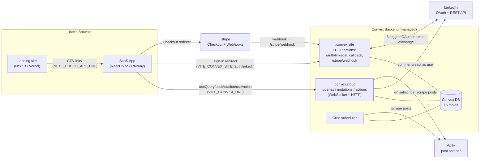

### Why OAuth runs through `.convex.site` (key design decision)

The LinkedIn `redirect_uri` points at **Convex** (`https://<deployment>.convex.site/auth/linkedin/callback`),
**never** at the React app. LinkedIn returns the authorization `code` to Convex, which exchanges
it for tokens **server‑side**, so the **client secret and the user's access/refresh tokens never
touch the browser**. Convex then issues an opaque session token and redirects the browser back to
the app. This is the backbone of the [security model](#17-security-posture).

---

## 3. Tech Stack

- **Backend:** [Convex](https://convex.dev) `^1.33–1.34` — real‑time serverless TypeScript.
  Queries (reactive reads), mutations (transactional writes), actions (side‑effects/external
  fetch), HTTP actions, and cron jobs. Stripe via the official `@convex-dev/stripe` component.
- **App (`app/`):** React **19**, Vite **6**, TypeScript (strict), Tailwind CSS **4**,
  `react-router-dom` **7**, `convex/react` client, `i18next` **25** (en/pt/es), plus **shadcn/ui**
  primitives (`cmdk`, `@radix-ui/react-popover`, `lucide-react`) + `@tanstack/react-virtual` for the
  searchable industry/country comboboxes (`@/*` alias → `app/src`; theme tokens in `index.css`).
- **Landing (`landing/`):** Next.js **15** (App Router), React **19**, Tailwind CSS **3.4**,
  TypeScript.
- **Payments:** Stripe (Checkout + Customer Portal + webhooks).
- **Post ingestion:** Apify REST API (`harvestapi~linkedin-profile-posts` actor) + manual
  user‑pasted post URLs.
- **Testing:** Vitest across all workspaces; React Testing Library + jsdom for the app; a custom
  `convex-mocks` shim for backend unit tests.
- **Tooling:** ESLint 9 (flat config, `--max-warnings 0`), Prettier (no‑semicolons, single‑quotes,
  120 cols), pnpm workspaces.

---

## 4. Repository Layout

```
/
├── landing/                     # Next.js marketing site → Vercel
│   ├── app/
│   │   ├── layout.tsx           # root layout + SEO metadata
│   │   ├── page.tsx             # home (composes 11 section components)
│   │   ├── pricing/page.tsx
│   │   ├── privacy/page.tsx     # LinkedIn app-review requirement
│   │   └── terms/page.tsx       # LinkedIn app-review requirement
│   ├── components/              # Nav, Hero, SSIExplainer, StatsBar, HowItWorks,
│   │                            #   Features, Testimonials, Pricing, FAQ, FinalCTA, Footer
│   ├── tailwind.config.ts       # custom ink/cream/lnblue/gold palette
│   └── next.config.js
│
├── app/                         # React + Vite SaaS dashboard → Railway
│   ├── index.html               # mount point + strict CSP meta
│   ├── vite.config.ts           # dev port 5174, inline Vitest config
│   └── src/
│       ├── main.tsx             # ConvexProvider + BrowserRouter bootstrap
│       ├── App.tsx              # routes + RequireAuth guard
│       ├── convex.ts            # re-export of convex/_generated/api
│       ├── pages/               # AuthSuccess, Feed, MyPosts, Settings, Billing, Admin
│       ├── components/          # PostCard, PostComposer, CommentBox, LinkedInEmbed,
│       │                        #   AppNav, Modal, BannedScreen, BanUserDialog,
│       │                        #   UsersTab, PlanLimitsTab, RowActionsMenu, LoadingSpinner
│       └── i18n/                # i18next init + locales/{en,pt,es}.json
│
├── convex/                      # Convex backend (shared by both apps)
│   ├── schema.ts                # 16-table database schema
│   ├── convex.config.ts         # registers @convex-dev/stripe component
│   ├── crons.ts                 # the ONLY file Convex reads for scheduled jobs
│   ├── http.ts                  # LinkedIn OAuth + Stripe webhook HTTP routes
│   ├── users.ts                 # getMe, subscription info, public identifier, logout
│   ├── sessions.ts              # session tokens + OAuth-state CSRF storage
│   ├── feed.ts                  # tier-gated feed query
│   ├── interactions.ts          # comment + react actions (use user's LinkedIn token)
│   ├── posts.ts                 # submitPost, getMyPosts, weekly usage
│   ├── billing.ts               # Stripe Checkout + Customer Portal sessions
│   ├── stripe.ts                # webhook-driven subscription sync mutations
│   ├── admin.ts                 # admin queries/mutations (users, plan limits, ban)
│   ├── lib/
│   │   ├── auth.ts              # requireAuth / requireAuthAction / resolveSession / assertNotBanned
│   │   ├── planLimits.ts        # plan-limit lookup + tierToRank
│   │   └── rateLimit.ts         # fixed-window rate limiter
│   ├── linkedin/
│   │   ├── oauth.ts             # auth URL builder + token exchange + userinfo
│   │   ├── auth.ts              # upsertUser mutation
│   │   ├── posts.ts             # LinkedIn post fetch/parse helpers
│   │   ├── parsePostUrl.ts      # /posts/… and /feed/update/… URL parser
│   │   ├── parsePostContent.ts  # HTML → text/media + shared-article link (extractArticleUrl) + article enrichment (parseArticle)
│   │   ├── verifyPostOwnership.ts
│   │   └── types.ts             # LinkedIn API response interfaces
│   ├── jobs/
│   │   ├── syncPosts.ts         # upsertPost mutation + syncAllPosts router
│   │   ├── syncPostsApify.ts    # Apify scrape (per-user + fan-out)
│   │   └── processQueue.ts      # drains postQueue → posts when capacity opens
│   └── migrations/
│       └── seedPlanLimits.ts    # one-time seed of tier-default plan limits
│
├── convex-mocks/                # Vitest mock for `convex/server` (backend unit tests)
├── docs/                        # planning/spec markdown + THIS document
├── README.md                    # quickstart (partially stale — see §19)
├── CLAUDE.md / AGENTS.md        # agent instructions
└── pnpm-workspace.yaml, tsconfig.base.json, eslint.config.js, .prettierrc
```

---

## 5. Data Model

All state lives in **Convex** (`convex/schema.ts`). There are **16 tables**. Every document also
carries Convex‑managed `_id` (`Id<table>`) and `_creationTime` (ms epoch) fields implicitly.

Convex `v.id('table')` fields are **logical foreign keys** — there is **no DB‑enforced referential
integrity**; consistency is maintained in application code.

### Entity relationships

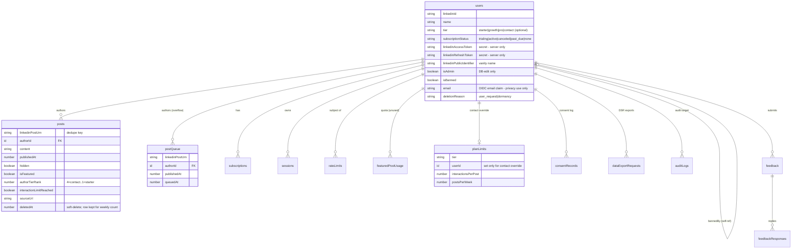

### Table reference

#### `users` — central identity / subscription / OAuth / admin record

One row per authenticated LinkedIn member. Inserted on first login (`linkedin/auth.ts:upsertUser`),
patched thereafter (profile, subscription, ban). Read almost everywhere.

| Field                        | Type                                                   | Req | Meaning                                                                                                                                                                                                                         |
|------------------------------|--------------------------------------------------------|:---:|---------------------------------------------------------------------------------------------------------------------------------------------------------------------------------------------------------------------------------|
| `linkedinId`                 | string                                                 |  ✓  | LinkedIn member id (`sub` from OIDC). Lookup key (`by_linkedin_id`).                                                                                                                                                            |
| `name`                       | string                                                 |  ✓  | Display name.                                                                                                                                                                                                                   |
| `headline`                   | string                                                 |  –  | LinkedIn headline.                                                                                                                                                                                                              |
| `profilePictureUrl`          | string                                                 |  –  | Avatar URL.                                                                                                                                                                                                                     |
| `industry`                   | string                                                 |  –  | Drives feed targeting (Growth/Pro).                                                                                                                                                                                             |
| `country`                    | string                                                 |  –  | Drives feed targeting (Growth/Pro).                                                                                                                                                                                             |
| `location`                   | string                                                 |  –  | Scraped LinkedIn display location (e.g. "Curitiba, Paraná, Brazil"). Read-only (profile scrape only).                                                                                                                           |
| `primaryLocale`              | string                                                 |  –  | Scraped LinkedIn primary-locale **language** (e.g. "en"). Seeds the UI i18n language; not user-editable.                                                                                                                        |
| `commentLanguage`            | string                                                 |  –  | Default language for AI-drafted comments: an ISO 639-1 code or `'auto'`. Absent ⇒ resolves to `'auto'` (match the post). User-set in Settings. Distinct from `primaryLocale`. See [§11A](#11a-ai-reaction--comment-assistance). |
| `tier`                       | `'starter'\|'growth'\|'pro'\|'contact'`                |  –  | Subscription tier. **Optional** → users with no tier are absent from the `by_tier` index.                                                                                                                                       |
| `subscriptionStatus`         | `'trialing'\|'active'\|'canceled'\|'past_due'\|'none'` |  ✓  | Stripe‑mirrored status; also admin‑overridable via `setUserSubscriptionStatus`. `trialing` hides the user's posts from the feed.                                                                                                |
| `trialEndsAt`                | number                                                 |  –  | Trial expiry (ms).                                                                                                                                                                                                              |
| `stripeCustomerId`           | string                                                 |  –  | Resolves Stripe webhooks → user (`by_stripe_customer`).                                                                                                                                                                         |
| `linkedinAccessToken`        | string                                                 |  –  | **Secret.** Used to act as the user on LinkedIn. Never sent to clients.                                                                                                                                                         |
| `linkedinRefreshToken`       | string                                                 |  –  | **Secret.** (No refresh flow is implemented — see §19.)                                                                                                                                                                         |
| `tokenExpiresAt`             | number                                                 |  –  | Access‑token expiry (ms).                                                                                                                                                                                                       |
| `linkedinPublicIdentifier`   | string                                                 |  –  | LinkedIn vanity name; captured via the first‑login `PublicIdentifierPromptScreen` or set in Settings, used for post‑ownership verification without Partner API.                                                                 |
| `isAdmin`                    | boolean                                                |  –  | **Set only by direct DB edit.** No application write path touches it.                                                                                                                                                           |
| `isBanned`                   | boolean                                                |  –  | Ban flag; set/cleared by `banUser`/`unbanUser`.                                                                                                                                                                                 |
| `bannedAt`                   | number                                                 |  –  | Ban timestamp.                                                                                                                                                                                                                  |
| `bannedBy`                   | `id('users')`                                          |  –  | Admin who banned (self‑reference).                                                                                                                                                                                              |
| `bannedReason`               | string                                                 |  –  | User‑visible reason on the banned screen.                                                                                                                                                                                       |
| `email`                      | string                                                 |  –  | Email from LinkedIn OIDC `email` claim. Used for DSR confirmations and breach notification. Not used for marketing.                                                                                                             |
| `emailVerified`              | boolean                                                |  –  | Whether LinkedIn verified the email address.                                                                                                                                                                                    |
| `deletionRequestedAt`        | number                                                 |  –  | When the user requested account deletion (ms).                                                                                                                                                                                  |
| `deletionScheduledAt`        | number                                                 |  –  | When the hard-delete cron will purge this account (ms). Presence signals pending erasure.                                                                                                                                       |
| `deletionReason`             | `'user_request'\|'dormancy'`                           |  –  | Why the deletion was scheduled.                                                                                                                                                                                                 |
| `lastLoginAt`                | number                                                 |  –  | Timestamp of most recent login (ms); updated on every `upsertUser` call. Powers the dormancy retention check.                                                                                                                   |
| `acknowledgedPolicyVersion`  | string                                                 |  –  | Privacy-policy version string the user last accepted. Drives the re-consent prompt when it diverges from the current policy version.                                                                                            |
| `consentPromptedAt`          | number                                                 |  –  | When the user completed the one-time consent prompt (ms). Unset ⇒ `ConsentPromptScreen` is shown on next login.                                                                                                                 |
| `publicIdentifierPromptedAt` | number                                                 |  –  | When the user was shown the one-time "confirm your LinkedIn profile URL" prompt (ms). Unset **and** no `linkedinPublicIdentifier` ⇒ `PublicIdentifierPromptScreen` is shown on login.                                           |
| `createdAt`                  | number                                                 |  ✓  | Creation timestamp (ms).                                                                                                                                                                                                        |

Indexes: `by_linkedin_id [linkedinId]`, `by_stripe_customer [stripeCustomerId]`, `by_tier [tier]`,
`by_subscription_status [subscriptionStatus]` (active-subscriber fan-out for the Apify sync),
`by_token_expiry [tokenExpiresAt]` (retention cron targets expired tokens directly),
`by_deletion_and_last_login [deletionScheduledAt, lastLoginAt]` (compound — serves both the
hard-delete sweep, ranging the leading field, and the dormancy sweep, `eq(deletionScheduledAt,
undefined)` + range on `lastLoginAt`).

#### `posts` — the shared feed

Inserted by `jobs/syncPosts.upsertPost` (manual + Apify) and `jobs/processQueue` (queue promotion).
Patched by `stripe.ts` **and** `admin.setUserTier` (re‑stamp `authorTierRank` + `feedRank` on tier
change, via the shared `restampUserPostsTierRank` helper — which schedules a batched, self‑rescheduling
re‑stamp so a high‑volume author never exceeds one mutation's write budget), `interactions.ts`
(`interactionLimitReached`), and `posts.ts` (`setPostHidden` → `hidden`; `deletePost` → `deletedAt`).
Every post writer keeps the denormalized `feedRank` / `inFeed` fields in sync through the single
`computeFeedFields` helper (`lib/feedRank.ts`).

| Field                     | Type          | Req | Meaning                                                                                                                                                                                                                                                                                    |
|---------------------------|---------------|:---:|--------------------------------------------------------------------------------------------------------------------------------------------------------------------------------------------------------------------------------------------------------------------------------------------|
| `linkedinPostUrn`         | string        |  ✓  | LinkedIn URN; dedupe key (`by_urn`).                                                                                                                                                                                                                                                       |
| `authorId`                | `id('users')` |  ✓  | Post author.                                                                                                                                                                                                                                                                               |
| `content`                 | string        |  ✓  | Post text (composed text + appended media links).                                                                                                                                                                                                                                          |
| `publishedAt`             | number        |  ✓  | Publish time (ms); primary sort + 7‑day window key.                                                                                                                                                                                                                                        |
| `likeCount`               | number        |  ✓  | Reaction count. Seeded from LinkedIn on submit/sync (`parsePostEngagement` / Apify), then incremented on in‑app reactions.                                                                                                                                                                 |
| `commentCount`            | number        |  ✓  | Comment count. Seeded from LinkedIn on submit/sync, then incremented on in‑app comments.                                                                                                                                                                                                   |
| `mediaUrls`               | string[]      |  ✓  | Extracted media URLs (images, documents, and the shared‑article link when the post links a LinkedIn article).                                                                                                                                                                              |
| `imageUrls`               | string[]      |  –  | Image‑typed media URLs only (subset of `mediaUrls`), captured at manual submit and sent to the AI as **vision input** (see [§11A](#11a-ai-reaction--comment-assistance)). Absent on synced/legacy posts.                                                                                   |
| `isFeatured`              | boolean       |  ✓  | Pinned to top of feed.                                                                                                                                                                                                                                                                     |
| `featuredAt`              | number        |  –  | When featured (secondary sort for featured).                                                                                                                                                                                                                                               |
| `visibilityIndustries`    | string[]      |  ✓  | Author allowlist — only viewers in these industries see it.                                                                                                                                                                                                                                |
| `visibilityCountries`     | string[]      |  ✓  | Author allowlist — only viewers in these countries see it.                                                                                                                                                                                                                                 |
| `hidden`                  | boolean       |  ✓  | `true` = excluded from feed (trial posts, un‑hidden on activation; also author/admin **Hide** via `setPostHidden`).                                                                                                                                                                        |
| `authorTierRank`          | number        |  –  | Denormalized tier rank at write time (4=contact, 3=pro, 2=growth, 1=starter). Defaults to 1 in feed sort when absent.                                                                                                                                                                      |
| `interactionLimitReached` | boolean       |  –  | `true` once `likeCount+commentCount ≥ interactionsPerPost`; filtered out of feed.                                                                                                                                                                                                          |
| `sourceUrl`               | string        |  –  | Original submitted URL (preserved for correct back‑links; powers PostCard's "View on LinkedIn"). Absent for cron‑synced posts.                                                                                                                                                             |
| `article`                 | object        |  –  | Best‑effort enrichment for a linked article (`{ url, title?, summary?, text?, author?, imageUrls }`, where `text` is the **full body**); see `lib/articleValidator.ts`. Feeds the AI reaction/comment prompts; not displayed. Absent when the post shares no article or enrichment failed. |
| `suggestedReaction`       | enum          |  –  | AI‑predicted most‑likely reaction (`LIKE\|PRAISE\|EMPATHY\|INTEREST\|APPRECIATION\|ENTERTAINMENT`), set async after submit. Absent ⇒ the UI picker treats it as `LIKE`. See [§11A](#11a-ai-reaction--comment-assistance).                                                                  |
| `deletedAt`               | number        |  –  | Soft‑delete marker (`deletePost`). Excluded from feed + My Posts, but the row is **kept** so it still counts toward the weekly limit.                                                                                                                                                      |
| `feedRank`                | number        |  –  | Denormalized single feed sort key (featured→tier→recency); see `lib/feedRank.ts`. Backs the `by_feed_rank` cursor index. Optional during rollout.                                                                                                                                          |
| `inFeed`                  | boolean       |  –  | `true` iff visible **and** under its interaction limit **and** not soft‑deleted. The filter column of `by_feed_rank`.                                                                                                                                                                      |

Indexes: `by_author [authorId]`, `by_urn [linkedinPostUrn]`,
`by_author_and_publishedAt [authorId, publishedAt]`, and `by_feed_rank [inFeed, feedRank]` which backs
the **live cursor‑paginated feed** — `getFeed` reads via this index (`eq(inFeed, true)`, `feedRank`
desc). The older `by_featured`, `by_published`, and `by_feed` indexes were **removed** once the feed
migrated to `by_feed_rank` (they had no remaining `withIndex` callers, and every index adds write
amplification on this high‑write table). See
[feed-cursor-pagination-plan.md](feed-cursor-pagination-plan.md).

#### `subscriptions` — Stripe subscription mirror

Written/read by `stripe.ts`; read by `users.getSubscriptionInfo`.

| Field                  | Type                                    | Req | Meaning                                                         |
|------------------------|-----------------------------------------|:---:|-----------------------------------------------------------------|
| `userId`               | `id('users')`                           |  ✓  | Subscriber.                                                     |
| `stripeSubscriptionId` | string                                  |  ✓  | Stripe sub id (`by_stripe_id`).                                 |
| `tier`                 | `'starter'\|'growth'\|'pro'\|'contact'` |  ✓  | Subscribed tier.                                                |
| `status`               | string                                  |  ✓  | **Free‑form** raw Stripe status (not a constrained union here). |
| `currentPeriodEnd`     | number                                  |  –  | Period end (ms).                                                |

Indexes: `by_user [userId]`, `by_stripe_id [stripeSubscriptionId]`.

#### `planLimits` — tier limits + per‑user contact overrides

Tier‑default rows have **no `userId`**; override rows (contact tier only) set `userId`. Seeded by
`migrations/seedPlanLimits.ts`; read by `lib/planLimits.ts`; CRUD‑managed by `admin.ts`.

| Field                 | Type                                    | Req | Meaning                                             |
|-----------------------|-----------------------------------------|:---:|-----------------------------------------------------|
| `tier`                | `'starter'\|'growth'\|'pro'\|'contact'` |  ✓  | Tier this row applies to.                           |
| `userId`              | `id('users')`                           |  –  | **Only** set for contact per‑user overrides.        |
| `interactionsPerPost` | number                                  |  ✓  | Max likes+comments counted per post before lockout. |
| `postsPerWeek`        | number                                  |  ✓  | Max posts admitted to feed per rolling 7 days.      |

Indexes: `by_tier [tier]` (matches default **and** override rows — callers filter `userId===undefined`
in JS), `by_user [userId]`.

#### `postQueue` — weekly‑limit overflow buffer

Posts that couldn't be inserted because the author hit their weekly limit. Drained by the
`processQueue` cron when capacity reopens. Written by `syncPosts.upsertPost` (Apify path only).

| Field                                                                                     | Type          | Req | Meaning                                          |
|-------------------------------------------------------------------------------------------|---------------|:---:|--------------------------------------------------|
| `linkedinPostUrn`                                                                         | string        |  ✓  | Dedupe key (`by_urn`).                           |
| `authorId`                                                                                | `id('users')` |  ✓  | Author (`by_author`).                            |
| `content`, `publishedAt`, `likeCount`, `commentCount`, `mediaUrls`, `hidden`, `sourceUrl` | —             | ✓/– | Snapshot carried so promotion needs no re‑fetch. |
| `queuedAt`                                                                                | number        |  ✓  | Enqueue timestamp (ms).                          |

On promotion, `authorTierRank` is recomputed and `interactionLimitReached` is set `false`.

#### `sessions` — app's own auth tokens

Random UUID tokens issued by the OAuth callback. 30‑day TTL.

| Field       | Type          | Req | Meaning                                                                                                                 |
|-------------|---------------|:---:|-------------------------------------------------------------------------------------------------------------------------|
| `token`     | string        |  ✓  | Opaque session token (`by_token`).                                                                                      |
| `userId`    | `id('users')` |  ✓  | Session owner (`by_userId`).                                                                                            |
| `expiresAt` | number        |  ✓  | Expiry (ms). `by_expires_at` backs the indexed expired-session cleanup cron (range scan, not a full-table `.filter()`). |

#### `oauthStates` — CSRF nonces

Single‑use OAuth `state` values; ~10‑minute TTL; deleted on validation.

| Field       | Type   | Req | Meaning                                                                    |
|-------------|--------|:---:|----------------------------------------------------------------------------|
| `state`     | string |  ✓  | Random nonce (`by_state`).                                                 |
| `expiresAt` | number |  ✓  | Expiry (ms). `by_expires_at` backs the indexed expired-state cleanup cron. |

#### `rateLimits` — fixed‑window counters

| Field         | Type          | Req | Meaning                                                                        |
|---------------|---------------|:---:|--------------------------------------------------------------------------------|
| `userId`      | `id('users')` |  ✓  | Subject.                                                                       |
| `action`      | string        |  ✓  | Action name (`submitPost`, `commentOnPost`, `reactToPost`, `profile_refresh`). |
| `windowStart` | number        |  ✓  | Window start (ms).                                                             |
| `count`       | number        |  ✓  | Calls in window.                                                               |

Index: `by_user_and_action [userId, action]`.

#### `appSettings` — singleton global settings

Accessed via `.first()` (treated as a singleton; no index).

| Field                       | Type    | Req | Meaning                                                                                                   |
|-----------------------------|---------|:---:|-----------------------------------------------------------------------------------------------------------|
| `apifySyncEnabled`          | boolean |  ✓  | Master toggle for the Apify post‑sync cron.                                                               |
| `apifyEnabled`              | boolean |  –  | **Master Apify kill-switch.** Absent ⇒ enabled. When false, all Apify (post sync + profile scrape) halts. |
| `apifyProfileScrapeEnabled` | boolean |  –  | Gates the LinkedIn profile scrape. Absent ⇒ disabled (opt-in; paid actor).                                |
| `lastApifySyncAt`           | number  |  –  | Last post‑sync timestamp (cron or manual "Sync all posts").                                               |
| `lastApifySyncError`        | string  |  –  | Last post‑sync error message.                                                                             |
| `lastProfileScrapeAt`       | number  |  –  | Last profile‑scrape fan‑out timestamp (manual "Sync all users").                                          |
| `lastProfileScrapeError`    | string  |  –  | Last profile‑scrape fan‑out error message.                                                                |

#### `featuredPostUsage` — per‑user monthly featured quota **(defined but unused)**

`userId`, `month` (`"YYYY-MM"`), `usedCount`; index `by_user_month`. **No read/write call sites
exist** — the featured‑post quota feature is not yet implemented.

#### `consentRecords` — append-only consent/withdrawal log (GDPR)

One row per consent event. Current effective consent for a given `(userId, purpose)` pair is the **most recent** row for
that pair. Queried via `by_user_and_purpose` index. The `purpose` union is intentionally narrow at launch (
`'marketing' | 'analytics'`); `'location_enrichment'` is reserved for a future Apify profile-scrape opt-in that is
disabled at launch.

| Field           | Type                       | Req | Meaning                                                |
|-----------------|----------------------------|:---:|--------------------------------------------------------|
| `userId`        | `id('users')`              |  ✓  | User who granted or withdrew consent.                  |
| `purpose`       | `'marketing'\|'analytics'` |  ✓  | Consent purpose.                                       |
| `granted`       | boolean                    |  ✓  | `true` = consent granted; `false` = consent withdrawn. |
| `policyVersion` | string                     |  ✓  | Policy version in effect at time of consent event.     |
| `createdAt`     | number                     |  ✓  | Event timestamp (ms).                                  |

Indexes: `by_user [userId]`, `by_user_and_purpose [userId, purpose]`.

#### `dataExportRequests` — asynchronous data-export (Subject Access Request)

Tracks the lifecycle of data-export jobs. The generated bundle is stored in Convex file storage (`fileStorageId`); the
download link is short-lived (`expiresAt`). A retention cron purges expired records and their associated storage
objects.

| Field           | Type                                      | Req | Meaning                                                                         |
|-----------------|-------------------------------------------|:---:|---------------------------------------------------------------------------------|
| `userId`        | `id('users')`                             |  ✓  | Requesting user (`by_user`).                                                    |
| `status`        | `'pending'\|'ready'\|'failed'\|'expired'` |  ✓  | Job state.                                                                      |
| `requestedAt`   | number                                    |  ✓  | When the request was received (ms).                                             |
| `fileStorageId` | `id('_storage')`                          |  –  | Convex storage id for the generated export bundle. Set when `status = 'ready'`. |
| `expiresAt`     | number                                    |  –  | When the download link/bundle expires (ms).                                     |

Indexes: `by_user [userId]`, `by_status [status]` — the latter lets the retention cron pull `'ready'`
exports via index instead of a full‑table `.filter()` scan.

#### `auditLogs` — accountability log (GDPR Art. 5(2))

Append-only record of DSR actions, consent changes, and admin access to personal data. A pseudonymized subset is
retained past account deletion (actorId and targetUserId nulled out, action/metadata preserved).

| Field          | Type                        | Req | Meaning                                                                                                       |
|----------------|-----------------------------|:---:|---------------------------------------------------------------------------------------------------------------|
| `actor`        | `'user'\|'admin'\|'system'` |  ✓  | Who triggered the action.                                                                                     |
| `actorId`      | `id('users')`               |  –  | Convex user id of the actor (absent for system-triggered events or after pseudonymization).                   |
| `action`       | string                      |  ✓  | Structured action name (e.g. `'consent.granted'`, `'dsr.export_requested'`, `'admin.view_user'`).             |
| `targetUserId` | `id('users')`               |  –  | The user this action was performed on, if applicable.                                                         |
| `metadata`     | string                      |  –  | JSON-encoded additional context (e.g. `purpose`, `policyVersion`). Stored as string to avoid schema coupling. |
| `createdAt`    | number                      |  ✓  | Event timestamp (ms).                                                                                         |

Indexes: `by_target [targetUserId]`, `by_created [createdAt]`.

#### `feedback` — user-submitted product feedback

One row per feedback submission. `userId` is cleared on account deletion (anonymization, not deletion).
Legacy single-reply fields (`responseText`, `respondedAt`, `respondedBy`) are kept as optional but
**deprecated** — `feedbackResponses` is now the source of truth for replies.

| Field          | Type                                                                                            | Req | Meaning                                      |
|----------------|-------------------------------------------------------------------------------------------------|:---:|----------------------------------------------|
| `userId`       | `id('users')`                                                                                   |  –  | Submitter (cleared on account deletion).     |
| `category`     | `'feature_request'\|'bug'\|'comment'\|'criticism'\|'praise'\|'question'\|'suggestion'\|'other'` |  ✓  | Feedback category.                           |
| `message`      | string                                                                                          |  ✓  | Free-text feedback body (≤4000 chars).       |
| `status`       | `'new'\|'responded'\|'archived'`                                                                |  ✓  | Triage state.                                |
| `createdAt`    | number                                                                                          |  ✓  | Submission timestamp (ms).                   |
| `responseText` | string                                                                                          |  –  | **Deprecated.** Legacy single-reply text.    |
| `respondedAt`  | number                                                                                          |  –  | **Deprecated.** Legacy reply timestamp (ms). |
| `respondedBy`  | `id('users')`                                                                                   |  –  | **Deprecated.** Legacy responding admin.     |

Indexes: `by_user [userId]`, `by_status [status]`.

#### `feedbackResponses` — append-only admin reply thread

Each row is one admin reply to a feedback item. Multiple rows per feedback item are allowed (threaded replies).

| Field         | Type             | Req | Meaning                     |
|---------------|------------------|:---:|-----------------------------|
| `feedbackId`  | `id('feedback')` |  ✓  | Parent feedback item.       |
| `responderId` | `id('users')`    |  ✓  | Admin who wrote this reply. |
| `text`        | string           |  ✓  | Reply text.                 |
| `createdAt`   | number           |  ✓  | Reply timestamp (ms).       |

Index: `by_feedback [feedbackId, createdAt]` (chronological per feedback item).

#### `motds` — admin Message of the Day

Admin-authored announcements. Exactly one is shown at a time: the newest `enabled` row whose
`[startAt, expiresAt)` window covers "now" (`convex/motd/motd.ts:selectActiveMotd`). Hard-deleted
on removal (admin content, not personal data).

| Field       | Type                     | Req | Meaning                                                                                          |
|-------------|--------------------------|:---:|--------------------------------------------------------------------------------------------------|
| `bodies`    | `record<string, string>` |  ✓  | Locale code → markdown body. `en` required (validation) and is the fallback for missing locales. |
| `important` | boolean                  |  ✓  | `false` → dismissible top banner; `true` → blocking modal (closable only via OK).                |
| `enabled`   | boolean                  |  ✓  | Admin on/off switch.                                                                             |
| `startAt`   | number                   |  –  | Optional scheduled start (ms). Absent ⇒ active immediately.                                      |
| `expiresAt` | number                   |  –  | Optional "limited date" (ms). Absent ⇒ never expires.                                            |
| `createdBy` | `id('users')`            |  ✓  | Admin who created it.                                                                            |
| `createdAt` | number                   |  ✓  | Creation timestamp (ms); also the tie-breaker for "newest active".                               |
| `updatedAt` | number                   |  ✓  | Last-edit timestamp (ms).                                                                        |

Index: `by_enabled_and_created [enabled, createdAt]` — the viewer query walks `enabled=true` newest-first.

#### `userInteractions` — per-user engagement log

One row per reaction or comment a user made on a post (written best-effort by `recordInteraction` after a
successful `reactToPost` / `commentOnPost`). Distinct from the aggregate `posts.likeCount` / `commentCount`.
Powers the **DSR export** (§13B — included in the user's data bundle, deleted in the erasure cascade) and a
future admin dashboard.

| Field       | Type                      | Req | Meaning                                          |
|-------------|---------------------------|:---:|--------------------------------------------------|
| `userId`    | `id('users')`             |  ✓  | Who reacted / commented.                         |
| `postId`    | `id('posts')`             |  ✓  | The target post.                                 |
| `kind`      | `'reaction' \| 'comment'` |  ✓  | Which interaction this row records.              |
| `reaction`  | enum                      |  –  | Reaction value (set when `kind === 'reaction'`). |
| `comment`   | string                    |  –  | Comment text (set when `kind === 'comment'`).    |
| `createdAt` | number                    |  ✓  | Interaction timestamp (ms).                      |

Indexes: `by_user [userId]` (DSR export + a user's activity), `by_post [postId]` (admin: who engaged with a post).

---

## 6. Backend Architecture & Conventions

### Convex function kinds used here

| Kind         | Reactive? | DB access                           | External fetch | Used for                                                           |
|--------------|-----------|-------------------------------------|----------------|--------------------------------------------------------------------|
| `query`      | ✓ (live)  | `ctx.db` read                       | ✗              | reads (feed, getMe, usage)                                         |
| `mutation`   | –         | `ctx.db` read/write (transactional) | ✗              | writes (upsert, ban, plan limits)                                  |
| `action`     | –         | via `ctx.runQuery/runMutation`      | ✓              | LinkedIn/Stripe/Apify calls (submitPost, comment, react, checkout) |
| `internal*`  | –         | as above                            | as above       | server‑only; not callable from clients                             |
| `httpAction` | –         | via `ctx.run*`                      | ✓              | OAuth routes + Stripe webhook (`http.ts`)                          |
| cron         | –         | mutation/action                     | as above       | scheduled jobs (`crons.ts`)                                        |

### Auth helper pattern (every protected function uses it)

Clients **never** pass a `userId`. They pass a `sessionToken`; the server resolves it. All helpers
live in `convex/lib/auth.ts`:

- `resolveSession(ctx, token)` → `Doc<'users'> | null` — resolves token → user **without** ban
  enforcement. Used by `getMe` so a banned user gets an `isBanned` signal (not `null`).
- `requireAuth(ctx, token)` → `Doc<'users'>` — for queries/mutations. Throws `'Unauthorized'` if
  the token is missing/expired/invalid; throws `'Account suspended'` if banned.
- `requireAuthAction(ctx, token)` → `Doc<'users'>` — same for actions (resolves via
  `ctx.runQuery(internal.sessions.getByToken)` + `internal.users.getWithTokens`, returning the
  token‑bearing record).
- `assertNotBanned(user)` — the single definition of "what a ban blocks"; called by both
  `requireAuth*`.

### Error‑handling convention (system‑wide)

- **Reads soft‑fail:** `getMe`, `getFeed`, `getMyPosts`, `getWeeklyUsage`, `getSubscriptionInfo`,
  `checkIsAdmin` catch auth errors and return `null` / `[]` / `false` rather than throwing.
- **Writes hard‑fail:** mutations/actions `throw new Error(message)`.
- Backend throws **plain `Error`** (not `ConvexError`).
- External‑call failures are **logged server‑side with the real error** and surfaced to clients as
  **generic sanitized messages** (see [§17](#17-security-posture)).

### LinkedIn member‑API calls

All authenticated requests to `api.linkedin.com` (Bearer = the user's token) route through the
single `linkedin/client.ts` `callMemberApi` seam, which owns the `Authorization` header, the
`Content-Type` header (when a body is present), and the log-real-error → throw-sanitized error
policy. Only the OAuth token exchange (`exchangeCodeForTokens`) calls LinkedIn directly — it targets
`www.linkedin.com` with a `client_secret` form‑POST and is a different auth shape.

### Type‑shim landscape

The former `convex/convexTypes.ts` hand‑mirror of `DataModel`/`ctx`/`db` shapes has been **removed**;
all backend code now imports generated `Doc<>`/`Id<>`/`QueryCtx`/`MutationCtx`/`ActionCtx` from
`convex/_generated/`. Two intentional patterns remain:

1. **Test mock seam.** `convex/lib/audit.ts` and the two Apify jobs (`jobs/syncPostsApify.ts`,
   `jobs/scrapeProfileApify.ts`) import `internalActionGeneric` / `internalMutationGeneric` from
   `convex/server` (the registration generic the `convex-mocks` Vitest alias replaces) and cast
   `ctx as unknown as ActionCtx` using the **generated** `ActionCtx`. Each fan‑out handler annotates
   its return type (`Promise<void>`) to break the same‑file `internal.*` type cycle that the precise
   generated ctx would otherwise introduce.
2. `app/src/convex.ts` — re‑exports `{ api }` from `convex/_generated/api` for a stable app‑side
   import path.

---

## 7. Authentication & Identity

LinkedIn **3‑legged OAuth 2.0 (OIDC)**, brokered entirely by Convex HTTP actions so secrets stay
server‑side. After OAuth the app uses its **own opaque session tokens**.

- **Scopes requested** (`convex/linkedin/oauth.ts`):
  `openid profile email r_basicprofile w_member_social_feed w_member_social`.
- **OAuth endpoints:** authorize `https://www.linkedin.com/oauth/v2/authorization`, token
  `https://www.linkedin.com/oauth/v2/accessToken`, userinfo `https://api.linkedin.com/v2/userinfo`
  (OIDC; replaces the deprecated `/v2/me`).
- **CSRF:** a random `state` is stored in `oauthStates` (10‑min TTL) before redirect and is
  single‑use validated on callback (deleted before the expiry check → replay‑safe).
- **Session token:** a random UUID stored in `sessions` (30‑day TTL); returned to the app in the
  redirect URL `?session=…`. The app keeps it in **`sessionStorage`** (key `sessionToken`).
- **Sign‑out:** the app auto‑starts OAuth for any unauthenticated visit (see `RequireAuth`, §14), and
  LinkedIn keeps its own SSO session — so a naive sign‑out is silently re‑authenticated. Sign‑out
  therefore sets a **persistent `signedOut` marker** (`localStorage`, `lib/session.ts`) _before_
  calling `users.logout`, drops the local `sessionToken`, and redirects to the **marketing/landing
  site** (`VITE_LANDING_URL` — the separate Next.js app at its own origin, see §15). The marker does
  two jobs: **(1)** it wins the race against the **reactive** `getMe → null` that `users.logout`
  triggers while the SPA is still mounted (which would otherwise trip `RequireAuth`'s auto‑OAuth and
  silently re‑log the user in via LinkedIn SSO → `/auth/success` → `/feed`); and **(2)** it
  **persists across the return visit**, so when a signed‑out user navigates back to the app
  `RequireAuth` bounces them to the landing site instead of auto‑logging them in. It is cleared on the
  next successful login (`AuthSuccessPage`), so "auto‑redirect for login" resumes for fresh/expired
  sessions. To log back in, the landing site's CTAs point **straight at OAuth**
  (`${NEXT_PUBLIC_CONVEX_SITE}/auth/linkedin`, §15) — not the app root — so a signed‑out visitor
  doesn't ping‑pong between the landing site and the app. All three sign‑out buttons (`AppNav`,
  `BannedScreen`, `CancelDeletionScreen`) route through the shared `signOut()` helper; `AppNav` also
  `await`s `users.logout` to invalidate the session server‑side.

### OAuth login flow

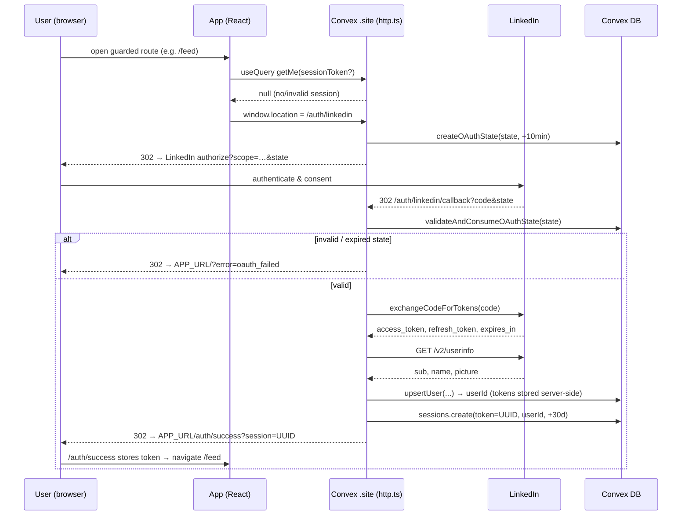

### Session‑authenticated request flow

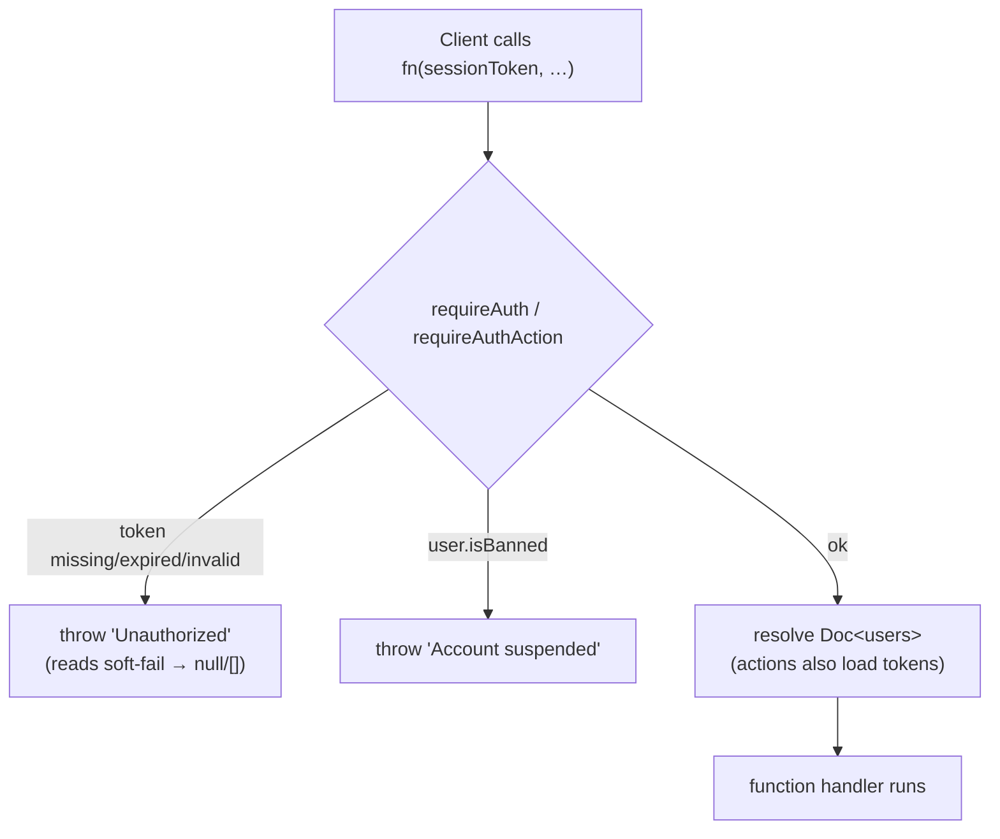

### Identity / user functions (`convex/users.ts`, `linkedin/auth.ts`, `sessions.ts`)

| Function                                                      | Kind              | Purpose                                                                                                                                                          |
|---------------------------------------------------------------|-------------------|------------------------------------------------------------------------------------------------------------------------------------------------------------------|
| `linkedin.auth.upsertUser`                                    | internalMutation  | Insert on first login (default `subscriptionStatus`, `createdAt`); patch profile + tokens thereafter. Never writes `isAdmin`.                                    |
| `users.getMe`                                                 | query (public)    | Safe profile via `resolveSession` + `toSafeMe` (strips tokens + raw `isAdmin`; re‑adds `isAdmin:true` only for admins; passes `isBanned`/`bannedReason`).        |
| `users.getWithTokens`                                         | internalQuery     | Full record **incl. tokens** — server‑only.                                                                                                                      |
| `users.getActiveSubscribers`                                  | internalQuery     | All users with `subscriptionStatus === 'active'` via the `by_subscription_status` index (reads only active subscribers, not the whole table).                    |
| `users.getSubscriptionInfo`                                   | query (public)    | Billing‑page data; reads the Stripe component's live subscriptions + our `subscriptions.tier`.                                                                   |
| `users.setPublicIdentifier`                                   | mutation (public) | Stores validated LinkedIn vanity name (`^[A-Za-z0-9\-_]{3,100}$`, lowercased).                                                                                   |
| `users.dismissPublicIdentifierPrompt`                         | mutation (public) | Stamps `publicIdentifierPromptedAt` so the first‑login `PublicIdentifierPromptScreen` shows only once (the "Skip for now" path).                                 |
| `users.updateProfile`                                         | mutation (public) | User edits their own `industry`/`country` (validated against canonical lists; empty string clears).                                                              |
| `users.refreshProfileFromLinkedIn`                            | mutation (public) | User-triggered profile re-scrape; requires a public identifier; **throws when the profile-scrape flag is off**; rate-limited 2/day; schedules the scrape action. |
| `users.applyScrapedProfile`                                   | internalMutation  | Writes scraped fields: `country` **fill-when-empty**; `location`/`primaryLocale` always refresh.                                                                 |
| `users.logout`                                                | mutation (public) | Deletes the current session token.                                                                                                                               |
| `users.forceLogoutAll`                                        | mutation (public) | Deletes **all** sessions for the user (compromise response).                                                                                                     |
| `sessions.create` / `getByToken` / `deleteByToken`            | internal          | Session lifecycle.                                                                                                                                               |
| `sessions.deleteAllForUser`                                   | internalMutation  | Revoke all sessions for a user (used by `forceLogoutAll`).                                                                                                       |
| `sessions.createOAuthState` / `validateAndConsumeOAuthState`  | internalMutation  | CSRF nonce lifecycle.                                                                                                                                            |
| `sessions.deleteExpiredSessions` / `deleteExpiredOAuthStates` | internalMutation  | Cron cleanup (batches of 200).                                                                                                                                   |

> **No token‑refresh flow exists.** Despite README claims, nothing refreshes LinkedIn tokens near
> expiry; `refreshToken`/`tokenExpiresAt` are stored but unused. See [§19](#19-known-discrepancies-dead-code--roadmap).

---

## 8. Subscriptions & Billing

Stripe is integrated via the **`@convex-dev/stripe`** component, registered in
`convex/convex.config.ts` (`app.use(stripe)`). The component auto‑syncs customers/subscriptions and
serves the webhook; our code adds **Checkout/Portal session creation** (`billing.ts`) and **webhook
callbacks** (`http.ts` → `stripe.ts`) that keep our `users`/`subscriptions` tables in sync.

### Price‑ID → tier mapping

`getTierFromPriceId(priceId)` maps the three `STRIPE_*_PRICE_ID` env values to `starter`/`growth`/
`pro` (unknown → `starter`). `contact` is admin‑assigned, not purchasable via Checkout.

### Checkout (subscribe) flow

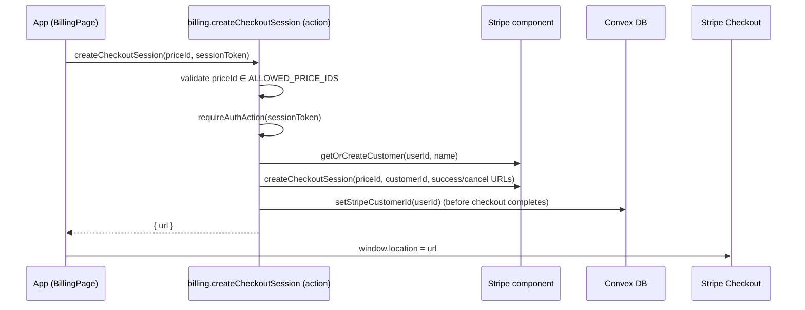

`createPortalSession` similarly returns a Stripe **Customer Portal** URL (requires an existing
`stripeCustomerId`).

### Webhook‑driven subscription sync

`http.ts` registers handlers for these Stripe events, each delegating to an internal mutation in
`stripe.ts`:

| Stripe event                                | Handler effect                                                                                                                                                                                                                                                            |
|---------------------------------------------|---------------------------------------------------------------------------------------------------------------------------------------------------------------------------------------------------------------------------------------------------------------------------|
| `customer.subscription.created` / `updated` | `syncUserSubscription`: set `tier` + `subscriptionStatus`, clear `trialEndsAt`, re‑stamp `authorTierRank` on all the user's posts, **upsert** our `subscriptions` row. If status `active` → **un‑hide** the user's hidden posts **and** schedule an immediate Apify sync. |
| `customer.subscription.deleted`             | `cancelUserSubscription`: mark sub `canceled`, downgrade user to `starter` + `canceled`, re‑stamp posts to `starter` rank.                                                                                                                                                |
| `invoice.payment_failed`                    | `markPastDue`: set `subscriptionStatus = past_due` (tier unchanged).                                                                                                                                                                                                      |

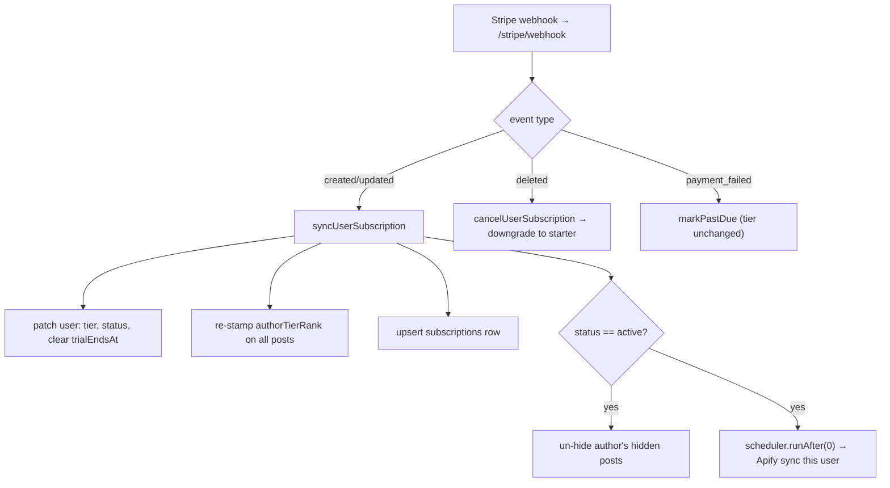

### Status semantics

`toSubscriptionStatus(raw)` maps the raw Stripe status onto the
`trialing|active|canceled|past_due|none` union; **unknown values default to `active`** (with a
console warning).

---

## 9. Plan Limits System

Two enforced limits per tier, stored in `planLimits` and looked up via
`lib/planLimits.getPlanLimitsHelper`:

- **`interactionsPerPost`** — once a post's `likeCount + commentCount ≥ interactionsPerPost`, the
  post is flagged `interactionLimitReached = true` and **filtered out of the feed** (its engagement
  budget is spent). Set in `interactions.ts`.
- **`postsPerWeek`** — max posts admitted to `posts` within a **rolling 7‑day window** (counted via
  `by_author_and_publishedAt`). Overflow either **throws** (manual submit) or is **queued** to
  `postQueue` (Apify path).

### Seed values (and hardcoded safety‑net defaults)

| Tier    | interactionsPerPost | postsPerWeek | tierToRank |
|---------|:-------------------:|:------------:|:----------:|
| starter |         25          |      1       |     1      |
| growth  |         50          |      2       |     2      |
| pro     |         200         |      5       |     3      |
| contact |         200         |      5       |     4      |

These are defined identically in **two places that must stay in sync**: the hardcoded `DEFAULTS` in
`lib/planLimits.ts` (used only if a DB row is missing) and the seed rows in
`migrations/seedPlanLimits.ts` (idempotent; run once via
`npx convex run migrations/seedPlanLimits:seedPlanLimits --prod`).

### Lookup precedence (`getPlanLimitsHelper(ctx, userId, tier)`)

- **`contact`:** (1) per‑user override row (`by_user` `.unique()`) → else (2) the contact **default**
  row (`by_tier` `.take(20).find(r => r.userId === undefined)` — a JS‑side filter, _not_ `.unique()`,
  because `by_tier` also matches override rows) → else (3) hardcoded `DEFAULTS.contact`.
- **all other tiers:** the single `by_tier` `.unique()` row → else `DEFAULTS[tier]`.
- `getPlanLimits` is an `internalQuery` wrapper so **actions** (no `ctx.db`) reach this via
  `ctx.runQuery`.

`tierToRank(tier?)`: `contact→4, pro→3, growth→2, starter→1, undefined/unknown→1`. Used to stamp
`posts.authorTierRank`.

---

## 10. Posts & Content Pipeline

Posts enter the `posts` table through **three paths**, all funneling into the single
`jobs/syncPosts.upsertPost` mutation:

1. **Manual submission** — user pastes a LinkedIn post URL (`posts.submitPost`).
2. **Apify cron** — daily, **only when an admin enabled `apifySyncEnabled`**, for active subscribers.
3. **On‑activation sync** — `scheduler.runAfter(0)` triggered by the Stripe webhook when a
   subscription becomes `active`.

`upsertPost` is the gatekeeper: on an **existing** URN it only patches `likeCount/commentCount/hidden`
(no limit re‑check); on **insert** it performs an **atomic weekly‑limit check** in the same
transaction and either inserts, throws, or (Apify path) diverts to `postQueue`. The weekly‑limit
decision is the pure helper `lib/postLimit.ts` `isWeeklyLimitReached(recentCount, postsPerWeek)`.

### Manual post submission (`posts.submitPost`, action)

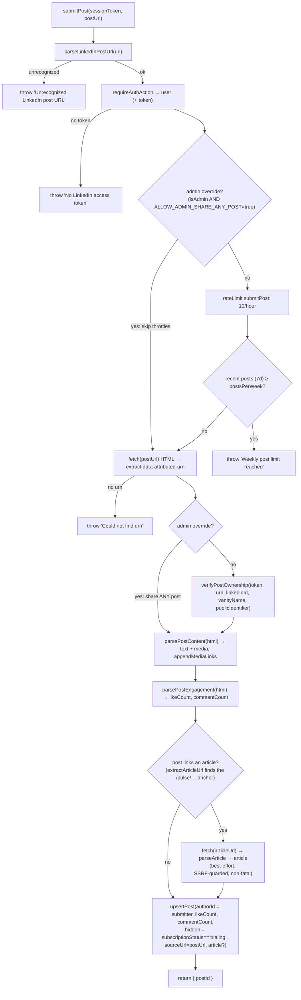

**Ownership verification** (`linkedin/verifyPostOwnership.ts`) is a two‑step fallback: **Step A**
the UGC API (works when `w_member_social`/`r_member_social` is approved); **Step B** a local
comparison of the post's author against the user's stored `linkedinPublicIdentifier` / `vanityName`
(no API call). This lets the product work **without LinkedIn Partner/MDP access**.

**Admin override (testing only, dev‑gated).** The override is active **only** when the submitter is an
admin **and** the `ALLOW_ADMIN_SHARE_ANY_POST` env var is `'true'` — a flag set exclusively on the
local / dev Convex deployment (`isAdminShareOverrideEnabled`). In production the var is absent, so
admins submit posts under exactly the same rules as everyone else. When active, `submitPost` skips
**both** the posting throttles (hourly rate limit + weekly per‑plan limit) **and** the ownership check,
so a dev admin may share **any** post in any volume. The ownership step is replaced by a synthesized
`OwnershipResult` with `strategy: 'admin-override'`, empty `content` (it falls back to the HTML‑parsed
text), and `publishedAt = now`. The post is still attributed to the **admin** (`authorId = submitter`),
because `posts.authorId` must reference a real `users` row; the original LinkedIn author — who
typically has no account — cannot be the `authorId`.

**Engagement counts.** Manual submissions seed `likeCount` / `commentCount` from
`parsePostEngagement(html)`, which reads schema.org `interactionStatistic` (`InteractionCounter`)
out of the same page HTML already fetched for content — no extra API call. Best‑effort: missing data
degrades to `0`. This mirrors the Apify path, which reads `engagement.likes/comments`.

**Content extraction** (`linkedin/parsePostContent.ts`) is best‑effort and non‑fatal (unrecognized
HTML yields `{ text: '', media: [] }`). From the already‑fetched page HTML it parses:

- **Text** — from JSON‑LD blocks (`articleBody` → `description` → `text`), falling back to the
  `og:description` meta tag.
- **Media** — typed as `image | article | document` (`PostMedia`), de‑duplicated, gathered from:
  `og:image` meta tags and JSON‑LD `image` (→ image); the **shared‑article anchor in the post body**
  (`extractArticleUrl`) plus a JSON‑LD `@type=Article` `url` fallback (→ article); JSON‑LD
  `associatedMedia.contentUrl` and **direct `.pdf` links found in the page** (→ document).
  `findPdfLinks` tests only the path segment (before `?`/`#`) for the `.pdf` extension but **returns
  the full URL including its query string**, so signed/expiring document tokens are preserved (the
  `4603f40` fix).

**Shared‑article link** (`extractArticleUrl`). A LinkedIn post that links an article (e.g. a Pulse
post) does **not** expose the article URL in its JSON‑LD — the post is typed `SocialMediaPosting`,
whose only URLs are the post's own `@id`, the author profile, and the cover image. The article link
lives only in the post body as an `<a data-test-id="article-content">` element (also carrying a
`feed-article-content` class/tracking name). `extractArticleUrl` selects that anchor — ignoring the
page's "more from this author" `/pulse/…` links, which lack those markers — strips tracking
query/hash to a clean canonical URL, and re‑validates the LinkedIn host (it is fetched server‑side, so
the SSRF guard applies). The earlier assumed `sharedContent.url` field does not exist in real LinkedIn
HTML and was removed.

`appendMediaLinks(text, media)` composes the stored `content`: the trimmed body, then (if any media)
a blank line, then one `[type] url` line per media item — self‑describing for future use. The
structured `mediaUrls` array (the bare URLs) is **persisted but not currently displayed** anywhere;
the feed/My Posts UI shows the post via the LinkedIn embed, not this stored text (see
[§11](#11-feed--engagement) / [§14](#14-frontend--authenticated-app-app)).

**Article enrichment** (`parseArticle`). When `extractArticleUrl` finds a shared article, `submitPost`
does one extra **best‑effort, SSRF‑guarded** `fetch` of that article page and runs `parseArticle` to
capture `{ url, title?, summary?, text?, author?, imageUrls }` into the post's `article` field
(`lib/articleValidator.ts`):

- **`text`** — the **full article body** as plain text. The guest SSR page renders the whole body
  (despite the post JSON‑LD's `isAccessibleForFree:false` flag) inside `<div
data-test-id="article-content-blocks">` as a flat list of `publishing-text-block` elements.
  `extractArticleBody` isolates that container (up to `</article>`) — excluding the header, sign‑in
  modal, comments, and "more articles" cards — and renders each `<p>` / `<h1‑6>` / `<pre>` / list in
  document order: paragraphs (blank‑line separated), headings on their own line, `- ` bullets, and
  ` ` ``‑fenced code blocks (internal whitespace preserved, entities decoded).
- **`title` / `summary` / `author`** — from the article's `@type:Article` JSON‑LD (where LinkedIn
  unusually maps `name`→title and `headline`→summary), with `og:` tag fallbacks.
- **`imageUrls`** — cover (`og:image` / JSON‑LD) plus inline body images (`media.licdn.com` URLs inside
  `article-content-blocks`), de‑duplicated.

Non‑fatal: no article link, a network error, or a parse miss simply leaves `article` undefined. The
data is **not displayed**; it seeds a future AI‑comment feature. The Apify cron path does not populate
`article`.

### Hiding & deleting a post (`posts.setPostHidden` / `posts.deletePost`, mutations)

Authors manage their own shared posts from My Posts; **admins may act on any post** (moderation). Both
mutations authorize via the pure `canModifyPost(user, post)` helper (`post.authorId === user._id ||
user.isAdmin`).

- **Hide / unhide** (`setPostHidden`) flips the `hidden` flag. Hidden posts leave the public feed
  (`getFeed` keys on `hidden === false`) but stay in the author's My Posts (so they can unhide).
  Un‑hiding a soft‑deleted post is rejected.
- **Delete** (`deletePost`) is a **soft delete**: it stamps `deletedAt` and sets `hidden: true`. The
  post disappears from the feed **and** from My Posts (`getMyPosts` filters `deletedAt === undefined`),
  but the row is intentionally **kept**. Idempotent.

**Invariant — neither operation changes the weekly post count.** The rolling 7‑day count
(`countPostsSince`, and the atomic check in `upsertPost`) counts **every** `posts` row in the window
regardless of `hidden`/`deletedAt`, so keeping the row means hiding or deleting a post never frees up
a posting slot. A hard delete is the only thing that would break this, which is why delete is soft.
On account deletion the privacy cascade still purges these rows by `authorId` (they are not exempt).

### Apify sync + queue pipeline

The daily cron calls `jobs/syncPosts.syncAllPosts`, which is **just a router**: it does nothing
unless `appSettings.apifySyncEnabled` is true, in which case it delegates to
`syncPostsApify.syncAllPostsViaApify`.

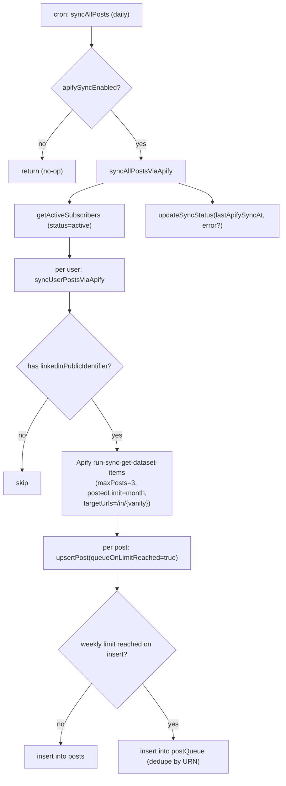

> Because `getActiveSubscribers` returns only `active` users, the Apify path's `hidden =
subscriptionStatus === 'trialing'` is effectively always `false` on the cron — trial‑hiding
> matters mainly for the **manual submit** and **on‑activation** paths.

### Queue drain (`jobs/processQueue.processPostQueue`, daily cron)

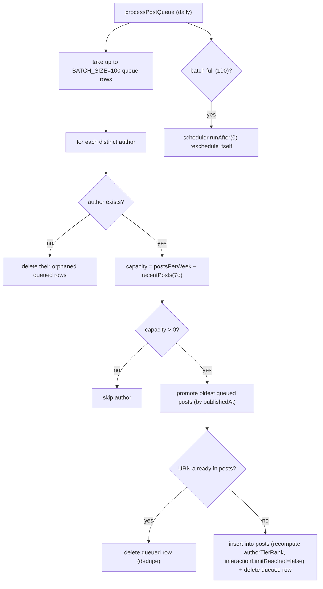

### Post‑related functions

| Function                                    | Kind              | Purpose                                                                                                             |
|---------------------------------------------|-------------------|---------------------------------------------------------------------------------------------------------------------|
| `posts.submitPost`                          | action (public)   | Manual submission (above).                                                                                          |
| `posts.getMyPosts`                          | query (public)    | Author's posts incl. hidden, **excl. soft‑deleted**, sorted by `publishedAt` desc (bounded to the 500 most‑recent). |
| `posts.setPostHidden`                       | mutation (public) | Hide/unhide a post (author or admin via `canModifyPost`). Doesn't change the weekly count.                          |
| `posts.deletePost`                          | mutation (public) | Soft‑delete a post (author or admin). Row kept → weekly count unchanged. Idempotent.                                |
| `posts.getWeeklyUsage`                      | query (public)    | `{ postsThisWeek, postsPerWeek }` over the same rolling 7‑day window submitPost enforces.                           |
| `posts.countRecentPosts`                    | internalQuery     | Count posts since a timestamp (shared by enforcement + usage pill).                                                 |
| `jobs/syncPosts.upsertPost`                 | internalMutation  | Insert/update gatekeeper with atomic weekly‑limit + optional queueing.                                              |
| `jobs/syncPosts.syncAllPosts`               | internalAction    | Cron router → Apify (if enabled).                                                                                   |
| `jobs/syncPostsApify.syncUserPostsViaApify` | internalAction    | Scrape one user's recent posts via Apify REST.                                                                      |
| `jobs/syncPostsApify.syncAllPostsViaApify`  | internalAction    | Fan‑out over active subscribers; records sync status.                                                               |
| `jobs/processQueue.processPostQueue`        | internalMutation  | Drain overflow queue when capacity opens.                                                                           |

---

## 11. Feed & Engagement

### Feed resolution (`feed.getFeed`, query)

Args: `paginationOpts` (Convex cursor pagination), `sessionToken`, `filterIndustries?`,
`filterCountries?`. Returns a `PaginationResult` — `{ page: enriched[], isDone, continueCursor }`
(posts include a **token‑stripped** author projection). The client consumes it via
`usePaginatedQuery` in `FeedPage.tsx`.

The viewer's tier sets the filter via `buildFeedFilter`:

- **starter:** no filters.
- **growth:** auto‑filter to the viewer's **own** `industry` + `country`.
- **pro / contact:** filter by the **caller‑supplied** `filterIndustries` / `filterCountries`
  (applied only when non‑empty).

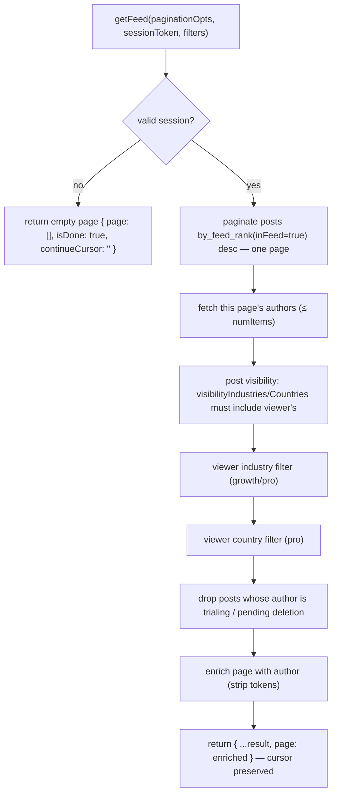

> `getFeed` walks the `by_feed_rank` index with `.paginate()`: `inFeed === true` pre-encodes the
> hidden / interaction-limit / soft-delete filters, and descending `feedRank` (featured → author
> tier → recency, see [`lib/feedRank.ts`](../convex/lib/feedRank.ts)) **is** the sort — so each call
> reads only one page and applies just the viewer-/author-dependent filters in memory. The denormalized
> fields are kept in sync by every post writer (`computeFeedFields`). Heavy viewer filters can yield
> short pages; the client's **Load more** (`usePaginatedQuery`) requests the next page. Design + rollout:
> [feed-cursor-pagination-plan.md](./feed-cursor-pagination-plan.md).

### Sort priority (effective order)

1. **Featured** posts first (newest first).
2. Then by **author tier rank** desc (contact → pro → growth → starter).
3. Then by **`publishedAt`** desc (newest first).

### Interactions (comment / react)

Both are **actions** that call LinkedIn with the **acting user's own token**, then increment the
local count (which may flip `interactionLimitReached`). Counts propagate to all viewers in real time
via Convex reactivity. On success each action also appends a per‑user row to **`userInteractions`**
(`internal.interactions.recordInteraction`, best‑effort — a logging failure never fails the action) —
the reaction type or comment text keyed by `userId`/`postId` — for the DSR export (§13B) and a future
admin dashboard. The interaction‑limit flip decision is the pure helper
`lib/interactionLimit.ts` `shouldFlipInteractionLimit(likeCount, commentCount, interactionsPerPost, alreadyReached)`.

| Action                                             | Validation                                                                 | Rate limit | LinkedIn endpoint                                                           |
|----------------------------------------------------|----------------------------------------------------------------------------|------------|-----------------------------------------------------------------------------|
| `commentOnPost(postId, commentText, sessionToken)` | text ≤ 3000 chars                                                          | 20/hour    | `POST /v2/socialActions/{urn}/comments`, actor `urn:li:person:{linkedinId}` |
| `reactToPost(postId, reactionType, sessionToken)`  | `reactionType ∈ {LIKE,PRAISE,EMPATHY,INTEREST,APPRECIATION,ENTERTAINMENT}` | 30/hour    | `POST /rest/reactions?actor=…`, header `Linkedin-Version: 202603`           |

> Endpoint **asymmetry**: comments use the legacy `/v2/socialActions` API; reactions use the
> versioned `/rest/reactions` API. `reactionType` uses the **real `/rest/reactions` enum values**
> (the UI shows friendly labels Like/Celebrate/Love/Insightful/Support/Funny). The feed's reaction
> control is a **picker pre‑selected to the AI‑suggested reaction** (`posts.suggestedReaction`,
> default `LIKE`) — see [§11A](#11a-ai-reaction--comment-assistance).

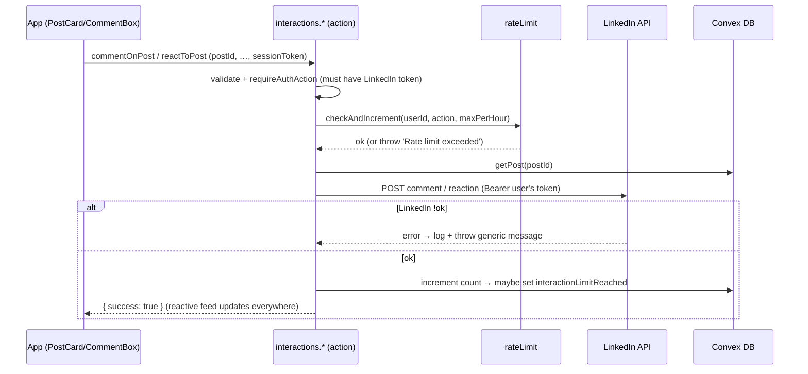

### Rate limiting (`lib/rateLimit.ts`)

A **fixed window** keyed on `(userId, action)`: `WINDOW_MS = 3,600,000` (1h). On each call it reads
the current window row; if `windowStart` is older than the window it resets, otherwise it increments
and throws once `count` reaches the limit (`maxPerWindow`). (The header comment says "sliding window" but the
implementation is fixed‑window.) `checkRateLimit` now accepts an optional `windowMs` + `windowLabel`
(defaults to 1h / "hour") so callers can specify non-hourly windows. Limits: `submitPost` 10/h,
`commentOnPost` 20/h, `reactToPost` 30/h, `generateComment` 30/h, `profile_refresh` 2/day. The `profile_refresh` budget
is
**shared** by the manual Refresh button and the auto-scrape on identifier change; the latter uses the
non-throwing `tryConsumeRateLimit` so an exhausted budget never blocks saving the identifier.
**Admins (`user.isAdmin`) bypass the rate limit on `commentOnPost`, `reactToPost`, `generateComment`,
and `profile_refresh`** — those call sites unconditionally skip the check for admins. **`submitPost` is the
exception:** its rate‑limit, weekly‑limit, and ownership bypass apply **only under the dev‑gated admin
override** (`ALLOW_ADMIN_SHARE_ANY_POST` — see
[§10 — Manual post submission](#manual-post-submission-postssubmitpost-action)). In production that
var is unset, so an admin submits posts under exactly the same limits as everyone else.

---

## 11A. AI Reaction & Comment Assistance

OpenRouter (OpenAI-compatible) powers two assists: (1) predicting each submitted post's most-likely
reaction, and (2) drafting comments on demand. The model is Google's open **Gemma**
(`google/gemma-4-26b-a4b-it`), served via OpenRouter's privacy-constrained provider routing. All calls go through one
seam —
`convex/ai/openrouter.ts` `callOpenRouter(messages, { action })` — which mirrors `linkedin/client.ts`
(auth + log-real-error→throw-sanitized). The prompts are **multimodal**: the post's images
(`posts.imageUrls`, the image-typed media captured at submit) + the linked article's images are attached as
vision input, and the **full article body** (`posts.article.text`) is sent as text — so the model must be
**vision-capable** (`OPENROUTER_MODEL` must point at a multimodal model). Non-image media (documents/links)
are listed as text context, not attached.

> **Compliance — AI inference runs via OpenRouter with zero data retention (dynamic provider routing).**
> `OPENROUTER_API_KEY` enables the AI features (unset ⇒ reactions no-op to `LIKE`, Generate reports "AI
> unavailable"). The seam (`convex/ai/openrouter.ts`) constrains routing **in code** to providers that honour
> **zero data retention** (`zdr: true`) and **no data collection / no training** (`data_collection: "deny"`) —
> not env-overridable — and OpenRouter picks the cheapest qualifying provider (`:floor`). The model is Google's
> open **Gemma** (`google/gemma-4-26b-a4b-it`). **OpenRouter** (US) is the named sub-processor; the **downstream
> inference provider (e.g. DeepInfra) and its region are selected per request, not pinned** — so region is not
> guaranteed and the controller relies on OpenRouter's DPA flowing down to its providers. Documented in
> `docs/compliance/`: ROPA **Activity 13** (`DATA-INVENTORY.md`), the **OpenRouter** rows in `SUBPROCESSORS.md`,
> **item 10** in `GAP-ASSESSMENT.md`, and the public `/privacy` disclosure. **Human/legal before go-live:**
> execute OpenRouter's DPA, confirm ZDR/no-training flows down to its providers, and assess the transfer
> position given the non-pinned region (add region constraints if needed).

### Reaction prediction (async, best-effort)

`posts.submitPost`, after the upsert, schedules `internal.ai.reactions.predictReaction` — submit returns
immediately; OpenRouter latency/cost/failure never touch it. The prediction reads the post, builds the
reaction prompt (content + article), calls OpenRouter, coerces the reply with `parseReaction` (whole-word
match against the 6-enum allow-list, **default `LIKE`**), and patches `posts.suggestedReaction`. Any
failure is swallowed (logged) — the post keeps the default `LIKE`. Only manual submits predict (that's
where `article` context exists); synced/legacy posts default to `LIKE`.

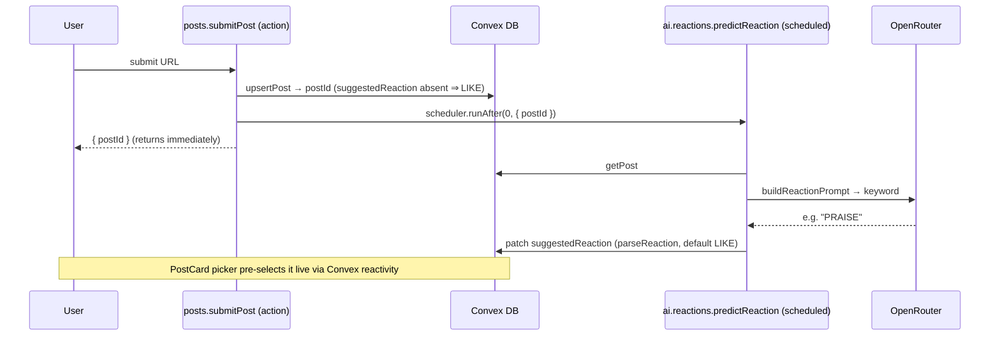

The feed's reaction control (`PostCard`) is a **picker** pre-selecting `suggestedReaction ?? 'LIKE'`; the
viewer confirms or changes before `reactToPost` sends the chosen reaction (§11).

### Comment drafting (on-demand)

`api.ai.comments.generateComment({ sessionToken, postId, language? })` → `{ comment }`. It auth-checks,
rate-limits (30/h, admins exempt), loads the post + the author's public name/headline
(`internal.users.getPublicAuthor`), resolves the language, builds the comment prompt (≤2 paragraphs,
concise, no hashtags/@-mentions; article + media URLs included), calls OpenRouter, and returns the draft.
**Nothing is persisted** — comments are generated fresh per user per click (identical reused text would
trip LinkedIn spam detection). `CommentBox` prefills the textarea (Generate / Regenerate) for the user to
edit, then posts via the unchanged `commentOnPost`.

### Comment language

All **ISO 639-1** codes (`convex/lib/languages.ts`, codes-only + `Intl.DisplayNames`, mirroring
`profileOptions.ts`) plus an **`auto`** sentinel ("match the post"). Stored as `users.commentLanguage`
(`v.string()`, validated in the handler — same pattern as `country`/`industry`). The default chain is
**per-comment select → saved `commentLanguage` → `auto`**, all via the pure `resolveCommentLanguage`
(shared by the action and both selects). Settings has a default picker (`setCommentLanguage`); the comment
box picker overrides per-comment without writing back.

### Files

`convex/ai/{openrouter,prompts,reactions,comments}.ts`, `convex/lib/{reactions,languages}.ts`,
`posts.submitPost` (schedule hook), `interactions.reactToPost` (enum fix), `users.{setCommentLanguage,
getPublicAuthor}`, `getMe` (exposes `commentLanguage` via `toSafeMe`); frontend `PostCard` (picker),
`CommentBox` (draft + language), `SettingsPage` ("AI Comments"), i18n `reactions.*` / `comment.*`.

---

## 12. Admin & Moderation

Admin is gated by the **`users.isAdmin`** boolean, which is **only settable by direct database
edit** — no application code writes it. Every admin function calls `assertAdmin(user)` after
`requireAuth`, throwing `'Forbidden: admin access required'` otherwise.

### Admin functions (`convex/admin.ts`)

| Function                                                                 | Kind     | Purpose                                                                                                                                                                                                  |
|--------------------------------------------------------------------------|----------|----------------------------------------------------------------------------------------------------------------------------------------------------------------------------------------------------------|
| `checkIsAdmin`                                                           | query    | `true/false` (soft‑fails to `false`) — drives the client route guard.                                                                                                                                    |
| `getSettings`                                                            | query    | App settings (3 Apify flags + post‑sync & profile‑scrape last‑run status).                                                                                                                               |
| `toggleApifySync(enabled)`                                               | mutation | Master switch for the Apify post‑sync cron.                                                                                                                                                              |
| `toggleApifyEnabled(enabled)`                                            | mutation | Master Apify kill-switch.                                                                                                                                                                                |
| `toggleApifyProfileScrape(enabled)`                                      | mutation | Toggle the LinkedIn profile scrape.                                                                                                                                                                      |
| `syncAllPosts`                                                           | mutation | **Manual trigger** → schedule a post sync for all active subscribers. Throws if post sync is disabled. See [Manual Apify sync triggers](#manual-apify-sync-triggers).                                    |
| `syncUserPosts(userId)`                                                  | mutation | **Manual trigger** → schedule a post sync for one user. Throws if disabled or the user has no LinkedIn URL.                                                                                              |
| `syncAllProfiles`                                                        | mutation | **Manual trigger** → schedule a profile scrape for all users with a LinkedIn URL. Throws if profile scrape is disabled.                                                                                  |
| `syncUserProfile(userId)`                                                | mutation | **Manual trigger** → schedule a profile scrape for one user. Throws if disabled or the user has no LinkedIn URL.                                                                                         |
| `listUsers`                                                              | query    | Up to 1000 users (newest first), **without** tokens/Stripe IDs; includes the public `linkedinPublicIdentifier` slug so the Users tab can gate the per‑row sync actions.                                  |
| `setUserTier(userId, tier)`                                              | mutation | Change tier (any of the 4) from the Users tab; promoting to `contact` auto‑seeds a per‑user `planLimits` override from contact defaults.                                                                 |
| `setUserSubscriptionStatus(userId, status)`                              | mutation | Admin override of `subscriptionStatus` (any of the 5) from the Users tab — chiefly to take a user out of `trialing` (which hides their posts). Manual override; a later Stripe webhook can overwrite it. |
| `listContactUsersWithLimits`                                             | query    | Every contact‑tier user (`by_tier`) with **effective** limits (override ?? contact default) + `hasOverride`. Powers the read‑only Plan Limits tab.                                                       |
| `listPlanLimits`                                                         | query    | All `planLimits` rows, enriched with `userName` for overrides. Also prefills the Users‑tab contact‑limits modal.                                                                                         |
| `updateTierDefault(tier, …)`                                             | mutation | Edit a tier's **default** row (filters out per‑user overrides). Backend‑only (no UI).                                                                                                                    |
| `setContactUserLimit(userId, …)`                                         | mutation | Upsert a contact per‑user override (validates ≥ 1; target must be contact tier). Edited from the Users tab.                                                                                              |
| `removeContactUserLimit(userId)`                                         | mutation | Delete a contact override (revert to tier default).                                                                                                                                                      |
| `banUser(userId, reason?)`                                               | mutation | Set ban fields. **Cannot self‑ban** (`assertNotSelfBan`) — guarantees ≥ 1 admin remains; banning _other_ admins is allowed.                                                                              |
| `unbanUser(userId)`                                                      | mutation | Clear all ban fields.                                                                                                                                                                                    |
| `getSettingsInternal` / `updateSyncStatus` / `updateProfileScrapeStatus` | internal | Used by the Apify jobs — read flags; record post‑sync / profile‑scrape last‑run + error.                                                                                                                 |

`validateLimitArgs` enforces `interactionsPerPost ≥ 1` and `postsPerWeek ≥ 1`. `effectiveContactLimits`
(pure, unit‑tested) resolves a contact user's display limits as `override ?? contact default ?? hardcoded`.

### Manual Apify sync triggers

Four admin‑only mutations let an admin run a sync on demand instead of waiting for the daily cron.
Each **respects the same toggles the crons honor**: it schedules the (slow, paid) job and returns
immediately, but only when its feature flag (+ the master kill‑switch) is on — otherwise it throws
`"<feature> is disabled — enable it in Settings first."` The UI also gates each control, but the
**server check is authoritative** (a stale client or a direct API call still can't run a disabled
integration). All four triggers share a single `assertApifyTriggerEnabled` precondition (auth + admin
assertion + flag check) so the server gate is defined once in `admin.ts`.

| Trigger                   | Schedules                                           | Surface (admin panel)                               |
|---------------------------|-----------------------------------------------------|-----------------------------------------------------|
| `syncAllPosts`            | `jobs/syncPosts.syncAllPosts` (post‑sync router)    | "Sync all now" on the **Apify Post Sync** card      |
| `syncUserPosts(userId)`   | `jobs/syncPostsApify.syncUserPostsViaApify`         | "Sync posts" in the **Users**‑tab row menu          |
| `syncAllProfiles`         | `jobs/scrapeProfileApify.scrapeAllProfilesViaApify` | "Sync all now" on the **Apify Profile Scrape** card |
| `syncUserProfile(userId)` | `jobs/scrapeProfileApify.scrapeUserProfile`         | "Sync profile" in the **Users**‑tab row menu        |

The per‑user triggers additionally require the target to have a `linkedinPublicIdentifier`
(otherwise the menu item is disabled and the server throws). Outcome is observable via each card's
`Last sync` / `Last profile sync` line (and the user's data updating reactively) — there is no
per‑item progress view. Because these are flag‑gated, they do **not** by themselves "switch Apify
on" — only the toggles do, and doing so in production triggers the compliance hard gate
(see [§13B](#13b-privacy--compliance)).

### Ban model — **reactive, not a forced logout**

`banUser` **only patches the user row** (`isBanned/bannedAt/bannedBy/bannedReason`). It does **not**
delete sessions. Enforcement is:

1. **Server:** the next `requireAuth`/`requireAuthAction` calls `assertNotBanned` → throws
   `'Account suspended'` (blocks all protected mutations/actions).
2. **Client:** Convex's reactive `getMe` query (which uses `resolveSession`, not `requireAuth`, so
   it still returns the user with `isBanned: true`) pushes the flag to any open tab → `RequireAuth`
   swaps the whole shell for `<BannedScreen>`.

An **unban** restores access on the **same** session token — no re‑login required.

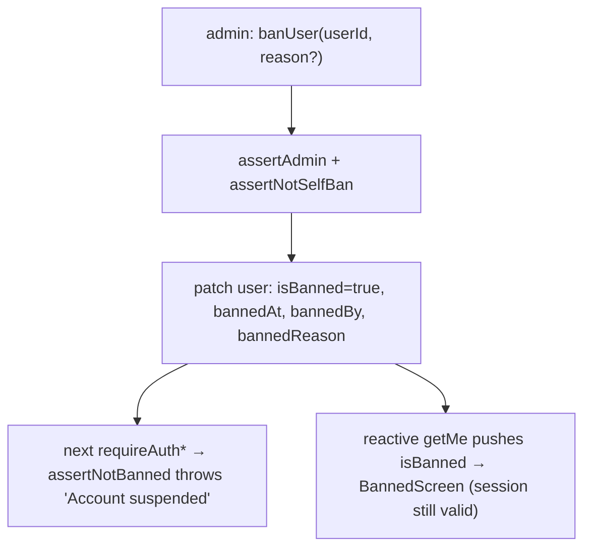

---

## 12A. Feedback

Authenticated users submit free-text feedback (≤4000 chars) tagged with a single category
via a floating button (bottom-right of every authenticated page). Admins read and reply by
email from the **Feedback** tab in the admin panel. Each feedback item can receive **multiple
admin replies** stored as a thread in the `feedbackResponses` table.

**Data:**

- `feedback` table — `userId?` (submitter; cleared on account deletion), `category` (one of
  `feature_request | bug | comment | criticism | praise | question | suggestion | other`),
  `message`, `status` (`new | responded | archived`), `createdAt`. The legacy single-reply
  fields `responseText`, `respondedAt`, `respondedBy` are retained as **optional/deprecated**
  (no longer written; superseded by `feedbackResponses`). Indexes: `by_user`, `by_status`.

- `feedbackResponses` table — append-only reply log; each row is one admin reply.
  `feedbackId` (FK → `feedback`), `responderId` (FK → `users`, the admin who replied),
  `text` (reply text), `createdAt` (ms). Index: `by_feedback [feedbackId, createdAt]`
  (chronological per item). A `backfillFeedbackResponses` internal mutation migrates any
  existing single-reply rows from the legacy fields — run once from the Convex dashboard
  after deploying.

**Backend** (`convex/feedback/`):

- `feedback.ts` — `submitFeedback` (user; validates, throttles **10/hour**, admins exempt),
  `listFeedback` (admin; newest-first, enriched with submitter name/email and full reply
  thread from `feedbackResponses`), `respondToFeedback` (admin; inserts a new
  `feedbackResponses` row, patches `status=responded`, writes a `feedback.responded` audit
  log, schedules the email if `sendEmail=true`), `archiveFeedback` / `reopenFeedback`, and
  the internal `getReplyData` + `sendFeedbackReply` action (keyed by `responseId`).
  `backfillFeedbackResponses` (internalMutation — one-time operator migration).
- `emails.ts` — `feedbackReplyEmail` builder (HTML-escapes user/admin text).
- Replies use `lib/email.ts:sendEmail` with `Reply-To` = `FEEDBACK_REPLY_TO` so users reply
  to a human inbox. The admin chooses **per reply** whether to send an email (`sendEmail`
  boolean arg to `respondToFeedback`).

**Frontend** (`app/src/components/`): `FeedbackButton` + `FeedbackModal` (user, i18n
en/pt/es); `FeedbackTab` + `RespondFeedbackModal` (admin, English). Respond is disabled when
the submitter has no email on file.

**Privacy:** `feedback` rows are **anonymized, not deleted**, on account erasure
(`cascadeDeleteUser` clears `userId`; content retained). `feedbackResponses` rows are
retained attached to the anonymized feedback after account deletion. Both are included in the
DSR export bundle (`gatherUserData` collects `feedbackResponses` for each of the user's
feedback items).

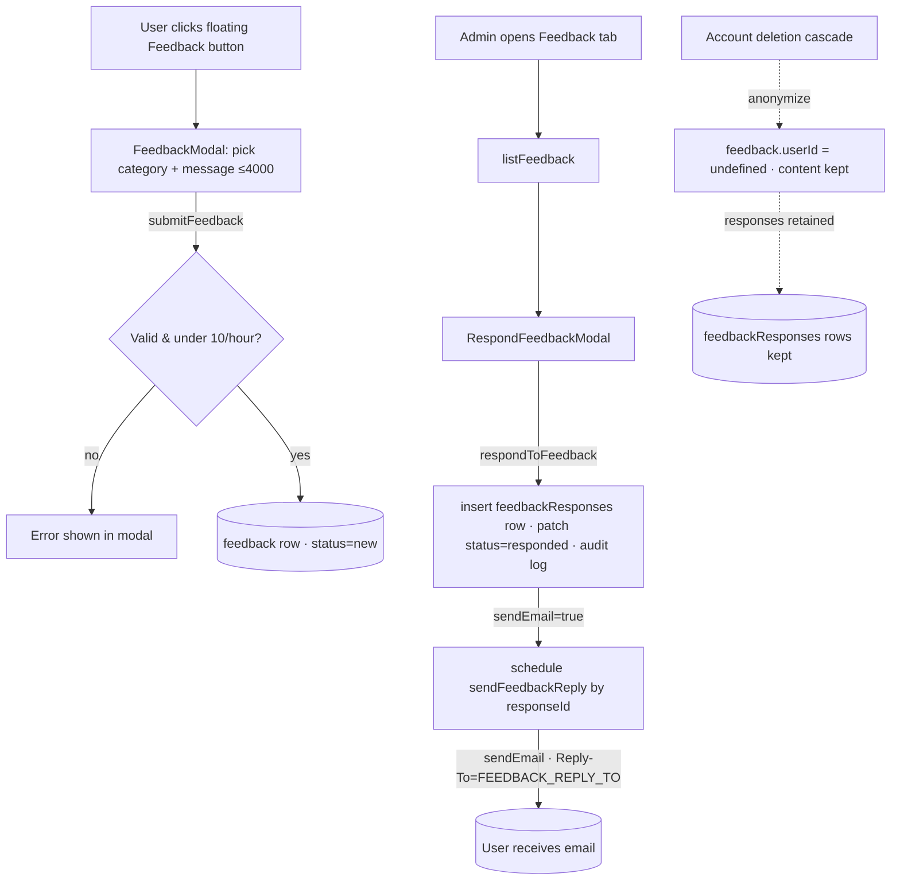

---

## 12B. Message of the Day (MOTD)

Admins author markdown announcements shown to authenticated users at the very top of the app.
Default presentation is a **dismissible top banner**; flagging a MOTD **important** escalates it to a
**blocking modal** that closes only via an OK button. Bodies are **per-locale markdown** (`en`
required as the fallback; others optional and extensible with no schema migration), with optional
**start/expiry scheduling**. Dismissal is **session-scoped** and re-shows on the next login.

**Data:** `motds` table (see [§5](#5-data-model)). The active MOTD is the newest `enabled` row whose
`[startAt, expiresAt)` window covers "now" — `selectActiveMotd` (pure, unit-tested).

**Backend** (`convex/motd/motd.ts`):

- `getActiveMotd` (viewer query) — `resolveSession`; returns `{ _id, bodies, important }` for the
  active MOTD or `null` (non-throwing). Reads `enabled=true` newest-first via `by_enabled_and_created`,
  then `selectActiveMotd`.
- `listMotds` (admin) — all MOTDs newest-first, bounded `take(200)`.
- `createMotd` / `updateMotd` / `deleteMotd` / `toggleMotdEnabled` (admin) — `requireAuth` +
  `assertAdmin`. Writes go through the pure `validateMotdInput` (trims bodies, drops empty locales,
  requires `en`, caps each body at 5000 chars, requires `expiresAt > startAt`). No audit log — admin
  content, not a personal-data action.

**Frontend** (`app/src/components/`):

- `MarkdownView` — shared safe renderer (`react-markdown` + `remark-gfm`, no raw HTML; links open in
  a new tab; dangerous URL protocols stripped).
- `Motd` — subscribes to `getActiveMotd`, resolves the body for the active language
  (`bodies[lang] ?? bodies.en`), renders the banner or (when `important`) the blocking `Modal`
  (`dismissOnBackdrop={false}`, `dismissOnEscape={false}`, OK button). Mounted in `RequireAuth`
  above `AppNav`. New i18n keys: `motd.dismiss`, `motd.ok` (en/pt/es).
- `MotdTab` — admin authoring (list + create/edit form with per-locale textareas, important/enabled
  toggles, optional `datetime-local` start/expiry, live `MarkdownView` preview). Added as the
  **MOTD** tab in `AdminPage` (admin chrome is English-only, like the other admin tabs).

**Dismissal & re-login mechanic:** dismissal is stored in `sessionStorage` under `motdDismissed` as
`{ token, motdId }`. The MOTD is hidden only when both the stored token equals the current
`sessionToken` **and** the stored `motdId` equals the active MOTD's id. A page reload keeps the same
token (stays dismissed); a re-login rotates the token via `AuthSuccessPage` (stored token no longer
matches → re-shows); a newly published MOTD has a new id → re-shows even mid-session.

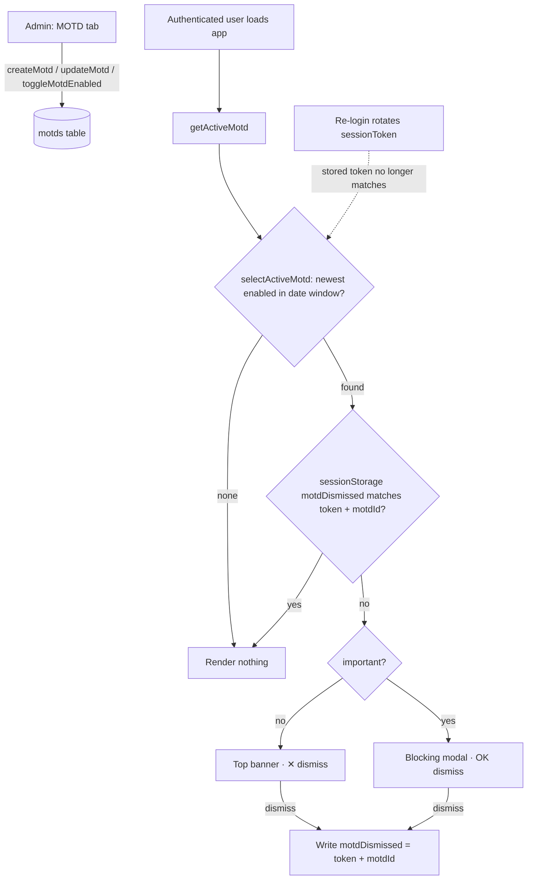

---

## 13. Scheduled Jobs (Crons)

`convex/crons.ts` is the **only** file Convex reads for scheduled work. The two post‑sync jobs run at
fixed wall‑clock times in UTC (`crons.cron`); the session/OAuth cleanup, account‑deletion, and
retention jobs run on fixed intervals from deploy time (`crons.interval`).

| Cron name                      | Schedule            | Target                                     | Effect                                                                                                                                                                                                                                                                     |
|--------------------------------|---------------------|--------------------------------------------|----------------------------------------------------------------------------------------------------------------------------------------------------------------------------------------------------------------------------------------------------------------------------|
| `sync LinkedIn posts`          | daily **03:00 UTC** | `jobs/syncPosts.syncAllPosts`              | Apify sync **iff** `apifySyncEnabled` (else no‑op).                                                                                                                                                                                                                        |
| `process post queue`           | daily **04:00 UTC** | `jobs/processQueue.processPostQueue`       | Promote queued posts when authors regain weekly capacity.                                                                                                                                                                                                                  |
| `cleanup expired sessions`     | every **6h**        | `sessions.deleteExpiredSessions`           | Purge expired sessions (≤ 200/run).                                                                                                                                                                                                                                        |
| `cleanup expired oauth states` | every **1h**        | `sessions.deleteExpiredOAuthStates`        | Purge expired CSRF nonces (≤ 200/run).                                                                                                                                                                                                                                     |
| `process account deletions`    | every **24h**       | `privacy/deletion.processAccountDeletions` | Hard-delete accounts past their 30-day deletion grace window (cascade + Stripe cancel + completion email). Reads due accounts via `by_deletion_and_last_login`; processes **one account per run** in bounded cascade passes, self-rescheduling until the due-set is empty. |
| `enforce data retention`       | every **24h**       | `privacy/retention.enforceDataRetention`   | Null expired LinkedIn tokens; expire/purge old export files + audit logs (>24mo); flag dormant accounts (24mo, non-subscribers) for deletion. Indexed reads; batched, self-rescheduling on the token/audit sweeps.                                                         |

---

## 13A. Profile Enrichment (LinkedIn Profile Scrape)

A dedicated Apify actor (`APIFY_TASK_ID_PROFILE_SCRAPE`) enriches a user with `country`
(fill-when-empty), `location`, and `primaryLocale`. Industry is **not** scraped (absent from the
payload) — it's user-edited in Settings. The scrape is **triggered**, not cron-scheduled:

- on `users.setPublicIdentifier`, but only when the identifier **changes**, the scrape is
  **enabled**, and the shared 2/day budget allows it (charged on the same `profile_refresh` counter
  as the button — and the flag is checked _before_ the budget, so a disabled scrape never charges it), and
- on the user-pressed **"Refresh from LinkedIn"** button (`refreshProfileFromLinkedIn`, ≤ 2/day), and
- on the **post sync** (`syncUserPostsViaApify` — subscription activation + hourly cron) **when the
  user has no `country` yet**, which bounds the (paid) scrape to ~once per user even though posts
  sync repeatedly.
- on an **admin manual trigger** — `admin.syncUserProfile(userId)` for one user, or
  `admin.syncAllProfiles`, which fans out via `jobs/scrapeProfileApify.scrapeAllProfilesViaApify`
  over every user with a `linkedinPublicIdentifier`. Both are flag‑gated; see
  [§12](#12-admin--moderation).

These triggers all schedule the internal action `jobs/scrapeProfileApify.scrapeUserProfile`, which bails if the
Apify env vars (`APIFY_API_TOKEN`/`APIFY_TASK_ID_PROFILE_SCRAPE`) are unset, or unless
`apifyEnabled && apifyProfileScrapeEnabled` (gate helpers in `lib/apify.ts`). It calls the Apify
actor, parses `location.countryCode` → `country`, `location.linkedinText` → `location`,
`primaryLocale.language` → `primaryLocale`, and writes via `users.applyScrapedProfile` (country only
if the user has none; location/locale always refresh). Results propagate to Settings via the
reactive `getMe`, which also seeds the UI language once.

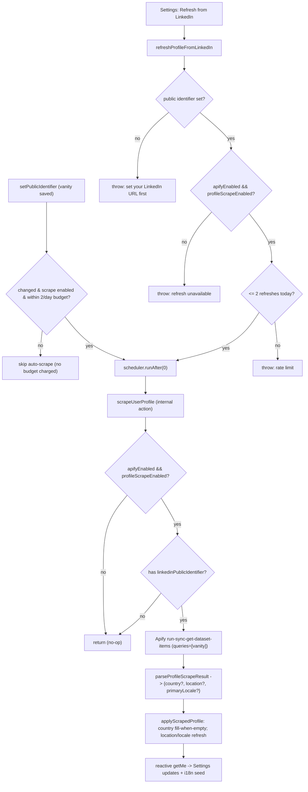

---

## 13B. Privacy & Compliance

> Implements the design spec `docs/superpowers/specs/2026-06-15-privacy-compliance-design.md`.
> **Phase 1 (Foundations)** is in place; later phases (DSR export/deletion, consent & retention,
> data minimization & retention, and legal/transparency artifacts) extend this section.

### Foundations (Phase 1)

- **Email capture.** `linkedin/auth.upsertUser` now stores `email`/`emailVerified` from the OIDC
  userinfo (previously fetched and discarded) and forwards the address to Stripe (`billing.ts`
  `getOrCreateCustomer`). Email is stored under legitimate interest / legal obligation — a contact
  channel for data‑subject rights and breach notification — **not** marketing consent.
- **Login + policy stamping.** `upsertUser` sets `lastLoginAt` on every login and stamps new users
  with the current `POLICY_VERSION` (`lib/policy.ts`) in `acknowledgedPolicyVersion`, so newly
  created accounts are never immediately re‑prompted to re‑accept the policy.
- **New tables** (see [§5](#5-data-model)): `consentRecords` (append‑only consent log),
  `dataExportRequests` (asynchronous Subject‑Access‑Request jobs), `auditLogs` (accountability —
  `lib/audit.ts` exposes `writeAuditLog` for in‑mutation use and the `logAudit` internal mutation
  for actions).
- **Transactional email.** `lib/email.ts` wraps Resend via `sendEmail` and **no‑ops when
  `RESEND_API_KEY`/`EMAIL_FROM` are unset**, so privacy flows never fail merely because email is not
  configured. See [§16](#16-environment-variables).
- **Apify stays disabled at launch.** The LinkedIn scrape (post sync + profile enrichment) remains
  **off in production** (kill‑switches in `appSettings`; `APIFY_*` env vars unset). It is therefore
  **not** disclosed as a processing activity. **Hard gate:** the day Apify is switched on in
  production, the privacy‑policy disclosure, the legal basis, and a sub‑processor entry must be added
  in the same change.

### Data-Subject Rights (Phase 2a)

Backend for self-service **access/portability** and **erasure**. Both resolve identity with
`resolveSession` (NOT `requireAuth`) so a **banned user can still exercise their rights**.

**Data export (right of access / portability)** — `convex/privacy/export.ts`:

- `requestDataExport` (mutation, rate-limited 1/day) inserts a `dataExportRequests` row and schedules
  `generateExport`.
- `generateExport` (action) gathers the user's own rows (`gatherUserData`), assembles a JSON bundle
  via the pure `buildExportBundle` — which **strips token secrets** and **redacts other actors** from
  audit entries — stores it in Convex file storage, marks the row `ready` with a **7-day** `expiresAt`,
  and emails the user (`exportReadyEmail`).
- `getExportStatus` / `getExportDownloadUrl` return the status and a short-lived **owner-only** download
  URL (`ctx.storage.getUrl`); expired links return null.

**Account deletion (right to erasure)** — `convex/privacy/deletion.ts`:

- `requestAccountDeletion` (mutation, idempotent) sets `deletionRequestedAt` + `deletionScheduledAt`
  (+30 days) + `deletionReason='user_request'`, **revokes all sessions**, audits, and schedules
  `onDeletionRequested` (cancels the user's Stripe subscriptions immediately via the Stripe SDK —
  stop billing during grace — and sends `deletionScheduledEmail`).
- The shared feed **excludes pending-deletion authors** via the pure `isAuthorFeedEligible` helper
  (`feed.ts`) — their posts disappear immediately and **reappear automatically on cancel**, with no
  post mutation.
- `cancelAccountDeletion` clears the deletion fields (the user must re-subscribe for paid features).
- `processAccountDeletions` (daily cron) erases accounts past their grace window, **one account per
  invocation**. The pure `cascadeDeleteUser` deletes up to a bounded batch of rows **per table per
  pass** — every owned row (posts, postQueue, subscriptions, sessions, rateLimits, featuredPostUsage,
  planLimits, consentRecords, dataExportRequests + their storage files) — and **pseudonymizes
  `auditLogs`** (nulls `targetUserId`/`actorId`, keeps action/metadata). The `users` row is deleted
  **last**, so a half-drained account stays "due" and the cron re-selects it until every table is
  clear — keeping each pass within one transaction's budget even for an author with an unbounded
  number of posts. On the final pass it writes an `account.deleted` system audit entry, then emails
  `deletionCompletedEmail`. **Billing invoices are retained inside Stripe** for tax/accounting law.
- A schema-derived completeness test asserts the cascade covers every user-referencing table, so a
  future table cannot silently orphan personal data.

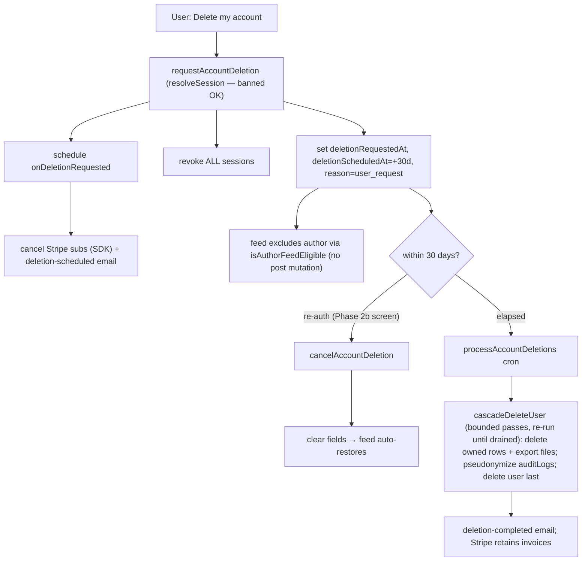

### Consent & Retention (Phase 3a)

Backend for **granular consent** recording, **re-consent** prompting, and automated **data
retention/dormancy** enforcement. The Phase 3b frontend — `ConsentToggles`, `PolicyUpdateScreen`,
`CookieNotice`, and the `/cookies` landing page — is documented in [§14](#14-frontend--authenticated-app-app)
and [§15](#15-frontend--landing-site-landing).

**Consent recording** — `convex/privacy/consent.ts`:

- `consentRecords` is **append-only** — individual purpose changes are each a new row, never an
  update, preserving a full audit trail.
- `recordConsent` (mutation, `resolveSession`) inserts a new `consentRecords` row for a given
  `purpose` + `granted` value, then writes an audit log entry.
- `getConsents` (query, `resolveSession`) returns the **latest record per purpose** for the
  current user via the pure helper `latestConsentByPurpose` (groups by purpose, keeps the most
  recent `_creationTime`).
- Purposes at launch: `marketing` and `analytics` — both **off by default** (no row = no
  consent; the pure helper returns `false` for absent purposes).

**One-time new-user consent prompt** — `convex/privacy/consent.ts`:

- `completeConsentPrompt` (mutation, `resolveSession`) is called once when a new user completes
  the first-login `ConsentPromptScreen`. It records both `marketing` and `analytics` consent
  choices (each as an append-only `consentRecords` row), stamps `users.consentPromptedAt` with the
  current timestamp, and writes a `consent.prompt_completed` audit log entry. An unset
  `consentPromptedAt` field is the signal that causes `RequireAuth` to show `ConsentPromptScreen`
  on the next login — see [§14](#14-frontend--authenticated-app-app).

**Re-consent / policy acknowledgement**:

- `acknowledgePolicy` (mutation, `resolveSession`) stamps `users.acknowledgedPolicyVersion` with
  the current `POLICY_VERSION` constant (from `lib/policy.ts`) and writes an audit log entry.
  This allows the backend to detect users who have not yet acknowledged an updated policy.
- `getMe` already exposes `acknowledgedPolicyVersion` (and `consentPromptedAt`) so the Phase 3b
  frontend can prompt re-acceptance or the one-time consent prompt without a separate query.

**Data retention & dormancy** — `convex/privacy/retention.ts`:

The `enforceDataRetention` cron (daily — see [§13](#13-scheduled-jobs-crons)) runs four
sequential batched sweeps using pure predicate helpers for testability. The token-expiry and
dormancy sweeps read through indexes (`by_token_expiry`, `by_deletion_and_last_login`) rather
than scanning the whole `users` table, and each processed row leaves its index range (token
fields incl. `tokenExpiresAt` cleared; dormant rows gain `deletionScheduledAt`). The cron
**self-reschedules** (`runAfter(0)`) whenever the token or audit sweep fills its batch, so a
large backlog drains across runs; rescheduling keys only off those two strictly-draining sweeps
to guarantee termination (the export and dormancy sweeps make bounded progress per run):

| Sweep                 | Predicate                                                                                                     | Action                                                                                                           |
|-----------------------|---------------------------------------------------------------------------------------------------------------|------------------------------------------------------------------------------------------------------------------|
| LinkedIn token expiry | `isTokenExpired(user)` — `tokenExpiresAt` in the past                                                         | Nulls `linkedinAccessToken`, `linkedinRefreshToken`, `tokenExpiresAt`, `tokenScope` on the `users` row.          |
| Export file expiry    | `isExportExpired(req)` — status `ready` + `expiresAt` in the past                                             | Deletes the file from Convex storage, sets status → `expired`.                                                   |
| Audit log purge       | `isAuditExpired(log)` — older than ~24 months                                                                 | Deletes the `auditLogs` row entirely.                                                                            |
| Dormancy              | `isDormant(user)` — `lastLoginAt` (or `_creationTime`) >24 months ago **and** no active/trialing subscription | Sets `deletionScheduledAt` (+30 days from now) + `deletionReason='dormancy'` and sends a dormancy-warning email. |

The dormancy path **reuses the Phase 2a deletion cascade**: once `deletionScheduledAt` is set,
`processAccountDeletions` (the existing daily cron) handles the hard delete after the 30-day
grace window. A dormant user who re-logs in sees `CancelDeletionScreen` (same interstitial as a
voluntary deletion request) and can cancel via `cancelAccountDeletion` — no new UI needed.

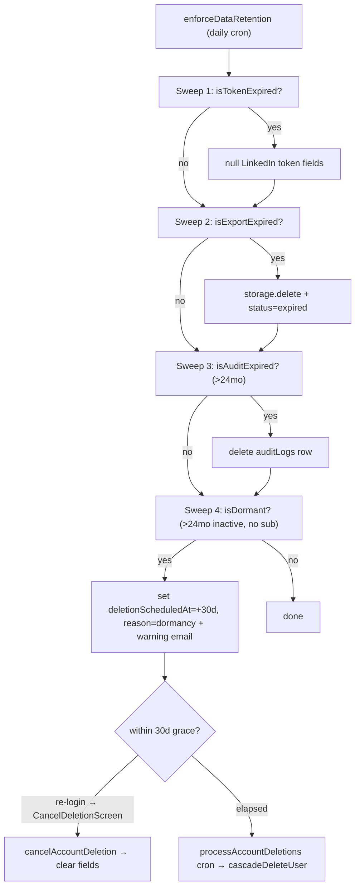

---

## 14. Frontend — Authenticated App (`app/`)

React 19 + Vite 6 SPA. Dev server runs on **port 5174**. Convex reactivity via `convex/react`.

### Bootstrap (`main.tsx`)

Imports `./i18n` (side‑effect init) → `./index.css` → mounts
`<StrictMode><ConvexProvider client={new ConvexReactClient(VITE_CONVEX_URL)}><BrowserRouter><App/>`.
`index.html` ships a strict **CSP** meta tag allowing `frame-src https://www.linkedin.com` (post
embeds) and `connect-src` to `*.convex.cloud` (wss) + `*.stripe.com`.

### Routing & session handling (`App.tsx`)

Declarative `react-router-dom` routes. The session token lives in **`sessionStorage`** (key
`sessionToken`) — there's no React context/store; each page reads it directly.

| Path            | Page              |                        Guarded                         |
|-----------------|-------------------|:------------------------------------------------------:|
| `/auth/success` | `AuthSuccessPage` |      – (captures `?session=` → stores → `/feed`)       |
| `/feed`         | `FeedPage`        |                           ✓                            |
| `/my-posts`     | `MyPostsPage`     |                           ✓                            |
| `/settings`     | `SettingsPage`    |                           ✓                            |
| `/billing`      | `BillingPage`     |                           ✓                            |
| `/admin`        | `AdminPage`       | ✓ (server‑gated via `checkIsAdmin`; not linked in nav) |
| `/privacy-data` | `PrivacyDataPage` |                           ✓                            |
| `*`             | → `/feed`         |                           –                            |

`RequireAuth` calls `getMe`; the interception order is:

1. **loading** (`getMe` undefined) → `<LoadingSpinner>`
2. **`me === null`** → if the user explicitly signed out (`isSignedOut()` / persistent `localStorage.signedOut`) →
   redirect to the **landing site** (`VITE_LANDING_URL`, §7) so sign‑out sticks; otherwise hard‑redirect to
   `${VITE_CONVEX_SITE}/auth/linkedin` (auto‑OAuth; LinkedIn's SSO makes it a one‑hop login).
3. **`isBanned`** → `<BannedScreen>`
4. **`me.deletionScheduledAt` set** (account pending deletion, within grace window) → `<CancelDeletionScreen>`
5. **`me.acknowledgedPolicyVersion !== POLICY_VERSION`** (policy updated since last login) → `<PolicyUpdateScreen>`
6. **`!me.consentPromptedAt`** (new user who has not yet completed the one-time consent prompt) →
   `<ConsentPromptScreen>`
7. **`!me.linkedinPublicIdentifier && !me.publicIdentifierPromptedAt`** (first login, LinkedIn profile URL not yet
   captured) → `<PublicIdentifierPromptScreen>`
8. **user ok** → `<AppNav>` + the requested page

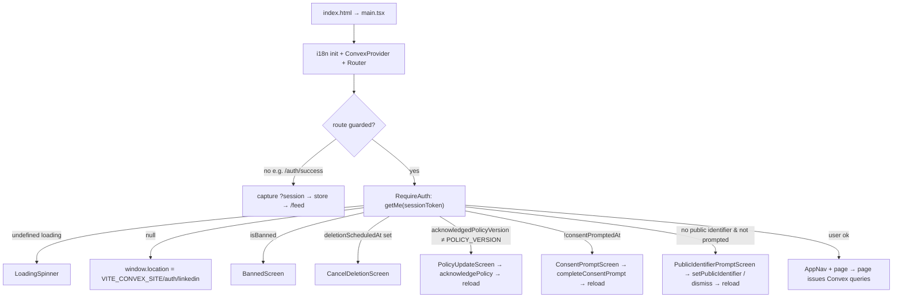

### Pages

- **AuthSuccessPage** — stores `?session` token in `sessionStorage`, clears the persistent
  `signedOut` marker (§7), and navigates to `/feed`. No Convex calls.
- **FeedPage** — `getFeed`; a `PostComposer` (calls `submitPost`); a list of `PostCard`s, each
  rendering the post as a **LinkedIn embed** (Option B — see `PostCard` below; raw post text is not
  shown); reactions via `reactToPost` (hard‑coded `LIKE`); inline `CommentBox` toggled per card.
- **MyPostsPage** — `getMe` + `getWeeklyUsage` + `getMyPosts` + `submitPost`. Usage pill ("N of M
  posts this week") turns **amber** at the cap and disables the composer (`atLimit`). Renders each
  post via the shared `LinkedInEmbed` with an app footer (stats, relative time, "View on LinkedIn").
- **SettingsPage** — `getMe` + `setPublicIdentifier` + `updateProfile` + `refreshProfileFromLinkedIn`.
  Industry and country are **searchable, virtualized comboboxes** (`VirtualizedCombobox`, built on the
  shadcn `command`/`popover` primitives + `@tanstack/react-virtual`; country names via `Intl.DisplayNames`);
  a read-only **Location** row appears when `me.location` is present (populated by the profile scrape);
  a **"Refresh from LinkedIn"** button re-scrapes the profile (disabled without a public identifier;
  shows the server error inline when the scrape flag is off). Pro/contact see a **stubbed** "who can
  see your posts" card ("Coming in next task").
- **BillingPage** — `getMe` + `getSubscriptionInfo` + `createCheckoutSession` + `createPortalSession`.
  Trial/expired banners; per‑plan Subscribe CTAs (disabled if the plan's `VITE_STRIPE_*_PRICE_ID` is
  missing); "Manage Subscription" → Stripe portal; Enterprise → `mailto:`.
- **AdminPage** — `checkIsAdmin` (redirects non‑admins; server is the real gate). Four tabs:
  **Settings** (three Apify toggles: master kill-switch, post sync, and profile scrape + last‑sync
  status), **Plan Limits** (`PlanLimitsTab` — **read‑only**: tier defaults + every contact user's
  effective limits, with an "override" tag), **Users** (`UsersTab` — per‑user row actions:
  **Change tier**, **Change status**, **Edit limits** (contact tier only), and **Ban/Unban**),
  **Feedback** (`FeedbackTab` — newest-first list of all user-submitted feedback; status filter
  pills New/Responded/Archived/All; per‑row actions **Respond…** (opens `RespondFeedbackModal` —
  sends an email reply via `api.feedback.feedback.respondToFeedback`; Respond button and textarea
  are disabled with a warning when the submitter has no email on file), **Archive**
  (`archiveFeedback`), **Reopen** (`reopenFeedback`)).
- **PrivacyDataPage** (`/privacy-data`, guarded) — data‑subject rights self‑service UI (Phase 2b
    - 3b). Three sections: (1) **Consent preferences** (`ConsentToggles` — see below) — marketing and
      analytics toggles, OFF by default, reading `api.privacy.consent.getConsents` and writing
      `api.privacy.consent.recordConsent` on toggle change. (2) **Data export**: "Request export" button
      calls `api.privacy.export.requestDataExport`; polls status via
      `api.privacy.export.getExportStatus`; shows a download link via
      `api.privacy.export.getExportDownloadUrl` once ready. (3) **Delete account**: a type‑`DELETE`
      confirm `Modal` wrapping `api.privacy.deletion.requestAccountDeletion`; on success replaces the
      section with a "scheduled for {date}" info panel. Cross‑reference: §13B (backend
      mutations/actions these calls hit).

### Reusable components

`AppNav` (feed/my‑posts/settings/billing/**privacy** links + language `<select>` + sign‑out; **no
admin link**; the **"Privacy"** link navigates to `/privacy-data`),
`PostComposer` (dark/light themes, `atLimit`), `CommentBox` (calls `commentOnPost`), `Modal`,
`BannedScreen`, `BanUserDialog`, `UsersTab` (filter/search + per‑row modals + `banUser`/`unbanUser`),
`FeedbackTab` (status filter pills + per‑row `RowActionsMenu` + `RespondFeedbackModal`),
`RespondFeedbackModal` (shows original message read-only + reply textarea; Respond disabled when submitter has no email
on file; calls `respondToFeedback`),
`ChangeTierModal` / `ChangeStatusModal` (admin `setUserTier` / `setUserSubscriptionStatus`),
`ContactLimitsModal` (per‑user contact `setContactUserLimit`/`removeContactUserLimit`, prefilled from
`listPlanLimits`), `PlanLimitsTab` (**read‑only**: tier defaults + contact users via
`listContactUsersWithLimits`), `RowActionsMenu`, `LoadingSpinner`,
`CancelDeletionScreen` (grace‑window full‑screen interstitial shown by `RequireAuth` when
`me.deletionScheduledAt` is set; "Keep my account" button calls
`api.privacy.deletion.cancelAccountDeletion` then `window.location.reload()`; also offers a Sign
out link — mirrors the `BannedScreen` layout),
`ConsentToggles` (Phase 3b — rendered inside `PrivacyDataPage`; a pair of labelled toggles for
`marketing` and `analytics` consent purposes, both **OFF by default**; reads
`api.privacy.consent.getConsents` on mount, calls `api.privacy.consent.recordConsent` on each
toggle change; cross-reference: §13B for the append-only backend),
`PolicyUpdateScreen` (Phase 3b — full‑screen interstitial injected by `RequireAuth` when
`me.acknowledgedPolicyVersion !== POLICY_VERSION`; "I acknowledge" button calls
`api.privacy.consent.acknowledgePolicy` then `window.location.reload()`; ensures every existing
user re-accepts after a policy update before reaching the app — see the `RequireAuth` interception
order above and §13B),
`ConsentPromptScreen` (first-login full-screen prompt shown by `RequireAuth` when
`me.consentPromptedAt` is unset; presents **Communication & analytics preferences** — marketing
and analytics toggles, both **OFF by default** — and a "Save & continue" button that calls
`api.privacy.consent.completeConsentPrompt({ sessionToken, marketing, analytics })` then
`window.location.reload()`; new users whose `acknowledgedPolicyVersion` is pre-stamped at signup
but `consentPromptedAt` is unset hit this prompt on first login — see the `RequireAuth`
interception order above and §13B),
`PublicIdentifierPromptScreen` (first-login full-screen prompt shown by `RequireAuth` when the user
has no `linkedinPublicIdentifier` **and** `publicIdentifierPromptedAt` is unset; asks for the LinkedIn
profile URL — reusing `extractVanityName` from `app/src/lib/linkedinProfile.ts` — and either saves it
via `api.users.setPublicIdentifier` or stamps `publicIdentifierPromptedAt` via
`api.users.dismissPublicIdentifierPrompt` ("Skip for now"), then `window.location.reload()`. LinkedIn's
OIDC login does **not** expose the vanityName, so this prompt is how it's captured at login — see §7
and the `RequireAuth` interception order above),
plus the two LinkedIn‑embed components:

- **`LinkedInEmbed`** — the **single shared** embed component used by **both** the Feed (`PostCard`)
  and **My Posts**. Renders a LinkedIn post in an iframe that is intentionally taller
  (`iframeHeight` 480) than its `overflow:hidden` container (`containerHeight` 420) so LinkedIn's
  native action bar is clipped, then overlays an optional opaque `footer` (the app's own controls)
  over that strip. `iframe` is sandboxed (`allow-scripts allow-same-origin`) and lazy‑loaded. Its
  exported `buildEmbedUrl(urn)` **preserves the stored URN namespace** (`urn:li:activity|share|ugcPost`)
  with raw (un‑encoded) colons as LinkedIn requires; only bare/legacy ids fall back to wrapping as
  `activity`.
- **`PostCard`** — the Feed's post renderer (**Option B layout**): an app‑owned header (Featured
  badge via `feed.featured` + author avatar/name/headline) **above** a `LinkedInEmbed`, whose
  `footer` is the app's in‑app **Like/Comment bar** (`type="button"` actions calling `onReact` /
  `onComment`) overlaying the clipped native bar, plus a **View on LinkedIn ↗** link. That link is
  rendered **only when `post.sourceUrl` is present** and points **directly at `sourceUrl`** (the exact
  URL the user submitted) — there is no URN reconstruction, because LinkedIn's `ugcPost`/`activity`/
  `share` IDs differ for the same post and a reconstructed `/feed/update/<urn>/` link can resolve
  wrongly. (`MyPostsPage` keeps a `buildLinkedInUrl` with a reconstruction fallback for cron‑synced
  posts.) **`PostCard` does not render `post.content` or `mediaUrls`** — the post body comes entirely
  from the embed.

> As of `1fcc123`, `MyPostsPage` uses this shared `LinkedInEmbed` directly (its old local
> `buildEmbedUrl` that force‑normalized to `activity` was removed, eliminating the previous
> duplicate). `MyPostsPage` keeps only `buildLinkedInUrl` (prefers the stored `sourceUrl`, falls back
> to a `/feed/update/<urn>/` link) and `timeAgo` for its embed footer's "View on LinkedIn ↗" link.

### i18n (`i18n/index.ts`)

`i18next` + `react-i18next` + browser language detector. Resources `en`/`pt`/`es`, fallback `en`.
**Detection order:** `localStorage` → `?lang=` querystring → `navigator`. The `AppNav` language
selector persists the choice to `localStorage`. On the first authenticated load, if no
`localStorage` `i18nextLng` key is present, the UI language is seeded once from `me.primaryLocale`
(the scraped LinkedIn language); the `AppNav` switcher still overrides it thereafter.

**Namespaces added in Phase 2b:** `privacy.*` — covers all labels, headings, status messages, and
confirmation copy used by `PrivacyDataPage` and `CancelDeletionScreen`; present in `en`, `pt`, and
`es` translation files.

**Keys added in Phase 3b:** `privacy.consent.*` (toggle labels, descriptions, and status copy for
`ConsentToggles`) and `privacy.policyUpdate.*` (heading, body, and button copy for
`PolicyUpdateScreen`); all three locales (`en`/`pt`/`es`).

**Keys added with new-user consent prompt:** `privacy.consentPrompt.*` (heading, body, toggle
labels, and "Save & continue" button copy for `ConsentPromptScreen`); all three locales
(`en`/`pt`/`es`).

---

## 15. Frontend — Landing Site (`landing/`)

Standalone **Next.js 15 (App Router)**, React 19, Tailwind 3.4. Pure marketing — **no API/Convex
calls**; all content (pricing, testimonials, FAQ, stats) is hard‑coded in module constants.

### Routes

| Route      | Purpose                                                                                                                            |
|------------|------------------------------------------------------------------------------------------------------------------------------------|
| `/`        | Home — composes `Nav → Hero → SSIExplainer → StatsBar → HowItWorks → Features → Testimonials → Pricing → FAQ → FinalCTA → Footer`. |
| `/pricing` | Standalone pricing (`Nav` + `Pricing`).                                                                                            |
| `/privacy` | Privacy Policy — **required for LinkedIn app review**.                                                                             |
| `/terms`   | Terms of Service — **required for LinkedIn app review**.                                                                           |
| `/cookies` | Cookie & Storage Policy (`CookiesPage`) — documents essential-only storage (no tracking cookies); linked from `Footer`.            |

`app/layout.tsx` defines static SEO metadata (title/description/OpenGraph), the dark "ink" theme,
and renders `<CookieNotice>` (see below). **Notable section content** (encodes the business rules):
Pricing lists "Posts hidden during trial"; Features tags tiers (Growth+/All tiers/Pro/Coming soon);
FAQ states SSI is 0–100 across four 25‑point pillars, official OAuth, "no automation — you write
your own comments". `Footer` links to `/privacy`, `/terms`, `/cookies`, and
`mailto:hello@linkintothessi.com`.

### CookieNotice (Phase 3b)

`CookieNotice` is a **client component** rendered in `landing/app/layout.tsx`. It displays a
dismissible first-visit banner informing visitors that the site uses only essential storage (no
tracking). Dismissal is persisted in **`localStorage`** (key `cookieNoticeDismissed`). The
component uses **`useSyncExternalStore`** with a no-op server snapshot so it hydrates safely
without an SSR/client mismatch — the notice is invisible on the server render and appears only
after hydration confirms the key is absent. The banner is **not** shown to returning visitors (key
already set) and disappears without page reload on dismiss.

### Why the legal pages exist

LinkedIn requires a publicly reachable **privacy policy** and **terms of service** before approving
an app that reads a user's posts and publishes comments/reactions on their behalf. `/privacy` states
tokens are stored securely server‑side and never exposed; `/terms` records the user's grant of
permission to act on their behalf and the monthly‑billing/cancellation policy.

As of Phase 4, `/privacy` and `/terms` have been rewritten as full **GDPR / LGPD / US-state**
drafts (covering lawful basis, data-subject rights, international transfers, and CCPA/CPRA
disclosures). Both pages are **DRAFTs pending legal review** — bracketed placeholders
(`[LEGAL_ENTITY_NAME]`, `[BUSINESS_ADDRESS]`, etc.) must be filled and a lawyer must sign off
before they are regulator-ready. `/cookies` documents the essential-storage-only cookie policy
(Phase 3b). See [`docs/compliance/README.md`](compliance/README.md) for the consolidated legal
to-do list.

### CTAs → app

Every conversion CTA (Nav "Join free", Hero, paid Pricing buttons, FinalCTA) is a plain `<a>` whose
`href` is the shared **`SIGN_IN_URL`** (`landing/lib/links.ts`) — i.e.
`${NEXT_PUBLIC_CONVEX_SITE}/auth/linkedin`, sending visitors **straight into LinkedIn OAuth** (it
falls back to `NEXT_PUBLIC_APP_URL` if the Convex site URL is unset). Going directly to OAuth (rather
than the app root) is what lets a previously‑signed‑out visitor — whom the app bounces back to this
site (§7) — actually log in instead of ping‑ponging. Internal nav (logo, footer, section anchors,
`/pricing`) uses Next `<Link>`.

### Styling

Tailwind with a custom palette — `ink` (dark navy bg), `cream` (text), `lnblue` (LinkedIn blue),
`gold` (accent) — Cormorant Garamond (display) + DM Sans (body), glassmorphic scrolled nav, radial
glows, a slot‑machine headline animation. No mobile hamburger menu.

---

## 16. Environment Variables

Canonical inventory (built by grepping every `process.env.*` / `import.meta.env.*` site). `.env*`
files are git‑ignored; the `.env*.example` files document the required set.

### Convex backend — set in the **Convex dashboard** (Settings → Environment Variables)

| Variable                         |                Required                 | Consumed in                          | Purpose                                                                                                                                                                                               |
|----------------------------------|:---------------------------------------:|--------------------------------------|-------------------------------------------------------------------------------------------------------------------------------------------------------------------------------------------------------|
| `LINKEDIN_CLIENT_ID`             |                    ✓                    | `linkedin/oauth.ts`                  | OAuth client id (authorize URL + token exchange).                                                                                                                                                     |
| `LINKEDIN_CLIENT_SECRET`         |                    ✓                    | `linkedin/oauth.ts`                  | OAuth client secret (server‑side token exchange).                                                                                                                                                     |
| `LINKEDIN_REDIRECT_URI`          |                    ✓                    | `linkedin/oauth.ts`                  | Must be `https://<deployment>.convex.site/auth/linkedin/callback` (Convex, **not** the app).                                                                                                          |
| `APP_URL`                        |   – (default `http://localhost:5173`)   | `http.ts`, `billing.ts`              | Browser redirect base: OAuth success/error + Stripe success/cancel/portal URLs.                                                                                                                       |
| `STRIPE_STARTER_PRICE_ID`        |               ✓ (billing)               | `billing.ts`, `stripe.ts`, `http.ts` | Price id → `starter` tier; checkout allowlist + price→tier map.                                                                                                                                       |
| `STRIPE_GROWTH_PRICE_ID`         |               ✓ (billing)               | `billing.ts`, `stripe.ts`, `http.ts` | Price id → `growth` tier.                                                                                                                                                                             |
| `STRIPE_PRO_PRICE_ID`            |               ✓ (billing)               | `billing.ts`, `stripe.ts`, `http.ts` | Price id → `pro` tier.                                                                                                                                                                                |
| `STRIPE_SECRET_KEY`              |               ✓ (billing)               | _(read by `@convex-dev/stripe`)_     | Stripe API secret — not referenced directly in our source.                                                                                                                                            |
| `STRIPE_WEBHOOK_SECRET`          |               ✓ (billing)               | _(read by `@convex-dev/stripe`)_     | Verifies webhook signatures at `/stripe/webhook`.                                                                                                                                                     |
| `APIFY_API_TOKEN`                |                ✓ (sync)                 | `jobs/syncPostsApify.ts`             | Bearer token for Apify REST. If unset, sync no‑ops.                                                                                                                                                   |
| `APIFY_TASK_ID`                  |                ✓ (sync)                 | `jobs/syncPostsApify.ts`             | Apify actor (`harvestapi~linkedin-profile-posts`).                                                                                                                                                    |
| `APIFY_TASK_ID_PROFILE_SCRAPE`   |           ✓ (profile scrape)            | `jobs/scrapeProfileApify.ts`         | LinkedIn **profile** scraper actor (country/location/primary-locale enrichment).                                                                                                                      |
| `RESEND_API_KEY`                 |        – (email no‑ops if unset)        | `lib/email.ts`                       | Resend API key for transactional email (DSR confirmations + breach notices).                                                                                                                          |
| `EMAIL_FROM`                     |        – (email no‑ops if unset)        | `lib/email.ts`                       | From‑address for transactional email (e.g. `noreply@linkintothessi.com`).                                                                                                                             |
| `CONVEX_DEPLOYMENT`              |                 ✓ (CLI)                 | Convex CLI                           | Selects the deployment for `convex dev`/`deploy`.                                                                                                                                                     |
| `ALLOW_ADMIN_SHARE_ANY_POST`     | – (**dev/testing only**, unset in prod) | `posts.ts` (`submitPost`)            | When `'true'`, lets an admin bypass post‑ownership verification + posting throttles in `submitPost`. Set **only** on the local/dev deployment (`npx convex env set ALLOW_ADMIN_SHARE_ANY_POST true`). |
| `FEEDBACK_REPLY_TO`              |              – (optional)               | `convex/feedback/feedback.ts`        | `Reply-To` address on feedback reply emails so users can reply to a human. Unset ⇒ no header (email still sends).                                                                                     |
| `OPENROUTER_API_KEY`             |   ✓ (AI features; AI no‑ops if unset)   | `convex/ai/openrouter.ts`            | OpenRouter bearer token for AI reaction prediction + comment drafting. Unset ⇒ reactions default to `LIKE`, comment drafting reports "AI unavailable".                                                |
| `OPENROUTER_MODEL`               | – (default `google/gemma-4-26b-a4b-it`) | `convex/ai/openrouter.ts`            | Optional model slug override. Provider routing (ZDR + no-data-collection, cheapest qualifying provider) is enforced in code, not via env.                                                             |
| `OPENROUTER_SITE_URL` / `…_NAME` |              – (optional)               | `convex/ai/openrouter.ts`            | Optional attribution (HTTP‑Referer / X‑Title) for OpenRouter's public rankings. Unset ⇒ not sent.                                                                                                     |

### App (`app/`) — Vite, `VITE_` prefix (embedded in the browser bundle)

| Variable                       |              Required               | Consumed in       | Purpose                                                                            |
|--------------------------------|:-----------------------------------:|-------------------|------------------------------------------------------------------------------------|
| `VITE_CONVEX_URL`              |                  ✓                  | `main.tsx`        | `.convex.cloud` URL for `ConvexReactClient` (data transport).                      |
| `VITE_CONVEX_SITE`             |                  ✓                  | `App.tsx`         | `.convex.site` base for the `/auth/linkedin` sign‑in redirect.                     |
| `VITE_LANDING_URL`             | – (default `http://localhost:3000`) | `lib/session.ts`  | Marketing/landing site URL; **sign‑out redirects here** (separate Next.js origin). |
| `VITE_STRIPE_STARTER_PRICE_ID` |           ✓ (billing UI)            | `BillingPage.tsx` | Starter price id for checkout.                                                     |
| `VITE_STRIPE_GROWTH_PRICE_ID`  |           ✓ (billing UI)            | `BillingPage.tsx` | Growth price id.                                                                   |
| `VITE_STRIPE_PRO_PRICE_ID`     |           ✓ (billing UI)            | `BillingPage.tsx` | Pro price id (missing → that plan's button disabled).                              |

### Landing (`landing/`) — Next.js, `NEXT_PUBLIC_` prefix

| Variable                  |                       Required                       | Consumed in    | Purpose                                                                                               |
|---------------------------|:----------------------------------------------------:|----------------|-------------------------------------------------------------------------------------------------------|
| `NEXT_PUBLIC_APP_URL`     |         – (default `http://localhost:5173`)          | `lib/links.ts` | App base URL; **fallback** for CTA links when `NEXT_PUBLIC_CONVEX_SITE` is unset.                     |
| `NEXT_PUBLIC_CONVEX_SITE` | – (CTAs fall back to `NEXT_PUBLIC_APP_URL` if unset) | `lib/links.ts` | Convex `.site` base; CTAs link to `${NEXT_PUBLIC_CONVEX_SITE}/auth/linkedin` to start OAuth directly. |

> **Port caveat:** the Vite dev server actually runs on **5174** (`app/vite.config.ts`), but every
> default fallback / `.env.example` assumes **5173**. Align `LINKEDIN_REDIRECT_URI`/`APP_URL` with the
> port you actually run locally.

---

## 17. Security Posture

The codebase follows a consistent, defensible security model:

- **Secrets & internal fields never reach clients.** `toSafeMe` (`users.getMe`) strips tokens **and**
  `stripeCustomerId`/`bannedBy`/`bannedAt`/raw `isAdmin`. The feed sends authors through an
  **allow‑list** projection (`toFeedAuthor` — only `_id`/name/headline/picture/industry/country/tier),
  so other users' `isAdmin`, Stripe id, `linkedinId`, ban state, etc. are never exposed.
  `users.getWithTokens` is an `internalQuery` (server‑only). The OAuth client secret lives only in
  Convex env and is used only in server‑side token exchange.
- **Clients never pass a `userId`.** Identity is always resolved server‑side from an **opaque UUID
  session token** via `lib/auth.ts`. The only thing a client can do is present a valid token.
- **CSRF protection** on OAuth: a single‑use `state` nonce (10‑min TTL) stored before redirect and
  **deleted before** the expiry check on callback (replay‑safe).
- **Sessions:** random UUID, 30‑day TTL, stored in **`sessionStorage`** (cleared on tab close).
  The token is delivered to the SPA in the OAuth redirect's **URL fragment** (`#session=…`, never a
  query string), and `AuthSuccessPage` scrubs it from history after reading — so it can't leak via
  server/proxy access logs or the `Referer` header. `logout` invalidates one session,
  `forceLogoutAll` invalidates all; expired sessions are purged by cron.
- **Generic client‑facing errors.** Every LinkedIn/OAuth/Stripe/Apify failure logs the real error
  server‑side (`console.error`) and returns a sanitized message — no stack traces or upstream bodies
  leak to clients.
- **SSRF guard on outbound fetches.** `submitPost` fetches a user‑supplied URL, so
  `parseLinkedInPostUrl` rejects any non‑`https` scheme or non‑`linkedin.com` host **before** the
  fetch, and the URN scraped from the returned page is format‑validated before any downstream use.
  The follow‑up **article‑enrichment fetch** runs the URL extracted from the page HTML through the
  same host allowlist (`isAllowedLinkedInUrl`, which shares `ALLOWED_LINKEDIN_HOST` with
  `parseLinkedInPostUrl`) **before** fetching, so a malicious/derived link cannot redirect the
  server‑side fetch off‑LinkedIn.
- **Payments fail safe.** The Stripe webhook signature is verified by `@convex-dev/stripe` before any
  handler runs; checkout/portal require auth and an allow‑listed price id; `toSubscriptionStatus`
  maps any non‑access status (`incomplete`/`unpaid`/`paused`/unknown) to a **non‑active** state so a
  half‑finished or lapsed subscription never grants access; `getTierFromPriceId` fails to `starter`.
- **Rate limiting** (fixed window per `userId+action`): submitPost 10/h, comment 20/h, react 30/h,
  profile scrape 2/day (shared by manual Refresh + auto‑scrape on identifier change). **Admins are
  exempt** from every rate limit.
- **Privilege escalation guarded:** `isAdmin` is **DB‑edit only** — excluded from every write path
  (`upsertUser`, `setPublicIdentifier`, etc.). Admin endpoints re‑check `assertAdmin` on the
  server‑resolved user, never on a client‑supplied id. `banUser` cannot self‑ban (always leaves ≥ 1
  admin).
- **Input validation:** `setPublicIdentifier` validates the vanity‑name format; `commentOnPost`
  caps text at 3000 chars; `reactToPost` constrains the reaction enum; `commentOnPost`/`reactToPost`
  reject `hidden`/interaction‑limit‑reached posts; `banUser` caps the reason at 500 chars; checkout
  validates the price id against an allowlist before any work.
- **CSP** (`app/index.html`) restricts script/style/frame/connect sources and adds
  `object-src 'none'`, `base-uri 'self'`, `form-action 'self'`. `script-src`/`style-src` keep
  `'unsafe-inline'` because the Vite dev server injects inline scripts/styles — tightening that needs
  a **prod‑only nonce/hash CSP served as an HTTP header** at the hosting layer (which is also where
  `frame-ancestors`/HSTS belong, since a `<meta>` CSP ignores `frame-ancestors`).

> **Open security‑relevant gaps / hardening backlog:** no LinkedIn token‑refresh flow (tokens
> silently expire ~60 days); the ban is reactive (a banned user's in‑flight reads still resolve until
> the next protected call / reactive push); `linkedinPublicIdentifier` is
> **self‑attributed** (format‑validated only — LinkedIn actions still use the user's own token, so it
> can't be used to act as someone else); and prod CSP / `frame-ancestors` / HSTS headers should be
> set at the hosting layer. See [§19](#19-known-discrepancies-dead-code--roadmap).

### Compliance Documentation

The `docs/compliance/` folder contains six **DRAFT** documents (pending legal review) that
accompany the technical controls described in [§13B](#13b-privacy--compliance):

| File                                                    | Contents                                                                     |
|---------------------------------------------------------|------------------------------------------------------------------------------|
| [`DATA-INVENTORY.md`](compliance/DATA-INVENTORY.md)     | Record of Processing Activities (ROPA) — GDPR Art. 30                        |
| [`SUBPROCESSORS.md`](compliance/SUBPROCESSORS.md)       | Sub-processor list (Convex, Stripe, LinkedIn, Resend; Apify hard-gate noted) |
| [`RETENTION-POLICY.md`](compliance/RETENTION-POLICY.md) | Retention windows per data category and automated-enforcement references     |
| [`GAP-ASSESSMENT.md`](compliance/GAP-ASSESSMENT.md)     | Multi-framework gap assessment (GDPR / UK GDPR / LGPD / CCPA-CPRA)           |
| [`BREACH-RUNBOOK.md`](compliance/BREACH-RUNBOOK.md)     | Personal data breach incident-response runbook (72-hour notification)        |
| [`DPA-TEMPLATE.md`](compliance/DPA-TEMPLATE.md)         | Data Processing Agreement template (GDPR Art. 28 / LGPD Art. 37)             |

See [`docs/compliance/README.md`](compliance/README.md) for the index and the consolidated human /
legal to-do list (bracketed placeholders, lawyer sign-off, sub-processor DPA signing, DPO/rep
assessment, and the Apify hard gate).

---

## 18. Configuration, Tooling & Testing

### Monorepo & scripts (root `package.json`)

pnpm workspaces (`pnpm-workspace.yaml`): `landing`, `app`, `convex`. Root scripts orchestrate via
`pnpm --filter`:

| Script                                         | Does                                                                                |
|------------------------------------------------|-------------------------------------------------------------------------------------|
| `dev:landing` / `dev:app` / `dev:convex`       | Run each workspace's dev server (`dev:convex` first runs `convex ai-files update`). |
| `build:landing` / `build:app` / `build:convex` | `next build` / `tsc && vite build` / `convex deploy`.                               |
| `lint` / `lint:fix`                            | `eslint . --max-warnings 0` (zero warnings tolerated) / `--fix`.                    |
| `format` / `format:check`                      | Prettier write / check.                                                             |

### Lint / format / TS

- **ESLint 9** flat config across all workspaces; `@typescript-eslint/no-explicit-any` is a **warn**
  (and `--max-warnings 0` makes any `any` fail CI), off in tests; React rules for `app/`+`landing/`;
  `no-console` off in `convex/`. Ignores `_generated`, `convex-mocks`, config files, agent dirs.
- **Prettier:** no semicolons, single quotes, `arrowParens: avoid`, no trailing commas, 120 cols,
  `singleAttributePerLine`, `prettier-plugin-tailwindcss`.
- **TS base** (`tsconfig.base.json`): `strict`, `ES2020`, `moduleResolution: bundler`. App builds
  gate on `tsc`; Vite runs an in‑dev type‑check overlay (`vite-plugin-checker`).

### Testing (Vitest everywhere)

- **Convex:** `convex/vitest.config.ts` aliases `convex/server` →
  `convex-mocks/_test/__mocks__/convex_server_generics.ts`, so backend handlers are testable as
  **plain functions** (the mock returns function definitions unchanged; `cronJobs`/`httpRouter` are
  no‑ops; a `components` Proxy yields `undefined`). Run: `pnpm --filter convex test`. Coverage spans
  schema, auth, oauth, feed, posts, processQueue, admin, parsePostUrl/Content, verifyPostOwnership.
- **App:** Vitest config inline in `vite.config.ts` (`jsdom`, `setupFiles` import
  `@testing-library/jest-dom` + `../i18n`). Component tests for PostCard, PostComposer,
  LinkedInEmbed, Modal, BannedScreen, BanUserDialog, UsersTab, PlanLimitsTab, AdminPage, MyPostsPage,
  SettingsPage, i18n. Run: `pnpm --filter app test`.
- **All:** `pnpm -r test`.
- **No CI config** (`.github/` doesn't exist) — lint/format/tests are run manually or by deploy
  platforms.

---

## 19. Known Discrepancies, Dead Code & Roadmap

### README ↔ code mismatches (trust the code)

- **Tables:** README says 5; there are **10**.
- **Post sync:** README says "hourly LinkedIn‑API cron"; reality is **daily, Apify‑only, admin‑gated**
  (no direct LinkedIn‑API ingestion path).
- **OAuth scopes:** README lists `r_liteprofile`/`r_member_social`/`r_network`; code uses
  `openid profile email r_basicprofile w_member_social_feed w_member_social`.
- **OAuth redirect:** README shows `?userId=…`; code uses `?session=…` (a session token).
- **Token refresh:** README claims a 60‑day refresh flow "implemented"/"attempted within 7 days of
  expiry"; **no refresh logic exists**.
- **Next.js:** README says 14; `landing/` is **15**.
- **Deploy artifacts:** README says `app/` includes a `Dockerfile` + `nginx.conf` for Railway;
  **neither file exists** in the repo (no `railway.*`, `Procfile`, `vercel.json`, etc. either).
- **Dev port:** README/`.env.example` assume 5173; Vite is configured for **5174**.
- README's project tree references files that don't exist (`jobs/syncConnections.ts`,
  `pages/LoginPage.tsx`).

### Dead / vestigial code

- **`featuredPostUsage`** table — defined and tested but has **no read/write call sites**.
- `linkedin/types.ts` legacy `LinkedInProfile`/`LinkedInConnectionElement`/`LinkedInConnectionsResponse`
  are unused remnants of the abandoned `r_network` connections feature.
- `tailwind.config.ts`'s `slotRoll` keyframe is overridden by the one in `globals.css` (dead).

### Stubs / planned

- **Post‑visibility controls** (who sees your posts) — Settings card is a "Coming soon" placeholder
  (the underlying `visibilityIndustries`/`visibilityCountries` fields **are** enforced in the feed,
  but there's no UI to set them).
- **AI comment generator** — `CommentBox` advertises "AI suggestions coming soon"; no integration.
- **Featured posts quota** — `featuredPostUsage` table exists but is unwired.
- **LinkedIn token refresh** — needed before tokens hit their ~60‑day expiry.
- **Placeholder constants** — `BannedScreen.SUPPORT_EMAIL = 'contact@email.com'` (TODO);
  `STRIPE_WEBHOOK_SECRET=whsec_your_secret` in the committed `.env.local`.

### Roadmap (from README + specs in `docs/`)

AI comment generator (Pro+), LinkedIn MDP/Partner access (unlock mutual‑connections + home‑feed APIs),
SSI‑trend analytics dashboard, proactive token‑refresh cron.

---

## 20. Glossary

- **SSI** — LinkedIn Social Selling Index, 0–100, four 25‑point pillars. The product's north‑star
  metric.
- **URN** — LinkedIn's resource identifier (e.g. `urn:li:activity:…`, `urn:li:ugcPost:…`,
  `urn:li:share:…`). Used as the post dedupe key; namespaces are **not interchangeable**, which is
  why `sourceUrl` is preserved.
- **Public identifier / vanity name** — the `linkedin.com/in/<name>` slug; used for ownership
  verification without Partner API access.
- **Apify** — third‑party scraping platform; the `harvestapi~linkedin-profile-posts` actor fetches a
  user's recent posts.
- **MDP / Partner access** — LinkedIn Marketing/Member Data Partner program; required for the
  connections and home‑feed APIs the product does **not** currently use.
- **Tier rank** — denormalized numeric tier on a post (4 contact … 1 starter) for feed sorting
  without a join.
- **Member API call** — an authenticated request to `api.linkedin.com` made as the user (Bearer =
  the user's token). All member‑API calls route through the single `linkedin/client.ts`
  `callMemberApi` seam; the OAuth token exchange (client‑secret flow) is separate.

---

## 21. Maintaining This Document

This document is **canonical** and must not be allowed to drift. The rule in `CLAUDE.md` requires
that **any code change or push updates the relevant section(s) here in the same change**. Practical
checklist when you touch the codebase:

| If you change…                                                                                                                   | Update section(s)                                                                         |
|----------------------------------------------------------------------------------------------------------------------------------|-------------------------------------------------------------------------------------------|
| `convex/schema.ts` (tables/fields/indexes)                                                                                       | [§5 Data Model](#5-data-model) (+ ER diagram)                                             |
| Auth/session/OAuth (`http.ts`, `linkedin/*`, `sessions.ts`, `lib/auth.ts`)                                                       | [§7](#7-authentication--identity) (+ flow) and [§17](#17-security-posture)                |
| Billing/Stripe (`billing.ts`, `stripe.ts`, `http.ts` webhooks, tiers)                                                            | [§8](#8-subscriptions--billing) (+ flow), [§1 tiers](#1-product-overview--business-model) |
| Plan limits (`lib/planLimits.ts`, `seedPlanLimits.ts`, `admin.ts`)                                                               | [§9](#9-plan-limits-system)                                                               |
| Posts/sync/queue (`posts.ts`, `jobs/*`, `linkedin/parse*`, `crons.ts`)                                                           | [§10](#10-posts--content-pipeline) (+ flows), [§13](#13-scheduled-jobs-crons)             |
| Feed/interactions/rate limits (`feed.ts`, `interactions.ts`, `lib/rateLimit.ts`)                                                 | [§11](#11-feed--engagement) (+ flows)                                                     |
| Admin/moderation (`admin.ts`, ban UI)                                                                                            | [§12](#12-admin--moderation)                                                              |
| Feedback (`convex/feedback/`, `app/src/components/Feedback*`, `app/src/components/RespondFeedbackModal.tsx`, admin Feedback tab) | [§12A](#12a-feedback)                                                                     |
| MOTD (`convex/motd/`, `app/src/components/Motd*`, `app/src/components/MarkdownView*`, admin MOTD tab)                            | [§12B](#12b-message-of-the-day-motd)                                                      |
| App UI (`app/src/**`)                                                                                                            | [§14](#14-frontend--authenticated-app-app)                                                |
| Landing (`landing/**`)                                                                                                           | [§15](#15-frontend--landing-site-landing)                                                 |
| Any `process.env` / `import.meta.env` usage                                                                                      | [§16 Environment Variables](#16-environment-variables)                                    |
| Tooling/tests/deploy                                                                                                             | [§18](#18-configuration-tooling--testing)                                                 |
| Resolving a stale item / removing dead code                                                                                      | [§19](#19-known-discrepancies-dead-code--roadmap)                                         |

When you add a **new subsystem**, add a new numbered section and a Table‑of‑Contents entry, and add
a flow chart (Mermaid) if it introduces a multi‑step flow.

---

_Last updated: 2026‑06‑15. Generated from a full read of the codebase at branch
`feat/initial-setup` (HEAD `f9e48dc`). Reflects the LinkedIn iframe + content‑capture feature
(commits `d1b40a2` → `1fcc123`): Feed/My Posts render posts via the single shared `LinkedInEmbed`
(Option B layout, no raw post text), `submitPost` persists parsed content + structured `mediaUrls`,
and `buildEmbedUrl` preserves the URN namespace. Also reflects the Profile Enrichment feature
(Task 14): Apify-driven LinkedIn profile scrape populating `location`, `primaryLocale`, and
`country` on the `users` table; user-editable `industry`/`country` dropdowns in Settings;
admin toggles for the master Apify kill-switch and profile scrape; and i18n seeding from
`me.primaryLocale` on first authenticated load. Also reflects **Privacy & Compliance Phase 1
(Foundations)**: email capture from LinkedIn OIDC (stored + forwarded to Stripe), `lastLoginAt` and
`acknowledgedPolicyVersion` on `users`, the new `consentRecords`/`dataExportRequests`/`auditLogs`
tables, the `lib/policy.ts`/`lib/audit.ts`/`lib/email.ts` modules, and the `RESEND_API_KEY`/
`EMAIL_FROM` env vars — see [§13B](#13b-privacy--compliance). Also reflects **Privacy & Compliance
Phase 2a (Backend DSR)**: self-service data export (`convex/privacy/export.ts` — rate-limited
`requestDataExport` mutation + `generateExport` action, 7-day signed download URL) and the 30-day
account-deletion lifecycle (`convex/privacy/deletion.ts` — `requestAccountDeletion` / `cancelAccountDeletion` /
`processAccountDeletions` daily cron; feed exclusion via `isAuthorFeedEligible`; `cascadeDeleteUser`
with auditLog pseudonymization; Stripe subscription cancellation during grace period). The
`process account deletions` cron is documented in [§13](#13-scheduled-jobs-crons). Also reflects
**Privacy & Compliance Phase 2b (Frontend DSR)**: the new guarded `/privacy-data` route
(`PrivacyDataPage` — export request/status/download + delete-with-confirm modal calling
`api.privacy._`), `CancelDeletionScreen`(grace-window interstitial wired into`RequireAuth`),
the updated `RequireAuth`interception order (loading → null → isBanned → deletionScheduledAt →
app), the **"Privacy"** link added to`AppNav`, and the new `privacy._`i18n namespace (en/pt/es)
— see [§14](#14-frontend--authenticated-app-app). Also reflects **Privacy & Compliance Phase 3a
(Consent + Retention/Dormancy + Re-consent Backend)**: append-only`consentRecords`table with`recordConsent`/
`getConsents`(latest-per-purpose via`latestConsentByPurpose`); `marketing`and`analytics`purposes off by default;
`acknowledgePolicy`stamping`users.acknowledgedPolicyVersion`
for Phase 3b re-consent prompts (`getMe`exposes the field); and the new`enforce data retention`
daily cron (`convex/privacy/retention.ts`) sweeping expired LinkedIn tokens, expiring/purging old
export files, purging audit logs >24 months, and flagging dormant accounts (24 months inactive,
non-subscriber) with `deletionScheduledAt='dormancy'`+ warning email — reusing the Phase 2a`processAccountDeletions`
cascade and`CancelDeletionScreen`for the grace window. See
[§13](#13-scheduled-jobs-crons) and [§13B](#13b-privacy--compliance). Also reflects **Privacy &
Compliance Phase 3b (Consent UI + Re-consent + Cookies Frontend)**:`ConsentToggles`(marketing +
analytics toggles, off by default, inside`PrivacyDataPage`) and `PolicyUpdateScreen`(full-screen`RequireAuth`
interstitial when`acknowledgedPolicyVersion !== POLICY_VERSION`, calls
`acknowledgePolicy`) in the authenticated app — see [§14](#14-frontend--authenticated-app-app);
`CookiesPage` (`/cookies`route, essential-storage-only policy) and`CookieNotice`(dismissible
first-visit banner,`localStorage`-persisted, SSR-safe via `useSyncExternalStore`) in the landing
site, with `Footer`updated to link`/cookies`— see [§15](#15-frontend--landing-site-landing);
new i18n keys`privacy.consent._`and`privacy.policyUpdate._`in all three locales (en/pt/es).
Also reflects **Privacy & Compliance Phase 4 (Legal / Transparency Docs)**: six DRAFT compliance
documents created under`docs/compliance/` (`DATA-INVENTORY.md`ROPA,`SUBPROCESSORS.md`,
`RETENTION-POLICY.md`, `GAP-ASSESSMENT.md`, `BREACH-RUNBOOK.md`, `DPA-TEMPLATE.md`) with an index
and consolidated human/legal to-do list in `docs/compliance/README.md`; `/privacy`and`/terms`
landing pages rewritten as full GDPR/LGPD/US-state DRAFT notices (pending legal review);
§17 updated with compliance documentation table; §15 updated to reflect the rewritten legal pages.
Also reflects **new-user consent prompt** (`ConsentPromptScreen`+`completeConsentPrompt`+`users.consentPromptedAt`):
one-time first-login full-screen prompt for Communication & analytics
preferences (marketing + analytics toggles, OFF by default); `RequireAuth` interception order
extended with step 6 (`!consentPromptedAt → ConsentPromptScreen`); `consentPromptedAt`field
added to the`users`table (§5);`completeConsentPrompt`mutation documented in §13B; new`privacy.consentPrompt._` i18n keys
in all three locales.\*
