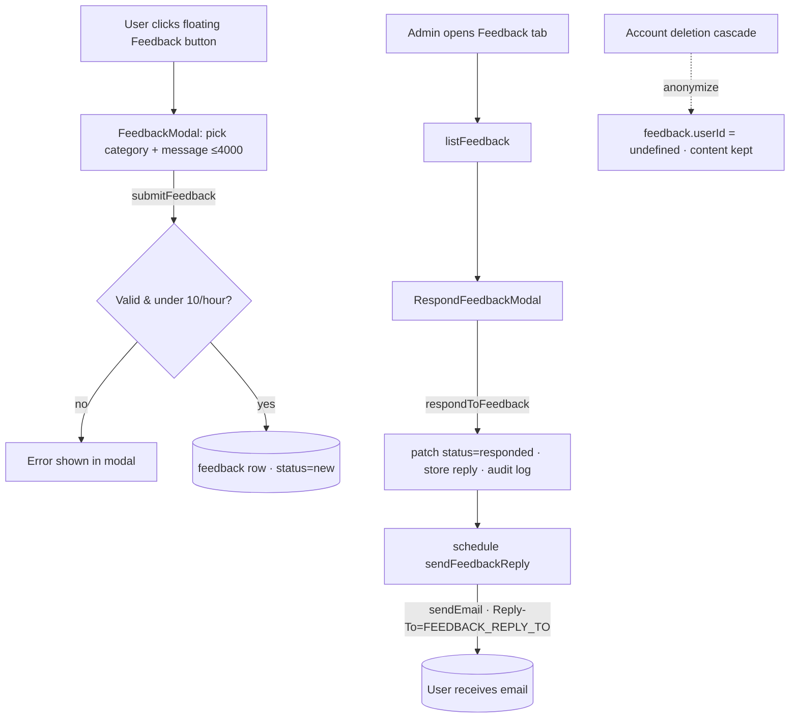

# In-App Feedback Form Implementation Plan

> **For agentic workers:** REQUIRED SUB-SKILL: Use superpowers:subagent-driven-development (recommended) or superpowers:
> executing-plans to implement this plan task-by-task. Steps use checkbox (`- [ ]`) syntax for tracking.

**Goal:** Add an in-app feedback feature: a floating button opens a modal where authenticated users submit a
single-category message (≤4000 chars); admins read and reply by email from a new Feedback tab.

**Architecture:** New Convex `feedback` table + `convex/feedback/` module (functions + email template), reusing the
existing `requireAuth`/`assertAdmin` guards, `checkRateLimit`, `writeAuditLog`, and the Resend-backed `sendEmail`.
Frontend adds a floating `FeedbackButton` + `FeedbackModal` inside the authenticated shell, and an admin `FeedbackTab` +
`RespondFeedbackModal`. Feedback is anonymized (not deleted) on account erasure and included in DSR export.

**Tech Stack:** Convex 1.34, React 19 + Vite + Tailwind, react-i18next, Vitest (convex: node env / pure-helper tests;
app: jsdom + Testing Library), Resend.

**Spec:** `docs/superpowers/specs/2026-06-17-feedback-form-design.md`

## Global Constraints

- **NEVER run `git commit` or `git push`.** Per the repo's CLAUDE.md, Henriko makes all commits. Each task ends with a *
  *Checkpoint** (run lint + tests, report green) and leaves the changes uncommitted for Henriko. This overrides the
  writing-plans default "Commit" step.
- **Read `convex/_generated/ai/guidelines.md` before writing Convex code** (already reflected below).
- **Keep `docs/PLATFORM.md` in sync** — Task 9 is part of "done", not optional (CLAUDE.md rule).
- **Single category** per feedback item (radio-style), stored as one snake_case string.
- **Message limit: 4000 chars**, validated server-side (trimmed, non-empty).
- **Submission throttle: 10 per hour** per user; **admins exempt** (mirrors `requestDataExport`).
- **Account deletion anonymizes feedback** (`userId → undefined`); the row + content is retained. Do NOT add `feedback`
  to the `OWNED` hard-delete array.
- The repo does **not** use `convex-test`. Test **pure exported helpers** in plain Vitest (see `convex/admin.test.ts`,
  `convex/privacy/emails.test.ts`). Convex function handlers are kept thin and are not integration-tested.
- Convex function references for files in `convex/feedback/feedback.ts` are `api.feedback.feedback.*` /
  `internal.feedback.feedback.*` (file-based routing: `<dir>.<file>.<fn>`).
- **Test commands:**
    - Convex: `pnpm --filter convex test` (all) · single file:
      `pnpm --filter convex exec vitest run <path-relative-to-convex>`
    - App: `pnpm --filter app test` (all) · single file: `pnpm --filter app exec vitest run <path-relative-to-app>`
    - Lint (root): `pnpm lint`
- After schema or Convex-function changes, regenerate types: `npx convex codegen` (or `pnpm dev:convex`). If the
  environment can't reach Convex, note it in the checkpoint — Henriko regenerates. (Pure-helper Vitest runs regardless,
  since Vitest does not full-typecheck.)

---

## File Structure

**Backend (`convex/`)**

- `schema.ts` — *modify*: add `feedback` table (Task 1).
- `feedback/feedback.ts` — *create*: validation helper + `submitFeedback`, `listFeedback`, `respondToFeedback`,
  `archiveFeedback`, `reopenFeedback`, `getFeedbackForReply` (internalQuery), `sendFeedbackReply` (internalAction) (Task
  4).
- `feedback/feedback.test.ts` — *create*: unit tests for `validateFeedbackMessage` (Task 4).
- `feedback/emails.ts` — *create*: `escapeHtml` + `feedbackReplyEmail` builder (Task 2).
- `feedback/emails.test.ts` — *create*: builder tests (Task 2).
- `lib/email.ts` — *modify*: optional `replyTo` (Task 3).
- `lib/email.test.ts` — *modify*: `replyTo` assertion (Task 3).
- `admin.ts` — *modify*: `export` the existing `assertAdmin` (Task 4).
- `privacy/deletion.ts` — *modify*: anonymize feedback in `cascadeDeleteUser` (Task 5).
- `privacy/deletion.test.ts` — *modify*: anonymization assertion (Task 5).
- `privacy/export.ts` — *modify*: gather + bundle feedback (Task 5).
- `privacy/export.test.ts` — *modify*: bundle assertion (Task 5).
- `schema.test.ts` — *modify*: assert `feedback` table (Task 1).

**Frontend (`app/src/`)**

- `components/Modal.tsx` — *modify*: optional `panelClassName` (Task 6).
- `components/FeedbackButton.tsx` — *create*: floating button (Task 7).
- `components/FeedbackModal.tsx` — *create*: submission modal (Task 7).
- `components/FeedbackModal.test.tsx` — *create* (Task 7).
- `components/FeedbackTab.tsx` — *create*: admin list/triage (Task 8).
- `components/FeedbackTab.test.tsx` — *create* (Task 8).
- `components/RespondFeedbackModal.tsx` — *create*: admin reply modal (Task 8).
- `components/RespondFeedbackModal.test.tsx` — *create* (Task 8).
- `pages/AdminPage.tsx` — *modify*: add `feedback` tab (Task 8).
- `App.tsx` — *modify*: render `<FeedbackButton />` in `RequireAuth` (Task 7).
- `i18n/locales/{en,pt,es}.json` — *modify*: `feedback.*` keys (Task 7).

**Docs**

- `docs/PLATFORM.md` — *modify*: §12A Feedback + §16 env var + §21 maintaining map (Task 9).
- `docs/compliance/DATA-INVENTORY.md`, `docs/compliance/RETENTION-POLICY.md` — *modify* (Task 9).

---

## Task 1: Schema — `feedback` table

**Files:**

- Modify: `convex/schema.ts`
- Test: `convex/schema.test.ts`

**Interfaces:**

- Produces: `feedback` table with fields `userId?: Id<'users'>`, `category` (8-literal union), `message: string`,
  `status: 'new'|'responded'|'archived'`, `createdAt: number`, optional `responseText`/`respondedAt`/`respondedBy`;
  indexes `by_user` (`['userId']`) and `by_status` (`['status','createdAt']`).

- [ ] **Step 1: Write the failing test** — append inside `convex/schema.test.ts`:

```ts
  it('defines the feedback table', () => {
    expect(schema.tables).toHaveProperty('feedback')
  })
```

- [ ] **Step 2: Run test to verify it fails**

Run: `pnpm --filter convex exec vitest run schema.test.ts`
Expected: FAIL — `feedback` property missing.

- [ ] **Step 3: Add the table** — in `convex/schema.ts`, add this table inside `defineSchema({ ... })` (place it after
  the `auditLogs` table, before the closing `})`; add a comma after the previous table):

```ts
  // User-submitted product feedback. Authenticated submitters; admins reply by email
  // (status → 'responded'). On account deletion the row is ANONYMIZED, not deleted:
  // userId is cleared (→ undefined) while the content is retained. See convex/privacy/deletion.ts.
  feedback: defineTable({
    userId: v.optional(v.id('users')), // submitter; set on submit, CLEARED on account deletion (anonymize)
    category: v.union(
      v.literal('feature_request'),
      v.literal('bug'),
      v.literal('comment'),
      v.literal('criticism'),
      v.literal('praise'),
      v.literal('question'),
      v.literal('suggestion'),
      v.literal('other')
    ),
    message: v.string(),
    status: v.union(v.literal('new'), v.literal('responded'), v.literal('archived')),
    createdAt: v.number(),
    // Response tracking — set when an admin replies.
    responseText: v.optional(v.string()),
    respondedAt: v.optional(v.number()),
    respondedBy: v.optional(v.id('users'))
  })
    .index('by_user', ['userId']) // export + locate rows to anonymize on deletion
    .index('by_status', ['status', 'createdAt']) // reserved for future server-side status triage
```

- [ ] **Step 4: Run test to verify it passes**

Run: `pnpm --filter convex exec vitest run schema.test.ts`
Expected: PASS.

- [ ] **Step 5: Regenerate Convex types**

Run: `npx convex codegen`
Expected: `convex/_generated/dataModel.d.ts` now includes `feedback`. (If unreachable, note for Henriko.)

- [ ] **Step 6: Checkpoint** — `pnpm lint` and `pnpm --filter convex test` green. Leave uncommitted for Henriko.

---

## Task 2: Feedback reply email template

**Files:**

- Create: `convex/feedback/emails.ts`
- Test: `convex/feedback/emails.test.ts`

**Interfaces:**

- Produces:
  `feedbackReplyEmail({ replyText, originalMessage }: { replyText: string; originalMessage: string }): { subject: string; html: string; text: string }`.
  HTML-escapes user/admin text.

- [ ] **Step 1: Write the failing test** — create `convex/feedback/emails.test.ts`:

```ts
import { describe, it, expect } from 'vitest'
import { feedbackReplyEmail } from './emails'

describe('feedbackReplyEmail', () => {
  it('includes the reply, quotes the original, and names the app', () => {
    const m = feedbackReplyEmail({ replyText: 'Thanks, fixed it!', originalMessage: 'The button is broken' })
    expect(m.subject).toMatch(/feedback/i)
    expect(m.html).toContain('Link Into The SSI')
    expect(m.html).toContain('Thanks, fixed it!')
    expect(m.html).toContain('The button is broken')
    expect(m.text).toContain('Thanks, fixed it!')
    expect(m.text).toContain('The button is broken')
  })

  it('HTML-escapes user-provided content to prevent injection', () => {
    const m = feedbackReplyEmail({ replyText: '<script>x</script>', originalMessage: 'a & b ' })
    expect(m.html).not.toContain('<script>')
    expect(m.html).toContain('&lt;script&gt;')
    expect(m.html).toContain('a &amp; b &lt;img&gt;')
  })
})
```

- [ ] **Step 2: Run test to verify it fails**

Run: `pnpm --filter convex exec vitest run feedback/emails.test.ts`
Expected: FAIL — module not found.

- [ ] **Step 3: Create the builder** — create `convex/feedback/emails.ts`:

```ts
// convex/feedback/emails.ts
// Pure transactional-email builder for admin replies to user feedback. No I/O — returns
// { subject, html, text } for convex/lib/email.ts:sendEmail to deliver. User/admin text is
// HTML-escaped because it is interpolated into the HTML body.
export interface EmailContent {
  subject: string
  html: string
  text: string
}

const APP = 'Link Into The SSI'

export function escapeHtml(input: string): string {
  return input
    .replace(/&/g, '&amp;')
    .replace(/</g, '&lt;')
    .replace(/>/g, '&gt;')
    .replace(/"/g, '&quot;')
    .replace(/'/g, '&#39;')
}

export function feedbackReplyEmail({
  replyText,
  originalMessage
}: {
  replyText: string
  originalMessage: string
}): EmailContent {
  const subject = `Re: your ${APP} feedback`
  const text =
    `Thanks for your feedback. You wrote:\n\n"${originalMessage}"\n\n` +
    `Our response:\n\n${replyText}\n\n— The ${APP} team`
  const html =
    `<p>Thanks for your feedback. You wrote:</p>` +
    `<blockquote>${escapeHtml(originalMessage)}</blockquote>` +
    `<p>Our response:</p>` +
    `<p>${escapeHtml(replyText)}</p>` +
    `<p>— The ${APP} team</p>`
  return { subject, html, text }
}
```

- [ ] **Step 4: Run test to verify it passes**

Run: `pnpm --filter convex exec vitest run feedback/emails.test.ts`
Expected: PASS.

- [ ] **Step 5: Checkpoint** — `pnpm lint` and `pnpm --filter convex test` green. Leave uncommitted.

---

## Task 3: `sendEmail` — optional `replyTo`

**Files:**

- Modify: `convex/lib/email.ts`
- Test: `convex/lib/email.test.ts`

**Interfaces:**

- Consumes: existing `sendEmail(args)`.
- Produces: `SendEmailArgs` gains optional `replyTo?: string`; forwarded to Resend as `reply_to` when present.

- [ ] **Step 1: Write the failing test** — append inside the `describe('sendEmail', ...)` block in
  `convex/lib/email.test.ts`:

```ts
  it('forwards replyTo to Resend as reply_to when provided', async () => {
    vi.stubEnv('RESEND_API_KEY', 'key_123')
    vi.stubEnv('EMAIL_FROM', 'noreply@linkintothessi.com')
    const fetchMock = vi.fn(async (_url: string, _opts: any) => ({ ok: true, json: async () => ({ id: 'e1' }) }))
    vi.stubGlobal('fetch', fetchMock)

    await sendEmail({ to: 'a@b.com', subject: 'Hi', html: '<p>x</p>', replyTo: 'support@linkintothessi.com' })

    const body = JSON.parse(fetchMock.mock.calls[0][1].body)
    expect(body.reply_to).toBe('support@linkintothessi.com')
  })

  it('omits reply_to when replyTo is not provided', async () => {
    vi.stubEnv('RESEND_API_KEY', 'key_123')
    vi.stubEnv('EMAIL_FROM', 'noreply@linkintothessi.com')
    const fetchMock = vi.fn(async (_url: string, _opts: any) => ({ ok: true, json: async () => ({ id: 'e1' }) }))
    vi.stubGlobal('fetch', fetchMock)

    await sendEmail({ to: 'a@b.com', subject: 'Hi', html: '<p>x</p>' })

    const body = JSON.parse(fetchMock.mock.calls[0][1].body)
    expect('reply_to' in body).toBe(false)
  })
```

- [ ] **Step 2: Run test to verify it fails**

Run: `pnpm --filter convex exec vitest run lib/email.test.ts`
Expected: FAIL — `reply_to` is `undefined`.

- [ ] **Step 3: Implement** — in `convex/lib/email.ts`:

Add `replyTo` to the interface:

```ts
export interface SendEmailArgs {
  to: string
  subject: string
  html: string
  text?: string
  replyTo?: string
}
```

Replace the `body: JSON.stringify({ ... })` block with:

```ts
    body: JSON.stringify({
      from,
      to: args.to,
      subject: args.subject,
      html: args.html,
      text: args.text,
      ...(args.replyTo ? { reply_to: args.replyTo } : {})
    })
```

- [ ] **Step 4: Run test to verify it passes**

Run: `pnpm --filter convex exec vitest run lib/email.test.ts`
Expected: PASS (all email tests).

- [ ] **Step 5: Checkpoint** — `pnpm lint` and `pnpm --filter convex test` green. Leave uncommitted.

---

## Task 4: Backend feedback functions

**Files:**

- Create: `convex/feedback/feedback.ts`
- Test: `convex/feedback/feedback.test.ts`
- Modify: `convex/admin.ts` (export `assertAdmin`)

**Interfaces:**

- Consumes: `requireAuth` (`lib/auth`), `assertAdmin` (`admin.ts`, now exported), `checkRateLimit` (`lib/rateLimit`),
  `writeAuditLog` (`lib/audit`), `sendEmail` (`lib/email`), `feedbackReplyEmail` (`feedback/emails`).
- Produces (function references):
    - `api.feedback.feedback.submitFeedback({ sessionToken, category, message })`
    - `api.feedback.feedback.listFeedback({ sessionToken })` → array of
      `{ _id, category, message, status, createdAt, responseText?, respondedAt?, userName: string|null, userEmail: string|null }`
    - `api.feedback.feedback.respondToFeedback({ sessionToken, feedbackId, responseText })`
    - `api.feedback.feedback.archiveFeedback({ sessionToken, feedbackId })`
    - `api.feedback.feedback.reopenFeedback({ sessionToken, feedbackId })`
    - `internal.feedback.feedback.getFeedbackForReply`, `internal.feedback.feedback.sendFeedbackReply`
    - Pure: `validateFeedbackMessage(message: string): string`, `FEEDBACK_CATEGORIES`, `MAX_FEEDBACK_LENGTH`,
      `FEEDBACK_RATE_LIMIT_PER_HOUR`.

- [ ] **Step 1: Export `assertAdmin`** — in `convex/admin.ts`, change the declaration:

```ts
export function assertAdmin(user: Doc<'users'>): void {
  if (!user.isAdmin) {
    throw new Error('Forbidden: admin access required')
  }
}
```

(Only the `export` keyword is added; the existing in-file calls keep working.)

- [ ] **Step 2: Write the failing test** — create `convex/feedback/feedback.test.ts`:

```ts
import { describe, it, expect } from 'vitest'
import { validateFeedbackMessage, MAX_FEEDBACK_LENGTH, FEEDBACK_CATEGORIES } from './feedback'

describe('validateFeedbackMessage', () => {
  it('trims and returns a valid message', () => {
    expect(validateFeedbackMessage('  hello  ')).toBe('hello')
  })

  it('throws on an empty / whitespace-only message', () => {
    expect(() => validateFeedbackMessage('')).toThrow(/empty/i)
    expect(() => validateFeedbackMessage('   ')).toThrow(/empty/i)
  })

  it(`throws when longer than ${MAX_FEEDBACK_LENGTH} chars (after trim)`, () => {
    expect(() => validateFeedbackMessage('a'.repeat(MAX_FEEDBACK_LENGTH + 1))).toThrow(/4000/)
  })

  it('accepts exactly the max length', () => {
    expect(validateFeedbackMessage('a'.repeat(MAX_FEEDBACK_LENGTH)).length).toBe(MAX_FEEDBACK_LENGTH)
  })
})

describe('FEEDBACK_CATEGORIES', () => {
  it('lists the 8 categories', () => {
    expect(FEEDBACK_CATEGORIES).toEqual([
      'feature_request',
      'bug',
      'comment',
      'criticism',
      'praise',
      'question',
      'suggestion',
      'other'
    ])
  })
})
```

- [ ] **Step 3: Run test to verify it fails**

Run: `pnpm --filter convex exec vitest run feedback/feedback.test.ts`
Expected: FAIL — module not found.

- [ ] **Step 4: Implement** — create `convex/feedback/feedback.ts`:

```ts
// convex/feedback/feedback.ts
// User feedback: submission (authenticated), admin listing/triage, and admin email replies.
// Replies ride the existing Resend pipeline (lib/email) and are tracked on the row.
import { internalAction, internalQuery, mutation, query } from '../_generated/server'
import { v } from 'convex/values'
import { internal } from '../_generated/api'
import { requireAuth } from '../lib/auth'
import { assertAdmin } from '../admin'
import { checkRateLimit } from '../lib/rateLimit'
import { writeAuditLog } from '../lib/audit'
import { sendEmail } from '../lib/email'
import { feedbackReplyEmail } from './emails'

export const FEEDBACK_CATEGORIES = [
  'feature_request',
  'bug',
  'comment',
  'criticism',
  'praise',
  'question',
  'suggestion',
  'other'
] as const

export const MAX_FEEDBACK_LENGTH = 4000
export const FEEDBACK_RATE_LIMIT_PER_HOUR = 10

const categoryValidator = v.union(
  v.literal('feature_request'),
  v.literal('bug'),
  v.literal('comment'),
  v.literal('criticism'),
  v.literal('praise'),
  v.literal('question'),
  v.literal('suggestion'),
  v.literal('other')
)

// Pure validator — exported for unit testing. Returns the trimmed message or throws.
export function validateFeedbackMessage(message: string): string {
  const trimmed = message.trim()
  if (trimmed.length === 0) throw new Error('Feedback message cannot be empty.')
  if (trimmed.length > MAX_FEEDBACK_LENGTH) {
    throw new Error(`Feedback must be ${MAX_FEEDBACK_LENGTH} characters or fewer.`)
  }
  return trimmed
}

// db cast for writeAuditLog (matches the pattern in convex/privacy/export.ts).
type AuditDb = { insert: (t: string, d: Record<string, unknown>) => Promise<string> }

export const submitFeedback = mutation({
  args: { sessionToken: v.string(), category: categoryValidator, message: v.string() },
  handler: async (ctx, { sessionToken, category, message }) => {
    const user = await requireAuth(ctx, sessionToken)
    const trimmed = validateFeedbackMessage(message)
    // Admins are exempt from the throttle (mirrors requestDataExport).
    if (!user.isAdmin) {
      await checkRateLimit(ctx, user._id, 'submitFeedback', FEEDBACK_RATE_LIMIT_PER_HOUR)
    }
    await ctx.db.insert('feedback', {
      userId: user._id,
      category,
      message: trimmed,
      status: 'new',
      createdAt: Date.now()
    })
  }
})

// Admin-only. Newest-first, bounded. Enriches each row with submitter name + email
// (null for anonymized rows whose userId was cleared on account deletion).
export const listFeedback = query({
  args: { sessionToken: v.string() },
  handler: async (ctx, { sessionToken }) => {
    const admin = await requireAuth(ctx, sessionToken)
    assertAdmin(admin)
    const rows = await ctx.db.query('feedback').order('desc').take(500)
    return await Promise.all(
      rows.map(async f => {
        const u = f.userId ? await ctx.db.get(f.userId) : null
        return {
          _id: f._id,
          category: f.category,
          message: f.message,
          status: f.status,
          createdAt: f.createdAt,
          responseText: f.responseText,
          respondedAt: f.respondedAt,
          userName: u?.name ?? null,
          userEmail: u?.email ?? null
        }
      })
    )
  }
})

export const respondToFeedback = mutation({
  args: { sessionToken: v.string(), feedbackId: v.id('feedback'), responseText: v.string() },
  handler: async (ctx, { sessionToken, feedbackId, responseText }) => {
    const admin = await requireAuth(ctx, sessionToken)
    assertAdmin(admin)
    const reply = validateFeedbackMessage(responseText)
    const feedback = await ctx.db.get(feedbackId)
    if (!feedback) throw new Error('Feedback not found')

    await ctx.db.patch(feedbackId, {
      status: 'responded',
      responseText: reply,
      respondedAt: Date.now(),
      respondedBy: admin._id
    })
    await writeAuditLog(ctx.db as unknown as AuditDb, {
      actor: 'admin',
      actorId: admin._id,
      action: 'feedback.responded',
      targetUserId: feedback.userId
    })
    await ctx.scheduler.runAfter(0, internal.feedback.feedback.sendFeedbackReply, { feedbackId })
  }
})

export const archiveFeedback = mutation({
  args: { sessionToken: v.string(), feedbackId: v.id('feedback') },
  handler: async (ctx, { sessionToken, feedbackId }) => {
    const admin = await requireAuth(ctx, sessionToken)
    assertAdmin(admin)
    const f = await ctx.db.get(feedbackId)
    if (!f) throw new Error('Feedback not found')
    await ctx.db.patch(feedbackId, { status: 'archived' })
  }
})

// Reopen → 'responded' if the item was already answered, else 'new'.
export const reopenFeedback = mutation({
  args: { sessionToken: v.string(), feedbackId: v.id('feedback') },
  handler: async (ctx, { sessionToken, feedbackId }) => {
    const admin = await requireAuth(ctx, sessionToken)
    assertAdmin(admin)
    const f = await ctx.db.get(feedbackId)
    if (!f) throw new Error('Feedback not found')
    await ctx.db.patch(feedbackId, { status: f.responseText ? 'responded' : 'new' })
  }
})

// Internal: data the reply action needs (action has no ctx.db).
export const getFeedbackForReply = internalQuery({
  args: { feedbackId: v.id('feedback') },
  handler: async (ctx, { feedbackId }) => {
    const f = await ctx.db.get(feedbackId)
    if (!f) return null
    const u = f.userId ? await ctx.db.get(f.userId) : null
    return { email: u?.email ?? null, originalMessage: f.message, responseText: f.responseText ?? '' }
  }
})

// Internal: emails the submitter. Best-effort — no email on file ⇒ no-op.
export const sendFeedbackReply = internalAction({
  args: { feedbackId: v.id('feedback') },
  handler: async (ctx, { feedbackId }) => {
    const data = await ctx.runQuery(internal.feedback.feedback.getFeedbackForReply, { feedbackId })
    if (!data || !data.email) return
    const m = feedbackReplyEmail({ replyText: data.responseText, originalMessage: data.originalMessage })
    const replyTo = process.env.FEEDBACK_REPLY_TO
    await sendEmail({
      to: data.email,
      subject: m.subject,
      html: m.html,
      text: m.text,
      ...(replyTo ? { replyTo } : {})
    })
  }
})
```

- [ ] **Step 5: Run test to verify it passes**

Run: `pnpm --filter convex exec vitest run feedback/feedback.test.ts`
Expected: PASS.

- [ ] **Step 6: Regenerate + typecheck**

Run: `npx convex codegen` then `pnpm --filter convex test`
Expected: codegen succeeds (`api.feedback.feedback.*` available); all convex tests pass. (If Convex unreachable, note
for Henriko.)

- [ ] **Step 7: Checkpoint** — `pnpm lint` and `pnpm --filter convex test` green. Leave uncommitted.

---

## Task 5: Privacy wiring — anonymize on deletion + include in export

**Files:**

- Modify: `convex/privacy/deletion.ts`, `convex/privacy/deletion.test.ts`
- Modify: `convex/privacy/export.ts`, `convex/privacy/export.test.ts`

**Interfaces:**

- Consumes: `feedback` table (`by_user` index).
- Produces: `cascadeDeleteUser` clears `userId` on the user's feedback rows (no delete); `buildExportBundle`/
  `gatherUserData`/`ExportInput` include `feedback`.

### 5a — Deletion anonymization

- [ ] **Step 1: Write the failing test** — in `convex/privacy/deletion.test.ts`, add a `feedback` entry to `SEED` (
  inside the `SEED` object):

```ts
  feedback: [{ _id: 'fb1', userId: 'u1', message: 'great app', status: 'responded', responseText: 'thanks' }],
```

Then add a new test inside `describe('cascadeDeleteUser', ...)`:

```ts
  it('anonymizes feedback (clears userId) instead of deleting it', async () => {
    const db = createMockDb(SEED)
    const storage = { delete: async (_id: string) => {} }
    await cascadeDeleteUser(db, storage, 'u1')
    // Not deleted…
    expect(db._deleted.map(d => d.id)).not.toContain('fb1')
    // …but userId cleared.
    expect(db._patched).toContainEqual({ id: 'fb1', data: { userId: undefined } })
  })
```

- [ ] **Step 2: Run test to verify it fails**

Run: `pnpm --filter convex exec vitest run privacy/deletion.test.ts`
Expected: FAIL — `fb1` not patched.

- [ ] **Step 3: Implement** — in `convex/privacy/deletion.ts`, inside `cascadeDeleteUser`, add a new step **between**
  the `auditLogs` pseudonymization (step 3) and `writeAuditLog` (step 4):

```ts
  // 3b. Anonymize feedback: keep the content for product use, drop the submitter link.
  const feedbacks = [
    ...(await db
      .query('feedback')
      .withIndex('by_user', (q: unknown) => (q as { eq(f: string, v: unknown): unknown }).eq('userId', userId))
      .collect())
  ]
  for (const f of feedbacks) await db.patch(f._id, { userId: undefined })
```

(Do NOT add `feedback` to the `OWNED` array.)

- [ ] **Step 4: Run test to verify it passes**

Run: `pnpm --filter convex exec vitest run privacy/deletion.test.ts`
Expected: PASS.

### 5b — Export inclusion

- [ ] **Step 5: Write the failing test** — in `convex/privacy/export.test.ts`, add a test inside
  `describe('buildExportBundle', ...)`:

```ts
  it('includes the user feedback verbatim', () => {
    const bundle = buildExportBundle({
      user: USER,
      posts: [],
      subscriptions: [],
      consents: [],
      audits: [],
      feedback: [{ _id: 'fb1', category: 'bug', message: 'broken', status: 'responded', responseText: 'fixed' }]
    })
    expect(bundle.feedback).toHaveLength(1)
    expect(bundle.feedback[0].message).toBe('broken')
    expect(bundle.feedback[0].responseText).toBe('fixed')
  })
```

- [ ] **Step 6: Run test to verify it fails**

Run: `pnpm --filter convex exec vitest run privacy/export.test.ts`
Expected: FAIL — `bundle.feedback` is `undefined`.

- [ ] **Step 7: Implement** — in `convex/privacy/export.ts`:

In `ExportInput`, add an optional field:

```ts
export interface ExportInput {
  user: AnyDoc
  posts: AnyDoc[]
  subscriptions: AnyDoc[]
  consents: AnyDoc[]
  audits: AnyDoc[]
  feedback?: AnyDoc[]
  exportedAt?: number
}
```

In `buildExportBundle`'s returned object, add (after the `consents` line):

```ts
    feedback: input.feedback ?? [],
```

In `gatherUserData`, add the query (after the `consents` query) and include it in the return:

```ts
    const feedback = await ctx.db
      .query('feedback')
      .withIndex('by_user', q => q.eq('userId', userId))
      .collect()
```

```ts
    return { user, posts, subscriptions, consents, audits, feedback }
```

- [ ] **Step 8: Run test to verify it passes**

Run: `pnpm --filter convex exec vitest run privacy/export.test.ts`
Expected: PASS.

- [ ] **Step 9: Checkpoint** — `pnpm lint` and `pnpm --filter convex test` green. Leave uncommitted.

---

## Task 6: `Modal` — optional `panelClassName`

**Files:**

- Modify: `app/src/components/Modal.tsx`
- Test: `app/src/components/Modal.test.tsx` (verify still green)

**Interfaces:**

- Produces: `Modal` accepts optional `panelClassName?: string` (default `'max-w-sm'`) controlling the panel width token.
  Backward-compatible with all current callers.

- [ ] **Step 1: Implement** — replace the contents of `app/src/components/Modal.tsx`:

```tsx
import { type ReactNode, useEffect } from 'react'

type Props = {
  onClose: () => void
  children: ReactNode
  panelClassName?: string
}

export default function Modal({ onClose, children, panelClassName = 'max-w-sm' }: Props) {
  useEffect(() => {
    function onKey(e: KeyboardEvent) {
      if (e.key === 'Escape') onClose()
    }
    window.addEventListener('keydown', onKey)
    return () => window.removeEventListener('keydown', onKey)
  }, [onClose])

  return (
    <div
      data-testid="modal-backdrop"
      onClick={onClose}
      className="fixed inset-0 z-50 flex items-center justify-center bg-slate-900/50 p-4"
    >
      <div
        onClick={e => e.stopPropagation()}
        className={`w-full ${panelClassName} rounded-xl bg-white p-5 shadow-2xl`}
      >
        {children}
      </div>
    </div>
  )
}
```

- [ ] **Step 2: Run existing Modal tests to verify no regression**

Run: `pnpm --filter app exec vitest run src/components/Modal.test.tsx`
Expected: PASS (backdrop + Escape behavior unchanged).

- [ ] **Step 3: Checkpoint** — `pnpm lint` and `pnpm --filter app exec vitest run src/components/Modal.test.tsx` green.
  Leave uncommitted.

---

## Task 7: User-facing widget — i18n + FeedbackModal + FeedbackButton + wiring

**Files:**

- Modify: `app/src/i18n/locales/en.json`, `pt.json`, `es.json`
- Create: `app/src/components/FeedbackModal.tsx`, `app/src/components/FeedbackButton.tsx`
- Test: `app/src/components/FeedbackModal.test.tsx`
- Modify: `app/src/App.tsx`

**Interfaces:**

- Consumes: `api.feedback.feedback.submitFeedback`, `Modal` (`panelClassName`), `react-i18next`.
- Produces: `<FeedbackButton />` (floating, bottom-right) rendered inside `RequireAuth`.

- [ ] **Step 1: Add i18n keys** — add a top-level `"feedback"` group to each locale file (insert after the
  `"privacy": { ... }` block; add a comma after that block's closing `}`).

`en.json`:

```json
  "feedback": {
    "button": "Feedback",
    "title": "Send us feedback",
    "categoryLabel": "What kind of feedback is this?",
    "categories": {
      "feature_request": "Feature request",
      "bug": "Bug",
      "comment": "Comment",
      "criticism": "Criticism",
      "praise": "Praise",
      "question": "Question",
      "suggestion": "Suggestion",
      "other": "Other"
    },
    "messageLabel": "Your message",
    "messagePlaceholder": "Tell us what's on your mind…",
    "submit": "Send feedback",
    "submitting": "Sending…",
    "cancel": "Cancel",
    "close": "Close",
    "thanks": "Thanks! We've received your feedback.",
    "error": "Something went wrong. Please try again."
  }
```

`pt.json`:

```json
  "feedback": {
    "button": "Feedback",
    "title": "Envie seu feedback",
    "categoryLabel": "Que tipo de feedback é este?",
    "categories": {
      "feature_request": "Sugestão de recurso",
      "bug": "Erro",
      "comment": "Comentário",
      "criticism": "Crítica",
      "praise": "Elogio",
      "question": "Pergunta",
      "suggestion": "Sugestão",
      "other": "Outro"
    },
    "messageLabel": "Sua mensagem",
    "messagePlaceholder": "Conte o que você está pensando…",
    "submit": "Enviar feedback",
    "submitting": "Enviando…",
    "cancel": "Cancelar",
    "close": "Fechar",
    "thanks": "Obrigado! Recebemos seu feedback.",
    "error": "Algo deu errado. Tente novamente."
  }
```

`es.json`:

```json
  "feedback": {
    "button": "Feedback",
    "title": "Envíanos tu feedback",
    "categoryLabel": "¿Qué tipo de feedback es este?",
    "categories": {
      "feature_request": "Solicitud de función",
      "bug": "Error",
      "comment": "Comentario",
      "criticism": "Crítica",
      "praise": "Elogio",
      "question": "Pregunta",
      "suggestion": "Sugerencia",
      "other": "Otro"
    },
    "messageLabel": "Tu mensaje",
    "messagePlaceholder": "Cuéntanos qué piensas…",
    "submit": "Enviar feedback",
    "submitting": "Enviando…",
    "cancel": "Cancelar",
    "close": "Cerrar",
    "thanks": "¡Gracias! Hemos recibido tu feedback.",
    "error": "Algo salió mal. Inténtalo de nuevo."
  }
```

- [ ] **Step 2: Write the failing test** — create `app/src/components/FeedbackModal.test.tsx`:

```tsx
import { render, screen, fireEvent, waitFor } from '@testing-library/react'
import { describe, it, expect, vi, beforeEach } from 'vitest'

const submitFn = vi.fn(async () => {})
vi.mock('convex/react', () => ({ useMutation: () => submitFn }))
vi.mock('../convex', () => ({ api: { feedback: { feedback: { submitFeedback: 'ref' } } } }))
vi.mock('react-i18next', () => ({ useTranslation: () => ({ t: (k: string) => k }) }))

import FeedbackModal from './FeedbackModal'

describe('FeedbackModal', () => {
  beforeEach(() => {
    submitFn.mockClear()
    sessionStorage.setItem('sessionToken', 'tok')
  })

  it('renders all 8 category pills', () => {
    render(<FeedbackModal onClose={() => {}} />)
    for (const c of [
      'feature_request',
      'bug',
      'comment',
      'criticism',
      'praise',
      'question',
      'suggestion',
      'other'
    ]) {
      expect(screen.getByText(`feedback.categories.${c}`)).toBeInTheDocument()
    }
  })

  it('disables submit until a category and message are present', () => {
    render(<FeedbackModal onClose={() => {}} />)
    const submit = screen.getByRole('button', { name: 'feedback.submit' })
    expect(submit).toBeDisabled()
    fireEvent.click(screen.getByText('feedback.categories.bug'))
    fireEvent.change(screen.getByLabelText('feedback.messageLabel'), { target: { value: 'It broke' } })
    expect(submit).not.toBeDisabled()
  })

  it('submits the chosen category + message, then shows the thank-you state', async () => {
    const onClose = vi.fn()
    render(<FeedbackModal onClose={onClose} />)
    fireEvent.click(screen.getByText('feedback.categories.bug'))
    fireEvent.change(screen.getByLabelText('feedback.messageLabel'), { target: { value: '  It broke  ' } })
    fireEvent.click(screen.getByRole('button', { name: 'feedback.submit' }))
    await waitFor(() =>
      expect(submitFn).toHaveBeenCalledWith({ sessionToken: 'tok', category: 'bug', message: 'It broke' })
    )
    expect(screen.getByText('feedback.thanks')).toBeInTheDocument()
  })
})
```

- [ ] **Step 3: Run test to verify it fails**

Run: `pnpm --filter app exec vitest run src/components/FeedbackModal.test.tsx`
Expected: FAIL — module not found.

- [ ] **Step 4: Implement `FeedbackModal`** — create `app/src/components/FeedbackModal.tsx`:

```tsx
import { useState } from 'react'
import { useTranslation } from 'react-i18next'
import { useMutation } from 'convex/react'
import { api } from '../convex'
import Modal from './Modal'

const CATEGORIES = [
  'feature_request',
  'bug',
  'comment',
  'criticism',
  'praise',
  'question',
  'suggestion',
  'other'
] as const
type Category = (typeof CATEGORIES)[number]
const MAX = 4000

export default function FeedbackModal({ onClose }: { onClose: () => void }) {
  const { t } = useTranslation()
  const submit = useMutation(api.feedback.feedback.submitFeedback)
  const [category, setCategory] = useState<Category | null>(null)
  const [message, setMessage] = useState('')
  const [submitting, setSubmitting] = useState(false)
  const [done, setDone] = useState(false)
  const [error, setError] = useState<string | null>(null)

  const trimmed = message.trim()
  const valid = category !== null && trimmed.length > 0 && trimmed.length <= MAX

  async function handleSubmit() {
    const token = sessionStorage.getItem('sessionToken') ?? undefined
    if (!valid || !category || !token) return
    setSubmitting(true)
    setError(null)
    try {
      await submit({ sessionToken: token, category, message: trimmed })
      setDone(true)
    } catch (e) {
      setError(e instanceof Error ? e.message : t('feedback.error'))
      setSubmitting(false)
    }
  }

  return (
    <Modal
      onClose={onClose}
      panelClassName="max-w-lg"
    >
      {done ? (
        <div className="py-6 text-center">
          <p className="text-base font-semibold text-slate-900">{t('feedback.thanks')}</p>
          <button
            onClick={onClose}
            className="mt-4 rounded-md bg-blue-600 px-4 py-2 text-sm font-semibold text-white hover:bg-blue-700"
          >
            {t('feedback.close')}
          </button>
        </div>
      ) : (
        <div>
          <h2 className="text-base font-semibold text-slate-900">{t('feedback.title')}</h2>

          <p className="mt-3 text-[11px] font-semibold uppercase tracking-wide text-slate-500">
            {t('feedback.categoryLabel')}
          </p>
          <div className="mt-2 flex flex-wrap gap-2">
            {CATEGORIES.map(c => (
              <button
                key={c}
                type="button"
                aria-pressed={category === c}
                onClick={() => setCategory(c)}
                className={`rounded-full px-3 py-1 text-xs font-medium transition-colors ${
                  category === c ? 'bg-blue-600 text-white' : 'bg-slate-100 text-slate-600 hover:bg-slate-200'
                }`}
              >
                {t(`feedback.categories.${c}`)}
              </button>
            ))}
          </div>

          <label className="mt-4 flex flex-col gap-1">
            <span className="text-[11px] font-semibold uppercase tracking-wide text-slate-500">
              {t('feedback.messageLabel')}
            </span>
            <textarea
              value={message}
              maxLength={MAX}
              onChange={e => setMessage(e.target.value)}
              placeholder={t('feedback.messagePlaceholder')}
              rows={6}
              className="resize-none rounded-md border border-slate-200 px-3 py-2 text-sm focus:border-blue-400 focus:outline-none"
            />
          </label>
          <div className="mt-1 text-right text-xs text-slate-400">
            {trimmed.length}/{MAX}
          </div>

          {error && <p className="mt-2 text-xs text-red-500">{error}</p>}

          <div className="mt-4 flex justify-end gap-2">
            <button
              type="button"
              onClick={onClose}
              className="rounded-md border border-slate-200 px-4 py-2 text-sm font-semibold text-slate-600 hover:bg-slate-50"
            >
              {t('feedback.cancel')}
            </button>
            <button
              type="button"
              disabled={!valid || submitting}
              onClick={() => void handleSubmit()}
              className="rounded-md bg-blue-600 px-4 py-2 text-sm font-semibold text-white hover:bg-blue-700 disabled:opacity-50"
            >
              {submitting ? t('feedback.submitting') : t('feedback.submit')}
            </button>
          </div>
        </div>
      )}
    </Modal>
  )
}
```

- [ ] **Step 5: Run test to verify it passes**

Run: `pnpm --filter app exec vitest run src/components/FeedbackModal.test.tsx`
Expected: PASS.

- [ ] **Step 6: Implement `FeedbackButton`** — create `app/src/components/FeedbackButton.tsx`:

```tsx
import { useState } from 'react'
import { useTranslation } from 'react-i18next'
import FeedbackModal from './FeedbackModal'

export default function FeedbackButton() {
  const { t } = useTranslation()
  const [open, setOpen] = useState(false)
  return (
    <>
      <button
        type="button"
        onClick={() => setOpen(true)}
        aria-label={t('feedback.button')}
        className="fixed bottom-5 right-5 z-40 rounded-full bg-blue-600 px-4 py-3 text-sm font-semibold text-white shadow-lg hover:bg-blue-700"
      >
        💬 {t('feedback.button')}
      </button>
      {open && <FeedbackModal onClose={() => setOpen(false)} />}
    </>
  )
}
```

- [ ] **Step 7: Wire into the authenticated shell** — in `app/src/App.tsx`:

Add the import (near the other component imports):

```tsx
import FeedbackButton from './components/FeedbackButton'
```

Replace the `RequireAuth` success return:

```tsx
  return (
    <>
      <AppNav />
      {children}
      <FeedbackButton />
    </>
  )
```

- [ ] **Step 8: Checkpoint** — `pnpm lint` and `pnpm --filter app test` green. Leave uncommitted.

---

## Task 8: Admin Feedback tab + Respond modal

**Files:**

- Create: `app/src/components/RespondFeedbackModal.tsx`, `app/src/components/RespondFeedbackModal.test.tsx`
- Create: `app/src/components/FeedbackTab.tsx`, `app/src/components/FeedbackTab.test.tsx`
- Modify: `app/src/pages/AdminPage.tsx`

**Interfaces:**

- Consumes: `api.feedback.feedback.listFeedback`, `respondToFeedback`, `archiveFeedback`, `reopenFeedback`; `Modal`,
  `RowActionsMenu`, `LoadingSpinner`.
- Produces: a `feedback` tab in `AdminPage`. Admin components use inline English (consistent with the rest of
  `AdminPage`).

### 8a — RespondFeedbackModal

- [ ] **Step 1: Write the failing test** — create `app/src/components/RespondFeedbackModal.test.tsx`:

```tsx
import { render, screen, fireEvent, waitFor } from '@testing-library/react'
import { describe, it, expect, vi, beforeEach } from 'vitest'
import { getFunctionName } from 'convex/server'
import { useMutation } from 'convex/react'
import type { Id } from '../../../convex/_generated/dataModel'

const mocks = { respondToFeedback: vi.fn() }
vi.mock('convex/react', () => ({ useMutation: vi.fn() }))

import RespondFeedbackModal from './RespondFeedbackModal'

const row = (over: Partial<Record<string, unknown>> = {}) => ({
  _id: 'fb1' as Id<'feedback'>,
  message: 'The button is broken',
  userName: 'Jane',
  userEmail: 'jane@example.com',
  ...over
})

beforeEach(() => {
  mocks.respondToFeedback.mockReset().mockResolvedValue(undefined)
  vi.mocked(useMutation).mockImplementation((ref: unknown) => {
    const name = getFunctionName(ref as Parameters<typeof getFunctionName>[0]).split(':').pop() ?? ''
    return (mocks[name as keyof typeof mocks] ?? vi.fn()) as never
  })
})

describe('RespondFeedbackModal', () => {
  it('sends the reply and closes', async () => {
    const onClose = vi.fn()
    render(
      <RespondFeedbackModal
        feedback={row()}
        sessionToken="tok"
        onClose={onClose}
      />
    )
    fireEvent.change(screen.getByLabelText(/your reply/i), { target: { value: 'Fixed in the next release' } })
    fireEvent.click(screen.getByRole('button', { name: /send reply/i }))
    await waitFor(() =>
      expect(mocks.respondToFeedback).toHaveBeenCalledWith({
        sessionToken: 'tok',
        feedbackId: 'fb1',
        responseText: 'Fixed in the next release'
      })
    )
    expect(onClose).toHaveBeenCalled()
  })

  it('disables replying when the submitter has no email on file', () => {
    render(
      <RespondFeedbackModal
        feedback={row({ userEmail: null, userName: null })}
        sessionToken="tok"
        onClose={() => {}}
      />
    )
    expect(screen.getByText(/no email on file/i)).toBeInTheDocument()
    expect(screen.getByRole('button', { name: /send reply/i })).toBeDisabled()
  })
})
```

- [ ] **Step 2: Run test to verify it fails**

Run: `pnpm --filter app exec vitest run src/components/RespondFeedbackModal.test.tsx`
Expected: FAIL — module not found.

- [ ] **Step 3: Implement** — create `app/src/components/RespondFeedbackModal.tsx`:

```tsx
import { useState } from 'react'
import { useMutation } from 'convex/react'
import { api } from '../convex'
import type { Id } from '../../../convex/_generated/dataModel'
import Modal from './Modal'

type Props = {
  feedback: { _id: Id<'feedback'>; message: string; userName: string | null; userEmail: string | null }
  sessionToken: string
  onClose: () => void
}

const MAX = 4000

export default function RespondFeedbackModal({ feedback, sessionToken, onClose }: Props) {
  const respond = useMutation(api.feedback.feedback.respondToFeedback)
  const [text, setText] = useState('')
  const [sending, setSending] = useState(false)
  const [error, setError] = useState<string | null>(null)

  const canReply = !!feedback.userEmail
  const trimmed = text.trim()
  const valid = canReply && trimmed.length > 0 && trimmed.length <= MAX

  async function handleSend() {
    if (!valid) return
    setSending(true)
    setError(null)
    try {
      await respond({ sessionToken, feedbackId: feedback._id, responseText: trimmed })
      onClose()
    } catch (e) {
      setError(e instanceof Error ? e.message : 'Failed to send reply')
      setSending(false)
    }
  }

  return (
    <Modal
      onClose={onClose}
      panelClassName="max-w-lg"
    >
      <h3 className="text-[15px] font-semibold text-slate-900">
        Respond to {feedback.userName ?? '(deleted user)'}
      </h3>

      <div className="mt-3 rounded-md border border-slate-200 bg-slate-50 p-3 text-sm whitespace-pre-wrap text-slate-700">
        {feedback.message}
      </div>

      {!canReply && (
        <p className="mt-3 text-xs text-amber-600">This user has no email on file — you can't send a reply.</p>
      )}

      <label className="mt-4 flex flex-col gap-1">
        <span className="text-[11px] font-semibold uppercase tracking-wide text-slate-500">Your reply</span>
        <textarea
          value={text}
          disabled={!canReply}
          maxLength={MAX}
          onChange={e => setText(e.target.value)}
          rows={6}
          className="resize-none rounded-md border border-slate-200 px-3 py-2 text-sm focus:border-blue-400 focus:outline-none disabled:bg-slate-50"
        />
      </label>
      <div className="mt-1 text-right text-xs text-slate-400">
        {trimmed.length}/{MAX}
      </div>

      {error && <p className="mt-2 text-xs text-red-500">{error}</p>}

      <div className="mt-4 flex justify-end gap-2">
        <button
          type="button"
          onClick={onClose}
          className="rounded-md border border-slate-200 px-4 py-2 text-sm font-semibold text-slate-600 hover:bg-slate-50"
        >
          Cancel
        </button>
        <button
          type="button"
          disabled={!valid || sending}
          onClick={() => void handleSend()}
          className="rounded-md bg-blue-600 px-4 py-2 text-sm font-semibold text-white hover:bg-blue-700 disabled:opacity-50"
        >
          {sending ? '…' : 'Send reply'}
        </button>
      </div>
    </Modal>
  )
}
```

- [ ] **Step 4: Run test to verify it passes**

Run: `pnpm --filter app exec vitest run src/components/RespondFeedbackModal.test.tsx`
Expected: PASS.

### 8b — FeedbackTab

- [ ] **Step 5: Write the failing test** — create `app/src/components/FeedbackTab.test.tsx`:

```tsx
import { render, screen, fireEvent } from '@testing-library/react'
import { describe, it, expect, vi, beforeEach } from 'vitest'
import { getFunctionName } from 'convex/server'
import { useQuery, useMutation } from 'convex/react'

const mockRows = [
  {
    _id: 'fb1',
    category: 'bug',
    message: 'The share button is broken on mobile',
    status: 'new',
    createdAt: 1,
    userName: 'Jane',
    userEmail: 'jane@example.com'
  },
  {
    _id: 'fb2',
    category: 'praise',
    message: 'Love this app',
    status: 'responded',
    createdAt: 2,
    responseText: 'Thank you!',
    userName: 'Bob',
    userEmail: 'bob@example.com'
  }
]
const mocks = { archiveFeedback: vi.fn(), reopenFeedback: vi.fn() }

vi.mock('convex/react', () => ({ useQuery: vi.fn(), useMutation: vi.fn() }))

import FeedbackTab from './FeedbackTab'

beforeEach(() => {
  Object.values(mocks).forEach(m => m.mockReset().mockResolvedValue(undefined))
  vi.mocked(useQuery).mockReturnValue(mockRows)
  vi.mocked(useMutation).mockImplementation((ref: unknown) => {
    const name = getFunctionName(ref as Parameters<typeof getFunctionName>[0]).split(':').pop() ?? ''
    return (mocks[name as keyof typeof mocks] ?? vi.fn()) as never
  })
})

describe('FeedbackTab', () => {
  it('lists feedback rows with submitter and category', () => {
    render(
      <FeedbackTab
        sessionToken="tok"
        isAdmin={true}
      />
    )
    expect(screen.getByText('Jane')).toBeInTheDocument()
    expect(screen.getByText(/the share button is broken/i)).toBeInTheDocument()
    expect(screen.getByText('bug')).toBeInTheDocument()
  })

  it('filters to New only', () => {
    render(
      <FeedbackTab
        sessionToken="tok"
        isAdmin={true}
      />
    )
    fireEvent.click(screen.getByRole('button', { name: /^new$/i }))
    expect(screen.getByText('Jane')).toBeInTheDocument()
    expect(screen.queryByText('Bob')).not.toBeInTheDocument()
  })
})
```

- [ ] **Step 6: Run test to verify it fails**

Run: `pnpm --filter app exec vitest run src/components/FeedbackTab.test.tsx`
Expected: FAIL — module not found.

- [ ] **Step 7: Implement** — create `app/src/components/FeedbackTab.tsx`:

```tsx
import { useQuery, useMutation } from 'convex/react'
import { api } from '../convex'
import { useState } from 'react'
import type { Id } from '../../../convex/_generated/dataModel'
import LoadingSpinner from './LoadingSpinner'
import RowActionsMenu, { type RowAction } from './RowActionsMenu'
import RespondFeedbackModal from './RespondFeedbackModal'

type Status = 'new' | 'responded' | 'archived'

type FeedbackRow = {
  _id: Id<'feedback'>
  category: string
  message: string
  status: Status
  createdAt: number
  responseText?: string
  respondedAt?: number
  userName: string | null
  userEmail: string | null
}

type StatusFilter = Status | 'all'

const STATUS_FILTERS: { value: StatusFilter; label: string }[] = [
  { value: 'all', label: 'All' },
  { value: 'new', label: 'New' },
  { value: 'responded', label: 'Responded' },
  { value: 'archived', label: 'Archived' }
]

const STATUS_COLOURS: Record<Status, string> = {
  new: 'bg-blue-100 text-blue-700',
  responded: 'bg-green-100 text-green-700',
  archived: 'bg-slate-100 text-slate-500'
}

type Props = {
  sessionToken: string | undefined
  isAdmin: boolean | undefined
}

export default function FeedbackTab({ sessionToken, isAdmin }: Props) {
  const rows = useQuery(api.feedback.feedback.listFeedback, sessionToken && isAdmin ? { sessionToken } : 'skip') as
    | FeedbackRow[]
    | undefined

  const archiveFeedback = useMutation(api.feedback.feedback.archiveFeedback)
  const reopenFeedback = useMutation(api.feedback.feedback.reopenFeedback)

  const [filter, setFilter] = useState<StatusFilter>('all')
  const [respondTarget, setRespondTarget] = useState<FeedbackRow | null>(null)

  if (rows === undefined) {
    return <LoadingSpinner />
  }

  const filtered = filter === 'all' ? rows : rows.filter(r => r.status === filter)

  function actionsFor(row: FeedbackRow): RowAction[] {
    const items: RowAction[] = []
    if (row.status !== 'archived') {
      items.push({ label: 'Respond…', onClick: () => setRespondTarget(row) })
      items.push({
        label: 'Archive',
        onClick: () => sessionToken && void archiveFeedback({ sessionToken, feedbackId: row._id })
      })
    } else {
      items.push({
        label: 'Reopen',
        onClick: () => sessionToken && void reopenFeedback({ sessionToken, feedbackId: row._id })
      })
    }
    return items
  }

  return (
    <div>
      {/* Status filter */}
      <div className="mb-3 flex flex-wrap gap-1">
        {STATUS_FILTERS.map(({ value, label }) => (
          <button
            key={value}
            onClick={() => setFilter(value)}
            className={`rounded-full px-3 py-1 text-xs font-medium transition-colors ${
              filter === value ? 'bg-blue-600 text-white' : 'bg-slate-100 text-slate-600 hover:bg-slate-200'
            }`}
          >
            {label}
          </button>
        ))}
      </div>

      <p className="mb-2 text-xs text-slate-400">
        {filtered.length} {filtered.length === 1 ? 'item' : 'items'}
      </p>

      <div className="rounded-lg border border-slate-200 bg-white">
        {filtered.length === 0 && (
          <div className="px-4 py-8 text-center text-sm text-slate-400">No feedback matches this filter.</div>
        )}

        {filtered.map(row => (
          <div
            key={row._id}
            className="flex items-start gap-3 border-b border-slate-100 px-4 py-3 last:border-b-0"
          >
            <div className="min-w-0 flex-1">
              <div className="flex flex-wrap items-center gap-2">
                <span className="font-medium text-slate-800">{row.userName ?? '(deleted user)'}</span>
                <span className="rounded-full bg-slate-100 px-2 py-0.5 text-[11px] font-medium text-slate-600">
                  {row.category}
                </span>
                <span className={`rounded-full px-2 py-0.5 text-[10px] font-bold uppercase ${STATUS_COLOURS[row.status]}`}>
                  {row.status}
                </span>
              </div>
              <p className="mt-1 line-clamp-2 text-sm text-slate-600">{row.message}</p>
              <div className="mt-1 text-[11px] text-slate-400">{new Date(row.createdAt).toLocaleString()}</div>
            </div>
            <RowActionsMenu
              label={`Actions for feedback from ${row.userName ?? 'deleted user'}`}
              items={actionsFor(row)}
            />
          </div>
        ))}
      </div>

      {respondTarget && sessionToken && (
        <RespondFeedbackModal
          feedback={respondTarget}
          sessionToken={sessionToken}
          onClose={() => setRespondTarget(null)}
        />
      )}
    </div>
  )
}
```

- [ ] **Step 8: Run test to verify it passes**

Run: `pnpm --filter app exec vitest run src/components/FeedbackTab.test.tsx`
Expected: PASS. (If `line-clamp-2` isn't available, the test still passes — it's a visual-only utility.)

### 8c — Wire the tab into AdminPage

- [ ] **Step 9: Implement** — in `app/src/pages/AdminPage.tsx`:

Add the import:

```tsx
import FeedbackTab from '../components/FeedbackTab'
```

Widen the tab state type:

```tsx
  const [tab, setTab] = useState<'settings' | 'planLimits' | 'users' | 'feedback'>('settings')
```

Add a tab button after the `users` tab button:

```tsx
        <button
          onClick={() => setTab('feedback')}
          className={`px-4 py-2 text-sm font-medium transition-colors ${
            tab === 'feedback' ? 'border-b-2 border-blue-500 text-blue-600' : 'text-slate-500 hover:text-slate-700'
          }`}
        >
          Feedback
        </button>
```

Add the tab body after the `users` tab block:

```tsx
      {/* Feedback tab */}
      {tab === 'feedback' && (
        <FeedbackTab
          sessionToken={sessionToken}
          isAdmin={isAdmin}
        />
      )}
```

- [ ] **Step 10: Run the AdminPage test to verify no regression**

Run: `pnpm --filter app exec vitest run src/pages/AdminPage.test.tsx`
Expected: PASS.

- [ ] **Step 11: Checkpoint** — `pnpm lint` and `pnpm --filter app test` green. Leave uncommitted.

---

## Task 9: Documentation & env var

**Files:**

- Modify: `docs/PLATFORM.md`
- Modify: `docs/compliance/DATA-INVENTORY.md`, `docs/compliance/RETENTION-POLICY.md`

**Interfaces:** none (docs only).

- [ ] **Step 1: Add the Table-of-Contents entry** — in `docs/PLATFORM.md` §"Table of Contents", add an entry for the new
  section between the §12 and §13 entries, matching the existing list style:

```markdown
12A. [Feedback](#12a-feedback)
```

- [ ] **Step 2: Add the new section** — insert after §12 (Admin & Moderation) and before §13 (Scheduled Jobs):

```markdown
## 12A. Feedback

Authenticated users submit free-text feedback (≤4000 chars) tagged with a single category
via a floating button (bottom-right of every authenticated page). Admins read and reply by
email from the **Feedback** tab in the admin panel.

**Data:** `feedback` table — `userId?` (submitter; cleared on account deletion),
`category` (one of `feature_request | bug | comment | criticism | praise | question |
suggestion | other`), `message`, `status` (`new | responded | archived`), `createdAt`, and
response tracking (`responseText`, `respondedAt`, `respondedBy`). Indexes: `by_user`,
`by_status`.

**Backend** (`convex/feedback/`):
- `feedback.ts` — `submitFeedback` (user; validates, throttles **10/hour**, admins exempt),
  `listFeedback` (admin; newest-first, enriched with submitter name/email),
  `respondToFeedback` (admin; stores reply, writes a `feedback.responded` audit log,
  schedules the email), `archiveFeedback` / `reopenFeedback`, and the internal
  `getFeedbackForReply` + `sendFeedbackReply` action.
- `emails.ts` — `feedbackReplyEmail` builder (HTML-escapes user/admin text).
- Replies use `lib/email.ts:sendEmail` with `Reply-To` = `FEEDBACK_REPLY_TO` so users reply
  to a human inbox.

**Frontend** (`app/src/components/`): `FeedbackButton` + `FeedbackModal` (user, i18n
en/pt/es); `FeedbackTab` + `RespondFeedbackModal` (admin, English). Respond is disabled when
the submitter has no email on file.

**Privacy:** feedback is **anonymized, not deleted**, on account erasure
(`cascadeDeleteUser` clears `userId`; content retained) and is included in the DSR export
bundle.



```

- [ ] **Step 3: Document the env var** — in `docs/PLATFORM.md` §16 (Environment Variables), under the Convex-backend list, add a row/line:

```markdown
- `FEEDBACK_REPLY_TO` *(optional)* — `Reply-To` address on feedback reply emails so users can reply to a human. Unset ⇒ no header (email still sends).
```

- [ ] **Step 4: Update the maintaining map** — in `docs/PLATFORM.md` §21 (Maintaining This Document), add a line mapping
  the feedback code areas (`convex/feedback/`, `app/src/components/Feedback*`,
  `app/src/components/RespondFeedbackModal.tsx`, admin Feedback tab) to **§12A**.

- [ ] **Step 5: Update compliance docs**

In `docs/compliance/DATA-INVENTORY.md`, add feedback as a personal-data category: content = user-submitted feedback
message + admin response; purpose = product feedback / support; lawful basis = legitimate interest. Note that on account
deletion it is **anonymized** (submitter link removed), not erased — and flag the residual risk that the free-text
message could rarely contain self-identifying content even after the link is cleared.

In `docs/compliance/RETENTION-POLICY.md`, add: feedback content is **retained in anonymized form** after account
deletion (submitter `userId` removed), consistent with audit-log handling.

- [ ] **Step 6: Checkpoint** — re-read the edited doc sections for accuracy. `pnpm lint` (docs don't affect lint, but
  confirm nothing else regressed). Leave uncommitted.

---

## Final verification (after all tasks)

- [ ] Run the full suites: `pnpm --filter convex test` and `pnpm --filter app test` — all green.
- [ ] Run `pnpm lint` — zero warnings.
- [ ] Regenerate Convex types if not already: `npx convex codegen`.
- [ ] Manual smoke (Henriko, with `pnpm dev:convex` + `pnpm dev:app`): submit feedback as a user → appears in admin
  Feedback tab → Respond sends an email (or no-ops if Resend/`FEEDBACK_REPLY_TO` unset) and flips status to Responded →
  Archive/Reopen work → request a data export and confirm feedback is in the bundle.
- [ ] Set `FEEDBACK_REPLY_TO` in the Convex dashboard (Settings → Environment Variables) for production.
- [ ] Hand off to Henriko to commit.

---

## Self-Review

**Spec coverage:**

- Floating button (bottom-right, authenticated pages) → Task 7 (`FeedbackButton`, wired in `App.tsx`). ✓
- Modal, ≤4000 chars, live counter, single-category pills → Task 7 (`FeedbackModal`). ✓
- 8 categories (single select) → Tasks 1 (schema union), 4 (`FEEDBACK_CATEGORIES`), 7 (pills). ✓
- Respond by email (tracked, Resend) → Tasks 3 (`replyTo`), 2 (template), 4 (`respondToFeedback` + `sendFeedbackReply`).
  ✓
- Admin Feedback section + Respond button → Task 8 (`FeedbackTab`, `RespondFeedbackModal`, AdminPage tab). ✓
- 10/hour throttle, admins exempt → Task 4 (`FEEDBACK_RATE_LIMIT_PER_HOUR`, `checkRateLimit`). ✓
- `archived` status + Archive/Reopen → Tasks 1, 4, 8. ✓
- Anonymize on deletion (not delete) → Task 5a. ✓
- DSR export inclusion → Task 5b. ✓
- `FEEDBACK_REPLY_TO` env var → Tasks 4 (read), 9 (docs). ✓
- i18n en/pt/es (user) + English admin → Task 7 / Task 8. ✓
- No-email-on-file ⇒ Respond disabled → Task 8 (`RespondFeedbackModal`). ✓
- Docs (PLATFORM §12A + ToC + mermaid; compliance) → Task 9. ✓
- Tests (validation, email builder, cascade anonymize, components) → Tasks 2,3,4,5,7,8. ✓

**Placeholder scan:** none — every step has concrete code/commands.

**Type consistency:** function refs `api.feedback.feedback.*` used identically in backend (Task 4) and frontend (Tasks
7, 8). `FeedbackRow` shape returned by `listFeedback` (Task 4) matches the consumer types in `FeedbackTab` (Task 8).
`panelClassName` defined in Task 6 and consumed in Tasks 7/8. `validateFeedbackMessage`/`MAX_FEEDBACK_LENGTH`/
`FEEDBACK_CATEGORIES` names consistent across Task 4 impl + test. `replyTo` (Task 3) consumed in Task 4. ✓

---

# Addendum: Reply History (2026-06-17)

Implements §12 of the spec — multiple replies per feedback item + full thread in the admin
tab + admin-chosen per-reply email. Same constraints as the Global Constraints above (no
commits; checkpoints; read the Convex guidelines; keep docs in sync). Tasks run after the
base feature (current working tree). Implementers should READ the current versions of the
files (they already exist) rather than assume the base-plan code verbatim.

## Task 10: Reply history — schema + backend (responses table, append-on-respond, per-reply email, backfill)

**Files:** Modify `convex/schema.ts`, `convex/schema.test.ts`, `convex/feedback/feedback.ts`. (No new handler unit
tests — repo convention; `validateFeedbackMessage` test stays.)

**Interfaces produced (later tasks rely on these exact shapes):**

- `feedbackResponses` table:
  `{ feedbackId: Id<'feedback'>, responderId: Id<'users'>, text: string, createdAt: number }`, index
  `by_feedback: ['feedbackId','createdAt']`.
- `respondToFeedback({ sessionToken, feedbackId, responseText, sendEmail: boolean })`.
- `listFeedback` row shape:
  `{ _id, category, message, status, createdAt, userName: string|null, userEmail: string|null, responses: { text: string, createdAt: number, responderName: string|null }[] }` (
  NB: `responseText`/`respondedAt` removed from the returned shape; replaced by `responses`).
- `internal.feedback.feedback.sendFeedbackReply({ responseId })` and
  `internal.feedback.feedback.getReplyData({ responseId })`.
- `internal.feedback.feedback.backfillFeedbackResponses` (internalMutation, no args).

**Steps:**

- [ ] **Schema** — add the `feedbackResponses` table (above) to `convex/schema.ts`. KEEP the existing `feedback` fields
  `responseText`/`respondedAt`/`respondedBy` as `v.optional(...)` but add a comment marking them DEPRECATED (superseded
  by `feedbackResponses`; retained to avoid a narrowing migration). Add a `schema.test.ts` assertion
  `expect(schema.tables).toHaveProperty('feedbackResponses')`. Run
  `pnpm --filter convex exec vitest run schema.test.ts` (RED→GREEN), then `npx convex codegen`.
- [ ] **`respondToFeedback`** — change args to add `sendEmail: v.boolean()`. In the handler: validate (
  `validateFeedbackMessage`), `get` the feedback (404 if missing),
  `const responseId = await ctx.db.insert('feedbackResponses', { feedbackId, responderId: admin._id, text: reply, createdAt: Date.now() })`,
  patch feedback `{ status: 'responded' }` ONLY (stop writing responseText/respondedAt/respondedBy), `writeAuditLog`
  `'feedback.responded'`, and
  `if (sendEmail) await ctx.scheduler.runAfter(0, internal.feedback.feedback.sendFeedbackReply, { responseId })`.
- [ ] **`getReplyData` + `sendFeedbackReply`** — replace `getFeedbackForReply`/`sendFeedbackReply({feedbackId})` with:
  `getReplyData({ responseId })` (internalQuery) → loads the response, then its feedback, then the submitter; returns
  `{ email: string|null, originalMessage: string, replyText: string }`. `sendFeedbackReply({ responseId })` (
  internalAction) → `getReplyData`, no-op if no email, else `feedbackReplyEmail({ replyText, originalMessage })` +
  `sendEmail(... replyTo)`.
- [ ] **`listFeedback`** — for each feedback row, fetch its responses:
  `ctx.db.query('feedbackResponses').withIndex('by_feedback', q => q.eq('feedbackId', f._id)).take(100)`, map to
  `{ text, createdAt, responderName }` (responderName via `ctx.db.get(responderId)` → `?.name ?? null`). Return
  `responses` (ordered ascending = chronological) and DROP `responseText`/`respondedAt` from the returned object. Keep
  newest-first ordering of the feedback rows themselves.
- [ ] **`reopenFeedback`** — replace the `f.responseText ? 'responded' : 'new'` check with: has-any-responses —
  `const hasResponse = await ctx.db.query('feedbackResponses').withIndex('by_feedback', q => q.eq('feedbackId', feedbackId)).first()`;
  `status: hasResponse ? 'responded' : 'new'`. Keep the audit log.
- [ ] **`backfillFeedbackResponses`** (internalMutation, no args) — read feedback rows in bounded batches; for each row
  with BOTH `responseText` and `respondedBy`, insert a `feedbackResponses` row
  `{ feedbackId: f._id, responderId: f.respondedBy, text: f.responseText, createdAt: f.respondedAt ?? f.createdAt }`,
  then `patch` the feedback clearing `{ responseText: undefined, respondedAt: undefined, respondedBy: undefined }`.
  Idempotent (skip rows already cleared). This is run once by the operator; it is not auto-scheduled.
- [ ] **Verify:** `pnpm --filter convex test` (full suite green; existing `validateFeedbackMessage` test unchanged),
  `npx convex codegen`, `pnpm lint`. **Checkpoint** (no commit).

## Task 11: Reply history — frontend (reply thread + send-email checkbox)

**Files:** Modify `app/src/components/FeedbackTab.tsx`, `app/src/components/RespondFeedbackModal.tsx`,
`app/src/components/FeedbackTab.test.tsx`, `app/src/components/RespondFeedbackModal.test.tsx`.

**Consumes:** the R1 `listFeedback` row shape (with `responses[]`) and
`respondToFeedback({ sessionToken, feedbackId, responseText, sendEmail })`.

**Steps:**

- [ ] **`FeedbackTab.tsx`** — update `FeedbackRow` to replace `responseText?`/`respondedAt?` with
  `responses: { text: string; createdAt: number; responderName: string | null }[]`. Render the full thread under the
  message: map `row.responses` to a list, each reply with its text + `new Date(createdAt).toLocaleString()` (+
  responderName if present), styled like the current single "Reply" block (green left-border). Pass the whole row (incl.
  `responses`) to `RespondFeedbackModal`.
- [ ] **`RespondFeedbackModal.tsx`** — widen the `feedback` prop to include
  `responses: { text: string; createdAt: number; responderName: string | null }[]`. Replace the single "Previous reply"
  block with a "Reply history" list rendering all `responses` (chronological) above the textarea. Add a **"Send email to
  submitter"** checkbox (default `checked`; `disabled` and unchecked when `!canReply`). Track its state as `sendEmail`
  and pass it to `respond({ sessionToken, feedbackId, responseText: trimmed, sendEmail })`. **Preserve the existing
  no-email behavior unchanged:** when the submitter has no email, the textarea and Send button stay disabled and the
  no-email note shows (replying requires an email; we are NOT adding internal-only replies in this change). So `valid`
  keeps requiring `canReply`; the checkbox only varies the `sendEmail` flag for the normal (has-email) case — but pass
  the real checkbox value regardless.
- [ ] **Tests** — update `FeedbackTab.test.tsx` mock rows to use `responses: [...]` (e.g. fb2 has one response with
  text "Thank you!"); assert the reply text renders. Update `RespondFeedbackModal.test.tsx`: a reply with the checkbox
  left checked calls `respondToFeedback` with `sendEmail: true`; unchecking the box and sending calls it with
  `sendEmail: false`; the reply history renders prior responses; the no-email case still disables the Send button +
  textarea (unchanged). Follow the existing `getFunctionName` mock pattern.
- [ ] **Verify:**
  `pnpm --filter app exec vitest run src/components/FeedbackTab.test.tsx src/components/RespondFeedbackModal.test.tsx`,
  full `pnpm --filter app test`, `pnpm lint`. **Checkpoint** (no commit).

## Task 12: Reply history — privacy export + docs

**Files:** Modify `convex/privacy/export.ts`, `convex/privacy/export.test.ts`, `docs/PLATFORM.md`,
`docs/compliance/DATA-INVENTORY.md`, `docs/compliance/RETENTION-POLICY.md`.

**Steps:**

- [ ] **Export** — in `gatherUserData`, after gathering `feedback`, gather the responses for those feedback items: for
  each feedback row,
  `ctx.db.query('feedbackResponses').withIndex('by_feedback', q => q.eq('feedbackId', f._id)).collect()`, flatten to one
  `feedbackResponses` array. Add `feedbackResponses?: AnyDoc[]` to `ExportInput`, include
  `feedbackResponses: input.feedbackResponses ?? []` in `buildExportBundle`'s return, and return `feedbackResponses`
  from `gatherUserData`. Add a `buildExportBundle` test asserting the responses are included verbatim (text). Run
  `pnpm --filter convex exec vitest run privacy/export.test.ts` (RED→GREEN).
- [ ] **Docs** — `docs/PLATFORM.md`: update §12A (data model now includes `feedbackResponses`; replies are a thread;
  admin-chosen per-reply email; backfill note) and, if §5 (Data Model) enumerates tables, add `feedbackResponses` there.
  `DATA-INVENTORY.md`: note feedback responses are part of the feedback activity and included in DSR export.
  `RETENTION-POLICY.md`: note responses are retained attached to the anonymized feedback after account deletion. Read
  each file first; match existing style.
- [ ] **Verify:** `pnpm --filter convex test`, `pnpm lint`. **Checkpoint** (no commit).
