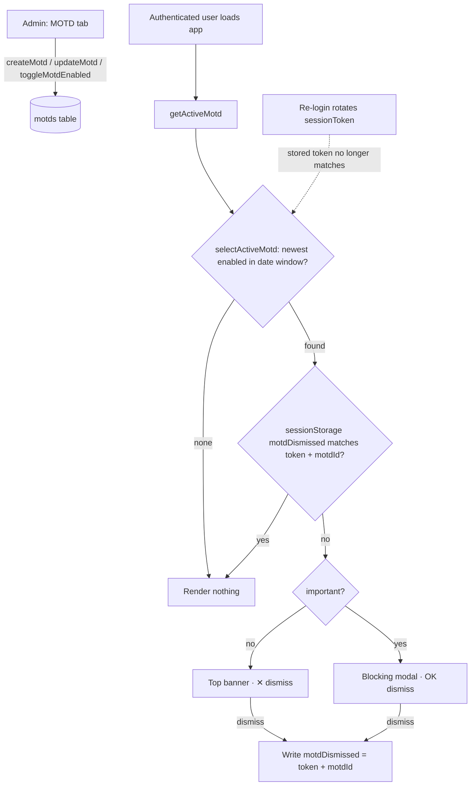

# Message of the Day (MOTD) Implementation Plan

> **For agentic workers:** REQUIRED SUB-SKILL: Use superpowers:subagent-driven-development (recommended) or superpowers:
> executing-plans to implement this plan task-by-task. Steps use checkbox (`- [ ]`) syntax for tracking.

**Goal:** Add an admin-authored Message of the Day shown to authenticated users as a dismissible top banner (or a
blocking modal when flagged "important"), with markdown bodies, per-locale text, optional scheduling, and dismissal that
re-shows on the next login.

**Architecture:** A new `motds` Convex table holds a list of messages; a pure `selectActiveMotd` picks the single newest
enabled message inside its date window. A viewer query `getActiveMotd` feeds a client `<Motd>` component rendered above
`<AppNav>` inside `RequireAuth`. Dismissal is stored in `sessionStorage` keyed by `{ sessionToken, motdId }`, so a fresh
login (which rotates the session token) re-shows it. Admins manage messages from a new "MOTD" tab in the admin panel.
Markdown is rendered with `react-markdown` + `remark-gfm` (no raw HTML).

**Tech Stack:** Convex (queries/mutations, `v.record`), React 19 + Vite, Tailwind v4, react-i18next, `react-markdown`,
`remark-gfm`, Vitest + Testing Library.

## Global Constraints

- **NEVER run `git commit` / `git push`** (project `CLAUDE.md`). Each task ends with a **Checkpoint** step that runs
  verification only; Henriko commits manually.
- **Package manager is pnpm**, never npm. Run any Convex CLI from the **repo root** (running it inside `convex/` wipes
  the deployment).
- Before writing Convex code, the rules in `convex/_generated/ai/guidelines.md` override training-data assumptions (
  function syntax: `{ args, handler }`; validators via `v`; index queries via `.withIndex`).
- **Keep `docs/PLATFORM.md` in sync in this same change** — Task 9 covers it; a feature is not "done" until the docs
  reflect it.
- Markdown rendering MUST NOT enable raw HTML (do **not** add `rehype-raw`).
- `Modal`'s new props `dismissOnBackdrop` / `dismissOnEscape` default to `true` so existing callers are unaffected.
- `motds.bodies` is a `v.record(v.string(), v.string())`; the **English (`en`) body is required by validation**, other
  locales optional.
- This is **pre-launch with disposable dev data** — additive schema changes ship directly (no backfill/migration).
- Test commands: app → `pnpm --filter app test`; convex → `pnpm --filter convex test`. Single app file →
  `pnpm --filter app exec vitest run <path>`. Single convex file →
  `pnpm --filter convex exec vitest run <path-relative-to-convex>`.

---

### Task 1: Add the `motds` table to the schema

**Files:**

- Modify: `convex/schema.ts` (add a new table after the `feedbackResponses` table, before the closing `})`)

**Interfaces:**

- Consumes: nothing.
- Produces: a `motds` table with fields `bodies: Record<string,string>`, `important: boolean`, `enabled: boolean`,
  `startAt?: number`, `expiresAt?: number`, `createdBy: Id<'users'>`, `createdAt: number`, `updatedAt: number`, and
  index `by_enabled_and_created` on `['enabled', 'createdAt']`.

- [ ] **Step 1: Add the table definition**

In `convex/schema.ts`, add this table inside the `defineSchema({ ... })` object, immediately after the
`feedbackResponses` table definition (mind the comma after the previous table):

```ts
// Admin-authored Message of the Day. Exactly one is shown at a time (the newest enabled
// row whose [startAt, expiresAt) window covers "now" — see convex/motd/motd.ts:selectActiveMotd).
// `bodies` is a locale->markdown map; `en` is required (enforced in validation) and is the
// fallback for locales without their own body. A record (not a fixed object) so new locales
// need no schema migration. Admin content — not personal data, hard-deleted on removal.
motds: defineTable({
  bodies: v.record(v.string(), v.string()),
  important: v.boolean(), // false -> banner, true -> blocking modal
  enabled: v.boolean(),
  startAt: v.optional(v.number()), // optional scheduled start (ms epoch)
  expiresAt: v.optional(v.number()), // optional "limited date" (ms epoch)
  createdBy: v.id('users'),
  createdAt: v.number(),
  updatedAt: v.number()
}).index('by_enabled_and_created', ['enabled', 'createdAt'])
```

- [ ] **Step 2: Regenerate the Convex API types and push the schema**

Run (from the **repo root**):

```bash
npx convex dev --once
```

Expected: completes without schema errors and regenerates `convex/_generated/`. Output ends with something like
`✔ ... Convex functions ready!` (or `Schema validation passed`). If it cannot connect to a deployment in this
environment, instead run `pnpm --filter convex exec tsc --noEmit` and confirm `convex/schema.ts` typechecks with no
errors.

- [ ] **Step 3: Checkpoint (no commit)**

Confirm `convex/_generated/dataModel.d.ts` now references `motds`. Verification only — do **not** run `git commit`.
Files changed: `convex/schema.ts` (+ regenerated `convex/_generated/*`). Ready for Henriko to commit.

---

### Task 2: Backend pure helpers — active-selection + validation (TDD)

**Files:**

- Create: `convex/motd/motd.ts` (pure helpers only in this task; Convex functions added in Task 3)
- Test: `convex/motd/motd.test.ts`

**Interfaces:**

- Consumes: nothing (pure functions; no Convex imports yet).
- Produces:
    - `MAX_MOTD_BODY_LENGTH = 5000` and `REQUIRED_LOCALE = 'en'` constants.
    -
  `selectActiveMotd<T extends { enabled: boolean; startAt?: number; expiresAt?: number; createdAt: number }>(rows: T[], now: number): T | null`
  -
  `validateMotdInput(input: { bodies: Record<string,string>; startAt?: number; expiresAt?: number }): Record<string,string>` —
  returns cleaned bodies (trimmed; empty locales dropped) or throws.

- [ ] **Step 1: Write the failing tests**

Create `convex/motd/motd.test.ts`:

```ts
import { describe, it, expect } from 'vitest'
import { selectActiveMotd, validateMotdInput, MAX_MOTD_BODY_LENGTH } from './motd'

describe('selectActiveMotd', () => {
  it('returns null when there are no rows', () => {
    expect(selectActiveMotd([], 1000)).toBeNull()
  })

  it('excludes disabled rows', () => {
    expect(selectActiveMotd([{ enabled: false, createdAt: 1 }], 1000)).toBeNull()
  })

  it('returns the newest enabled row within the window', () => {
    const rows = [
      { enabled: true, createdAt: 1 },
      { enabled: true, createdAt: 5 },
      { enabled: true, createdAt: 3 }
    ]
    expect(selectActiveMotd(rows, 1000)?.createdAt).toBe(5)
  })

  it('excludes rows whose startAt is in the future', () => {
    expect(selectActiveMotd([{ enabled: true, createdAt: 1, startAt: 2000 }], 1000)).toBeNull()
  })

  it('excludes rows whose expiresAt has passed', () => {
    expect(selectActiveMotd([{ enabled: true, createdAt: 1, expiresAt: 500 }], 1000)).toBeNull()
  })

  it('includes a row exactly at startAt and strictly before expiresAt', () => {
    const row = { enabled: true, createdAt: 1, startAt: 1000, expiresAt: 2000 }
    expect(selectActiveMotd([row], 1000)).toEqual(row)
  })
})

describe('validateMotdInput', () => {
  it('requires a non-empty English body', () => {
    expect(() => validateMotdInput({ bodies: { pt: 'Olá' } })).toThrow(/English/)
    expect(() => validateMotdInput({ bodies: { en: '   ' } })).toThrow(/English/)
  })

  it('trims bodies and drops empty optional-locale entries', () => {
    expect(validateMotdInput({ bodies: { en: '  hi  ', pt: '   ', es: 'hola' } })).toEqual({
      en: 'hi',
      es: 'hola'
    })
  })

  it('rejects an over-length body', () => {
    const long = 'a'.repeat(MAX_MOTD_BODY_LENGTH + 1)
    expect(() => validateMotdInput({ bodies: { en: long } })).toThrow(/characters or fewer/)
  })

  it('rejects expiresAt on or before startAt', () => {
    expect(() => validateMotdInput({ bodies: { en: 'hi' }, startAt: 1000, expiresAt: 1000 })).toThrow(/after its start/)
    expect(() => validateMotdInput({ bodies: { en: 'hi' }, startAt: 2000, expiresAt: 1000 })).toThrow(/after its start/)
  })

  it('accepts a valid input and returns cleaned bodies', () => {
    expect(validateMotdInput({ bodies: { en: 'hi' }, startAt: 1000, expiresAt: 2000 })).toEqual({ en: 'hi' })
  })
})
```

- [ ] **Step 2: Run the tests to verify they fail**

Run: `pnpm --filter convex exec vitest run motd/motd.test.ts`
Expected: FAIL — `Failed to resolve import "./motd"` (the file does not exist yet).

- [ ] **Step 3: Write the minimal implementation**

Create `convex/motd/motd.ts`:

```ts
// convex/motd/motd.ts
// Message of the Day: admin authoring (CRUD) + the viewer query that resolves the single
// active MOTD. Pure helpers (selectActiveMotd / validateMotdInput) are exported for unit tests.

export const MAX_MOTD_BODY_LENGTH = 5000
export const REQUIRED_LOCALE = 'en'

type MotdActiveFields = {
  enabled: boolean
  startAt?: number
  expiresAt?: number
  createdAt: number
}

// Pure: the newest enabled MOTD whose [startAt, expiresAt) window covers `now`, else null.
export function selectActiveMotd<T extends MotdActiveFields>(rows: T[], now: number): T | null {
  const active = rows
    .filter(r => r.enabled)
    .filter(r => (r.startAt == null || r.startAt <= now) && (r.expiresAt == null || r.expiresAt > now))
    .sort((a, b) => b.createdAt - a.createdAt)
  return active[0] ?? null
}

// Pure: trim per-locale bodies, drop empties, enforce a required English body, cap length,
// and require expiresAt > startAt when both are present. Returns the cleaned bodies map.
export function validateMotdInput(input: {
  bodies: Record<string, string>
  startAt?: number
  expiresAt?: number
}): Record<string, string> {
  const cleaned: Record<string, string> = {}
  for (const [locale, body] of Object.entries(input.bodies)) {
    const trimmed = body.trim()
    if (trimmed.length === 0) continue
    if (trimmed.length > MAX_MOTD_BODY_LENGTH) {
      throw new Error(`MOTD body for "${locale}" must be ${MAX_MOTD_BODY_LENGTH} characters or fewer.`)
    }
    cleaned[locale] = trimmed
  }
  if (!cleaned[REQUIRED_LOCALE]) {
    throw new Error('An English (en) MOTD body is required.')
  }
  if (input.startAt != null && input.expiresAt != null && input.expiresAt <= input.startAt) {
    throw new Error('MOTD expiry must be after its start date.')
  }
  return cleaned
}
```

- [ ] **Step 4: Run the tests to verify they pass**

Run: `pnpm --filter convex exec vitest run motd/motd.test.ts`
Expected: PASS — all 12 assertions green.

- [ ] **Step 5: Checkpoint (no commit)**

Files changed: `convex/motd/motd.ts`, `convex/motd/motd.test.ts`. Verification only — do **not** commit.

---

### Task 3: Backend Convex functions — viewer query + admin CRUD

**Files:**

- Modify: `convex/motd/motd.ts` (append the queries/mutations below the pure helpers)

**Interfaces:**

- Consumes: `requireAuth`, `resolveSession` from `convex/lib/auth.ts`; `assertAdmin` from `convex/admin.ts`;
  `selectActiveMotd`, `validateMotdInput` from Task 2; the `motds` table from Task 1.
- ## Produces (referenced by the frontend as `api.motd.motd.*`):

  `getActiveMotd({ sessionToken?: string }) -> { _id: Id<'motds'>, bodies: Record<string,string>, important: boolean } | null`
    - `listMotds({ sessionToken: string }) -> Doc<'motds'>[]` (newest-first)
    - `createMotd({ sessionToken, bodies, important, enabled, startAt?, expiresAt? }) -> Id<'motds'>`
    - `updateMotd({ sessionToken, motdId, bodies, important, enabled, startAt?, expiresAt? }) -> void`
    - `deleteMotd({ sessionToken, motdId }) -> void`
    - `toggleMotdEnabled({ sessionToken, motdId, enabled }) -> void`

- [ ] **Step 1: Add the Convex imports at the top of `convex/motd/motd.ts`**

Insert these imports as the first lines of the file (above the `MAX_MOTD_BODY_LENGTH` constant):

```ts
import { mutation, query } from '../_generated/server'
import { v } from 'convex/values'
import { requireAuth, resolveSession } from '../lib/auth'
import { assertAdmin } from '../admin'
```

- [ ] **Step 2: Append the functions at the end of `convex/motd/motd.ts`**

```ts
const bodiesValidator = v.record(v.string(), v.string())

// Viewer query — returns the single active MOTD (locale-resolution happens client-side) or null.
// Non-throwing: an unauthenticated/expired token yields null rather than an error state.
export const getActiveMotd = query({
  args: { sessionToken: v.optional(v.string()) },
  handler: async (ctx, { sessionToken }) => {
    const user = await resolveSession(ctx, sessionToken)
    if (!user) return null
    const enabledRows = await ctx.db
      .query('motds')
      .withIndex('by_enabled_and_created', q => q.eq('enabled', true))
      .order('desc')
      .take(50)
    const active = selectActiveMotd(enabledRows, Date.now())
    if (!active) return null
    return { _id: active._id, bodies: active.bodies, important: active.important }
  }
})

// Admin: every MOTD, newest-first. Bounded — admin tool.
export const listMotds = query({
  args: { sessionToken: v.string() },
  handler: async (ctx, { sessionToken }) => {
    const admin = await requireAuth(ctx, sessionToken)
    assertAdmin(admin)
    return await ctx.db.query('motds').order('desc').take(200)
  }
})

export const createMotd = mutation({
  args: {
    sessionToken: v.string(),
    bodies: bodiesValidator,
    important: v.boolean(),
    enabled: v.boolean(),
    startAt: v.optional(v.number()),
    expiresAt: v.optional(v.number())
  },
  handler: async (ctx, { sessionToken, bodies, important, enabled, startAt, expiresAt }) => {
    const admin = await requireAuth(ctx, sessionToken)
    assertAdmin(admin)
    const cleaned = validateMotdInput({ bodies, startAt, expiresAt })
    const now = Date.now()
    return await ctx.db.insert('motds', {
      bodies: cleaned,
      important,
      enabled,
      ...(startAt != null ? { startAt } : {}),
      ...(expiresAt != null ? { expiresAt } : {}),
      createdBy: admin._id,
      createdAt: now,
      updatedAt: now
    })
  }
})

export const updateMotd = mutation({
  args: {
    sessionToken: v.string(),
    motdId: v.id('motds'),
    bodies: bodiesValidator,
    important: v.boolean(),
    enabled: v.boolean(),
    startAt: v.optional(v.number()),
    expiresAt: v.optional(v.number())
  },
  handler: async (ctx, { sessionToken, motdId, bodies, important, enabled, startAt, expiresAt }) => {
    const admin = await requireAuth(ctx, sessionToken)
    assertAdmin(admin)
    const existing = await ctx.db.get(motdId)
    if (!existing) throw new Error('MOTD not found')
    const cleaned = validateMotdInput({ bodies, startAt, expiresAt })
    // Setting a field to undefined in patch clears it — so clearing a date removes the schedule.
    await ctx.db.patch(motdId, {
      bodies: cleaned,
      important,
      enabled,
      startAt: startAt ?? undefined,
      expiresAt: expiresAt ?? undefined,
      updatedAt: Date.now()
    })
  }
})

export const deleteMotd = mutation({
  args: { sessionToken: v.string(), motdId: v.id('motds') },
  handler: async (ctx, { sessionToken, motdId }) => {
    const admin = await requireAuth(ctx, sessionToken)
    assertAdmin(admin)
    const existing = await ctx.db.get(motdId)
    if (!existing) throw new Error('MOTD not found')
    await ctx.db.delete(motdId)
  }
})

export const toggleMotdEnabled = mutation({
  args: { sessionToken: v.string(), motdId: v.id('motds'), enabled: v.boolean() },
  handler: async (ctx, { sessionToken, motdId, enabled }) => {
    const admin = await requireAuth(ctx, sessionToken)
    assertAdmin(admin)
    const existing = await ctx.db.get(motdId)
    if (!existing) throw new Error('MOTD not found')
    await ctx.db.patch(motdId, { enabled, updatedAt: Date.now() })
  }
})
```

- [ ] **Step 3: Verify the pure-helper tests still pass and regenerate the API**

Run: `pnpm --filter convex test`
Expected: PASS — the `motd/motd.test.ts` suite (and all existing convex suites) stay green.

Then, from the **repo root**: `npx convex dev --once`
Expected: pushes without errors and regenerates `convex/_generated/api.d.ts` so `api.motd.motd.getActiveMotd` (and
siblings) typecheck. (If no deployment is reachable here, run `pnpm --filter convex exec tsc --noEmit` and confirm
`convex/motd/motd.ts` typechecks.)

- [ ] **Step 4: Checkpoint (no commit)**

Files changed: `convex/motd/motd.ts` (+ regenerated `convex/_generated/*`). Verification only — do **not** commit.

---

### Task 4: `MarkdownView` — safe shared markdown renderer (TDD)

**Files:**

- Modify: `app/package.json` (add `react-markdown`, `remark-gfm` via pnpm — do not hand-edit)
- Create: `app/src/components/MarkdownView.tsx`
- Test: `app/src/components/MarkdownView.test.tsx`

**Interfaces:**

- Consumes: `react-markdown`, `remark-gfm`.
- Produces: `export default function MarkdownView({ markdown, className }: { markdown: string; className?: string })` —
  renders GFM markdown to React elements, no raw HTML, links forced to `target="_blank" rel="noopener noreferrer"`.

- [ ] **Step 1: Add the dependencies**

Run: `pnpm --filter app add react-markdown remark-gfm`
Expected: both appear under `dependencies` in `app/package.json` and the lockfile updates.

- [ ] **Step 2: Write the failing tests**

Create `app/src/components/MarkdownView.test.tsx`:

```tsx
import { render, screen } from '@testing-library/react'
import { describe, it, expect } from 'vitest'
import MarkdownView from './MarkdownView'

describe('MarkdownView', () => {
  it('renders GFM markdown with safe external links', () => {
    render(<MarkdownView markdown={'# Title\n\n**bold** and [link](https://example.com)'} />)
    expect(screen.getByRole('heading', { name: 'Title' })).toBeInTheDocument()
    expect(screen.getByText('bold')).toBeInTheDocument()
    const link = screen.getByRole('link', { name: 'link' })
    expect(link).toHaveAttribute('href', 'https://example.com')
    expect(link).toHaveAttribute('target', '_blank')
    expect(link.getAttribute('rel') ?? '').toContain('noopener')
  })

  it('does not render raw HTML as live markup', () => {
    const { container } = render(<MarkdownView markdown={'<script>alert(1)</script><b>x</b>'} />)
    expect(container.querySelector('script')).toBeNull()
    // react-markdown (no rehype-raw) renders raw HTML as literal text, not parsed elements.
    expect(container.textContent).toContain('<b>x</b>')
  })

  it('neutralizes javascript: links', () => {
    render(<MarkdownView markdown={'[x](javascript:alert(1))'} />)
    const anchor = screen.getByText('x')
    expect(anchor.getAttribute('href') ?? '').not.toContain('javascript:')
  })
})
```

- [ ] **Step 3: Run the tests to verify they fail**

Run: `pnpm --filter app exec vitest run src/components/MarkdownView.test.tsx`
Expected: FAIL — `Failed to resolve import "./MarkdownView"`.

- [ ] **Step 4: Write the implementation**

Create `app/src/components/MarkdownView.tsx`:

```tsx
import ReactMarkdown from 'react-markdown'
import remarkGfm from 'remark-gfm'

type Props = { markdown: string; className?: string }

// Safe markdown renderer shared by the live MOTD and the admin preview.
// No raw HTML (rehype-raw deliberately omitted); react-markdown's default urlTransform strips
// dangerous URL protocols (javascript:, etc.). Links are forced to open in a new tab safely.
export default function MarkdownView({ markdown, className }: Props) {
  return (
    <div className={className}>
      <ReactMarkdown
        remarkPlugins={[remarkGfm]}
        components={{
          a: ({ node: _node, ...props }) => (
            <a
              {...props}
              target="_blank"
              rel="noopener noreferrer"
              className="underline"
            />
          )
        }}
      >
        {markdown}
      </ReactMarkdown>
    </div>
  )
}
```

- [ ] **Step 5: Run the tests to verify they pass**

Run: `pnpm --filter app exec vitest run src/components/MarkdownView.test.tsx`
Expected: PASS — all 3 tests green.

- [ ] **Step 6: Checkpoint (no commit)**

Files changed: `app/package.json`, `pnpm-lock.yaml`, `app/src/components/MarkdownView.tsx`,
`app/src/components/MarkdownView.test.tsx`. Verification only — do **not** commit.

---

### Task 5: Extend `Modal` with non-dismissible options (TDD)

**Files:**

- Modify: `app/src/components/Modal.tsx`
- Modify: `app/src/components/Modal.test.tsx`

**Interfaces:**

- Consumes: nothing new.
- Produces: `Modal` gains `dismissOnBackdrop?: boolean` (default `true`) and `dismissOnEscape?: boolean` (default
  `true`). When `false`, that dismissal path is disabled.

- [ ] **Step 1: Add the failing regression tests**

Append these two tests inside the `describe('Modal', ...)` block in `app/src/components/Modal.test.tsx` (before its
closing `})`):

```tsx
it('does not call onClose on backdrop click when dismissOnBackdrop is false', () => {
  const onClose = vi.fn()
  render(
    <Modal
      onClose={onClose}
      dismissOnBackdrop={false}
    >
      <p>Body</p>
    </Modal>
  )
  fireEvent.click(screen.getByTestId('modal-backdrop'))
  expect(onClose).not.toHaveBeenCalled()
})

it('does not call onClose on Escape when dismissOnEscape is false', () => {
  const onClose = vi.fn()
  render(
    <Modal
      onClose={onClose}
      dismissOnEscape={false}
    >
      <p>Body</p>
    </Modal>
  )
  fireEvent.keyDown(window, { key: 'Escape' })
  expect(onClose).not.toHaveBeenCalled()
})
```

- [ ] **Step 2: Run the tests to verify they fail**

Run: `pnpm --filter app exec vitest run src/components/Modal.test.tsx`
Expected: FAIL — the two new tests fail because the current `Modal` always closes on backdrop click and Escape (the prop
is ignored).

- [ ] **Step 3: Update `Modal.tsx`**

Replace the entire contents of `app/src/components/Modal.tsx` with:

```tsx
import { type ReactNode, useEffect } from 'react'

type Props = {
  onClose: () => void
  children: ReactNode
  panelClassName?: string
  dismissOnBackdrop?: boolean
  dismissOnEscape?: boolean
}

export default function Modal({
  onClose,
  children,
  panelClassName = 'max-w-sm',
  dismissOnBackdrop = true,
  dismissOnEscape = true
}: Props) {
  useEffect(() => {
    if (!dismissOnEscape) return
    function onKey(e: KeyboardEvent) {
      if (e.key === 'Escape') onClose()
    }
    window.addEventListener('keydown', onKey)
    return () => window.removeEventListener('keydown', onKey)
  }, [onClose, dismissOnEscape])

  return (
    <div
      data-testid="modal-backdrop"
      onClick={dismissOnBackdrop ? onClose : undefined}
      className="fixed inset-0 z-50 flex items-center justify-center bg-slate-900/50 p-4"
    >
      <div
        onClick={e => e.stopPropagation()}
        className={`w-full ${panelClassName} rounded-xl bg-white p-5 shadow-2xl`}
      >
        {children}
      </div>
    </div>
  )
}
```

- [ ] **Step 4: Run the full Modal suite to verify all pass**

Run: `pnpm --filter app exec vitest run src/components/Modal.test.tsx`
Expected: PASS — the 4 original tests (default behavior preserved) plus the 2 new tests all green.

- [ ] **Step 5: Checkpoint (no commit)**

Files changed: `app/src/components/Modal.tsx`, `app/src/components/Modal.test.tsx`. Verification only — do **not**
commit.

---

### Task 6: `Motd` display component + i18n keys (TDD)

**Files:**

- Modify: `app/src/i18n/locales/en.json`, `app/src/i18n/locales/pt.json`, `app/src/i18n/locales/es.json` (add a `motd`
  namespace)
- Create: `app/src/components/Motd.tsx`
- Test: `app/src/components/Motd.test.tsx`

**Interfaces:**

- Consumes: `api.motd.motd.getActiveMotd` (Task 3), `MarkdownView` (Task 4), `Modal` with the new props (Task 5),
  `react-i18next`.
- Produces: `export default function Motd()` — renders the active MOTD as a banner (or blocking modal when `important`),
  resolving the body via `bodies[lang] ?? bodies.en`, and writing dismissal to
  `sessionStorage['motdDismissed'] = JSON.stringify({ token, motdId })`.

- [ ] **Step 1: Add the i18n keys**

Add this top-level key to **each** of `app/src/i18n/locales/en.json`, `pt.json`, `es.json` (placement is flexible — it
must be a valid sibling key; e.g., insert right after the `"feedback": { ... },` block). Use the per-locale values
below.

`en.json`:

```json
  "motd": {
    "dismiss": "Dismiss",
    "ok": "OK"
  },
```

`pt.json`:

```json
  "motd": {
    "dismiss": "Dispensar",
    "ok": "OK"
  },
```

`es.json`:

```json
  "motd": {
    "dismiss": "Descartar",
    "ok": "OK"
  },
```

(If you add it as the **last** key in a file, drop the trailing comma and add a comma to the previous key instead so the
JSON stays valid.)

- [ ] **Step 2: Write the failing tests**

Create `app/src/components/Motd.test.tsx`:

```tsx
import { render, screen, fireEvent } from '@testing-library/react'
import { describe, it, expect, vi, beforeEach } from 'vitest'

let activeMotd: { _id: string; bodies: Record<string, string>; important: boolean } | null = null
let currentLang = 'en'

vi.mock('convex/react', () => ({ useQuery: () => activeMotd }))
vi.mock('../convex', () => ({ api: { motd: { motd: { getActiveMotd: 'ref' } } } }))
vi.mock('react-i18next', () => ({
  useTranslation: () => ({ t: (k: string) => k, i18n: { language: currentLang } })
}))

import Motd from './Motd'

describe('Motd', () => {
  beforeEach(() => {
    sessionStorage.clear()
    sessionStorage.setItem('sessionToken', 'tok1')
    activeMotd = null
    currentLang = 'en'
  })

  it('renders nothing when there is no active MOTD', () => {
    activeMotd = null
    const { container } = render(<Motd />)
    expect(container).toBeEmptyDOMElement()
  })

  it('renders a banner (not a modal) for a non-important MOTD', () => {
    activeMotd = { _id: 'm1', bodies: { en: 'Hello **world**' }, important: false }
    render(<Motd />)
    expect(screen.getByText('world')).toBeInTheDocument()
    expect(screen.queryByTestId('modal-backdrop')).not.toBeInTheDocument()
  })

  it('hides after dismiss and records the dismissal in sessionStorage', () => {
    activeMotd = { _id: 'm1', bodies: { en: 'Hi there' }, important: false }
    render(<Motd />)
    fireEvent.click(screen.getByRole('button', { name: 'motd.dismiss' }))
    expect(screen.queryByText('Hi there')).not.toBeInTheDocument()
    expect(JSON.parse(sessionStorage.getItem('motdDismissed')!)).toEqual({ token: 'tok1', motdId: 'm1' })
  })

  it('re-shows after a re-login (the session token changed)', () => {
    sessionStorage.setItem('motdDismissed', JSON.stringify({ token: 'tok1', motdId: 'm1' }))
    sessionStorage.setItem('sessionToken', 'tok2') // fresh token from a new login
    activeMotd = { _id: 'm1', bodies: { en: 'Hi there' }, important: false }
    render(<Motd />)
    expect(screen.getByText('Hi there')).toBeInTheDocument()
  })

  it('re-shows when a different MOTD becomes active in the same session', () => {
    sessionStorage.setItem('motdDismissed', JSON.stringify({ token: 'tok1', motdId: 'm1' }))
    activeMotd = { _id: 'm2', bodies: { en: 'A new message' }, important: false }
    render(<Motd />)
    expect(screen.getByText('A new message')).toBeInTheDocument()
  })

  it('renders a blocking modal with an OK button for an important MOTD', () => {
    activeMotd = { _id: 'm1', bodies: { en: 'Important notice' }, important: true }
    render(<Motd />)
    expect(screen.getByTestId('modal-backdrop')).toBeInTheDocument()
    expect(screen.getByRole('button', { name: 'motd.ok' })).toBeInTheDocument()
  })

  it('falls back to English when the active language has no body', () => {
    currentLang = 'pt'
    activeMotd = { _id: 'm1', bodies: { en: 'English body' }, important: false }
    render(<Motd />)
    expect(screen.getByText('English body')).toBeInTheDocument()
  })

  it('shows the active-language body when present', () => {
    currentLang = 'pt'
    activeMotd = { _id: 'm1', bodies: { en: 'English', pt: 'Portugues' }, important: false }
    render(<Motd />)
    expect(screen.getByText('Portugues')).toBeInTheDocument()
  })
})
```

- [ ] **Step 3: Run the tests to verify they fail**

Run: `pnpm --filter app exec vitest run src/components/Motd.test.tsx`
Expected: FAIL — `Failed to resolve import "./Motd"`.

- [ ] **Step 4: Write the implementation**

Create `app/src/components/Motd.tsx`:

```tsx
import { useState } from 'react'
import { useQuery } from 'convex/react'
import { useTranslation } from 'react-i18next'
import { api } from '../convex'
import MarkdownView from './MarkdownView'
import Modal from './Modal'

type DismissRecord = { token?: string; motdId?: string }

function readDismissed(): DismissRecord | null {
  try {
    const raw = sessionStorage.getItem('motdDismissed')
    return raw ? (JSON.parse(raw) as DismissRecord) : null
  } catch {
    return null
  }
}

export default function Motd() {
  const { t, i18n } = useTranslation()
  const token = sessionStorage.getItem('sessionToken') ?? undefined
  const motd = useQuery(api.motd.motd.getActiveMotd, { sessionToken: token })
  // Tracks a dismiss performed during this mount (so the UI updates immediately on click).
  const [dismissedId, setDismissedId] = useState<string | null>(null)

  if (!motd) return null

  const stored = readDismissed()
  const isDismissed = dismissedId === motd._id || (stored?.token === token && stored?.motdId === motd._id)
  if (isDismissed) return null

  const lang = (i18n.language || 'en').split('-')[0]
  const body = motd.bodies[lang] ?? motd.bodies.en ?? ''

  function dismiss() {
    if (token) sessionStorage.setItem('motdDismissed', JSON.stringify({ token, motdId: motd._id }))
    setDismissedId(motd._id)
  }

  if (motd.important) {
    return (
      <Modal
        onClose={dismiss}
        dismissOnBackdrop={false}
        dismissOnEscape={false}
        panelClassName="max-w-lg"
      >
        <div className="[&_a]:text-blue-600 [&_h1]:mb-2 [&_h1]:text-lg [&_h1]:font-bold [&_h2]:font-semibold">
          <MarkdownView
            markdown={body}
            className="text-sm leading-relaxed text-slate-700"
          />
        </div>
        <div className="mt-5 flex justify-end">
          <button
            type="button"
            onClick={dismiss}
            className="rounded-md bg-slate-900 px-4 py-2 text-sm font-semibold text-white hover:bg-slate-800"
          >
            {t('motd.ok')}
          </button>
        </div>
      </Modal>
    )
  }

  return (
    <div className="w-full bg-blue-600 px-4 py-2 text-sm text-white">
      <div className="mx-auto flex max-w-[640px] items-start gap-3">
        <div className="min-w-0 flex-1 [&_p]:m-0">
          <MarkdownView markdown={body} />
        </div>
        <button
          type="button"
          aria-label={t('motd.dismiss')}
          onClick={dismiss}
          className="shrink-0 cursor-pointer rounded px-1 text-white/80 hover:text-white"
        >
          ✕
        </button>
      </div>
    </div>
  )
}
```

- [ ] **Step 5: Run the tests to verify they pass**

Run: `pnpm --filter app exec vitest run src/components/Motd.test.tsx`
Expected: PASS — all 8 tests green.

- [ ] **Step 6: Checkpoint (no commit)**

Files changed: the three locale JSONs, `app/src/components/Motd.tsx`, `app/src/components/Motd.test.tsx`. Verification
only — do **not** commit.

---

### Task 7: Wire `Motd` into the app shell

**Files:**

- Modify: `app/src/App.tsx`

**Interfaces:**

- Consumes: `Motd` (Task 6).
- Produces: `<Motd />` rendered at the top of `RequireAuth`'s authenticated output, above `<AppNav />`.

- [ ] **Step 1: Import `Motd`**

In `app/src/App.tsx`, add the import alongside the other component imports (e.g., after the `AppNav` import on line 13):

```tsx
import Motd from './components/Motd'
```

- [ ] **Step 2: Render `<Motd />` above `<AppNav />`**

In `app/src/App.tsx`, change the final `return` of `RequireAuth` from:

```tsx
return (
  <>
    <AppNav />
    {children}
    <FeedbackButton />
  </>
)
```

to:

```tsx
return (
  <>
    <Motd />
    <AppNav />
    {children}
    <FeedbackButton />
  </>
)
```

- [ ] **Step 3: Verify the app suite and lint pass**

Run: `pnpm --filter app test`
Expected: PASS — the full app test suite (including `Motd`, `MarkdownView`, `Modal`) is green.

Run: `pnpm lint`
Expected: no errors (`eslint . --max-warnings 0` exits 0).

- [ ] **Step 4: Checkpoint (no commit)**

Files changed: `app/src/App.tsx`. Verification only — do **not** commit.

---

### Task 8: Admin "MOTD" tab (TDD-lite)

**Files:**

- Create: `app/src/components/MotdTab.tsx`
- Test: `app/src/components/MotdTab.test.tsx`
- Modify: `app/src/pages/AdminPage.tsx`

**Interfaces:**

- Consumes: `api.motd.motd.{listMotds,createMotd,updateMotd,deleteMotd,toggleMotdEnabled}` (Task 3), `MarkdownView` (
  Task 4).
- Produces: `export default function MotdTab({ sessionToken, isAdmin }: { sessionToken?: string; isAdmin?: boolean })`;
  `AdminPage` gains a `'motd'` tab.

- [ ] **Step 1: Write the failing tests**

Create `app/src/components/MotdTab.test.tsx`:

```tsx
import { render, screen, fireEvent } from '@testing-library/react'
import { describe, it, expect, vi, beforeEach } from 'vitest'
import { useQuery } from 'convex/react'

vi.mock('convex/react', () => ({ useQuery: vi.fn(), useMutation: vi.fn(() => vi.fn()) }))
vi.mock('../convex', () => ({
  api: {
    motd: {
      motd: {
        listMotds: 'listMotds',
        createMotd: 'createMotd',
        updateMotd: 'updateMotd',
        deleteMotd: 'deleteMotd',
        toggleMotdEnabled: 'toggleMotdEnabled'
      }
    }
  }
}))

import MotdTab from './MotdTab'

beforeEach(() => {
  vi.mocked(useQuery).mockReturnValue([
    { _id: 'm1', bodies: { en: 'Hello world' }, important: false, enabled: true, createdAt: 1 }
  ] as never)
})

describe('MotdTab', () => {
  it('lists existing MOTDs with their status', () => {
    render(
      <MotdTab
        sessionToken="tok"
        isAdmin
      />
    )
    expect(screen.getByText('Hello world')).toBeInTheDocument()
    expect(screen.getByText('Enabled')).toBeInTheDocument()
  })

  it('opens the editor with a required EN field when creating', () => {
    render(
      <MotdTab
        sessionToken="tok"
        isAdmin
      />
    )
    fireEvent.click(screen.getByRole('button', { name: /new motd/i }))
    expect(screen.getByText(/EN \(required\)/i)).toBeInTheDocument()
  })
})
```

- [ ] **Step 2: Run the tests to verify they fail**

Run: `pnpm --filter app exec vitest run src/components/MotdTab.test.tsx`
Expected: FAIL — `Failed to resolve import "./MotdTab"`.

- [ ] **Step 3: Implement `MotdTab.tsx`**

Create `app/src/components/MotdTab.tsx`:

```tsx
import { useState } from 'react'
import { useMutation, useQuery } from 'convex/react'
import type { Id } from '../../../convex/_generated/dataModel'
import { api } from '../convex'
import MarkdownView from './MarkdownView'

const SUPPORTED_LOCALES = ['en', 'pt', 'es'] as const
type Locale = (typeof SUPPORTED_LOCALES)[number]

type EditState = {
  id: Id<'motds'> | null // null = creating
  bodies: Record<string, string>
  important: boolean
  enabled: boolean
  startLocal: string
  expiresLocal: string
}

// epoch ms -> value for <input type="datetime-local"> (local wall-clock), and back.
function msToLocalInput(ms?: number): string {
  if (ms == null) return ''
  const d = new Date(ms)
  return new Date(ms - d.getTimezoneOffset() * 60000).toISOString().slice(0, 16)
}
function localInputToMs(s: string): number | undefined {
  if (!s) return undefined
  const ms = new Date(s).getTime()
  return Number.isNaN(ms) ? undefined : ms
}

export default function MotdTab({ sessionToken, isAdmin }: { sessionToken?: string; isAdmin?: boolean }) {
  const motds = useQuery(api.motd.motd.listMotds, sessionToken && isAdmin ? { sessionToken } : 'skip')
  const createMotd = useMutation(api.motd.motd.createMotd)
  const updateMotd = useMutation(api.motd.motd.updateMotd)
  const deleteMotd = useMutation(api.motd.motd.deleteMotd)
  const toggleEnabled = useMutation(api.motd.motd.toggleMotdEnabled)

  const [edit, setEdit] = useState<EditState | null>(null)
  const [previewLocale, setPreviewLocale] = useState<Locale>('en')
  const [error, setError] = useState<string | null>(null)
  const [saving, setSaving] = useState(false)

  function startCreate() {
    setError(null)
    setEdit({
      id: null,
      bodies: { en: '', pt: '', es: '' },
      important: false,
      enabled: true,
      startLocal: '',
      expiresLocal: ''
    })
  }

  function startEdit(m: {
    _id: Id<'motds'>
    bodies: Record<string, string>
    important: boolean
    enabled: boolean
    startAt?: number
    expiresAt?: number
  }) {
    setError(null)
    setEdit({
      id: m._id,
      bodies: { en: m.bodies.en ?? '', pt: m.bodies.pt ?? '', es: m.bodies.es ?? '' },
      important: m.important,
      enabled: m.enabled,
      startLocal: msToLocalInput(m.startAt),
      expiresLocal: msToLocalInput(m.expiresAt)
    })
  }

  async function handleSave() {
    if (!sessionToken || !edit) return
    setSaving(true)
    setError(null)
    const payload = {
      sessionToken,
      bodies: edit.bodies,
      important: edit.important,
      enabled: edit.enabled,
      startAt: localInputToMs(edit.startLocal),
      expiresAt: localInputToMs(edit.expiresLocal)
    }
    try {
      if (edit.id) await updateMotd({ ...payload, motdId: edit.id })
      else await createMotd(payload)
      setEdit(null)
    } catch (e) {
      setError(e instanceof Error ? e.message : 'Failed to save MOTD')
    } finally {
      setSaving(false)
    }
  }

  if (motds === undefined) return <p className="text-sm text-slate-500">Loading…</p>

  return (
    <div>
      <div className="mb-4 flex items-center justify-between">
        <h2 className="text-base font-semibold text-slate-900">Messages of the Day</h2>
        <button
          onClick={startCreate}
          className="rounded-md bg-blue-600 px-3 py-1.5 text-sm font-semibold text-white hover:bg-blue-700"
        >
          New MOTD
        </button>
      </div>

      {motds.length === 0 && <p className="text-sm text-slate-500">No MOTDs yet.</p>}

      <ul className="flex flex-col gap-2">
        {motds.map(m => (
          <li
            key={m._id}
            className="rounded-lg border border-slate-200 bg-white p-3"
          >
            <div className="flex items-center gap-2">
              <span
                className={`rounded-full px-2 py-0.5 text-xs font-medium ${m.enabled ? 'bg-green-100 text-green-700' : 'bg-slate-100 text-slate-500'}`}
              >
                {m.enabled ? 'Enabled' : 'Disabled'}
              </span>
              {m.important && (
                <span className="rounded-full bg-amber-100 px-2 py-0.5 text-xs font-medium text-amber-700">
                  Important
                </span>
              )}
              <span className="ml-auto text-xs text-slate-400">
                {m.startAt ? `from ${new Date(m.startAt).toLocaleString()} ` : ''}
                {m.expiresAt ? `until ${new Date(m.expiresAt).toLocaleString()}` : ''}
              </span>
            </div>
            <p className="mt-2 line-clamp-2 text-sm text-slate-600">{m.bodies.en}</p>
            <div className="mt-2 flex gap-3">
              <button
                onClick={() => startEdit(m)}
                className="text-xs font-semibold text-blue-600 hover:underline"
              >
                Edit
              </button>
              <button
                onClick={() => sessionToken && void toggleEnabled({ sessionToken, motdId: m._id, enabled: !m.enabled })}
                className="text-xs font-semibold text-slate-600 hover:underline"
              >
                {m.enabled ? 'Disable' : 'Enable'}
              </button>
              <button
                onClick={() => sessionToken && void deleteMotd({ sessionToken, motdId: m._id })}
                className="text-xs font-semibold text-red-600 hover:underline"
              >
                Delete
              </button>
            </div>
          </li>
        ))}
      </ul>

      {edit && (
        <div className="mt-5 rounded-lg border border-slate-200 bg-white p-4">
          <h3 className="text-sm font-semibold text-slate-900">{edit.id ? 'Edit MOTD' : 'New MOTD'}</h3>

          {SUPPORTED_LOCALES.map(loc => (
            <label
              key={loc}
              className="mt-3 flex flex-col gap-1"
            >
              <span className="text-[11px] font-semibold uppercase tracking-wide text-slate-500">
                {loc.toUpperCase()} {loc === 'en' ? '(required)' : '(optional)'}
              </span>
              <textarea
                value={edit.bodies[loc] ?? ''}
                onChange={e => setEdit({ ...edit, bodies: { ...edit.bodies, [loc]: e.target.value } })}
                rows={loc === 'en' ? 5 : 3}
                placeholder="Markdown supported…"
                className="resize-none rounded-md border border-slate-200 px-3 py-2 text-sm focus:border-blue-400 focus:outline-none"
              />
            </label>
          ))}

          <div className="mt-3 flex flex-wrap gap-4">
            <label className="flex items-center gap-2 text-sm text-slate-700">
              <input
                type="checkbox"
                checked={edit.important}
                onChange={e => setEdit({ ...edit, important: e.target.checked })}
              />
              Important (blocking modal)
            </label>
            <label className="flex items-center gap-2 text-sm text-slate-700">
              <input
                type="checkbox"
                checked={edit.enabled}
                onChange={e => setEdit({ ...edit, enabled: e.target.checked })}
              />
              Enabled
            </label>
          </div>

          <div className="mt-3 flex flex-wrap gap-4">
            <label className="flex flex-col gap-1 text-xs text-slate-500">
              Start (optional)
              <input
                type="datetime-local"
                value={edit.startLocal}
                onChange={e => setEdit({ ...edit, startLocal: e.target.value })}
                className="rounded-md border border-slate-200 px-2 py-1 text-sm"
              />
            </label>
            <label className="flex flex-col gap-1 text-xs text-slate-500">
              Expiry (optional)
              <input
                type="datetime-local"
                value={edit.expiresLocal}
                onChange={e => setEdit({ ...edit, expiresLocal: e.target.value })}
                className="rounded-md border border-slate-200 px-2 py-1 text-sm"
              />
            </label>
          </div>

          <div className="mt-4">
            <div className="mb-1 flex items-center gap-2">
              <span className="text-[11px] font-semibold uppercase tracking-wide text-slate-500">Preview</span>
              <select
                value={previewLocale}
                onChange={e => setPreviewLocale(e.target.value as Locale)}
                className="rounded border border-slate-200 text-xs"
              >
                {SUPPORTED_LOCALES.map(l => (
                  <option
                    key={l}
                    value={l}
                  >
                    {l.toUpperCase()}
                  </option>
                ))}
              </select>
            </div>
            <div className="rounded-md border border-slate-200 bg-slate-50 p-3 text-sm [&_a]:text-blue-600 [&_a]:underline">
              <MarkdownView markdown={edit.bodies[previewLocale] || edit.bodies.en || ''} />
            </div>
          </div>

          {error && <p className="mt-2 text-xs text-red-500">{error}</p>}

          <div className="mt-4 flex justify-end gap-2">
            <button
              onClick={() => setEdit(null)}
              className="rounded-md border border-slate-200 px-4 py-2 text-sm font-semibold text-slate-600 hover:bg-slate-50"
            >
              Cancel
            </button>
            <button
              onClick={() => void handleSave()}
              disabled={saving}
              className="rounded-md bg-blue-600 px-4 py-2 text-sm font-semibold text-white hover:bg-blue-700 disabled:opacity-50"
            >
              {saving ? 'Saving…' : 'Save'}
            </button>
          </div>
        </div>
      )}
    </div>
  )
}
```

- [ ] **Step 4: Run the MotdTab tests to verify they pass**

Run: `pnpm --filter app exec vitest run src/components/MotdTab.test.tsx`
Expected: PASS — both tests green.

- [ ] **Step 5: Wire the tab into `AdminPage.tsx`**

In `app/src/pages/AdminPage.tsx`:

1. Add the import after the `FeedbackTab` import (line 8):

```tsx
import MotdTab from '../components/MotdTab'
```

2. Add `'motd'` to the tab-state union (line 21):

```tsx
const [tab, setTab] = useState<'settings' | 'planLimits' | 'users' | 'feedback' | 'motd'>('settings')
```

3. Add a tab button immediately after the Feedback tab button (after its closing `</button>`, before the closing
   `</div>` of the tab bar):

```tsx
<button
  onClick={() => setTab('motd')}
  className={`px-4 py-2 text-sm font-medium transition-colors ${
    tab === 'motd' ? 'border-b-2 border-blue-500 text-blue-600' : 'text-slate-500 hover:text-slate-700'
  }`}
>
  MOTD
</button>
```

4. Add the tab body immediately after the Feedback tab block (after the `{tab === 'feedback' && (...)}` block):

```tsx
{
  /* MOTD tab */
}
{
  tab === 'motd' && (
    <MotdTab
      sessionToken={sessionToken}
      isAdmin={isAdmin}
    />
  )
}
```

- [ ] **Step 6: Verify the full app suite and lint pass**

Run: `pnpm --filter app test`
Expected: PASS — all app suites green, including the existing `AdminPage` tab tests (which route unknown `list*` queries
to `[]`, so `listMotds` returns `[]` and the MOTD tab renders cleanly).

Run: `pnpm lint`
Expected: exits 0.

- [ ] **Step 7: Checkpoint (no commit)**

Files changed: `app/src/components/MotdTab.tsx`, `app/src/components/MotdTab.test.tsx`, `app/src/pages/AdminPage.tsx`.
Verification only — do **not** commit.

---

### Task 9: Update `docs/PLATFORM.md`

**Files:**

- Modify: `docs/PLATFORM.md` (TOC, §5 table reference, new §12B section, §21 Maintaining map)

**Interfaces:**

- Consumes: the final shape of all prior tasks.
- Produces: canonical documentation in sync with the code (required by `CLAUDE.md`).

- [ ] **Step 1: Add the Table-of-Contents entry**

In `docs/PLATFORM.md`, after the `12A. [Feedback](#12a-feedback)` line (line 31), add:

```markdown
    12B. [Message of the Day (MOTD)](#12b-message-of-the-day-motd)
```

- [ ] **Step 2: Add the `motds` table to the §5 Table reference**

In `docs/PLATFORM.md`, immediately before the `## 6. Backend Architecture & Conventions` heading, add a new
table-reference block:

```markdown
#### `motds` — admin Message of the Day

Admin-authored announcements. Exactly one is shown at a time: the newest `enabled` row whose
`[startAt, expiresAt)` window covers "now" (`convex/motd/motd.ts:selectActiveMotd`). Hard-deleted
on removal (admin content, not personal data).

| Field       | Type                     | Req | Meaning                                                                                          |
| ----------- | ------------------------ | :-: | ------------------------------------------------------------------------------------------------ |
| `bodies`    | `record<string, string>` |  ✓  | Locale code → markdown body. `en` required (validation) and is the fallback for missing locales. |
| `important` | boolean                  |  ✓  | `false` → dismissible top banner; `true` → blocking modal (closable only via OK).                |
| `enabled`   | boolean                  |  ✓  | Admin on/off switch.                                                                             |
| `startAt`   | number                   |  –  | Optional scheduled start (ms). Absent ⇒ active immediately.                                      |
| `expiresAt` | number                   |  –  | Optional "limited date" (ms). Absent ⇒ never expires.                                            |
| `createdBy` | `id('users')`            |  ✓  | Admin who created it.                                                                            |
| `createdAt` | number                   |  ✓  | Creation timestamp (ms); also the tie-breaker for "newest active".                               |
| `updatedAt` | number                   |  ✓  | Last-edit timestamp (ms).                                                                        |

Index: `by_enabled_and_created [enabled, createdAt]` — the viewer query walks `enabled=true` newest-first.
```

- [ ] **Step 3: Add the §12B section**

In `docs/PLATFORM.md`, immediately before the `## 13. Scheduled Jobs (Crons)` heading (and after the `---` that closes
§12A), add:

````markdown
## 12B. Message of the Day (MOTD)

Admins author markdown announcements shown to authenticated users at the very top of the app.
Default presentation is a **dismissible top banner**; flagging a MOTD **important** escalates it to a
**blocking modal** that closes only via an OK button. Bodies are **per-locale markdown** (`en`
required as the fallback; others optional and extensible with no schema migration), with optional
**start/expiry scheduling**. Dismissal is **session-scoped** and re-shows on the next login.

**Data:** `motds` table (see [§5](#5-data-model)). The active MOTD is the newest `enabled` row whose
`[startAt, expiresAt)` window covers "now" — `selectActiveMotd` (pure, unit-tested).

**Backend** (`convex/motd/motd.ts`):

- `getActiveMotd` (viewer query) — `resolveSession`; returns `{ _id, bodies, important }` for the
  active MOTD or `null` (non-throwing). Reads `enabled=true` newest-first via `by_enabled_and_created`,
  then `selectActiveMotd`.
- `listMotds` (admin) — all MOTDs newest-first, bounded `take(200)`.
- `createMotd` / `updateMotd` / `deleteMotd` / `toggleMotdEnabled` (admin) — `requireAuth` +
  `assertAdmin`. Writes go through the pure `validateMotdInput` (trims bodies, drops empty locales,
  requires `en`, caps each body at 5000 chars, requires `expiresAt > startAt`). No audit log — admin
  content, not a personal-data action.

**Frontend** (`app/src/components/`):

- `MarkdownView` — shared safe renderer (`react-markdown` + `remark-gfm`, no raw HTML; links open in
  a new tab; dangerous URL protocols stripped).
- `Motd` — subscribes to `getActiveMotd`, resolves the body for the active language
  (`bodies[lang] ?? bodies.en`), renders the banner or (when `important`) the blocking `Modal`
  (`dismissOnBackdrop={false}`, `dismissOnEscape={false}`, OK button). Mounted in `RequireAuth`
  above `AppNav`. New i18n keys: `motd.dismiss`, `motd.ok` (en/pt/es).
- `MotdTab` — admin authoring (list + create/edit form with per-locale textareas, important/enabled
  toggles, optional `datetime-local` start/expiry, live `MarkdownView` preview). Added as the
  **MOTD** tab in `AdminPage` (admin chrome is English-only, like the other admin tabs).

**Dismissal & re-login mechanic:** dismissal is stored in `sessionStorage` under `motdDismissed` as
`{ token, motdId }`. The MOTD is hidden only when both the stored token equals the current
`sessionToken` **and** the stored `motdId` equals the active MOTD's id. A page reload keeps the same
token (stays dismissed); a re-login rotates the token via `AuthSuccessPage` (stored token no longer
matches → re-shows); a newly published MOTD has a new id → re-shows even mid-session.



---
````

- [ ] **Step 4: Add the §21 Maintaining-map row**

In `docs/PLATFORM.md`, in the §21 table, after the Feedback row (the one ending `[§12A](#12a-feedback)`), add:

```markdown
| MOTD (`convex/motd/`, `app/src/components/Motd.tsx`, `MarkdownView.tsx`, `MotdTab.tsx`, admin MOTD tab) | [§12B](#12b-message-of-the-day-motd) |
```

- [ ] **Step 5: Verify the Mermaid/Markdown is well-formed**

Open `docs/PLATFORM.md` and confirm: the new TOC link, the `motds` table renders, §12B appears between §12A and §13, the
Mermaid block is fenced correctly, and the §21 row is present. (No automated check — visual confirmation.)

- [ ] **Step 6: Checkpoint (no commit)**

Files changed: `docs/PLATFORM.md`. Verification only — do **not** commit.

---

## Final verification (after all tasks)

- [ ] Run `pnpm --filter convex test` → all convex suites pass.
- [ ] Run `pnpm --filter app test` → all app suites pass.
- [ ] Run `pnpm lint` → exits 0.
- [ ] Run `pnpm format:check` → exits 0 (run `pnpm format` first if it reports diffs).
- [ ] From repo root, `npx convex dev --once` → schema + functions push cleanly.
- [ ] Manual smoke (optional, dev): create an enabled non-important MOTD → banner shows on `/feed`; dismiss → gone;
  reload → still gone; sign out and back in → shows again. Flag one important → modal blocks until OK.
- [ ] All changes are staged for **Henriko to commit** — no `git commit` was run.

```

```
