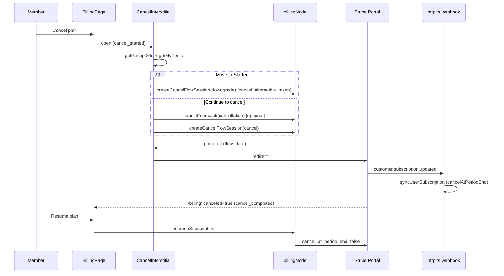

# Recap, History, Cancel Flow, Landing Proof & Conversion Email Implementation Plan

> **For agentic workers:** REQUIRED SUB-SKILL: Use superpowers:subagent-driven-development (recommended) or superpowers:
> executing-plans to implement this plan task-by-task. Steps use checkbox (`- [ ]`) syntax for tracking.

**Goal:** Ship backlog/revenue R15 (in-app recap page), R16 (history page), R09 (retention-aware cancel flow), R10
(landing SSI proof without unverifiable stats) and R14 (expectation-debt fixes: FAQ/CTA copy + trial-conversion email),
with en/pt/es parity and `docs/PLATFORM.md` updated.

**Architecture:** The engagement log (`userInteractions`) becomes the single source for "made" and "received" counts by
logging inside the same mutation that bumps the post counters and by stamping `authorId` on every row. Pure helpers in
`convex/lib/` do the window math, excerpting and near-cap picking; two new Convex queries (`getRecap`,
`listMyInteractions`) feed two new app pages. The cancel flow reuses Stripe's Customer Portal deep links (`flow_data`)
through the existing `stripe()` helper, wrapped by one interstitial dialog on the Billing page. The landing site only
loses unverifiable copy. The conversion email hooks the existing webhook sync + transactional mailer.

**Tech Stack:** Convex (queries/mutations/actions, `'use node'` for Stripe), Stripe SDK (already installed), React 19 +
react-router + `convex/react`, react-i18next, shadcn/radix Dialog primitives, Vitest + Testing Library, Next.js landing
dictionaries. **No new dependency.**

**Spec:** `docs/superpowers/specs/2026-09-07-recap-history-cancel-design.md` — the plan argues from it; read both.

## Global Constraints

Every task's requirements implicitly include this section.

- **NEVER commit.** No `git commit`, `git push`, `git stash`, `git checkout`, `git reset`, `git add`. Henriko makes all
  commits. When a task is done, say so; do not commit.
- **Edit and Write tools only** for file changes. Bash/PowerShell is for read-only commands and for running tests,
  typecheck, lint and Prettier. Never edit via sed/heredoc/node scripts.
- **Convex work:** read `convex/_generated/ai/guidelines.md` before touching any file under `convex/`. Use `pnpm`, run
  every command from the repo root (`D:\ERP\LinkIntoTheSSI\LinkIntoTheSSI`), never `cd convex`. No `.filter()` on
  database queries (index range + JS filter). No `convex-test`: mock nothing from `convex/server`; unit-test pure logic
  in `convex/lib/` only.
- **Prettier:** after editing code files run `pnpm exec prettier --write <each file you touched>` (code/config files
  only). NEVER run `pnpm format`. Never reformat prose (`.md`) files.
- **Working tree:** 45 uncommitted files from the previous batch are present (many staged). Touch only the files each
  task lists.
- **Copy rules (spec §1):** never tell a free member to check their SSI; never claim the app reads, shows or predicts
  the SSI; precise traceable numbers or none; no fabricated proof; no auto-applied coupons; no reciprocal-pod wording;
  no shaming copy; reason field never mandatory; no modals on page load; no celebration toasts; one consent-gated
  PostHog event per new moment via `captureEvent`.
- **i18n:** en/pt/es always in parity (app `app/src/i18n/locales/*.json`, landing `landing/i18n/dictionaries/*.json`).
  pt is pt-BR, es is neutral Latin American, labels are sentence case.
- **Apify** is dev-only and never appears in customer-facing or compliance copy.
- **Design skills** to apply while writing UI: responsive-design, karpathy-guidelines (small diffs, no speculative
  abstractions), frontend-design, web-design-guidelines (a11y: `aria-pressed`, `role="progressbar"`, `<time dateTime>`,
  40px tap targets), ui-ux-pro-max.
- **Commands:** convex tests `pnpm --filter ./convex test <file>`; app tests `pnpm --filter ./app test <file>`;
  `pnpm typecheck`; `pnpm lint`; full gate `pnpm verify`.

---

## File Map

| Area    | File                                                                                                               | Responsibility                                                                                                        |
|---------|--------------------------------------------------------------------------------------------------------------------|-----------------------------------------------------------------------------------------------------------------------|
| Convex  | `convex/schema.ts`                                                                                                 | widen `userInteractions` (+`authorId`, `by_author`), `feedback.category` (+`cancellation`)                            |
| Convex  | `convex/lib/recap.ts` (new)                                                                                        | window math, counting, excerpting, near-cap pick                                                                      |
| Convex  | `convex/lib/history.ts` (new)                                                                                      | `HistoryRow` shape + mapper                                                                                           |
| Convex  | `convex/lib/interactionLimit.ts`                                                                                   | `isNearInteractionLimit` (80% nudge)                                                                                  |
| Convex  | `convex/lib/stripePrices.ts`                                                                                       | `starterPriceIdFor`                                                                                                   |
| Convex  | `convex/lib/trialMilestone.ts`                                                                                     | `isTrialConversion`                                                                                                   |
| Convex  | `convex/interactions.ts`                                                                                           | log inside `incrementCommentCount`/`incrementLikeCount`; delete `recordInteraction`; `getRecap`; `listMyInteractions` |
| Convex  | `convex/feedback/feedback.ts`                                                                                      | `cancellation` category                                                                                               |
| Convex  | `convex/billingNode.ts`                                                                                            | `createCancelFlowSession`, `resumeSubscription`                                                                       |
| Convex  | `convex/lib/billingEmails.ts`, `convex/notifications.ts`, `convex/stripe.ts`                                       | `trialConvertedEmail`, `sendTrialConverted`, sync hook                                                                |
| App     | `app/src/components/WindowToggle.tsx` (new)                                                                        | segmented 7d/30d/all control                                                                                          |
| App     | `app/src/components/PlanUsagePills.tsx` (new)                                                                      | pills extracted from MyPostsPage                                                                                      |
| App     | `app/src/lib/relativeDay.ts` (new)                                                                                 | `timeAgo` extracted from MyPostsPage                                                                                  |
| App     | `app/src/components/UpgradeAtLimit.tsx`                                                                            | `nearCap` prop + `near` event field                                                                                   |
| App     | `app/src/pages/RecapPage.tsx` (new), `app/src/pages/HistoryPage.tsx` (new)                                         | R15 / R16 pages                                                                                                       |
| App     | `app/src/components/CancelInterstitial.tsx` (new), `app/src/pages/BillingPage.tsx`                                 | R09                                                                                                                   |
| App     | `app/src/App.tsx`, `components/shell/navItems.ts`, `components/shell/Sidebar.tsx`                                  | routes + nav                                                                                                          |
| App     | `app/src/i18n/locales/{en,pt,es}.json`                                                                             | keys                                                                                                                  |
| Landing | `landing/components/SSIExplainer.tsx`, `landing/components/Proof.tsx`, `landing/i18n/dictionaries/{en,pt,es}.json` | R10 / R14 copy                                                                                                        |
| Docs    | `docs/PLATFORM.md`, `backlog/revenue/README.md`, `backlog/revenue/R09.md` `R10.md` `R14.md` `R15.md` `R16.md`      | documentation                                                                                                         |

Execution order follows the product order R15 → R16 → R09 → R10 → R14, with shared groundwork first.

---

### Task 1: Schema widen + feedback category

**Files:**

- Modify: `convex/schema.ts:325-340` (feedback category union), `convex/schema.ts:368-382` (userInteractions)
- Modify: `convex/feedback/feedback.ts:14-37`
- Test: `convex/feedback/feedback.test.ts:23-36`

**Interfaces:**

- Produces: `userInteractions.authorId?: Id<'users'>` + index `by_author` (used by Task 3); `feedback.category` accepts
  `'cancellation'` (used by Task 8); `FEEDBACK_CATEGORIES` has 9 entries.

- [ ] **Step 1: Update the failing category test**

In `convex/feedback/feedback.test.ts` replace the `lists the 8 categories` test body so the expected array ends with
`'cancellation'`:

```ts
  it('lists the 9 categories', () => {
    expect(FEEDBACK_CATEGORIES).toEqual([
      'feature_request',
      'bug',
      'comment',
      'criticism',
      'praise',
      'question',
      'suggestion',
      'other',
      'cancellation'
    ])
  })
```

- [ ] **Step 2: Run it to see it fail**

Run: `pnpm --filter ./convex test feedback/feedback.test.ts`
Expected: FAIL — received array has 8 entries.

- [ ] **Step 3: Add the category**

In `convex/feedback/feedback.ts` append `'cancellation'` to `FEEDBACK_CATEGORIES` and add `v.literal('cancellation')` as
the last member of `categoryValidator`. Add this comment above the array:

```ts
// 'cancellation' is written only by the cancel interstitial (app CancelInterstitial.tsx); it is
// deliberately NOT in the FeedbackModal picker.
```

- [ ] **Step 4: Widen the schema**

In `convex/schema.ts` feedback table (line ~327-336) add `v.literal('cancellation')` after `v.literal('other')`.

Replace the `userInteractions` table definition with:

```ts
  // Per-user engagement log: one row per reaction or comment the user made on a post, written in
  // the SAME transaction as the post counter bump (interactions.ts incrementLikeCount /
  // incrementCommentCount) so counts and log never drift. Powers the recap + history pages, the
  // DSR export and the trial-conversion email. `authorId` is the post's author at write time (rows
  // written before 2026-09-07 lack it and are ignored by "received" counts).
  // `reaction` is set when kind==='reaction'; `comment` when 'comment'.
  userInteractions: defineTable({
    userId: v.id('users'),
    postId: v.id('posts'),
    authorId: v.optional(v.id('users')),
    kind: v.union(v.literal('reaction'), v.literal('comment')),
    reaction: v.optional(reactionValidator),
    comment: v.optional(v.string()),
    createdAt: v.number()
  })
    .index('by_user', ['userId']) // DSR export + a user's activity + history page
    // Locate rows referencing a given post so account erasure can delete OTHER users' interactions
    // on the deleted user's posts (they aren't caught by the by_user drain). See privacy/deletion.ts.
    .index('by_post', ['postId'])
    // "Received" side of the recap: everything anyone did on this author's posts.
    .index('by_author', ['authorId']),
```

- [ ] **Step 5: Run the tests and typecheck**

Run: `pnpm --filter ./convex test feedback/feedback.test.ts privacy/deletion.test.ts`
Expected: PASS (the schema-derived erasure completeness test in `privacy/deletion.test.ts` still passes:
`userInteractions` is already in the `OWNED` drain list and rows carrying an erased author's `authorId` are removed
through `by_post` when their posts are deleted).

Run: `pnpm --filter ./convex exec tsc --noEmit -p .`
Expected: exit 0.

- [ ] **Step 6: Prettier the touched code files**

Run: `pnpm exec prettier --write convex/schema.ts convex/feedback/feedback.ts convex/feedback/feedback.test.ts`

---

### Task 2: Pure helpers (`recap.ts`, `history.ts`, near-limit, Starter price, trial conversion)

**Files:**

- Create: `convex/lib/recap.ts`, `convex/lib/recap.test.ts`, `convex/lib/history.ts`, `convex/lib/history.test.ts`
- Modify: `convex/lib/interactionLimit.ts`, `convex/lib/stripePrices.ts`, `convex/lib/trialMilestone.ts`
- Test: `convex/lib/interactionLimit.test.ts`, `convex/lib/stripePrices.test.ts`, `convex/lib/trialMilestone.test.ts`

**Interfaces (Produces):**

- `convex/lib/interactionLimit.ts`: `UPGRADE_NUDGE_RATIO = 0.8`;
  `isNearInteractionLimit(likeCount: number, commentCount: number, interactionsPerPost: number): boolean`
- `convex/lib/recap.ts`: `type RecapWindow = '7d' | '30d'`; `RECAP_ROW_CEILING = 2000`; `RECAP_POST_CEILING = 200`;
  `EXCERPT_LENGTH = 140`; `interface RecapCounts { reactions: number; comments: number; posts: number; total: number }`;
  `interface WindowBounds { since: number; prevSince: number; until: number }`;
  `interface InteractionLike { _creationTime: number; kind: 'reaction' | 'comment'; postId: string; userId?: string; authorId?: string }`;
  `floorToHour(ms: number): number`; `windowDays(window: RecapWindow): 7 | 30`;
  `windowBounds(window: RecapWindow, now: number): WindowBounds`;
  `countInteractions(rows: InteractionLike[], from: number, to: number): RecapCounts` (from inclusive, to exclusive,
  keyed on `_creationTime`); `excludeSelf<T extends { userId: string; authorId?: string }>(rows: T[]): T[]`;
  `excerpt(content: string, max = EXCERPT_LENGTH): string`;
  `pickNearCapPost<T extends { likeCount: number; commentCount: number; interactionLimitReached?: boolean }>(posts: T[], cap: number): T | null`
- `convex/lib/history.ts`:
  `interface HistoryRow { id: string; kind: 'reaction' | 'comment'; reaction?: Reaction; comment?: string; createdAt: number; post: null | { id: string; linkedinPostUrn: string; sourceUrl?: string; excerpt: string; authorName: string; removed: boolean } }`;
  `toHistoryRow(row, post, author): HistoryRow`
- `convex/lib/stripePrices.ts`:
  `starterPriceIdFor(env: Record<string, string | undefined>, interval: string | undefined): string | undefined`
- `convex/lib/trialMilestone.ts`: `isTrialConversion(prev: string | undefined, next: string): boolean`

- [ ] **Step 1: Write the failing tests**

Append to `convex/lib/interactionLimit.test.ts` (extend the import to
`{ isNearInteractionLimit, shouldFlipInteractionLimit }`):

```ts
describe('isNearInteractionLimit', () => {
  it('is true from ceil(80%) of the cap up to cap-1', () => {
    expect(isNearInteractionLimit(19, 0, 25)).toBe(false) // 19 < ceil(20)
    expect(isNearInteractionLimit(20, 0, 25)).toBe(true)
    expect(isNearInteractionLimit(18, 6, 25)).toBe(true) // 24
    expect(isNearInteractionLimit(20, 5, 25)).toBe(false) // capped
  })
  it('is false for a zero or negative cap', () => {
    expect(isNearInteractionLimit(0, 0, 0)).toBe(false)
    expect(isNearInteractionLimit(5, 5, -1)).toBe(false)
  })
})
```

Create `convex/lib/recap.test.ts`:

```ts
import { describe, expect, it } from 'vitest'
import {
  countInteractions,
  excerpt,
  excludeSelf,
  floorToHour,
  pickNearCapPost,
  windowBounds,
  windowDays,
  type InteractionLike
} from './recap'

const DAY = 86_400_000
const NOW = 1_800_000_000_000 // arbitrary, already on an hour boundary? floor it below
const T = floorToHour(NOW)

function row(over: Partial<InteractionLike>): InteractionLike {
  return { _creationTime: T - DAY, kind: 'reaction', postId: 'p1', userId: 'u1', authorId: 'a1', ...over }
}

describe('floorToHour', () => {
  it('drops minutes and seconds', () => {
    expect(floorToHour(3_600_000 * 5 + 59_999)).toBe(3_600_000 * 5)
  })
})

describe('windowBounds', () => {
  it('spans 7 or 30 days back and the same span before that', () => {
    expect(windowDays('7d')).toBe(7)
    expect(windowDays('30d')).toBe(30)
    expect(windowBounds('7d', T)).toEqual({ since: T - 7 * DAY, prevSince: T - 14 * DAY, until: T })
    expect(windowBounds('30d', T)).toEqual({ since: T - 30 * DAY, prevSince: T - 60 * DAY, until: T })
  })
})

describe('countInteractions', () => {
  it('is from-inclusive, to-exclusive and counts distinct posts', () => {
    const rows = [
      row({ _creationTime: 100, postId: 'p1' }),
      row({ _creationTime: 150, postId: 'p1', kind: 'comment' }),
      row({ _creationTime: 199, postId: 'p2' }),
      row({ _creationTime: 200, postId: 'p3' }),
      row({ _creationTime: 99, postId: 'p4' })
    ]
    expect(countInteractions(rows, 100, 200)).toEqual({ reactions: 2, comments: 1, posts: 2, total: 3 })
    expect(countInteractions(rows, 200, Number.POSITIVE_INFINITY)).toEqual({ reactions: 1, comments: 0, posts: 1, total: 1 })
    expect(countInteractions([], 0, 1)).toEqual({ reactions: 0, comments: 0, posts: 0, total: 0 })
  })
})

describe('excludeSelf', () => {
  it('drops rows where the actor is the author and keeps legacy rows without authorId', () => {
    const rows = [row({ userId: 'u1', authorId: 'u1' }), row({ userId: 'u2', authorId: 'u1' }), row({ userId: 'u1', authorId: undefined })]
    expect(excludeSelf(rows)).toHaveLength(2)
  })
})

describe('excerpt', () => {
  it('collapses whitespace, trims and cuts with an ellipsis', () => {
    expect(excerpt('  hello \n\n world  ')).toBe('hello world')
    const long = 'a'.repeat(200)
    expect(excerpt(long)).toBe('a'.repeat(140) + '…')
    expect(excerpt('short', 10)).toBe('short')
  })
})

describe('pickNearCapPost', () => {
  it('returns the highest-total post inside the 80% band, skipping capped posts', () => {
    const posts = [
      { id: 'low', likeCount: 5, commentCount: 0 },
      { id: 'near', likeCount: 18, commentCount: 3 },
      { id: 'nearer', likeCount: 22, commentCount: 2 },
      { id: 'capped', likeCount: 25, commentCount: 0, interactionLimitReached: true }
    ]
    expect(pickNearCapPost(posts, 25)?.id).toBe('nearer')
    expect(pickNearCapPost([posts[0]], 25)).toBeNull()
    expect(pickNearCapPost([], 25)).toBeNull()
  })
})
```

Create `convex/lib/history.test.ts`:

```ts
import { describe, expect, it } from 'vitest'
import { toHistoryRow } from './history'

const base = { _id: 'i1', kind: 'comment' as const, comment: 'Nice', createdAt: 5 }
const post = { _id: 'p1', linkedinPostUrn: 'urn:li:share:1', sourceUrl: undefined, content: '  Hello   world ', hidden: false, deletedAt: undefined }

describe('toHistoryRow', () => {
  it('maps a live post with its author and excerpt', () => {
    expect(toHistoryRow(base, post, { name: 'Ana' })).toEqual({
      id: 'i1',
      kind: 'comment',
      reaction: undefined,
      comment: 'Nice',
      createdAt: 5,
      post: { id: 'p1', linkedinPostUrn: 'urn:li:share:1', sourceUrl: undefined, excerpt: 'Hello world', authorName: 'Ana', removed: false }
    })
  })
  it('marks hidden or deleted posts removed and falls back to an empty author name', () => {
    expect(toHistoryRow(base, { ...post, hidden: true }, null).post?.removed).toBe(true)
    expect(toHistoryRow(base, { ...post, deletedAt: 1 }, null).post?.removed).toBe(true)
    expect(toHistoryRow(base, post, null).post?.authorName).toBe('')
  })
  it('returns post: null when the post row is gone', () => {
    expect(toHistoryRow(base, null, null).post).toBeNull()
  })
})
```

Append to `convex/lib/stripePrices.test.ts` (extend the import with `starterPriceIdFor`):

```ts
describe('starterPriceIdFor', () => {
  it('picks the annual Starter price only for year, monthly otherwise', () => {
    expect(starterPriceIdFor(ENV, 'year')).toBe('price_s_y')
    expect(starterPriceIdFor(ENV, 'month')).toBe('price_s_m')
    expect(starterPriceIdFor(ENV, undefined)).toBe('price_s_m')
    expect(starterPriceIdFor({}, 'year')).toBeUndefined()
  })
})
```

Append to `convex/lib/trialMilestone.test.ts` (extend the import with `isTrialConversion`):

```ts
describe('isTrialConversion', () => {
  it('is true only for trialing → active', () => {
    expect(isTrialConversion('trialing', 'active')).toBe(true)
    expect(isTrialConversion('active', 'active')).toBe(false)
    expect(isTrialConversion('trialing', 'canceled')).toBe(false)
    expect(isTrialConversion(undefined, 'active')).toBe(false)
  })
})
```

- [ ] **Step 2: Run them to see them fail**

Run:
`pnpm --filter ./convex test lib/recap.test.ts lib/history.test.ts lib/interactionLimit.test.ts lib/stripePrices.test.ts lib/trialMilestone.test.ts`
Expected: FAIL — modules/exports missing.

- [ ] **Step 3: Implement**

Append to `convex/lib/interactionLimit.ts`:

```ts
/** From this share of the cap a post is "near" it — the recap shows the upgrade ask (backlog/R15). */
export const UPGRADE_NUDGE_RATIO = 0.8

export function isNearInteractionLimit(likeCount: number, commentCount: number, interactionsPerPost: number): boolean {
  if (interactionsPerPost <= 0) return false
  const total = likeCount + commentCount
  return total >= Math.ceil(interactionsPerPost * UPGRADE_NUDGE_RATIO) && total < interactionsPerPost
}
```

Create `convex/lib/recap.ts`:

```ts
// Pure helpers for the recap page (backlog/R15). Everything here is time-zone free: windows are
// computed from a caller-supplied `now` (the client floors it to the hour so the query args stay
// stable across re-renders and Convex can share the subscription).
import { isNearInteractionLimit } from './interactionLimit'

export type RecapWindow = '7d' | '30d'

const HOUR = 3_600_000
const DAY = 86_400_000

/** Hard ceiling on rows read per side per query; the page says so when hit. */
export const RECAP_ROW_CEILING = 2000
/** Posts listed in the plan-usage section (newest first). */
export const RECAP_POST_CEILING = 200
export const EXCERPT_LENGTH = 140

export interface RecapCounts {
  reactions: number
  comments: number
  posts: number // distinct posts touched
  total: number
}

export interface WindowBounds {
  since: number
  prevSince: number
  until: number
}

export interface InteractionLike {
  _creationTime: number
  kind: 'reaction' | 'comment'
  postId: string
  userId?: string
  authorId?: string
}

export function floorToHour(ms: number): number {
  return Math.floor(ms / HOUR) * HOUR
}

export function windowDays(window: RecapWindow): 7 | 30 {
  return window === '7d' ? 7 : 30
}

export function windowBounds(window: RecapWindow, now: number): WindowBounds {
  const span = windowDays(window) * DAY
  return { since: now - span, prevSince: now - 2 * span, until: now }
}

/** Counts rows with from <= _creationTime < to. */
export function countInteractions(rows: InteractionLike[], from: number, to: number): RecapCounts {
  const posts = new Set<string>()
  let reactions = 0
  let comments = 0
  for (const r of rows) {
    if (r._creationTime < from || r._creationTime >= to) continue
    if (r.kind === 'reaction') reactions += 1
    else comments += 1
    posts.add(r.postId)
  }
  return { reactions, comments, posts: posts.size, total: reactions + comments }
}

/** "Received" never counts what the author did on their own post. */
export function excludeSelf<T extends { userId: string; authorId?: string }>(rows: T[]): T[] {
  return rows.filter(r => r.authorId !== r.userId)
}

export function excerpt(content: string, max = EXCERPT_LENGTH): string {
  const flat = content.replace(/\s+/g, ' ').trim()
  return flat.length > max ? `${flat.slice(0, max)}…` : flat
}

/** The post closest to the cap (highest total inside the nudge band), or null. */
export function pickNearCapPost<T extends { likeCount: number; commentCount: number; interactionLimitReached?: boolean }>(
  posts: T[],
  cap: number
): T | null {
  let best: T | null = null
  for (const p of posts) {
    if (p.interactionLimitReached) continue
    if (!isNearInteractionLimit(p.likeCount, p.commentCount, cap)) continue
    if (!best || p.likeCount + p.commentCount > best.likeCount + best.commentCount) best = p
  }
  return best
}
```

Create `convex/lib/history.ts`:

```ts
// Row shape for the history page (backlog/R16). Kept pure so the mapper is unit-testable and the
// app can import the type without pulling Convex server code.
import type { Reaction } from './reactions'
import { excerpt } from './recap'

export interface HistoryRow {
  id: string
  kind: 'reaction' | 'comment'
  reaction?: Reaction
  comment?: string
  createdAt: number
  post: null | {
    id: string
    linkedinPostUrn: string
    sourceUrl?: string
    excerpt: string
    authorName: string
    removed: boolean
  }
}

interface InteractionDoc {
  _id: string
  kind: 'reaction' | 'comment'
  reaction?: Reaction
  comment?: string
  createdAt: number
}

interface PostDoc {
  _id: string
  linkedinPostUrn: string
  sourceUrl?: string
  content: string
  hidden: boolean
  deletedAt?: number
}

export function toHistoryRow(row: InteractionDoc, post: PostDoc | null, author: { name: string } | null): HistoryRow {
  return {
    id: row._id,
    kind: row.kind,
    reaction: row.reaction,
    comment: row.comment,
    createdAt: row.createdAt,
    post: post
      ? {
          id: post._id,
          linkedinPostUrn: post.linkedinPostUrn,
          sourceUrl: post.sourceUrl,
          excerpt: excerpt(post.content),
          authorName: author?.name ?? '',
          removed: post.deletedAt !== undefined || post.hidden
        }
      : null
  }
}
```

Append to `convex/lib/stripePrices.ts`:

```ts
/** Starter price for the downgrade portal flow (backlog/R09): annual stays annual. */
export function starterPriceIdFor(env: Env, interval: string | undefined): string | undefined {
  return interval === 'year' ? env.STRIPE_STARTER_ANNUAL_PRICE_ID : env.STRIPE_STARTER_PRICE_ID
}
```

Append to `convex/lib/trialMilestone.ts`:

```ts
/** trialing → active on the same subscription row = the trial converted (backlog/R14 email). */
export function isTrialConversion(prev: string | undefined, next: string): boolean {
  return prev === 'trialing' && next === 'active'
}
```

- [ ] **Step 4: Run the tests**

Run:
`pnpm --filter ./convex test lib/recap.test.ts lib/history.test.ts lib/interactionLimit.test.ts lib/stripePrices.test.ts lib/trialMilestone.test.ts`
Expected: PASS.

- [ ] **Step 5: Prettier**

Run:
`pnpm exec prettier --write convex/lib/recap.ts convex/lib/recap.test.ts convex/lib/history.ts convex/lib/history.test.ts convex/lib/interactionLimit.ts convex/lib/interactionLimit.test.ts convex/lib/stripePrices.ts convex/lib/stripePrices.test.ts convex/lib/trialMilestone.ts convex/lib/trialMilestone.test.ts`

---

### Task 3: Log inside the counter mutations + `getRecap` + `listMyInteractions`

**Files:**

- Modify: `convex/interactions.ts` (imports 2-14; `recordInteraction` 73-87; `incrementCommentCount` 117-160;
  `incrementLikeCount` 162-217; `commentOnPost` 250-260; `reactToPost` 291-307)
- Modify: `docs/superpowers/specs/2026-09-07-recap-history-cancel-design.md` §3.4 (one clarification line)

**Interfaces:**

- Consumes: Task 1 schema; Task 2 helpers.
- Produces: `api.interactions.getRecap({ sessionToken: string, window: '7d' | '30d', now: number })` returning
  `{ window, since, until, made: { current: RecapCounts, previous: RecapCounts }, received: { current, previous }, truncated: boolean, plan: { tier, interactionsPerPost, postsPerWeek, featuredPerMonth, nextTier: 'growth' | 'pro' | null }, posts: Array<{ id, linkedinPostUrn, sourceUrl?, excerpt, likeCount, commentCount, isFeatured, interactionLimitReached }>, nearCapPost: null | { id, excerpt, total } }`;
  `api.interactions.listMyInteractions({ sessionToken: string, since: number, paginationOpts })` returning a Convex
  pagination result whose `page` is `HistoryRow[]`.

- [ ] **Step 1: Delete `recordInteraction` and its call sites**

In `convex/interactions.ts` delete lines 73-87 (the comment block +
`export const recordInteraction = internalMutation({...})`).

In `commentOnPost` replace lines 250-260 (the `ctx.runMutation(...incrementCommentCount...)` call and the try/catch)
with:

```ts
    await ctx.runMutation(internal.interactions.incrementCommentCount, {
      postId,
      actorId: user._id,
      comment: commentText
    })
```

In `reactToPost` replace lines 291-307 with:

```ts
    const { counted }: { counted: boolean } = await ctx.runMutation(internal.interactions.incrementLikeCount, {
      postId,
      actorId: user._id,
      reaction: reactionType
    })
```

(keep the existing `return { success: true, counted }`.)

- [ ] **Step 2: Log inside the mutations**

Replace the `incrementCommentCount` args + the two lines after the count patch:

```ts
export const incrementCommentCount = internalMutation({
  args: { postId: v.id('posts'), actorId: v.id('users'), comment: v.string() },
  handler: async (ctx, { postId, actorId, comment }) => {
```

and right after `await ctx.db.patch(postId, { commentCount: newCommentCount })` insert:

```ts
    // Same transaction as the counter: the log is the source for recap/history (backlog/R15).
    await ctx.db.insert('userInteractions', {
      userId: actorId,
      postId,
      authorId: post.authorId,
      kind: 'comment',
      comment,
      createdAt: Date.now()
    })
```

Replace the `incrementLikeCount` args:

```ts
export const incrementLikeCount = internalMutation({
  args: { postId: v.id('posts'), actorId: v.id('users'), reaction: reactionValidator },
  handler: async (ctx, { postId, actorId, reaction }): Promise<{ counted: boolean }> => {
```

and right after `await ctx.db.patch(postId, { likeCount: newLikeCount })` insert:

```ts
    await ctx.db.insert('userInteractions', {
      userId: actorId,
      postId,
      authorId: post.authorId,
      kind: 'reaction',
      reaction,
      createdAt: now
    })
```

Every early `return` that precedes the count patch (missing post, cap reached, already reacted) keeps skipping the log —
nothing else to change.

- [ ] **Step 3: Add the two queries**

Extend the imports at the top of `convex/interactions.ts`:

```ts
import { paginationOptsValidator } from 'convex/server'
import { nextTier } from './lib/planLimits'
import { toHistoryRow, type HistoryRow } from './lib/history'
import {
  countInteractions,
  excerpt,
  excludeSelf,
  pickNearCapPost,
  RECAP_POST_CEILING,
  RECAP_ROW_CEILING,
  windowBounds
} from './lib/recap'
```

(`getPlanLimitsHelper` is already imported from './lib/planLimits' — merge into one import line.)

Append at the end of the file:

```ts
// ── Recap (backlog/R15) ────────────────────────────────────────────────────────────────────────
// `now` comes from the client floored to the hour so args are stable across renders. The current
// window is [since, +∞) so interactions inside the partial hour count immediately; the previous
// window is [prevSince, since). Reads are newest-first with a hard ceiling, so truncation drops the
// oldest rows first and `truncated` tells the page.
export const getRecap = query({
  args: {
    sessionToken: v.string(),
    window: v.union(v.literal('7d'), v.literal('30d')),
    now: v.number()
  },
  handler: async (ctx, { sessionToken, window, now }) => {
    const user = await requireAuth(ctx, sessionToken)
    const { since, prevSince, until } = windowBounds(window, now)

    const made = await ctx.db
      .query('userInteractions')
      .withIndex('by_user', q => q.eq('userId', user._id).gte('_creationTime', prevSince))
      .order('desc')
      .take(RECAP_ROW_CEILING)
    const receivedRaw = await ctx.db
      .query('userInteractions')
      .withIndex('by_author', q => q.eq('authorId', user._id).gte('_creationTime', prevSince))
      .order('desc')
      .take(RECAP_ROW_CEILING)
    const received = excludeSelf(receivedRaw)

    const tier = user.tier ?? 'starter'
    const limits = await getPlanLimitsHelper(ctx, user._id, tier)

    const recent = await ctx.db
      .query('posts')
      .withIndex('by_author', q => q.eq('authorId', user._id).gte('_creationTime', since))
      .order('desc')
      .take(RECAP_POST_CEILING)
    const posts = recent.filter(p => p.deletedAt === undefined && !p.hidden)
    const near = pickNearCapPost(posts, limits.interactionsPerPost)

    const OPEN_END = Number.POSITIVE_INFINITY
    return {
      window,
      since,
      until,
      made: {
        current: countInteractions(made, since, OPEN_END),
        previous: countInteractions(made, prevSince, since)
      },
      received: {
        current: countInteractions(received, since, OPEN_END),
        previous: countInteractions(received, prevSince, since)
      },
      truncated: made.length >= RECAP_ROW_CEILING || receivedRaw.length >= RECAP_ROW_CEILING,
      plan: { tier, ...limits, nextTier: nextTier(tier) },
      posts: posts.map(p => ({
        id: p._id,
        linkedinPostUrn: p.linkedinPostUrn,
        sourceUrl: p.sourceUrl,
        excerpt: excerpt(p.content),
        likeCount: p.likeCount,
        commentCount: p.commentCount,
        isFeatured: p.isFeatured,
        interactionLimitReached: p.interactionLimitReached === true
      })),
      nearCapPost: near ? { id: near._id, excerpt: excerpt(near.content), total: near.likeCount + near.commentCount } : null
    }
  }
})

// ── History (backlog/R16) ──────────────────────────────────────────────────────────────────────
// `since` = 0 means all time. Newest first; 20 per page from the client.
export const listMyInteractions = query({
  args: { sessionToken: v.string(), since: v.number(), paginationOpts: paginationOptsValidator },
  handler: async (ctx, { sessionToken, since, paginationOpts }) => {
    const user = await requireAuth(ctx, sessionToken)
    const result = await ctx.db
      .query('userInteractions')
      .withIndex('by_user', q => q.eq('userId', user._id).gte('_creationTime', since))
      .order('desc')
      .paginate(paginationOpts)
    const page: HistoryRow[] = []
    for (const row of result.page) {
      const post = await ctx.db.get(row.postId)
      const author = post ? await ctx.db.get(post.authorId) : null
      page.push(toHistoryRow(row, post, author))
    }
    return { ...result, page }
  }
})
```

- [ ] **Step 4: Typecheck + the existing suite**

Run: `pnpm --filter ./convex exec tsc --noEmit -p .`
Expected: exit 0 (if `internalMutation` becomes an unused import after deleting `recordInteraction`, it is still used by
the two counter mutations — no change).

Run: `pnpm --filter ./convex test`
Expected: all green (385 + the Task 1/2 additions).

Run (read-only): `pnpm exec rg -n "recordInteraction" convex app`
Expected: no matches.

- [ ] **Step 5: Amend the spec §3.4 (one line)**

In the spec's §3.4 `getRecap` paragraph append this sentence after the sentence that defines `made`/`received`: "The
current window counts `[since, +∞)` and the previous window `[prevSince, since)`; both reads are `.order('desc')` so a
truncated read drops the oldest rows first, and `until` is returned for display only."

- [ ] **Step 6: Prettier**

Run: `pnpm exec prettier --write convex/interactions.ts`

---

### Task 4: Shared app pieces (WindowToggle, PlanUsagePills, relativeDay, UpgradeAtLimit `nearCap`)

**Files:**

- Create: `app/src/components/WindowToggle.tsx`, `app/src/components/WindowToggle.test.tsx`,
  `app/src/components/PlanUsagePills.tsx`, `app/src/lib/relativeDay.ts`, `app/src/lib/relativeDay.test.ts`
- Modify: `app/src/pages/MyPostsPage.tsx:1-52,58-60,139-190`,
  `app/src/components/UpgradeAtLimit.tsx:26-27,66-69,84-104,106-116`, `app/src/i18n/locales/{en,pt,es}.json`
  (`upgrade.interactionCapNear`, `recap.window.*`)
- Test: `app/src/components/UpgradeAtLimit.test.tsx`, `app/src/pages/MyPostsPage.test.tsx` (must stay green)

**Interfaces (Produces):**

- `WindowToggle<T extends ToggleWindow>({ value: T; onChange: (next: T) => void; options: readonly T[] })` default
  export; `type ToggleWindow = '7d' | '30d' | 'all'`; labels come from `recap.window.7d|30d|all`.
- `PlanUsagePills({ usage, featuredUsage })` default export with exported
  `interface WeeklyUsage { postsThisWeek: number; postsPerWeek: number }` and
  `interface FeaturedUsage { usedCount: number; featuredPerMonth: number }` (both props `X | null | undefined`).
- `timeAgo(ts: number, t: TFunction): string` from `@/lib/relativeDay`.
- `UpgradeAtLimit` prop `nearCap?: { total: number; cap: number }`; both `upgrade_at_limit_clicked` events carry
  `near: boolean`.

- [ ] **Step 1: Locale keys (all three files)**

`app/src/i18n/locales/en.json` — inside `"upgrade": { ... }` add after `"interactionCap"`:

```json
    "interactionCapNear": "Your post is at {{total}} of {{cap}} interactions. On {{nextPlan}} it keeps collecting to {{next}}.",
```

and add a new top-level block right after the `"upgrade": { ... }` block (before `"errors"`):

```json
  "recap": {
    "window": {
      "7d": "Last 7 days",
      "30d": "Last 30 days",
      "all": "All time"
    }
  },
```

`pt.json` — same positions:

```json
    "interactionCapNear": "Sua publicação está em {{total}} de {{cap}} interações. No {{nextPlan}} ela continua acumulando até {{next}}.",
```

```json
  "recap": {
    "window": {
      "7d": "Últimos 7 dias",
      "30d": "Últimos 30 dias",
      "all": "Desde o início"
    }
  },
```

`es.json` — same positions:

```json
    "interactionCapNear": "Tu publicación está en {{total}} de {{cap}} interacciones. En {{nextPlan}} sigue acumulando hasta {{next}}.",
```

```json
  "recap": {
    "window": {
      "7d": "Últimos 7 días",
      "30d": "Últimos 30 días",
      "all": "Desde el inicio"
    }
  },
```

(Task 5 adds the rest of the `recap` block into this same object.)

- [ ] **Step 2: Failing tests**

Create `app/src/components/WindowToggle.test.tsx`:

```tsx
import { fireEvent, render, screen } from '@testing-library/react'
import { describe, expect, it, vi } from 'vitest'
import WindowToggle from './WindowToggle'

describe('WindowToggle', () => {
  it('renders one pressed button per option and reports clicks', () => {
    const onChange = vi.fn()
    render(<WindowToggle value="7d" onChange={onChange} options={['7d', '30d'] as const} />)
    expect(screen.getByRole('button', { name: 'Last 7 days' })).toHaveAttribute('aria-pressed', 'true')
    expect(screen.getByRole('button', { name: 'Last 30 days' })).toHaveAttribute('aria-pressed', 'false')
    fireEvent.click(screen.getByRole('button', { name: 'Last 30 days' }))
    expect(onChange).toHaveBeenCalledWith('30d')
  })
})
```

Create `app/src/lib/relativeDay.test.ts`:

```ts
import { describe, expect, it } from 'vitest'
import i18n from '@/i18n'
import { timeAgo } from './relativeDay'

describe('timeAgo', () => {
  it('says Today under a day and counts whole days after', () => {
    const t = i18n.t.bind(i18n)
    expect(timeAgo(Date.now() - 1000, t)).toBe('Today')
    expect(timeAgo(Date.now() - 3 * 86_400_000, t)).toBe('3 days ago')
  })
})
```

(`@/i18n` is the app's i18next instance initialised by `app/src/test/setup.ts`; if the module default-exports under a
different path, use the path `app/src/i18n/index.ts` exports from.)

Append to `app/src/components/UpgradeAtLimit.test.tsx` — add the analytics mock near the other `vi.mock` calls and two
cases:

```tsx
vi.mock('@/lib/observability/analytics', () => ({ captureEvent: vi.fn() }))
import { captureEvent } from '@/lib/observability/analytics'
```

```tsx
  it('renders the near-cap copy with both numbers and tags the event near=true', () => {
    render(
      <MemoryRouter>
        <UpgradeAtLimit limit="interactionCap" nearCap={{ total: 20, cap: 25 }} />
      </MemoryRouter>
    )
    expect(screen.getByText(/20 of 25 interactions/)).toBeInTheDocument()
    expect(screen.getByText(/keeps collecting to 50/)).toBeInTheDocument()
    fireEvent.click(screen.getByRole('link'))
    expect(captureEvent).toHaveBeenCalledWith('upgrade_at_limit_clicked', { limit: 'interactionCap', plan: 'growth', near: true })
  })

  it('tags the plain cap event near=false', () => {
    renderComponent('interactionCap')
    fireEvent.click(screen.getByRole('link'))
    expect(captureEvent).toHaveBeenCalledWith('upgrade_at_limit_clicked', { limit: 'interactionCap', plan: 'growth', near: false })
  })
```

(import `fireEvent` from `@testing-library/react` if the file does not already.)

- [ ] **Step 3: Run to see them fail**

Run:
`pnpm --filter ./app test components/WindowToggle.test.tsx lib/relativeDay.test.ts components/UpgradeAtLimit.test.tsx`
Expected: FAIL — missing modules / prop.

- [ ] **Step 4: Implement WindowToggle**

Create `app/src/components/WindowToggle.tsx`:

```tsx
import { useTranslation } from 'react-i18next'
import { cn } from '@/lib/utils'

export type ToggleWindow = '7d' | '30d' | 'all'

// Segmented control shared by Recap and History. Same pill styling as the Billing interval toggle;
// min-h-10 keeps every option a 40px tap target on phones.
export default function WindowToggle<T extends ToggleWindow>({
  value,
  onChange,
  options
}: {
  value: T
  onChange: (next: T) => void
  options: readonly T[]
}) {
  const { t } = useTranslation()
  return (
    <div role="group" className="inline-flex items-center gap-1 rounded-full border p-1 text-sm">
      {options.map(option => (
        <button
          key={option}
          type="button"
          aria-pressed={option === value}
          onClick={() => onChange(option)}
          className={cn(
            'min-h-10 rounded-full px-3 transition-colors',
            option === value ? 'bg-primary text-primary-foreground' : 'text-muted-foreground hover:text-foreground'
          )}
        >
          {t(`recap.window.${option}`)}
        </button>
      ))}
    </div>
  )
}
```

- [ ] **Step 5: Extract `timeAgo`**

Create `app/src/lib/relativeDay.ts`:

```ts
import type { TFunction } from 'i18next'

/** "Today" under a day, "N days ago" after — uses the myPosts.* keys shared by My Posts and History. */
export function timeAgo(ts: number, t: TFunction): string {
  const days = Math.floor((Date.now() - ts) / 86400000)
  if (days <= 0) return t('myPosts.today')
  return t('myPosts.daysAgo', { count: days })
}
```

In `app/src/pages/MyPostsPage.tsx` delete the local `timeAgo` function (lines 48-52) and add
`import { timeAgo } from '@/lib/relativeDay'`. Existing call sites keep passing `t`.

- [ ] **Step 6: Extract PlanUsagePills**

Create `app/src/components/PlanUsagePills.tsx`:

```tsx
import { useTranslation } from 'react-i18next'
import { isUnlimitedFeatured } from '../../../convex/lib/postLimit'
import { Badge } from '@/components/ui/badge'

// The shape returned by posts.getWeeklyUsage (null when not signed in).
export interface WeeklyUsage {
  postsThisWeek: number
  postsPerWeek: number
}

// The shape returned by posts.getFeaturedUsage (null when not signed in).
export interface FeaturedUsage {
  usedCount: number
  featuredPerMonth: number
}

// Weekly-post + featured-post pills shared by My Posts and Recap. flex-wrap so the pills stack as
// whole units (never mid-label) on narrow screens.
export default function PlanUsagePills({
  usage,
  featuredUsage
}: {
  usage: WeeklyUsage | null | undefined
  featuredUsage: FeaturedUsage | null | undefined
}) {
  const { t } = useTranslation()
  const atLimit = usage != null && usage.postsThisWeek >= usage.postsPerWeek
  // Mirrors the >= boundary featurePost enforces server-side (isFeaturedLimitReached).
  const featuredAtCap = featuredUsage != null && featuredUsage.usedCount >= featuredUsage.featuredPerMonth
  return (
    <div className="flex flex-wrap items-center gap-2">
      {usage && (
        <Badge
          title={t('myPosts.weeklyUsageHint')}
          variant={atLimit ? 'warning' : 'primary'}
          className="shrink-0 rounded-full px-3 py-1 text-xs"
        >
          {t('myPosts.weeklyUsage', { used: usage.postsThisWeek, limit: usage.postsPerWeek })}
        </Badge>
      )}
      {featuredUsage && (
        <Badge
          title={t('myPosts.featuredPillHint')}
          variant={featuredAtCap ? 'warning' : 'primary'}
          className="shrink-0 rounded-full px-3 py-1 text-xs"
        >
          {/* The contact/enterprise "unlimited" sentinel (convex/lib/postLimit.ts) is
              never shown as a raw number. */}
          {isUnlimitedFeatured(featuredUsage.featuredPerMonth)
            ? t('myPosts.featuredPillUnlimited', { used: featuredUsage.usedCount })
            : t('myPosts.featuredPill', { used: featuredUsage.usedCount, limit: featuredUsage.featuredPerMonth })}
        </Badge>
      )}
    </div>
  )
}
```

In `app/src/pages/MyPostsPage.tsx`:

- Replace the pills block (the `<div className="flex flex-wrap items-center gap-2">` … `</div>` that holds the two
  `Badge`s, lines 165-188) with `<PlanUsagePills usage={usage} featuredUsage={featuredUsage} />`.
- Delete the local `WeeklyUsage` and `FeaturedUsage` interfaces (lines 36-46) and import them:
  `import PlanUsagePills, { type FeaturedUsage, type WeeklyUsage } from '@/components/PlanUsagePills'`.
- Keep the page's own `atLimit` / `featuredAtCap` (they still drive the composer + featured ask).
- If `Badge` or `isUnlimitedFeatured` is now unused in MyPostsPage, remove those imports (check with `pnpm lint`).

- [ ] **Step 7: UpgradeAtLimit `nearCap`**

In `app/src/components/UpgradeAtLimit.tsx`:

Props:

```tsx
export default function UpgradeAtLimit({
  limit,
  nearCap,
  className
}: {
  limit: LimitKind
  /** Recap-only: the post is inside the 80% band, not capped yet (backlog/R15). */
  nearCap?: { total: number; cap: number }
  className?: string
}) {
```

Both `captureEvent('upgrade_at_limit_clicked', …)` calls (the mailto branch and the Link branch) gain
`near: nearCap !== undefined`:

```tsx
captureEvent('upgrade_at_limit_clicked', { limit, plan: tier, near: nearCap !== undefined })
```

```tsx
captureEvent('upgrade_at_limit_clicked', { limit, plan: next, near: nearCap !== undefined })
```

In the copy switch, replace the `case 'interactionCap':` branch:

```tsx
      case 'interactionCap':
        return nearCap
          ? t('upgrade.interactionCapNear', { total: nearCap.total, cap: nearCap.cap, nextPlan, next: nextLimits.interactionsPerPost })
          : t('upgrade.interactionCap', { nextPlan, next: nextLimits.interactionsPerPost })
```

- [ ] **Step 8: Run the tests**

Run:
`pnpm --filter ./app test components/WindowToggle.test.tsx lib/relativeDay.test.ts components/UpgradeAtLimit.test.tsx pages/MyPostsPage.test.tsx`
Expected: PASS, MyPostsPage unchanged.

- [ ] **Step 9: Lint, typecheck, Prettier**

Run:
`pnpm exec prettier --write app/src/components/WindowToggle.tsx app/src/components/WindowToggle.test.tsx app/src/components/PlanUsagePills.tsx app/src/lib/relativeDay.ts app/src/lib/relativeDay.test.ts app/src/pages/MyPostsPage.tsx app/src/components/UpgradeAtLimit.tsx app/src/components/UpgradeAtLimit.test.tsx app/src/i18n/locales/en.json app/src/i18n/locales/pt.json app/src/i18n/locales/es.json`
Run: `pnpm --filter ./app exec tsc --noEmit -p .` then `pnpm lint`
Expected: exit 0 both.

---

### Task 5: RecapPage + routes + nav + Sidebar (R15)

**Files:**

- Create: `app/src/pages/RecapPage.tsx`, `app/src/pages/RecapPage.test.tsx`
- Modify: `app/src/App.tsx:7-12,84-146`, `app/src/components/shell/navItems.ts`,
  `app/src/components/shell/navItems.test.ts:6`, `app/src/components/shell/Sidebar.tsx:73-91`,
  `app/src/components/shell/Sidebar.test.tsx:88-92`, `app/src/pages/BillingPage.test.tsx` (only if the SSI assertion
  needs nothing — it stays), `app/src/i18n/locales/{en,pt,es}.json`
- Test: `app/src/pages/RecapPage.test.tsx`, `app/src/components/shell/Sidebar.test.tsx`,
  `app/src/components/shell/navItems.test.ts`

**Interfaces:**

- Consumes: `api.interactions.getRecap` (Task 3), `WindowToggle`, `PlanUsagePills`, `UpgradeAtLimit nearCap` (Task 4),
  `useTrialProgress()` → `{ isTrialing, progress }`, `TrialMeter({ progress })`, `buildPostUrl(urn, sourceUrl?)`.
- Produces: route `/recap`; nav entries Recap + History (History route is Task 6 — the nav link exists first, the page
  lands next task).

- [ ] **Step 1: Locale keys**

`en.json` — `"nav"`: delete `"viewSsi"` and `"viewSsiNote"`, keep `"recap": "Recap"`, add `"history": "History"` after
it. Fill the `recap` block created in Task 4 so it reads:

```json
  "recap": {
    "title": "Recap",
    "lead": "What you made and received here, and how your plan is being used.",
    "window": {
      "7d": "Last 7 days",
      "30d": "Last 30 days",
      "all": "All time"
    },
    "made": "You made",
    "received": "Your posts received",
    "breakdown": "{{reactions}} reactions · {{comments}} comments · {{posts}} posts",
    "delta": "{{delta}} vs the previous {{days}} days",
    "celebrate": "More than the previous {{days}} days. Keep going.",
    "truncated": "Showing the first {{count}} interactions in this window.",
    "planUsage": "Plan usage",
    "postUsage": "{{total}} of {{cap}} interactions",
    "noPosts": "No posts added in this window. Posts you share show up here with their interaction count.",
    "emptyTitle": "Nothing recorded in the last {{days}} days",
    "emptyBody": "Your first reaction or comment in the feed shows up here, along with what your posts receive.",
    "emptyCta": "Go to the feed",
    "honest": "These are the interactions recorded here. We don't read or predict your SSI.",
    "salesNav": "Have Sales Navigator? Your SSI is still at",
    "seeAll": "See every interaction"
  },
```

`pt.json` — `"nav"`: delete `viewSsi`/`viewSsiNote`, keep `"recap": "Resumo"`, add `"history": "Histórico"`. `recap`
block:

```json
  "recap": {
    "title": "Resumo",
    "lead": "O que você fez e recebeu aqui, e como seu plano está sendo usado.",
    "window": {
      "7d": "Últimos 7 dias",
      "30d": "Últimos 30 dias",
      "all": "Desde o início"
    },
    "made": "Você fez",
    "received": "Suas publicações receberam",
    "breakdown": "{{reactions}} reações · {{comments}} comentários · {{posts}} publicações",
    "delta": "{{delta}} em relação aos {{days}} dias anteriores",
    "celebrate": "Mais do que nos {{days}} dias anteriores. Continue assim.",
    "truncated": "Mostrando as primeiras {{count}} interações deste período.",
    "planUsage": "Uso do plano",
    "postUsage": "{{total}} de {{cap}} interações",
    "noPosts": "Nenhuma publicação adicionada neste período. As publicações que você compartilha aparecem aqui com a contagem de interações.",
    "emptyTitle": "Nada registrado nos últimos {{days}} dias",
    "emptyBody": "Sua primeira reação ou comentário no feed aparece aqui, junto com o que suas publicações recebem.",
    "emptyCta": "Ir para o feed",
    "honest": "Estas são as interações registradas aqui. Nós não lemos nem prevemos seu SSI.",
    "salesNav": "Tem o Sales Navigator? Seu SSI continua em",
    "seeAll": "Ver todas as interações"
  },
```

`es.json` — `"nav"`: delete `viewSsi`/`viewSsiNote`, keep `"recap": "Resumen"`, add `"history": "Historial"`. `recap`
block:

```json
  "recap": {
    "title": "Resumen",
    "lead": "Lo que hiciste y recibiste aquí, y cómo se está usando tu plan.",
    "window": {
      "7d": "Últimos 7 días",
      "30d": "Últimos 30 días",
      "all": "Desde el inicio"
    },
    "made": "Hiciste",
    "received": "Tus publicaciones recibieron",
    "breakdown": "{{reactions}} reacciones · {{comments}} comentarios · {{posts}} publicaciones",
    "delta": "{{delta}} frente a los {{days}} días anteriores",
    "celebrate": "Más que en los {{days}} días anteriores. Sigue así.",
    "truncated": "Mostrando las primeras {{count}} interacciones de este período.",
    "planUsage": "Uso del plan",
    "postUsage": "{{total}} de {{cap}} interacciones",
    "noPosts": "No agregaste publicaciones en este período. Las publicaciones que compartes aparecen aquí con su conteo de interacciones.",
    "emptyTitle": "Nada registrado en los últimos {{days}} días",
    "emptyBody": "Tu primera reacción o comentario en el feed aparece aquí, junto con lo que reciben tus publicaciones.",
    "emptyCta": "Ir al feed",
    "honest": "Estas son las interacciones registradas aquí. No leemos ni predecimos tu SSI.",
    "salesNav": "¿Tienes Sales Navigator? Tu SSI sigue en",
    "seeAll": "Ver todas las interacciones"
  },
```

- [ ] **Step 2: Failing tests**

Create `app/src/pages/RecapPage.test.tsx`:

```tsx
import { vi } from 'vitest'

vi.mock('../convex', () => ({
  api: {
    interactions: { getRecap: 'interactions.getRecap' },
    posts: {
      getWeeklyUsage: 'posts.getWeeklyUsage',
      getFeaturedUsage: 'posts.getFeaturedUsage',
      getTierLimits: 'posts.getTierLimits'
    },
    users: {
      getMe: 'users.getMe',
      getSubscriptionInfo: 'users.getSubscriptionInfo',
      getTrialProgress: 'users.getTrialProgress'
    }
  }
}))

let mockQueryReturns: Record<string, unknown> = {}
vi.mock('convex/react', () => ({
  useQuery: vi.fn((ref: string) => mockQueryReturns[ref])
}))
vi.mock('@/lib/observability/analytics', () => ({ captureEvent: vi.fn() }))

import { fireEvent, render, screen } from '@testing-library/react'
import { MemoryRouter } from 'react-router-dom'
import { useQuery } from 'convex/react'
import { beforeEach, describe, expect, it } from 'vitest'
import { captureEvent } from '@/lib/observability/analytics'
import RecapPage from './RecapPage'

const COUNTS = (reactions: number, comments: number, posts: number) => ({ reactions, comments, posts, total: reactions + comments })

const RECAP = {
  window: '7d',
  since: 0,
  until: 1,
  made: { current: COUNTS(5, 2, 4), previous: COUNTS(2, 1, 2) },
  received: { current: COUNTS(3, 1, 1), previous: COUNTS(0, 0, 0) },
  truncated: false,
  plan: { tier: 'starter', interactionsPerPost: 25, postsPerWeek: 1, featuredPerMonth: 0, nextTier: 'growth' },
  posts: [
    {
      id: 'p1',
      linkedinPostUrn: 'urn:li:share:1',
      excerpt: 'Hello world',
      likeCount: 18,
      commentCount: 2,
      isFeatured: false,
      interactionLimitReached: false
    }
  ],
  nearCapPost: { id: 'p1', excerpt: 'Hello world', total: 20 }
}

const EMPTY = {
  ...RECAP,
  made: { current: COUNTS(0, 0, 0), previous: COUNTS(0, 0, 0) },
  received: { current: COUNTS(0, 0, 0), previous: COUNTS(0, 0, 0) },
  posts: [],
  nearCapPost: null
}

function renderPage() {
  return render(
    <MemoryRouter>
      <RecapPage />
    </MemoryRouter>
  )
}

beforeEach(() => {
  sessionStorage.setItem('sessionToken', 'tok')
  vi.mocked(captureEvent).mockClear()
  vi.mocked(useQuery).mockClear()
  mockQueryReturns = {
    'interactions.getRecap': RECAP,
    'posts.getWeeklyUsage': { postsThisWeek: 1, postsPerWeek: 1 },
    'posts.getFeaturedUsage': { usedCount: 0, featuredPerMonth: 0 },
    'posts.getTierLimits': {
      starter: { interactionsPerPost: 25, postsPerWeek: 1, featuredPerMonth: 0 },
      growth: { interactionsPerPost: 50, postsPerWeek: 2, featuredPerMonth: 1 },
      pro: { interactionsPerPost: 200, postsPerWeek: 5, featuredPerMonth: 3 }
    },
    'users.getMe': { _id: 'u1', tier: 'starter', subscriptionStatus: 'active' },
    'users.getSubscriptionInfo': { priceInterval: 'year' },
    'users.getTrialProgress': null
  }
})

describe('RecapPage', () => {
  it('shows a spinner until the recap loads', () => {
    mockQueryReturns['interactions.getRecap'] = undefined
    renderPage()
    expect(screen.getByTestId('loading-spinner')).toBeInTheDocument()
  })

  it('renders both tiles with breakdown, delta and the celebrate line only where earned', () => {
    renderPage()
    expect(screen.getByText('You made')).toBeInTheDocument()
    expect(screen.getByText('5 reactions · 2 comments · 4 posts')).toBeInTheDocument()
    expect(screen.getByText('+4 vs the previous 7 days')).toBeInTheDocument()
    expect(screen.getAllByText(/vs the previous/)).toHaveLength(1) // received had no previous data
    expect(screen.getByText('More than the previous 7 days. Keep going.')).toBeInTheDocument()
  })

  it('shows the near-cap upgrade ask with both numbers and the per-post bar', () => {
    renderPage()
    expect(screen.getByText(/20 of 25 interactions\. On Growth it keeps collecting to 50/)).toBeInTheDocument()
    expect(screen.getByRole('progressbar')).toHaveAttribute('aria-valuenow', '20')
    expect(screen.getByText('1 of 1 posts this week')).toBeInTheDocument()
  })

  it('keeps the SSI mention behind the Sales Navigator line and links to history', () => {
    renderPage()
    expect(screen.getByText(/Have Sales Navigator/)).toBeInTheDocument()
    expect(screen.getByRole('link', { name: 'See every interaction' })).toHaveAttribute('href', '/history')
    expect(screen.getByText(/We don't read or predict your SSI/)).toBeInTheDocument()
  })

  it('fires recap_viewed once per loaded window and re-queries on toggle', () => {
    renderPage()
    expect(captureEvent).toHaveBeenCalledTimes(1)
    expect(captureEvent).toHaveBeenCalledWith('recap_viewed', { window: '7d', nearCap: true })
    fireEvent.click(screen.getByRole('button', { name: 'Last 30 days' }))
    const asked30 = vi
      .mocked(useQuery)
      .mock.calls.some(([ref, args]) => ref === 'interactions.getRecap' && (args as { window?: string })?.window === '30d')
    expect(asked30).toBe(true)
  })

  it('renders the empty state with a feed link and no plan section', () => {
    mockQueryReturns['interactions.getRecap'] = EMPTY
    renderPage()
    expect(screen.getByText('Nothing recorded in the last 7 days')).toBeInTheDocument()
    expect(screen.getByRole('link', { name: 'Go to the feed' })).toHaveAttribute('href', '/feed')
    expect(screen.queryByText('Plan usage')).not.toBeInTheDocument()
    expect(captureEvent).toHaveBeenCalledWith('recap_viewed', { window: '7d', nearCap: false })
  })
})
```

Update `app/src/components/shell/navItems.test.ts:6`:

```ts
    expect(paths).toEqual(['/feed', '/my-posts', '/recap', '/history', '/billing', '/settings', '/privacy-data'])
```

Replace the Sidebar test at `Sidebar.test.tsx:88-92`:

```tsx
  it('drops the SSI link-out and routes Recap and History to their own pages', () => {
    renderSidebar()
    expect(screen.queryByRole('link', { name: /ssi/i })).not.toBeInTheDocument()
    expect(screen.getByRole('link', { name: 'Recap' })).toHaveAttribute('href', '/recap')
    expect(screen.getByRole('link', { name: 'History' })).toHaveAttribute('href', '/history')
  })
```

- [ ] **Step 3: Run to see them fail**

Run:
`pnpm --filter ./app test pages/RecapPage.test.tsx components/shell/Sidebar.test.tsx components/shell/navItems.test.ts`
Expected: FAIL.

- [ ] **Step 4: Nav + routes + Sidebar**

`app/src/components/shell/navItems.ts`:

```ts
import { Rss, FileText, BarChart3, History, CreditCard, Settings, ShieldCheck, type LucideIcon } from 'lucide-react'
```

and the main group becomes:

```ts
  {
    labelKey: 'nav.groups.main',
    items: [
      { path: '/feed', labelKey: 'nav.feed', icon: Rss },
      { path: '/my-posts', labelKey: 'nav.myPosts', icon: FileText },
      { path: '/recap', labelKey: 'nav.recap', icon: BarChart3 },
      { path: '/history', labelKey: 'nav.history', icon: History }
    ]
  },
```

`app/src/components/shell/Sidebar.tsx` — replace the footer (lines 73-91, the
`<div className="border-sidebar-border border-t p-3">` holding the SSI anchor, note, recap Link and `<UserMenu />`)
with:

```tsx
      <div className="border-sidebar-border border-t p-3">
        <UserMenu />
      </div>
```

`Link` and `onNavigate` remain used by the nav list above; keep the imports.

`app/src/App.tsx` — add imports `import RecapPage from './pages/RecapPage'` and
`import HistoryPage from './pages/HistoryPage'` (HistoryPage is created in Task 6; to keep this task green on its own,
add the `/history` route + import in Task 6 instead — this task adds only `/recap`). Add after the `/my-posts` route:

```tsx
          <Route
            path="/recap"
            element={
              <RequireAuth>
                <RecapPage />
              </RequireAuth>
            }
          />
```

- [ ] **Step 5: RecapPage**

Create `app/src/pages/RecapPage.tsx`:

```tsx
import { useEffect, useRef, useState } from 'react'
import { useQuery } from 'convex/react'
import { useTranslation } from 'react-i18next'
import { Link } from 'react-router-dom'
import { api } from '../convex'
import { PageHeader } from '@/components/PageHeader'
import LoadingSpinner from '@/components/LoadingSpinner'
import PlanUsagePills, { type FeaturedUsage, type WeeklyUsage } from '@/components/PlanUsagePills'
import TrialMeter from '@/components/TrialMeter'
import UpgradeAtLimit from '@/components/UpgradeAtLimit'
import WindowToggle from '@/components/WindowToggle'
import { Badge } from '@/components/ui/badge'
import { Button } from '@/components/ui/button'
import { buildPostUrl } from '@/components/LinkedInEmbed'
import { useTrialProgress } from '@/hooks/useTrialProgress'
import { captureEvent } from '@/lib/observability/analytics'
import { floorToHour, RECAP_ROW_CEILING, windowDays, type RecapCounts, type RecapWindow } from '../../../convex/lib/recap'

const WINDOWS = ['7d', '30d'] as const

function Tile({ label, counts, previous, days }: { label: string; counts: RecapCounts; previous: RecapCounts; days: number }) {
  const { t, i18n } = useTranslation()
  const delta = counts.total - previous.total
  const signed = new Intl.NumberFormat(i18n.language, { signDisplay: 'always' }).format(delta)
  return (
    <div className="bg-card rounded-xl border p-5">
      <p className="text-muted-foreground m-0 text-sm">{label}</p>
      <p className="text-foreground m-0 mt-1 font-display text-4xl font-semibold tabular-nums">{counts.total}</p>
      <p className="text-muted-foreground m-0 mt-2 text-xs">
        {t('recap.breakdown', { reactions: counts.reactions, comments: counts.comments, posts: counts.posts })}
      </p>
      {previous.total > 0 && (
        <p className="text-muted-foreground m-0 mt-1 text-xs tabular-nums">{t('recap.delta', { delta: signed, days })}</p>
      )}
      {counts.total > previous.total && previous.total > 0 && (
        <p className="text-foreground m-0 mt-2 text-xs font-medium">{t('recap.celebrate', { days })}</p>
      )}
    </div>
  )
}

// backlog/R15 — the in-app recap. Real recorded numbers only; never the SSI itself.
export default function RecapPage() {
  const { t } = useTranslation()
  const sessionToken = sessionStorage.getItem('sessionToken') ?? undefined
  const [range, setRange] = useState<RecapWindow>('7d')
  // Floored to the hour so the query args are stable across renders (one Convex subscription).
  const [now] = useState(() => floorToHour(Date.now()))
  const recap = useQuery(api.interactions.getRecap, sessionToken ? { sessionToken, window: range, now } : 'skip')
  const usage = useQuery(api.posts.getWeeklyUsage, { sessionToken }) as WeeklyUsage | null | undefined
  const featuredUsage = useQuery(api.posts.getFeaturedUsage, { sessionToken }) as FeaturedUsage | null | undefined
  const { isTrialing, progress } = useTrialProgress()
  const tracked = useRef<RecapWindow | null>(null)

  useEffect(() => {
    if (!recap || tracked.current === recap.window) return
    tracked.current = recap.window
    captureEvent('recap_viewed', { window: recap.window, nearCap: recap.nearCapPost !== null })
  }, [recap])

  if (recap === undefined) return <LoadingSpinner />

  const days = windowDays(recap.window)
  const cap = recap.plan.interactionsPerPost
  const empty = recap.made.current.total === 0 && recap.received.current.total === 0 && recap.posts.length === 0

  return (
    <div className="mx-auto max-w-160 px-4 py-8 font-sans">
      <PageHeader title={t('recap.title')} lead={t('recap.lead')}>
        <WindowToggle value={range} onChange={setRange} options={WINDOWS} />
      </PageHeader>

      {isTrialing && progress && (
        <div className="bg-card mb-6 rounded-xl border p-4">
          <TrialMeter progress={progress} />
        </div>
      )}

      {empty ? (
        <div className="bg-card rounded-xl border p-8 text-center">
          <h2 className="text-foreground m-0 text-lg font-semibold">{t('recap.emptyTitle', { days })}</h2>
          <p className="text-muted-foreground mt-2 mb-4 text-sm">{t('recap.emptyBody')}</p>
          <Button asChild>
            <Link to="/feed">{t('recap.emptyCta')}</Link>
          </Button>
        </div>
      ) : (
        <>
          <div className="grid gap-4 sm:grid-cols-2">
            <Tile label={t('recap.made')} counts={recap.made.current} previous={recap.made.previous} days={days} />
            <Tile label={t('recap.received')} counts={recap.received.current} previous={recap.received.previous} days={days} />
          </div>
          {recap.truncated && (
            <p className="text-muted-foreground mt-2 mb-0 text-xs">{t('recap.truncated', { count: RECAP_ROW_CEILING })}</p>
          )}

          {recap.nearCapPost && (
            <section className="mt-6">
              <p className="text-foreground m-0 line-clamp-2 text-sm">{recap.nearCapPost.excerpt}</p>
              <UpgradeAtLimit limit="interactionCap" nearCap={{ total: recap.nearCapPost.total, cap }} className="mt-2" />
            </section>
          )}

          <section className="mt-8">
            <div className="mb-3 flex flex-wrap items-center justify-between gap-2">
              <h2 className="text-foreground m-0 text-base font-semibold">{t('recap.planUsage')}</h2>
              <PlanUsagePills usage={usage} featuredUsage={featuredUsage} />
            </div>
            {recap.posts.length === 0 ? (
              <p className="text-muted-foreground m-0 text-sm">{t('recap.noPosts')}</p>
            ) : (
              <ul className="divide-border m-0 list-none divide-y p-0">
                {recap.posts.map(p => {
                  const total = p.likeCount + p.commentCount
                  const label = t('recap.postUsage', { total, cap })
                  const pct = p.interactionLimitReached ? 100 : cap > 0 ? Math.min(100, Math.round((total / cap) * 100)) : 0
                  return (
                    <li key={p.id} className="py-3">
                      <div className="flex flex-wrap items-center gap-2">
                        <a
                          href={buildPostUrl(p.linkedinPostUrn, p.sourceUrl)}
                          target="_blank"
                          rel="noopener noreferrer"
                          className="text-foreground line-clamp-2 min-w-0 flex-1 text-sm no-underline hover:underline"
                        >
                          {p.excerpt}
                        </a>
                        {p.isFeatured && <Badge variant="primary">{t('feed.featured')}</Badge>}
                        {p.interactionLimitReached && (
                          <Badge variant="warning">{t('myPosts.interactionCapBadge', { limit: cap })}</Badge>
                        )}
                      </div>
                      <p className="text-muted-foreground mt-1 mb-1 text-xs tabular-nums">{label}</p>
                      <div
                        role="progressbar"
                        aria-label={label}
                        aria-valuemin={0}
                        aria-valuemax={cap}
                        aria-valuenow={Math.min(total, cap)}
                        className="bg-muted h-1.5 w-full overflow-hidden rounded-full"
                      >
                        <div className="bg-primary h-full rounded-full" style={{ width: `${pct}%` }} />
                      </div>
                    </li>
                  )
                })}
              </ul>
            )}
          </section>

          <footer className="text-muted-foreground mt-8 space-y-2 text-xs">
            <p className="m-0">{t('recap.honest')}</p>
            <p className="m-0">
              {t('recap.salesNav')}{' '}
              <a
                href="https://www.linkedin.com/sales/ssi"
                target="_blank"
                rel="noopener noreferrer"
                className="underline underline-offset-4"
              >
                linkedin.com/sales/ssi
              </a>
            </p>
            <p className="m-0">
              <Link to="/history" className="text-primary hover:underline">
                {t('recap.seeAll')}
              </Link>
            </p>
          </footer>
        </>
      )}
    </div>
  )
}
```

- [ ] **Step 6: Run the tests**

Run:
`pnpm --filter ./app test pages/RecapPage.test.tsx components/shell/Sidebar.test.tsx components/shell/navItems.test.ts components/shell/CommandPalette.test.tsx pages/BillingPage.test.tsx`
Expected: PASS (CommandPalette lists nav items generically; BillingPage's "no SSI link" assertion still holds).

If the `1 of 1 posts this week` assertion fails, read the real `myPosts.weeklyUsage` string in `en.json` and match it —
the pills are unchanged from My Posts.

- [ ] **Step 7: Verify no SSI link-out remains outside the recap footer**

Run (read-only): `pnpm exec rg -n "viewSsi|linkedin.com/sales/ssi" app/src`
Expected: matches only in `RecapPage.tsx` (footer anchor), `RecapPage.test.tsx`, and the BillingPage negative assertion.

- [ ] **Step 8: Lint, typecheck, Prettier**

Run:
`pnpm exec prettier --write app/src/pages/RecapPage.tsx app/src/pages/RecapPage.test.tsx app/src/App.tsx app/src/components/shell/navItems.ts app/src/components/shell/navItems.test.ts app/src/components/shell/Sidebar.tsx app/src/components/shell/Sidebar.test.tsx app/src/i18n/locales/en.json app/src/i18n/locales/pt.json app/src/i18n/locales/es.json`
Run: `pnpm --filter ./app exec tsc --noEmit -p .` then `pnpm lint`
Expected: exit 0. (The `/history` nav item points at a route that lands in Task 6; `pnpm lint`/tsc do not check route
existence.)

---

### Task 6: HistoryPage (R16)

**Files:**

- Create: `app/src/pages/HistoryPage.tsx`, `app/src/pages/HistoryPage.test.tsx`
- Modify: `app/src/App.tsx` (import + `/history` route after `/recap`), `app/src/i18n/locales/{en,pt,es}.json`
  (`history` block)

**Interfaces:**

- Consumes: `api.interactions.listMyInteractions` (Task 3) via `usePaginatedQuery`; `HistoryRow` type; `WindowToggle`;
  `timeAgo`; `REACTIONS` from `convex/lib/reactions.ts` (`{ value, emoji, labelKey }`); `buildPostUrl`; keys
  `feed.viewOnLinkedIn`, `feed.loadMore`, `myPosts.today`, `myPosts.daysAgo`.

- [ ] **Step 1: Locale keys**

Add a top-level `history` block right after `recap` in each file.

`en.json`:

```json
  "history": {
    "title": "History",
    "lead": "Every reaction and comment you recorded here.",
    "commented": "Commented",
    "by": "by {{name}}",
    "removed": "Post removed",
    "showMore": "Show more",
    "showLess": "Show less",
    "empty": "No interactions in this window.",
    "emptyCta": "Go to the feed"
  },
```

`pt.json`:

```json
  "history": {
    "title": "Histórico",
    "lead": "Cada reação e comentário que você registrou aqui.",
    "commented": "Comentou",
    "by": "de {{name}}",
    "removed": "Publicação removida",
    "showMore": "Mostrar mais",
    "showLess": "Mostrar menos",
    "empty": "Nenhuma interação neste período.",
    "emptyCta": "Ir para o feed"
  },
```

`es.json`:

```json
  "history": {
    "title": "Historial",
    "lead": "Cada reacción y comentario que registraste aquí.",
    "commented": "Comentaste",
    "by": "de {{name}}",
    "removed": "Publicación eliminada",
    "showMore": "Mostrar más",
    "showLess": "Mostrar menos",
    "empty": "No hay interacciones en este período.",
    "emptyCta": "Ir al feed"
  },
```

- [ ] **Step 2: Failing test**

Create `app/src/pages/HistoryPage.test.tsx`:

```tsx
import { vi } from 'vitest'

vi.mock('../convex', () => ({
  api: { interactions: { listMyInteractions: 'interactions.listMyInteractions' } }
}))

let mockPaginated: { results: unknown[]; status: string; loadMore: ReturnType<typeof vi.fn> } = {
  results: [],
  status: 'Exhausted',
  loadMore: vi.fn()
}
vi.mock('convex/react', () => ({
  usePaginatedQuery: vi.fn(() => mockPaginated)
}))

import { fireEvent, render, screen } from '@testing-library/react'
import { MemoryRouter } from 'react-router-dom'
import { usePaginatedQuery } from 'convex/react'
import { beforeEach, describe, expect, it } from 'vitest'
import HistoryPage from './HistoryPage'

const DAY = 86_400_000
const ROWS = [
  {
    id: 'i1',
    kind: 'reaction',
    reaction: 'PRAISE',
    createdAt: Date.now() - 2 * DAY,
    post: { id: 'p1', linkedinPostUrn: 'urn:li:share:1', excerpt: 'A post', authorName: 'Ana', removed: false }
  },
  {
    id: 'i2',
    kind: 'comment',
    comment: 'Great point,\nthanks',
    createdAt: Date.now(),
    post: { id: 'p2', linkedinPostUrn: 'urn:li:share:2', excerpt: 'Gone', authorName: 'Bo', removed: true }
  },
  { id: 'i3', kind: 'reaction', reaction: 'LIKE', createdAt: Date.now(), post: null }
]

function renderPage() {
  return render(
    <MemoryRouter>
      <HistoryPage />
    </MemoryRouter>
  )
}

beforeEach(() => {
  sessionStorage.setItem('sessionToken', 'tok')
  vi.mocked(usePaginatedQuery).mockClear()
  mockPaginated = { results: ROWS, status: 'Exhausted', loadMore: vi.fn() }
})

describe('HistoryPage', () => {
  it('renders reactions by label, comments verbatim, author, removed badges and post links', () => {
    renderPage()
    expect(screen.getByText('Celebrate')).toBeInTheDocument()
    expect(screen.getByText(/Great point/)).toBeInTheDocument()
    expect(screen.getByText('by Ana')).toBeInTheDocument()
    expect(screen.getAllByText('Post removed')).toHaveLength(2)
    expect(screen.getAllByRole('link', { name: /View on LinkedIn/ })).toHaveLength(2)
    expect(screen.getByText('2 days ago')).toBeInTheDocument()
  })

  it('loads more while the cursor is open', () => {
    mockPaginated = { results: ROWS, status: 'CanLoadMore', loadMore: vi.fn() }
    renderPage()
    fireEvent.click(screen.getByRole('button', { name: 'Load more' }))
    expect(mockPaginated.loadMore).toHaveBeenCalledWith(20)
  })

  it('expands a long comment on demand', () => {
    mockPaginated = {
      results: [{ ...ROWS[1], comment: 'x'.repeat(300) }],
      status: 'Exhausted',
      loadMore: vi.fn()
    }
    renderPage()
    fireEvent.click(screen.getByRole('button', { name: 'Show more' }))
    expect(screen.getByRole('button', { name: 'Show less' })).toBeInTheDocument()
  })

  it('shows the empty state and queries all time when asked', () => {
    mockPaginated = { results: [], status: 'Exhausted', loadMore: vi.fn() }
    renderPage()
    expect(screen.getByText('No interactions in this window.')).toBeInTheDocument()
    expect(screen.getByRole('link', { name: 'Go to the feed' })).toHaveAttribute('href', '/feed')
    fireEvent.click(screen.getByRole('button', { name: 'All time' }))
    const askedAll = vi
      .mocked(usePaginatedQuery)
      .mock.calls.some(([, args]) => (args as { since?: number })?.since === 0)
    expect(askedAll).toBe(true)
  })
})
```

- [ ] **Step 3: Run to see it fail**

Run: `pnpm --filter ./app test pages/HistoryPage.test.tsx`
Expected: FAIL — module missing.

- [ ] **Step 4: Implement**

Create `app/src/pages/HistoryPage.tsx`:

```tsx
import { useState } from 'react'
import { usePaginatedQuery } from 'convex/react'
import { useTranslation } from 'react-i18next'
import { Link } from 'react-router-dom'
import { api } from '../convex'
import { PageHeader } from '@/components/PageHeader'
import LoadingSpinner from '@/components/LoadingSpinner'
import WindowToggle, { type ToggleWindow } from '@/components/WindowToggle'
import { Badge } from '@/components/ui/badge'
import { Button } from '@/components/ui/button'
import { buildPostUrl } from '@/components/LinkedInEmbed'
import { timeAgo } from '@/lib/relativeDay'
import { cn } from '@/lib/utils'
import type { HistoryRow } from '../../../convex/lib/history'
import { REACTIONS } from '../../../convex/lib/reactions'
import { floorToHour, windowBounds } from '../../../convex/lib/recap'

const WINDOWS = ['7d', '30d', 'all'] as const
const PAGE = 20
const LONG_CHARS = 280
const LONG_LINES = 6

function isLong(comment: string): boolean {
  return comment.length > LONG_CHARS || comment.split('\n').length > LONG_LINES
}

function Row({ row }: { row: HistoryRow }) {
  const { t, i18n } = useTranslation()
  const [expanded, setExpanded] = useState(false)
  const reaction = row.kind === 'reaction' ? REACTIONS.find(r => r.value === row.reaction) : undefined
  const long = row.kind === 'comment' && !!row.comment && isLong(row.comment)
  const when = new Date(row.createdAt)
  return (
    <li className="flex flex-col gap-3 py-4 sm:flex-row sm:items-start sm:justify-between">
      <div className="min-w-0 flex-1">
        <p className="text-foreground m-0 text-sm font-semibold">
          <span aria-hidden="true">{reaction ? reaction.emoji : '💬'}</span> {reaction ? t(reaction.labelKey) : t('history.commented')}
        </p>
        {row.kind === 'comment' && row.comment && (
          <>
            <p className={cn('text-foreground mt-1 mb-0 text-sm whitespace-pre-wrap', long && !expanded && 'line-clamp-6')}>
              {row.comment}
            </p>
            {long && (
              <button type="button" className="text-primary mt-1 min-h-10 text-xs hover:underline" onClick={() => setExpanded(e => !e)}>
                {t(expanded ? 'history.showLess' : 'history.showMore')}
              </button>
            )}
          </>
        )}
        <div className="mt-2 text-xs">
          {row.post ? (
            <>
              <p className={cn('m-0 line-clamp-2', row.post.removed ? 'text-muted-foreground' : 'text-foreground')}>{row.post.excerpt}</p>
              <p className="text-muted-foreground m-0 mt-1 flex flex-wrap items-center gap-2">
                {row.post.authorName && <span>{t('history.by', { name: row.post.authorName })}</span>}
                {row.post.removed && <Badge variant="outline">{t('history.removed')}</Badge>}
                <a
                  href={buildPostUrl(row.post.linkedinPostUrn, row.post.sourceUrl)}
                  target="_blank"
                  rel="noopener noreferrer"
                  className="text-primary hover:underline"
                >
                  {t('feed.viewOnLinkedIn')}
                </a>
              </p>
            </>
          ) : (
            <Badge variant="outline">{t('history.removed')}</Badge>
          )}
        </div>
      </div>
      <time dateTime={when.toISOString()} title={when.toLocaleString(i18n.language)} className="text-muted-foreground shrink-0 text-xs">
        {timeAgo(row.createdAt, t)}
      </time>
    </li>
  )
}

// backlog/R16 — every recorded interaction, newest first. Comments are shown verbatim.
export default function HistoryPage() {
  const { t } = useTranslation()
  const sessionToken = sessionStorage.getItem('sessionToken') ?? undefined
  const [range, setRange] = useState<ToggleWindow>('30d')
  const [now] = useState(() => floorToHour(Date.now()))
  const since = range === 'all' ? 0 : windowBounds(range, now).since
  const { results, status, loadMore } = usePaginatedQuery(
    api.interactions.listMyInteractions,
    sessionToken ? { sessionToken, since } : 'skip',
    { initialNumItems: PAGE }
  )

  return (
    <div className="mx-auto max-w-160 px-4 py-8 font-sans">
      <PageHeader title={t('history.title')} lead={t('history.lead')}>
        <WindowToggle value={range} onChange={setRange} options={WINDOWS} />
      </PageHeader>

      {status === 'LoadingFirstPage' ? (
        <LoadingSpinner />
      ) : results.length === 0 ? (
        <div className="bg-card rounded-xl border p-8 text-center">
          <p className="text-muted-foreground mt-0 mb-4 text-sm">{t('history.empty')}</p>
          <Button asChild>
            <Link to="/feed">{t('history.emptyCta')}</Link>
          </Button>
        </div>
      ) : (
        <>
          <ul className="divide-border m-0 list-none divide-y p-0">
            {results.map(row => (
              <Row key={row.id} row={row} />
            ))}
          </ul>
          {status === 'CanLoadMore' && (
            <div className="mt-4 flex justify-center">
              <Button variant="outline" onClick={() => loadMore(PAGE)}>
                {t('feed.loadMore')}
              </Button>
            </div>
          )}
          {status === 'LoadingMore' && <LoadingSpinner />}
        </>
      )}
    </div>
  )
}
```

If `LoadingSpinner` is a fixed full-screen overlay (it is — `data-testid="loading-spinner"`), the `LoadingMore` line is
acceptable; if it visually blocks the list during "load more", replace that line with a
`text-muted-foreground text-center text-xs` `…` paragraph.

In `app/src/App.tsx` add `import HistoryPage from './pages/HistoryPage'` and, after the `/recap` route:

```tsx
          <Route
            path="/history"
            element={
              <RequireAuth>
                <HistoryPage />
              </RequireAuth>
            }
          />
```

- [ ] **Step 5: Run the tests**

Run: `pnpm --filter ./app test pages/HistoryPage.test.tsx`
Expected: PASS.

- [ ] **Step 6: Lint, typecheck, Prettier**

Run:
`pnpm exec prettier --write app/src/pages/HistoryPage.tsx app/src/pages/HistoryPage.test.tsx app/src/App.tsx app/src/i18n/locales/en.json app/src/i18n/locales/pt.json app/src/i18n/locales/es.json`
Run: `pnpm --filter ./app exec tsc --noEmit -p .` then `pnpm lint`
Expected: exit 0.

---

### Task 7: Cancel + resume actions (`billingNode.ts`)

**Files:**

- Modify: `convex/billingNode.ts` (imports lines 8-9; append two actions)
- Modify: spec §3.6 (customer lookup line)

**Interfaces:**

- Consumes: `starterPriceIdFor` (Task 2), `findLiveSubscription`, `internal.billing.listUserSubscriptions`,
  `stripeComponent.getOrCreateCustomer`, `stripe()`.
- Produces:
  `api.billingNode.createCancelFlowSession({ sessionToken: string, flow: 'cancel' | 'downgrade' }): Promise<{ url: string }>`;
  `api.billingNode.resumeSubscription({ sessionToken: string }): Promise<null>`.

- [ ] **Step 1: Imports**

Change line 8 to `import { ALLOWED_PRICE_IDS, starterPriceIdFor } from './lib/stripePrices'`.

- [ ] **Step 2: Append the actions**

```ts
// ── Cancel / downgrade / resume (backlog/R09) ──────────────────────────────────────────────────
// Stripe's hosted portal owns the confirmation UI; we only deep-link into the right flow. The
// @convex-dev/stripe component's createCustomerPortalSession cannot set flow_data, so this uses
// the SDK directly (same pattern as createCheckoutSession). Sync lands via the existing webhook.
export const createCancelFlowSession = action({
  args: { sessionToken: v.string(), flow: v.union(v.literal('cancel'), v.literal('downgrade')) },
  handler: async (ctx, { sessionToken, flow }): Promise<{ url: string }> => {
    const user = await requireAuthAction(ctx, sessionToken)
    const subscriptions = await ctx.runQuery(internal.billing.listUserSubscriptions, { userId: user._id })
    const live = findLiveSubscription(subscriptions)
    if (!live) throw new ConvexError('NO_LIVE_SUBSCRIPTION')

    const customer = await stripeComponent.getOrCreateCustomer(ctx, {
      userId: user._id,
      email: user.email,
      name: user.name
    })
    const appUrl = process.env.APP_URL ?? 'http://localhost:5173'

    let flowData: Stripe.BillingPortal.SessionCreateParams.FlowData
    if (flow === 'cancel') {
      flowData = {
        type: 'subscription_cancel',
        subscription_cancel: { subscription: live.stripeSubscriptionId },
        after_completion: { type: 'redirect', redirect: { return_url: `${appUrl}/billing?canceled=true` } }
      }
    } else {
      if (live.tier === 'starter') throw new ConvexError('ALREADY_STARTER')
      const price = starterPriceIdFor(process.env, live.priceInterval)
      if (!price) throw new ConvexError('Starter price not configured')
      const sub = await stripe().subscriptions.retrieve(live.stripeSubscriptionId)
      const itemId = sub.items.data[0]?.id
      if (!itemId) throw new ConvexError('Subscription has no item')
      flowData = {
        type: 'subscription_update_confirm',
        subscription_update_confirm: {
          subscription: live.stripeSubscriptionId,
          items: [{ id: itemId, price, quantity: 1 }]
        },
        after_completion: { type: 'redirect', redirect: { return_url: `${appUrl}/billing?downgraded=true` } }
      }
    }

    const session = await stripe().billingPortal.sessions.create({
      customer: customer.customerId,
      return_url: `${appUrl}/billing`,
      flow_data: flowData
    })
    return { url: session.url }
  }
})

// Undo a pending period-end cancellation. The webhook's customer.subscription.updated clears
// cancelAtPeriodEnd on our row; the page reacts to that, so nothing is returned.
export const resumeSubscription = action({
  args: { sessionToken: v.string() },
  handler: async (ctx, { sessionToken }): Promise<null> => {
    const user = await requireAuthAction(ctx, sessionToken)
    const subscriptions = await ctx.runQuery(internal.billing.listUserSubscriptions, { userId: user._id })
    const live = findLiveSubscription(subscriptions)
    if (!live?.cancelAtPeriodEnd) throw new ConvexError('NOTHING_TO_RESUME')
    await stripe().subscriptions.update(live.stripeSubscriptionId, { cancel_at_period_end: false })
    return null
  }
})
```

Subscription rows carry `tier`, `stripeSubscriptionId`, `priceInterval` and `cancelAtPeriodEnd`
(`convex/schema.ts:185-198`), so `live.tier` / `live.priceInterval` are typed fields.

- [ ] **Step 3: Typecheck**

Run: `pnpm --filter ./convex exec tsc --noEmit -p .`
Expected: exit 0. If the Stripe SDK type name differs (`Stripe.BillingPortal.SessionCreateParams.FlowData`), drop the
explicit annotation and let inference type `flowData` per branch by building the params object inline in each branch and
calling `sessions.create` twice — never `as any`.

- [ ] **Step 4: Amend the spec §3.6**

Replace the sentence that throws `'No Stripe customer found'` with: "The customer id comes from
`stripeComponent.getOrCreateCustomer` (same as checkout); a member with a live subscription always has one."

- [ ] **Step 5: Prettier**

Run: `pnpm exec prettier --write convex/billingNode.ts`

---

### Task 8: CancelInterstitial + BillingPage cancel/resume (R09)

**Files:**

- Create: `app/src/components/CancelInterstitial.tsx`, `app/src/components/CancelInterstitial.test.tsx`
- Modify: `app/src/pages/BillingPage.tsx:1-19,53-71,233-244,304-311,505-511`,
  `app/src/pages/BillingPage.test.tsx:17-41,105-117`, `app/src/i18n/locales/{en,pt,es}.json` (`billing.cancel.*`)
- Modify: spec §4.8 (add `bodyNoPosts` to the key list)

**Interfaces:**

- Consumes: `api.billingNode.createCancelFlowSession`, `api.billingNode.resumeSubscription` (Task 7),
  `api.interactions.getRecap` (Task 3), `api.posts.getMyPosts`,
  `api.feedback.feedback.submitFeedback({ sessionToken, category: 'cancellation', message })`.
- Produces: `CancelInterstitial({ open, onOpenChange, tier, isTrialing, periodEndDate })` default export; events
  `cancel_started { plan, trial }`, `cancel_alternative_taken { from }`, `cancel_completed { plan }`.

- [ ] **Step 1: Locale keys**

Insert a `"cancel": { ... }` object inside `"billing"` right after `"activatingTimeout"` (before `"plans"`).

`en.json`:

```json
    "cancel": {
      "link": "Cancel plan",
      "title": "Before you go",
      "trialBody": "You won't be charged. Your trial ends on {{date}} and your posts leave the feed then.",
      "trialBodyNoDate": "You won't be charged. Your posts leave the feed when your trial ends.",
      "body_one": "Your post leaves the feed on {{date}}. In the last 30 days it received {{received}} reactions and comments.",
      "body_other": "Your {{count}} posts leave the feed on {{date}}. In the last 30 days they received {{received}} reactions and comments.",
      "bodyNoPosts": "Your plan ends on {{date}}. In the last 30 days your posts received {{received}} reactions and comments.",
      "bodyNoDate": "Your posts leave the feed at the end of your billing period. In the last 30 days they received {{received}} reactions and comments.",
      "alternative": "Move to Starter and keep your posts in the feed.",
      "alternativeCta": "Move to Starter",
      "question": "What would have made you stay?",
      "questionPlaceholder": "Optional. One line is enough.",
      "keep": "Keep my plan",
      "continue": "Continue to cancel",
      "resume": "Resume plan",
      "postsLeave": "Your posts leave the feed on {{date}}.",
      "resumed": "Your plan continues.",
      "resumeFailed": "Couldn't resume your plan: {{error}}."
    },
```

`pt.json`:

```json
    "cancel": {
      "link": "Cancelar plano",
      "title": "Antes de sair",
      "trialBody": "Você não será cobrado. Seu teste termina em {{date}} e suas publicações saem do feed nessa data.",
      "trialBodyNoDate": "Você não será cobrado. Suas publicações saem do feed quando o teste terminar.",
      "body_one": "Sua publicação sai do feed em {{date}}. Nos últimos 30 dias ela recebeu {{received}} reações e comentários.",
      "body_other": "Suas {{count}} publicações saem do feed em {{date}}. Nos últimos 30 dias elas receberam {{received}} reações e comentários.",
      "bodyNoPosts": "Seu plano termina em {{date}}. Nos últimos 30 dias suas publicações receberam {{received}} reações e comentários.",
      "bodyNoDate": "Suas publicações saem do feed no fim do período de cobrança. Nos últimos 30 dias elas receberam {{received}} reações e comentários.",
      "alternative": "Mude para o Starter e mantenha suas publicações no feed.",
      "alternativeCta": "Mudar para o Starter",
      "question": "O que teria feito você ficar?",
      "questionPlaceholder": "Opcional. Uma linha basta.",
      "keep": "Manter meu plano",
      "continue": "Continuar e cancelar",
      "resume": "Retomar plano",
      "postsLeave": "Suas publicações saem do feed em {{date}}.",
      "resumed": "Seu plano continua.",
      "resumeFailed": "Não foi possível retomar seu plano: {{error}}."
    },
```

`es.json`:

```json
    "cancel": {
      "link": "Cancelar plan",
      "title": "Antes de irte",
      "trialBody": "No se te cobrará. Tu prueba termina el {{date}} y tus publicaciones salen del feed ese día.",
      "trialBodyNoDate": "No se te cobrará. Tus publicaciones salen del feed cuando termine tu prueba.",
      "body_one": "Tu publicación sale del feed el {{date}}. En los últimos 30 días recibió {{received}} reacciones y comentarios.",
      "body_other": "Tus {{count}} publicaciones salen del feed el {{date}}. En los últimos 30 días recibieron {{received}} reacciones y comentarios.",
      "bodyNoPosts": "Tu plan termina el {{date}}. En los últimos 30 días tus publicaciones recibieron {{received}} reacciones y comentarios.",
      "bodyNoDate": "Tus publicaciones salen del feed al final de tu período de facturación. En los últimos 30 días recibieron {{received}} reacciones y comentarios.",
      "alternative": "Pasa a Starter y mantén tus publicaciones en el feed.",
      "alternativeCta": "Pasar a Starter",
      "question": "¿Qué te habría hecho quedarte?",
      "questionPlaceholder": "Opcional. Con una línea basta.",
      "keep": "Mantener mi plan",
      "continue": "Continuar y cancelar",
      "resume": "Reanudar plan",
      "postsLeave": "Tus publicaciones salen del feed el {{date}}.",
      "resumed": "Tu plan continúa.",
      "resumeFailed": "No se pudo reanudar tu plan: {{error}}."
    },
```

- [ ] **Step 2: Failing interstitial test**

Create `app/src/components/CancelInterstitial.test.tsx`:

```tsx
import { vi } from 'vitest'

vi.mock('../convex', () => ({
  api: {
    interactions: { getRecap: 'interactions.getRecap' },
    posts: { getMyPosts: 'posts.getMyPosts' },
    billingNode: { createCancelFlowSession: 'billingNode.createCancelFlowSession' },
    feedback: { feedback: { submitFeedback: 'feedback.feedback.submitFeedback' } }
  }
}))

let mockQueryReturns: Record<string, unknown> = {}
const mockCancelFlow = vi.fn(async () => ({ url: '' }))
const mockSubmitFeedback = vi.fn(async () => null)
vi.mock('convex/react', () => ({
  useQuery: vi.fn((ref: string) => mockQueryReturns[ref]),
  useAction: vi.fn(() => mockCancelFlow),
  useMutation: vi.fn(() => mockSubmitFeedback)
}))
vi.mock('@/lib/observability/analytics', () => ({ captureEvent: vi.fn() }))
vi.mock('@/components/ui/toast', () => ({ toast: vi.fn() }))

import { fireEvent, render, screen, waitFor } from '@testing-library/react'
import { beforeEach, describe, expect, it } from 'vitest'
import { captureEvent } from '@/lib/observability/analytics'
import { toast } from '@/components/ui/toast'
import CancelInterstitial from './CancelInterstitial'

const RECAP = { received: { current: { total: 7 } } }
const POSTS = [{ _id: 'a' }, { _id: 'b', hidden: true }, { _id: 'c' }]

function renderIt(over: Partial<Parameters<typeof CancelInterstitial>[0]> = {}) {
  return render(
    <CancelInterstitial open tier="growth" isTrialing={false} periodEndDate="10/1/2026" onOpenChange={vi.fn()} {...over} />
  )
}

beforeEach(() => {
  sessionStorage.setItem('sessionToken', 'tok')
  vi.mocked(captureEvent).mockClear()
  vi.mocked(toast).mockClear()
  mockCancelFlow.mockClear()
  mockSubmitFeedback.mockClear()
  mockQueryReturns = { 'interactions.getRecap': RECAP, 'posts.getMyPosts': POSTS }
})

describe('CancelInterstitial', () => {
  it('states what a paying member loses, with the live post count and 30-day received total', () => {
    renderIt()
    expect(
      screen.getByText('Your 2 posts leave the feed on 10/1/2026. In the last 30 days they received 7 reactions and comments.')
    ).toBeInTheDocument()
    expect(captureEvent).toHaveBeenCalledTimes(1)
    expect(captureEvent).toHaveBeenCalledWith('cancel_started', { plan: 'growth', trial: false })
  })

  it('tells a trialing member there is no charge', () => {
    renderIt({ isTrialing: true })
    expect(screen.getByText(/You won't be charged\. Your trial ends on 10\/1\/2026/)).toBeInTheDocument()
  })

  it('offers Starter only above Starter and routes it to the downgrade flow', async () => {
    renderIt({ tier: 'starter' })
    expect(screen.queryByRole('button', { name: 'Move to Starter' })).not.toBeInTheDocument()
  })

  it('downgrade: fires the alternative event and asks for the downgrade portal flow', async () => {
    renderIt()
    fireEvent.click(screen.getByRole('button', { name: 'Move to Starter' }))
    await waitFor(() => expect(mockCancelFlow).toHaveBeenCalledWith({ sessionToken: 'tok', flow: 'downgrade' }))
    expect(captureEvent).toHaveBeenCalledWith('cancel_alternative_taken', { from: 'growth' })
  })

  it('continue: saves a non-blank note as cancellation feedback, then opens the cancel flow', async () => {
    renderIt()
    fireEvent.change(screen.getByLabelText('What would have made you stay?'), { target: { value: '  Too pricey ' } })
    fireEvent.click(screen.getByRole('button', { name: 'Continue to cancel' }))
    await waitFor(() => expect(mockCancelFlow).toHaveBeenCalledWith({ sessionToken: 'tok', flow: 'cancel' }))
    expect(mockSubmitFeedback).toHaveBeenCalledWith({ sessionToken: 'tok', category: 'cancellation', message: 'Too pricey' })
  })

  it('continue with a blank note never writes feedback', async () => {
    renderIt()
    fireEvent.click(screen.getByRole('button', { name: 'Continue to cancel' }))
    await waitFor(() => expect(mockCancelFlow).toHaveBeenCalled())
    expect(mockSubmitFeedback).not.toHaveBeenCalled()
  })

  it('surfaces a portal failure as a toast', async () => {
    mockCancelFlow.mockRejectedValueOnce(new Error('boom'))
    renderIt()
    fireEvent.click(screen.getByRole('button', { name: 'Continue to cancel' }))
    await waitFor(() => expect(toast).toHaveBeenCalled())
  })
})
```

- [ ] **Step 3: Run to see it fail**

Run: `pnpm --filter ./app test components/CancelInterstitial.test.tsx`
Expected: FAIL — module missing.

- [ ] **Step 4: Implement CancelInterstitial**

Create `app/src/components/CancelInterstitial.tsx`:

```tsx
import { useEffect, useState } from 'react'
import { useAction, useMutation, useQuery } from 'convex/react'
import { useTranslation } from 'react-i18next'
import { api } from '../convex'
import { Button } from '@/components/ui/button'
import {
  Dialog,
  DialogClose,
  DialogContent,
  DialogDescription,
  DialogFooter,
  DialogHeader,
  DialogTitle
} from '@/components/ui/dialog'
import { Textarea } from '@/components/ui/textarea'
import { toast } from '@/components/ui/toast'
import { friendlyError } from '@/lib/errors'
import { captureEvent } from '@/lib/observability/analytics'
import { floorToHour } from '../../../convex/lib/recap'

const MAX = 4000

interface OwnPost {
  hidden?: boolean
  interactionLimitReached?: boolean
  deletedAt?: number
}

// backlog/R09 — the single interstitial between "Cancel plan" and Stripe's hosted cancel flow.
// It shows what the member keeps (real counts), offers Starter above Starter, and asks one optional
// question. Never a second screen, never a guilt line.
export default function CancelInterstitial({
  open,
  onOpenChange,
  tier,
  isTrialing,
  periodEndDate
}: {
  open: boolean
  onOpenChange: (open: boolean) => void
  tier: string
  isTrialing: boolean
  periodEndDate: string | null
}) {
  const { t } = useTranslation()
  const sessionToken = sessionStorage.getItem('sessionToken') ?? undefined
  const [now] = useState(() => floorToHour(Date.now()))
  const recap = useQuery(api.interactions.getRecap, open && sessionToken ? { sessionToken, window: '30d', now } : 'skip')
  const posts = useQuery(api.posts.getMyPosts, open && sessionToken ? { sessionToken } : 'skip') as OwnPost[] | undefined
  const createCancelFlow = useAction(api.billingNode.createCancelFlowSession)
  const submitFeedback = useMutation(api.feedback.feedback.submitFeedback)
  const [message, setMessage] = useState('')
  const [pending, setPending] = useState(false)

  useEffect(() => {
    if (open) captureEvent('cancel_started', { plan: tier, trial: isTrialing })
  }, [open, tier, isTrialing])

  const received = recap?.received.current.total
  const liveCount = posts?.filter(p => !p.hidden && !p.interactionLimitReached && p.deletedAt === undefined).length

  let body: string
  if (isTrialing) {
    body = t(periodEndDate ? 'billing.cancel.trialBody' : 'billing.cancel.trialBodyNoDate', { date: periodEndDate })
  } else if (received === undefined || liveCount === undefined) {
    body = '…'
  } else if (!periodEndDate) {
    body = t('billing.cancel.bodyNoDate', { received })
  } else if (liveCount === 0) {
    body = t('billing.cancel.bodyNoPosts', { date: periodEndDate, received })
  } else {
    body = t('billing.cancel.body', { count: liveCount, date: periodEndDate, received })
  }

  async function go(flow: 'cancel' | 'downgrade') {
    if (!sessionToken) return
    setPending(true)
    try {
      if (flow === 'cancel') {
        const trimmed = message.trim()
        if (trimmed) {
          try {
            await submitFeedback({ sessionToken, category: 'cancellation', message: trimmed })
          } catch {
            // The note is a courtesy; the cancel must never depend on it.
          }
        }
      } else {
        captureEvent('cancel_alternative_taken', { from: tier })
      }
      const { url } = await createCancelFlow({ sessionToken, flow })
      if (url) window.location.href = url
      else setPending(false)
    } catch (err: unknown) {
      toast(t('billing.portalFailed', { error: friendlyError(err, String(err)) }))
      setPending(false)
    }
  }

  return (
    <Dialog open={open} onOpenChange={onOpenChange}>
      <DialogContent>
        <DialogHeader>
          <DialogTitle>{t('billing.cancel.title')}</DialogTitle>
          <DialogDescription>{body}</DialogDescription>
        </DialogHeader>

        {tier !== 'starter' && (
          <div className="bg-muted rounded-xl p-4 text-sm">
            <p className="m-0">{t('billing.cancel.alternative')}</p>
            <Button variant="outline" className="mt-3" disabled={pending} onClick={() => void go('downgrade')}>
              {t('billing.cancel.alternativeCta')}
            </Button>
          </div>
        )}

        <label className="block text-sm">
          <span className="text-foreground mb-1 block font-medium">{t('billing.cancel.question')}</span>
          <Textarea
            value={message}
            maxLength={MAX}
            rows={3}
            placeholder={t('billing.cancel.questionPlaceholder')}
            onChange={e => setMessage(e.target.value)}
            className="resize-none"
          />
        </label>

        <DialogFooter>
          <DialogClose asChild>
            <Button variant="outline">{t('billing.cancel.keep')}</Button>
          </DialogClose>
          <Button
            variant="destructive"
            disabled={pending}
            className={pending ? 'cursor-wait' : undefined}
            onClick={() => void go('cancel')}
          >
            {t('billing.cancel.continue')}
          </Button>
        </DialogFooter>
      </DialogContent>
    </Dialog>
  )
}
```

If the `submitFeedback` mutation's `category` arg type rejects `'cancellation'`, Task 1's validator was not
regenerated — run `pnpm --filter ./convex exec convex codegen` from the repo root (never inside `convex/`).

- [ ] **Step 5: BillingPage wiring**

In `app/src/pages/BillingPage.tsx`:

Imports — add:

```tsx
import CancelInterstitial from '@/components/CancelInterstitial'
import { captureEvent } from '@/lib/observability/analytics'
```

Hooks (after `const clearBillingNotice = …`):

```tsx
  const resumeSubscription = useAction(api.billingNode.resumeSubscription)
  const [cancelOpen, setCancelOpen] = useState(false)
  const [resumeLoading, setResumeLoading] = useState(false)
```

After the `justSubscribed` latch (line ~71) add the `?canceled=true` latch + effect:

```tsx
  // R09 — Stripe's cancel flow returns here as /billing?canceled=true. Same latch pattern as
  // justSubscribed; the event fires once the webhook has flipped cancelAtPeriodEnd.
  const [justCanceled, setJustCanceled] = useState(false)
  if (!justCanceled && searchParams.get('canceled') === 'true') {
    setJustCanceled(true)
  }
  const [cancelTracked, setCancelTracked] = useState(false)
  useEffect(() => {
    if (!justCanceled || cancelTracked || !subscriptionInfo?.cancelAtPeriodEnd) return
    setCancelTracked(true)
    captureEvent('cancel_completed', { plan: me?.tier ?? 'starter' })
    setSearchParams({}, { replace: true })
  }, [justCanceled, cancelTracked, subscriptionInfo?.cancelAtPeriodEnd, me?.tier, setSearchParams])
```

(`me` and `subscriptionInfo` are declared above this point — keep the effect after both hooks.)

Handler, after `handleManageSubscription`:

```tsx
  async function handleResume() {
    if (!sessionToken) return
    setResumeLoading(true)
    try {
      await resumeSubscription({ sessionToken })
      toast(t('billing.cancel.resumed'))
    } catch (err: unknown) {
      toast(t('billing.cancel.resumeFailed', { error: friendlyError(err, String(err)) }))
    } finally {
      setResumeLoading(false)
    }
  }
```

Replace the Manage button block (lines 304-311) with a row that also carries the cancel link, or the resume button when
a cancellation is pending:

```tsx
          <div className="mt-4 flex flex-wrap items-center gap-4">
            <Button
              variant="outline"
              onClick={handleManageSubscription}
              disabled={portalLoading}
              className={`text-[13px] ${portalLoading ? 'cursor-wait' : 'cursor-pointer'}`}
            >
              {portalLoading ? '...' : t('billing.manageSubscription')}
            </Button>
            {subscriptionInfo.cancelAtPeriodEnd ? (
              <Button
                onClick={handleResume}
                disabled={resumeLoading}
                className={`text-[13px] ${resumeLoading ? 'cursor-wait' : 'cursor-pointer'}`}
              >
                {resumeLoading ? '...' : t('billing.cancel.resume')}
              </Button>
            ) : (
              <button
                type="button"
                onClick={() => setCancelOpen(true)}
                className="text-muted-foreground min-h-10 text-[13px] underline-offset-4 hover:underline"
              >
                {t('billing.cancel.link')}
              </button>
            )}
          </div>
          {subscriptionInfo.cancelAtPeriodEnd && periodEndDate && (
            <p className="text-muted-foreground mt-2 mb-0 text-xs">{t('billing.cancel.postsLeave', { date: periodEndDate })}</p>
          )}
```

(`subscriptionInfo` is non-null inside this card — the card renders only when `hasCard`; if TypeScript still sees it as
possibly undefined, use `subscriptionInfo?.cancelAtPeriodEnd`.)

Mount the dialog next to `CheckoutSuccessDialog`:

```tsx
      <CancelInterstitial
        open={cancelOpen}
        onOpenChange={setCancelOpen}
        tier={me?.tier ?? 'starter'}
        isTrialing={isTrialing}
        periodEndDate={periodEndDate}
      />
```

- [ ] **Step 6: BillingPage tests**

In `app/src/pages/BillingPage.test.tsx`:

Extend the `../convex` mock:

```tsx
    billing: { createPortalSession: 'billing.createPortalSession' },
    billingNode: {
      createCheckoutSession: 'billingNode.createCheckoutSession',
      createCancelFlowSession: 'billingNode.createCancelFlowSession',
      resumeSubscription: 'billingNode.resumeSubscription'
    },
    interactions: { getRecap: 'interactions.getRecap' },
    feedback: { feedback: { submitFeedback: 'feedback.feedback.submitFeedback' } },
```

Replace the action mocks:

```tsx
const mockCheckout = vi.fn(async () => ({ url: '' }))
const mockPortal = vi.fn(async () => ({ url: '' }))
const mockResume = vi.fn(async () => null)
const mockCancelFlow = vi.fn(async () => ({ url: '' }))
const ACTIONS: Record<string, unknown> = {
  'billing.createPortalSession': mockPortal,
  'billingNode.resumeSubscription': mockResume,
  'billingNode.createCancelFlowSession': mockCancelFlow
}

vi.mock('convex/react', () => ({
  useQuery: vi.fn((ref: string) => mockQueryReturns[ref]),
  useAction: vi.fn((ref: string) => ACTIONS[ref] ?? mockCheckout),
  useMutation: vi.fn(() => vi.fn(async () => {}))
}))
vi.mock('@/lib/observability/analytics', () => ({ captureEvent: vi.fn() }))
```

Add `import { captureEvent } from '@/lib/observability/analytics'` with the other imports, and in `beforeEach` add
`mockResume.mockClear(); mockCancelFlow.mockClear(); vi.mocked(captureEvent).mockClear()`.

Append a describe block:

```tsx
describe('cancel + resume (R09)', () => {
  it('shows the cancel link for a card holder with nothing pending', () => {
    setUser({ subscriptionStatus: 'active' })
    renderPage()
    expect(screen.getByRole('button', { name: 'billing.cancel.link' })).toBeInTheDocument()
    expect(screen.queryByRole('button', { name: 'billing.cancel.resume' })).not.toBeInTheDocument()
  })

  it('swaps the link for Resume once a cancellation is pending and calls the action', async () => {
    mockQueryReturns['users.getSubscriptionInfo'] = {
      tier: 'growth',
      status: 'active',
      cancelAtPeriodEnd: true,
      currentPeriodEnd: Date.now() + 5 * 86_400_000
    }
    setUser({ subscriptionStatus: 'active' })
    renderPage()
    expect(screen.queryByRole('button', { name: 'billing.cancel.link' })).not.toBeInTheDocument()
    fireEvent.click(screen.getByRole('button', { name: 'billing.cancel.resume' }))
    await waitFor(() => expect(mockResume).toHaveBeenCalledWith({ sessionToken: 'tok' }))
    expect(screen.getByText(/billing\.cancel\.postsLeave/)).toBeInTheDocument()
  })

  it('?canceled=true fires cancel_completed once and strips the param', async () => {
    mockQueryReturns['users.getSubscriptionInfo'] = { tier: 'growth', status: 'active', cancelAtPeriodEnd: true }
    renderBilling({ search: 'canceled=true', me: { subscriptionStatus: 'active', tier: 'growth' } })
    await waitFor(() => expect(captureEvent).toHaveBeenCalledWith('cancel_completed', { plan: 'growth' }))
    expect(vi.mocked(captureEvent).mock.calls.filter(([name]) => name === 'cancel_completed')).toHaveLength(1)
    expect(mockSetSearchParams).toHaveBeenCalledWith({}, { replace: true })
  })
})
```

(`renderBilling` and `setUser` already exist in the file; `currentPeriodEnd` is the field `periodEndDate` derives from —
check lines 187-190 and use that exact field name.)

- [ ] **Step 7: Run the tests**

Run: `pnpm --filter ./app test components/CancelInterstitial.test.tsx pages/BillingPage.test.tsx`
Expected: PASS, including the pre-existing BillingPage cases.

- [ ] **Step 8: Amend the spec §4.8**

In the `billing.cancel.*` key list add `bodyNoPosts` ("Your plan ends on {{date}}. In the last 30 days your posts
received {{received}} reactions and comments.") with the note "used when the member has no live post; `…` renders while
the counts load".

- [ ] **Step 9: Lint, typecheck, Prettier**

Run:
`pnpm exec prettier --write app/src/components/CancelInterstitial.tsx app/src/components/CancelInterstitial.test.tsx app/src/pages/BillingPage.tsx app/src/pages/BillingPage.test.tsx app/src/i18n/locales/en.json app/src/i18n/locales/pt.json app/src/i18n/locales/es.json`
Run: `pnpm --filter ./app exec tsc --noEmit -p .` then `pnpm lint`
Expected: exit 0.

---

### Task 9: Landing copy — R10 stats out, R14 FAQ/CTA (en/pt/es)

**Files:**

- Modify: `landing/components/SSIExplainer.tsx:17,38-51`, `landing/components/Proof.tsx:41-53`,
  `landing/i18n/dictionaries/en.json`, `pt.json`, `es.json` (`ssiExplainer.intro`, delete `ssiExplainer.stats`, add
  `ssiExplainer.sourceLine` + `sourceLabel`; `proof.proofCardBody`, delete `proof.proofCardLink`, add
  `proof.proofCardNote`; `faq.items[3]`, `faq.items[5]`; `finalCta.subheadline`)

**Interfaces:**

- The `Dictionary` type derives from `en.json`, so deleting `stats`/`proofCardLink` in en.json breaks `tsc` until the
  two components stop reading them — do the dictionaries and components in the same task.

- [ ] **Step 1: Dictionaries**

`landing/i18n/dictionaries/en.json`:

- `ssiExplainer.intro` →
  `"Your Social Selling Index is LinkedIn's own 0–100 measure of how findable you are, whether by recruiters, clients or peers. Four areas, 25 points each. Engagement is the one you control every day."`
- delete the `"stats": [ … ]` array; add `"sourceLine": "Four areas, 25 points each, recalculated daily."` and
  `"sourceLabel": "Source: LinkedIn"`.
- `proof.proofCardBody` →
  `"Your recap shows every interaction you make and receive, week by week. No score invented by us, no inflated numbers."`;
  delete `proofCardLink`; add `"proofCardNote": "Have Sales Navigator? Your SSI is still on LinkedIn."`.
- `faq.items[3].a` (the SSI question) →
  `"Your Social Selling Index is LinkedIn's 0–100 score across four areas: professional brand, the right people, insights and relationships. LinkedIn recalculates it daily. We don't read or predict that score and we don't promise a timeline. What we give you is a feed where real engagement is easy and a recap of every interaction you make and receive. Since August 2026 the SSI page is a Sales Navigator feature; free and Premium members no longer see it."`
- `faq.items[5].a` (cancel) →
  `"Yes. No contracts, no lock-in, no cancellation fees. Cancel from your subscription page whenever you like; access lasts until the end of the current period."`
- `finalCta.subheadline` → `"Seven days free. Real engagement from day one."`

`pt.json` (same keys):

- intro:
  `"Seu Social Selling Index é a métrica de 0 a 100 do próprio LinkedIn que mede o quão fácil é te encontrar, seja por recrutadores, clientes ou colegas. Quatro áreas, 25 pontos cada. Engajamento é a que você controla todos os dias."`
- sourceLine: `"Quatro áreas, 25 pontos cada, recalculadas diariamente."`; sourceLabel: `"Fonte: LinkedIn"`
- proofCardBody:
  `"Seu resumo mostra cada interação que você faz e recebe, semana a semana. Nenhuma pontuação inventada por nós, nenhum número inflado."`;
  proofCardNote: `"Tem o Sales Navigator? Seu SSI continua no LinkedIn."`
- faq SSI answer:
  `"Seu Social Selling Index é a pontuação de 0 a 100 do LinkedIn em quatro áreas: marca profissional, pessoas certas, insights e relacionamentos. O LinkedIn recalcula diariamente. Nós não lemos nem prevemos essa pontuação, e não prometemos prazo. O que oferecemos é um feed onde o engajamento real é fácil e um resumo de cada interação que você faz e recebe. Desde agosto de 2026 a página do SSI é um recurso do Sales Navigator; membros gratuitos e Premium não a veem mais."`
- faq cancel answer:
  `"Sim. Sem contratos, sem fidelidade, sem taxas de cancelamento. Cancele pela sua página de assinatura quando quiser; o acesso dura até o fim do período atual."`
- finalCta.subheadline: `"Sete dias grátis. Engajamento real desde o primeiro dia."`

`es.json`:

- intro:
  `"Tu Social Selling Index es la propia métrica 0–100 de LinkedIn sobre qué tan fácil es encontrarte, ya sea para reclutadores, clientes o colegas. Cuatro áreas, 25 puntos cada una. El engagement es la que controlas todos los días."`
- sourceLine: `"Cuatro áreas, 25 puntos cada una, recalculadas a diario."`; sourceLabel: `"Fuente: LinkedIn"`
- proofCardBody:
  `"Tu resumen muestra cada interacción que haces y recibes, semana a semana. Ninguna puntuación inventada por nosotros, ningún número inflado."`;
  proofCardNote: `"¿Tienes Sales Navigator? Tu SSI sigue en LinkedIn."`
- faq SSI answer:
  `"Tu Social Selling Index es la puntuación 0–100 de LinkedIn en cuatro áreas: marca profesional, las personas correctas, insights y relaciones. LinkedIn la recalcula a diario. No la leemos ni la predecimos, y no prometemos plazos. Lo que te damos es un feed donde el engagement real es fácil y un resumen de cada interacción que haces y recibes. Desde agosto de 2026 la página del SSI es una función de Sales Navigator; los miembros gratuitos y Premium ya no la ven."`
- faq cancel answer:
  `"Sí. Sin contratos, sin permanencia, sin cargos por cancelación. Cancela desde tu página de suscripción cuando quieras; el acceso dura hasta el final del período actual."`
- finalCta.subheadline: `"Siete días gratis. Engagement real desde el primer día."`

Before editing, read each file's `faq.items` array and confirm index 3 is the SSI question and index 5 the cancel
question (line ~213-224) — match by the question text, not by position, if they differ.

- [ ] **Step 2: Components**

`landing/components/SSIExplainer.tsx` — delete the stats block (lines 38-51:
`<div className="rounded-2xl bg-ink-600 px-8 py-12">…{dict.stats.map(…)}…</div>`) and put in its place:

```tsx
      <p className="mx-auto mt-10 max-w-2xl text-center text-xs text-cream/50">
        {dict.sourceLine}{' '}
        <a
          href={SSI_SOURCE_URL}
          target="_blank"
          rel="noopener noreferrer"
          className="underline underline-offset-4 hover:text-cream/80"
        >
          {dict.sourceLabel}
        </a>
      </p>
```

with, above the component:

```tsx
const SSI_SOURCE_URL = 'https://business.linkedin.com/sales-solutions/social-selling'
```

If the component reads `dict` from a nested prop (e.g. `dict.ssiExplainer`), keep that shape — only the keys change.

`landing/components/Proof.tsx` — replace the anchor (lines 46-53, `href="https://www.linkedin.com/sales/ssi"` …
`{dict.proofCardLink} →`) with:

```tsx
        <p className="mt-4 text-xs text-cream/40">{dict.proofCardNote}</p>
```

and update the comment at lines 41-42 to:
`{/* No link-out: the SSI page is a Sales Navigator feature since Aug 2026 (backlog/R10). */}`.

- [ ] **Step 3: Parity + typecheck**

Run (read-only, from the repo root):

```bash
node -e "const fs=require('fs');const keys=(o,p='')=>Object.entries(o).flatMap(([k,v])=>v&&typeof v==='object'&&!Array.isArray(v)?keys(v,p+k+'.'):[p+k]);const d=l=>new Set(keys(JSON.parse(fs.readFileSync('landing/i18n/dictionaries/'+l+'.json','utf8'))));const en=d('en');for(const l of ['pt','es']){const s=d(l);const miss=[...en].filter(k=>!s.has(k));const extra=[...s].filter(k=>!en.has(k));console.log(l,'missing',miss,'extra',extra)}console.log('en keys',en.size)"
```

Expected: `pt missing [] extra []`, `es missing [] extra []`, `en keys 174` (173 − stats − proofCardLink + sourceLine +
sourceLabel + proofCardNote = 174 with arrays counted as one key).

Run: `pnpm --filter ./landing exec tsc --noEmit` (or `pnpm typecheck`)
Expected: exit 0 — no remaining `dict.stats` / `dict.proofCardLink` reads.

Run (read-only): `pnpm exec rg -n "sales/ssi|Start free|check your (real )?score" landing --glob '!node_modules'`
Expected: no matches in components or dictionaries.

- [ ] **Step 4: Prettier**

Run:
`pnpm exec prettier --write landing/components/SSIExplainer.tsx landing/components/Proof.tsx landing/i18n/dictionaries/en.json landing/i18n/dictionaries/pt.json landing/i18n/dictionaries/es.json`

If the landing package has a test script, run `pnpm --filter ./landing test`.

---

### Task 10: Trial-conversion email (R14)

**Files:**

- Modify: `convex/lib/billingEmails.ts` (append builder), `convex/lib/billingEmails.test.ts:1-15,81-115`,
  `convex/notifications.ts:18-26,45-73` (imports + new action), `convex/stripe.ts:14,129-137`

**Interfaces:**

- Consumes: `isTrialConversion` (Task 2), `getBillingContext`, `findLiveSubscription`, `deliver`,
  `resolveBillingLocale`, `planName`, `formatPriceLabel`.
- Produces:
  `trialConvertedEmail(locale: BillingLocale, a: { made: number; received: number; planName: string; priceLabel: string; recapUrl: string }): { subject; text; html }`;
  `internal.notifications.sendTrialConverted({ userId })`.

- [ ] **Step 1: Failing test**

In `convex/lib/billingEmails.test.ts` add `trialConvertedEmail` to the builder import and
`const RECAP_URL = 'https://app.example/recap'` next to `BILLING_URL`. Inside the transactional test's `all` array add:

```ts
      ...LOCALES.map(l =>
        trialConvertedEmail(l, { made: 3, received: 2, planName: 'Growth', priceLabel: PRICE, recapUrl: RECAP_URL })
      )
```

and a dedicated case:

```ts
  it('trialConvertedEmail states the counts, the plan and links the recap', () => {
    const m = trialConvertedEmail('en', { made: 3, received: 2, planName: 'Growth', priceLabel: '$9/month', recapUrl: RECAP_URL })
    expect(m.subject).toBe('Your Growth plan started today')
    expect(m.text).toContain('you made 3 interactions and your posts received 2')
    expect(m.text).toContain('Your Growth plan ($9/month) is now active.')
    expect(m.text).toContain(RECAP_URL)
    expect(m.html).toContain(`href="${RECAP_URL}"`)
  })
```

Run: `pnpm --filter ./convex test lib/billingEmails.test.ts`
Expected: FAIL — export missing.

- [ ] **Step 2: Builder**

Append to `convex/lib/billingEmails.ts`:

```ts
export interface ConvertedArgs {
  made: number
  received: number
  planName: string
  priceLabel: string
  recapUrl: string
}

/** Day-7 conversion notice (backlog/R14): the charge and the recorded counts, one link. Not sent at 0+0. */
export function trialConvertedEmail(locale: BillingLocale, a: ConvertedArgs): EmailContent {
  const copy: Record<BillingLocale, { subject: string; lead: string; term: string; link: string }> = {
    en: {
      subject: `Your ${a.planName} plan started today`,
      lead: `During your trial you made ${a.made} interactions and your posts received ${a.received}.`,
      term: `Your ${a.planName} plan (${a.priceLabel}) is now active.`,
      link: 'See your recap:'
    },
    pt: {
      subject: `Seu plano ${a.planName} começou hoje`,
      lead: `Durante o seu teste você fez ${a.made} interações e suas publicações receberam ${a.received}.`,
      term: `Seu plano ${a.planName} (${a.priceLabel}) está ativo.`,
      link: 'Veja seu resumo:'
    },
    es: {
      subject: `Tu plan ${a.planName} comenzó hoy`,
      lead: `Durante tu prueba hiciste ${a.made} interacciones y tus publicaciones recibieron ${a.received}.`,
      term: `Tu plan ${a.planName} (${a.priceLabel}) ya está activo.`,
      link: 'Mira tu resumen:'
    }
  }
  const c = copy[locale]
  return {
    subject: c.subject,
    text: `${c.lead}\n\n${c.term}\n\n${c.link} ${a.recapUrl}`,
    html: `<p>${c.lead}</p><p>${c.term}</p><p>${c.link} <a href="${a.recapUrl}">${a.recapUrl}</a></p>`
  }
}
```

`EmailContent` is already imported at `convex/lib/billingEmails.ts:9` (`import type { EmailContent } from './email'`)
and every existing builder returns it with the same `text` / `html` shape (`duplicateSubscriptionCanceledEmail` is the
closest sibling — read it first).

Run: `pnpm --filter ./convex test lib/billingEmails.test.ts`
Expected: PASS (including the banned-words scan — the copy contains none of "SSI", "score", "guarantee").

- [ ] **Step 3: Notification action**

In `convex/notifications.ts` add `trialConvertedEmail` to the `./lib/billingEmails` import and change line 26 to
`import { findLiveSubscription, pickTrialingSubscription, TRIAL_INTERACTION_THRESHOLD } from './lib/trialMilestone'`.
Append:

```ts
/** Fired by stripe.syncUserSubscription when a row goes trialing → active (backlog/R14). */
export const sendTrialConverted = internalAction({
  args: { userId: v.id('users') },
  handler: async (ctx, { userId }) => {
    const c = await ctx.runQuery(internal.billing.getBillingContext, { userId })
    if (!c?.email) return
    if (c.subscriptionStatus !== 'active') return
    const sub = findLiveSubscription(c.subscriptions)
    if (!sub) return
    // Nothing recorded means nothing to recap — Henriko's call: skip the email at zero.
    if (c.made + c.received === 0) return

    const locale = resolveBillingLocale(c.language, c.primaryLocale)
    const m = trialConvertedEmail(locale, {
      made: c.made,
      received: c.received,
      planName: planName(locale, sub.tier),
      priceLabel: formatPriceLabel(locale, {
        amount: sub.priceAmount,
        currency: sub.priceCurrency,
        interval: sub.priceInterval
      }),
      recapUrl: `${process.env.APP_URL ?? 'http://localhost:5173'}/recap`
    })
    await deliver('trial_converted', c.email, m)
  }
})
```

`deliver(kind: string, to: string, m: EmailContent)` (`convex/notifications.ts:37`) takes a plain string kind — nothing
to widen.

- [ ] **Step 4: Sync hook**

In `convex/stripe.ts` change line 14 to
`import { findDuplicateSubscription, findLiveSubscription, isTrialConversion } from './lib/trialMilestone'`.

Right after the `existing` lookup (line ~83, before the stale-canceled guard) add:

```ts
    // trialing → active on this row = the trial converted (backlog/R14). Decided before the patch.
    const converted = isTrialConversion(existing?.status, args.status)
```

Right after the user patch (`await ctx.db.patch(user._id, { tier: effectiveTier, … })`, line ~137) add:

```ts
    if (converted) {
      await ctx.scheduler.runAfter(0, internal.notifications.sendTrialConverted, { userId: user._id })
    }
```

(`internal` is already imported at `convex/stripe.ts:8`.)

- [ ] **Step 5: Typecheck + suite**

Run: `pnpm --filter ./convex exec tsc --noEmit -p .` then `pnpm --filter ./convex test`
Expected: exit 0 / all green.

- [ ] **Step 6: Prettier**

Run:
`pnpm exec prettier --write convex/lib/billingEmails.ts convex/lib/billingEmails.test.ts convex/notifications.ts convex/stripe.ts`

---

### Task 11: Locale parity + full gate

**Files:** none new — verification only (fix anything red in the file that owns it).

- [ ] **Step 1: App locale parity (read-only)**

```bash
node -e "const fs=require('fs');const keys=(o,p='')=>Object.entries(o).flatMap(([k,v])=>v&&typeof v==='object'&&!Array.isArray(v)?keys(v,p+k+'.'):[p+k]);const d=l=>new Set(keys(JSON.parse(fs.readFileSync('app/src/i18n/locales/'+l+'.json','utf8'))));const en=d('en');for(const l of ['pt','es']){const s=d(l);console.log(l,'missing',[...en].filter(k=>!s.has(k)),'extra',[...s].filter(k=>!en.has(k)))}console.log('en keys',en.size)"
```

Expected: no missing/extra for pt and es; `en keys 342` (295 − nav.viewSsi − nav.viewSsiNote + nav.history + 20 recap +
9 history + upgrade.interactionCapNear + 18 billing.cancel). If the number differs but parity holds, recount the added
keys against Tasks 4-8 rather than forcing the number.

- [ ] **Step 2: Interpolation sanity (read-only)**

```bash
pnpm exec rg -n "\{\{(total|cap|received|date|days|delta|count|name|reactions|comments|posts)\}\}" app/src/i18n/locales/en.json | wc -l
```

Expected: the same count for pt.json and es.json when the command is repeated with each file (placeholders must survive
translation).

- [ ] **Step 3: Full gate**

Run: `pnpm verify`
Expected: exit 0 (format:check, lint, typecheck, all workspace tests). If `format:check` flags a file you did not touch,
do not reformat it — report it.

---

### Task 12: Documentation — PLATFORM.md, backlog README, R-docs

**Files:**

- Modify: `docs/PLATFORM.md` (sections listed below), `backlog/revenue/README.md:141-152`, `backlog/revenue/R09.md`,
  `R10.md`, `R14.md`, `R15.md`, `R16.md`
- These are prose files: Edit tool only, no Prettier.

- [ ] **Step 1: PLATFORM.md §5 (Data Model, `userInteractions` ~lines 652-667)**

Replace the sentence saying rows are "written best-effort by `recordInteraction`" with: "written inside
`incrementLikeCount` / `incrementCommentCount` (same transaction as the counter bump, `convex/interactions.ts`), so the
log and the aggregate never drift. `authorId` (optional) is the post author at write time; rows written before
2026-09-07 lack it and are excluded from 'received' counts." Add `authorId` to the field list and `by_author` to the
index line: "`by_user` (DSR export, history page), `by_post` (erasure cascade), `by_author` (recap 'received' side)". In
the feedback table's category list add `cancellation` with the note "written only by the cancel interstitial".

- [ ] **Step 2: PLATFORM.md §8 (Subscriptions & Billing)**

After the "Renewal / access-end date (B21)" subsection add:

```markdown
### Cancel, downgrade and resume (R09)

`billingNode.createCancelFlowSession({ sessionToken, flow })` deep-links into Stripe's hosted Customer Portal with `flow_data` — `subscription_cancel` (returns to `/billing?canceled=true`) or `subscription_update_confirm` onto the Starter price of the same interval (`starterPriceIdFor`, returns to `/billing?downgraded=true`). `billingNode.resumeSubscription` clears `cancel_at_period_end`. Both rely on the existing `customer.subscription.updated` webhook to sync `subscriptions.cancelAtPeriodEnd`; the Billing page swaps its "Cancel plan" link for "Resume plan" from that field alone.

The app shows exactly one interstitial (`CancelInterstitial`) before Stripe: what leaves the feed (live post count + 30-day received total from `interactions.getRecap`), a "Move to Starter" alternative above Starter, and one optional question stored as `feedback` category `cancellation`. Errors: `NO_LIVE_SUBSCRIPTION`, `ALREADY_STARTER`, `NOTHING_TO_RESUME`, `Starter price not configured`.



```

In the "Trial notifications" table add a row: `trial_converted` — trigger "`syncUserSubscription` sees a row go trialing → active (`isTrialConversion`)" — action `notifications.sendTrialConverted` — builder `trialConvertedEmail` — skipped when `made + received === 0`, no live subscription, or status ≠ active.

In "Stripe Dashboard setup" add rows (manual, Henriko): "Customer Portal → enable subscription cancellation (at period end) and plan switching restricted to the Starter prices; keep the `STRIPE_STARTER_PRICE_ID` / `STRIPE_STARTER_ANNUAL_PRICE_ID` env values current."

- [ ] **Step 3: PLATFORM.md §9 (Plan Limits)**

After the "Upgrade at the limit (R08)" subsection add a paragraph: "**Near-limit nudge (R15).** `isNearInteractionLimit(likeCount, commentCount, cap)` (`convex/lib/interactionLimit.ts`, `UPGRADE_NUDGE_RATIO = 0.8`) is true from `ceil(0.8 × cap)` to `cap − 1`. The recap page shows `UpgradeAtLimit` with `nearCap={{ total, cap }}` for the highest such post (`pickNearCapPost`), copy `upgrade.interactionCapNear`; the `upgrade_at_limit_clicked` event carries `near: true|false`."

- [ ] **Step 4: PLATFORM.md §11 (Feed & Engagement → Interactions)**

Rewrite the sentence(s) about `recordInteraction` (~line 1046 and the Mermaid line ~1785 `I ->> DB: recordInteraction (best-effort)`): the mutation inserts the `userInteractions` row itself; Mermaid line becomes `I ->> DB: patch count + insert userInteractions (same txn)`. Add to the functions table:

- `interactions.getRecap` (query) — `{ sessionToken, window: '7d'|'30d', now }` → made/received counts for the current window `[since, +∞)` and the previous `[prevSince, since)`, plan limits, posts added in the window with their interaction totals, `nearCapPost`, `truncated` (2000-row ceiling per side, newest first).
- `interactions.listMyInteractions` (query, paginated) — `{ sessionToken, since, paginationOpts }` → `HistoryRow[]` newest first; `since = 0` is all time.

- [ ] **Step 5: PLATFORM.md §11B, §12A, §13B**

§11B: in the quick-actions sentence, note the palette now lists Recap and History (it reads `NAV_GROUPS`).
§12A: add `cancellation` to the category list with "only written by `CancelInterstitial`; not selectable in `FeedbackModal`".
§13B: in the erasure cascade paragraph add: "`userInteractions.authorId` needs no extra step: rows where the erased member is the author hang off that member's posts and are removed by the `by_post` orphan cleanup; rows where they are the actor drain via `by_user`. DSR export is unchanged (it already exports the table)."

- [ ] **Step 6: PLATFORM.md §14 (App)**

- Routes table: add `/recap` → `RecapPage` and `/history` → `HistoryPage` (both inside `RequireAuth`).
- Pages: add two entries. RecapPage — "7d/30d `WindowToggle`, two tiles (made / received: total, breakdown, signed delta vs the previous window, celebrate line only when current > previous > 0), `TrialMeter` while trialing, near-cap `UpgradeAtLimit`, plan-usage section (`PlanUsagePills` + per-post `role=progressbar` rows for posts added in the window), honest footer with the Sales Navigator line (the only SSI link in the app), `recap_viewed {window, nearCap}` once per loaded window. `now` is floored to the hour client-side." HistoryPage — "`usePaginatedQuery(listMyInteractions)` 20 per page, 7d/30d/all, rows show reaction label or the verbatim comment (`line-clamp-6` + Show more past 280 chars / 6 lines), post excerpt, author, `Post removed` badge, `<time dateTime>` via `timeAgo`."
- Reusable components: add `WindowToggle`, `PlanUsagePills` (extracted from MyPostsPage), `CancelInterstitial`; `lib/relativeDay.ts` `timeAgo`.
- Sidebar paragraph (~2950-2957): footer is `UserMenu` only; the SSI link-out and its Sales Navigator note are gone (SSI page paywalled since Aug 2026). Trial-banner note (~2711-2718): remove the `nav.viewSsi` mention.
- UpgradeAtLimit paragraph (~2792-2813): add the `nearCap` prop and `near` event field.
- i18n key list (~3035) and R06 keys (~3105-3109): note the removed `nav.viewSsi` / `nav.viewSsiNote`, the new `nav.history`, `recap.*` (20), `history.*` (9), `upgrade.interactionCapNear`, `billing.cancel.*` (18); locales now 342 keys (arrays counted once).
- Events list (wherever `card_gate_opened`/`upgrade_at_limit_clicked` are documented): add `recap_viewed {window, nearCap}`, `cancel_started {plan, trial}`, `cancel_alternative_taken {from}`, `cancel_completed {plan}`, and the `near` field on `upgrade_at_limit_clicked`.

- [ ] **Step 7: PLATFORM.md §15 (Landing)**

Around lines 3268-3270: the SSIExplainer stats grid is removed (three unverifiable figures dropped, R10); a source line links to https://business.linkedin.com/sales-solutions/social-selling. The Proof card no longer links to the SSI page (`proofCardNote` replaces `proofCardLink`). FAQ: the SSI answer no longer promises a timeline or tells members to check the score; the cancel answer no longer claims "one click". `finalCta.subheadline` is "Seven days free. Real engagement from day one." Landing dictionaries: 174 keys.

- [ ] **Step 8: PLATFORM.md §21 changelog**

Append under the changelog (newest first, match the existing entry format):

```markdown
- **2026-09-07 — Recap, History, Cancel flow, Landing proof, Conversion email (R15/R16/R09/R10/R14).** `userInteractions` +`authorId`/`by_author`, log written inside the counter mutations (`recordInteraction` deleted); `interactions.getRecap` + `listMyInteractions`; pages `/recap`, `/history`; Sidebar SSI link-out removed; `billingNode.createCancelFlowSession` + `resumeSubscription` (portal `flow_data`), `CancelInterstitial`, feedback category `cancellation`; `isNearInteractionLimit` 80% nudge + `UpgradeAtLimit.nearCap`; landing stats + SSI link-outs removed, FAQ/CTA copy; `trialConvertedEmail` / `sendTrialConverted` from `syncUserSubscription`. Locales: app 342 keys, landing 174. Sections touched: 5, 8, 9, 11, 11B, 12A, 13B, 14, 15.
```

If the §21 mapping table lacks rows for `convex/lib/recap.ts`, `convex/lib/history.ts`, `app/src/pages/RecapPage.tsx`,
`HistoryPage.tsx`, `CancelInterstitial.tsx`, add them pointing at §11 / §14 / §8.

- [ ] **Step 9: backlog/revenue/README.md**

Flip the status cell to `DONE` on the rows for R09 (line 141), R15 (142), R16 (143), R14 (146), R10 (152). Keep every
other cell.

- [ ] **Step 10: R-docs**

For each of `R09.md`, `R10.md`, `R14.md`, `R15.md`, `R16.md`: set the status line (line 3) to `DONE 2026-09-07`, tick
every acceptance box that the shipped work meets (`- [x]`), and add a `## Decisions (2026-09-07)` section at the end
with these lines:

- R15: "Cap bars show posts added in the window only. Featured tile and top-posts list dropped. `now` floored to the
  hour; current window open-ended. Only the Comment tap counts (no ai_draft kind). Recap CTA goes to /feed."
- R16: "Windows 7d/30d/all (All time added). Comments verbatim with Show more past 280 chars / 6 lines. Removed =
  deleted or hidden post; a missing post row also renders the badge."
- R09: "One interstitial, Stripe portal `flow_data` for cancel + Starter downgrade (same interval), Resume via
  `cancel_at_period_end=false`. Reason optional, stored as feedback `cancellation`. Stripe Dashboard portal settings are
  Henriko's manual step (PLATFORM §8)."
- R10: "All three stats dropped (unverifiable); source line links LinkedIn's Social Selling page. Proof card links
  nowhere; SSI mention only behind 'Have Sales Navigator?'."
- R14: "FAQ SSI answer: no timeline, no 'check your score'; cancel answer drops the click count. Conversion email sent
  once from `syncUserSubscription` on trialing → active, skipped at 0 recorded interactions (Henriko 2026-09-06)."

Leave any acceptance box unticked whose item is explicitly deferred in the spec §10 and say so in the Decisions section.

- [ ] **Step 11: Final read-only checks**

Run: `pnpm exec rg -n "recordInteraction|nav\.viewSsi" docs/PLATFORM.md`
Expected: no matches except inside the changelog entry.

Run: `pnpm verify`
Expected: exit 0. Report to Henriko that everything is ready for him to commit — do not commit.

---

## Self-Review Notes

- **Spec coverage:** §3.1 → T1; §3.2 → T3; §3.3 → T2; §3.4/§3.5 → T3; §3.6 → T7; §3.7 → T1; §3.8 → T10; §4.1 → T5/T6;
  §4.2 → T4; §4.3 → T5; §4.4 → T6; §4.5/§4.6 → T8; §4.7 events → T4 (`near`), T5 (`recap_viewed`), T8 (cancel events);
  §4.8 keys → T4/T5/T6/T8; §5 landing → T9; §8 tests → each task; §9 docs → T12; §11 acceptance → T11/T12.
- **Deviations recorded in the spec by the tasks that make them:** current window `[since, +∞)` + newest-first reads
  (T3), customer id via `getOrCreateCustomer` (T7), `billing.cancel.bodyNoPosts` (T8).
- **Type consistency:** `RecapCounts`, `RecapWindow`, `HistoryRow`, `WeeklyUsage`/`FeaturedUsage`, `ToggleWindow`,
  `nearCap: { total, cap }`, `createCancelFlowSession({ sessionToken, flow })`, `resumeSubscription({ sessionToken })`,
  `trialConvertedEmail(locale, { made, received, planName, priceLabel, recapUrl })` are named identically everywhere
  above.
