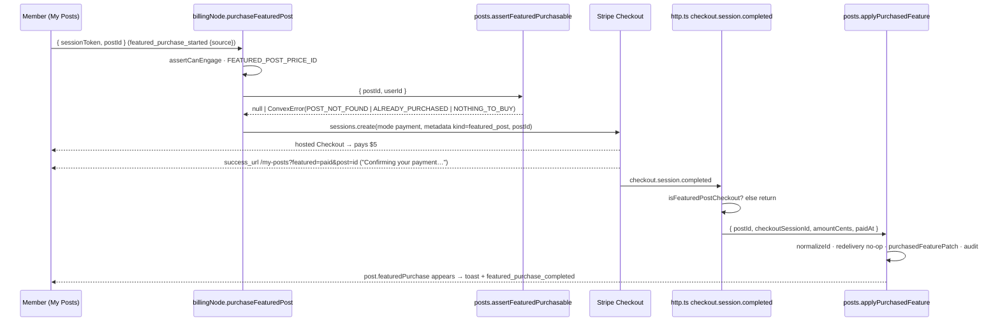

# Pricing Decoy (R13) + Featured-Post Add-on (R17) + ROPA Refresh Implementation Plan

> **For agentic workers:** REQUIRED SUB-SKILL: Use superpowers:subagent-driven-development (recommended) or superpowers:
> executing-plans to implement this plan task-by-task. Steps use checkbox (`- [ ]`) syntax for tracking.

**Goal:** Re-anchor the plan ladder as Good-Better-Best (Starter $10 → Growth $15 →
Pro $50, annual visible, monthly behind a text link), sell one featured post for $5 as a one-time Stripe Checkout with a
per-tier interaction-cap bonus, and bring the ROPA (`docs/compliance/DATA-INVENTORY.md`) back in sync with the schema.

**Architecture:** R13 is display-only (client price labels, landing + app copy, docs; Stripe Prices are Henriko's manual
step). R17 widens `posts` with `interactionCapBonus` + `featuredPurchase`, adds a pure decision module
`convex/lib/featuredPurchase.ts`, a `"use node"` action that opens a `mode: 'payment'` Checkout, a
`checkout.session.completed` webhook handler that fulfils through an internal mutation, and three client surfaces (My
Posts control, UpgradeAtLimit line, Billing line) — upgrade first, add-on second, everywhere. ROPA is docs-only.

**Tech Stack:** Convex (queries/mutations/actions, `@convex-dev/stripe` webhook routing + direct Stripe SDK), React 19 +
Vite + react-router + react-i18next (`app/`), Next.js SSG landing (`landing/`), vitest + @testing-library/react, pnpm
workspaces, Tailwind v4.

**Spec:** `docs/superpowers/specs/2026-09-08-pricing-decoy-featured-addon-ropa-design.md` (§3 R13, §4 R17, §5 ROPA, §6
gates, §7 execution, §8 manual steps).

## Global Constraints

Copied from the spec §2 and the project's standing rules. Every task's requirements include this section.

- **NEVER commit.** No `git commit`, `git push`, `git stash`, `git checkout --`, `git reset`, `git add`, or any other
  git state change. Henriko makes all commits. Report "files changed + test output" instead of committing.
- **Edit and Write tools only** for file changes. Never edit with bash heredocs, `sed -i`, node scripts or PowerShell.
  Bash is for read-only work (grep/sed -n/cat) and for running tests, lint, typecheck and builds.
- **pnpm, from the repo root** (`D:\ERP\LinkIntoTheSSI\LinkIntoTheSSI`). Never `npm`. Never run the convex CLI from
  inside `convex/`.
- **Never run `pnpm format`.** `pnpm verify` = `format:check && lint && typecheck && pnpm -r test`; if format:check
  fails on a file you touched, fix that file by hand to Prettier's output (`pnpm exec prettier --check <file>` to see,
  `pnpm exec prettier <file>` prints the formatted version — read it, then Edit the file to match).
- **Test commands:** convex `pnpm --filter convex test -- <path relative to convex/>`; app
  `pnpm --filter app test -- <path relative to app/>`; landing has no test runner — `pnpm --filter landing lint` and
  `pnpm --filter landing build` (expect 12 SSG pages, exit 0). Report the real output.
- **`docs/PLATFORM.md` stays in sync in the same change** (its §21 maps code areas to sections). A feature is not done
  until the docs say what the code does.
- **i18n:** pt = Brazilian Portuguese, es = neutral Latin-American Spanish, sentence case. The three app locales
  (`app/src/i18n/locales/{en,pt,es}.json`) and the three landing dictionaries
  (`landing/i18n/dictionaries/{en,pt,es}.json`) must keep exact key parity with identical `{{placeholder}}` sets. No
  parity test exists — verify with the script in "Locale parity check" below and report both counts (arrays-as-one and
  raw leaves).
- **Copy:** exact numbers, never "more reach"; no fabricated proof, urgency, or struck-through prices; every surface
  names the upgrade before the add-on; no fourth pricing card; no free plan; no A/B price tests; the client's price
  strings are labels, Stripe is the truth for charges.
- **Apify is dev-only** and never appears in customer-facing or compliance copy.
- **Prices:** Starter `$10/mo` / `$100/yr`, Growth `$15/mo` / `$150/yr`, Pro `$50/mo` / `$500/yr`, featured post `$5`
  once. Cap bonus per author tier at fulfilment: starter +25, growth +50, pro +100, contact 0 (nothing to buy).
- **Ponytail:** shortest working diff, reuse what exists (`toast`, `captureEvent`, `friendlyError`, `useCardGate`,
  `PLAN_PRICES`, `computeFeedFields`, `writeAuditLog`, `isUnlimitedFeatured`). Non-trivial logic leaves one test behind.

### Rules for every implementer and reviewer subagent (copy verbatim into each prompt)

```
Rules (non-negotiable):
1. Do NOT run any git command that changes state: no commit, push, stash, add, reset, checkout, restore, rebase. Read-only git (status, diff, log) is fine. Henriko commits.
2. Change files ONLY with the Edit and Write tools. Never sed -i, heredocs, node/PowerShell write scripts.
3. Never run `pnpm format`. Fix Prettier complaints by hand with Edit.
4. Use pnpm from the repo root D:\ERP\LinkIntoTheSSI\LinkIntoTheSSI. Never npm. Never run the convex CLI inside convex/.
5. Report test/lint output faithfully — paste the pass/fail counts and any failure text. Never claim a green run you did not see.
6. Read every file you edit in full before editing it. Match its existing style.
```

### Locale parity check (read-only script, run with Bash)

```bash
node -e "
const fs=require('fs');const dir=process.argv[1];
const load=l=>JSON.parse(fs.readFileSync(dir+'/'+l+'.json','utf8'));
const walk=(o,p='',out=new Map())=>{for(const[k,v]of Object.entries(o)){const key=p?p+'.'+k:k;if(v&&typeof v==='object'&&!Array.isArray(v))walk(v,key,out);else out.set(key,JSON.stringify(v));}return out;};
const leaves=o=>Object.values(o).reduce((n,v)=>n+(v&&typeof v==='object'?leaves(v):1),0);
const ph=s=>[...s.matchAll(/{{\s*(\w+)\s*}}/g)].map(m=>m[1]).sort().join(',');
const en=walk(load('en'));
for(const l of ['en','pt','es']){const m=walk(load(l));const missing=[...en.keys()].filter(k=>!m.has(k));const extra=[...m.keys()].filter(k=>!en.has(k));const phDiff=[...en.keys()].filter(k=>m.has(k)&&ph(en.get(k))!==ph(m.get(k)));console.log(l,'arrays-as-one',m.size,'raw leaves',leaves(load(l)),'missing',missing,'extra',extra,'placeholderDiff',phDiff);}
" app/src/i18n/locales
```

Run it once with `app/src/i18n/locales` and once with `landing/i18n/dictionaries`. Expected after Task 5: app
`arrays-as-one 389 raw leaves 399` for all three, `missing [] extra [] placeholderDiff []`. Landing after Task 1:
identical counts across en/pt/es, all lists empty.

`leaves` recurses *into* arrays rather than taking `v.length`. The two agree for the app locales, whose three arrays
hold plain strings, but not for the landing dictionaries, whose arrays hold objects — `pricing.plans` is three entries
and twenty-seven string leaves. Counting entries there reports 101 instead of 155. (Final counts for this batch,
measured after the final fix wave: app **392 / 402**, landing **87 / 155**, zero drift in both.)

---

## File map

| Area                            | Create                                                                  | Modify                                                                                                                                                                                                                                      |
|---------------------------------|-------------------------------------------------------------------------|---------------------------------------------------------------------------------------------------------------------------------------------------------------------------------------------------------------------------------------------|
| R13 landing (Task 1)            | —                                                                       | `landing/components/Pricing.tsx`, `landing/i18n/dictionaries/{en,pt,es}.json`                                                                                                                                                               |
| R13 app + docs (Task 2)         | `app/src/lib/planPrices.test.ts`                                        | `app/src/lib/planPrices.ts`, `app/src/i18n/locales/{en,pt,es}.json` (`billing.plans.*.features` order), `convex/.env.local.example`, `README.md`, `docs/PLATFORM.md` §1 §8 §15 §16, `backlog/revenue/R13-*.md`, `backlog/revenue/README.md` |
| R17 backend core (Task 3)       | `convex/lib/featuredPurchase.ts`, `convex/lib/featuredPurchase.test.ts` | `convex/schema.ts`, `convex/lib/planLimits.ts` (+test), `convex/lib/interactionLimit.ts` (+test), `convex/interactions.ts`, `convex/jobs/syncPosts.ts`, `convex/lib/recap.ts` (+test), `convex/posts.ts`                                    |
| R17 checkout + webhook (Task 4) | —                                                                       | `convex/lib/stripePrices.ts` (+test), `convex/billingNode.ts`, `convex/http.ts`, `convex/.env.local.example`, `docs/PLATFORM.md` §8 §16 §21                                                                                                 |
| R17 frontend (Task 5)           | —                                                                       | `app/src/lib/planPrices.ts` (+test), `app/src/pages/MyPostsPage.tsx` (+test), `app/src/components/UpgradeAtLimit.tsx` (+test), `app/src/pages/BillingPage.tsx` (+test), `app/src/i18n/locales/{en,pt,es}.json`                              |
| R17 docs + privacy (Task 6)     | —                                                                       | `docs/PLATFORM.md` §5 §9 §10 §11 §13B §14, `landing/app/[lang]/privacy/content/{en,pt,es}.tsx`, `backlog/revenue/R17-*.md`, `backlog/revenue/README.md`                                                                                     |
| ROPA (Task 7)                   | —                                                                       | `docs/compliance/DATA-INVENTORY.md`                                                                                                                                                                                                         |
| Gates + review (Task 8)         | —                                                                       | fix wave as needed; memory files (orchestrator only)                                                                                                                                                                                        |

---

### Task 1: R13 landing — Starter $10, monthly behind a text link, one value axis

**UI task.** The implementer MUST load these skills with the Skill tool before editing: `responsive-design`,
`frontend-design:frontend-design`, `web-design-guidelines`, `ui-ux-pro-max`.

**Files:**

- Modify: `landing/components/Pricing.tsx` (126 lines)
- Modify: `landing/i18n/dictionaries/en.json` (`pricing` block, ~:126-182)
- Modify: `landing/i18n/dictionaries/pt.json` (same block, same lines)
- Modify: `landing/i18n/dictionaries/es.json` (same block, same lines)

**Interfaces:**

- Consumes: `Dictionary['pricing']` (type derived from `en.json` in `landing/i18n/getDictionary.ts:12` — en.json is the
  type source, so a removed key that is still referenced fails `next build`), `SIGN_IN_URL` from `@/lib/links`.
- Produces: dictionary keys `pricing.seeMonthly`, `pricing.seeAnnual`, `pricing.plans[].axis`; removes
  `pricing.toggleAnnual`, `pricing.toggleAnnualSuffix`, `pricing.toggleMonthly`. Task 2 quotes the same prices in the
  app.

- [ ] **Step 1: Confirm the removed keys have no other consumers**

Run: `grep -rn "toggleAnnual\|toggleMonthly" landing/components landing/app landing/i18n landing/lib`
Expected: hits only in `landing/components/Pricing.tsx` and the three dictionary files. If anything else references
them, list it in your report and update it in this task.

- [ ] **Step 2: Edit `landing/i18n/dictionaries/en.json`**

Read the file. In the `pricing` object:

(a) Replace the three toggle keys (they sit right after `"subheadline"`) —

```json
    "toggleAnnual": "Annual",
    "toggleAnnualSuffix": "· 2 months free",
    "toggleMonthly": "Monthly",
```

with

```json
    "seeMonthly": "Prefer to pay monthly? See monthly prices",
    "seeAnnual": "Back to annual · 2 months free",
```

(b) In each `plans[]` entry add `"axis"` right after `"description"` and replace `features` (the interactions line
leaves the list; Growth/Pro gain the featured line after "Everything in …"; posts/week stays last):

```json
      {
        "id": "starter",
        "name": "Starter",
        "description": "Get into the feed and start engaging",
        "axis": "25 interactions counted per post",
        "features": ["See the full live feed", "Comment & react with AI", "1 post into the feed / week"],
        "cta": "Start 7-day Starter trial"
      },
      {
        "id": "growth",
        "name": "Growth",
        "description": "A targeted feed for faster results",
        "axis": "50 interactions counted per post",
        "features": [
          "Feed filtered to your industry + country",
          "Everything in Starter",
          "1 featured post a month",
          "2 posts into the feed / week"
        ],
        "cta": "Start 7-day Growth trial"
      },
      {
        "id": "pro",
        "name": "Pro",
        "description": "Maximum reach and control",
        "axis": "200 interactions counted per post",
        "features": [
          "Custom industry + country filters",
          "Control who sees your posts",
          "Everything in Growth",
          "3 featured posts a month",
          "5 posts into the feed / week"
        ],
        "cta": "Start 7-day Pro trial"
      }
```

Keep `name`/`cta` exactly as they are in the file (the values above are what the file holds today; do not retype them
from memory — Edit only `axis` and `features`).

- [ ] **Step 3: Edit `landing/i18n/dictionaries/pt.json`** (pt-BR)

(a) Replace

```json
    "toggleAnnual": "Anual",
    "toggleAnnualSuffix": "· 2 meses grátis",
    "toggleMonthly": "Mensal",
```

with

```json
    "seeMonthly": "Prefere pagar por mês? Ver preços mensais",
    "seeAnnual": "Voltar ao anual · 2 meses grátis",
```

(b) Plans — `axis` after `description`, new `features`:

- starter: `"axis": "25 interações contadas por publicação"`,
  `"features": ["Veja o feed completo em tempo real", "Comente e reaja com IA", "1 publicação no feed / semana"]`
- growth: `"axis": "50 interações contadas por publicação"`,
  `"features": ["Feed filtrado por setor + país", "Tudo do Starter", "1 publicação em destaque por mês", "2 publicações no feed / semana"]`
- pro: `"axis": "200 interações contadas por publicação"`,
  `"features": ["Filtros personalizados de setor + país", "Controle quem vê suas publicações", "Tudo do Growth", "3 publicações em destaque por mês", "5 publicações no feed / semana"]`

- [ ] **Step 4: Edit `landing/i18n/dictionaries/es.json`** (neutral LatAm)

(a) Replace

```json
    "toggleAnnual": "Anual",
    "toggleAnnualSuffix": "· 2 meses gratis",
    "toggleMonthly": "Mensual",
```

with

```json
    "seeMonthly": "¿Prefieres pagar por mes? Ver precios mensuales",
    "seeAnnual": "Volver a anual · 2 meses gratis",
```

(b) Plans:

- starter: `"axis": "25 interacciones contadas por publicación"`,
  `"features": ["Accede al feed completo en vivo", "Comenta y reacciona con IA", "1 publicación en el feed / semana"]`
- growth: `"axis": "50 interacciones contadas por publicación"`,
  `"features": ["Feed filtrado por industria + país", "Todo lo de Starter", "1 publicación destacada al mes", "2 publicaciones en el feed / semana"]`
- pro: `"axis": "200 interacciones contadas por publicación"`,
  `"features": ["Filtros personalizados de industria + país", "Controla quién ve tus publicaciones", "Todo lo de Growth", "3 publicaciones destacadas al mes", "5 publicaciones en el feed / semana"]`

- [ ] **Step 5: Edit `landing/components/Pricing.tsx`**

Read the file first. Three edits:

(a) `MONTHLY_PRICES`: change `starter: 5` to `starter: 10` and put this comment above the constant (replace any existing
comment on it):

```tsx
// Display labels only — Stripe's Prices are the truth for what is charged (docs/PLATFORM.md §8).
// Starter is $10 on purpose: the decoy that makes Growth ($15 for double the cap and the posts,
// plus a featured post) the obvious buy. backlog/revenue/R13.
const MONTHLY_PRICES: Record<string, number> = { starter: 10, growth: 15, pro: 50 }
```

(b) Replace the whole toggle element — the `<div className="mt-8 inline-flex items-center gap-3 rounded-full …">` that
contains the two `setAnnual(true)` / `setAnnual(false)` buttons — with one text control:

```tsx
          {/* Annual is the price on the cards; monthly sits behind this text link so the yearly
              number is what every visitor reads first (backlog/R13). The label names where it
              goes, so it needs no aria-pressed; min-h-11 keeps a 44 px target on phones. */}
          <button
            type="button"
            onClick={() => setAnnual(a => !a)}
            className="mt-8 inline-flex min-h-11 items-center rounded-md px-3 text-sm text-cream/60 underline-offset-4 transition-colors duration-300 hover:text-cream hover:underline focus-visible:outline-2 focus-visible:outline-offset-2 focus-visible:outline-gold"
          >
            {annual ? dict.seeMonthly : dict.seeAnnual}
          </button>
```

(c) Inside the card, right after the price block (the `<div className="mb-6">` that renders `p.big`, `p.period` and
`p.sub`) and before `<ul className="mb-8 flex-1 space-y-2.5">`, insert:

```tsx
              {/* The one axis the three plans are compared on (backlog/R13): the number the ladder
                  sells, in body-weight cream so it reads before the checklist. */}
              <p className="mb-5 text-sm font-medium text-cream">{plan.axis}</p>
```

Nothing else changes: the CTA still carries `?plan=<id>&interval=<annual|monthly>`, the Growth card keeps its highlight
and "Recommended" badge, the footer keeps `trialNote` and the Enterprise line. If the design skills you loaded argue for
a different spacing token, tune `mb-5`/`mt-8` only — keep the structure and the copy.

- [ ] **Step 6: Landing parity check**

Run the "Locale parity check" script from the plan header with `landing/i18n/dictionaries`.
Expected: three lines with equal counts, `missing [] extra [] placeholderDiff []`. Paste the three lines in your report.

- [ ] **Step 7: Lint + build**

Run: `pnpm --filter landing lint`
Expected: exit 0, no warnings.

Run: `pnpm --filter landing build`
Expected: exit 0, "12" static pages in the route summary, no type error (a leftover `dict.toggleAnnual` would fail here
because `Dictionary` derives from `en.json`).

- [ ] **Step 8: Report — do NOT commit**

List the files changed, paste the parity lines and the lint/build tails. Do not run any git state-changing command.

---

### Task 2: R13 app labels + docs + backlog

**Files:**

- Modify: `app/src/lib/planPrices.ts` (16 lines)
- Create: `app/src/lib/planPrices.test.ts`
- Modify: `app/src/i18n/locales/en.json`, `pt.json`, `es.json` — `billing.plans.{starter,growth,pro}.features` (~:
  278-308)
- Modify: `convex/.env.local.example:23`
- Modify: `README.md:132-141` (tier table)
- Modify: `docs/PLATFORM.md` — §1 tier table (~:79), §8 "Billing intervals" (~:994-999) + Stripe Dashboard table (~:
  1554-1572), §15 pricing section (~:4183-4188, ~:4310-4316, ~:4344), §16 env rows quoting `$50/yr` (~:4457-4462 and the
  convex `STRIPE_STARTER_*` rows)
- Modify: `backlog/revenue/R13-*.md` (status line 3, evidence :29-34, acceptance :90-96), `backlog/revenue/README.md`
  (R13 row :155, order notes :172-176)

**Interfaces:**

- Consumes: nothing from other tasks.
- Produces: `PLAN_PRICES.monthly.starter === '$10/mo'`, `PLAN_PRICES.annual.starter === '$100/yr'` — every app surface
  (BillingPage grid, card gate cost line, UpgradeAtLimit) already reads this table.

- [ ] **Step 1: Write the failing test `app/src/lib/planPrices.test.ts`**

```ts
import { describe, expect, it } from 'vitest'
import { PLAN_PRICES } from './planPrices'

const amount = (label: string) => Number(label.replace(/[^0-9.]/g, ''))

describe('PLAN_PRICES', () => {
  it('prices Starter at $10/mo and $100/yr (backlog/R13 decoy ladder)', () => {
    expect(PLAN_PRICES.monthly.starter).toBe('$10/mo')
    expect(PLAN_PRICES.annual.starter).toBe('$100/yr')
  })

  it('prices every annual plan at 10 × monthly — the "2 months free" promise', () => {
    for (const plan of Object.keys(PLAN_PRICES.monthly)) {
      expect(amount(PLAN_PRICES.annual[plan])).toBe(amount(PLAN_PRICES.monthly[plan]) * 10)
    }
  })
})
```

- [ ] **Step 2: Run it to see it fail**

Run: `pnpm --filter app test -- src/lib/planPrices.test.ts`
Expected: 1 failed (`'$5/mo'` ≠ `'$10/mo'`), 1 passed.

- [ ] **Step 3: Edit `app/src/lib/planPrices.ts`**

Replace the two Starter labels:

```ts
export const PLAN_PRICES: Record<Interval, Record<string, string>> = {
  monthly: { starter: '$10/mo', growth: '$15/mo', pro: '$50/mo' },
  annual: { starter: '$100/yr', growth: '$150/yr', pro: '$500/yr' }
}
```

Add one line to the header comment (after the existing sentence about Stripe being the truth):
`// Starter is $10 by design — the decoy under Growth (backlog/revenue/R13).`

- [ ] **Step 4: Run the test again**

Run: `pnpm --filter app test -- src/lib/planPrices.test.ts`
Expected: 2 passed.

- [ ] **Step 5: Reorder `billing.plans.*.features` in the three app locales**

Read each file's `billing.plans` block. In every plan's `features` array, move the interactions line (the one starting
with `25`, `50` or `200`) to index 0. Do not change any string. Result for `en.json`:

```json
      "starter": {
        "name": "Starter",
        "description": "Get started and start engaging",
        "features": [
          "25 interactions counted per post",
          "See the full live feed",
          "Comment & react with AI",
          "1 post into the feed / week"
        ]
      },
      "growth": {
        "name": "Growth",
        "description": "Targeted feed for faster results",
        "features": [
          "50 interactions counted per post",
          "Feed filtered to your industry + country",
          "Everything in Starter",
          "2 posts into the feed / week"
        ]
      },
      "pro": {
        "name": "Pro",
        "description": "Maximum visibility and control",
        "features": [
          "200 interactions counted per post",
          "Custom industry + country filters",
          "Control who sees your posts",
          "Everything in Growth",
          "5 posts into the feed / week"
        ]
      }
```

Apply the same move in `pt.json` (lines starting `25 interações…`, `50 interações…`, `200 interações…`) and `es.json`
(`25 interacciones…`, `50 interacciones…`, `200 interacciones…`). Only the order changes; keep `name`/`description`
untouched.

- [ ] **Step 6: Run the app locale parity script**

Run the "Locale parity check" with `app/src/i18n/locales`.
Expected: `arrays-as-one 377 raw leaves 387` ×3, all lists empty (unchanged counts — this task adds no keys).

- [ ] **Step 7: `convex/.env.local.example`**

Line 23 comment: change `Starter $50/yr` to `Starter $100/yr` so it reads
`# Annual price IDs (2 months free: Starter $100/yr, Growth $150/yr, Pro $500/yr).`

- [ ] **Step 8: `README.md` tier table**

Read lines 128-142. Change the header cell `Starter ($5/mo)` to `Starter ($10/mo)`. The column is one character wider
now, so re-pad every cell of that column (header, `:---:` separator, and each body row) so the pipes stay aligned — this
table is hand-aligned prose, not Prettier-formatted. Keep the ✓/✗ centred as they are.

- [ ] **Step 9: `docs/PLATFORM.md` — §1, §8, §15, §16**

Read each anchor before editing (line numbers drift; grep the quoted text).

(a) §1 tier table (grep `|  $5/mo  |`): replace `$5/mo` with `$10/mo` in that row — the cell width is unchanged
(` $10/mo  ` is still nine characters).

(b) §8 "Billing intervals" paragraph (grep `Starter $50/yr`): change to `Starter $100/yr` and append this sentence to
the paragraph:
`The landing shows the annual price on every card and puts the monthly price behind a text link ("Prefer to pay monthly?") — the Good-Better-Best ladder is Starter $10 → Growth $15 → Pro $50, and Starter is the decoy that makes Growth the obvious buy (backlog/revenue/R13).`

(c) §8 "Stripe Dashboard setup" table (grep `Webhook events`): update the status line above the table to
`Status (2026-09-08): not yet applied` (keep its wording otherwise) and add this row before the "Webhook events" row:

```
| Starter prices (R13) | Products → Starter | Create a **$10 monthly** and a **$100 annual** Price (2 months free) in every environment; repoint `STRIPE_STARTER_PRICE_ID` / `STRIPE_STARTER_ANNUAL_PRICE_ID` and the `VITE_STRIPE_STARTER_*` copies; archive the $5/$50 Prices. Existing $5 subscribers keep their Price until they switch. | The client's labels (`app/src/lib/planPrices.ts`, `landing/components/Pricing.tsx`) already say $10/$100. |
```

Match the table's column count exactly (read its header row first).

(d) §15 pricing section: find the paragraph that describes the `Pricing` component (grep `Pricing.tsx` inside §15, ~:
4183). Replace its description of the toggle with this text (keep the rest of the paragraph):

`Three cards, annual price shown, one axis line under the price ("25/50/200 interactions counted per post" — the only number the three plans are compared on), then the feature list (featured posts on Growth/Pro after "Everything in …", posts/week last). Monthly pricing sits behind a text link ("Prefer to pay monthly? See monthly prices" / "Back to annual · 2 months free") that flips a local ` +
"`annual`" + ` boolean; the CTA carries ` + "`?plan=<id>&interval=<annual|monthly>`" +
` exactly as before. **Pricing structure (backlog/R13):** Starter $10 → Growth $15 → Pro $50. At $5 → $15 → $50 every step was ~3× for a linear feature gain, so no card read as the deal; at $10 → $15 Growth costs 1.5× Starter for double the cap (50 vs 25), double the posts (2 vs 1) and a featured post, and Pro is 3.3× Growth for 4× the cap — Growth is the deal by construction, which is why it wears the "Recommended" badge. No free plan, no fourth card, no struck-through prices.`

(Write it as one prose paragraph; the concatenation above is just to show the backticked tokens.)

Then grep §15 for `Monthly/Annual toggle` (RefCarrier mention, ~:4310) and `<toggle>` (CTA table note, ~:4344): rewrite
each mention to say "the annual/monthly text link (`seeMonthly` / `seeAnnual`; annual by default)".

(e) §16: grep `$50/yr` across the file (`grep -n '50/yr' docs/PLATFORM.md`) and change every Starter mention to
`$100/yr` (VITE rows and convex `STRIPE_STARTER_ANNUAL_PRICE_ID` row). Leave Growth/Pro rows alone.

- [ ] **Step 10: Backlog docs**

`backlog/revenue/R13-*.md` (read it): status line 3 → `> **Status:** DONE 2026-09-08 · **Priority:** P2 · **Effort:** M`
(keep any trailing fields); add a
`**Decision (Henriko, 2026-09-07):** Starter $10 / $100 (decoy under Growth), monthly demoted to a text link, one value axis (interactions per post), fixed featured-post cap bonus +25/+50/+100 for R17.`
line under the status; fix the stale evidence (`PLAN_PRICES` lives in `app/src/lib/planPrices.ts`; the landing toggle is
gone); tick every acceptance box that this task and Task 1 satisfy and leave the Stripe-Dashboard box open with
`(manual — PLATFORM §8)`.

`backlog/revenue/README.md`: R13 row (~:155) status `TODO` → `DONE 2026-09-08`; order note item for R17 (~:172-176):
replace "Held … until R13 settles the ladder math" with
`R13 settled the ladder 2026-09-08 (Starter $10; fixed bonus +25/+50/+100) — R17 unblocked.`

- [ ] **Step 11: Run the app suite + typecheck**

Run: `pnpm --filter app test`
Expected: all green (394 + 2 new = 396, or the current count + 2 — paste it).

Run: `pnpm typecheck` (from the root)
Expected: exit 0.

- [ ] **Step 12: Report — do NOT commit**

Files changed, test counts, parity lines, and the exact PLATFORM sections you touched.

---

### Task 3: R17 backend core — schema, cap bonus, pure decisions, fulfilment mutation

**Files:**

- Modify: `convex/schema.ts` (posts table, after `interactionLimitReached` ~:150-152)
- Modify: `convex/lib/planLimits.ts` (after `DEFAULTS` ~:29-34); Test: `convex/lib/planLimits.test.ts`
- Modify: `convex/lib/interactionLimit.ts` (28 lines); Test: `convex/lib/interactionLimit.test.ts`
- Modify: `convex/interactions.ts` (`flipCapIfReached` ~:118-134, import :13)
- Modify: `convex/jobs/syncPosts.ts` (~:190, import :10)
- Modify: `convex/lib/recap.ts` (`pickNearCapPost` ~:76-86, import :4); Test: `convex/lib/recap.test.ts`
- Create: `convex/lib/featuredPurchase.ts`, `convex/lib/featuredPurchase.test.ts`
- Modify: `convex/posts.ts` (imports :2-18, `featurePost` ~:540-587, two new functions)

**Interfaces:**

- Consumes: `DEFAULTS`, `Tier`, `getPlanLimitsHelper(ctx, userId, tier): Promise<PlanLimits>`
  (`convex/lib/planLimits.ts`), `hasReachedInteractionLimit(likeCount, commentCount, cap)`,
  `shouldFlipInteractionLimit(likeCount, commentCount, cap, alreadyReached)`,
  `isNearInteractionLimit(likeCount, commentCount, cap)` (`convex/lib/interactionLimit.ts`),
  `computeFeedFields({ isFeatured, publishedAt, authorTierRank, hidden, interactionLimitReached, deletedAt })`
  (`convex/lib/feedRank.ts`), `isUnlimitedFeatured(featuredPerMonth)` (`convex/lib/postLimit.ts`),
  `writeAuditLog(db, { actor, actorId?, action, targetUserId?, metadata?: string })` (`convex/lib/audit.ts`).
- Produces (Tasks 4 and 5 rely on these exact names):
    - `posts.interactionCapBonus?: number`,
      `posts.featuredPurchase?: { checkoutSessionId: string; amountCents: number; paidAt: number }`
    - `FEATURED_CAP_BONUS: Record<Tier, number>` in `convex/lib/planLimits.ts`
    - `effectiveInteractionCap(planCap: number, bonus: number | undefined): number` in `convex/lib/interactionLimit.ts`
    - `featuredPurchaseBlocker(post, userId, limits): 'POST_NOT_FOUND' | 'ALREADY_PURCHASED' | 'NOTHING_TO_BUY' | null`,
      `isFeaturedPostCheckout(session): boolean`, `purchasedFeaturePatch(input): { patch, action }`,
      `type FeaturedPurchase` in `convex/lib/featuredPurchase.ts`
    - `internal.posts.assertFeaturedPurchasable({ postId: Id<'posts'>, userId: Id<'users'> })` (throws
      `ConvexError(blocker)`)
    -
  `internal.posts.applyPurchasedFeature({ postId: string, checkoutSessionId: string, amountCents: number, paidAt: number })`
    - Audit actions `post.featured_purchased`, `post.featured_purchase_orphaned`

- [ ] **Step 1: Schema — `convex/schema.ts`**

Read the `posts` table. Right after the `interactionLimitReached` field (keep its comment), add:

```ts
    // backlog/R17 — a bought featured post counts against planCap + this bonus (FEATURED_CAP_BONUS
    // for the author's tier at fulfilment). Absent on every other post.
    interactionCapBonus: v.optional(v.number()),
    // backlog/R17 — the one-time Stripe Checkout that featured this post. Present ⇒ bought once:
    // re-featuring is free (featurePost skips the monthly quota) and a redelivered webhook is a no-op.
    featuredPurchase: v.optional(
      v.object({ checkoutSessionId: v.string(), amountCents: v.number(), paidAt: v.number() })
    ),
```

- [ ] **Step 2: Failing tests for the bonus table and the effective cap**

Append to `convex/lib/planLimits.test.ts` (read it; add `FEATURED_CAP_BONUS` to its import from `./planLimits`, keep
`DEFAULTS` and `nextTier` imported):

```ts
describe('FEATURED_CAP_BONUS (backlog/R17)', () => {
  it('never lifts a bought post past the next tier’s plain cap — the ladder stays a ladder', () => {
    for (const tier of ['starter', 'growth'] as const) {
      const next = nextTier(tier)
      expect(next).not.toBeNull()
      expect(DEFAULTS[tier].interactionsPerPost + FEATURED_CAP_BONUS[tier]).toBeLessThanOrEqual(
        DEFAULTS[next!].interactionsPerPost
      )
    }
  })

  it('is the fixed table Henriko chose and gives contact nothing to buy', () => {
    expect(FEATURED_CAP_BONUS).toEqual({ starter: 25, growth: 50, pro: 100, contact: 0 })
  })
})
```

Append to `convex/lib/interactionLimit.test.ts` (add `effectiveInteractionCap` to its import):

```ts
describe('effectiveInteractionCap (backlog/R17)', () => {
  it('is the plan cap when the post carries no bonus', () => {
    expect(effectiveInteractionCap(25, undefined)).toBe(25)
  })

  it('adds the bonus a bought post carries', () => {
    expect(effectiveInteractionCap(25, 25)).toBe(50)
  })
})
```

Run: `pnpm --filter convex test -- lib/planLimits.test.ts lib/interactionLimit.test.ts`
Expected: FAIL — `FEATURED_CAP_BONUS` / `effectiveInteractionCap` are not exported.

- [ ] **Step 3: Implement the constants**

`convex/lib/planLimits.ts` — right after the `DEFAULTS` object:

```ts
// backlog/R17 — the interaction-cap bonus a bought featured post carries, keyed by the author's
// tier at fulfilment (Henriko, 2026-09-07: a fixed table, not a multiplier). Kept next to
// DEFAULTS so planLimits.test.ts can prove plan + bonus never passes the next tier's cap.
// Contact has unlimited featured posts, so there is nothing to sell.
export const FEATURED_CAP_BONUS: Record<Tier, number> = { starter: 25, growth: 50, pro: 100, contact: 0 }
```

`convex/lib/interactionLimit.ts` — append:

```ts
/**
 * backlog/R17 — the cap a specific post is measured against: its author's plan cap plus the bonus
 * stored on the post when its featured slot was bought. Every site that decides "reached"
 * for an EXISTING post goes through this (interactions.flipCapIfReached, jobs/syncPosts
 * applyEngagementCounts, lib/recap.pickNearCapPost); creation-time checks keep the plan cap.
 */
export function effectiveInteractionCap(planCap: number, bonus: number | undefined): number {
  return planCap + (bonus ?? 0)
}
```

Run the two test files again. Expected: all green.

- [ ] **Step 4: The three existing-post cap sites**

(a) `convex/interactions.ts`: change the import on :13 to
`import { effectiveInteractionCap, shouldFlipInteractionLimit } from './lib/interactionLimit'`. In `flipCapIfReached`,
replace

```ts
  // The callers already returned when the post was capped, so it's provably not-yet-reached here.
  if (!shouldFlipInteractionLimit(likeCount, commentCount, limits.interactionsPerPost, false)) return
```

with

```ts
  // A bought featured post is measured against plan cap + its bonus (backlog/R17).
  const cap = effectiveInteractionCap(limits.interactionsPerPost, post.interactionCapBonus)
  // The callers already returned when the post was capped, so it's provably not-yet-reached here.
  if (!shouldFlipInteractionLimit(likeCount, commentCount, cap, false)) return
```

And fix the function's doc comment: its last sentence claims "a second email for the same post cannot happen". Replace
that sentence with:
`A purchase (posts.applyPurchasedFeature) re-decides the flag against the bigger cap, so a bought post can reach a second cap and get a second notice — a new event at a new number, never a repeat of the first.`

(b) `convex/jobs/syncPosts.ts`: change :10 to
`import { effectiveInteractionCap, hasReachedInteractionLimit } from '../lib/interactionLimit'`; in
`applyEngagementCounts` replace

```ts
          reached = hasReachedInteractionLimit(u.likeCount, u.commentCount, cap)
```

with

```ts
          reached = hasReachedInteractionLimit(
            u.likeCount,
            u.commentCount,
            effectiveInteractionCap(cap, post.interactionCapBonus)
          )
```

(`capCache` still caches the PLAN cap per author; the bonus is per post, so it is applied outside the cache.)

(c) `convex/lib/recap.ts`: change :4 to
`import { effectiveInteractionCap, isNearInteractionLimit } from './interactionLimit'`; in `pickNearCapPost` add
`interactionCapBonus?: number` to the generic constraint and use the effective cap in the `isNearInteractionLimit` call,
i.e. the constraint becomes
`T extends { likeCount: number; commentCount: number; interactionLimitReached?: boolean; interactionCapBonus?: number }`
and the call becomes
`isNearInteractionLimit(p.likeCount, p.commentCount, effectiveInteractionCap(cap, p.interactionCapBonus))`.

Add to `convex/lib/recap.test.ts` inside `describe('pickNearCapPost', …)`:

```ts
  it('measures a bought post against its plan cap plus its bonus (backlog/R17)', () => {
    // 42 of 25 would be capped; 42 of 25 + 25 = 50 sits inside the 80 % band.
    const bought = { id: 'bought', likeCount: 42, commentCount: 0, interactionCapBonus: 25 }
    expect(pickNearCapPost([bought], 25)?.id).toBe('bought')
  })
```

Run: `pnpm --filter convex test -- lib/recap.test.ts`
Expected: green.

- [ ] **Step 5: Failing tests for the pure decisions — `convex/lib/featuredPurchase.test.ts`**

```ts
import { describe, expect, it } from 'vitest'
import { featuredPurchaseBlocker, isFeaturedPostCheckout, purchasedFeaturePatch } from './featuredPurchase'

const purchase = { checkoutSessionId: 'cs_1', amountCents: 500, paidAt: 1_700_000_000_000 }
const base = {
  likeCount: 0,
  commentCount: 0,
  publishedAt: 1_600_000_000_000,
  authorTierRank: 1,
  hidden: false,
  deletedAt: undefined
}

describe('featuredPurchaseBlocker', () => {
  const limits = { featuredPerMonth: 1 }

  it('lets the author of a live, never-bought post buy', () => {
    expect(featuredPurchaseBlocker({ authorId: 'u1' }, 'u1', limits)).toBeNull()
  })

  it('reads a missing, deleted or foreign post as not found — no ownership leak', () => {
    expect(featuredPurchaseBlocker(null, 'u1', limits)).toBe('POST_NOT_FOUND')
    expect(featuredPurchaseBlocker({ authorId: 'u1', deletedAt: 1 }, 'u1', limits)).toBe('POST_NOT_FOUND')
    expect(featuredPurchaseBlocker({ authorId: 'u2' }, 'u1', limits)).toBe('POST_NOT_FOUND')
  })

  it('refuses a second purchase of the same post', () => {
    expect(featuredPurchaseBlocker({ authorId: 'u1', featuredPurchase: purchase }, 'u1', limits)).toBe(
      'ALREADY_PURCHASED'
    )
  })

  it('gives an unlimited (contact) tier nothing to buy', () => {
    expect(featuredPurchaseBlocker({ authorId: 'u1' }, 'u1', { featuredPerMonth: 9999 })).toBe('NOTHING_TO_BUY')
  })
})

describe('isFeaturedPostCheckout', () => {
  it('accepts only a paid, payment-mode session tagged featured_post', () => {
    const paid = { mode: 'payment', payment_status: 'paid', metadata: { kind: 'featured_post' } }
    expect(isFeaturedPostCheckout(paid)).toBe(true)
    expect(isFeaturedPostCheckout({ ...paid, mode: 'subscription' })).toBe(false)
    expect(isFeaturedPostCheckout({ ...paid, payment_status: 'unpaid' })).toBe(false)
    expect(isFeaturedPostCheckout({ ...paid, metadata: null })).toBe(false)
    expect(isFeaturedPostCheckout({ ...paid, metadata: { kind: 'other' } })).toBe(false)
  })
})

describe('purchasedFeaturePatch', () => {
  it('features a live post with its tier bonus and brings a capped post back into the feed', () => {
    // A starter post that already hit 25: against 25 + 25 it is no longer capped.
    const { patch, action } = purchasedFeaturePatch({
      post: { ...base, likeCount: 25 },
      tier: 'starter',
      planCap: 25,
      purchase,
      now: 42
    })
    expect(action).toBe('post.featured_purchased')
    expect(patch).toMatchObject({
      isFeatured: true,
      featuredAt: 42,
      interactionCapBonus: 25,
      interactionLimitReached: false,
      featuredPurchase: purchase,
      inFeed: true
    })
  })

  it('keeps a post capped when it already passed the bigger cap', () => {
    const { patch } = purchasedFeaturePatch({
      post: { ...base, likeCount: 60 },
      tier: 'starter',
      planCap: 25,
      purchase,
      now: 42
    })
    expect(patch.interactionLimitReached).toBe(true)
    expect(patch.inFeed).toBe(false)
  })

  it('stores only the purchase on a post deleted before the webhook arrived', () => {
    const { patch, action } = purchasedFeaturePatch({
      post: { ...base, deletedAt: 7 },
      tier: 'growth',
      planCap: 50,
      purchase,
      now: 42
    })
    expect(action).toBe('post.featured_purchase_orphaned')
    expect(patch).toEqual({ featuredPurchase: purchase })
  })
})
```

Run: `pnpm --filter convex test -- lib/featuredPurchase.test.ts`
Expected: FAIL — module not found.

- [ ] **Step 6: Create `convex/lib/featuredPurchase.ts`**

```ts
// The pure decisions behind the $5 featured-post add-on (backlog/revenue/R17). No ctx, no Stripe
// types: the action, the internal query and the webhook mutation pass plain shapes in, so every
// branch is unit-tested without a database (featuredPurchase.test.ts).
import type { Doc } from '../_generated/dataModel'
import { computeFeedFields } from './feedRank'
import { effectiveInteractionCap, hasReachedInteractionLimit } from './interactionLimit'
import { FEATURED_CAP_BONUS, type Tier } from './planLimits'
import { isUnlimitedFeatured } from './postLimit'

export type FeaturedPurchase = { checkoutSessionId: string; amountCents: number; paidAt: number }

export type FeaturedPurchaseBlocker = 'POST_NOT_FOUND' | 'ALREADY_PURCHASED' | 'NOTHING_TO_BUY'

/**
 * Why `userId` cannot buy a featured slot for `post` right now, or null when they can. A missing,
 * soft-deleted or someone else's post all read POST_NOT_FOUND, so the answer never confirms that
 * a post id exists. Unlimited tiers (contact) have nothing to buy.
 */
export function featuredPurchaseBlocker(
  post: { authorId: string; deletedAt?: number; featuredPurchase?: FeaturedPurchase } | null,
  userId: string,
  limits: { featuredPerMonth: number }
): FeaturedPurchaseBlocker | null {
  if (!post || post.authorId !== userId || post.deletedAt !== undefined) return 'POST_NOT_FOUND'
  if (post.featuredPurchase) return 'ALREADY_PURCHASED'
  if (isUnlimitedFeatured(limits.featuredPerMonth)) return 'NOTHING_TO_BUY'
  return null
}

/** The webhook's filter: only a PAID one-time Checkout tagged by billingNode.purchaseFeaturedPost. */
export function isFeaturedPostCheckout(session: {
  mode?: string
  payment_status?: string
  metadata?: Record<string, string> | null
}): boolean {
  return session.mode === 'payment' && session.payment_status === 'paid' && session.metadata?.kind === 'featured_post'
}

export type PurchasedFeatureOutcome = {
  patch: Partial<Doc<'posts'>>
  action: 'post.featured_purchased' | 'post.featured_purchase_orphaned'
}

/**
 * What fulfilment writes onto the post. A post deleted between Checkout and the webhook keeps
 * only the purchase record (the money exists; the audit row says why nothing was featured).
 * Otherwise the post is featured with its tier's bonus and `interactionLimitReached` is
 * re-decided against the bigger cap, so a capped post comes back into the feed at the top.
 */
export function purchasedFeaturePatch(input: {
  post: Pick<Doc<'posts'>, 'likeCount' | 'commentCount' | 'publishedAt' | 'authorTierRank' | 'hidden' | 'deletedAt'>
  tier: Tier
  planCap: number
  purchase: FeaturedPurchase
  now: number
}): PurchasedFeatureOutcome {
  const { post, tier, planCap, purchase, now } = input
  if (post.deletedAt !== undefined) {
    return { patch: { featuredPurchase: purchase }, action: 'post.featured_purchase_orphaned' }
  }
  const bonus = FEATURED_CAP_BONUS[tier]
  const reached = hasReachedInteractionLimit(post.likeCount, post.commentCount, effectiveInteractionCap(planCap, bonus))
  const feed = computeFeedFields({
    isFeatured: true,
    publishedAt: post.publishedAt,
    authorTierRank: post.authorTierRank,
    hidden: post.hidden,
    interactionLimitReached: reached,
    deletedAt: undefined
  })
  return {
    patch: {
      isFeatured: true,
      featuredAt: now,
      interactionCapBonus: bonus,
      interactionLimitReached: reached,
      featuredPurchase: purchase,
      ...feed
    },
    action: 'post.featured_purchased'
  }
}
```

If `Pick<Doc<'posts'>, …>` rejects a field name (e.g. `hidden` is not optional in the schema), adjust the `Pick` list to
the real field names — read the `posts` table in `convex/schema.ts` and `FeedFieldInputs` in `convex/lib/feedRank.ts` —
but keep the function's shape.

Run: `pnpm --filter convex test -- lib/featuredPurchase.test.ts`
Expected: 9 passed.

- [ ] **Step 7: `convex/posts.ts` — imports**

Edit the imports at the top:

- line 2 today is `import { action, internalQuery, mutation, query, type QueryCtx } from './_generated/server'` — add
  `internalMutation` to it (alphabetical: `action, internalMutation, internalQuery, mutation, query, type QueryCtx`)
- `DEFAULTS, getPlanLimitsHelper, type PlanLimits, type Tier` are already imported from `./lib/planLimits`;
  `ConvexError` from `convex/values`; `computeFeedFields` from `./lib/feedRank` — reuse them
- add `import { featuredPurchaseBlocker, purchasedFeaturePatch } from './lib/featuredPurchase'`
- add `import { writeAuditLog } from './lib/audit'`

- [ ] **Step 8: `convex/posts.ts` — `featurePost` skips the quota for a bought post**

Read `featurePost`. Keep its opening exactly (requireAuth → get → `canModifyPost` → deleted →
`if (post.isFeatured) return`). Then restructure the rest so the feed fields are computed first and a bought post
short-circuits before the quota read:

```ts
    const feed = computeFeedFields({
      isFeatured: true,
      publishedAt: post.publishedAt,
      authorTierRank: post.authorTierRank,
      hidden: post.hidden,
      interactionLimitReached: post.interactionLimitReached,
      deletedAt: post.deletedAt
    })
    // backlog/R17 — a bought slot was paid for once; re-featuring it never touches the monthly
    // quota and never refunds (the hint under the buy button says so).
    if (post.featuredPurchase) {
      await ctx.db.patch(postId, { isFeatured: true, featuredAt: Date.now(), ...feed })
      return
    }
```

followed by the existing quota block unchanged (`tier` → `limits` → `month` → `usageRow` → `usedCount` →
`isFeaturedLimitReached` throw → `patch` → usage upsert), minus the `const feed = computeFeedFields(...)` that used to
sit after the throw (it moved up). `unfeaturePost` does not change.

- [ ] **Step 9: `convex/posts.ts` — the two internal functions**

Append after `unfeaturePost`:

```ts
// ── Featured post add-on (backlog/revenue/R17) ───────────────────────────────────────────────────

// billingNode.purchaseFeaturedPost asks before opening Checkout. Throws the blocker's code; the
// client shows it through friendlyError.
export const assertFeaturedPurchasable = internalQuery({
  args: { postId: v.id('posts'), userId: v.id('users') },
  handler: async (ctx, { postId, userId }): Promise<null> => {
    const [post, user] = await Promise.all([ctx.db.get(postId), ctx.db.get(userId)])
    const limits = await getPlanLimitsHelper(ctx, userId, user?.tier ?? 'starter')
    const blocker = featuredPurchaseBlocker(post, userId, limits)
    if (blocker) throw new ConvexError(blocker)
    return null
  }
})

type AuditDb = Parameters<typeof writeAuditLog>[0]

// Fulfilment, called by http.ts on checkout.session.completed. `postId` is a plain string on
// purpose: Stripe retries a failing webhook for days, so a bad id must log and return, never fail
// the validator. Idempotent — a redelivered event finds `featuredPurchase` set and stops. Never
// touches featuredPostUsage: the purchase is outside the monthly quota by design.
export const applyPurchasedFeature = internalMutation({
  args: { postId: v.string(), checkoutSessionId: v.string(), amountCents: v.number(), paidAt: v.number() },
  handler: async (ctx, { postId, checkoutSessionId, amountCents, paidAt }): Promise<null> => {
    const id = ctx.db.normalizeId('posts', postId)
    const post = id ? await ctx.db.get(id) : null
    if (!id || !post) {
      console.error('[posts] featured purchase for unknown post', { postId, checkoutSessionId })
      return null
    }
    if (post.featuredPurchase) return null
    const author = await ctx.db.get(post.authorId)
    const tier: Tier = author?.tier ?? 'starter'
    const limits = await getPlanLimitsHelper(ctx, post.authorId, tier)
    const purchase = { checkoutSessionId, amountCents, paidAt }
    const { patch, action } = purchasedFeaturePatch({
      post,
      tier,
      planCap: limits.interactionsPerPost,
      purchase,
      now: Date.now()
    })
    await ctx.db.patch(id, patch)
    // Money moved without a member action in our app, so the row says what it bought (or why
    // nothing was featured: the post was deleted between Checkout and the webhook).
    await writeAuditLog(ctx.db as unknown as AuditDb, {
      actor: 'system',
      action,
      targetUserId: post.authorId,
      metadata: JSON.stringify({ postId: id, checkoutSessionId, amountCents, bonus: patch.interactionCapBonus ?? 0 })
    })
    return null
  }
})
```

- [ ] **Step 10: Convex suite + typecheck**

Run: `pnpm --filter convex test`
Expected: all green (459 + 12 new = 471, or current + 12 — paste the number).

Run: `pnpm typecheck`
Expected: exit 0. If `ctx.db.patch(id, patch)` complains about `Partial<Doc<'posts'>>`, change
`PurchasedFeatureOutcome.patch` to `Partial<Omit<Doc<'posts'>, '_id' | '_creationTime'>>` in `featuredPurchase.ts` (and
nothing else).

Run: `pnpm lint`
Expected: exit 0.

- [ ] **Step 11: Report — do NOT commit**

Files changed, the three test counts, and the exact text of the `flipCapIfReached` comment you rewrote.

---

### Task 4: R17 checkout action + webhook fulfilment + PLATFORM §8/§16/§21

**Files:**

- Modify: `convex/lib/stripePrices.ts` (39 lines); Test: `convex/lib/stripePrices.test.ts`
- Modify: `convex/billingNode.ts` (new action after `createCheckoutSession`, imports :8-12)
- Modify: `convex/http.ts` (`events` map ~:185-215)
- Modify: `convex/.env.local.example` (after the annual price ids)
- Modify: `docs/PLATFORM.md` §8 (after "Billing intervals"; webhook table ~:1305-1311 + mermaid ~:1313-1335; price-id
  paragraph ~:971-976; Dashboard table ~:1563-1572), §16 (convex env table; allowlist note ~:4408-4414), §21 mapping
  table (~:4856-4870)

**Interfaces:**

- Consumes (Task 3): `internal.posts.assertFeaturedPurchasable({ postId, userId })`,
  `internal.posts.applyPurchasedFeature({ postId: string, checkoutSessionId, amountCents, paidAt })`,
  `isFeaturedPostCheckout(session)` from `./lib/featuredPurchase`; existing `requireAuthAction`,
  `stripeComponent.getOrCreateCustomer`, `resolveBillingLocale`, `stripeCheckoutLocale`, `assertCanEngage(user)`
  (`convex/lib/access.ts`), `eventCreatedMs(event)` (`convex/http.ts`).
- Produces (Task 5 relies on):
  `api.billingNode.purchaseFeaturedPost({ sessionToken: string, postId: Id<'posts'> }) → { url: string | null }`;
  ConvexError codes `PAYMENT_REQUIRED:` (from `assertCanEngage`), `FEATURED_PRICE_UNSET`, `POST_NOT_FOUND`,
  `ALREADY_PURCHASED`, `NOTHING_TO_BUY`; success URL `/my-posts?featured=paid&post=<id>`, cancel URL `/my-posts`; env
  `STRIPE_FEATURED_POST_PRICE_ID`.

- [ ] **Step 1: Failing test — the featured Price is never a tier**

Append to `convex/lib/stripePrices.test.ts` inside `describe('stripePrices', …)`:

```ts
  it('never maps the one-time featured-post price to a tier (backlog/R17)', () => {
    const map = buildPriceMap({ ...ENV, STRIPE_FEATURED_POST_PRICE_ID: 'price_feat' })
    expect(resolveTier(map, 'price_feat')).toBe('starter') // the "unknown id" default, not a tier of its own
    expect(Object.values(map)).not.toContain('price_feat')
  })
```

If `buildPriceMap` returns a `Map`, replace the last line with `expect([...map.keys()]).not.toContain('price_feat')`.

Run: `pnpm --filter convex test -- lib/stripePrices.test.ts`
Expected: this test already PASSES (nothing maps the id). Keep it — it pins the rule for whoever edits `buildPriceMap`
next.

- [ ] **Step 2: `convex/lib/stripePrices.ts` — export the id**

Append:

```ts
// backlog/R17 — the one-time $5 "Featured post" Price (Checkout mode: payment). Deliberately NOT
// part of buildPriceMap: it maps to no tier, so it can never enter ALLOWED_PRICE_IDS or resolve
// through getTierFromPriceId. billingNode.purchaseFeaturedPost is its only consumer.
export const FEATURED_POST_PRICE_ID = process.env.STRIPE_FEATURED_POST_PRICE_ID
```

- [ ] **Step 3: `convex/billingNode.ts` — the action**

Imports: change :9 to
`import { ALLOWED_PRICE_IDS, FEATURED_POST_PRICE_ID, getTierFromPriceId, starterPriceIdFor } from './lib/stripePrices'`
and add `import { assertCanEngage } from './lib/access'`.

Insert after `createCheckoutSession` (before `endTrialEarly`):

```ts
// ── Featured post add-on (backlog/revenue/R17) ───────────────────────────────────────────────────
// One-time $5 Checkout that features ONE post with a bigger interaction cap. Same Stripe customer
// as the subscription, so the saved card is offered; fulfilled by the checkout.session.completed
// webhook (http.ts → posts.applyPurchasedFeature). The server allows any eligible post at any
// time — the UI decides where to offer it (upgrade first, add-on second).
export const purchaseFeaturedPost = action({
  args: { sessionToken: v.string(), postId: v.id('posts') },
  handler: async (ctx, { sessionToken, postId }): Promise<{ url: string | null }> => {
    const user = await requireAuthAction(ctx, sessionToken)
    if (!user) throw new ConvexError('User not found')
    assertCanEngage(user) // PAYMENT_REQUIRED: for no card / past due; trialing members pass
    if (!FEATURED_POST_PRICE_ID) throw new ConvexError('FEATURED_PRICE_UNSET')
    await ctx.runQuery(internal.posts.assertFeaturedPurchasable, { postId, userId: user._id })

    const customer = await stripeComponent.getOrCreateCustomer(ctx, {
      userId: user._id,
      email: user.email,
      name: user.name
    })
    const appUrl = process.env.APP_URL ?? 'http://localhost:5173'
    const billingLocale = resolveBillingLocale(user.language, user.primaryLocale)

    const session = await stripe().checkout.sessions.create({
      mode: 'payment',
      customer: customer.customerId,
      line_items: [{ price: FEATURED_POST_PRICE_ID, quantity: 1 }],
      // Three strings, nothing personal: the webhook keys on `kind` and fulfils by `postId`;
      // convexUserId is for support lookups in the Stripe Dashboard (the author comes from the
      // post at fulfilment, never from here).
      metadata: { kind: 'featured_post', convexUserId: user._id, postId },
      locale: stripeCheckoutLocale(billingLocale),
      success_url: `${appUrl}/my-posts?featured=paid&post=${postId}`,
      cancel_url: `${appUrl}/my-posts`
    })
    return { url: session.url }
  }
})
```

If `assertCanEngage`'s parameter type does not accept the object `requireAuthAction` returns, read
`convex/lib/access.ts` and pass what it wants (it reads `subscriptionStatus`); do not change `access.ts`.

- [ ] **Step 4: `convex/http.ts` — the webhook handler**

Add `import { isFeaturedPostCheckout } from './lib/featuredPurchase'` next to the other `./lib/…` imports. In the
`events` map, after the `'invoice.payment_failed'` handler (it is the last entry today), add:

```ts
    // backlog/R17 — the one-time featured-post purchase. Subscription checkouts complete through
    // this event too; the pure filter lets only a PAID payment-mode session tagged by
    // purchaseFeaturedPost through. postId travels as a plain string and is normalised inside the
    // mutation: a malformed id must log and return, never throw (Stripe retries a 500 for days).
    'checkout.session.completed': async (ctx: StripeEvent, event: StripeEvent) => {
      const session = event.data.object
      if (!isFeaturedPostCheckout(session)) return
      await ctx.runMutation(internal.posts.applyPurchasedFeature, {
        postId: String(session.metadata?.postId ?? ''),
        checkoutSessionId: String(session.id),
        amountCents: typeof session.amount_total === 'number' ? session.amount_total : 0,
        paidAt: eventCreatedMs(event)
      })
    }
```

Match the neighbouring handlers' exact signature style (they are typed `async (ctx: StripeEvent, event: StripeEvent)`).

- [ ] **Step 5: `convex/.env.local.example`**

After the annual price-id lines add:

```
# backlog/R17 — one-time $5 "Featured post" Price (Checkout mode: payment). Not a tier; never in the
# subscription allowlist. Fulfilled by the checkout.session.completed webhook.
STRIPE_FEATURED_POST_PRICE_ID=price_xxx
```

- [ ] **Step 6: Convex suite + typecheck + lint**

Run: `pnpm --filter convex test` → green (Task 3 count + 1). Run: `pnpm typecheck` → exit 0. Run: `pnpm lint` → exit 0.

- [ ] **Step 7: `docs/PLATFORM.md` §8**

Read §8 (heading "Billing" ~:963) before editing. Four edits:

(a) Price-id paragraph (grep `ALLOWED_PRICE_IDS` in §8, ~:971-976): append the sentence
`The one-time featured-post Price (` + "`STRIPE_FEATURED_POST_PRICE_ID`" + `, backlog/R17) is exported separately as ` +
"`FEATURED_POST_PRICE_ID`" + ` and is never part of ` + "`buildPriceMap`" +
`, so it cannot enter the subscription allowlist or resolve to a tier.`

(b) New subsection after "Billing intervals" (before the checkout-params table's subsection):

````markdown
### Featured post add-on (one-time Checkout, backlog/R17)

A member buys one featured slot for **$5** for ONE of their posts. It is a Stripe Checkout in `mode: 'payment'`
on the same customer as the subscription (saved card offered), fulfilled by webhook. It is outside the monthly
featured quota: `featuredPostUsage` is never written, a bought post re-features for free forever, and there is
no refund for un-featuring it (the hint under the button says so before the tap).

**Entry points (all in the app, upgrade named first on every one):** the capped-post row on My Posts
(`buyFeaturedCapped` copy, source `cap`), the Feature slot on an unfeatured card at the monthly quota or in
`?feature=buy` mode (source `quota` / `billing`), the featured `UpgradeAtLimit` line (`upgrade.featuredAddon`,
text only), and the Billing page line (`billing.featuredAddon` → `/my-posts?feature=buy`).

**`billingNode.purchaseFeaturedPost({ sessionToken, postId })`** — `"use node"` action:

1. `requireAuthAction` → `assertCanEngage(user)` (`PAYMENT_REQUIRED:` for no card / past due; trialing passes —
   the trial hint says "Charged today, separate from your trial").
2. `FEATURED_POST_PRICE_ID` unset → `FEATURED_PRICE_UNSET`.
3. `internal.posts.assertFeaturedPurchasable({ postId, userId })` → `POST_NOT_FOUND` (missing, deleted, or not
   the caller's — one answer, no ownership leak), `ALREADY_PURCHASED`, `NOTHING_TO_BUY` (unlimited featured tier).
4. `getOrCreateCustomer` → `checkout.sessions.create({ mode: 'payment', customer, line_items: [featured price × 1],
   metadata: { kind: 'featured_post', convexUserId, postId }, locale, success_url: /my-posts?featured=paid&post=<id>,
   cancel_url: /my-posts })` → `{ url }`.

**Fulfilment — `checkout.session.completed` → `posts.applyPurchasedFeature`:** `lib/featuredPurchase.isFeaturedPostCheckout`
lets only a paid `payment`-mode session with `metadata.kind === 'featured_post'` through (subscription checkouts
complete through the same event). The mutation takes `postId` as a plain string and `normalizeId`s it — a bad id
logs and returns so Stripe never retries. Then, via the pure `purchasedFeaturePatch`:

| Post state at the webhook | Written | Audit action |
|---|---|---|
| Already has `featuredPurchase` (redelivery) | nothing | — |
| Soft-deleted between Checkout and webhook | `featuredPurchase` only (the money exists; nothing to feature) | `post.featured_purchase_orphaned` |
| Live | `isFeatured: true`, `featuredAt`, `interactionCapBonus = FEATURED_CAP_BONUS[author tier]`, `featuredPurchase`, `interactionLimitReached` re-decided against `planCap + bonus` (a capped post comes back at the top), `feedRank`/`inFeed` | `post.featured_purchased` |

Cap bonus by the author's tier at fulfilment: starter +25, growth +50, pro +100, contact 0 (nothing to buy).
§9 and §11 describe how the effective cap is applied.


````

(c) Webhook table (~:1305-1311): add a row
`| checkout.session.completed | Featured-post purchase fulfilment (payment-mode sessions tagged featured_post only) → posts.applyPurchasedFeature |`
in the table's column shape, and add a matching node/edge to the webhook mermaid diagram right below it.

(d) Stripe Dashboard table: add rows before "Webhook events":

```
| Featured post Price (R17) | Products → "Featured post" | One-time **$5** Price (not recurring) per environment; set `STRIPE_FEATURED_POST_PRICE_ID` in the Convex env. | Never add it to the subscription price ids. |
```

and extend the "Webhook events" row's list with `checkout.session.completed`.

- [ ] **Step 8: `docs/PLATFORM.md` §16 and §21**

§16 convex env table: add the row
`| STRIPE_FEATURED_POST_PRICE_ID | Convex | One-time $5 featured-post Price (backlog/R17). Not a tier; never in ALLOWED_PRICE_IDS. |`
in the table's column shape, next to the other `STRIPE_*_PRICE_ID` rows. In the allowlist note (~:4408-4414) append:
`The featured-post Price is outside this list by construction (see §8).`

§21 mapping table: add the row
`| Featured post add-on (billingNode.purchaseFeaturedPost, http.ts checkout.session.completed, posts.applyPurchasedFeature / assertFeaturedPurchasable, lib/featuredPurchase.ts, MyPostsPage BuyFeaturedButton) | §5 posts fields, §8 add-on subsection + webhook table, §9 effective cap, §10 featuring, §11 cap sites, §14 My Posts + PostHog, §16 env |`.

- [ ] **Step 9: Report — do NOT commit**

Files changed, test/typecheck/lint tails, and the §8 headings you added.

---

### Task 5: R17 frontend — My Posts control, UpgradeAtLimit line, Billing line, twelve keys

**UI task.** The implementer MUST load these skills with the Skill tool before editing: `responsive-design`,
`frontend-design:frontend-design`, `web-design-guidelines`, `ui-ux-pro-max`.

**Files:**

- Modify: `app/src/lib/planPrices.ts`; Test: `app/src/lib/planPrices.test.ts`
- Modify: `app/src/pages/MyPostsPage.tsx` (327 lines); Test: `app/src/pages/MyPostsPage.test.tsx`
- Modify: `app/src/components/UpgradeAtLimit.tsx` (154 lines); Test: `app/src/components/UpgradeAtLimit.test.tsx`
- Modify: `app/src/pages/BillingPage.tsx`; Test: `app/src/pages/BillingPage.test.tsx`
- Modify: `app/src/i18n/locales/en.json`, `pt.json`, `es.json` (`myPosts` block after `interactionCapBadge` :123;
  `billing.enterprise` :205; `upgrade.contactCustom` :424)

**Interfaces:**

- Consumes: `api.billingNode.purchaseFeaturedPost({ sessionToken, postId }) → { url: string | null }` (Task 4);
  `posts.interactionCapBonus`, `posts.featuredPurchase` on `getMyPosts` rows, `FEATURED_CAP_BONUS`,
  `effectiveInteractionCap` (Task 3); existing `toast(message)` (`@/components/ui/toast`), `captureEvent(name, props?)`
  (`@/lib/observability/analytics`), `friendlyError(err, fallback)` (`@/lib/errors`),
  `useCardGate() → { gated, isTrialing, … }` (`@/hooks/useCardGate`), `isUnlimitedFeatured`
  (`../../../convex/lib/postLimit`), `canEngage(status)` (`../../../convex/lib/access`), `Button` variants
  `outline | ghost | destructive`, `Badge variant="warning"`.
- Produces: `FEATURED_POST_PRICE = '$5'` in `app/src/lib/planPrices.ts`; PostHog events
  `featured_purchase_started { source: 'cap' | 'billing' | 'quota' }` and `featured_purchase_completed`; URL contracts
  `?feature=buy` and `?featured=paid&post=<id>` on `/my-posts`; twelve i18n keys (below).

- [ ] **Step 1: `FEATURED_POST_PRICE` — failing test, then the constant**

Append to `app/src/lib/planPrices.test.ts` (add `FEATURED_POST_PRICE` to the import):

```ts
describe('FEATURED_POST_PRICE', () => {
  it('is the $5 label every add-on surface quotes (backlog/R17)', () => {
    expect(FEATURED_POST_PRICE).toBe('$5')
  })
})
```

Run: `pnpm --filter app test -- src/lib/planPrices.test.ts` → FAIL (not exported). Then append to
`app/src/lib/planPrices.ts`:

```ts
// backlog/R17 — the one-time featured-post add-on. A label like the rest: Stripe's Price is charged.
export const FEATURED_POST_PRICE = '$5'
```

Run again → 3 passed.

- [ ] **Step 2: The twelve keys — `app/src/i18n/locales/en.json`**

Read the file. Three insertions:

(a) After `"interactionCapBadge": "Reached {{limit}} interactions and left the feed"` (the last key of `myPosts`, :123 —
add the trailing comma to it):

```json
    "buyFeatured": "Feature for {{price}}",
    "buyFeaturedHint": "Once, this post only. Room for {{newCap}} interactions. No refund if you unfeature it.",
    "buyFeaturedTrial": "Charged today, separate from your trial.",
    "buyFeaturedCapped": "Reached {{cap}} and left the feed. Featured, it comes back at the top with room for {{newCap}}.",
    "featuredPaidBadge": "Featured · paid · cap {{cap}}",
    "featuredPaidToast": "Paid. Your post is featured with room for {{newCap}} interactions.",
    "confirmingPayment": "Confirming your payment…",
    "postAddedBuy": "Post added. Feature it for {{price}} below.",
    "postAddedFeature": "Post added. Feature it below."
```

(b) After `"enterprise": "Need more? Contact us for custom enterprise plans."` (:205):

```json
    "featuredAddon": "Featured post add-on · {{price}} each · one post pinned at the top with room for {{newCap}} interactions",
    "featuredAddonCta": "Pick a post",
```

(c) After `"contactCustom"` (the last key of `upgrade`, :424 — add the trailing comma):

```json
    "featuredAddon": "Or feature any post below for {{price}}, once."
```

- [ ] **Step 3: `pt.json`** (pt-BR, same three spots)

(a) after `interactionCapBadge`:

```json
    "buyFeatured": "Destacar por {{price}}",
    "buyFeaturedHint": "Uma vez, só esta publicação. Espaço para {{newCap}} interações. Sem reembolso se você remover o destaque.",
    "buyFeaturedTrial": "Cobrado hoje, separado do seu período de teste.",
    "buyFeaturedCapped": "Atingiu {{cap}} e saiu do feed. Em destaque, ela volta ao topo com espaço para {{newCap}}.",
    "featuredPaidBadge": "Em destaque · pago · limite {{cap}}",
    "featuredPaidToast": "Pago. Sua publicação está em destaque com espaço para {{newCap}} interações.",
    "confirmingPayment": "Confirmando seu pagamento…",
    "postAddedBuy": "Publicação adicionada. Destaque-a por {{price}} abaixo.",
    "postAddedFeature": "Publicação adicionada. Destaque-a abaixo."
```

(b) after `billing.enterprise`:

```json
    "featuredAddon": "Publicação em destaque avulsa · {{price}} cada · uma publicação fixada no topo com espaço para {{newCap}} interações",
    "featuredAddonCta": "Escolher uma publicação",
```

(c) after `upgrade.contactCustom`:

```json
    "featuredAddon": "Ou destaque qualquer publicação abaixo por {{price}}, uma vez."
```

- [ ] **Step 4: `es.json`** (neutral LatAm, same three spots)

(a):

```json
    "buyFeatured": "Destacar por {{price}}",
    "buyFeaturedHint": "Una vez, solo esta publicación. Espacio para {{newCap}} interacciones. Sin reembolso si quitas el destacado.",
    "buyFeaturedTrial": "Se cobra hoy, aparte de tu prueba.",
    "buyFeaturedCapped": "Alcanzó {{cap}} y salió del feed. Destacada, vuelve arriba con espacio para {{newCap}}.",
    "featuredPaidBadge": "Destacada · pagada · límite {{cap}}",
    "featuredPaidToast": "Pagado. Tu publicación está destacada con espacio para {{newCap}} interacciones.",
    "confirmingPayment": "Confirmando tu pago…",
    "postAddedBuy": "Publicación agregada. Destácala por {{price}} abajo.",
    "postAddedFeature": "Publicación agregada. Destácala abajo."
```

(b):

```json
    "featuredAddon": "Publicación destacada adicional · {{price}} cada una · una publicación fijada arriba con espacio para {{newCap}} interacciones",
    "featuredAddonCta": "Elegir una publicación",
```

(c):

```json
    "featuredAddon": "O destaca cualquier publicación de abajo por {{price}}, una sola vez."
```

Run the "Locale parity check" with `app/src/i18n/locales`. Expected: `arrays-as-one 389 raw leaves 399` ×3, all lists
empty.

- [ ] **Step 5: `app/src/components/UpgradeAtLimit.tsx` — failing tests, then the line**

Append to `app/src/components/UpgradeAtLimit.test.tsx` inside `describe('UpgradeAtLimit', …)`:

```ts
  it('names the $5 add-on after the featured upgrade line (backlog/R17)', () => {
    mockMe = { tier: 'growth', subscriptionStatus: 'active' }
    renderComponent('featured')
    const upgrade = screen.getByRole('link', { name: /upgrade to/i })
    const addon = screen.getByText(/feature any post below for \$5/i)
    expect(upgrade.compareDocumentPosition(addon) & Node.DOCUMENT_POSITION_FOLLOWING).toBeTruthy()
  })

  it('keeps the add-on off the contact line and off every other limit kind', () => {
    mockMe = { tier: 'contact', subscriptionStatus: 'active' }
    const contact = renderComponent('featured')
    expect(screen.queryByText(/\$5/)).not.toBeInTheDocument()
    contact.unmount()
    mockMe = { tier: 'growth', subscriptionStatus: 'active' }
    renderComponent('weeklyPosts')
    expect(screen.queryByText(/\$5/)).not.toBeInTheDocument()
  })
```

Run: `pnpm --filter app test -- src/components/UpgradeAtLimit.test.tsx` → the first new test FAILS.

Then in `UpgradeAtLimit.tsx`: change the planPrices import to
`import { FEATURED_POST_PRICE, PLAN_PRICES } from '@/lib/planPrices'` and, in the final
`return (<span className={className}> … <Link …>{t('upgrade.cta', { nextPlan })}</Link> …)`, add after the `</Link>`:

```tsx
      {/* backlog/R17 — the add-on, after the upgrade, as text only: the cards on My Posts carry
          the control. Contact never reaches this return (the mailto branch above). */}
      {limit === 'featured' && <span className="block">{t('upgrade.featuredAddon', { price: FEATURED_POST_PRICE })}</span>}
```

Run again → green.

- [ ] **Step 6: `app/src/pages/MyPostsPage.test.tsx` — harness + failing tests**

Read the file. Harness edits:

(a) Imports: `import { fireEvent, render, screen, waitFor, within } from '@testing-library/react'` and
`import { MemoryRouter, useLocation } from 'react-router-dom'`.

(b) The `vi.mock('../convex', …)` api object gains
`billingNode: { purchaseFeaturedPost: 'billingNode.purchaseFeaturedPost' }`.

(c) Replace the `useAction` mock with a per-ref dispatch and add two module mocks:

```ts
let mockQueryReturns: Record<string, unknown> = {}
let mockMutations: Record<string, ReturnType<typeof vi.fn>> = {}
let mockActions: Record<string, ReturnType<typeof vi.fn>> = {}

vi.mock('convex/react', () => ({
  useQuery: vi.fn((ref: string) => mockQueryReturns[ref]),
  useAction: vi.fn((ref: string) => {
    mockActions[ref] ||= vi.fn(async () => ({}))
    return mockActions[ref]
  }),
  useMutation: vi.fn((ref: string) => {
    mockMutations[ref] ||= vi.fn(async () => {})
    return mockMutations[ref]
  })
}))
vi.mock('@/components/ui/toast', () => ({ toast: vi.fn() }))
vi.mock('@/lib/observability/analytics', () => ({ captureEvent: vi.fn() }))

import { toast } from '@/components/ui/toast'
import { captureEvent } from '@/lib/observability/analytics'
```

(d) `renderPage` takes the route and renders a probe so tests can see the stripped query string:

```tsx
// The page strips its one-shot params; this shows what is left in the URL.
function SearchProbe() {
  const { search } = useLocation()
  return <div data-testid="search">{search}</div>
}

function renderPage(path = '/my-posts') {
  return render(
    <MemoryRouter initialEntries={[path]}>
      <MyPostsPage />
      <SearchProbe />
    </MemoryRouter>
  )
}
```

(e) In `beforeEach`, also reset `mockActions = {}` and clear the two new mocks: `vi.mocked(toast).mockClear()`,
`vi.mocked(captureEvent).mockClear()`.

(f) Rewrite the existing test `'disables Feature and explains why once the monthly cap is reached'`: at the cap the slot
now offers the add-on. Replace its assertions with:
`expect(screen.getByRole('button', { name: /feature for \$5/i })).toBeInTheDocument()` and
`expect(screen.queryByRole('button', { name: /^feature$/i })).not.toBeInTheDocument()`; keep its fixtures.
`'keeps Unfeature enabled for an already-featured post even at the monthly cap'` stays as is.

(g) Add a new `describe` block:

```tsx
describe('MyPostsPage — featured post add-on (backlog/R17)', () => {
  const unfeatured = {
    _id: 'p2',
    linkedinPostUrn: 'urn:li:activity:2',
    content: 'Hi',
    publishedAt: Date.now(),
    likeCount: 0,
    commentCount: 0,
    hidden: false,
    isFeatured: false
  }
  const purchase = { checkoutSessionId: 'cs_1', amountCents: 500, paidAt: 1 }

  it('offers the $5 slot with the bought cap instead of a disabled Feature button at the monthly cap', () => {
    mockQueryReturns['posts.getFeaturedUsage'] = { usedCount: 3, featuredPerMonth: 3 }
    mockQueryReturns['posts.getMyPosts'] = [unfeatured]
    renderPage()
    expect(screen.getByRole('button', { name: /feature for \$5/i })).toBeInTheDocument()
    expect(screen.queryByRole('button', { name: /^feature$/i })).not.toBeInTheDocument()
    // starter cap 25 + starter bonus 25; the no-refund rule is visible text, not a tooltip
    expect(screen.getByText(/room for 50 interactions/i)).toBeInTheDocument()
    expect(screen.getByText(/no refund/i)).toBeInTheDocument()
  })

  it('puts the upgrade first and the add-on second on a post that left the feed', () => {
    mockQueryReturns['posts.getMyPosts'] = [{ ...unfeatured, interactionLimitReached: true }]
    renderPage()
    expect(screen.getByText(/reached 25 and left the feed/i)).toBeInTheDocument()
    const upgrade = screen.getByRole('link', { name: /upgrade to/i })
    const buy = screen.getByRole('button', { name: /feature for \$5/i })
    expect(upgrade.compareDocumentPosition(buy) & Node.DOCUMENT_POSITION_FOLLOWING).toBeTruthy()
    // One control per card: the Feature slot keeps its plain button on a capped post.
    expect(screen.getAllByRole('button', { name: /feature for \$5/i })).toHaveLength(1)
  })

  it('tells a trialing member the charge is separate from the trial', () => {
    mockQueryReturns['users.getMe'] = { name: 'Henri Durand', tier: 'starter', subscriptionStatus: 'trialing' }
    mockQueryReturns['posts.getMyPosts'] = [{ ...unfeatured, interactionLimitReached: true }]
    renderPage()
    expect(screen.getByText(/separate from your trial/i)).toBeInTheDocument()
  })

  it('hides the control for an unlimited tier, a bought post and a card-gated member', () => {
    const capped = { ...unfeatured, interactionLimitReached: true }

    mockQueryReturns['users.getMe'] = { name: 'Henri Durand', tier: 'contact', subscriptionStatus: 'active' }
    mockQueryReturns['posts.getFeaturedUsage'] = { usedCount: 0, featuredPerMonth: 9999 }
    mockQueryReturns['posts.getMyPosts'] = [capped]
    const contact = renderPage()
    expect(screen.queryByRole('button', { name: /feature for/i })).not.toBeInTheDocument()
    contact.unmount()

    mockQueryReturns['users.getMe'] = { name: 'Henri Durand', tier: 'starter', subscriptionStatus: 'active' }
    mockQueryReturns['posts.getFeaturedUsage'] = { usedCount: 3, featuredPerMonth: 3 }
    mockQueryReturns['posts.getMyPosts'] = [{ ...capped, featuredPurchase: purchase, interactionCapBonus: 25 }]
    const bought = renderPage()
    expect(screen.queryByRole('button', { name: /feature for/i })).not.toBeInTheDocument()
    // A bought post re-features for free, even at the monthly cap.
    expect(screen.getByRole('button', { name: /^feature$/i })).toBeEnabled()
    bought.unmount()

    mockQueryReturns['users.getMe'] = { name: 'Henri Durand', tier: 'starter', subscriptionStatus: 'none' }
    mockQueryReturns['posts.getFeaturedUsage'] = { usedCount: 0, featuredPerMonth: 3 }
    mockQueryReturns['posts.getMyPosts'] = [capped]
    renderPage()
    expect(screen.queryByRole('button', { name: /feature for/i })).not.toBeInTheDocument()
  })

  it('names the effective cap on a bought post’s badge and on its cap badge', () => {
    mockQueryReturns['posts.getMyPosts'] = [
      { ...unfeatured, isFeatured: true, interactionCapBonus: 25, featuredPurchase: purchase, interactionLimitReached: true }
    ]
    renderPage()
    expect(screen.getByText(/featured · paid · cap 50/i)).toBeInTheDocument()
    expect(screen.getByText(/reached 50 interactions and left the feed/i)).toBeInTheDocument()
  })

  it('?feature=buy shows the control on an eligible card and strips the param', () => {
    mockQueryReturns['posts.getMyPosts'] = [unfeatured]
    renderPage('/my-posts?feature=buy')
    expect(screen.getByRole('button', { name: /feature for \$5/i })).toBeInTheDocument()
    expect(screen.getByTestId('search').textContent).toBe('')
  })

  it('?featured=paid&post=<id> toasts once, shows "Confirming…" on that card and strips the params', () => {
    mockQueryReturns['posts.getMyPosts'] = [unfeatured]
    renderPage('/my-posts?featured=paid&post=p2')
    expect(screen.getByText(/confirming your payment/i)).toBeInTheDocument()
    expect(toast).toHaveBeenCalledTimes(1)
    expect(toast).toHaveBeenCalledWith(expect.stringMatching(/room for 50 interactions/i))
    expect(captureEvent).toHaveBeenCalledWith('featured_purchase_completed')
    expect(screen.getByTestId('search').textContent).toBe('')
  })

  it('fires featured_purchase_started with the placement and calls the action with the post id', async () => {
    mockQueryReturns['posts.getMyPosts'] = [{ ...unfeatured, interactionLimitReached: true }]
    renderPage()
    fireEvent.click(screen.getByRole('button', { name: /feature for \$5/i }))
    expect(captureEvent).toHaveBeenCalledWith('featured_purchase_started', { source: 'cap' })
    await waitFor(() =>
      expect(mockActions['billingNode.purchaseFeaturedPost']).toHaveBeenCalledWith({ sessionToken: 'tok', postId: 'p2' })
    )
  })

  it('order-bumps the add-on after a submit only at the featured cap', async () => {
    mockQueryReturns['posts.getFeaturedUsage'] = { usedCount: 3, featuredPerMonth: 3 }
    renderPage()
    fireEvent.change(screen.getByPlaceholderText(/linkedin\.com\/posts/i), {
      target: { value: 'https://www.linkedin.com/posts/henri_activity-7000000000000000000-abcd' }
    })
    fireEvent.click(screen.getByRole('button', { name: /submit/i }))
    await waitFor(() => expect(toast).toHaveBeenCalledWith(expect.stringMatching(/feature it for \$5 below/i)))
  })
})
```

Notes for the implementer: `sessionStorage.setItem('sessionToken', 'tok')` must be in `beforeEach` (it is already if the
existing delete tests assert `sessionToken: 'tok'`; otherwise add it). If `PostComposer` rejects the sample URL before
calling `onSubmit`, read `app/src/components/PostComposer.tsx` and use a URL its validator accepts.

Run: `pnpm --filter app test -- src/pages/MyPostsPage.test.tsx` → the new tests FAIL (no control yet).

- [ ] **Step 7: `app/src/pages/MyPostsPage.tsx` — implementation**

Read the whole file first. Edits, top to bottom:

(a) Imports:

```tsx
import { useEffect, useRef, useState } from 'react'
import { useSearchParams } from 'react-router-dom'
```

plus, next to the existing `@/` imports:

```tsx
import { toast } from '@/components/ui/toast'
import { captureEvent } from '@/lib/observability/analytics'
import { useCardGate } from '@/hooks/useCardGate'
import { FEATURED_POST_PRICE } from '@/lib/planPrices'
import { FEATURED_CAP_BONUS, type Tier } from '../../../convex/lib/planLimits'
import { effectiveInteractionCap } from '../../../convex/lib/interactionLimit'
import { isUnlimitedFeatured } from '../../../convex/lib/postLimit'
```

(b) `interface MyPost` gains:

```ts
  // backlog/R17 — set by posts.applyPurchasedFeature when this post's featured slot was bought.
  interactionCapBonus?: number
  featuredPurchase?: { checkoutSessionId: string; amountCents: number; paidAt: number }
```

(c) Add a small component above `export default function MyPostsPage` (after the interface):

```tsx
type BuySource = 'cap' | 'billing' | 'quota'

// backlog/R17 — the $5 control. Ghost, never primary: the upgrade link always sits above it. The
// numbers and the no-refund rule are visible text under the button, never a tooltip.
function BuyFeaturedButton({
  post,
  source,
  newCap,
  isTrialing,
  onBuy
}: {
  post: MyPost
  source: BuySource
  newCap: number
  isTrialing: boolean
  onBuy: (post: MyPost, source: BuySource) => void
}) {
  const { t } = useTranslation()
  return (
    <div className="flex flex-col items-start gap-1">
      <Button type="button" variant="ghost" size="sm" className="cursor-pointer" onClick={() => onBuy(post, source)}>
        {t('myPosts.buyFeatured', { price: FEATURED_POST_PRICE })}
      </Button>
      <span className="text-muted-foreground text-[11px]">{t('myPosts.buyFeaturedHint', { newCap })}</span>
      {isTrialing && <span className="text-muted-foreground text-[11px]">{t('myPosts.buyFeaturedTrial')}</span>}
    </div>
  )
}
```

(d) Inside `MyPostsPage`, after the existing `useMutation` lines and BEFORE the early
`if (posts === undefined) return <LoadingSpinner />` (hooks must all run before it):

```tsx
  const purchaseFeaturedPost = useAction(api.billingNode.purchaseFeaturedPost)
  const { gated, isTrialing } = useCardGate()
  const [searchParams, setSearchParams] = useSearchParams()

  // backlog/R17 — two one-shot URL params, latched during render (BillingPage's `justSubscribed`
  // pattern) so they survive being stripped a moment later:
  //   ?feature=buy            Billing's "Pick a post": the buy control on every eligible card.
  //   ?featured=paid&post=ID  Stripe's success_url: that card reads "Confirming…" until the
  //                           webhook writes featuredPurchase onto it. No timeout, by decision.
  const paidPostId = searchParams.get('featured') === 'paid' ? searchParams.get('post') : null
  const wantsBuy = searchParams.get('feature') === 'buy'
  const [buyMode, setBuyMode] = useState(false)
  const [confirmingPostId, setConfirmingPostId] = useState<string | null>(null)
  if (wantsBuy && !buyMode) setBuyMode(true)
  if (paidPostId && confirmingPostId !== paidPostId) setConfirmingPostId(paidPostId)

  const tier: Tier = me?.tier ?? 'starter'
  const planCap = tierLimits?.[tier]?.interactionsPerPost
  // The cap a bought post gets: plan cap + this tier's bonus. Undefined until the limits load.
  const newCap = planCap === undefined ? undefined : effectiveInteractionCap(planCap, FEATURED_CAP_BONUS[tier])
  const featuredUnlimited = featuredUsage != null && isUnlimitedFeatured(featuredUsage.featuredPerMonth)
  const atLimit = usage != null && usage.postsThisWeek >= usage.postsPerWeek
  const featuredAtCap = featuredUsage != null && featuredUsage.usedCount >= featuredUsage.featuredPerMonth
  // Hidden for a bought post, an unlimited tier, and anyone the card gate would stop at the purchase.
  const canBuy = (post: MyPost) => !post.featuredPurchase && !featuredUnlimited && !gated && newCap !== undefined

  useEffect(() => {
    if (paidPostId || wantsBuy) setSearchParams({}, { replace: true })
  }, [paidPostId, wantsBuy, setSearchParams])

  // One toast per return leg, once the numbers it names have loaded; the ref survives StrictMode's
  // double effect.
  const paidToastFired = useRef(false)
  useEffect(() => {
    if (!confirmingPostId || newCap === undefined || paidToastFired.current) return
    paidToastFired.current = true
    captureEvent('featured_purchase_completed')
    toast(t('myPosts.featuredPaidToast', { newCap }))
  }, [confirmingPostId, newCap, t])
```

Delete the old `const atLimit = …` / `const featuredAtCap = …` lines that sit after the early return (they moved up). If
`me?.tier` is not assignable to `Tier`, read what `getMe` returns in `convex/users.ts` and narrow it there in the page
with the same `?? 'starter'` fallback the file already used — do not cast.

(e) `handleSubmit` becomes:

```tsx
  async function handleSubmit(postUrl: string) {
    if (!sessionToken) throw new Error(t('auth.notSignedIn'))
    await submitPost({ sessionToken, postUrl })
    // backlog/R17 order bump: one line, no second action — the new card below carries the control.
    // Members who cannot buy (card-gated, unlimited tier) get the plain "feature it" line.
    const bump = featuredAtCap && !gated && !featuredUnlimited
    toast(t(bump ? 'myPosts.postAddedBuy' : 'myPosts.postAddedFeature', { price: FEATURED_POST_PRICE }))
  }
```

and add next to `handleToggleFeatured`:

```tsx
  async function handleBuyFeatured(post: MyPost, source: BuySource) {
    if (!sessionToken) return
    setActionError(null)
    captureEvent('featured_purchase_started', { source })
    try {
      const { url } = await purchaseFeaturedPost({ sessionToken, postId: post._id })
      // eslint-disable-next-line react-hooks/immutability -- a browser redirect, not a React mutation
      if (url) window.location.href = url
    } catch (err) {
      setActionError(friendlyError(err, t('myPosts.updateError')))
    }
  }
```

(`window.location.href`, mirroring `BillingPage.handleManageSubscription`, rather than the spec's `location.assign`: the
test mock returns no `url`, so jsdom never navigates. If `pnpm lint` reports that eslint directive as unused, delete the
directive line; if it reports the assignment, keep it.)

(f) Featured badge (the `{post.isFeatured && (<Badge variant="warning" …>{t('feed.featured')}</Badge>)}` in the action
bar):

```tsx
                  {post.isFeatured && (
                    <Badge variant="warning" className="rounded-full px-2 py-0.5 text-[11px]">
                      {post.featuredPurchase && planCap !== undefined
                        ? t('myPosts.featuredPaidBadge', { cap: effectiveInteractionCap(planCap, post.interactionCapBonus) })
                        : t('feed.featured')}
                    </Badge>
                  )}
```

(g) The Feature/Unfeature button block (right side of the action bar) becomes a three-way slot. One control per card: a
capped post keeps the plain button here and gets its buy control in the cap row below.

```tsx
                  {confirmingPostId === post._id && !post.featuredPurchase ? (
                    <span role="status" className="text-muted-foreground text-[11px]">
                      {t('myPosts.confirmingPayment')}
                    </span>
                  ) : !post.isFeatured &&
                    !post.interactionLimitReached &&
                    (featuredAtCap || buyMode) &&
                    canBuy(post) &&
                    newCap !== undefined ? (
                    <BuyFeaturedButton
                      post={post}
                      source={buyMode ? 'billing' : 'quota'}
                      newCap={newCap}
                      isTrialing={isTrialing}
                      onBuy={handleBuyFeatured}
                    />
                  ) : (
                    <Button
                      type="button"
                      variant="outline"
                      size="sm"
                      aria-pressed={post.isFeatured ?? false}
                      disabled={!post.isFeatured && featuredAtCap && !post.featuredPurchase}
                      title={
                        !post.isFeatured && featuredAtCap && !post.featuredPurchase
                          ? t('myPosts.featureLimitReached')
                          : undefined
                      }
                      onClick={() => handleToggleFeatured(post)}
                      className="cursor-pointer"
                    >
                      {post.isFeatured ? t('myPosts.unfeature') : t('myPosts.feature')}
                    </Button>
                  )}
```

(A bought post is never quota-blocked: `featurePost` skips the quota for it, so the button stays enabled.)

(h) The cap row (`{post.interactionLimitReached && me && tierLimits && (…)}`) becomes:

```tsx
              {post.interactionLimitReached && me && planCap !== undefined && (
                <div className="border-border flex flex-col gap-2 border-b px-3.5 py-2">
                  <div className="flex flex-wrap items-center gap-2">
                    <Badge variant="warning" className="rounded-full px-2 py-0.5 text-[11px]">
                      {t('myPosts.interactionCapBadge', {
                        limit: effectiveInteractionCap(planCap, post.interactionCapBonus)
                      })}
                    </Badge>
                    <span className="text-muted-foreground text-[11px]">
                      <UpgradeAtLimit limit="interactionCap" />
                    </span>
                  </div>
                  {/* Upgrade first, add-on second (backlog/R17): a featured slot brings the post back. */}
                  {canBuy(post) && newCap !== undefined && (
                    <div className="flex flex-col gap-1">
                      <span className="text-muted-foreground text-[11px]">
                        {t('myPosts.buyFeaturedCapped', { cap: planCap, newCap })}
                      </span>
                      <BuyFeaturedButton
                        post={post}
                        source="cap"
                        newCap={newCap}
                        isTrialing={isTrialing}
                        onBuy={handleBuyFeatured}
                      />
                    </div>
                  )}
                </div>
              )}
```

Everything else in the file (profile header, `PlanUsagePills`, the featured `UpgradeAtLimit` ask gated on
`featuredPerMonth > 0`, `PostComposer`, hide/unhide/delete, `LinkedInEmbed`, the delete `Modal`) stays as it is.

Run: `pnpm --filter app test -- src/pages/MyPostsPage.test.tsx` → all green (the existing tests too).

- [ ] **Step 8: `app/src/pages/BillingPage.test.tsx` — failing tests**

Read the file. Harness: in the `vi.mock('../convex', …)` object change `posts: { getMyPosts: 'posts.getMyPosts' }` to
`posts: { getMyPosts: 'posts.getMyPosts', getTierLimits: 'posts.getTierLimits' }`; define once near the top

```ts
const TIER_LIMITS = {
  starter: { interactionsPerPost: 25, postsPerWeek: 1, featuredPerMonth: 0 },
  growth: { interactionsPerPost: 50, postsPerWeek: 2, featuredPerMonth: 1 },
  pro: { interactionsPerPost: 200, postsPerWeek: 5, featuredPerMonth: 3 },
  contact: { interactionsPerPost: 200, postsPerWeek: 5, featuredPerMonth: 9999 }
}
```

and in `beforeEach`, where `mockQueryReturns` defaults are set (next to `'posts.getMyPosts'`), add
`mockQueryReturns['posts.getTierLimits'] = TIER_LIMITS`. Then add:

```tsx
describe('BillingPage — featured post add-on (backlog/R17)', () => {
  it('offers the add-on under the plans with the bought cap and links to My Posts in buy mode', () => {
    setUser({ subscriptionStatus: 'active', tier: 'growth' })
    renderPage()
    // growth cap 50 + growth bonus 50
    expect(screen.getByText(/billing\.featuredAddon:.*"newCap":100/)).toBeInTheDocument()
    expect(screen.getByRole('link', { name: 'billing.featuredAddonCta' })).toHaveAttribute('href', '/my-posts?feature=buy')
  })

  it('hides it for an unlimited tier and for a member without a card', () => {
    setUser({ subscriptionStatus: 'active', tier: 'contact' })
    const contact = renderPage()
    expect(screen.queryByText(/billing\.featuredAddon/)).not.toBeInTheDocument()
    contact.unmount()
    setUser({ subscriptionStatus: 'none', tier: 'growth' })
    renderPage()
    expect(screen.queryByText(/billing\.featuredAddon/)).not.toBeInTheDocument()
  })
})
```

Run: `pnpm --filter app test -- src/pages/BillingPage.test.tsx` → the first new test FAILS.

- [ ] **Step 9: `app/src/pages/BillingPage.tsx` — the line**

Imports: `import { Link, useSearchParams } from 'react-router-dom'`;
`import { FEATURED_POST_PRICE, isInterval, PLAN_PRICES, type Interval } from '@/lib/planPrices'`; add
`import { canEngage } from '../../../convex/lib/access'`,
`import { isUnlimitedFeatured } from '../../../convex/lib/postLimit'`,
`import { FEATURED_CAP_BONUS, type Tier } from '../../../convex/lib/planLimits'`,
`import { effectiveInteractionCap } from '../../../convex/lib/interactionLimit'`.

Next to the page's other `useQuery` calls add `const tierLimits = useQuery(api.posts.getTierLimits, {})`, and after
`canTrial` (~:222):

```tsx
  // backlog/R17 — the featured-post add-on line under the plan grid: same eligibility as the
  // purchase itself (lib/access.canEngage), nothing to sell to an unlimited tier.
  const addonTier: Tier = me?.tier ?? 'starter'
  const addonLimits = tierLimits?.[addonTier]
  const showAddon =
    !!me && canEngage(me.subscriptionStatus) && addonLimits !== undefined && !isUnlimitedFeatured(addonLimits.featuredPerMonth)
```

Right above the "Need more?" paragraph (`{t('billing.enterprise')}` …) insert:

```tsx
        {/* Upgrade (the grid above) first, add-on second — never instead of a plan. */}
        {showAddon && addonLimits && (
          <p className="text-muted-foreground mt-6 text-[13px]">
            {t('billing.featuredAddon', {
              price: FEATURED_POST_PRICE,
              newCap: effectiveInteractionCap(addonLimits.interactionsPerPost, FEATURED_CAP_BONUS[addonTier])
            })}{' '}
            <Link to="/my-posts?feature=buy" className="text-primary hover:underline">
              {t('billing.featuredAddonCta')}
            </Link>
          </p>
        )}
```

Run: `pnpm --filter app test -- src/pages/BillingPage.test.tsx` → green.

- [ ] **Step 10: Whole app suite, typecheck, lint, format check**

Run: `pnpm --filter app test` → all green (paste the count; expect the Task 2 count + 14).
Run: `pnpm typecheck` → exit 0. Run: `pnpm lint` → exit 0 (an unused eslint directive fails lint — see Step 7e). Run:
`pnpm format:check` → exit 0; fix any file you touched by hand.

- [ ] **Step 11: Report — do NOT commit**

Files changed, app test count, parity lines (expect 389 / 399), and any deviation from this plan with the reason.

---

### Task 6: R17 docs — PLATFORM §5/§9/§10/§11/§13B/§14, privacy sentence ×3, backlog

**Files:**

- Modify: `docs/PLATFORM.md` — ER diagram posts (~:325-330), §5 posts field table (~:418-443), §9 (tier/limits table ~:
  1625+), §10 "Featuring a post" (~:1877-1898), §11 (cap decision, `flipCapIfReached` mentions ~:1225/:1257/:2137), §13B
  (post-cap notice bullet ~:2847-2852; retention), §14 (MyPostsPage bullet ~:3247-3258; PostHog events list ~:4596-4640)
- Modify: `landing/app/[lang]/privacy/content/en.tsx` (Billing paragraph ~:59-62), `pt.tsx` (~:62-65), `es.tsx` (~:
  62-65)
- Modify: `backlog/revenue/R17-buy-featured-posts.md`, `backlog/revenue/README.md`

**Interfaces:** consumes the names from Tasks 3-5 exactly as written there (`interactionCapBonus`, `featuredPurchase`,
`FEATURED_CAP_BONUS`, `effectiveInteractionCap`, `applyPurchasedFeature`, `assertFeaturedPurchasable`,
`purchaseFeaturedPost`, `BuyFeaturedButton`, `featured_purchase_started { source }`, `featured_purchase_completed`,
`?feature=buy`, `?featured=paid&post=`).

- [ ] **Step 1: PLATFORM ER diagram + §5**

ER diagram (grep `boolean interactionLimitReached`): add `number interactionCapBonus "optional, R17"` and
`object featuredPurchase "optional, R17"` lines under it in the diagram's syntax.

§5 posts table: add two rows after `interactionLimitReached`:

```
| `interactionCapBonus` | number? | backlog/R17 — set at purchase fulfilment to `FEATURED_CAP_BONUS[author tier]` (25/50/100). The post's cap is `plan cap + bonus` at every existing-post cap site (§9, §11). Never set at creation. |
| `featuredPurchase` | `{ checkoutSessionId, amountCents, paidAt }`? | backlog/R17 — the one-time Checkout that featured this post. Present ⇒ bought once: `featurePost` skips the monthly quota for it, a redelivered webhook is a no-op, `assertFeaturedPurchasable` refuses a second purchase. Deleted with the post at erasure (the Stripe invoice stays in Stripe, §13B). |
```

Match the table's real columns (read its header).

- [ ] **Step 2: PLATFORM §9, §10, §11**

§9: after the tier limits table add a short paragraph: `**Featured-post cap bonus (backlog/R17).** ` + "
`FEATURED_CAP_BONUS`" + ` (` + "`convex/lib/planLimits.ts`" +
`) = starter 25 · growth 50 · pro 100 · contact 0. A post whose featured slot was bought carries it as ` + "
`posts.interactionCapBonus`" + `; ` + "`effectiveInteractionCap(planCap, bonus)`" + ` (` + "
`convex/lib/interactionLimit.ts`" +
`) is the cap such a post is measured against. Plan + bonus never exceeds the next tier's plain cap (25+25 ≤ 50, 50+50 ≤ 200; ` +
"`planLimits.test.ts`" + `), so the add-on never outranks an upgrade.`

§10 "Featuring a post": append a paragraph: `**Bought slots.** A post with ` + "`featuredPurchase`" +
` was featured by the $5 add-on (§8). ` + "`featurePost`" + ` re-features it without reading or writing ` + "
`featuredPostUsage`" + `; ` + "`unfeaturePost`" +
` is unchanged and refunds nothing (the hint under the buy button says so). Fulfilment itself is ` + "
`posts.applyPurchasedFeature`" + `, not ` + "`featurePost`" + `.`

§11: where the cap decision is described (grep `flipCapIfReached`), state that the three existing-post sites —
`interactions.flipCapIfReached`, `jobs/syncPosts.applyEngagementCounts`, `lib/recap.pickNearCapPost` — call
`effectiveInteractionCap(limits.interactionsPerPost, post.interactionCapBonus)`, that creation-time checks keep the
plain plan cap, and that a purchase re-decides `interactionLimitReached` against the bigger cap so a bought post can
reach a second cap and receive a second R20 notice (a new event at a new number). Fix any sentence that still says a
second email "cannot happen".

- [ ] **Step 3: PLATFORM §13B and §14**

§13B: in the data-retention material (grep the R19/R21 fields bullet ~:2853), add a bullet:
`**Featured-post purchase record (R17)** — ` + "`posts.featuredPurchase`" + ` (session id, amount, date) and ` + "
`interactionCapBonus`" +
` live on the post: exported with it, deleted with it at erasure. The invoice/receipt stays in Stripe under the customer (Stripe is a sub-processor already listed). Audit rows ` +
"`post.featured_purchased`" + ` / ` + "`post.featured_purchase_orphaned`" + ` carry `postId
`, session id, amount and bonus, no content.`

§14 MyPostsPage bullet: describe (a) `BuyFeaturedButton` (ghost button "Feature for $5" + visible hint with the new cap
and the no-refund rule + trial line when trialing), (b) the two placements — capped-post row (upgrade line first, then
`buyFeaturedCapped` + control, source `cap`) and the Feature slot on an unfeatured, uncapped card at the monthly quota
or in buy mode (source `quota`/`billing`) — one control per card, (c) hidden for bought posts, unlimited tiers and
card-gated members, (d) the one-shot params `?feature=buy` (from Billing) and `?featured=paid&post=<id>` (Stripe
success: "Confirming your payment…" on that card until `featuredPurchase` lands, no timeout, one toast +
`featured_purchase_completed` via a ref latch, params stripped with `replace`), (e) the paid badge "Featured · paid ·
cap N", (f) the order-bump toast after a submit (`postAddedBuy` at the featured cap, `postAddedFeature` otherwise), (g)
the `UpgradeAtLimit` featured line's `upgrade.featuredAddon` text and the Billing page's `billing.featuredAddon` line →
`/my-posts?feature=buy`.

§14 PostHog list: add two bullets in the list's style —
`featured_purchase_started { source: 'cap' | 'billing' | 'quota' }` (My Posts, on the tap, before the action) and
`featured_purchase_completed` (My Posts, once per `?featured=paid` return leg). Update every count phrase ("fifteen"/"15
named events") to seventeen / 17 (grep `named events` and `fifteenth`).

- [ ] **Step 4: Privacy pages (landing)**

Append one sentence to the Billing paragraph in each file (inside the existing `<p>`, after the card-details sentence):

- `en.tsx`:
  ` One-off purchases (a featured post) are charged by Stripe the same way and appear on your Stripe receipt; we store the purchase record (session id, amount, date) on the post it featured.`
- `pt.tsx`:
  ` Compras avulsas (uma publicação em destaque) são cobradas pelo Stripe da mesma forma e aparecem no seu recibo do Stripe; armazenamos o registro da compra (ID da sessão, valor e data) na publicação destacada.`
- `es.tsx`:
  ` Las compras únicas (una publicación destacada) se cobran a través de Stripe de la misma forma y aparecen en su recibo de Stripe; guardamos el registro de la compra (ID de sesión, monto y fecha) en la publicación destacada.`

(es privacy uses the formal "su" register already — keep it.)

Run: `pnpm --filter landing lint` and `pnpm --filter landing build` → exit 0, 12 pages.

- [ ] **Step 5: Backlog**

`backlog/revenue/R17-buy-featured-posts.md`: status line →
`> **Status:** DONE 2026-09-08 · **Priority:** P2 · **Effort:** L …` (keep trailing fields); replace the "held until
R13" note (line 6) with `Ladder settled by R13 (2026-09-08): fixed bonus +25/+50/+100 by tier, stored per post.`; update
Evidence (:33-47) to the real paths (`convex/lib/featuredPurchase.ts`, `posts.applyPurchasedFeature`,
`billingNode.purchaseFeaturedPost`, `http.ts` handler, `MyPostsPage.BuyFeaturedButton`, `BillingPage.test.tsx` exists —
drop "create"); acceptance boxes (:110-120): tick all eight, rewrite the `interactionCapBonus: 100` box to "per-tier
`FEATURED_CAP_BONUS` (25/50/100)", and add
`- [ ] Stripe Dashboard: one-time $5 Price + STRIPE_FEATURED_POST_PRICE_ID + checkout.session.completed on the endpoint (manual — PLATFORM §8)`.

`backlog/revenue/README.md`: R17 row (~:140) status `TODO` → `DONE 2026-09-08 (Stripe Dashboard rows pending)`.

- [ ] **Step 6: Report — do NOT commit**

List every PLATFORM section touched with the heading text, and paste the landing build tail.

---

### Task 7: ROPA refresh — `docs/compliance/DATA-INVENTORY.md`

Docs only. **Never mention Apify** (dev-only, not a sub-processor). Keep the DRAFT banner on line 1.

**Files:**

- Modify: `docs/compliance/DATA-INVENTORY.md` (Activities 1-14 at ~:56-295; §3 LIA :318; §4 transfers :366; §5 DSR :394;
  Field-to-Activity mapping :420+)

**Interfaces:** consumes `convex/schema.ts` (the truth for fields), `docs/PLATFORM.md` §5 (tables), §8 (billing incl.
the R17 add-on), §13B (retention/erasure), §14 PostHog list (17 events), `convex/notifications.ts` (every email the app
sends).

- [ ] **Step 1: Build the diff — read-only**

Run: `grep -n "^  [a-zA-Z]*: defineTable\|^    [a-zA-Z]*:" convex/schema.ts` and compare every table/field against the
mapping table at the end of DATA-INVENTORY.md. Also run `grep -n "export const send" convex/notifications.ts` for the
email list and read PLATFORM §14's PostHog list. Write the gap list into your report before editing (tables missing,
fields missing, activities whose description is stale).

Known gaps to confirm (the spec's list — verify each against the code, do not add anything you cannot find):

- `posts`: `interactionCapBonus`, `featuredPurchase` (R17), plus any of `hidden`, `feedRank`, `inFeed`, `featuredAt`,
  `interactionLimitReached`, `deletedAt`, `sourceUrl`, article fields not yet in the mapping.
- `users`: invite fields (`inviteCode`, `referredByCode` or as named in the schema, R19), `chosenPlan`, `language`,
  `billingNotice` and whatever else the schema holds that the mapping lacks.
- `subscriptions`: price snapshot (`priceAmount`, `priceCurrency`, `priceInterval`), `cancelAtPeriodEnd`,
  `stripeCreated`, `lastEventAt`, `trialEndsAt` if present.
- Interaction log table (R15 `interactions`, `by_author`), `userPostState` (R21 hide/interacted), `featuredPostUsage`,
  `planLimits.featuredPerMonth`, `feedback.category` incl. `cancellation`, `auditLogs` actions incl.
  `post.featured_purchased` / `post.featured_purchase_orphaned`, `appSettings`, `motds` (or as named), rate-limiter
  component (no own table).
- Activity 6 Billing: one-off purchases via Checkout `mode: 'payment'` + `checkout.session.completed`; Stripe receipt;
  purchase record on the post.
- Activity 10 emails: every sender in `convex/notifications.ts` (post-cap notice R20, trial converted, duplicate
  canceled, past due, trial ending, invite if any).
- Activity 14 analytics: the 17 named PostHog events (consent-gated, EU, no replay).

- [ ] **Step 2: Edit the activities**

For each gap, update the Activity's rows in the file's own template (Data categories / Data subjects / Source / Legal
basis / Recipients / Retention / International transfers / Security measures). Keep legal bases as they are unless a new
field clearly changes one; when unsure, add `(⚖️ confirm with counsel)` after the row instead of guessing.

- [ ] **Step 3: Edit the Field-to-Activity mapping**

Add every missing field to its table's row (or add the row) with the Activity number it belongs to. Posts' R17 fields →
the Posts activity AND a cross-reference to Billing (`Activity 6 — purchase record`).

- [ ] **Step 4: Header**

Line 3: `> Last updated: 2026-09-08`. Keep line 1's DRAFT banner verbatim.

- [ ] **Step 5: Sanity**

Run: `grep -in "apify" docs/compliance/DATA-INVENTORY.md` → no output. Run the prose through nothing else (Prettier does
not own this file; `pnpm format:check` must still pass — run it).

- [ ] **Step 6: Report — do NOT commit**

Paste the gap list you built in Step 1 and what you did with each item.

---

### Task 8: Final gates, whole-batch review, fix wave, memory (orchestrator)

Run by the orchestrating session, not a subagent, except the two review subagents.

- [ ] **Step 1: Gates**

Run: `pnpm verify` → exit 0 (format:check, lint, typecheck, all three test suites). Paste tails.
Run: `pnpm --filter landing lint && pnpm --filter landing build` → exit 0, 12 pages.
Run the "Locale parity check" for both dirs → app 389/399 ×3, landing equal ×3, all lists empty.

- [ ] **Step 2: Browser check (375 px, pt and es)**

Open the landing pricing section (Henriko's dev server on `http://localhost:3000` if it is up — attach with `navigate`;
otherwise `preview_start` a landing dev server) at `/pt#pricing` and `/es#pricing` with `resize_window` mobile: the text
link wraps without overflow, the axis line reads before the list, the Growth badge is not clipped, the CTA stays a
full-width tap target. Screenshot each. If a Convex dev backend is available, also open `/my-posts` in the app;
otherwise say it was not exercised.

- [ ] **Step 3: Whole-batch review — two subagents in parallel**

(a) Code reviewer (`feature-dev:code-reviewer` or `claude`): the full diff (`git diff` + untracked files listed by
`git status`), spec + plan as context. Ask for Critical / Important / Minor with file:line, and to verify every claim by
reading the code.

(b) RCD / product reviewer (`claude`): the copy, the surfaces, the order (upgrade first, add-on second), exact numbers,
no-refund visibility, no fabricated urgency, pt-BR/es register, the privacy sentence, the ROPA.

Both prompts carry the "Rules for every implementer and reviewer subagent" block.

- [ ] **Step 4: Fix wave**

Fix every Critical and Important with Edit/Write (subagent per cluster if large), re-run Step 1. Record rejected
suggestions with the reason.

- [ ] **Step 5: Memory (orchestrator's own files)**

Update `C:\Users\henri\.claude\projects\D--ERP-LinkIntoTheSSI-LinkIntoTheSSI\memory\`: `rcd-audit-2026-09-05.md` (R13 +
R17 DONE 2026-09-08, webhook-ordering `lastEventAt` was already done, the landing hero overlap did not reproduce and was
dropped), `p2-backlog-execution.md` (the AI-generator tier-gating follow-up resolved — state how),
`landing-conversion-redesign.md` (Plan 2 done), and the `MEMORY.md` index lines.

- [ ] **Step 6: Final report to Henriko — do NOT commit**

Files changed by area, gate results, the review verdict, and the manual Stripe Dashboard steps still open (PLATFORM §8):
Starter $10/$100 Prices + env repoint, the one-time $5 Price + `STRIPE_FEATURED_POST_PRICE_ID`,
`checkout.session.completed` on the webhook endpoint, and the three Customer Portal rows from R09.
