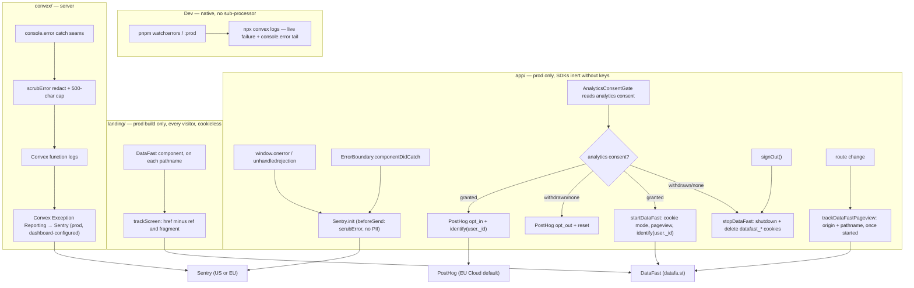

# DataFast Web Analytics (landing + app) Implementation Plan

> **For agentic workers:** REQUIRED SUB-SKILL: Use superpowers:subagent-driven-development (recommended) or
> superpowers:executing-plans to implement this plan task-by-task. Steps use checkbox (`- [ ]`) syntax for tracking.

**Goal:** Send DataFast pageviews from the landing (cookieless, every visitor) and from the app (cookie mode, only for
signed-in members who granted `analytics` consent), with `docs/PLATFORM.md` and the compliance records updated in the
same change.

**Architecture:** Client SDK only. The app gets one module, `app/src/lib/observability/datafast.ts` (`startDataFast` /
`stopDataFast` / `trackDataFastPageview`), driven by three existing seams: the consent choke point
`syncAnalyticsConsent`, a route effect in `AnalyticsConsentGate`, and `signOut()`. The landing gets one client
component, `landing/components/DataFast.tsx`, mounted in the locale layout. Both CSPs allow `https://datafa.st`.
`convex/` is untouched.

**Tech Stack:** TypeScript. App: Vite + React + react-router-dom, Vitest 4 in jsdom. Landing: Next.js app router,
Vitest 4 in node. `datafast@3.0.18`, already in both `package.json` files and `pnpm-lock.yaml`.

**Spec:** `docs/superpowers/specs/2026-09-23-datafast-analytics-design.md`. Read §2 (verified SDK behavior) and §6
(privacy guards) before Task 1.

## Global Constraints

- **Never commit or push.** No git command that changes state: no `commit`, `push`, `add`, `stash`, `checkout`,
  `switch`, `restore`, `reset`, `rebase`, `merge` or `clean`. Read-only git (`status`, `diff`, `log`) is fine. Henriko
  commits everything, so every task ends with its changes left uncommitted.
- **Change files only with the Edit and Write tools.** No `sed`, heredocs, or node/python replace scripts. Shells are
  for
  read-only commands, tests, builds and Prettier.
- **pnpm, never npm. Never run `pnpm format`.** Format only the code files you changed, from the repo root:
  `pnpm exec prettier --write <files>`, then `pnpm exec prettier --check <files>`. `docs/` is in `.prettierignore` and
  hand-formatted; `.env.example` files are not Prettier's.
- **Don't touch** `app/package.json`, `landing/package.json`, the root `package.json` or `pnpm-lock.yaml` (Henriko's
  uncommitted `datafast@^3.0.18` install, plus an unrelated `packageManager` bump), or anything in `convex/`.
- **Website id (public):** `dfid_8IrKZ1PONPjcOv8mSg4o2`. **DataFast `domain`:** `linkintothessi.com`, derived from
  `VITE_COOKIE_DOMAIN` / `NEXT_PUBLIC_COOKIE_DOMAIN` with the leading dot stripped (unset in dev ⇒ the page's host).
- **What leaves the browser:**
    - App hrefs are `location.origin + pathname` only, never the query or fragment.
    - Landing hrefs are the full URL minus the `ref` param and the fragment.
    - `identify` sends only the Convex `_id`, never traits.
    - Pageviews go out only through `trackScreen(path, { href })`. SDK auto-capture stays off: never pass
      `autoCapturePageviews`.
- **Never call the SDK's `optOut()`.** Stopping means `shutdown()` plus `deleteCookie` for the five `datafast_*`
  cookies.
- **Not in this change (launch-time, Henriko's):** the DataFast DPA, the public Privacy Policy and Cookie & Storage
  Policy copy, the landing `CookieNotice` text, the `POLICY_VERSION` bump, the Cloudflare env vars, and any Stripe
  connection in DataFast.
- **Code style:** the repo's Prettier config (no semicolons, single quotes, `arrowParens: avoid`, no trailing commas,
  `printWidth` 120, one JSX attribute per line). Match the surrounding comment density.
- **Doc style:**
    - Wrap prose by hand at about 120 characters, like the surrounding text.
    - New prose uses plain hyphens. Changelog dates use non-breaking hyphens (`2026‑09‑23`, U+2011), like the entries
      below them.
    - The docs already contain U+2011 hyphens (`no‑op`, `consent‑gated`), so build every Edit `old_string` from a
      fresh Read of the file, never from this plan's wording. The `new_string` text comes from this plan.
- **Doc tables stay padded.** Width counts codepoints, except that `✓` and `✗` count 2. Run the checker below after
  every table edit.
- **Deviations from the spec** (the spec is otherwise binding):
    1. DataFast gets its own ROPA entry, **Activity 17** in `DATA-INVENTORY.md`, instead of joining Activity 14 (spec
       §10).
        - It has its own legal-basis split (landing = legitimate interest, app = consent) and its own data subjects.
        - Widening Activity 14's cells would force re-padding that whole table, which is about 900 characters wide.
        - Everything the spec lists for Activity 14 goes into Activity 17 and its cross-references instead.
    2. The §16 Cloudflare Worker env tables in `PLATFORM.md` stay unchanged (spec §10 asked for both vars there).
        - Those tables list what is set today; the Sentry/PostHog keys aren't in them either.
        - Listing the DataFast ids there would invite setting them before the DPA and the policy copy.
        - The §17 launch checklist carries that step instead.
    3. `docs/compliance/GAP-ASSESSMENT.md` is updated too, though spec §10 doesn't list it: `docs/compliance/README.md`
       §7 requires it when the compliance posture changes.
    4. The SUBPROCESSORS row in the `PLATFORM.md` §17 Compliance Documentation table also drops its stale "Apify
       hard-gate noted", because `SUBPROCESSORS.md` lists no Apify.
    5. `app/src/lib/session.test.ts` mocks `./observability/datafast`, which spec §8 doesn't mention. Its
       `window.location` stubs have no `hostname`, and the real `deleteCookie` reads it.

### Table checker (read-only)

Save this with the Write tool at `C:\Users\henri\AppData\Local\Temp\table-align.cjs`, overwriting any existing copy:

```js
// Read-only Markdown table alignment check (never writes). Usage:
//   node table-align.cjs <file> <firstLine> <lastLine>
// The range must cover exactly one table (header, separator, body). Prints each row that is not padded to the
// table's column widths as "<line number>\t<correctly padded row>", or ALIGNED.
// Width = codepoints, except ✓ and ✗ count 2 (how the docs' tables are aligned).
const fs = require('fs')
const [file, from, to] = process.argv.slice(2)
const lines = fs.readFileSync(file, 'utf8').split(/\r?\n/)
const cellsOf = line => line.split(/(?<!\\)\|/).slice(1, -1)
const width = s => [...s].length + (s.match(/[✓✗]/g) || []).length
const isSep = cells => cells.length > 0 && cells.every(c => /^\s*:?-+:?\s*$/.test(c))
const rows = []
for (let n = +from; n <= +to; n++) rows.push({ n, line: lines[n - 1], cells: cellsOf(lines[n - 1]) })
const sep = rows.find(r => isSep(r.cells))
if (!sep) throw new Error('no separator row in the range')
const bad = rows.filter(r => r.cells.length !== sep.cells.length)
if (bad.length) throw new Error('rows with the wrong cell count: ' + bad.map(r => r.n).join(', '))
const spaced = sep.cells[0].startsWith(' ')
const marks = sep.cells.map(c => ({ left: c.trim().startsWith(':'), right: c.trim().endsWith(':') }))
const body = rows.filter(r => r !== sep)
const W = marks.map((_, i) => Math.max(3, ...body.map(r => width(r.cells[i].trim()))))
function pad(text, i) {
  const room = W[i] - width(text)
  const { left, right } = marks[i]
  const before = left && right ? Math.floor(room / 2) : right ? room : 0
  return ' ' + ' '.repeat(before) + text + ' '.repeat(room - before) + ' '
}
function rule(i) {
  const { left, right } = marks[i]
  const dashes = W[i] + (spaced ? 0 : 2) - (left ? 1 : 0) - (right ? 1 : 0)
  const mark = (left ? ':' : '') + '-'.repeat(dashes) + (right ? ':' : '')
  return spaced ? ' ' + mark + ' ' : mark
}
let aligned = true
for (const r of rows) {
  const want = '|' + r.cells.map((c, i) => (r === sep ? rule(i) : pad(c.trim(), i))).join('|') + '|'
  if (want !== r.line) {
    aligned = false
    console.log(r.n + '\t' + want)
  }
}
console.log(aligned ? 'ALIGNED' : 'NOT ALIGNED: replace each listed line with the text after its tab')
```

How to use it:

1. Find the table's line range with Grep `-n` right before each run, because earlier edits shift line numbers. The
   range covers exactly one table, header through last row.
2. Run it from Git Bash with `node /tmp/table-align.cjs <file> <firstLine> <lastLine>`. In PowerShell, use
   `node $env:TEMP\table-align.cjs <file> <firstLine> <lastLine>`.
3. It prints `ALIGNED`, or each misaligned row as `<line>\t<correctly padded row>`. Replace each printed line with the
   text after its tab (Edit tool), then run it again until it prints `ALIGNED`.
4. If it prints rows you did not touch, your new cell is wider than its column. Shorten the cell, unless the task says
   the whole table gets re-padded.

The checker already reports `ALIGNED` on the seven existing tables this plan edits, so any difference it finds after
an edit comes from that edit.

## Review Focus

These are the five failure modes most likely to bite a real person. The spec implies each one, but no happy-path test
covers it. Each has a test in the task that owns the code.

1. **Re-granting analytics after withdrawing it, with no reload** → DataFast starts again (init ×2, identify ×2).
   Owner: Task 1, `lets a re-grant start DataFast again`.
2. **Route changes before consent resolves, or for a member who never consented** → no DataFast init and no request.
   Owner: Task 1, `does nothing before DataFast has started`.
3. **A dev or preview build, or a build without the website id** → nothing initializes. Owner: Task 1,
   `does nothing outside a production build or without the website id`.
4. **Signing out from the user menu or the ⌘K palette** (both reach `signOut()` through `performSignOut`) → the DataFast
   cookies are deleted before the redirect. Owner: Task 2, `stops DataFast before leaving for the landing site`.
5. **An invite link whose only query param is `ref`** (`/pt?ref=AbC123`) → the reported href has no dangling `?`.
   Owner: Task 3, `leaves no dangling ? when ref was the only param`.

---

## File map

| File                                                                                      | Change                                 | Task |
|-------------------------------------------------------------------------------------------|----------------------------------------|------|
| `app/src/lib/observability/datafast.ts`                                                   | new: start, stop, pageview             | 1    |
| `app/src/lib/observability/datafast.test.ts`                                              | new                                    | 1    |
| `app/scripts/gen-headers.mjs`                                                             | `connect-src` + header comment         | 1    |
| `app/scripts/gen-headers.test.ts`                                                         | expected `connect-src`                 | 1    |
| `app/.env.example`                                                                        | `VITE_DATAFAST_WEBSITE_ID`             | 1    |
| `app/src/lib/observability/analytics.ts`                                                  | `syncAnalyticsConsent` drives DataFast | 2    |
| `app/src/lib/observability/analytics.test.ts`                                             | DataFast cases                         | 2    |
| `app/src/components/AnalyticsConsentGate.tsx`                                             | route-change pageview effect           | 2    |
| `app/src/lib/session.ts`                                                                  | `signOut()` stops DataFast             | 2    |
| `app/src/lib/session.test.ts`                                                             | DataFast mock + ordering test          | 2    |
| `landing/components/DataFast.tsx`                                                         | new client component                   | 3    |
| `landing/components/DataFast.test.ts`                                                     | new                                    | 3    |
| `landing/app/[lang]/layout.tsx`                                                           | mount `<DataFast />`                   | 3    |
| `landing/next.config.js`                                                                  | `connect-src` + header comment         | 3    |
| `landing/.env.example`                                                                    | `NEXT_PUBLIC_DATAFAST_WEBSITE_ID`      | 3    |
| `docs/PLATFORM.md`                                                                        | §14, §15, §16, §17, §21                | 4    |
| `docs/compliance/SUBPROCESSORS.md`, `DATA-INVENTORY.md`, `GAP-ASSESSMENT.md`, `README.md` | DataFast records                       | 5    |

---

### Task 1: App DataFast module and CSP

**Files:**

- Create: `app/src/lib/observability/datafast.ts`
- Create: `app/src/lib/observability/datafast.test.ts`
- Modify: `app/scripts/gen-headers.mjs:8-11` (header comment), `:45` (`connect-src`)
- Modify: `app/scripts/gen-headers.test.ts:32-34`
- Modify: `app/.env.example` (append)

**Interfaces:**

- Consumes, from the `datafast` package:
    - `initDataFast(config): Promise<DataFastWeb>`
    - `deleteCookie(name: string, domain?: string): void`
    - `type DataFastWeb`, which has `trackScreen(screenName: string, options?: { href?: string }): Promise<void>`,
      `identify(userId: string): Promise<void>` and `shutdown(): Promise<void>`
- Produces (Task 2 uses these):
    - `startDataFast(userId: string): void`: idempotent, and a no-op unless `import.meta.env.PROD` is true and
      `VITE_DATAFAST_WEBSITE_ID` is set.
    - `stopDataFast(): void`: safe to call when DataFast never started.
    - `trackDataFastPageview(pathname: string): void`: a no-op until DataFast has started.

- [ ] **Step 1: Write the failing test.** Create `app/src/lib/observability/datafast.test.ts`:

```ts
import { afterEach, beforeEach, describe, expect, it, vi } from 'vitest'

const sdk = vi.hoisted(() => ({ initDataFast: vi.fn(), deleteCookie: vi.fn() }))
vi.mock('datafast', () => sdk)

const client = { trackScreen: vi.fn(), identify: vi.fn(), shutdown: vi.fn() }

const COOKIES = [
  'datafast_visitor_id',
  'datafast_visitor_first_seen_at',
  'datafast_visitor_session_count',
  'datafast_session_id',
  'datafast_session_start'
]

// A fresh module per test: whether DataFast has started is module state.
async function load() {
  vi.resetModules()
  return import('./datafast')
}

beforeEach(() => {
  vi.clearAllMocks()
  sdk.initDataFast.mockResolvedValue(client)
  vi.stubEnv('PROD', true)
  vi.stubEnv('VITE_DATAFAST_WEBSITE_ID', 'dfid_test')
  vi.stubEnv('VITE_COOKIE_DOMAIN', '.linkintothessi.com')
  // A secret-bearing URL: neither the query nor the fragment may reach DataFast.
  window.history.replaceState(null, '', '/unsubscribe?token=secret#session=secret')
})

afterEach(() => {
  vi.unstubAllEnvs()
  window.history.replaceState(null, '', '/')
})

describe('startDataFast', () => {
  it('initializes once, in cookie mode, on the root domain', async () => {
    const { startDataFast } = await load()
    startDataFast('user_1')
    startDataFast('user_1')
    await vi.waitFor(() => expect(client.identify).toHaveBeenCalled())
    expect(sdk.initDataFast).toHaveBeenCalledTimes(1)
    expect(sdk.initDataFast).toHaveBeenCalledWith({
      websiteId: 'dfid_test',
      domain: 'linkintothessi.com',
      maxQueueSize: 1
    })
  })

  it('sends the first pageview as origin + pathname, then identifies with the bare id', async () => {
    const { startDataFast } = await load()
    startDataFast('user_1')
    await vi.waitFor(() => expect(client.identify).toHaveBeenCalled())
    expect(client.trackScreen).toHaveBeenCalledWith('/unsubscribe', {
      href: `${window.location.origin}/unsubscribe`
    })
    expect(client.identify.mock.calls).toEqual([['user_1']])
    expect(client.trackScreen.mock.invocationCallOrder[0]).toBeLessThan(client.identify.mock.invocationCallOrder[0])
  })

  it('does nothing outside a production build or without the website id', async () => {
    const { startDataFast } = await load()
    vi.stubEnv('PROD', false)
    startDataFast('user_1')
    vi.stubEnv('PROD', true)
    vi.stubEnv('VITE_DATAFAST_WEBSITE_ID', '')
    startDataFast('user_1')
    expect(sdk.initDataFast).not.toHaveBeenCalled()
  })
})

describe('stopDataFast', () => {
  it('deletes the five cookies on the root domain even when DataFast never started', async () => {
    const { stopDataFast } = await load()
    stopDataFast()
    expect(sdk.deleteCookie.mock.calls).toEqual(COOKIES.map(name => [name, 'linkintothessi.com']))
    expect(client.shutdown).not.toHaveBeenCalled()
  })

  it('after a start, deletes the cookies, shuts down, then deletes them again', async () => {
    const { startDataFast, stopDataFast } = await load()
    startDataFast('user_1')
    await vi.waitFor(() => expect(client.identify).toHaveBeenCalled())
    stopDataFast()
    expect(sdk.deleteCookie).toHaveBeenCalledTimes(5)
    await vi.waitFor(() => expect(sdk.deleteCookie).toHaveBeenCalledTimes(10))
    expect(client.shutdown).toHaveBeenCalledTimes(1)
    expect(client.shutdown.mock.invocationCallOrder[0]).toBeLessThan(sdk.deleteCookie.mock.invocationCallOrder[5])
  })

  it('lets a re-grant start DataFast again', async () => {
    const { startDataFast, stopDataFast } = await load()
    startDataFast('user_1')
    await vi.waitFor(() => expect(client.identify).toHaveBeenCalledTimes(1))
    stopDataFast()
    await vi.waitFor(() => expect(sdk.deleteCookie).toHaveBeenCalledTimes(10))
    startDataFast('user_1')
    await vi.waitFor(() => expect(client.identify).toHaveBeenCalledTimes(2))
    expect(sdk.initDataFast).toHaveBeenCalledTimes(2)
  })
})

describe('trackDataFastPageview', () => {
  it('does nothing before DataFast has started', async () => {
    const { trackDataFastPageview } = await load()
    trackDataFastPageview('/feed')
    await Promise.resolve()
    expect(sdk.initDataFast).not.toHaveBeenCalled()
    expect(client.trackScreen).not.toHaveBeenCalled()
  })

  it('sends origin + pathname once started', async () => {
    const { startDataFast, trackDataFastPageview } = await load()
    startDataFast('user_1')
    await vi.waitFor(() => expect(client.identify).toHaveBeenCalled())
    trackDataFastPageview('/feed')
    await vi.waitFor(() =>
      expect(client.trackScreen).toHaveBeenLastCalledWith('/feed', { href: `${window.location.origin}/feed` })
    )
  })
})
```

- [ ] **Step 2: Run it and watch it fail.**

Run: `pnpm --filter app exec vitest run src/lib/observability/datafast.test.ts`
Expected: FAIL. The import of `./datafast` can't be resolved, because the module doesn't exist yet.

- [ ] **Step 3: Implement.** Create `app/src/lib/observability/datafast.ts`:

```ts
// Web analytics (DataFast), cookie mode. ANALYTICS purpose — strictly consent-gated: started only by
// syncAnalyticsConsent for a signed-in member who granted `analytics` consent, stopped on withdrawal or sign-out.
// Pageviews carry origin + pathname only, never the query or fragment (/auth/success#…, /unsubscribe?token=…).
import { deleteCookie, initDataFast, type DataFastWeb } from 'datafast'

// The five cookies DataFast's cookie mode writes on `.<domain>`. shutdown() leaves them behind.
const COOKIES = [
  'datafast_visitor_id',
  'datafast_visitor_first_seen_at',
  'datafast_visitor_session_count',
  'datafast_session_id',
  'datafast_session_start'
]

let started: Promise<DataFastWeb> | null = null

// Every event carries `domain`, which must match the DataFast website's domain (`linkintothessi.com`).
function rootDomain(): string {
  const configured = (import.meta.env.VITE_COOKIE_DOMAIN as string | undefined)?.trim().replace(/^\./, '')
  return configured || window.location.hostname
}

function pageHref(pathname: string): string {
  return window.location.origin + pathname
}

/** Start DataFast for a consenting member. Idempotent; a no-op outside prod builds or without the website id. */
export function startDataFast(userId: string): void {
  const websiteId = (import.meta.env.VITE_DATAFAST_WEBSITE_ID as string | undefined)?.trim()
  if (!import.meta.env.PROD || !websiteId || started) return
  started = initDataFast({ websiteId, domain: rootDomain(), maxQueueSize: 1 }).then(async client => {
    // Pageview first: identify builds its href from the last screen name ("/Unknown" before any pageview).
    await client.trackScreen(window.location.pathname, { href: pageHref(window.location.pathname) })
    await client.identify(userId)
    return client
  })
}

/** Stop sending and delete the visitor cookies. Safe to call when DataFast never started. */
export function stopDataFast(): void {
  const pending = started
  started = null
  const clearCookies = () => {
    for (const name of COOKIES) deleteCookie(name, rootDomain())
  }
  clearCookies()
  // An init or send still in flight may write the cookies after the first sweep, so sweep again once it's shut down.
  void pending?.then(async client => {
    await client.shutdown()
    clearCookies()
  })
}

/** Send a pageview for a route change. A no-op until startDataFast has run. */
export function trackDataFastPageview(pathname: string): void {
  void started?.then(client => client.trackScreen(pathname, { href: pageHref(pathname) }))
}
```

- [ ] **Step 4: Run it and watch it pass.**

Run: `pnpm --filter app exec vitest run src/lib/observability/datafast.test.ts`
Expected: PASS, 8 tests.

- [ ] **Step 5: Make the CSP test expect DataFast.** In `app/scripts/gen-headers.test.ts`, the second `toContain` in the
  `buildHeadersContent` test becomes:

```ts
    expect(out).toContain(
      "connect-src 'self' https://*.convex.cloud wss://*.convex.cloud https://*.convex.site https://*.stripe.com https://*.posthog.com https://*.sentry.io https://datafa.st"
    )
```

Run: `pnpm --filter app exec vitest run scripts/gen-headers.test.ts`
Expected: FAIL. The output doesn't contain `… https://*.sentry.io https://datafa.st`.

- [ ] **Step 6: Allow DataFast in the app CSP.** In `app/scripts/gen-headers.mjs`:
    - Line 45 becomes:
      ```js
          `connect-src 'self' https://*.convex.cloud wss://*.convex.cloud https://*.convex.site https://*.stripe.com https://*.posthog.com https://*.sentry.io https://datafa.st`,
      ```
    - The header comment's third-party paragraph (lines 8-11) gains one last line:
      ```js
      // blob WebWorker). The beacon posts to same-origin /cdn-cgi/rum, covered by connect-src 'self'.
      // DataFast posts pageviews to datafa.st; its SDK is bundled, so it needs no script-src entry.
      ```

Run: `pnpm --filter app exec vitest run scripts/gen-headers.test.ts`
Expected: PASS, 4 tests.

- [ ] **Step 7: Document the env var.** In `app/.env.example`, after the last line
  (`VITE_POSTHOG_HOST=https://us.i.posthog.com`), append:

```
# DataFast web analytics (analytics purpose; starts ONLY for a signed-in member who granted `analytics` consent).
# Public website id, shared with the landing. Inert in dev builds even when set.
VITE_DATAFAST_WEBSITE_ID=dfid_8IrKZ1PONPjcOv8mSg4o2
```

Leave the existing "All three are build-time" comment as it is: it still describes the three Sentry/PostHog vars.

- [ ] **Step 8: Format, then run both suites again.**

Run:
`pnpm exec prettier --write app/src/lib/observability/datafast.ts app/src/lib/observability/datafast.test.ts app/scripts/gen-headers.mjs app/scripts/gen-headers.test.ts`,
then the same command with `--check`, then the two test commands from Steps 4 and 6.
Expected: Prettier reports every file formatted, and both suites pass.

- [ ] **Step 9: Leave the changes uncommitted.** Henriko commits.

---

### Task 2: Consent wiring

**Files:**

- Modify: `app/src/lib/observability/analytics.ts:1-7` (header comment and import), `:36-46` (`syncAnalyticsConsent`)
- Modify: `app/src/lib/observability/analytics.test.ts`
- Modify: `app/src/components/AnalyticsConsentGate.tsx` (whole file)
- Modify: `app/src/lib/session.ts:1-3` (import), `:41-53` (`signOut`)
- Modify: `app/src/lib/session.test.ts`

**Interfaces:**

- Consumes (Task 1), from `app/src/lib/observability/datafast.ts`: `startDataFast(userId: string): void`,
  `stopDataFast(): void`, `trackDataFastPageview(pathname: string): void`.
- Produces: `syncAnalyticsConsent(userId: string | undefined, consents: ConsentMap): void` keeps its signature and now
  drives DataFast too.

- [ ] **Step 1: Write the failing consent tests.** In `app/src/lib/observability/analytics.test.ts`, replace the two
  import lines at the top with:

```ts
import { beforeEach, describe, it, expect, vi } from 'vitest'
import { shouldCaptureAnalytics, syncAnalyticsConsent } from './analytics'
import { startDataFast, stopDataFast } from './datafast'

vi.mock('./datafast', () => ({ startDataFast: vi.fn(), stopDataFast: vi.fn() }))
```

Then append after the existing `describe('shouldCaptureAnalytics', …)` block:

```ts

// Tests run without a PostHog key, so these also prove the DataFast half runs while PostHog is off.
describe('syncAnalyticsConsent → DataFast', () => {
  beforeEach(() => {
    vi.clearAllMocks()
  })

  it('leaves DataFast alone while consents are loading', () => {
    syncAnalyticsConsent('u1', undefined)
    expect(startDataFast).not.toHaveBeenCalled()
    expect(stopDataFast).not.toHaveBeenCalled()
  })

  it('starts DataFast for a member who granted analytics consent', () => {
    syncAnalyticsConsent('u1', { analytics: true })
    expect(startDataFast).toHaveBeenCalledWith('u1')
    expect(stopDataFast).not.toHaveBeenCalled()
  })

  it('stops DataFast when consent is withdrawn, absent, or there is no member', () => {
    syncAnalyticsConsent('u1', { analytics: false })
    syncAnalyticsConsent('u1', null)
    syncAnalyticsConsent(undefined, { analytics: true })
    expect(stopDataFast).toHaveBeenCalledTimes(3)
    expect(startDataFast).not.toHaveBeenCalled()
  })
})
```

- [ ] **Step 2: Run it and watch it fail.**

Run: `pnpm --filter app exec vitest run src/lib/observability/analytics.test.ts`
Expected: FAIL. The `starts DataFast…` and `stops DataFast…` tests fail, because `syncAnalyticsConsent` returns before
doing anything while PostHog isn't initialized. The loading case and the five `shouldCaptureAnalytics` tests pass.

- [ ] **Step 3: Implement.** In `app/src/lib/observability/analytics.ts`:
    - Replace the last header-comment line and the import:
      ```ts
      // opaque Convex user id only. Sentry (error monitoring) is the necessary/security path — see sentry.ts.
      import posthog from 'posthog-js'
      ```
      with:
      ```ts
      // opaque Convex user id only. Sentry (error monitoring) is the necessary/security path — see sentry.ts.
      // syncAnalyticsConsent also starts and stops DataFast web analytics under the same consent — see datafast.ts.
      import posthog from 'posthog-js'
      import { startDataFast, stopDataFast } from './datafast'
      ```
    - Replace the whole `syncAnalyticsConsent` function, its one-line doc comment included, with:
      ```ts
      /** Reconcile PostHog and DataFast with the current login + consent. Idempotent. */
      export function syncAnalyticsConsent(userId: string | undefined, consents: ConsentMap): void {
        const allowed = shouldCaptureAnalytics(userId, consents)
        // `undefined` = consents still loading: leave DataFast alone, or every page load would delete its cookies (and
        // mint a new visitor) before the query resolves.
        if (consents !== undefined) {
          if (allowed && userId) startDataFast(userId)
          else stopDataFast()
        }
        if (!initialized) return
        if (allowed) {
          posthog.opt_in_capturing()
          posthog.identify(userId)
        } else {
          posthog.opt_out_capturing()
          posthog.reset()
        }
      }
      ```

PostHog behaves exactly as before, including the early return when it has no key.

- [ ] **Step 4: Run it and watch it pass.**

Run: `pnpm --filter app exec vitest run src/lib/observability/analytics.test.ts`
Expected: PASS, 8 tests.

- [ ] **Step 5: Write the failing sign-out test.** In `app/src/lib/session.test.ts`:
    - After the two `./session` import lines, add:
      ```ts
      import { stopDataFast } from './observability/datafast'
  
      // The real stopDataFast reads window.location.hostname, which these tests replace with a bare { assign } stub.
      vi.mock('./observability/datafast', () => ({ stopDataFast: vi.fn() }))
      ```
    - Inside `describe('signOut', …)`, after the `clears motdDismissed along with the token on sign-out` test, add:
      ```ts
  
        it('stops DataFast before leaving for the landing site', () => {
          vi.mocked(stopDataFast).mockClear()
          const assign = vi.fn()
          Object.defineProperty(window, 'location', { value: { assign }, writable: true, configurable: true })
  
          signOut()
  
          expect(stopDataFast).toHaveBeenCalledTimes(1)
          expect(vi.mocked(stopDataFast).mock.invocationCallOrder[0]).toBeLessThan(assign.mock.invocationCallOrder[0])
        })
      ```

Run: `pnpm --filter app exec vitest run src/lib/session.test.ts`
Expected: FAIL. `stopDataFast` was called 0 times; the other 7 tests pass.

- [ ] **Step 6: Implement.** In `app/src/lib/session.ts`:
    - Directly under line 1 (`// Shared session / sign-out helpers for the app shell.`), add
      `import { stopDataFast } from './observability/datafast'`. The blank line before `const CONVEX_SITE_URL` stays.
    - Replace the `signOut` doc comment and function with:
      ```ts
      /**
       * Sign the user out: stop DataFast and delete its cookies (so the next member on this browser starts as a new
       * visitor), mark the explicit sign-out, drop the local session token, and leave the SPA for the landing site (a
       * separate origin). Callers holding a live Convex session should invalidate it server-side (users.logout) before
       * calling this, and call beginSignOut() first so the marker is set before logout flips getMe to null.
       */
      export function signOut(): void {
        stopDataFast()
        markSignedOut()
        sessionStorage.removeItem('sessionToken')
        // The dismissed-MOTD memory stores the session token, so it must die with the session.
        sessionStorage.removeItem('motdDismissed')
        window.location.assign(LANDING_URL)
      }
      ```

Run: `pnpm --filter app exec vitest run src/lib/session.test.ts`
Expected: PASS, 8 tests.

- [ ] **Step 7: Send route-change pageviews.** Replace `app/src/components/AnalyticsConsentGate.tsx` with (Write tool):

```tsx
import { useEffect } from 'react'
import { useQuery } from 'convex/react'
import { useLocation } from 'react-router-dom'
import { api } from '../convex'
import { syncAnalyticsConsent } from '../lib/observability/analytics'
import { trackDataFastPageview } from '../lib/observability/datafast'

type ConsentMap = { analytics?: boolean; marketing?: boolean } | null | undefined

// Drives PostHog and DataFast on/off from the signed-in user's live `analytics` consent. Renders nothing;
// mounted only inside the authenticated shell, where `userId` is known. Reacts to consent changes
// (e.g. the user toggling analytics off in Settings) without a reload.
export default function AnalyticsConsentGate({ userId, sessionToken }: { userId: string; sessionToken?: string }) {
  const consents = useQuery(api.privacy.consent.getConsents, sessionToken ? { sessionToken } : 'skip') as ConsentMap
  const { pathname } = useLocation()

  useEffect(() => {
    syncAnalyticsConsent(userId, consents)
  }, [userId, consents])

  // Route-change pageviews. A no-op until consent has started DataFast, which sends the first pageview itself.
  useEffect(() => {
    trackDataFastPageview(pathname)
  }, [pathname])

  return null
}
```

This step has no unit test. The effect is a single call, and Task 1 already pins the "no-op until started" behavior of
`trackDataFastPageview`. `useLocation` is safe because the gate always renders inside `BrowserRouter` (`main.tsx`), and
no test renders the gate. If the first pageview and a route pageview ever overlap for the same URL, the SDK's
same-href 60-second dedup absorbs the second one (spec §4).

- [ ] **Step 8: Format, then run the whole app suite.**

Run:
`pnpm exec prettier --write app/src/lib/observability/analytics.ts app/src/lib/observability/analytics.test.ts app/src/components/AnalyticsConsentGate.tsx app/src/lib/session.ts app/src/lib/session.test.ts`,
then the same command with `--check`, then `pnpm --filter app test`.
Expected: every file is formatted, and the whole app suite passes. The full run catches any other test that now
reaches the real DataFast module.

- [ ] **Step 9: Leave the changes uncommitted.** Henriko commits.

---

### Task 3: Landing component and CSP

**Files:**

- Create: `landing/components/DataFast.tsx`
- Create: `landing/components/DataFast.test.ts`
- Modify: `landing/app/[lang]/layout.tsx:7-8` (import), `:72-75` (mount)
- Modify: `landing/next.config.js:1-7` (header comment), `:28` (`connect-src`)
- Modify: `landing/.env.example` (append)

**Interfaces:**

- Consumes:
    - From `datafast`: `initDataFast({ websiteId, domain?, cookieless?, maxQueueSize? }): Promise<DataFastWeb>`.
    - From `next/navigation`: `usePathname(): string`.
- Produces:
    - Default export `DataFast`, which renders `null`.
    - `landingPageviewHref(href: string): string`, pure and exported for the test.

- [ ] **Step 1: Write the failing test.** Create `landing/components/DataFast.test.ts`:

```ts
import { describe, expect, it, vi } from 'vitest'
import { landingPageviewHref } from './DataFast'

// Hermetic under the landing's node test environment: no SDK, no Next runtime.
vi.mock('datafast', () => ({ initDataFast: vi.fn() }))
vi.mock('next/navigation', () => ({ usePathname: vi.fn() }))

describe('landingPageviewHref', () => {
  it('drops the ref invite code and the fragment, and keeps the UTM params', () => {
    expect(
      landingPageviewHref('https://www.linkintothessi.com/en?utm_source=linkedin&ref=AbC123&utm_campaign=launch#pricing')
    ).toBe('https://www.linkintothessi.com/en?utm_source=linkedin&utm_campaign=launch')
  })

  it('leaves no dangling ? when ref was the only param', () => {
    expect(landingPageviewHref('https://www.linkintothessi.com/pt?ref=AbC123')).toBe('https://www.linkintothessi.com/pt')
  })

  it('keeps source and via untouched', () => {
    const href = 'https://www.linkintothessi.com/es?source=newsletter&via=partner'
    expect(landingPageviewHref(href)).toBe(href)
  })
})
```

- [ ] **Step 2: Run it and watch it fail.**

Run: `pnpm --filter landing exec vitest run components/DataFast.test.ts`
Expected: FAIL. `./DataFast` can't be resolved.

- [ ] **Step 3: Implement.** Create `landing/components/DataFast.tsx`:

```tsx
'use client'

import { initDataFast, type DataFastWeb } from 'datafast'
import { usePathname } from 'next/navigation'
import { useEffect } from 'react'

// Web analytics (DataFast), cookieless: every visitor, no cookie, no banner (the SDK keeps its session id in
// sessionStorage). Inert outside production builds and until NEXT_PUBLIC_DATAFAST_WEBSITE_ID is set.
const WEBSITE_ID = process.env.NEXT_PUBLIC_DATAFAST_WEBSITE_ID?.trim()
// Every event carries `domain`, which must match the DataFast website's domain (`linkintothessi.com`), not this
// page's `www.` host. Unset (dev) ⇒ the SDK's default, the page's host.
const DOMAIN = process.env.NEXT_PUBLIC_COOKIE_DOMAIN?.trim().replace(/^\./, '') || undefined

let client: Promise<DataFastWeb> | undefined

/** The href we report: the page URL minus the `ref` invite code (it identifies a member) and the fragment. */
export function landingPageviewHref(href: string): string {
  const url = new URL(href)
  url.searchParams.delete('ref')
  url.hash = ''
  return url.toString()
}

function trackPageview(pathname: string): void {
  if (!WEBSITE_ID || process.env.NODE_ENV !== 'production') return
  client ??= initDataFast({ websiteId: WEBSITE_ID, domain: DOMAIN, cookieless: true, maxQueueSize: 1 })
  const href = landingPageviewHref(window.location.href)
  void client.then(c => c.trackScreen(pathname, { href }))
}

export default function DataFast() {
  const pathname = usePathname()
  useEffect(() => {
    trackPageview(pathname)
  }, [pathname])
  return null
}
```

The init lives in a plain module function rather than in the component. That keeps module-state writes out of the
component, where the React Compiler lint rules (`eslint-plugin-react-hooks` 7, enabled for `landing/`) could flag them.

- [ ] **Step 4: Run it and watch it pass.**

Run: `pnpm --filter landing exec vitest run components/DataFast.test.ts`
Expected: PASS, 3 tests.

- [ ] **Step 5: Mount it.** In `landing/app/[lang]/layout.tsx`:
    - After `import CookieNotice from '@/components/CookieNotice'`, add `import DataFast from '@/components/DataFast'`.
    - Inside `<body>`, directly after the `<CookieNotice … />` element, add `<DataFast />`:
      ```tsx
              <CookieNotice
                dict={dict.cookieNotice}
                lang={lang}
              />
              <DataFast />
      ```

- [ ] **Step 6: Allow DataFast in the landing CSP.** In `landing/next.config.js`:
    - Line 28 becomes `` `connect-src 'self' https://*.convex.cloud https://*.convex.site https://datafa.st`, ``
    - In the header comment, directly after `// same-origin /cdn-cgi/rum, which connect-src 'self' already covers.`,
      insert:
      ```js
      // DataFast (bundled npm SDK, cookieless) posts pageviews to https://datafa.st, which connect-src allows.
      ```

Verify (read-only, from the repo root):
`node -e "import('./landing/next.config.js').then(m => m.default.headers()).then(h => console.log(h[0].headers.find(x => x.key === 'Content-Security-Policy').value))"`
Expected: the printed policy's `connect-src` ends in `https://datafa.st`.

- [ ] **Step 7: Document the env var.** In `landing/.env.example`, after the last line (`NEXT_PUBLIC_COOKIE_DOMAIN=`),
  append a blank line and:

```
# DataFast web analytics (public website id, safe to commit). Cookieless on the landing. Inert in dev
# (`next dev`) and on localhost even when set; set it in the production Cloudflare build env.
NEXT_PUBLIC_DATAFAST_WEBSITE_ID=dfid_8IrKZ1PONPjcOv8mSg4o2
```

- [ ] **Step 8: Format, then run the landing suite.**

Run:
`pnpm exec prettier --write landing/components/DataFast.tsx landing/components/DataFast.test.ts "landing/app/[lang]/layout.tsx" landing/next.config.js`,
then the same command with `--check`, then `pnpm --filter landing test`.
Expected: every file is formatted, and the whole landing suite passes.

- [ ] **Step 9: Leave the changes uncommitted.** Henriko commits.

---

### Task 4: `docs/PLATFORM.md`

**Files:** Modify `docs/PLATFORM.md` in these places (pre-edit line hints; locate every anchor with Grep):

- §14: around line 4858
- §15: around lines 6533-6537 and 6710
- §16: around lines 6830-6853
- §17: around lines 6955-6963, 6986-6987, 7125, 7158-7192 and 7208-7215
- §21: around lines 7430-7473

**Interfaces:** Consumes the names from Tasks 1-3: `startDataFast`, `stopDataFast`, `trackDataFastPageview`,
`syncAnalyticsConsent`, `AnalyticsConsentGate`, `signOut()`, `landingPageviewHref`, `components/DataFast.tsx`,
`VITE_DATAFAST_WEBSITE_ID`, `NEXT_PUBLIC_DATAFAST_WEBSITE_ID`.

- [ ] **Step 1: §14, routing and session handling.** Under `### Routing & session handling (\`App.tsx\`)`, after the
      paragraph ending `…so without it a scrolled feed would carry its scroll into the next page.`, insert a blank line
  and this paragraph:

```markdown
`<AnalyticsConsentGate>` (rendered by `RequireAuth` inside `AppShell`) drives both consent-gated analytics tools from
the member's live `analytics` consent: PostHog, and DataFast in cookie mode ([§17](#17-security-posture)
Observability). It also sends one DataFast pageview per `pathname` change, carrying `origin + pathname` only (never the
query or fragment); until consent has started DataFast, that call does nothing. `signOut()` (`lib/session.ts`) stops
DataFast and deletes its `datafast_*` cookies before it leaves for the landing, so the next member on a shared browser
starts as a new visitor.
```

- [ ] **Step 2: §15, the "Still deferred" warning.** Under `### Privacy Policy: OIDC wording and Stripe's controller
      role`, replace the whole paragraph that starts `⚠️ **Still deferred, and now the closest thing to a launch blocker
      on this page:**` with:

```markdown
⚠️ **Still deferred, and now the closest thing to a launch blocker on this page:** `/privacy` §4 lists six
sub-processors and **omits Sentry, PostHog and DataFast**. That omission is correct while the SDKs sit inert without
prod keys, and the public-copy update plus a second `POLICY_VERSION` bump are recorded as launch-time steps in
`docs/compliance/SUBPROCESSORS.md` ("Human action required"). Setting the prod `VITE_`/`NEXT_PUBLIC_` keys in
Cloudflare and leaving this copy alone would make the policy wrong on the day traffic starts. The same goes for the
`CookieNotice` text and the `/cookies` page ("…only uses essential browser storage…", en/pt/es): both stop being true
once the landing keeps DataFast state in `sessionStorage` and `localStorage`
([Web analytics](#web-analytics-datafast-cookieless)).
```

- [ ] **Step 3: §15, a new subsection.** Insert this directly above the `### Styling` heading, with one blank line
  between it and the heading:

```markdown
### Web analytics (DataFast, cookieless)

`components/DataFast.tsx` is a client component that renders nothing, mounted in `app/[lang]/layout.tsx` next to
`CookieNotice`. It runs only in a production build (`NODE_ENV === 'production'`) with `NEXT_PUBLIC_DATAFAST_WEBSITE_ID`
set, and the SDK itself is a no-op on localhost, so `next dev` and local builds send nothing. The bundled `datafast` SDK
is initialized once per page load in **cookieless** mode (`cookieless: true`, `maxQueueSize: 1`, auto-capture off). It
sets no cookie and shows no banner: it keeps its session id in `sessionStorage` and its send queue in `localStorage`,
and DataFast's server hashes IP + user agent into a daily-rotating visitor id. Every `usePathname()` change sends one
`trackScreen(pathname, { href })`. The href comes from the pure `landingPageviewHref`, which drops the `ref` invite code
and the fragment and keeps `utm_*`, `source` and `via`. An invite code identifies a member, which is also why the app's
`invite_copied` event carries no props. The DataFast `domain` is `NEXT_PUBLIC_COOKIE_DOMAIN` without its leading dot
(`linkintothessi.com`), so landing and app events share one DataFast website. There are no custom goals: a CTA click
leaves the page before the SDK could send it (no `keepalive`), so clicks stay with the first-party beacon above.
`next.config.js` allows `https://datafa.st` in `connect-src`. The app side, the consent model and the launch steps are
in [§17](#17-security-posture) Observability.
```

- [ ] **Step 4: §16, the app table.** In the `### App (\`app/\`) — Vite, \`VITE_\` prefix` table, add a row after the
      `VITE_POSTHOG_HOST` row. The Required column is centered. Cells:
    - Variable: `` `VITE_DATAFAST_WEBSITE_ID` ``
    - Required: `– (prod only; unset ⇒ DataFast off)` (an en dash, as in the Sentry/PostHog rows)
    - Consumed in: `` `observability/datafast.ts` ``
    - Purpose: ``Public DataFast website id, shared with the landing. Starts only once the member grants `analytics`
    consent (cookie mode); withdrawal or sign-out stops it and deletes its cookies.`` (one line in the table)

Run the checker over that table. It may print only the new row: paste its padded version and re-run until `ALIGNED`.

- [ ] **Step 5: §16, the landing table (full re-pad).** In the `### Landing (\`landing/\`) — Next.js, \`NEXT_PUBLIC_\`
  prefix` table, add a last row. Cells:
    - Variable: `` `NEXT_PUBLIC_DATAFAST_WEBSITE_ID` ``
    - Required: `– (prod only; unset ⇒ DataFast off)`
    - Consumed in: `` `components/DataFast.tsx` ``
    - Purpose: ``Public DataFast website id, the same one the app uses. Cookieless: every visitor, no cookie, no banner.
    Inert under `next dev` and on localhost even when set, so it only matters in the production Cloudflare build
    ([§15](#15-frontend--landing-site-landing) Web analytics).`` (one line in the table)

The new Variable and Consumed-in cells are wider than their columns, so every row of this table gets re-padded. Run
the checker and replace all seven printed lines (one Edit over the table block is easiest), then re-run until
`ALIGNED`.

- [ ] **Step 6: §17, the CSP bullet.** In `- **CSP + security headers (served at the Cloudflare HTTP layer).**`:
    - Replace these two lines:
      ```
        `https://*.posthog.com`); `connect-src` allows Convex `.cloud`/`.site`, Stripe, `https://*.posthog.com`, and
        `https://*.sentry.io`; `worker-src`/`child-src` allow `blob:` workers (Sentry Replay compresses off the main thread);
      ```
      with:
      ```
        `https://*.posthog.com`); `connect-src` allows Convex `.cloud`/`.site`, Stripe, `https://*.posthog.com`,
        `https://*.sentry.io`, and `https://datafa.st` (DataFast pageviews; the SDK is bundled, so no `script-src` entry);
        `worker-src`/`child-src` allow `blob:` workers (Sentry Replay compresses off the main thread);
      ```
    - Replace this line:
      ```
        prerendered/cached; the strict hashed CSP is reserved for the app, which renders untrusted data). Both CSPs also allow
      ```
      with:
      ```
        prerendered/cached; the strict hashed CSP is reserved for the app, which renders untrusted data); its `connect-src`
        allows Convex `.cloud`/`.site` and `https://datafa.st` (cookieless DataFast pageviews). Both CSPs also allow
      ```

- [ ] **Step 7: §17, the Observability intro.** Replace the first two lines of the intro under `### Observability &
      Error Monitoring` (from `Three layers:` through `…and the backend log redactor`) with:

```markdown
Three layers: a zero‑dependency dev log tail, prod error monitoring (Sentry), and analytics: consent‑gated PostHog,
plus DataFast web analytics (consent‑gated in the app, cookieless on the landing). **All three are inert in dev** — the
SDKs no‑op unless their prod keys are set — and the backend log redactor
```

The next line, `` (`scrubError`) runs everywhere regardless. … ``, stays as it is.

- [ ] **Step 8: §17, a DataFast bullet.** Insert this, followed by one blank line, directly above the bullet that
  starts `` - **Backend `console.error` redaction (`scrubError`):** ``. That bullet follows the blank line that ends
  `- **The complete event list.**`:

```markdown
- **Web analytics — DataFast (`datafast` npm SDK, bundled), one DataFast website for both sites:**
    - **App — cookie mode, consent-gated:** `app/src/lib/observability/datafast.ts`.
        - `syncAnalyticsConsent` (above) drives DataFast next to PostHog, and runs its DataFast half even without a
          PostHog key.
        - Consents still loading (`undefined`) ⇒ DataFast is left alone, so a page load never deletes the cookies and
          mints a new visitor before the query resolves.
        - Granted ⇒ `startDataFast(user._id)`. It is a **no-op unless PROD and `VITE_DATAFAST_WEBSITE_ID` are set**,
          and idempotent (module-level promise). It runs `initDataFast({ websiteId, domain, maxQueueSize: 1 })` with
          auto-capture off, sends one pageview for the current path, then calls `identify(user._id)` with no traits.
        - Withdrawn, or no consent record ⇒ `stopDataFast()`. It deletes the five `datafast_*` cookies at once (the
          SDK's `deleteCookie`). Once a pending start settles, it calls `shutdown()` and deletes them again, because
          an init in flight may have just written them. It never calls `optOut()`, whose persistent `datafast_ignore`
          flag would block a later re-grant.
        - `AnalyticsConsentGate` calls `trackDataFastPageview(pathname)` on every route change (a no-op until
          started), and `signOut()` (`lib/session.ts`) calls `stopDataFast()` before the redirect.
        - Every href is `location.origin + pathname`, so `/auth/success#session=…` and `/unsubscribe?token=…` never
          leave the browser.
        - The `domain` is `VITE_COOKIE_DOMAIN` without its leading dot (`linkintothessi.com`), so the cookies live on
          `.linkintothessi.com`.
    - **Landing — cookieless, every visitor:** `landing/components/DataFast.tsx`; see
      [§15](#15-frontend--landing-site-landing) Web analytics.
    - **Both:** silent in dev, on localhost (the SDK returns a no-op client there) and until the website ids are set.
      Under an ad blocker, the requests to `https://datafa.st` fail quietly and the numbers undercount. There are no
      custom goals, no Stripe metadata and no backend code; the launch steps are in the checklist below.
```

- [ ] **Step 9: §17, the Mermaid chart.** Replace the Observability chart with the block below. It is the
  ```` ```mermaid ```` block whose first subgraph is `subgraph Dev["Dev — native, no sub-processor"]`, and it ends
  with `P2 --> POSTHOG["PostHog (EU Cloud default)"]` and its closing fence.

````markdown

````

- [ ] **Step 10: §17, the launch checklist.** After item 5, which ends
  `…disclose Sentry (necessary/security) + PostHog (consent‑gated analytics). See
  \`docs/compliance/SUBPROCESSORS.md\`.`, add item 6:

```markdown
6. **DataFast:**
   1. Sign DataFast's DPA at `datafa.st/dpa`, taking the **cookie** variant (the app sets cookies).
   2. In DataFast's Site Settings, confirm the website domain is `linkintothessi.com` and keep the cookieless/privacy
      toggle **off**: the landing flags its own events cookieless, and "off" lets the app's `identify` persist.
   3. Disclose DataFast in the Privacy Policy, the Cookie & Storage Policy, the `CookieNotice` text and the `/cookies`
      meta description (en/pt/es), and bump `POLICY_VERSION` (one bump can cover item 5 too).
   4. Set `NEXT_PUBLIC_DATAFAST_WEBSITE_ID` on the landing Worker and `VITE_DATAFAST_WEBSITE_ID` on the app Worker
      (`dfid_8IrKZ1PONPjcOv8mSg4o2`; Cloudflare build env, production only), then redeploy both.
   5. In DataFast's realtime view, check that a landing visit and a consenting member's app pageviews (under their
      `_id`) arrive. If landing events are missing (cookieless events refused on a cookie-mode website), give the
      landing its own DataFast website and swap its env var; no code change.
   6. Connecting Stripe (Site Settings → Revenue) is a separate decision. It gives DataFast read access to every paying
      member's Stripe payment and customer records, emails included, whatever their in-app consent, so extend
      `SUBPROCESSORS.md` and the Privacy Policy first.
```

- [ ] **Step 11: §17, the Compliance Documentation table (full re-pad).** Replace the Contents cell of the
  `SUBPROCESSORS.md` row with
  `Sub-processor list (Convex, Stripe, LinkedIn, Cloudflare, Resend, OpenRouter, Sentry, PostHog, DataFast)`. The
  stale Apify note goes, and Cloudflare was missing. The new cell changes the column's width, so re-pad the whole
  table with the checker's output until `ALIGNED`.

- [ ] **Step 12: §21, a code-area map row.** Add a row directly above the `| Tooling/tests/deploy` row. Cells:
    - If you change…: ``Consent-gated analytics — PostHog + DataFast (`app/src/lib/observability/analytics.ts`,
    `app/src/lib/observability/datafast.ts`, `app/src/components/AnalyticsConsentGate.tsx`, `app/src/lib/session.ts`
    `signOut`, `landing/components/DataFast.tsx`, both CSPs' `connect-src`)`` (one line in the table)
    - Update section (s): ``[§17 Observability & Error Monitoring](#17-security-posture),
    [§14](#14-frontend--authenticated-app-app), [§15](#15-frontend--landing-site-landing),
    [§16](#16-environment-variables), `docs/compliance/` (SUBPROCESSORS, DATA-INVENTORY Activity 17,
    GAP-ASSESSMENT)`` (one line in the table)

Both cells fit the existing columns, so the checker may print only the new row.

- [ ] **Step 13: §21, the changelog entry.** Insert this as the newest entry, directly above the paragraph that starts
  `_Last updated: 2026‑09‑22 (landing copy rewrite).`, followed by one blank line:

```markdown
_Last updated: 2026‑09‑23 (DataFast web analytics). **DataFast now measures the landing for every visitor, cookieless,
and the app for members who granted analytics consent.** Client SDK only (`datafast@3.0.18`), one DataFast website
(`linkintothessi.com`) for both sites, and no backend code: no Stripe metadata, no REST API, no new Convex env var. The
landing's `components/DataFast.tsx` sends one cookieless pageview per pathname, with the `ref` invite code and the
fragment stripped (`landingPageviewHref`). In the app, `syncAnalyticsConsent` now drives DataFast next to PostHog.
Granted ⇒ `startDataFast` (cookie mode, a first pageview, then `identify(user._id)` with no traits). Withdrawn or no
record ⇒ `stopDataFast` (`shutdown()` plus deleting the five `datafast_*` cookies; never `optOut()`, whose persistent
flag would block a later re-grant). Still loading ⇒ untouched, so a page load never mints a new visitor.
`AnalyticsConsentGate` sends a pageview per route change (`origin + pathname`, never the query or fragment), and
`signOut()` stops DataFast before the redirect. Both CSPs allow `https://datafa.st` in `connect-src`. Everything stays
inert until `VITE_DATAFAST_WEBSITE_ID` and `NEXT_PUBLIC_DATAFAST_WEBSITE_ID` are set in the production Cloudflare
builds. The DPA, the public policy copy, the `CookieNotice` text and the `POLICY_VERSION` bump are launch steps (§17
launch checklist). Compliance: a SUBPROCESSORS row, ROPA Activity 17, and the GAP-ASSESSMENT ROPA and cookies rows.
Sections updated: §14, §15, §16, §17, §21._
```

- [ ] **Step 14: Verify.**
    - Run the checker over the four tables you touched: the §16 app and landing tables, the §17 Compliance Documentation
      table, and the §21 map. Each prints `ALIGNED`.
    - Grep `docs/PLATFORM.md` for `datafa\.st`: expect at least six matching lines (the §15 subsection, the §17 CSP
      bullet twice, the DataFast bullet, the Mermaid node and the launch checklist).
    - Grep for `Apify hard-gate`: expect no match.

- [ ] **Step 15: Leave the changes uncommitted.** Henriko commits.

---

### Task 5: Compliance records

**Files:** Modify `docs/compliance/SUBPROCESSORS.md`, `docs/compliance/DATA-INVENTORY.md`,
`docs/compliance/GAP-ASSESSMENT.md` and `docs/compliance/README.md`.

**Interfaces:** Consumes the facts in spec §2, §6, §10 and §11 and the names from Tasks 1-3. Produces the
`DATA-INVENTORY.md` anchor `#activity-17-web-analytics-datafast`, which its TOC links to. The PLATFORM §21 row from Task
4 refers to "DATA-INVENTORY Activity 17".

Never mention Apify in these files: it is a dev-only tool, not a sub-processor.

- [ ] **Step 1: `SUBPROCESSORS.md`.**
    - In the header blockquote, change `Last updated: 2026-06-19` to `Last updated: 2026-09-23`.
    - Add a table row directly above the `| **OpenRouter, Inc.**` row. Cells:
        - Sub-processor: `**JustShipIt Pte. Ltd. (trading as DataFast)**`
        - Purpose: ``Web analytics. **Landing:** cookieless audience measurement for every visitor (pages, traffic
      sources, UTM campaigns, countries, devices), with no cookie. **App (consent-gated):** pageviews of signed-in
      members who granted `analytics` consent (`convex/privacy/consent.ts`), in cookie mode; stopped, and its cookies
      deleted, on withdrawal or sign-out.``
        - Personal data shared: ``**Landing:** IP address and user agent (hashed by DataFast into a daily-rotating visitor
      id), page URL without the `ref` invite code or fragment, referrer, device/browser, country. **App:** DataFast
      visitor and session ids (first-party `datafast_*` cookies), the opaque Convex user `_id`, page paths without
      query or fragment, IP address and user agent (country and device lookup). **Not shared:** name, email, LinkedIn
      tokens, billing data, post content.``
        - Location: `Singapore entity; infrastructure mostly outside the EU, including the United States`
        - Transfer mechanism: `SCCs per DataFast's DPA (Singapore law)`
        - DPA / privacy terms: `[DataFast DPA](https://datafa.st/dpa)`

      Each cell is one line in the table. Run the checker over the table (from the `| Sub-processor` header through
      the `**Inference providers**` row). It may print only the new row.
    - In the "Human action required" blockquote list, add this bullet after the Observability (Sentry + PostHog) bullet,
      which ends `…are set in the app's Cloudflare build env).`:

```markdown
> - **Web analytics (DataFast):** sign DataFast's DPA (`datafa.st/dpa`), taking the **cookie** variant, before
>   `VITE_DATAFAST_WEBSITE_ID` / `NEXT_PUBLIC_DATAFAST_WEBSITE_ID` are set in the Cloudflare build envs. In DataFast's
>   Site Settings, confirm the website domain is `linkintothessi.com` and keep the cookieless/privacy toggle **off**
>   (the landing flags its own events cookieless). When the ids go live, disclose DataFast in the Privacy Policy, the
>   Cookie & Storage Policy and the landing's `CookieNotice` text, and bump `POLICY_VERSION`. Connecting Stripe in
>   DataFast (Site Settings → Revenue) would also share every paying member's Stripe payment and customer records,
>   emails included: extend this row and the Privacy Policy before doing it.
```

- [ ] **Step 2: `DATA-INVENTORY.md`.**
    - In the header blockquote, change `Last updated: 2026-09-14` to `Last updated: 2026-09-23`.
    - In the TOC, after
      `    - [Activity 16: Member Rankings & 3-Day Activity Digest](#activity-16-member-rankings--3-day-activity-digest)`,
      add `    - [Activity 17: Web Analytics (DataFast)](#activity-17-web-analytics-datafast)`.
    - In Activity 14's **Status** paragraph, replace:
      ```
      Cloudflare build env. The landing site is **not** instrumented. See `docs/PLATFORM.md` §17 (Observability & Error
      Monitoring).
      ```
      with:
      ```
      Cloudflare build env. Sentry and PostHog do not instrument the landing site; DataFast web analytics (landing and app)
      is Activity 17. See `docs/PLATFORM.md` §17 (Observability & Error Monitoring).
      ```
    - Add the new activity. Replace `---` + blank line + `## 3. Legitimate-Interest Assessment (LIA)` (the rule after
      Activity 16's table and the §3 heading) with the block below. The existing rule then sits above Activity 17, and a
      new one sits above §3:

```markdown
---

### Activity 17: Web Analytics (DataFast)

**Status:** **Wired but inert until launch.** The DataFast SDK is integrated in the landing site (`landing/`) and the
authenticated app (`app/`) but stays disabled until each site's production Cloudflare build env sets the public website
id (`NEXT_PUBLIC_DATAFAST_WEBSITE_ID`, `VITE_DATAFAST_WEBSITE_ID`). See `docs/PLATFORM.md` §15 (Web analytics) and §17
(Observability & Error Monitoring).

**Purpose:** (a) **Landing audience measurement**: count visits, pages, traffic sources and UTM campaigns, countries and
devices, to learn which channels bring visitors; (b) **App web analytics**: see how consenting members move through the
app.

| Attribute | Detail |
|---|---|
| **Data categories** | **Landing (cookieless):** page URL without the `ref` invite code or fragment, referrer, device/browser/OS, country, and the IP address + user agent, which DataFast hashes into a daily-rotating visitor id; a DataFast session id in `sessionStorage`; no cookie. **App (cookie mode):** first-party `datafast_*` cookies (visitor id, first-seen time and session count for 365 days; session id and start for 30 minutes), the opaque Convex user `_id` (sent by `identify`, no traits), page paths without query or fragment, device/browser/OS, country. No name, email, tokens, billing data or post content |
| **Data subjects** | Landing visitors (anyone who loads the site); registered members who granted `analytics` consent (app) |
| **Source** | Client-side `datafast` SDK: `landing/components/DataFast.tsx`; `app/src/lib/observability/datafast.ts`, driven by `syncAnalyticsConsent` |
| **Legal basis** | **Landing — Legitimate interest (Art. 6(1)(f))**: cookieless audience measurement, no cookie, a daily-rotating hashed visitor id (see §3 LIA). **App — Consent (Art. 6(1)(a))**: starts only after the member grants `analytics` consent (Activity 7); withdrawal or sign-out stops sending and deletes the cookies |
| **Recipients / sub-processors** | **JustShipIt Pte. Ltd. (DataFast)** — see `SUBPROCESSORS.md`. Convex, Inc. hosts the `consentRecords` that gate the app side |
| **Retention** | Held by DataFast per its own retention policy. Link Into The SSI stores no analytics data in its own schema (no new fields in `convex/schema.ts`). App cookies expire after 365 days (visitor) or 30 minutes (session), and are deleted earlier on withdrawal or sign-out |
| **International transfers** | Singapore entity; infrastructure mostly outside the EU, including the United States: SCCs per DataFast's DPA. See §4 |
| **Security measures** | Active only in production builds with the website id set (never in dev or on localhost); URLs stripped before sending (app: origin + path only, so `#session=` / `?token=` never leave the browser; landing: `ref` and the fragment removed); `identify` sends only the opaque `_id`; stopping never uses the SDK's persistent `optOut()` flag: the app shuts the SDK down and deletes its cookies |

---

## 3. Legitimate-Interest Assessment (LIA)
```

- Pad the new table: run the checker over its range and replace every printed line until `ALIGNED`.
- In the §3 LIA intro, replace the paragraph that starts `This assessment applies to the processing in **Activity 3
    (Posts)**` and ends `…relies on **consent**, not legitimate interest.)` with:

```markdown
This assessment applies to the processing in **Activity 3 (Posts)** and, to a lesser extent, **Activity 2 (Profile
Attributes for feed targeting)** and **Activity 4 (Engagement)**, **Activity 13 (AI reaction/comment assistance)**,
**Activity 16 (Member rankings and the 3-day activity digest)**, the **error-monitoring portion of Activity 14 (
Sentry)** — its security/reliability purpose, with PII scrubbed before send — and the **landing portion of Activity 17
(DataFast cookieless audience measurement)** — no cookie, a daily-rotating hashed visitor id, invite codes stripped
from URLs — all of which rely on Art. 6 (1)(f) legitimate interest as a lawful basis. (The **analytics portion of
Activity 14 (PostHog)** and the **app portion of Activity 17 (DataFast)** rely on **consent**, not legitimate
interest.)
```

- In §4 International Transfers:
    - Replace the intro, `All personal data is processed by sub-processors located in the **United States**. The
      following transfer mechanisms` / `apply:`, with:
      ```
      All personal data is processed by sub-processors located in the **United States** unless a row below says otherwise.
      The following transfer mechanisms apply:
      ```
    - Add a row after the `| **PostHog, Inc.**` row. Cells: `**JustShipIt Pte. Ltd. (DataFast)** (Singapore entity)` |
      `Web analytics: landing cookieless, app consent-gated (Activity 17)` | `SCCs per DataFast's DPA (Singapore law)`.
      The first cell names the country, the way the OpenRouter row does, because the intro now says "unless a row below
      says otherwise". The checker may print only the new row.
- In the note under §5, replace:
  ```
  mapping is maintained below for reference._ **Activity 14 (analytics/error monitoring) adds no fields to
  `convex/schema.ts`** — that data resides with Sentry/PostHog; the only local field involved is the `analytics`
  ```
  with:
  ```
  mapping is maintained below for reference._ **Activities 14 and 17 (analytics/error monitoring) add no fields to
  `convex/schema.ts`** — that data resides with Sentry/PostHog/DataFast; the only local field involved is the `analytics`
  ```

- [ ] **Step 3: `GAP-ASSESSMENT.md`.**
    - In the header blockquote, change `Last updated: 2026-09-14` to `Last updated: 2026-09-23`.
    - In the `**Records of processing activities (Art. 30 / equivalent)**` row's Current-state cell, replace
      `covering all 16 processing activities (including the active AI assist, Activity 13, the R23 in-app notifications,
      Activity 15, and the R22/R24 rankings + activity digest, Activity 16),` with `covering all 17 processing activities
    (including the active AI assist, Activity 13, the R23 in-app notifications, Activity 15, the R22/R24 rankings +
    activity digest, Activity 16, and the DataFast web analytics, Activity 17),`.
    - In the `**Cookies & ePrivacy**` row:
        - The Current-state cell becomes: ``**Implemented.** Application uses essential cookies (session
      authentication); DataFast's `datafast_*` analytics cookies are set only after a signed-in member grants
      `analytics` consent and are deleted on withdrawal or sign-out. No advertising cookies. The landing's DataFast
      measurement is cookieless (`sessionStorage`/`localStorage`, no cookie) under legitimate interest (DATA-INVENTORY
      Activity 17). Cookie notice (`CookieNotice` component) displayed on first visit. Dedicated cookie policy page at
      `/cookies` on the landing site. Consent toggles for analytics (which gate PostHog and the app's DataFast
      cookies).`` It replaces "No analytics or advertising tracking cookies deployed at launch", which stops being
          true.
        - The Gap cell becomes: ``A lawyer must confirm that the landing's cookieless DataFast measurement fits the
      audience-measurement exemption or legitimate interest in each market. At launch, the `CookieNotice` text and the
      `/cookies` page must disclose DataFast (see SUBPROCESSORS.md).``

      Each cell is one line in the table.
    - Run the checker over the matrix table (from the `| Requirement` header through its last row). It may print only
      these two rows.

- [ ] **Step 4: `README.md`.**
    - In the header blockquote, change `Last updated: 2026-06-19` to `Last updated: 2026-09-23`.
    - In §3 "Sign a DPA with each active sub-processor", after the two-line bullet that starts
      `- Convex, Stripe, Resend, and LinkedIn each have their own standard DPA.`, add:

```markdown
- DataFast (web analytics) generates its DPA at `datafa.st/dpa` in a cookie and a cookieless variant. Take the
  **cookie** variant, because the app runs DataFast in cookie mode (the landing is cookieless), and sign it before the
  DataFast website ids go live (see `SUBPROCESSORS.md`).
```

- [ ] **Step 5: Verify.**
    - The checker prints `ALIGNED` for four tables: the SUBPROCESSORS table, DATA-INVENTORY's Activity 17 table,
      DATA-INVENTORY's §4 table, and the GAP-ASSESSMENT matrix.
    - Grep `docs/compliance/` for `Activity 17`. Expect DATA-INVENTORY's TOC, the Activity 14 status, the section
      heading, §3 and §4, plus the two GAP-ASSESSMENT rows. (§5 says "Activities 14 and 17", so it doesn't match.)
    - `git diff --stat docs/compliance` (read-only) shows only the four files above.

- [ ] **Step 6: Leave the changes uncommitted.** Henriko commits.

---

### Task 6: Final gate

- [ ] **Step 1:** `pnpm typecheck`. Expected: exit 0.
- [ ] **Step 2:** `pnpm lint`. Expected: exit 0 with no warnings (the script runs `--max-warnings 0`).
- [ ] **Step 3:** `pnpm --filter app test`, then `pnpm --filter landing test`. Expected: both suites pass.
- [ ] **Step 4:** Check formatting of the 13 changed code files:
  `pnpm exec prettier --check app/src/lib/observability/datafast.ts app/src/lib/observability/datafast.test.ts app/scripts/gen-headers.mjs app/scripts/gen-headers.test.ts app/src/lib/observability/analytics.ts app/src/lib/observability/analytics.test.ts app/src/components/AnalyticsConsentGate.tsx app/src/lib/session.ts app/src/lib/session.test.ts landing/components/DataFast.tsx landing/components/DataFast.test.ts "landing/app/[lang]/layout.tsx" landing/next.config.js`.
  Expected: all files formatted.
- [ ] **Step 5:** `pnpm --filter app build`, then Grep `app/dist/_headers` for `https://datafa.st`. Expected: one
  match, in the `Content-Security-Policy` line.
- [ ] **Step 6:** `pnpm --filter landing build`. Expected: success. This is the only check that the server layout
  accepts the new client component.
- [ ] **Step 7:** `git status --short` (read-only). Expected: the Task 1-5 files plus the changes that were already
  there (the three `package.json` files, `pnpm-lock.yaml`, the spec and this plan). Nothing staged or committed.
- [ ] **Step 8:** Tell Henriko the change is ready for his commit. List the launch steps that are still his (the §17
  launch checklist, item 6).
