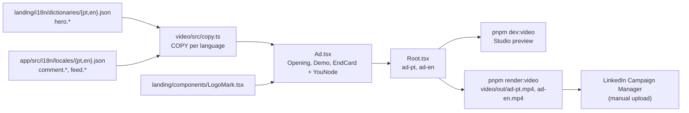

# Promotional Ad Video (PT + EN) Implementation Plan

> **For agentic workers:** REQUIRED SUB-SKILL: Use superpowers:subagent-driven-development (recommended) or superpowers:executing-plans to implement this plan task-by-task. Steps use checkbox (`- [ ]`) syntax for tracking.

**Goal:** A new `video/` workspace that renders the 30-second, silent, square LinkedIn feed ad as `video/out/ad-pt.mp4` and `video/out/ad-en.mp4`.

**Architecture:** One Remotion component (`Ad`) registered twice (`ad-pt`, `ad-en`); the language is its only prop. Every scene reads the same absolute frame (no `<Sequence>`), so the frames and pixel positions of the mock's buttons and the gold "you" node's taps come from the same constants. Strings that already exist are imported from the landing and app dictionaries, never copied.

**Tech Stack:** Remotion `4.0.529` (`remotion`, `@remotion/cli`, `@remotion/fonts`), React 19, TypeScript 5.9, `@fontsource` Cormorant Garamond 600 + DM Sans variable (the app's font packages), `lucide-react` (the app's icon set), pnpm workspaces.

**Spec:** `docs/superpowers/specs/2026-09-26-promo-video-design.md` (approved 2026-09-26). Read it before starting; this plan argues from it.

## Global Constraints

Copied from the spec; every task must meet them.

- **Output:** 1080×1080, 30 fps, 900 frames (30.0 s), H.264 with an AAC track (`--enforce-audio-track`), CRF 18. Silent.
- **Remotion `4.0.529`**, pinned exactly (no caret) for `remotion`, `@remotion/cli` and `@remotion/fonts`.
- **Colour (the landing's dark tokens, nothing new):** background ink `#0e1320`; card surfaces `#161c2b`, `#1c2433`; border `#2a3142`; text cream `#f5f0e8`, secondary `#9a9384`, accent gold-text `#e8c474`; node, CTA fill and rings gold `#d8a94e` (CTA text `#1c1813`); LinkedIn window accent `#0077b5` in the handoff scene only; background glows gold `rgba(201,150,62,α)` top-left and blue `rgba(0,119,181,α)` bottom-right with α ~0.12–0.18.
- **Type:** Cormorant Garamond 600 for the hook (~88px), the promise (~96px) and the captions (~64px). DM Sans for the app mock (the app's sizes scaled ~1.75×) and the fine print (≥ 28px).
- **Motion:** ease-out `bezier(0.16, 1, 0.3, 1)`, nothing at constant speed except the camera drift. Word reveal: per word, rise 24px, fade in, blur 6px → 0 over 18 frames, 2–3 frame stagger. Scene change: 12-frame cross-fade, outgoing scales 1 → 1.02, incoming 0.98 → 1. UI entrances: `spring`, damping 200. The one overshoot: the CTA pill, spring damping ~12. Tap: node scales 1 → 0.85 → 1 over 8 frames and releases a ring (0 → 60px, fading). Camera: the whole frame drifts 1 → 1.03 over the 30 s. Constellation: ~40 dots from Remotion's seeded `random()`.
- **Safe area:** no text within 90px of an edge; nothing important in the bottom 100px (LinkedIn's sound control).
- **Copy:** strings that exist on the landing or in the app are imported from their dictionaries. The two new captions: sentence case, no superlatives, no em dashes, pt-BR written natively. The trial disclosure is the landing's exact `hero.ctaDisclaimer`. Nothing on screen mentions the SSI score, a result, a number of users or a testimonial.
- **LinkedIn:** the LinkedIn window is a plain browser frame with a `linkedin.com` URL pill and a generic post. No LinkedIn logo and no imitation of LinkedIn's interface.
- **Fonts:** the brand fonts render in every frame, including frame 0 (no fallback-font flash).
- **Repo rules (CLAUDE.md + memory):**
  - **No git state changes at all.** No `git commit`, `git push`, `git stash`, `git checkout`, `git reset` or `git add`; Henriko commits everything.
  - Change files with the Edit and Write tools. Never use sed, heredocs or node scripts to edit, and Bash is for read-only work and for running tools. The one exception is the `cp` of binary font files in the Task 1 fallback.
  - Use pnpm, never npm. Never run `pnpm format`; Prettier runs on `video` only.
  - `docs/PLATFORM.md` is updated in the same change.

## Review Focus

The five uncovered ways this breaks for a person watching the ad, most likely first. Each one is pinned to a check in the task that owns the code.

1. **A later landing or app copy edit makes a line overflow or breaks the handoff split.** Expected: every string fits its box, captions stay at two lines at most, and the render refuses to split `hero.subLine2` unless it is exactly two sentences. Pinned by `sentences()` (Task 1, `copy.ts`, which throws during the render) and by the fit checks on the stills in Tasks 1, 2, 3 and 5.
2. **pt-BR accents and symbols render as tofu or in a fallback face** (ã ç ê é á í ó ú, `…`, `—`, `↗`, `→`, `·`). Expected: every glyph is visible and in the brand font, except `→` and `↗`, which DM Sans's latin subset lacks; those use the system font, as on the landing. Pinned by the PT still checks in Tasks 1, 2 and 3.
3. **The gold node misses its target.** Expected: 4 frames before each tap the node sits centred on the button it presses, in both languages. Pinned by the Task 4 stills at frames 368, 404, 521, 571 and 601.
4. **The MP4 differs from the reviewed stills** (colour banding in the dark gradients, a different font, missing emoji). Expected: frames pulled from the MP4 match the stills. Pinned by Task 5 Step 9, which extracts frames 20, 340 and 880 from each MP4.
5. **Phone-size viewing under LinkedIn's overlays.** Expected: the fine print is still legible at one-third size and nothing important sits below y = 980. Pinned by the end-card check in Task 1 and the one-third-scale stills of frames 190, 500 and 880 in Task 5.

## Deviations from the spec (for Henriko to approve with this plan)

- `scenes/Opening.tsx` replaces `Hook.tsx` + `Promise.tsx`: scenes 1 and 2 share the constellation and one clock.
- Three small extra files:
  - `motion.tsx`: easing and reveal helpers used by every scene.
  - `YouNode.tsx`: the gold node, as one layer above all scenes, so it can fly out of the Demo into the logo.
  - `assets.d.ts`: the type for the `.woff2` imports.
- One `LogoMark` instead of two clipped copies. The end card reveals only the L. The flying node lands exactly on the logo's node and becomes it, so no third copy of the path data exists.
- One global clock instead of overlapping `<Sequence>`s. Each tap's frame and position is defined once (`TAPS`) and read by both the button and the node.
- `--jpeg-quality=100` on the render, which gives less banding in the dark gradients.
- `lucide-react`, the icon set the app already uses, draws the comment and combobox icons.
- The comment count shows as the app's icon plus number (`PostCard.tsx`), not the word "comments".
- The captions sit in a band at y 100–260, above the mock.
- The spike still is frame 880 (the end card), because frame 0 has no text that could prove the fonts loaded.
- The PLATFORM.md music recipe uses `Html5Audio`, because `Audio` is deprecated in 4.0.529.
- The docs gain a thumbnail command (`remotion still … --frame=80`).
- Verified: `https://linkintothessi.com` redirects (308) to `www`, so the literal URL on the end card works.

## Reference: the strings the ad must show

Imported, verified against the dictionaries on 2026-09-26:

| Key | EN | PT |
|---|---|---|
| landing `hero.eyebrow` | Good at your work, but few people see it? | Você faz um bom trabalho, mas pouca gente vê? |
| landing `hero.headlineLine1` | Get noticed on LinkedIn | Apareça no LinkedIn |
| landing `hero.headlineLine2` | by the people in your field. | para as pessoas da sua área. |
| landing `hero.subLine2` | You react and comment yourself, on LinkedIn. Nothing is automated. | Você mesmo reage e comenta, direto no LinkedIn. Nada é automático. |
| landing `hero.cta` | Start my free trial | Começar meu teste grátis |
| landing `hero.ctaDisclaimer` | Free for 7 days or your first 50 interactions (made or received), whichever comes first. Card required. Cancel anytime. | Grátis por 7 dias ou até suas primeiras 50 interações (feitas ou recebidas), o que vier primeiro. Cartão necessário. Cancele quando quiser. |
| app `comment.generate` / `generating` / `regenerate` | Generate with AI / Generating… / Regenerate | Gerar com IA / Gerando… / Gerar de novo |
| app `comment.submit` | Copy & comment on LinkedIn | Copiar e comentar no LinkedIn |
| app `comment.languageAuto` | Auto — match the post | Automático — idioma da publicação |
| app `feed.viewOnLinkedIn` / `feed.comment` | View on LinkedIn ↗ / Comment | Ver no LinkedIn ↗ / Comentar |

New (in `video/src/copy.ts`): the captions "Posts from your field, in one place." / "Publicações da sua área, em um só lugar." and "Get an AI draft for your comment." / "Receba um rascunho com IA para o seu comentário.", plus the fictional mock data from spec §2.3. The CTA pill appends a literal `→` glyph, as `landing/components/Hero.tsx:37` does.

## File map

```
video/
  package.json          # remotion + @remotion/cli + @remotion/fonts 4.0.529, react 19, fonts, lucide-react
  tsconfig.json         # extends ../tsconfig.base.json; jsx react-jsx; noEmit
  src/
    index.ts            # registerRoot(Root)
    Root.tsx            # <Composition> ad-pt and ad-en: 1080×1080, 30 fps, 900 frames, same component
    Ad.tsx              # background glows, camera drift, cross-fades between the 3 layers, YouNode on top
    brand.ts            # tokens (C), fonts (loadFont), SIZE/FPS/TOTAL_FRAMES/XF/EASE/COL
    motion.tsx          # progress, track, tapScale, rise, enterStyle, exitStyle, STAGGER, <Words>
    copy.ts             # COPY: Record<Lang, AdCopy> — imported strings + 2 new captions + fictional mock data
    assets.d.ts         # `*.woff2` imports are URLs
    YouNode.tsx         # the gold "you" node: pulses, taps through the mock, lands as the logo's node
    scenes/
      Opening.tsx       # scenes 1–2: constellation, hook, promise, rings (exports HOME, BRIGHTEN, RINGS)
      Demo.tsx          # scenes 3–5: feed, comment box + AI draft, linkedin.com window (exports TAPS)
      EndCard.tsx       # scene 6: L reveal, wordmark, CTA, URL, fine print (exports LOGO_NODE, LANDED)
  out/                  # renders and stills (gitignored)
```

Modified outside `video/`:
- `pnpm-workspace.yaml`
- `.gitignore`
- `eslint.config.js`
- the root `package.json`
- `.claude/launch.json` (local only; `.claude/` is gitignored)
- `docs/PLATFORM.md`

## Timeline (global frames, 30 fps)

| Frames | What happens |
|---|---|
| 0 | Dim constellation; the node is faint at `HOME` (540, 250) |
| 4–46 | Hook rises word by word (9 words in both languages) |
| 84–96 | Hook exits (fade, blur, rise 16px) |
| 90–108 | Node lights up (radius 14 → 18, opacity 0.35 → 1) |
| 96 / 120 / 144 | Node pulses and sends out rings; the first ring lights each dot as it passes |
| 98–~150 | Promise line 1, then line 2 in gold-text |
| 186–202 | Node sinks 70px and fades out |
| 198–210 | Opening → Demo cross-fade |
| 212 | Feed caption |
| 222 / 236 / 250 | Card 1, card 2 and the skeleton rise |
| 330–348 | Node reappears beside the comment button |
| 372 | Tap: comment button. The box opens from 378 and pushes card 2 down |
| 360–372 / 374 | Feed caption exits / draft caption |
| 408 | Tap: Generate with AI; "Generating…" 410–440 |
| 440–490 | The draft types in; the button reads "Regenerate" |
| 525 | Tap: Copy & comment on LinkedIn; the draft caption exits 525–537 |
| 532–552 | The feed dims |
| 539 | Handoff sentence 1 |
| 540–~560 | The `linkedin.com` window rises |
| 575 | Tap: the comment input; the draft is pasted from 577 |
| 605 | Tap: Comment; "You" / "Você" reply slides in 609–629 |
| 628–640 / 642 | Handoff sentence 1 exits / sentence 2 |
| 693–705 | Demo → end card cross-fade |
| 700–750 | Node flies in an arc onto the logo's node |
| 712–752 | The L reveals from the bottom up |
| 742–769 | Wordmark "Link Into The SSI" |
| 750–770 | The node's glow fades: it is now the logo's node |
| 758 | CTA pill springs in (the one overshoot) |
| 772 / 782 | URL, then fine print |
| 800–900 | Hold |

---

### Task 1: Scaffold, repo gates and the end-card spike

Proves the risky parts first:
- The bundler accepts the cross-package imports: landing JSON, app JSON and `LogoMark.tsx`.
- The `.woff2` font imports work, and the fonts render.
- The repo gates (workspace, lint, typecheck, Prettier) accept the new package.

**Files:**
- Create: `video/package.json`, `video/tsconfig.json`, `video/src/assets.d.ts`, `video/src/brand.ts`, `video/src/motion.tsx`, `video/src/copy.ts`, `video/src/scenes/EndCard.tsx`, `video/src/Ad.tsx`, `video/src/Root.tsx`, `video/src/index.ts`
- Modify: `pnpm-workspace.yaml:4`, `.gitignore` (end of file), `eslint.config.js:2,59,61`, `package.json:8,23`, `.claude/launch.json`

**Interfaces:**
- Consumes:
  - `landing/i18n/dictionaries/{en,pt}.json` (`hero.*`)
  - `app/src/i18n/locales/{en,pt}.json` (`comment.*`, `feed.*`)
  - `landing/components/LogoMark.tsx` (default export, `{ className?: string }`)
- Produces:
  - `brand.ts`:
    - `C` (colour tokens: `ink card cardRaised border cream muted goldText gold onGold accent input lnBlue`)
    - `SERIF`, `SANS`
    - `SIZE = 1080`, `FPS = 30`, `TOTAL_FRAMES = 900`, `XF = 12`
    - `EASE` (`(t: number) => number`)
    - `COL = { x: 110, w: 860 }`
  - `motion.tsx`:
    - `progress(frame, start, duration): number` (eased 0 → 1, clamped)
    - `type Step = { at; dur; to }`
    - `track(frame, from, steps: Step[]): number`
    - `tapScale(frame, taps: number[]): number`
    - `rise(frame, start): number` (spring, damping 200)
    - `enterStyle(frame, start): CSSProperties`, `exitStyle(frame, start): CSSProperties`
    - `STAGGER = 3`
    - `<Words text start />`
  - `copy.ts`: `LANGS`, `type Lang = 'pt' | 'en'`, `type Post`, `type AdCopy`, `COPY: Record<Lang, AdCopy>`
  - `EndCard.tsx`: `LOGO_NODE: { x; y; r }` (≈ 560.34, 211.57, 11.76), `LANDED = 750`, `<EndCard copy />`
  - `Ad.tsx`: `type AdProps = { lang: Lang }`, `<Ad lang />`

- [ ] **Step 1: Register the workspace and ignore the renders**

Edit `pnpm-workspace.yaml`: old `  - 'convex'` → new:

```yaml
  - 'convex'
  - 'video'
```

Edit `.gitignore`. The file uses CRLF, has no trailing newline and ends at `.windsurf/`, its only occurrence; `backlog/` is tracked since `184ee08`. The Edit tool keeps the line endings. Old `.windsurf/` → new:

```
.windsurf/

# Remotion renders and stills (video/): large binaries, re-rendered on demand
video/out/
```

- [ ] **Step 2: Create the package**

`video/package.json`:

```json
{
  "name": "video",
  "private": true,
  "version": "0.0.1",
  "type": "module",
  "scripts": {
    "studio": "remotion studio src/index.ts --port=3100",
    "render": "remotion render src/index.ts ad-pt out/ad-pt.mp4 --crf=18 --jpeg-quality=100 --enforce-audio-track && remotion render src/index.ts ad-en out/ad-en.mp4 --crf=18 --jpeg-quality=100 --enforce-audio-track"
  },
  "dependencies": {
    "@fontsource-variable/dm-sans": "^5.2.8",
    "@fontsource/cormorant-garamond": "^5.2.11",
    "@remotion/cli": "4.0.529",
    "@remotion/fonts": "4.0.529",
    "lucide-react": "^1.20.0",
    "react": "^19.2.7",
    "react-dom": "^19.2.7",
    "remotion": "4.0.529"
  },
  "devDependencies": {
    "@types/react": "^19.2.17",
    "typescript": "^5.9.3"
  }
}
```

The ranges are the app's own, so pnpm resolves the same `react` and `@types/react` as `app/` and `landing/`. That matters because `tsc` type-checks `LogoMark.tsx` from `landing/` with a single copy of the JSX types.

`video/tsconfig.json`:

```json
{
  "extends": "../tsconfig.base.json",
  "compilerOptions": {
    "jsx": "react-jsx",
    "noEmit": true
  },
  "include": ["src"]
}
```

- [ ] **Step 3: Install**

Run: `pnpm install`

Expected: exit 0. The `video` workspace gets `remotion 4.0.529`, `@remotion/cli 4.0.529`, `@remotion/fonts 4.0.529`, the two font packages and `lucide-react`, and `pnpm-lock.yaml` changes.

If pnpm prints "Ignored build scripts" naming a new package, read that package's install script before approving anything. Add it to `allowBuilds` in `pnpm-workspace.yaml` only if Remotion needs the script to run, with a one-line comment saying why, following the existing entries.

- [ ] **Step 4: Brand tokens, fonts and the asset type**

`video/src/assets.d.ts`:

```ts
// Remotion's bundler serves an imported font file and returns its URL.
declare module '*.woff2' {
  const url: string
  export default url
}
```

`video/src/brand.ts`:

```ts
import cormorant600 from '@fontsource/cormorant-garamond/files/cormorant-garamond-latin-600-normal.woff2'
import dmSans from '@fontsource-variable/dm-sans/files/dm-sans-latin-wght-normal.woff2'
import { loadFont } from '@remotion/fonts'
import { Easing } from 'remotion'

// The landing's dark tokens (landing/app/globals.css) plus the app's dark card, input and avatar tokens.
export const C = {
  ink: '#0e1320',
  card: '#161c2b',
  cardRaised: '#1c2433',
  border: '#2a3142',
  cream: '#f5f0e8',
  muted: '#9a9384',
  goldText: '#e8c474',
  gold: '#d8a94e',
  onGold: '#1c1813',
  accent: '#2a2418',
  input: 'rgba(42, 49, 66, 0.3)',
  lnBlue: '#0077b5'
}
export const SERIF = '"Cormorant Garamond", Georgia, serif'
export const SANS = '"DM Sans", system-ui, sans-serif'

// loadFont holds every frame until its font is ready and fails the render if the font can't load,
// so no frame is ever drawn in a fallback font.
void loadFont({ family: 'Cormorant Garamond', url: cormorant600, weight: '600' })
void loadFont({ family: 'DM Sans', url: dmSans, weight: '100 1000' })

export const SIZE = 1080
export const FPS = 30
export const TOTAL_FRAMES = 900 // 30 s
export const XF = 12 // cross-fade length, in frames
export const EASE = Easing.bezier(0.16, 1, 0.3, 1)
// The content column. 110px side margins keep text 90px from the edges even at the end of the 1.03 camera drift.
export const COL = { x: 110, w: 860 }
```

- [ ] **Step 5: Motion helpers**

`video/src/motion.tsx`:

```tsx
import { type CSSProperties, Fragment } from 'react'
import { interpolate, spring, useCurrentFrame } from 'remotion'
import { EASE, FPS, XF } from './brand'

const clamp = { extrapolateLeft: 'clamp', extrapolateRight: 'clamp' } as const

// 0 → 1 over `duration` frames from `start`, eased; 0 before, 1 after.
export const progress = (frame: number, start: number, duration: number) =>
  interpolate(frame, [start, start + duration], [0, 1], { ...clamp, easing: EASE })

// A value that eases from `from` to each step's `to` in turn. Steps must be in time order.
export type Step = { at: number; dur: number; to: number }
export const track = (frame: number, from: number, steps: Step[]) =>
  steps.reduce((value, step) => value + (step.to - value) * progress(frame, step.at, step.dur), from)

// The press of a tap: 1 → 0.85 → 1 over 8 frames from each tap frame.
export const tapScale = (frame: number, taps: number[]) =>
  Math.min(...taps.map(at => interpolate(frame, [at, at + 4, at + 8], [1, 0.85, 1], clamp)))

// A UI entrance: a spring with no bounce that settles in ~20 frames.
export const rise = (frame: number, start: number) =>
  spring({ frame: Math.max(0, frame - start), fps: FPS, config: { damping: 200 } })

export const enterStyle = (frame: number, start: number): CSSProperties => {
  const p = progress(frame, start, 18)
  return { opacity: p, transform: `translateY(${(1 - p) * 24}px)` }
}

export const exitStyle = (frame: number, start: number): CSSProperties => {
  const p = progress(frame, start, XF)
  return { opacity: 1 - p, filter: `blur(${p * 6}px)`, transform: `translateY(${-p * 16}px)` }
}

export const STAGGER = 3 // frames between two words of a reveal

// Word-by-word reveal: each word rises 24px, fades in and un-blurs over 18 frames.
export function Words({ text, start }: { text: string; start: number }) {
  const frame = useCurrentFrame()
  return (
    <>
      {text.split(' ').map((word, i) => {
        const p = progress(frame, start + i * STAGGER, 18)
        return (
          <Fragment key={i}>
            {i > 0 && ' '}
            <span
              style={{
                display: 'inline-block',
                opacity: p,
                transform: `translateY(${(1 - p) * 24}px)`,
                filter: `blur(${(1 - p) * 6}px)`
              }}
            >
              {word}
            </span>
          </Fragment>
        )
      })}
    </>
  )
}
```

- [ ] **Step 6: Copy**

`video/src/copy.ts`:

```ts
import appEn from '../../app/src/i18n/locales/en.json'
import appPt from '../../app/src/i18n/locales/pt.json'
import landingEn from '../../landing/i18n/dictionaries/en.json'
import landingPt from '../../landing/i18n/dictionaries/pt.json'

export const LANGS = ['pt', 'en'] as const
export type Lang = (typeof LANGS)[number]

// Only the keys the ad reads.
type LandingStrings = {
  hero: {
    eyebrow: string
    headlineLine1: string
    headlineLine2: string
    subLine2: string
    cta: string
    ctaDisclaimer: string
  }
}
type AppStrings = {
  comment: { generate: string; generating: string; regenerate: string; submit: string; languageAuto: string }
  feed: { viewOnLinkedIn: string; comment: string }
}

export type Post = { name: string; headline: string; text: string; emoji: string; reactions: number; comments: number }

export type AdCopy = {
  hook: string
  promise: [string, string]
  feedCaption: string
  draftCaption: string
  handoff: [string, string]
  cta: string
  finePrint: string
  ui: AppStrings['comment'] & AppStrings['feed']
  you: string
  posts: [Post, Post]
  draft: string
}

// The handoff shows landing hero.subLine2 one sentence at a time.
function sentences(line: string): [string, string] {
  const parts = line.split(/(?<=\.) /)
  if (parts.length !== 2) throw new Error(`Expected two sentences in "${line}"`)
  return [parts[0], parts[1]]
}

// Every string that already exists on the landing or in the app comes from its dictionary, so a copy change there
// reaches the ad on the next render.
function fromSources(
  { hero }: LandingStrings,
  { comment, feed }: AppStrings
): Pick<AdCopy, 'hook' | 'promise' | 'handoff' | 'cta' | 'finePrint' | 'ui'> {
  return {
    hook: hero.eyebrow,
    promise: [hero.headlineLine1, hero.headlineLine2],
    handoff: sentences(hero.subLine2),
    cta: hero.cta,
    finePrint: hero.ctaDisclaimer,
    ui: {
      generate: comment.generate,
      generating: comment.generating,
      regenerate: comment.regenerate,
      submit: comment.submit,
      languageAuto: comment.languageAuto,
      viewOnLinkedIn: feed.viewOnLinkedIn,
      comment: feed.comment
    }
  }
}

// The mock posts are fictional; their counts are the same in both languages.
const STATS = [
  { emoji: '💡', reactions: 48, comments: 12 },
  { emoji: '👍', reactions: 31, comments: 7 }
] as const

export const COPY: Record<Lang, AdCopy> = {
  pt: {
    ...fromSources(landingPt, appPt),
    feedCaption: 'Publicações da sua área, em um só lugar.',
    draftCaption: 'Receba um rascunho com IA para o seu comentário.',
    you: 'Você',
    posts: [
      {
        name: 'Marina Albuquerque',
        headline: 'Head de Vendas · SaaS B2B',
        text: 'Fechamos nosso primeiro contrato enterprise neste trimestre. O que mais ajudou foi mapear quem aprova a compra antes da primeira reunião.',
        ...STATS[0]
      },
      {
        name: 'Rafael Moreira',
        headline: 'Fundador · Fintech',
        text: 'Três coisas que eu diria para mim mesmo sobre precificar um SaaS:',
        ...STATS[1]
      }
    ],
    draft:
      'Mapear quem decide antes da primeira reunião mudou nosso ciclo também. Vocês trouxeram compras para a conversa antes ou depois do piloto?'
  },
  en: {
    ...fromSources(landingEn, appEn),
    feedCaption: 'Posts from your field, in one place.',
    draftCaption: 'Get an AI draft for your comment.',
    you: 'You',
    posts: [
      {
        name: 'Sarah Mitchell',
        headline: 'Head of Sales · B2B SaaS',
        text: 'We closed our first enterprise deal this quarter. What helped most was mapping who signs off on the purchase before the first call.',
        ...STATS[0]
      },
      {
        name: 'Daniel Brooks',
        headline: 'Founder · Fintech',
        text: "Three things I'd tell my younger self about pricing a SaaS product:",
        ...STATS[1]
      }
    ],
    draft:
      'Mapping who decides before the first call changed our sales cycle too. Did you bring procurement in before or after the pilot?'
  }
}
```

- [ ] **Step 7: End card, `Ad` (end card only for now), `Root`, `index`**

`video/src/scenes/EndCard.tsx`:

```tsx
import type { CSSProperties } from 'react'
import { AbsoluteFill, spring, useCurrentFrame } from 'remotion'
import LogoMark from '../../../landing/components/LogoMark'
import { C, COL, FPS, SANS, SERIF } from '../brand'
import type { AdCopy } from '../copy'
import { enterStyle, progress, Words } from '../motion'

// Geometry of landing/components/LogoMark.tsx: viewBox 11.5 3.2 25.5 40.8, node at (28.4, 7.6), r 2.4.
const LOGO = { w: 125, h: 200, top: 190 }
const LOGO_LEFT = 540 - LOGO.w / 2
const UNIT = LOGO.w / 25.5 // px per viewBox unit
// Where the gold "you" node lands (YouNode.tsx): on the logo's own node, which the reveal below never uncovers.
export const LOGO_NODE = { x: LOGO_LEFT + (28.4 - 11.5) * UNIT, y: LOGO.top + (7.6 - 3.2) * UNIT, r: 2.4 * UNIT }
export const LANDED = 750

const centered: CSSProperties = { position: 'absolute', left: COL.x, width: COL.w, textAlign: 'center' }

export function EndCard({ copy }: { copy: AdCopy }) {
  const frame = useCurrentFrame()
  // The L rises from the bottom. The clip stops 20% from the top, so the logo's own node never shows.
  const reveal = progress(frame, 712, 40)
  const pop = spring({ frame: Math.max(0, frame - 758), fps: FPS, config: { damping: 12 } })
  return (
    <AbsoluteFill>
      <div
        style={{
          position: 'absolute',
          left: LOGO_LEFT,
          top: LOGO.top,
          width: LOGO.w,
          height: LOGO.h,
          lineHeight: 0,
          color: C.gold,
          clipPath: `inset(${100 - 80 * reveal}% 0 0 0)`
        }}
      >
        <LogoMark />
      </div>
      <div
        style={{
          ...centered,
          top: 420,
          fontFamily: SERIF,
          fontWeight: 600,
          fontSize: 60,
          letterSpacing: '0.025em',
          color: C.cream
        }}
      >
        <Words
          text="Link Into The SSI"
          start={742}
        />
      </div>
      <div style={{ ...centered, top: 528, display: 'flex', justifyContent: 'center' }}>
        <div
          style={{
            opacity: Math.min(1, pop * 1.5),
            transform: `scale(${0.6 + 0.4 * pop})`,
            padding: '22px 52px',
            borderRadius: 999,
            background: C.gold,
            color: C.onGold,
            fontFamily: SANS,
            fontSize: 34,
            fontWeight: 600
          }}
        >
          {copy.cta}
          <span style={{ marginLeft: 14 }}>→</span>
        </div>
      </div>
      <div
        style={{
          ...centered,
          top: 660,
          fontFamily: SANS,
          fontSize: 30,
          fontWeight: 500,
          color: C.goldText,
          ...enterStyle(frame, 772)
        }}
      >
        linkintothessi.com
      </div>
      <div
        style={{
          ...centered,
          top: 740,
          fontFamily: SANS,
          fontSize: 28,
          lineHeight: 1.45,
          color: C.muted,
          textWrap: 'balance',
          ...enterStyle(frame, 782)
        }}
      >
        {copy.finePrint}
      </div>
    </AbsoluteFill>
  )
}
```

`video/src/Ad.tsx` (Task 1 version):

```tsx
import type { ReactNode } from 'react'
import { AbsoluteFill, interpolate, useCurrentFrame } from 'remotion'
import { C, TOTAL_FRAMES, XF } from './brand'
import { COPY, type Lang } from './copy'
import { progress } from './motion'
import { EndCard } from './scenes/EndCard'

export type AdProps = { lang: Lang }

// Mounts a scene for frames [from, to). It fades in over the first XF frames and out over the last XF,
// scaling 0.98 → 1 on the way in and 1 → 1.02 on the way out (a camera push, not a slide).
function Crossfade({ from, to, children }: { from: number; to: number; children: ReactNode }) {
  const frame = useCurrentFrame()
  if (frame < from || frame >= to) return null
  const fadeIn = from === 0 ? 1 : progress(frame, from, XF)
  const fadeOut = to === TOTAL_FRAMES ? 0 : progress(frame, to - XF, XF)
  return (
    <AbsoluteFill
      style={{
        opacity: fadeIn * (1 - fadeOut),
        transform: `scale(${(0.98 + 0.02 * fadeIn) * (1 + 0.02 * fadeOut)})`
      }}
    >
      {children}
    </AbsoluteFill>
  )
}

export function Ad({ lang }: AdProps) {
  const frame = useCurrentFrame()
  const copy = COPY[lang]
  return (
    <AbsoluteFill
      style={{
        background: `radial-gradient(circle at 12% 8%, rgba(201, 150, 62, 0.16), transparent 55%), radial-gradient(circle at 90% 94%, rgba(0, 119, 181, 0.14), transparent 55%), ${C.ink}`
      }}
    >
      {/* The camera drift: the whole frame scales 1 → 1.03 over the 30 s. */}
      <AbsoluteFill style={{ transform: `scale(${interpolate(frame, [0, TOTAL_FRAMES], [1, 1.03])})` }}>
        <Crossfade
          from={705 - XF}
          to={TOTAL_FRAMES}
        >
          <EndCard copy={copy} />
        </Crossfade>
      </AbsoluteFill>
    </AbsoluteFill>
  )
}
```

`video/src/Root.tsx`:

```tsx
import { Composition } from 'remotion'
import { Ad } from './Ad'
import { FPS, SIZE, TOTAL_FRAMES } from './brand'
import { LANGS } from './copy'

// One component, registered once per language: `ad-pt` and `ad-en`.
export function Root() {
  return (
    <>
      {LANGS.map(lang => (
        <Composition
          key={lang}
          id={`ad-${lang}`}
          component={Ad}
          width={SIZE}
          height={SIZE}
          fps={FPS}
          durationInFrames={TOTAL_FRAMES}
          defaultProps={{ lang }}
        />
      ))}
    </>
  )
}
```

`video/src/index.ts`:

```ts
import { registerRoot } from 'remotion'
import { Root } from './Root'

registerRoot(Root)
```

- [ ] **Step 8: Typecheck**

Run: `pnpm --filter video exec tsc --noEmit`

Expected: no output, exit 0. A missing or renamed dictionary key fails here, at the `fromSources(...)` call sites.

- [ ] **Step 9: Spike render, the end card in both languages**

Run:
```bash
pnpm --filter video exec remotion still src/index.ts ad-en out/spike-en.png --frame=880
pnpm --filter video exec remotion still src/index.ts ad-pt out/spike-pt.png --frame=880
```

Expected: both exit 0. The first run also downloads Chrome Headless Shell (~100 MB, once).

Fallbacks (spec §7), only if the render fails:
- **Fonts.** If the error names a `.woff2` import (for example `Module parse failed` or `Can't resolve`):
  - Copy the two font files with `mkdir -p video/public/fonts && cp video/node_modules/@fontsource/cormorant-garamond/files/cormorant-garamond-latin-600-normal.woff2 video/node_modules/@fontsource-variable/dm-sans/files/dm-sans-latin-wght-normal.woff2 video/public/fonts/`.
  - Delete `src/assets.d.ts`.
  - In `brand.ts`, drop the two font imports and use `url: staticFile('fonts/cormorant-garamond-latin-600-normal.woff2')` and `url: staticFile('fonts/dm-sans-latin-wght-normal.woff2')`, importing `staticFile` from `remotion`.
- **Cross-package imports.** If the error names `landing/` or `app/`:
  - Replace the four JSON imports with object literals holding exactly the strings in "Reference: the strings the ad must show", typed `LandingStrings` / `AppStrings`. Head each one with `// Copied from <path> <keys>; keep in sync`.
  - Copy `LogoMark`'s `<svg>` into `EndCard.tsx` under `// Copied from landing/components/LogoMark.tsx; keep in sync`.

Then Read `video/out/spike-en.png` and `video/out/spike-pt.png` and check:
- **Fonts.** "Link Into The SSI" is Cormorant Garamond, a high-contrast serif with a small x-height (not Georgia's heavy, wide shapes). The pill, URL and fine print are DM Sans (not Segoe UI).
- **Logo.** The gold L is fully revealed and there is **no** node above it; that arrives in Task 4.
- **CTA.** EN "Start my free trial →" / PT "Começar meu teste grátis →", in one gold pill with dark text.
- **Fine print.** The full `hero.ctaDisclaimer` in muted grey, balanced lines, none cut off. In PT the accents in "Grátis", "até", "interações", "Cartão necessário" are all visible.
- **Safe area.** Nothing is closer than 90px to the left, right or top edge, and nothing sits below y ≈ 980.

- [ ] **Step 10: Repo gates**

Edit `eslint.config.js`:
- Line 2: old `// Applies to: app/ (Vite+React), convex/ (Node+TS), landing/ (Next.js+React)` → new `// Applies to: app/ (Vite+React), convex/ (Node+TS), landing/ (Next.js+React), video/ (Remotion+React)`.
- Line 59: old `(app/ and landing/) ─────────` → new `(app/, landing/ and video/) ─`. The line keeps its length.
- Line 61: old `    files: ['app/src/**/*.{ts,tsx}', 'landing/**/*.{ts,tsx,js,jsx}'],` → new `    files: ['app/src/**/*.{ts,tsx}', 'landing/**/*.{ts,tsx,js,jsx}', 'video/src/**/*.{ts,tsx}'],`.

Edit the root `package.json`:
- old `    "dev:app": "pnpm --filter app dev",` → new:

  ```json
      "dev:app": "pnpm --filter app dev",
      "dev:video": "pnpm --filter video studio",
      "render:video": "pnpm --filter video render",
  ```
- `typecheck`: old `&& pnpm --filter landing exec tsc --noEmit"` → new `&& pnpm --filter landing exec tsc --noEmit && pnpm --filter video exec tsc --noEmit"`.

Edit `.claude/launch.json`: old

```json
      "port": 5173
    }
  ]
```

→ new

```json
      "port": 5173
    },
    {
      "name": "video",
      "runtimeExecutable": "pnpm",
      "runtimeArgs": ["--filter", "video", "studio", "--no-open"],
      "port": 3100
    }
  ]
```

- [ ] **Step 11: Format and run the gates**

Run: `pnpm exec prettier --write video`, then `pnpm exec prettier --check video`
Expected: "All matched files use Prettier code style!"

Run: `pnpm exec eslint video --max-warnings 0`
Expected: no output, exit 0.

Run: `pnpm typecheck`
Expected: exit 0 for all four packages.

- [ ] **Step 12: No commit.** Henriko commits (CLAUDE.md). Run no git command that changes state.

---

### Task 2: Opening (scenes 1–2)

**Files:**
- Create: `video/src/scenes/Opening.tsx`
- Modify: `video/src/Ad.tsx` (full file below)

**Interfaces:**
- Consumes:
  - `brand.ts`: `C`, `COL`, `SERIF`, `SIZE`, `XF`
  - `motion.tsx`: `exitStyle`, `progress`, `STAGGER`, `Words`
  - `copy.ts`: `AdCopy`
- Produces:
  - `HOME = { x: 540, y: 250 }`
  - `BRIGHTEN = 90`
  - `RINGS = [96, 120, 144]` (the frames the node pulses; Task 4 reads all three)
  - `<Opening copy />`

- [ ] **Step 1: Write the scene**

`video/src/scenes/Opening.tsx`:

```tsx
import { AbsoluteFill, random, useCurrentFrame } from 'remotion'
import { C, COL, SERIF, SIZE, XF } from '../brand'
import type { AdCopy } from '../copy'
import { exitStyle, progress, STAGGER, Words } from '../motion'

// The gold "you" node's home, the frame it lights up and the frames it pulses (YouNode.tsx draws it).
export const HOME = { x: 540, y: 250 }
export const BRIGHTEN = 90
export const RINGS = [96, 120, 144]

const RING_LIFE = 72 // frames for a ring to grow to RING_MAX
const RING_MAX = 1040 // px: past the farthest dot, so every dot lights up fully
const TEXT = { top: 450, bottom: 900 }
const HOOK_AT = 4
const HOOK_OUT = 84
const PROMISE_AT = 98

// ~40 dots at seeded random() positions, so every render is identical. They keep clear of the text box, the node
// and each other. `d` is the distance to the node, which sets the frame the first ring lights the dot.
function makeDots() {
  const dots: { x: number; y: number; r: number; d: number }[] = []
  for (let i = 0; dots.length < 40 && i < 5000; i++) {
    const x = 40 + random(`x${i}`) * 1000
    const y = 40 + random(`y${i}`) * 1000
    const d = Math.hypot(x - HOME.x, y - HOME.y)
    const inText = x > COL.x - 30 && x < COL.x + COL.w + 30 && y > TEXT.top - 30 && y < TEXT.bottom + 30
    if (inText || d <= 100 || dots.some(dot => Math.hypot(dot.x - x, dot.y - y) < 80)) continue
    dots.push({ x, y, r: 4 + random(`r${i}`) * 3, d })
  }
  return dots
}
const DOTS = makeDots()

export function Opening({ copy }: { copy: AdCopy }) {
  const frame = useCurrentFrame()
  const reach = RING_MAX * progress(frame, RINGS[0], RING_LIFE)
  const line2At = PROMISE_AT + copy.promise[0].split(' ').length * STAGGER + 6
  return (
    <AbsoluteFill>
      <svg
        width={SIZE}
        height={SIZE}
      >
        {RINGS.map(at => {
          const p = progress(frame, at, RING_LIFE)
          if (p <= 0 || p >= 1) return null
          return (
            <circle
              key={at}
              cx={HOME.x}
              cy={HOME.y}
              r={RING_MAX * p}
              fill="none"
              stroke={C.gold}
              strokeWidth={3}
              opacity={0.5 * (1 - p)}
            />
          )
        })}
        {DOTS.map((dot, i) => {
          // 0 → 1 as the first ring passes the dot: it swells for a moment and stays lit.
          const lit = Math.min(1, Math.max(0, (reach - dot.d) / 80))
          return (
            <circle
              key={i}
              cx={dot.x}
              cy={dot.y}
              r={dot.r * (1 + 0.6 * Math.sin(Math.PI * lit))}
              fill={C.cream}
              opacity={0.22 + 0.68 * lit}
            />
          )
        })}
      </svg>
      <div
        style={{
          position: 'absolute',
          left: COL.x,
          width: COL.w,
          top: TEXT.top,
          height: TEXT.bottom - TEXT.top,
          display: 'flex',
          flexDirection: 'column',
          justifyContent: 'center',
          textAlign: 'center',
          fontFamily: SERIF,
          fontWeight: 600,
          color: C.cream,
          textWrap: 'balance'
        }}
      >
        {frame < HOOK_OUT + XF ? (
          <div style={{ fontSize: 88, lineHeight: 1.1, ...exitStyle(frame, HOOK_OUT) }}>
            <Words
              text={copy.hook}
              start={HOOK_AT}
            />
          </div>
        ) : (
          <>
            <div style={{ fontSize: 96, lineHeight: 1.05 }}>
              <Words
                text={copy.promise[0]}
                start={PROMISE_AT}
              />
            </div>
            <div style={{ fontSize: 96, lineHeight: 1.05, color: C.goldText }}>
              <Words
                text={copy.promise[1]}
                start={line2At}
              />
            </div>
          </>
        )}
      </div>
    </AbsoluteFill>
  )
}
```

- [ ] **Step 2: Mount it in `Ad`**

`video/src/Ad.tsx` (full file):

```tsx
import type { ReactNode } from 'react'
import { AbsoluteFill, interpolate, useCurrentFrame } from 'remotion'
import { C, TOTAL_FRAMES, XF } from './brand'
import { COPY, type Lang } from './copy'
import { progress } from './motion'
import { EndCard } from './scenes/EndCard'
import { Opening } from './scenes/Opening'

export type AdProps = { lang: Lang }

// Mounts a scene for frames [from, to). It fades in over the first XF frames and out over the last XF,
// scaling 0.98 → 1 on the way in and 1 → 1.02 on the way out (a camera push, not a slide).
function Crossfade({ from, to, children }: { from: number; to: number; children: ReactNode }) {
  const frame = useCurrentFrame()
  if (frame < from || frame >= to) return null
  const fadeIn = from === 0 ? 1 : progress(frame, from, XF)
  const fadeOut = to === TOTAL_FRAMES ? 0 : progress(frame, to - XF, XF)
  return (
    <AbsoluteFill
      style={{
        opacity: fadeIn * (1 - fadeOut),
        transform: `scale(${(0.98 + 0.02 * fadeIn) * (1 + 0.02 * fadeOut)})`
      }}
    >
      {children}
    </AbsoluteFill>
  )
}

export function Ad({ lang }: AdProps) {
  const frame = useCurrentFrame()
  const copy = COPY[lang]
  return (
    <AbsoluteFill
      style={{
        background: `radial-gradient(circle at 12% 8%, rgba(201, 150, 62, 0.16), transparent 55%), radial-gradient(circle at 90% 94%, rgba(0, 119, 181, 0.14), transparent 55%), ${C.ink}`
      }}
    >
      {/* The camera drift: the whole frame scales 1 → 1.03 over the 30 s. */}
      <AbsoluteFill style={{ transform: `scale(${interpolate(frame, [0, TOTAL_FRAMES], [1, 1.03])})` }}>
        <Crossfade
          from={0}
          to={210}
        >
          <Opening copy={copy} />
        </Crossfade>
        <Crossfade
          from={705 - XF}
          to={TOTAL_FRAMES}
        >
          <EndCard copy={copy} />
        </Crossfade>
      </AbsoluteFill>
    </AbsoluteFill>
  )
}
```

- [ ] **Step 3: Typecheck**

Run: `pnpm --filter video exec tsc --noEmit`
Expected: no output, exit 0.

- [ ] **Step 4: Render the scene stills**

Run:
```bash
for l in en pt; do for f in 20 75 150 190; do pnpm --filter video exec remotion still src/index.ts ad-$l out/t2-$l-$f.png --frame=$f; done; done
```
Expected: 8 PNGs in `video/out/`, each command exits 0.

- [ ] **Step 5: Check the stills (Read each PNG)**

- **20:** dim cream dots across the top band, the side strips and the bottom band, none inside the text box. The first hook words are rising, blurred at first.
- **75:** the full hook, one centred block in Cormorant 600 (~88px), at most 3 balanced lines inside y 450–900.
  - EN: "Good at your work, but few people see it?"
  - PT: "Você faz um bom trabalho, mas pouca gente vê?", with "ê" intact.
- **150:** the promise. Line 1 is cream, line 2 gold-text.
  - EN: "Get noticed on LinkedIn" / "by the people in your field."
  - PT: "Apareça no LinkedIn" / "para as pessoas da sua área.", with "ç" and "á" intact.
  - The dots are fully lit (opacity ~0.9), no dot overlaps the text, and a faint ring may still be expanding.
- **190:** the promise holds and the dots stay lit.
- **Both languages:** nothing within 90px of an edge.

If a line wraps badly or spills out of the text box, change only `fontSize` (hook 80–88, promise 88–96) and say so in the task report.

- [ ] **Step 6: Format and lint**

Run: `pnpm exec prettier --write video`, then `pnpm exec eslint video --max-warnings 0`
Expected: clean.

- [ ] **Step 7: No commit.** Henriko commits.

---

### Task 3: Demo (scenes 3–5, one continuous shot)

**Files:**
- Create: `video/src/scenes/Demo.tsx`
- Modify: `video/src/Ad.tsx` (full file below)

**Interfaces:**
- Consumes:
  - `brand.ts`: `C`, `COL`, `SANS`, `SERIF`, `TOTAL_FRAMES`, `XF`
  - `motion.tsx`: `exitStyle`, `progress`, `rise`, `Words`
  - `copy.ts`: `AdCopy`, `Post`
  - `lucide-react`: `ChevronsUpDown`, `MessageSquare`
- Produces:
  - `TAPS: { comment; generate; submit; paste; post }`, each `{ at: number; x: number; y: number }` in global frame and pixel coordinates, in time order. Task 4 flies the node through them in insertion order.
  - `<Demo copy />`

Layout arithmetic (all fixed, so the taps land on the same pixels in both languages):

- **Card**, height 339 = 2 + 28 + 70 (author) + 20 + 113 (3 text lines at 26 × 1.45) + 20 + 84 (footer) + 2.
- **Comment box**, height 336 = 2 + 28 + 56 (row) + 14 + 128 (draft) + 14 + 64 (submit) + 28 + 2. It spans y 623–959.
- **Window row**, top 345 = 60 (bar) + 32 + 70 + 20 + 113 + 24 + 2 (divider) + 24.
- **Window height** 441 before the reply and 629 after it. It spans y 270–899.
- **Taps:**

  | Tap | x | y |
  |---|---|---|
  | comment | 306 | 566 |
  | generate | 676 | 681 |
  | submit | 710 | 897 |
  | paste | 454 | 647 |
  | post | 826 | 647 |

- [ ] **Step 1: Write the scene**

`video/src/scenes/Demo.tsx`:

```tsx
import type { CSSProperties } from 'react'
import { ChevronsUpDown, MessageSquare } from 'lucide-react'
import { AbsoluteFill, interpolate, useCurrentFrame } from 'remotion'
import { C, COL, SANS, SERIF, TOTAL_FRAMES, XF } from '../brand'
import type { AdCopy, Post } from '../copy'
import { exitStyle, progress, rise, Words } from '../motion'

// Fixed layout (px). Every box has a fixed size, so each tap lands on the same pixels in both languages;
// a longer label ellipsizes, as in the app, instead of moving a button.
const B = 2 // border
const PAD = 28 // panel padding
const GAP = 14
const LEFT = COL.x + B + PAD // a panel's inner left edge
const RIGHT = COL.x + COL.w - B - PAD // a panel's inner right edge
const CARD = { top: 270, h: 339, footer: 84, gap: 24, react: 104, comment: 96 }
const BOX = { top: CARD.top + CARD.h + GAP, h: 336, row: 56, combo: 392, gen: 260, text: 128, submit: 460, submitH: 64 }
const WIN = { top: 270, bar: 60, pad: 32, row: 345, rowH: 60, avatar: 48, button: 220, reply: 164 }
const WIN_LEFT = COL.x + B + WIN.pad
const WIN_RIGHT = COL.x + COL.w - B - WIN.pad
const INPUT = { left: WIN_LEFT + WIN.avatar + GAP, right: WIN_RIGHT - WIN.button - GAP }
const ROW_Y = WIN.top + B + WIN.row + WIN.rowH / 2

// Where and when the gold node taps (YouNode.tsx), computed from the same constants that place the buttons.
export const TAPS = {
  comment: { at: 372, x: LEFT + CARD.react + GAP + CARD.comment / 2, y: CARD.top + CARD.h - B - (CARD.footer - B) / 2 },
  generate: { at: 408, x: LEFT + BOX.combo + GAP + BOX.gen / 2, y: BOX.top + B + PAD + BOX.row / 2 },
  submit: { at: 525, x: RIGHT - BOX.submit / 2, y: BOX.top + BOX.h - B - PAD - BOX.submitH / 2 },
  paste: { at: 575, x: (INPUT.left + INPUT.right) / 2, y: ROW_Y },
  post: { at: 605, x: WIN_RIGHT - WIN.button / 2, y: ROW_Y }
}

// What each tap sets off.
const T = {
  cards: [222, 236, 250],
  boxOpen: TAPS.comment.at + 6,
  generating: TAPS.generate.at + 2,
  typing: [440, 490],
  dim: TAPS.submit.at + 7,
  window: TAPS.submit.at + 15,
  pasted: TAPS.paste.at + 2,
  posted: TAPS.post.at + 4
}

const panel: CSSProperties = {
  position: 'absolute',
  left: COL.x,
  width: COL.w,
  boxSizing: 'border-box',
  background: C.card,
  border: `${B}px solid ${C.border}`,
  borderRadius: 21,
  overflow: 'hidden',
  fontFamily: SANS,
  color: C.cream
}
const field: CSSProperties = {
  boxSizing: 'border-box',
  display: 'flex',
  alignItems: 'center',
  height: BOX.row,
  padding: '0 21px',
  border: `${B}px solid ${C.border}`,
  borderRadius: 14,
  background: C.input,
  fontSize: 23
}
const clamp3: CSSProperties = { display: '-webkit-box', WebkitLineClamp: 3, WebkitBoxOrient: 'vertical', overflow: 'hidden' }
const oneLine: CSSProperties = { overflow: 'hidden', textOverflow: 'ellipsis', whiteSpace: 'nowrap' }
const count: CSSProperties = { fontVariantNumeric: 'tabular-nums' }
const bar = (width: number, height: number, marginTop: number) => (
  <div style={{ width, height, marginTop, borderRadius: 999, background: C.cardRaised }} />
)

// Initials on the app's avatar colours; `ring` marks the viewer.
function Avatar({ name, size, ring = false }: { name: string; size: number; ring?: boolean }) {
  return (
    <div
      style={{
        width: size,
        height: size,
        flexShrink: 0,
        borderRadius: '50%',
        display: 'flex',
        alignItems: 'center',
        justifyContent: 'center',
        background: C.accent,
        color: C.goldText,
        fontFamily: SANS,
        fontSize: size * 0.35,
        fontWeight: 600,
        boxShadow: ring ? `0 0 0 4px ${C.gold}` : undefined
      }}
    >
      {name
        .split(' ')
        .map(word => word[0])
        .join('')}
    </div>
  )
}

function Author({ post }: { post: Post }) {
  return (
    <div style={{ display: 'flex', alignItems: 'center', gap: 18 }}>
      <Avatar
        name={post.name}
        size={70}
      />
      <div style={{ minWidth: 0 }}>
        <div style={{ fontSize: 25, fontWeight: 600 }}>{post.name}</div>
        <div style={{ ...oneLine, fontSize: 21, color: C.muted }}>{post.headline}</div>
      </div>
    </div>
  )
}

// A feed card as the app draws it: author, text, then the suggested reaction, the comment button and the link.
function Card({ post, link, top, style }: { post: Post; link: string; top: number; style: CSSProperties }) {
  return (
    <div style={{ ...panel, top, height: CARD.h, padding: PAD, ...style }}>
      <Author post={post} />
      <div style={{ ...clamp3, marginTop: 20, fontSize: 26, lineHeight: 1.45 }}>{post.text}</div>
      <div
        style={{
          position: 'absolute',
          left: 0,
          right: 0,
          bottom: 0,
          height: CARD.footer,
          boxSizing: 'border-box',
          display: 'flex',
          alignItems: 'center',
          padding: `0 ${PAD}px`,
          borderTop: `${B}px solid ${C.border}`,
          fontSize: 23,
          color: C.muted
        }}
      >
        <span style={{ width: CARD.react, display: 'flex', alignItems: 'center', gap: 8 }}>
          <span style={{ fontSize: 28 }}>{post.emoji}</span>
          <span style={count}>{post.reactions}</span>
        </span>
        <span
          style={{
            width: CARD.comment,
            marginLeft: GAP,
            display: 'flex',
            alignItems: 'center',
            justifyContent: 'center',
            gap: 8
          }}
        >
          <MessageSquare size={28} />
          <span style={count}>{post.comments}</span>
        </span>
        <span style={{ marginLeft: 'auto', color: C.goldText }}>{link}</span>
      </div>
    </div>
  )
}

// The third card, half below the fold: grey bars and no text, so the feed reads as a list that keeps going.
function Skeleton({ top, style }: { top: number; style: CSSProperties }) {
  return (
    <div style={{ ...panel, top, height: CARD.h, padding: PAD, ...style }}>
      <div style={{ display: 'flex', alignItems: 'center', gap: 18 }}>
        <div style={{ width: 70, height: 70, borderRadius: '50%', background: C.cardRaised }} />
        <div>
          {bar(260, 22, 0)}
          {bar(180, 18, 12)}
        </div>
      </div>
      {bar(760, 20, 28)}
      {bar(640, 20, 14)}
    </div>
  )
}

// The app's comment box: language, Generate with AI, the draft, then Copy & comment on LinkedIn.
function CommentBox({ copy, open }: { copy: AdCopy; open: number }) {
  const f = useCurrentFrame()
  const generating = f >= T.generating && f < T.typing[0]
  const label = f < T.generating ? copy.ui.generate : generating ? copy.ui.generating : copy.ui.regenerate
  const typed = Math.round(
    interpolate(f, T.typing, [0, copy.draft.length], { extrapolateLeft: 'clamp', extrapolateRight: 'clamp' })
  )
  const caret = f >= T.typing[0] && f < T.typing[1] + 6
  return (
    <div
      style={{
        ...panel,
        top: BOX.top,
        height: BOX.h,
        padding: PAD,
        opacity: Math.min(1, open * 2),
        clipPath: `inset(0 0 ${(1 - open) * 100}% 0 round 21px)`
      }}
    >
      <div style={{ display: 'flex', gap: GAP }}>
        <div style={{ ...field, width: BOX.combo, gap: 10 }}>
          <span style={{ ...oneLine, flex: 1 }}>{copy.ui.languageAuto}</span>
          <ChevronsUpDown
            size={24}
            style={{ flexShrink: 0, opacity: 0.5 }}
          />
        </div>
        <div
          style={{
            ...field,
            width: BOX.gen,
            justifyContent: 'center',
            fontWeight: 600,
            opacity: generating ? 0.5 : 1
          }}
        >
          {label}
        </div>
      </div>
      <div
        style={{
          ...field,
          height: BOX.text,
          marginTop: GAP,
          padding: '14px 18px',
          alignItems: 'flex-start',
          lineHeight: 1.45
        }}
      >
        {/* One block child, so the caret flows at the end of the text instead of becoming a flex item. */}
        <div>
          {copy.draft.slice(0, typed)}
          {caret && (
            <span
              style={{
                display: 'inline-block',
                width: 3,
                height: 26,
                marginLeft: 2,
                verticalAlign: 'text-bottom',
                background: C.gold
              }}
            />
          )}
        </div>
      </div>
      <div
        style={{
          position: 'absolute',
          right: PAD,
          bottom: PAD,
          width: BOX.submit,
          height: BOX.submitH,
          borderRadius: 14,
          display: 'flex',
          alignItems: 'center',
          justifyContent: 'center',
          background: C.gold,
          color: C.ink,
          fontSize: 23,
          fontWeight: 600
        }}
      >
        {copy.ui.submit}
      </div>
    </div>
  )
}

// A plain browser window on linkedin.com: a URL pill and a generic post. No LinkedIn logo, none of LinkedIn's UI.
function LinkedInWindow({ copy }: { copy: AdCopy }) {
  const f = useCurrentFrame()
  if (f < T.window) return null
  const s = rise(f, T.window)
  const posted = progress(f, T.posted, 20)
  const pasted = f >= T.pasted && f < T.posted
  const post = copy.posts[0]
  return (
    <div
      style={{
        ...panel,
        top: WIN.top,
        height: 2 * B + WIN.row + WIN.rowH + WIN.pad + posted * (24 + WIN.reply),
        background: C.cardRaised,
        opacity: s,
        transform: `translateY(${(1 - s) * 60}px) scale(${0.96 + 0.04 * s})`,
        transformOrigin: '50% 0',
        boxShadow: '0 40px 80px rgba(0, 0, 0, 0.45)'
      }}
    >
      <div
        style={{
          position: 'relative',
          height: WIN.bar,
          display: 'flex',
          alignItems: 'center',
          gap: 10,
          padding: '0 24px',
          background: C.card
        }}
      >
        {[0, 1, 2].map(i => (
          <div
            key={i}
            style={{ width: 14, height: 14, borderRadius: '50%', background: C.border }}
          />
        ))}
        <div
          style={{
            position: 'absolute',
            left: '50%',
            transform: 'translateX(-50%)',
            padding: '6px 28px',
            borderRadius: 999,
            background: C.ink,
            color: C.muted,
            fontSize: 21
          }}
        >
          linkedin.com
        </div>
      </div>
      <div style={{ padding: `${WIN.pad}px ${WIN.pad}px 0` }}>
        <Author post={post} />
        <div style={{ ...clamp3, marginTop: 20, fontSize: 26, lineHeight: 1.45 }}>{post.text}</div>
        <div style={{ height: B, marginTop: 24, background: C.border }} />
      </div>
      <div
        style={{
          position: 'absolute',
          top: WIN.row,
          left: WIN.pad,
          right: WIN.pad,
          height: WIN.rowH,
          display: 'flex',
          alignItems: 'center',
          gap: GAP
        }}
      >
        <Avatar
          name={copy.you}
          size={WIN.avatar}
          ring
        />
        <div
          style={{
            ...field,
            flex: 1,
            minWidth: 0,
            height: WIN.rowH,
            borderRadius: WIN.rowH / 2,
            border: `${B}px solid ${pasted ? C.gold : C.border}`
          }}
        >
          {pasted && <span style={oneLine}>{copy.draft}</span>}
        </div>
        <div
          style={{
            width: WIN.button,
            height: WIN.rowH,
            flexShrink: 0,
            borderRadius: WIN.rowH / 2,
            display: 'flex',
            alignItems: 'center',
            justifyContent: 'center',
            background: C.lnBlue,
            color: C.cream,
            fontSize: 23,
            fontWeight: 600
          }}
        >
          {copy.ui.comment}
        </div>
      </div>
      {posted > 0 && (
        <div
          style={{
            position: 'absolute',
            top: WIN.row + WIN.rowH + 24,
            left: WIN.pad,
            right: WIN.pad,
            height: WIN.reply,
            display: 'flex',
            gap: GAP,
            opacity: posted,
            transform: `translateY(${(1 - posted) * 16}px)`
          }}
        >
          <Avatar
            name={copy.you}
            size={WIN.avatar}
            ring
          />
          <div
            style={{
              flex: 1,
              minWidth: 0,
              alignSelf: 'flex-start',
              padding: '14px 20px',
              borderRadius: 18,
              background: C.card,
              fontSize: 23,
              lineHeight: 1.45
            }}
          >
            <div style={{ fontWeight: 600 }}>{copy.you}</div>
            <div style={clamp3}>{copy.draft}</div>
          </div>
        </div>
      )}
    </div>
  )
}

// A serif caption in the band above the mock (y 100–260), revealed word by word, gone XF frames after `out`.
function Caption({ text, at, out }: { text: string; at: number; out: number }) {
  const frame = useCurrentFrame()
  if (frame < at || frame >= out + XF) return null
  return (
    <div
      style={{
        position: 'absolute',
        left: COL.x,
        width: COL.w,
        top: 100,
        height: 160,
        display: 'flex',
        alignItems: 'center',
        justifyContent: 'center',
        textAlign: 'center',
        fontFamily: SERIF,
        fontWeight: 600,
        fontSize: 64,
        lineHeight: 1.1,
        color: C.cream,
        textWrap: 'balance',
        ...exitStyle(frame, out)
      }}
    >
      <div>
        <Words
          text={text}
          start={at}
        />
      </div>
    </div>
  )
}

export function Demo({ copy }: { copy: AdCopy }) {
  const f = useCurrentFrame()
  const open = rise(f, T.boxOpen)
  const push = open * (BOX.h + GAP) // the open comment box pushes the cards below it down
  const dim = progress(f, T.dim, 20)
  const enter = (i: number): CSSProperties => {
    const s = rise(f, T.cards[i])
    return { opacity: s, transform: `translateY(${(1 - s) * 80}px)` }
  }
  return (
    <AbsoluteFill>
      <AbsoluteFill style={{ opacity: 1 - 0.7 * dim, transform: `scale(${1 - 0.03 * dim})`, transformOrigin: '50% 40%' }}>
        <Card
          post={copy.posts[0]}
          link={copy.ui.viewOnLinkedIn}
          top={CARD.top}
          style={enter(0)}
        />
        {f >= T.boxOpen && (
          <CommentBox
            copy={copy}
            open={open}
          />
        )}
        <Card
          post={copy.posts[1]}
          link={copy.ui.viewOnLinkedIn}
          top={CARD.top + CARD.h + CARD.gap + push}
          style={enter(1)}
        />
        <Skeleton
          top={CARD.top + 2 * (CARD.h + CARD.gap) + push}
          style={enter(2)}
        />
      </AbsoluteFill>
      <LinkedInWindow copy={copy} />
      <Caption
        text={copy.feedCaption}
        at={212}
        out={360}
      />
      <Caption
        text={copy.draftCaption}
        at={374}
        out={TAPS.submit.at}
      />
      <Caption
        text={copy.handoff[0]}
        at={539}
        out={628}
      />
      <Caption
        text={copy.handoff[1]}
        at={642}
        out={TOTAL_FRAMES}
      />
    </AbsoluteFill>
  )
}
```

- [ ] **Step 2: Mount it in `Ad`**

`video/src/Ad.tsx`: the same file as Task 2 Step 2, with `import { Demo } from './scenes/Demo'` added after `import { progress } from './motion'`, and this block between the Opening and EndCard `Crossfade`s:

```tsx
        <Crossfade
          from={210 - XF}
          to={705}
        >
          <Demo copy={copy} />
        </Crossfade>
```

The full file after this step, for reference:

```tsx
import type { ReactNode } from 'react'
import { AbsoluteFill, interpolate, useCurrentFrame } from 'remotion'
import { C, TOTAL_FRAMES, XF } from './brand'
import { COPY, type Lang } from './copy'
import { progress } from './motion'
import { Demo } from './scenes/Demo'
import { EndCard } from './scenes/EndCard'
import { Opening } from './scenes/Opening'

export type AdProps = { lang: Lang }

// Mounts a scene for frames [from, to). It fades in over the first XF frames and out over the last XF,
// scaling 0.98 → 1 on the way in and 1 → 1.02 on the way out (a camera push, not a slide).
function Crossfade({ from, to, children }: { from: number; to: number; children: ReactNode }) {
  const frame = useCurrentFrame()
  if (frame < from || frame >= to) return null
  const fadeIn = from === 0 ? 1 : progress(frame, from, XF)
  const fadeOut = to === TOTAL_FRAMES ? 0 : progress(frame, to - XF, XF)
  return (
    <AbsoluteFill
      style={{
        opacity: fadeIn * (1 - fadeOut),
        transform: `scale(${(0.98 + 0.02 * fadeIn) * (1 + 0.02 * fadeOut)})`
      }}
    >
      {children}
    </AbsoluteFill>
  )
}

export function Ad({ lang }: AdProps) {
  const frame = useCurrentFrame()
  const copy = COPY[lang]
  return (
    <AbsoluteFill
      style={{
        background: `radial-gradient(circle at 12% 8%, rgba(201, 150, 62, 0.16), transparent 55%), radial-gradient(circle at 90% 94%, rgba(0, 119, 181, 0.14), transparent 55%), ${C.ink}`
      }}
    >
      {/* The camera drift: the whole frame scales 1 → 1.03 over the 30 s. */}
      <AbsoluteFill style={{ transform: `scale(${interpolate(frame, [0, TOTAL_FRAMES], [1, 1.03])})` }}>
        <Crossfade
          from={0}
          to={210}
        >
          <Opening copy={copy} />
        </Crossfade>
        <Crossfade
          from={210 - XF}
          to={705}
        >
          <Demo copy={copy} />
        </Crossfade>
        <Crossfade
          from={705 - XF}
          to={TOTAL_FRAMES}
        >
          <EndCard copy={copy} />
        </Crossfade>
      </AbsoluteFill>
    </AbsoluteFill>
  )
}
```

- [ ] **Step 3: Typecheck**

Run: `pnpm --filter video exec tsc --noEmit`
Expected: no output, exit 0.

- [ ] **Step 4: Render the scene stills**

Run:
```bash
for l in en pt; do for f in 300 380 425 470 520 560 590 690; do pnpm --filter video exec remotion still src/index.ts ad-$l out/t3-$l-$f.png --frame=$f; done; done
```
Expected: 16 PNGs, each command exits 0.

- [ ] **Step 5: Check the stills (Read each PNG)**

- **300:** the feed caption sits in the band above the cards, at most 2 lines ("Posts from your field, in one place." / "Publicações da sua área, em um só lugar.").
  - Card 1 shows the author, the 3-line post text, then "💡 48", the comment icon with "12", and "View on LinkedIn ↗" / "Ver no LinkedIn ↗".
  - Card 2 is below it (1–2 lines of text).
  - The skeleton peeks in at the bottom.
  - The emoji renders in colour.
- **380:** the comment box is opening under card 1 and card 2 is moving down. The draft caption is rising (EN "Get an AI draft for your comment.", PT "Receba um rascunho com IA para o seu comentário.").
- **425:** the Generate button reads "Generating…" / "Gerando…" at half opacity. The PT combobox shows "Automático — idioma da pu…", ellipsized as the app does.
- **470:** the draft is half typed, with the gold caret at the end of the text.
- **520:** the full draft fits within 3 lines of its box. The button reads "Regenerate" / "Gerar de novo". The submit label "Copy & comment on LinkedIn" / "Copiar e comentar no LinkedIn" is on one line.
- **560:** the feed is dimmed, and the handoff sentence 1 caption is visible ("You react and comment yourself, on LinkedIn." / "Você mesmo reage e comenta, direto no LinkedIn.").
  - The `linkedin.com` window has risen over the feed.
  - It shows three grey dots, the URL pill, card 1's author and text, a divider, and the comment row: ringed avatar, empty input, blue "Comment" / "Comentar".
  - No LinkedIn logo.
- **590:** the draft is in the input with a gold border, ellipsized.
- **690:** the reply sits under the input: the ringed avatar with "Y" / "V", then "You" / "Você" in bold and the draft clamped to 3 lines. The caption reads "Nothing is automated." / "Nada é automático.". The window's bottom is above y ≈ 900.
- **Both languages:** no text within 90px of an edge; nothing important below y ≈ 980.

If a label overflows its fixed box, shorten nothing. Report it and widen the box, keeping `TAPS` derived from the constants so the node follows.

- [ ] **Step 6: Format and lint**

Run: `pnpm exec prettier --write video`, then `pnpm exec eslint video --max-warnings 0`
Expected: clean.

- [ ] **Step 7: No commit.** Henriko commits.

---

### Task 4: The gold "you" node

**Files:**
- Create: `video/src/YouNode.tsx`
- Modify: `video/src/Ad.tsx` (final file below)

**Interfaces:**
- Consumes:
  - `HOME`, `BRIGHTEN`, `RINGS` from `scenes/Opening.tsx`
  - `TAPS` from `scenes/Demo.tsx`
  - `LOGO_NODE`, `LANDED` from `scenes/EndCard.tsx`
  - `progress`, `tapScale`, `track`, `type Step` from `motion.tsx`
  - `C` from `brand.ts`
- Produces: `<YouNode />`, drawn last inside the drift layer of `Ad`, so it shares the camera with every scene.

- [ ] **Step 1: Write the node**

`video/src/YouNode.tsx`:

```tsx
import { AbsoluteFill, useCurrentFrame } from 'remotion'
import { C } from './brand'
import { progress, type Step, tapScale, track } from './motion'
import { TAPS } from './scenes/Demo'
import { LANDED, LOGO_NODE } from './scenes/EndCard'
import { BRIGHTEN, HOME, RINGS } from './scenes/Opening'

// The gold "you" node, one layer above every scene. It lights up in the Opening, taps through the Demo and flies
// into the logo's node on the end card.
const UI_TAPS = Object.values(TAPS)
const FLIGHT = { at: LANDED - 50, dur: 50, arc: 160 }
const STOPS = [
  { at: 186, dur: 16, x: HOME.x, y: HOME.y + 70 }, // sinks as the Opening ends
  { at: 330, dur: 1, x: TAPS.comment.x + 90, y: TAPS.comment.y + 60 }, // jumps while hidden, next to the first tap
  ...UI_TAPS.map(tap => ({ at: tap.at - 24, dur: 18, x: tap.x, y: tap.y })), // arrives 6 frames before each tap
  { at: FLIGHT.at, dur: FLIGHT.dur, x: LOGO_NODE.x, y: LOGO_NODE.y }
]
const PATH_X: Step[] = STOPS.map(stop => ({ at: stop.at, dur: stop.dur, to: stop.x }))
const PATH_Y: Step[] = STOPS.map(stop => ({ at: stop.at, dur: stop.dur, to: stop.y }))
const OPACITY: Step[] = [
  { at: BRIGHTEN, dur: 18, to: 1 },
  { at: 186, dur: 16, to: 0 },
  { at: 332, dur: 16, to: 1 }
]
const RADIUS: Step[] = [
  { at: BRIGHTEN, dur: 18, to: 18 },
  { at: 186, dur: 16, to: 8 },
  { at: 332, dur: 16, to: 18 },
  { at: FLIGHT.at, dur: FLIGHT.dur, to: LOGO_NODE.r } // ends the size of the logo's node
]
const PRESSES = [...RINGS, ...UI_TAPS.map(tap => tap.at)]

export function YouNode() {
  const f = useCurrentFrame()
  const x = track(f, HOME.x, PATH_X)
  const y = track(f, HOME.y, PATH_Y) - FLIGHT.arc * Math.sin(Math.PI * progress(f, FLIGHT.at, FLIGHT.dur))
  const r = track(f, 14, RADIUS)
  const glow = 1 - progress(f, LANDED, 20) // the halo goes once the node is part of the logo
  return (
    <AbsoluteFill>
      {UI_TAPS.map(tap => {
        const p = progress(f, tap.at, 16)
        if (p <= 0 || p >= 1) return null
        return (
          <div
            key={tap.at}
            style={{
              position: 'absolute',
              left: tap.x - 60 * p,
              top: tap.y - 60 * p,
              width: 120 * p,
              height: 120 * p,
              boxSizing: 'border-box',
              borderRadius: '50%',
              border: `3px solid ${C.gold}`,
              opacity: 1 - p
            }}
          />
        )
      })}
      <div
        style={{
          position: 'absolute',
          left: x - r,
          top: y - r,
          width: 2 * r,
          height: 2 * r,
          borderRadius: '50%',
          background: C.gold,
          opacity: track(f, 0.35, OPACITY),
          transform: `scale(${tapScale(f, PRESSES)})`,
          boxShadow: `0 0 ${28 * glow}px ${8 * glow}px rgba(216, 169, 78, ${0.55 * glow})`
        }}
      />
    </AbsoluteFill>
  )
}
```

- [ ] **Step 2: Mount it last in `Ad`**

`video/src/Ad.tsx` (final file):

```tsx
import type { ReactNode } from 'react'
import { AbsoluteFill, interpolate, useCurrentFrame } from 'remotion'
import { C, TOTAL_FRAMES, XF } from './brand'
import { COPY, type Lang } from './copy'
import { progress } from './motion'
import { Demo } from './scenes/Demo'
import { EndCard } from './scenes/EndCard'
import { Opening } from './scenes/Opening'
import { YouNode } from './YouNode'

export type AdProps = { lang: Lang }

// Mounts a scene for frames [from, to). It fades in over the first XF frames and out over the last XF,
// scaling 0.98 → 1 on the way in and 1 → 1.02 on the way out (a camera push, not a slide).
function Crossfade({ from, to, children }: { from: number; to: number; children: ReactNode }) {
  const frame = useCurrentFrame()
  if (frame < from || frame >= to) return null
  const fadeIn = from === 0 ? 1 : progress(frame, from, XF)
  const fadeOut = to === TOTAL_FRAMES ? 0 : progress(frame, to - XF, XF)
  return (
    <AbsoluteFill
      style={{
        opacity: fadeIn * (1 - fadeOut),
        transform: `scale(${(0.98 + 0.02 * fadeIn) * (1 + 0.02 * fadeOut)})`
      }}
    >
      {children}
    </AbsoluteFill>
  )
}

export function Ad({ lang }: AdProps) {
  const frame = useCurrentFrame()
  const copy = COPY[lang]
  return (
    <AbsoluteFill
      style={{
        background: `radial-gradient(circle at 12% 8%, rgba(201, 150, 62, 0.16), transparent 55%), radial-gradient(circle at 90% 94%, rgba(0, 119, 181, 0.14), transparent 55%), ${C.ink}`
      }}
    >
      {/* The camera drift: the whole frame scales 1 → 1.03 over the 30 s. */}
      <AbsoluteFill style={{ transform: `scale(${interpolate(frame, [0, TOTAL_FRAMES], [1, 1.03])})` }}>
        <Crossfade
          from={0}
          to={210}
        >
          <Opening copy={copy} />
        </Crossfade>
        <Crossfade
          from={210 - XF}
          to={705}
        >
          <Demo copy={copy} />
        </Crossfade>
        <Crossfade
          from={705 - XF}
          to={TOTAL_FRAMES}
        >
          <EndCard copy={copy} />
        </Crossfade>
        <YouNode />
      </AbsoluteFill>
    </AbsoluteFill>
  )
}
```

- [ ] **Step 3: Typecheck**

Run: `pnpm --filter video exec tsc --noEmit`
Expected: no output, exit 0.

- [ ] **Step 4: Render the node stills**

Run:
```bash
for l in en pt; do for f in 368 404 521 571 601; do pnpm --filter video exec remotion still src/index.ts ad-$l out/t4-$l-$f.png --frame=$f; done; done
for f in 50 120 725 880; do pnpm --filter video exec remotion still src/index.ts ad-en out/t4-en-$f.png --frame=$f; done
```
Expected: 14 PNGs, each command exits 0.

- [ ] **Step 5: Check the stills (Read each PNG)**

- **368 / 404 / 521 / 571 / 601, both languages:** 4 frames before each tap, the node sits centred, at full opacity, on the thing it is about to press:
  - the comment icon and count;
  - "Generate with AI" / "Gerar com IA";
  - the gold submit button;
  - the comment input;
  - the blue "Comment" / "Comentar" button.

  EN and PT put the node at the same pixels.
- **50:** a faint node at the top centre with a soft halo, above the hook.
- **120:** a bright node mid-pulse, with a gold ring expanding from it and the dots lighting up.
- **725:** the node mid-flight above the end card, on an upward arc, while the L is rising from the bottom.
- **880:** the node sits exactly where the logo's own circle belongs, above and to the right of the L's top edge, like the landing's header logo. It is the same gold, has no halo, and is not doubled.

If the node is off target on a still, fix the layout constant in `Demo.tsx` or `EndCard.tsx` that places that element. Never nudge the node, because `TAPS` and `LOGO_NODE` must stay derived from the layout.

- [ ] **Step 6: Format and lint**

Run: `pnpm exec prettier --write video`, then `pnpm exec eslint video --max-warnings 0`
Expected: clean.

- [ ] **Step 7: No commit.** Henriko commits.

---

### Task 5: Henriko's still review, play-through and the final renders

**Files:**
- Create (gitignored): `video/out/review/*`, `video/out/ad-pt.mp4`, `video/out/ad-en.mp4`

**Interfaces:**
- Consumes: the whole `video/` package from Tasks 1–4.
- Produces: the two MP4s, plus the proof that they match spec §1.

- [ ] **Step 1: One still per scene per language**

Run:
```bash
mkdir -p video/out/review
for l in en pt; do i=1; for f in 75 190 340 500 690 880; do pnpm --filter video exec remotion still src/index.ts ad-$l out/review/$l-$i.png --frame=$f; i=$((i+1)); done; done
```
Expected: `video/out/review/{en,pt}-{1..6}.png`.

- [ ] **Step 2: One contact sheet per language**

Run:
```bash
for l in en pt; do pnpm --filter video exec remotion ffmpeg -y -start_number 1 -i out/review/$l-%d.png -vf scale=540:-1,tile=3x2 -frames:v 1 -update 1 out/review/sheet-$l.png; done
```
Expected: `video/out/review/sheet-en.png` and `sheet-pt.png`, each 1620×1080. If the tiling fails, send the 12 stills themselves in Step 4.

- [ ] **Step 3: Self-review the sheets (Read both)**

- The six scenes are in order: hook, promise, feed, draft, handoff, end card.
- EN and PT sit at the same positions.
- No clipped text, no tofu, no LinkedIn logo.

Fix anything found through the task that owns it (Task 2, 3 or 4), then redo Steps 1–3.

- [ ] **Step 4: Henriko approves the stills (gate)**

SendUserFile `video/out/review/sheet-pt.png` and `video/out/review/sheet-en.png` (status `normal`, display `render`) with the caption "Um quadro por cena, PT e EN (0:02,5 · 0:06,3 · 0:11,3 · 0:16,7 · 0:23 · 0:29,3)". Ask in pt-BR: "Aprova os quadros para eu renderizar os MP4s?" **Wait for an explicit yes.** Change what Henriko asks for, then redo Steps 1–4.

- [ ] **Step 5: Phone-size check**

Run:
```bash
for l in en pt; do for f in 190 500 880; do pnpm --filter video exec remotion still src/index.ts ad-$l out/review/phone-$l-$f.png --frame=$f --scale=0.3333; done; done
```
Read the 360×360 PNGs. Expected:
- The promise, the draft and the CTA are readable at a glance.
- The fine print is small but legible.
- Nothing important falls in the bottom ~33px (the 100px safe band at 1/3 scale).

- [ ] **Step 6: Play-through in Studio**

1. `preview_start` with `{ name: "video" }`; the Studio opens on http://localhost:3100.
2. Select `ad-pt`, play it through once, then do the same for `ad-en`.
3. `read_console_messages` with `onlyErrors: true`. Expected: none.

Watch the motion:
- Nothing jumps at the cross-fades (frames 198–210 and 693–705).
- The node's moves ease in and out.
- The CTA pill overshoots once, gently.

Take a `computer` screenshot of the Studio for the task report, then `preview_stop`.

- [ ] **Step 7: Render**

Run in the background: `pnpm render:video`
Expected: exit 0 and two files, `video/out/ad-pt.mp4` and `video/out/ad-en.mp4`.

- [ ] **Step 8: Probe**

Run:
```bash
for l in pt en; do pnpm --filter video exec remotion ffprobe -v error -show_entries stream=codec_type,codec_name,width,height,r_frame_rate,duration -of compact out/ad-$l.mp4; done
```
Expected per file, in ffprobe's own field order:
- `stream|codec_name=h264|codec_type=video|width=1080|height=1080|r_frame_rate=30/1|duration=30.000000`
- `stream|codec_name=aac|codec_type=audio|r_frame_rate=0/0|duration=30.0…` (the silent track; AAC pads to whole frames, so its duration is about 30 s)

- [ ] **Step 9: The MP4 matches the stills**

Run:
```bash
for l in pt en; do for t in 0.666:20 11.333:340 29.333:880; do pnpm --filter video exec remotion ffmpeg -y -ss ${t%%:*} -i out/ad-$l.mp4 -frames:v 1 -update 1 out/review/mp4-$l-${t##*:}.png; done; done
```
Each seek time is n/30 rounded down, because ffmpeg keeps the first frame at or after it (0.667 would give frame 21).

The bundled ffmpeg only carries what Remotion needs. If it rejects the PNG output, check the frames in the browser pane instead:
1. `navigate` to `file:///D:/ERP/LinkIntoTheSSI/LinkIntoTheSSI/video/out/ad-pt.mp4`.
2. For each frame n (20, 340, 880), run `javascript_tool` with `const v = document.querySelector('video'); v.pause(); v.currentTime = (n + 0.5) / 30`. A browser shows the frame playing at that time, so aim mid-frame.
3. `zoom` into the video.
4. Repeat for `ad-en.mp4`.

Read the six PNGs (or zooms) next to the stills of the same frames. Expected:
- Same fonts and emoji.
- No visible banding in the gold and blue glows.
- The same layout.

- [ ] **Step 10: Size**

Run: `ls -l video/out/*.mp4`
Expected: each file is well under LinkedIn's 200 MB video ad limit (a few MB).

- [ ] **Step 11: Hand over the videos**

SendUserFile `video/out/ad-pt.mp4` and `video/out/ad-en.mp4` (status `normal`, display `attach`).

- [ ] **Step 12: No commit.** Henriko commits (the renders are gitignored in any case).

---

### Task 6: Docs, final gates and memory

**Files:**
- Modify: `docs/PLATFORM.md`:
  - the TOC (line 43)
  - §3 (after line 213)
  - §4 tree (line 294)
  - a new §15A (before `## 16.`, line 7165)
  - §18 (lines 7893, 7901, 7913, 7966)
  - the §21 table (after line 8123)
  - a Last-updated entry (above line 8137)
- Create: `C:\Users\henri\.claude\projects\D--ERP-LinkIntoTheSSI-LinkIntoTheSSI\memory\promo-video.md`
- Modify: that memory folder's `MEMORY.md`

Anchor every edit on its text, never on these line numbers: other sessions edit this file too.

**Interfaces:**
- Consumes: the finished package from Tasks 1–5, and the real gate results from Step 9.
- Produces: the canonical docs for the package.

- [ ] **Step 1: Table of contents**

Edit: old

```
15. [Frontend — Landing Site (`landing/`)](#15-frontend--landing-site-landing)
16. [Environment Variables](#16-environment-variables)
```

→ new

```
15. [Frontend — Landing Site (`landing/`)](#15-frontend--landing-site-landing)
    15A. [Promotional Video (`video/`)](#15a-promotional-video-video)
16. [Environment Variables](#16-environment-variables)
```

- [ ] **Step 2: §3 tech stack**

Edit: old

```
- **Landing (`landing/`):** Next.js **15** (App Router), React **19**, Tailwind CSS **4** (CSS-first,
  `@tailwindcss/postcss`), TypeScript.
```

→ new

```
- **Landing (`landing/`):** Next.js **15** (App Router), React **19**, Tailwind CSS **4** (CSS-first,
  `@tailwindcss/postcss`), TypeScript.
- **Promo video (`video/`):** [Remotion](https://www.remotion.dev) **4.0.529**, React **19**, TypeScript. Renders the
  LinkedIn ad MP4s locally; nothing is deployed ([§15A](#15a-promotional-video-video)).
```

- [ ] **Step 3: §4 repository tree**

Edit: old `├── convex-mocks/                # Vitest mock for `convex/server` (backend unit tests)` → new:

```
├── convex-mocks/                # Vitest mock for `convex/server` (backend unit tests)
├── video/                       # Remotion promo ad, 1080×1080, pt + en → video/out/*.mp4 (not deployed, §15A)
```

The `#` sits in the same column: `video/` is followed by 23 spaces.

- [ ] **Step 4: New §15A**

Edit: old

```
---

## 16. Environment Variables
```

→ new (the section, then the original text):

````
---

## 15A. Promotional Video (`video/`)

A 30-second, silent, square (1080×1080) ad for the LinkedIn feed, in pt-BR and US English. The same files fit the
Instagram and Facebook feeds. [Remotion](https://www.remotion.dev) `4.0.529` draws it with React and renders it
locally; nothing in `video/` is deployed, and Henriko uploads the MP4s to LinkedIn Campaign Manager himself. Design
and storyboard: [`docs/superpowers/specs/2026-09-26-promo-video-design.md`](superpowers/specs/2026-09-26-promo-video-design.md).

### What the ad says

| Seconds   | Scene    | Strings and their source                                                                    |
|-----------|----------|---------------------------------------------------------------------------------------------|
| 0-3       | Hook     | landing `hero.eyebrow`                                                                      |
| 3-7       | Promise  | landing `hero.headlineLine1` + `hero.headlineLine2`                                         |
| 7-12      | Feed     | `feedCaption` (new), app `feed.viewOnLinkedIn`, fictional posts                             |
| 12-17.5   | AI draft | `draftCaption` (new), app `comment.generate` / `generating` / `regenerate` / `languageAuto` |
| 17.5-23.5 | Handoff  | landing `hero.subLine2` (one sentence at a time), app `comment.submit`, `feed.comment`      |
| 23.5-30   | End card | landing `hero.cta` + `hero.ctaDisclaimer`, literal `linkintothessi.com`                     |

Every string that exists on the landing or in the app is imported from its dictionary by `video/src/copy.ts`, so a copy
change there reaches the ad on the next render. The two new captions, the fictional posts and names, and the AI draft
live in the same file. Nothing on screen claims an SSI score, a result, a user count or a testimonial. The
`linkedin.com` window is a plain browser frame: no LinkedIn logo and no copy of LinkedIn's interface.

### How it is built

- **One component, two compositions.** `Root.tsx` registers `Ad` as `ad-pt` and `ad-en` (1080×1080, 30 fps, 900
  frames); the language is the only prop. `COPY` is typed `Record<Lang, AdCopy>`, so a missing string fails `tsc`.
- **One clock.** Every scene reads the absolute frame (no `<Sequence>`). `Ad.tsx` cross-fades three layers (Opening
  0-210, Demo 198-705, end card 693-900) and drifts the whole frame from scale 1 to 1.03. The tap frames and pixel
  positions in `Demo.tsx` (`TAPS`) are computed from the same constants that place the buttons.
- **The gold node** (`YouNode.tsx`) is one layer above every scene. It lights the constellation, taps through the mock
  at `TAPS` and flies into `LOGO_NODE`. The end card reveals only the L of `landing/components/LogoMark.tsx` (imported
  unchanged), so the node that lands is the logo's node.
- **Fixed layout.** Every box in the mock has a fixed size, so the taps land on the same pixels in both languages. A
  longer label ellipsizes, as it does in the app, instead of moving a button.
- **Fonts.** `brand.ts` loads Cormorant Garamond 600 and DM Sans from the app's `@fontsource` packages with
  `@remotion/fonts`, which holds every frame until the font is ready and fails the render if it can't load. `→` and
  `↗` (missing from the latin subset) and the emoji come from the system font, Segoe UI Emoji on Windows.

### Commands

```bash
pnpm dev:video        # Remotion Studio on http://localhost:3100: pick ad-pt or ad-en, scrub, play
pnpm render:video     # video/out/ad-pt.mp4 + ad-en.mp4: H.264, CRF 18, silent AAC track
pnpm --filter video exec remotion still src/index.ts ad-pt out/thumb-pt.png --frame=80   # a still, e.g. a thumbnail
pnpm --filter video exec remotion ffprobe out/ad-pt.mp4                                  # size, fps, length, streams
```

The first render downloads Chrome Headless Shell (~100 MB) once; later renders run offline. `video/out/` is
gitignored. `video/` has no unit tests: the only logic is timing, so `tsc`, ESLint and a review of the stills are the
checks.



### Changing the ad

- **Copy.** Nothing re-renders on its own: after a change to landing `hero.*` or app `comment.*` / `feed.*`,
  re-render and look at the stills before uploading, since a longer string can wrap onto one more line. The render
  throws `Expected two sentences in "…"` if `hero.subLine2` stops being two sentences.
- **Timing.** The frame constants live next to what they time: `T` and `TAPS` in `Demo.tsx`, `RINGS`, `BRIGHTEN`,
  `HOOK_AT`, `HOOK_OUT` and `PROMISE_AT` in `Opening.tsx`, and `LANDED` in `EndCard.tsx`. The node follows `TAPS`, so
  moving a tap moves the node with it.
- **Music.** Drop `video/public/music.mp3` and add `<Html5Audio src={staticFile('music.mp3')} />` inside `Ad` (both
  from `remotion`; `Audio` is the deprecated name). Keep the ad working silent: LinkedIn autoplays muted.
- **Another language.** Add it to `LANGS` and `COPY` in `copy.ts`; `tsc` then lists every missing string.

**License.** Remotion is free for individuals and for companies with up to 3 employees. Beyond that it needs a company
license ([remotion.dev/license](https://www.remotion.dev/license)).

---

## 16. Environment Variables
````

- [ ] **Step 5: §18 tooling (four edits)**

1. Old `pnpm workspaces (`pnpm-workspace.yaml`): `landing`, `app`, `convex`. Root scripts orchestrate via` → new `pnpm workspaces (`pnpm-workspace.yaml`): `landing`, `app`, `convex`, `video`. Root scripts orchestrate via`.
2. Old

   ```
   | `format` / `format:check`                      | Prettier write / check.                                                             |
   ```

   → new (the new row is already padded to the table's width)

   ```
   | `format` / `format:check`                      | Prettier write / check.                                                             |
   | `dev:video` / `render:video`                   | Remotion Studio on port 3100 / render both ad MP4s into `video/out/` (§15A).        |
   ```

3. Old `React rules for `app/`+`landing/`;` → new `React rules for `app/`+`landing/`+`video/`;`.
4. Old

   ```
   - **All:** `pnpm -r test` (every workspace now declares a `test` script); `pnpm verify` additionally runs
     `pnpm --filter convex test:integration` after the recursive unit run.
   ```

   → new

   ```
   - **Video:** no unit tests (the only logic is timing); `tsc`, ESLint and the reviewed stills are the checks (§15A).
   - **All:** `pnpm -r test` (every workspace except `video/` declares a `test` script, and pnpm skips a package without
     one); `pnpm verify` additionally runs `pnpm --filter convex test:integration` after the recursive unit run.
   ```

- [ ] **Step 6: §21 mapping row**

The row must be exactly as wide as its neighbours: 850 chars, with pipes at char positions 0, 518 and 849. Print it with:

```bash
PYTHONIOENCODING=utf-8 python -c 'print("| " + "Promo video (`video/**`)".ljust(515) + " | " + "[§15A](#15a-promotional-video-video)".ljust(328) + " |")'
```

Insert the printed line with Edit, directly below the `| Landing (`landing/**`) …` row, using that whole row as `old_string`.

- [ ] **Step 7: Check the table alignment**

Run:
```bash
PYTHONIOENCODING=utf-8 python -c "
import io
L = io.open('docs/PLATFORM.md', encoding='utf-8').read().split('\n')
for key in ('| Seconds ', '| 0-3 ', '| 23.5-30 ', '| \`dev:video\`', '| Script ', '| Promo video', '| Landing (\`landing/**\`)'):
    l = next(x for x in L if x.startswith(key))
    print([i for i, c in enumerate(l) if c == '|'])
"
```

Expected:
- the three §15A rows print `[0, 12, 23, 117]`;
- the `dev:video` and `Script` rows print `[0, 49, 135]`;
- the `Promo video` and `Landing` rows print `[0, 518, 849]`.

- [ ] **Step 8: Last-updated entry**

Insert above the first `_Last updated:` line (today the "landing keywords" entry), followed by one blank line. The dates use non-breaking hyphens (U+2011), like every other entry:

```
_Last updated: 2026‑09‑26 (Promo video). **A new `video/` workspace renders the 30-second LinkedIn feed ad in pt-BR
and English.** Remotion `4.0.529` draws one composition twice (`ad-pt`, `ad-en`, 1080×1080, 30 fps, 900 frames) on a
single global clock: the Opening (hook, then the promise over a constellation the node's rings light up), the Demo (the
feed, the AI draft in the comment box, the handoff to a plain `linkedin.com` window) and the end card (logo, CTA, URL,
trial fine print), with the gold "you" node as one layer above them that ends as the logo's node. Every string that
exists elsewhere is imported from the landing (`hero.*`) and app (`comment.*`, `feed.*`) dictionaries; the two new
captions and the fictional mock posts live in `video/src/copy.ts`. Renders go to the gitignored `video/out/`; nothing
is deployed and no app, landing or Convex code changed. `video` joins `pnpm-workspace.yaml`, the ESLint React block
and the root `typecheck`, with root scripts `dev:video` / `render:video`. Gates: `pnpm typecheck`, `pnpm lint` and
`pnpm format:check` clean; `pnpm -r test` unchanged (`video/` has no `test` script). Sections updated: §3, §4, §15A
(new), §18, §21._
```

If a gate result in Step 9 differs, write the actual result into the "Gates:" sentence instead.

- [ ] **Step 9: Final gates**

Run each and record the result:
- `pnpm typecheck`. Expected: exit 0 for convex, app, landing and video.
- `pnpm lint`. Expected: exit 0, zero warnings.
- `pnpm format:check`. Expected: "All matched files use Prettier code style!". `docs/` and `*.md` are excluded.
- `pnpm -r test`. Expected: the landing, app and convex suites pass as before; `video` is skipped (no `test` script).

- [ ] **Step 10: Project memory**

Write `C:\Users\henri\.claude\projects\D--ERP-LinkIntoTheSSI-LinkIntoTheSSI\memory\promo-video.md`:

```markdown
---
name: promo-video
description: video/ (Remotion 4.0.529) renders the 30 s LinkedIn feed ad in pt-BR + EN from landing hero.* and app comment.*/feed.* strings; after changing those keys, tell Henriko the ad needs a re-render and a still review.
metadata:
  type: project
---

`video/` (built 2026-09-26, PLATFORM §15A) renders `video/out/ad-pt.mp4` and `ad-en.mp4` (`pnpm render:video`;
Studio `pnpm dev:video` on port 3100). `video/src/copy.ts` imports landing `hero.eyebrow`, `headlineLine1`,
`headlineLine2`, `subLine2`, `cta`, `ctaDisclaimer` and app `comment.generate`, `generating`, `regenerate`, `submit`,
`languageAuto`, `feed.viewOnLinkedIn`, `feed.comment`.

**Why:** the renders are manual and gitignored, so a copy edit to those keys changes the ad silently on the next
render; a longer string can wrap or ellipsize, and `hero.subLine2` must stay exactly two sentences or the render throws.
**How to apply:** when a change touches any of those keys, tell Henriko the ad needs a re-render and a look at the
stills (§15A "Changing the ad"). Copy rules for any new ad text: [[landing-copy-voice]], [[i18n-locale-standards]].
```

Edit `MEMORY.md`: add a line after the `- [Landing copy voice + claims]…` line:

```
- [Promo video (video/)](promo-video.md) — 2026-09-26 Remotion 30 s LinkedIn ad, pt + en (PLATFORM §15A); it imports landing `hero.*` + app `comment.*`/`feed.*`, so after editing those keys tell Henriko to re-render + review stills; renders are gitignored in `video/out/`.
```

- [ ] **Step 11: No commit.** Tell Henriko the change is ready to commit. Include the new `pnpm-lock.yaml` in the list of changed files.
