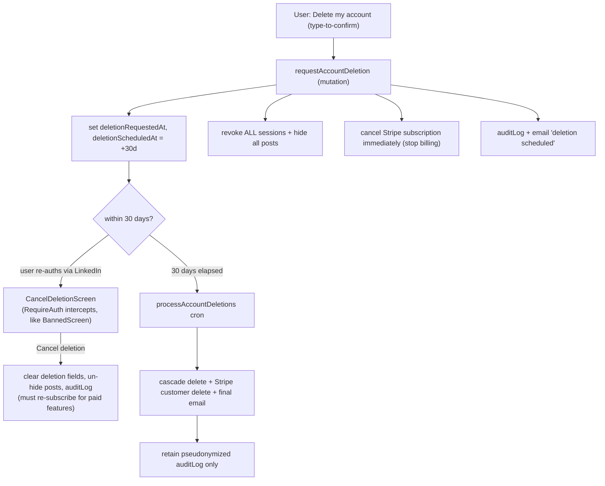

# Privacy & Data Protection Compliance — Design Spec

> **Status:** Approved design (2026-06-15). Ready for implementation planning.
> **Scope:** GDPR, UK GDPR, LGPD (Brazil), and US state privacy laws (CCPA/CPRA + comparable
> state acts).
> **Topic slug:** `privacy-compliance`

---

## 0. Important caveats (read first)

1. **This is not legal advice.** No amount of code makes a product "compliant with every US and
   EU framework." Compliance also requires legal counsel, organizational processes, and business
   decisions. This spec builds the **technical machinery and documentation scaffolding** those
   frameworks require, so counsel can review and sign off. Every generated legal text is marked
   **"DRAFT — requires legal review."**
2. **Human / legal to-dos live outside the code** and are tracked in §9: appointing a privacy
   contact, signing each sub-processor's DPA, confirming the lawful-basis posture, and any
   registration/representative obligations (e.g. ANPD in Brazil, an EU/UK representative if
   required).
3. **Git:** per `CLAUDE.md`, this repo's owner makes all commits. The implementation will **write
   files only** and never run `git commit`/`git push`.
4. **`docs/PLATFORM.md` is canonical** and must be updated in the same change as the code (a new
   "Privacy & Compliance" section), per `CLAUDE.md`.

---

## 1. Decisions locked during brainstorming

| Decision                                       | Choice                                                                                                                                                                                                                                                        |
| ---------------------------------------------- | ------------------------------------------------------------------------------------------------------------------------------------------------------------------------------------------------------------------------------------------------------------- |
| **Program scope**                              | One coherent "Privacy Compliance" spec covering sub-projects **A** (data inventory / ROPA), **B** (data-subject rights), **C** (consent & preferences), **D** (retention & minimization), **F** (legal & transparency artifacts). Built in **4 phases** (§8). |
| **Sub-project E (third-party / scraped data)** | **Removed from launch.** Apify scraping is a test-only integration, **disabled in production**. Its obligations therefore do not apply at launch — subject to the **hard gate** in §4.4.                                                                      |
| **Legal-basis posture**                        | **Hybrid by data type.** Core service processing = legitimate interest / contractual necessity (no consent UI). Explicit consent only for optional/sensitive purposes.                                                                                        |
| **Account deletion**                           | **30-day grace period → hard-delete**, with legally-required billing records retained in **pseudonymized** form. **Self-service** in-app.                                                                                                                     |
| **Stripe on deletion request**                 | **Cancel the subscription immediately** (no billing during grace). Cancelling a pending deletion requires **re-subscribing** for paid features.                                                                                                               |
| **DSR delivery**                               | **Self-service in-app** (replaces the current "email us" model).                                                                                                                                                                                              |
| **Contact channel / notifications**            | **Store the user's email** (already received from LinkedIn OIDC, currently discarded) + add a **transactional email** provider. Email is also passed to Stripe.                                                                                               |
| **Cookies**                                    | **No blocking consent banner** (only strictly-necessary + functional storage exists). Cookie Policy page + a lightweight informational notice. Consent plumbing is built so future analytics can be gated.                                                    |
| **Inactive accounts**                          | **Dormancy auto-deletion enabled.** No login for **24 months** (active subscribers excluded) → 30-day email-warned window → deletion via the standard lifecycle. Threshold is an adjustable config constant.                                                  |
| **Re-consent on policy change**                | **In scope.** A `POLICY_VERSION` bump prompts users to re-acknowledge on next login; consent-based purposes are re-asked.                                                                                                                                     |
| **Business inputs**                            | Bracketed placeholders for now: `[LEGAL_ENTITY_NAME]`, `[BUSINESS_ADDRESS]`, `[GOVERNING_LAW_JURISDICTION]`, `[PRIVACY_CONTACT_EMAIL]`.                                                                                                                       |

---

## 2. Architecture & schema changes (Section 1)

### 2.1 Module layout (follows existing `convex/` conventions)

```
convex/
  privacy/
    export.ts        # data export (access + portability)
    deletion.ts      # 30-day deletion lifecycle
    consent.ts       # consent record/get/check helpers
    retention.ts     # retention-enforcement cron logic
  lib/
    email.ts         # provider-agnostic transactional email wrapper (Resend impl)
    audit.ts         # writeAuditLog helper
app/src/
  pages/
    PrivacyDataPage.tsx       # "Privacy & Data" hub: export, delete, consent
  components/
    DeleteAccountDialog.tsx   # type-to-confirm deletion
    CancelDeletionScreen.tsx  # shown during grace window (RequireAuth interception)
landing/app/
  privacy/page.tsx   # full rewrite
  terms/page.tsx     # rewrite
  cookies/page.tsx   # new
docs/compliance/
  DATA-INVENTORY.md GAP-ASSESSMENT.md SUBPROCESSORS.md
  RETENTION-POLICY.md BREACH-RUNBOOK.md DPA-TEMPLATE.md
```

### 2.2 Schema changes (`convex/schema.ts`)

**New fields on `users`:**

| Field                       | Type                                             | Purpose                                                                      |
| --------------------------- | ------------------------------------------------ | ---------------------------------------------------------------------------- |
| `email`                     | `v.optional(v.string())`                         | Captured from OIDC `email` claim; contact channel for DSR + breach notice    |
| `emailVerified`             | `v.optional(v.boolean())`                        | From OIDC `email_verified`                                                   |
| `deletionRequestedAt`       | `v.optional(v.number())`                         | When the user requested deletion (audit + email)                             |
| `deletionScheduledAt`       | `v.optional(v.number())`                         | Hard-delete due time; **presence = "pending deletion"**                      |
| `deletionReason`            | `v.optional(v.union('user_request','dormancy'))` | Distinguishes user-requested vs dormancy deletion (adapts messaging + audit) |
| `lastLoginAt`               | `v.optional(v.number())`                         | Set on session creation; powers the dormancy check                           |
| `acknowledgedPolicyVersion` | `v.optional(v.string())`                         | Last privacy-policy version the user acknowledged (re-consent)               |

**New tables:**

```
consentRecords            # append-only consent/withdrawal log
  userId: id('users')
  purpose: union('marketing', 'analytics')   # extensible; 'location_enrichment' reserved for future
  granted: boolean
  policyVersion: string
  createdAt: number
  index by_user [userId]
  index by_user_and_purpose [userId, purpose]

dataExportRequests        # async export job tracking
  userId: id('users')
  status: union('pending', 'ready', 'failed', 'expired')
  requestedAt: number
  fileStorageId: optional(id('_storage'))
  expiresAt: optional(number)
  index by_user [userId]

auditLogs                 # accountability (GDPR Art. 5(2))
  actor: union('user', 'admin', 'system')
  actorId: optional(id('users'))
  action: string          # e.g. 'export.requested', 'deletion.scheduled', 'consent.granted'
  targetUserId: optional(id('users'))
  metadata: optional(string)   # JSON string, no secrets
  createdAt: number
  index by_target [targetUserId]
  index by_created [createdAt]
```

**New crons (`convex/crons.ts`):**

- `processAccountDeletions` — daily; hard-deletes accounts past `deletionScheduledAt` (cascade in §3.2).
- `enforceDataRetention` — daily; token nulling, export-file expiry, audit-log purge, rate-limit housekeeping (§4.2).

**Design rationale:**

- Consent is an **append-only log**, not an overwritten boolean, so consent is provable (what, which
  policy version, when, including withdrawals). Current state = latest record per `(userId, purpose)`.
- Deletion is a **scheduled field + cron**, not an inline action — gives the reversible 30-day window
  and keeps the heavy cascade off the request path (same pattern as the existing session/oauth
  cleanup crons).
- `auditLogs` is the one record that **partially survives erasure** — a pseudonymized proof-of-action
  is retained without identifying data.

---

## 3. Data-Subject Rights engine — sub-project B (Section 2)

### 3.1 Right to access & portability — export

- **`privacy/export.ts:requestDataExport`** (public mutation): `requireAuth`; rate-limited **1/day**
  via `lib/rateLimit.ts`; inserts a `dataExportRequests` row (`status:'pending'`); schedules the
  generator; writes an audit log.
- **`generateExport`** (internal action): gathers **only this user's** rows across all tables; builds
  a **machine-readable JSON bundle** (portability = "structured, commonly-used, machine-readable");
  stores it in **Convex file storage**; sets `status:'ready'`, `expiresAt:+7d`; emails a download link.
- **Download**: an authenticated, **owner-only** action returns a short-lived `ctx.storage.getUrl`.
  The link self-expires; `enforceDataRetention` purges the file after 7 days (`status:'expired'`).
- **Bundle contents**: profile (incl. `email`), posts, subscription mirror, consent history, and the
  user's **own** audit entries (`targetUserId == self`, with other actors' identifiers and internal
  metadata redacted — the user is entitled to data _about them_, not the internal admin trail).
  **Excludes** raw secrets (LinkedIn access/refresh tokens — they are the user's _credentials_;
  exposing them is a security risk, not a transparency gain) and **any other user's data**.

### 3.2 Right to erasure — the 30-day deletion lifecycle



**Request handler (`requestAccountDeletion`):** allowed **even for banned users** (erasure cannot be
withheld as punishment — resolve identity with a `resolveSession`-style helper that does not enforce
the ban, not `requireAuth`). Sets `deletionRequestedAt`/`deletionScheduledAt`; revokes all sessions;
hides all posts; **cancels the Stripe subscription immediately**; writes audit log; sends the
"deletion scheduled" email. Idempotent (guards a second request while one is pending).

**Grace window:** reactive `getMe` carries `deletionScheduledAt`; `RequireAuth` swaps in
`CancelDeletionScreen` (the existing `BannedScreen` pattern). Re-auth works because `upsertUser`
patches the existing row by `linkedinId` — **`upsertUser` must NOT clear the deletion fields on
re-login**; only the explicit **Cancel** action clears them (and un-hides posts).

**Hard-delete cron cascade (`processAccountDeletions`):** best-effort, idempotent, batched with
self-reschedule (the `processQueue` pattern). For each user past `deletionScheduledAt`:

| Table / target                                                     | Action                                                                    |
| ------------------------------------------------------------------ | ------------------------------------------------------------------------- |
| `users`                                                            | **Delete** (capture `email` first for the final notice)                   |
| `posts`, `postQueue`                                               | **Delete** (`by_author`)                                                  |
| `subscriptions`                                                    | **Delete** our mirror (`by_user`); Stripe retains actual invoices for tax |
| `sessions`                                                         | Delete stragglers (`by_userId`)                                           |
| `rateLimits`, `featuredPostUsage`, `planLimits` (contact override) | **Delete** (`by_user*`)                                                   |
| `consentRecords`, `dataExportRequests` + stored files              | **Delete** (+ `ctx.storage.delete`)                                       |
| `auditLogs`                                                        | **Retain, pseudonymized** — proof-of-deletion event, no PII               |
| **Stripe customer**                                                | **External delete** (best-effort, audited); invoices retained by Stripe   |

After the cascade, send the "deletion completed" email (using the captured address), then the local
record is gone. External-call and email failures are logged + audited and **must not abort** the
local cascade.

### 3.3 Right to rectification

Already largely covered by `updateProfile` (industry/country) + `setPublicIdentifier`. LinkedIn-sourced
fields (name/headline/picture) are corrected "at LinkedIn → Refresh"; this is **documented** rather
than made editable, since the source of truth is LinkedIn.

### 3.4 Right to object / restrict

Wired into consent (§4.1): withdrawing `marketing` stops marketing; future analytics likewise. Core
legitimate-interest processing cannot be "objected away" without leaving the service — stated honestly
in the privacy notice.

### 3.5 Dormancy-triggered deletion (retention)

`lastLoginAt` is set on every session creation. The `enforceDataRetention` cron treats an account with
`lastLoginAt` older than the dormancy threshold (**default 24 months**, a config constant) **and no
active or trialing subscription** as dormant: it sets `deletionScheduledAt = +30d`,
`deletionReason = 'dormancy'`, and sends a **dormancy-warning email** ("log in within 30 days or your
account will be removed").

Unlike a user-initiated request, dormancy does **not** immediately revoke sessions, hide posts, or
cancel Stripe (the account is already inactive, and active subscribers are excluded). If the user logs
in during the window, `lastLoginAt` refreshes and `RequireAuth` shows the reactivation
`CancelDeletionScreen` (its copy adapts to `deletionReason`); "keep my account" clears
`deletionScheduledAt`/`deletionReason`. Otherwise `processAccountDeletions` runs the **same cascade**
as §3.2. The threshold and the active-subscriber exclusion are config constants documented in the ROPA.

---

## 4. Consent & retention — sub-projects C + D (Section 3)

### 4.1 Consent model (hybrid)

A new **"Privacy & Data"** page in Settings consolidates export, delete, consent toggles, and links to
the legal pages.

| Processing                                        | Legal basis                    | UI at launch                                       |
| ------------------------------------------------- | ------------------------------ | -------------------------------------------------- |
| Profile, feed, engagement, manual post submission | Legitimate interest / contract | **No consent UI** — transparency + ROPA            |
| **Marketing email** (future)                      | **Consent**                    | Toggle, default **OFF**                            |
| **Analytics** (future)                            | **Consent**                    | Toggle, default **OFF**                            |
| ~~Location enrichment~~                           | (Apify disabled at launch)     | **Dropped at launch**; purpose reserved for future |

- Each toggle writes an append-only `consentRecords` row (`granted`, `policyVersion`, `createdAt`).
- **`privacy/consent.ts`**: `recordConsent(purpose, granted)`, `getConsents(userId)`,
  `hasConsent(ctx, userId, purpose)`.
- **`POLICY_VERSION`** constant (e.g. `'2026-06-15'`) stamped on every record; schema supports a
  re-consent prompt when it bumps (prompt UI may be a later phase).
- Because both consent purposes are future features, **the launch Privacy & Data page may show no live
  toggles** (or "coming soon" placeholders). The **consent infrastructure is the deliverable**;
  toggles activate with their features.

### 4.2 Cookies / local storage

Only `sessionStorage.sessionToken` (auth = strictly necessary) and `localStorage.i18nextLng`
(language = functional) are used — both exempt from consent under ePrivacy. Deliverables: a **Cookie
Policy page** + a lightweight, dismissible first-visit **informational notice** (not accept/reject).
The consent plumbing means analytics, if added later, can be gated before it loads.

### 4.3 Retention & minimization (D)

Enforced by `enforceDataRetention` cron + config constants (the `planLimits` DEFAULTS pattern):

| Data                                     | Retention                                                                              | Mechanism                                                                |
| ---------------------------------------- | -------------------------------------------------------------------------------------- | ------------------------------------------------------------------------ |
| Expired LinkedIn tokens                  | Null out once past `tokenExpiresAt`                                                    | cron clears `linkedinAccessToken`/`linkedinRefreshToken`                 |
| `dataExportRequests` files               | **7 days**                                                                             | cron deletes file, marks `expired`                                       |
| `auditLogs`                              | **24 months**                                                                          | cron purge                                                               |
| Stale `rateLimits` rows                  | Housekeeping purge                                                                     | cron                                                                     |
| `consentRecords`                         | Life of account (legal proof)                                                          | retained                                                                 |
| Posts                                    | Life of account (they are the product)                                                 | deleted with account                                                     |
| Host/server logs (Convex/Vercel/Railway) | Per-platform config                                                                    | **documented** in ROPA                                                   |
| **Inactive accounts**                    | **24 months** no login (active subscribers excluded) → 30-day warned window → deletion | dormancy branch of `enforceDataRetention` (§3.5); requires `lastLoginAt` |

Minimization notes: email is newly stored, but justified — it is the data needed to _honor_ the other
rights (breach notice, DSR confirmations). The export bundle excludes secrets. The ROPA records the
minimization stance.

### 4.4 Apify — dormant integration **hard gate**

Apify post-sync and profile-scrape are **test-only and disabled for launch**. The design requires:

- `apifyEnabled`, `apifySyncEnabled`, `apifyProfileScrapeEnabled` **default OFF in production**;
  `APIFY_*` env vars unset in prod.
- Posts enter **only** via manual submission (`submitPost`).
- The ROPA documents Apify as a **dormant, available** integration — **not** a current sub-processor,
  **not** disclosed in the public privacy policy.
- **HARD GATE:** the day Apify is switched on in production, the privacy-policy disclosure + legal
  basis (likely legitimate interest with a balancing test) + sub-processor entry + DPA **must be
  added in the same change.**

### 4.5 Re-consent on privacy-policy change

A `POLICY_VERSION` constant identifies the current privacy policy; `users.acknowledgedPolicyVersion`
records the version each user last acknowledged (set to the current version at signup, so new users
are never prompted).

`RequireAuth` interception order: **banned → pending-deletion → policy re-acknowledgment → app**. When
`acknowledgedPolicyVersion !== POLICY_VERSION`, a `PolicyUpdateModal` summarizes what changed;
acknowledging sets `acknowledgedPolicyVersion = POLICY_VERSION` and writes an audit log. For any
**consent-based** purpose whose terms materially changed, the modal **re-asks** and writes fresh
`consentRecords` rows under the new version. The prompt blocks only until acknowledged — it is not a
permanent lockout.

---

## 5. Documentation, legal artifacts & email — sub-projects A + F (Section 4)

### 5.1 Documentation foundation (`docs/compliance/`)

| Deliverable           | Contents                                                                                                                                                                                                                                                                                                                                                             |
| --------------------- | -------------------------------------------------------------------------------------------------------------------------------------------------------------------------------------------------------------------------------------------------------------------------------------------------------------------------------------------------------------------- |
| `DATA-INVENTORY.md`   | **ROPA** (Art. 30): per activity — data, data subjects, purpose, **legal basis**, sub-processors, retention, **international transfers**, security. Notes post content may contain third-party data (basis: user authored/published it publicly; legitimate interest). Records the Apify dormant status + the §4.4 hard gate, and the §3.5 dormancy-deletion policy. |
| `GAP-ASSESSMENT.md`   | Current-vs-required across GDPR / UK GDPR / LGPD / CCPA-CPRA + comparable US state laws; residual gaps (LinkedIn-ToS scraping risk).                                                                                                                                                                                                                                 |
| `SUBPROCESSORS.md`    | LinkedIn, Stripe, Convex, Vercel, Railway, Cloudflare, **Resend** (Apify excluded while dormant) — data shared, location, **transfer mechanism (SCCs / adequacy)**, DPA link.                                                                                                                                                                                        |
| `RETENTION-POLICY.md` | The §4.3 schedule incl. the §3.5 dormancy policy.                                                                                                                                                                                                                                                                                                                    |
| `BREACH-RUNBOOK.md`   | Detection → risk assessment → **72-hour authority notice** (Art. 33) → **data-subject notice** (Art. 34 / LGPD Art. 48) + notification templates.                                                                                                                                                                                                                    |
| `DPA-TEMPLATE.md`     | Processing-agreement template for records / B2B customers.                                                                                                                                                                                                                                                                                                           |

### 5.2 User-facing legal pages (`landing/app/`)

- **`/privacy` (full rewrite)** — controller identity & contact `[placeholders]`; data + **sources**
  (LinkedIn OIDC incl. email, user-submitted post URLs, Stripe — **no scraping disclosure**);
  purposes + **legal bases** (hybrid); sub-processors; **international transfers**; retention; **all
  data-subject rights + how to exercise them in-app**; **CCPA/CPRA** block ("we do **not** sell or
  share," right to know/delete/opt-out, non-discrimination); **LGPD** rights (Art. 18) + ANPD
  reference; right to lodge a complaint; **age requirement (16+)**. Stamped `POLICY_VERSION`.
- **`/terms` (rewrite)** — existing grants + data-processing references, acceptable use, LinkedIn-ToS
  acknowledgment, governing law `[placeholder]`.
- **`/cookies` (new)** — essential-storage-only policy.
- **Age affirmation (16+)** — partly inherited from LinkedIn's own age floor; an explicit affirmation
  is added to ToS acceptance.

All legal text is generated as **DRAFT — requires legal review** with `[BRACKETED]` business inputs.

### 5.3 Email & breach infrastructure

- **`convex/lib/email.ts`** — provider-agnostic wrapper, **Resend** implementation. New env:
  `RESEND_API_KEY`, `EMAIL_FROM`.
- **Capture email**: `upsertUser` stores `email`/`emailVerified` from the OIDC userinfo it already
  fetches; `billing.ts` passes the real email to Stripe (currently `email: undefined`).
- **Templates**: `export-ready`, `deletion-scheduled`, `deletion-completed`, `breach-notice`.
- The stored email channel makes **Art. 34 breach notification** actually executable.

### 5.4 Why F comes last

A privacy policy promising "export and delete in Settings" is false until B/C/D exist — and a false
privacy statement is itself a violation. Build the machinery, then describe it.

---

## 6. Error handling

- Reads soft-fail (`null`/`[]`), writes hard-fail (`throw Error`) — matches existing conventions.
- Deletion cron: best-effort, **idempotent**, batched with self-reschedule; external Stripe + email
  calls are non-blocking (failure logged + audited, never aborts the cascade).
- Export: guarded against double-generation; owner-scoped; rate-limited.
- Consent writes hard-fail.
- In-flight events fail safe: Stripe webhooks / Apify paths already guard `if (!user) return`, and
  `getActiveSubscribers` excludes deleted/pending users.

---

## 7. Testing (Vitest — existing setup)

- **convex**:
  - export — bundle completeness, **owner-scoping**, **no tokens/secrets leaked**, file expiry.
  - deletion — cascade covers every table, idempotency, **banned user can still delete**, grace
    cancel restores + un-hides, `upsertUser` does not clear deletion fields.
  - consent — `recordConsent`/`getConsents`/`hasConsent`, latest-record-wins.
  - retention cron — token nulling, export-file expiry, audit purge.
  - email wrapper — mocked send.
  - dormancy — warning sets `deletionScheduledAt` + `reason`, active subscribers excluded, login reactivates.
  - re-consent — `POLICY_VERSION` bump triggers the prompt; acknowledgment records the version; changed consent purposes re-asked.
- **app**: Privacy & Data page (export states, delete confirm), `CancelDeletionScreen` (copy adapts to
  `deletionReason`), `PolicyUpdateModal` (re-consent on version bump), `RequireAuth` interception order
  (banned → pending-deletion → re-ack), consent toggles.
- **Defensive test:** assert **every table carrying `userId`/`authorId` is covered by the deletion
  cascade**, so a future new table can't silently orphan personal data.

---

## 8. Security

- Export download links: short-lived, **owner-only**, auto-expiring; bundle excludes secrets; export
  rate-limited 1/day (anti-DoS on generation).
- Deletion path allows banned users but still requires a valid session.
- `auditLogs` are internal/admin-only, pseudonymized on deletion, retention-limited.
- Builds on existing strong posture (server-side tokens, CSRF, SSRF guard, generic errors).

---

## 9. Rollout phases (input to writing-plans)

1. **Foundations** — schema changes (`users` fields + 3 tables); `lib/email.ts` + Resend; capture
   email in `upsertUser` + pass to Stripe; `lib/audit.ts`. _Enables everything else._
2. **DSR (B)** — export (request + generate + download + 7-day expiry); deletion lifecycle
   (`requestAccountDeletion`, `cancelAccountDeletion`, `processAccountDeletions` cron); Privacy & Data
   page (export + delete); `CancelDeletionScreen` + `RequireAuth` interception; emails
   (`export-ready`, `deletion-scheduled`, `deletion-completed`).
3. **Consent & retention (C + D)** — `consentRecords` + `privacy/consent.ts` + Settings toggles
   (marketing/analytics placeholders); cookie notice + `/cookies` page; `enforceDataRetention` cron
   **incl. the dormancy branch** (§3.5, needs `lastLoginAt`); **re-consent / policy-acknowledgment
   prompt** (§4.5, needs `acknowledgedPolicyVersion` + `PolicyUpdateModal`).
4. **Docs & legal (A + F)** — all `docs/compliance/` deliverables; rewritten `/privacy` + `/terms`;
   new `/cookies`; age affirmation; `breach-notice` template.

**Every phase updates `docs/PLATFORM.md`** with/within a new "Privacy & Compliance" section
(+ TOC entry + Mermaid for the deletion lifecycle), per `CLAUDE.md`.

---

## 10. Human / legal to-dos (outside code)

- Provide business inputs: `[LEGAL_ENTITY_NAME]`, `[BUSINESS_ADDRESS]`,
  `[GOVERNING_LAW_JURISDICTION]`, `[PRIVACY_CONTACT_EMAIL]`.
- Legal review of all DRAFT texts.
- Sign each sub-processor's DPA (Stripe, Convex, Vercel, Railway, Cloudflare, Resend).
- Confirm the hybrid lawful-basis posture with counsel.
- Assess registration/representative duties (ANPD; EU/UK representative if applicable).
- Confirm Apify stays disabled in production (or trigger the §4.4 hard gate).

---

## 11. Out of scope (this effort)

- Active Apify scraping + its disclosures (gated by §4.4).
- LinkedIn-ToS scraping risk (a platform/contract risk, not a data-protection control).
- DPO appointment tooling and any external privacy-portal integrations.

```

```
