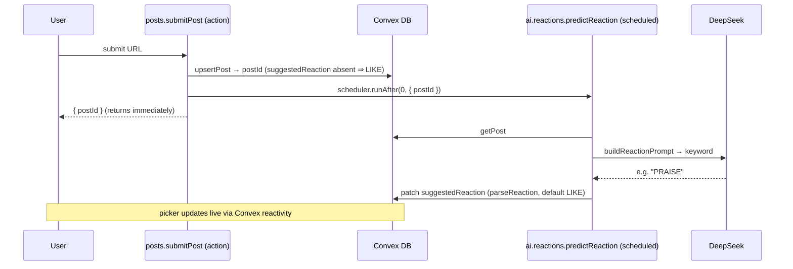

# AI Reaction Prediction & AI Comment Drafting — Design Spec

**Date:** 2026-06-19
**Status:** Approved (design)
**Feature:** Use DeepSeek (`deepseek-v4-flash`) to (1) predict the most-likely LinkedIn reaction for a
submitted post and store it, surfaced as a pre-selected reaction picker, and (2) draft a comment on demand,
in a user-chosen language, prefilled into the comment box for the user to edit before posting.

---

## Compliance gate (read first)

DeepSeek is a **new third-party sub-processor** (and is China-hosted). The reaction prompt sends post content;
the comment prompt additionally sends the **post author's name/headline**. This is new personal-data processing
that the privacy program (see `docs/PLATFORM.md` §13B and `docs/compliance/`) does **not** yet cover.

**Posture — identical to the Apify dormant-gate pattern:** the integration is **gated behind the
`DEEPSEEK_API_KEY` env var**, which is set **only on the local/dev deployment** during the test phase. With no
key (the production default), reaction prediction silently no-ops to `LIKE` and the **Generate** button surfaces
an "AI drafting is unavailable" message. Therefore this feature ships **no always-on processing in production**
and adds **no new disclosure obligation at launch**.

**Before `DEEPSEEK_API_KEY` may be set in production**, the same checklist as any other sub-processor applies:
ROPA entry, sub-processor list + privacy-policy disclosure, legal-basis/data-region review, and a DPA with
DeepSeek. This spec **builds the feature**; it does **not** authorize production enablement. Pre-launch, dev is
disposable with no production data, so test-phase use on dev is in scope.

---

## Decisions

| Question                                                                                                           | Answer                                                                                                                                                                                                |
|--------------------------------------------------------------------------------------------------------------------|-------------------------------------------------------------------------------------------------------------------------------------------------------------------------------------------------------|
| What does the stored reaction drive?                                                                               | A **reaction picker** on each post, **pre-selected** to the AI suggestion; the viewer confirms or changes before it's sent.                                                                           |
| Reaction enum mismatch (`reactToPost` uses `CELEBRATE/SUPPORT/FUNNY/LOVE/INSIGHTFUL`; spec uses the real API enum) | **Align to the real `/rest/reactions` API enum** `LIKE/PRAISE/EMPATHY/INTEREST/APPRECIATION/ENTERTAINMENT` and fix `reactToPost`. One source of truth; friendly UI labels.                            |
| When does reaction prediction run?                                                                                 | **Async after the upsert** — `submitPost` schedules an internal action that calls DeepSeek and patches the post. Submit never waits on AI.                                                            |
| How does the comment draft appear?                                                                                 | **Explicit "Generate with AI" button** in the comment box (+ **Regenerate**), not auto on open.                                                                                                       |
| Comment language — selectable set                                                                                  | **All ISO 639-1 world languages** + an **"Auto — match the post"** option.                                                                                                                            |
| Comment language — default                                                                                         | **`auto`** (write in the post's language). A Settings-level default exists and itself defaults to `auto`; the per-comment picker defaults to the saved setting; per-comment changes never write back. |
| Which language does `generateComment` use?                                                                         | The **comment box's** selected value → falls back to the saved setting → `auto`.                                                                                                                      |
| Comment persistence                                                                                                | **None.** Comments are generated fresh per user per click (identical reused text would trip LinkedIn spam detection). Only the reaction is stored.                                                    |
| Reaction prediction scope                                                                                          | **Manual `submitPost` only** (where `article` enrichment exists). Synced/legacy posts default to `LIKE`.                                                                                              |

---

## Canonical reaction model

`reactToPost` today sends UI display words (`CELEBRATE/SUPPORT/FUNNY/LOVE/INSIGHTFUL`) that are **not** valid
`/rest/reactions` `reactionType` values — a latent bug (untested because reactions need `r_member_social` and
there's no prod data). The fix makes the **API enum** the single stored/predicted/sent value, with UI labels
for display only.

| API value (stored + sent to LinkedIn + AI output) | UI label (i18n) | Emoji |
|---------------------------------------------------|-----------------|-------|
| `LIKE`                                            | Like            | 👍    |
| `PRAISE`                                          | Celebrate       | 👏    |
| `EMPATHY`                                         | Love            | ❤️    |
| `INTEREST`                                        | Insightful      | 💡    |
| `APPRECIATION`                                    | Support         | 🤝    |
| `ENTERTAINMENT`                                   | Funny           | 😄    |

### `convex/lib/reactions.ts` (new — single source of truth)

```typescript
import { type Infer, v } from 'convex/values'

export const reactionValidator = v.union(
  v.literal('LIKE'),
  v.literal('PRAISE'),
  v.literal('EMPATHY'),
  v.literal('INTEREST'),
  v.literal('APPRECIATION'),
  v.literal('ENTERTAINMENT')
)
export type Reaction = Infer<typeof reactionValidator>

// UI metadata, co-located so labels/emoji can never reference a non-existent reaction.
export const REACTIONS: ReadonlyArray<{ value: Reaction; emoji: string; labelKey: string }> = [
  { value: 'LIKE', emoji: '👍', labelKey: 'reactions.like' },
  { value: 'PRAISE', emoji: '👏', labelKey: 'reactions.celebrate' },
  { value: 'EMPATHY', emoji: '❤️', labelKey: 'reactions.love' },
  { value: 'INTEREST', emoji: '💡', labelKey: 'reactions.insightful' },
  { value: 'APPRECIATION', emoji: '🤝', labelKey: 'reactions.support' },
  { value: 'ENTERTAINMENT', emoji: '😄', labelKey: 'reactions.funny' }
]

const VALID = new Set<string>(REACTIONS.map(r => r.value))

/**
 * Coerce a raw model reply into a valid reaction. An exact one-word reply (the instructed
 * format) wins; otherwise the first keyword appearing as a whole word wins; anything else
 * (empty, prose, unknown) defaults to LIKE. Pure — unit-tested.
 */
export function parseReaction(raw: string): Reaction {
  const text = (raw ?? '').trim().toUpperCase()
  for (const r of REACTIONS) if (text === r.value) return r.value // clean one-word answer
  for (const r of REACTIONS) if (new RegExp(`\\b${r.value}\\b`).test(text)) return r.value // noisy answer
  return 'LIKE'
}
```

> Whole-word (`\b`) matching, not bare `includes`, so a clean `PRAISE` and a noisy `"Reaction: PRAISE."` both
> resolve, while `"unlikely"` can't false-match `LIKE`. On any ambiguity the safe `LIKE` default holds.

---

## Data model (`convex/schema.ts`)

Two optional widenings (pre-launch, no prod data — no backfill needed):

```typescript
// posts:
suggestedReaction: v.optional(reactionValidator), // AI-predicted; absent ⇒ UI treats as LIKE

// users:
commentLanguage: v.optional(v.string()), // ISO 639-1 code or 'auto'; absent ⇒ resolves to 'auto'
```

`commentLanguage` is a free `v.string()` validated against the language set **in the handler** — matching the
existing `users.country` / `users.industry` pattern (a `v.union` of ~180 literals would bloat the validator).

---

## Comment languages (`convex/lib/languages.ts`, new)

Mirrors `convex/lib/profileOptions.ts` (`COUNTRY_CODES` / `countryLabel`):

```typescript
// Full ISO 639-1 table — generated from the standard. Native + English names for display.
export const LANGUAGE_CODES: ReadonlyArray<{ code: string; name: string; native: string }> = [
  { code: 'en', name: 'English', native: 'English' },
  { code: 'es', name: 'Spanish', native: 'Español' },
  { code: 'pt', name: 'Portuguese', native: 'Português' },
  { code: 'fr', name: 'French', native: 'Français' },
  // …all ISO 639-1 languages…
]

export const AUTO_LANGUAGE = 'auto' as const
const CODES = new Set<string>(LANGUAGE_CODES.map(l => l.code))

export function isValidCommentLanguage(value: string): boolean {
  return value === AUTO_LANGUAGE || CODES.has(value)
}

/** Saved setting → a valid value, defaulting to 'auto'. Pure; shared by server + both selects. */
export function resolveCommentLanguage(stored: string | undefined): string {
  return stored && isValidCommentLanguage(stored) ? stored : AUTO_LANGUAGE
}

/** Display label for a code; native name (falls back to English name, then the raw code). */
export function languageLabel(code: string): string {
  const l = LANGUAGE_CODES.find(x => x.code === code)
  return l ? l.native : code
}
```

Default chain: **per-comment select → saved `commentLanguage` → `auto`** — each layer overrides the one below
without mutating it. `auto` is just another value in the same validator and select; it only branches in one
prompt line. (`primaryLocale` is **not** in this chain; it still seeds the UI language only.)

---

## DeepSeek client (`convex/ai/deepseek.ts`, new)

Single seam, mirroring `convex/linkedin/client.ts` `callMemberApi` (auth + log-real-error→throw-sanitized).
Uses `fetch()`, available in the default Convex runtime — **no `"use node"`**.

```typescript
type ChatMessage = { role: 'system' | 'user'; content: string }

export async function callDeepSeek(messages: ChatMessage[], opts: { action: string }): Promise<string> {
  const apiKey = process.env.DEEPSEEK_API_KEY
  if (!apiKey) {
    console.error('DEEPSEEK_API_KEY not set')
    throw new Error(`Failed to ${opts.action}. AI is not configured.`)
  }
  const model = process.env.DEEPSEEK_MODEL ?? 'deepseek-v4-flash'
  const res = await fetch('https://api.deepseek.com/chat/completions', {
    method: 'POST',
    headers: { Authorization: `Bearer ${apiKey}`, 'Content-Type': 'application/json' },
    body: JSON.stringify({ model, messages, stream: false })
  })
  if (!res.ok) {
    console.error(`DeepSeek ${opts.action} failed: ${res.status}`, await res.text())
    throw new Error(`Failed to ${opts.action}. Please try again.`)
  }
  const data = await res.json()
  const text = data?.choices?.[0]?.message?.content
  if (typeof text !== 'string' || !text.trim()) {
    console.error(`DeepSeek ${opts.action}: empty/invalid response`)
    throw new Error(`Failed to ${opts.action}. Please try again.`)
  }
  return text
}
```

**Env vars** (added to §16 + the convex `.env.example`):

| Variable           | Required                                        | Purpose                                                       |
|--------------------|-------------------------------------------------|---------------------------------------------------------------|
| `DEEPSEEK_API_KEY` | – (AI no-ops if unset; **the production gate**) | DeepSeek bearer token. Set only on dev during the test phase. |
| `DEEPSEEK_MODEL`   | – (default `deepseek-v4-flash`)                 | Model override.                                               |

---

## Prompts (`convex/ai/prompts.ts`, new — pure, unit-tested)

`deepseek-v4-flash` is **text-only** (no vision): media is referenced by URL with an explicit "you cannot view
it" note. Long fields are truncated to bound cost/context (`REACTION_MAX = 1500`, `COMMENT_ARTICLE_MAX = 2000`).

### `buildReactionPrompt(post): ChatMessage[]`

```
SYSTEM:
You predict the single most fitting LinkedIn reaction a thoughtful professional would give to a post.
Reply with ONLY one of these keywords — nothing else, no punctuation, no explanation:

LIKE — general agreement, acknowledgement, or support; the safe default.
PRAISE — celebrating an announcement, milestone, promotion, new job, award, or successful launch.
EMPATHY — a heartwarming, caring, or moving post you appreciate or love.
INTEREST — the post shares a useful insight, idea, tip, or makes you think.
APPRECIATION — supporting someone through a challenge, setback, or vulnerable moment.
ENTERTAINMENT — the post is funny, witty, or light-hearted.

If you are unsure, reply LIKE.

USER:
Post:
{content, truncated to REACTION_MAX}

{if post.article}Linked article — "{article.title}": {article.summary || article.text excerpt}{/if}

Most fitting reaction:
```

### `buildCommentPrompt(post, language): ChatMessage[]`

```
SYSTEM:
You help a LinkedIn user write a genuine, useful comment on someone else's post. Follow every rule:
- At most 2 short paragraphs. Concise.
- Add something of value: a specific insight, a thoughtful question, or a genuine reflection — not empty praise.
- Sound like a real professional speaking in the first person. Warm, not sycophantic.
- No hashtags. Do not @-mention anyone. Avoid emojis (at most one, only if it truly fits).
- Do not restate or quote the post at length.
- {LANGUAGE LINE}
Reply with ONLY the comment text — no preamble, no surrounding quotation marks.

  LANGUAGE LINE when language === 'auto':
    Write the comment in the same language as the post below.
  LANGUAGE LINE otherwise:
    Write the comment in {languageLabel(language)} ({language}).

USER:
Post author: {post.author?.name}{ — headline if present}
Post:
{content}

{if post.article}Linked article — "{article.title}"{ by article.author}:
{article.summary}
{article.text, truncated to COMMENT_ARTICLE_MAX}{/if}

{if post.mediaUrls.length}The post also includes media you cannot view — infer only from context:
{mediaUrls joined}{/if}

Write the comment now.
```

> The action passes a **post snapshot** (content, article, mediaUrls, author name/headline) so the builders stay
> pure and testable. Author name/headline come from a join the action performs before building the prompt.

---

## Backend functions

### Reaction prediction (`convex/ai/reactions.ts`, new)

```typescript
import { internalAction, internalMutation } from '../_generated/server'
import { internal } from '../_generated/api'
import { v } from 'convex/values'
import { reactionValidator, parseReaction } from '../lib/reactions'
import { buildReactionPrompt } from './prompts'
import { callDeepSeek } from './deepseek'

// Best-effort: any failure (incl. missing API key) is swallowed; the post keeps its default LIKE.
export const predictReaction = internalAction({
  args: { postId: v.id('posts') },
  handler: async (ctx, { postId }) => {
    const post = await ctx.runQuery(internal.interactions.getPost, { postId })
    if (!post) return
    try {
      const raw = await callDeepSeek(buildReactionPrompt(post), { action: 'predict reaction' })
      const reaction = parseReaction(raw)
      await ctx.runMutation(internal.ai.reactions.setSuggestedReaction, { postId, reaction })
    } catch (e) {
      console.error('predictReaction failed (post keeps default LIKE):', e)
    }
  }
})

export const setSuggestedReaction = internalMutation({
  args: { postId: v.id('posts'), reaction: reactionValidator },
  handler: async (ctx, { postId, reaction }) => {
    await ctx.db.patch(postId, { suggestedReaction: reaction })
  }
})
```

`internal.interactions.getPost` already exists. The same-file `ctx.runMutation` target needs a return-type
annotation per the Convex circularity guideline.

### `submitPost` hook (`convex/posts.ts`)

After the successful upsert returns `postId`, and before returning, schedule the prediction (covers the normal
and admin-override paths identically):

```typescript
await ctx.scheduler.runAfter(0, internal.ai.reactions.predictReaction, { postId })
```

### Comment generation (`convex/ai/comments.ts`, new)

```typescript
export const generateComment = action({
  args: { sessionToken: v.string(), postId: v.id('posts'), language: v.optional(v.string()) },
  handler: async (ctx, { sessionToken, postId, language }): Promise<{ comment: string }> => {
    const user = (await requireAuthAction(ctx, sessionToken)) as Doc<'users'>
    if (!user.isAdmin) {
      await ctx.runMutation(internal.lib.rateLimit.checkAndIncrement, {
        userId: user._id, action: 'generateComment', maxPerHour: 30
      })
    }
    const post = await ctx.runQuery(internal.interactions.getPost, { postId })
    if (!post) throw new Error('Post not found')
    const author = await ctx.runQuery(internal.users.getPublicAuthor, { userId: post.authorId }) // name/headline

    const lang = resolveCommentLanguage(language ?? user.commentLanguage)
    const text = await callDeepSeek(buildCommentPrompt({ ...post, author }, lang), { action: 'generate comment' })
    return { comment: text.trim() }
  }
})
```

A small `internal.users.getPublicAuthor` query returns `{ name, headline }` (no token fields) for the prompt. On
any DeepSeek failure (incl. missing key) the sanitized error propagates to the comment box.

### Settings mutation (`convex/users.ts`)

```typescript
export const setCommentLanguage = mutation({
  args: { sessionToken: v.string(), commentLanguage: v.string() },
  handler: async (ctx, { sessionToken, commentLanguage }) => {
    const user = await requireAuth(ctx, sessionToken)
    if (!isValidCommentLanguage(commentLanguage)) throw new Error('Unsupported language')
    await ctx.db.patch(user._id, { commentLanguage })
  }
})
```

`getMe` adds `commentLanguage` to its returned safe-profile shape.

### Feed (`convex/feed.ts`)

`getFeed` adds `suggestedReaction` to each projected post so the picker can pre-select it.

### Rate limiting (`convex/lib/rateLimit.ts`)

No code change — the limiter is keyed on an arbitrary action string. New budget: **`generateComment` 30/hour**,
admins exempt (consistent with `commentOnPost` / `reactToPost`). Documented in §11.

### `reactToPost` fix (`convex/interactions.ts`)

Replace the inline 6-literal union with `reactionType: reactionValidator` (imported). The request body already
forwards `reactionType` verbatim, so it now sends valid API values. No other logic changes.



---

## Frontend

### Reaction picker (`app/src/components/PostCard.tsx`)

- `PostWithAuthor` gains `suggestedReaction?: Reaction`.
- The single 👍 button becomes a **picker**: clicking it opens a small popover (reuse
  `app/src/components/ui/popover.tsx`) with the six `REACTIONS` in a row (emoji + i18n label). The option equal
  to `post.suggestedReaction ?? 'LIKE'` is **pre-highlighted** (ring + `aria-pressed`). The button's resting face
  shows that suggested reaction's emoji/label.
- Selecting an option calls `onReact(post._id, reaction)` and closes; keyboard-navigable, each option a real
  `<button>`.

### Feed (`app/src/pages/FeedPage.tsx`)

- `onReact` signature becomes `(id, reactionType)`; drop the hard-coded `'LIKE'`, forward the chosen reaction to
  `api.interactions.reactToPost`. (CommentBox seeds its own language — no new props.)

### Comment box (`app/src/components/CommentBox.tsx`)

- Reads `api.users.getMe` for `commentLanguage`. Adds a compact **language combobox** (reuse
  `VirtualizedCombobox`) initialised to `resolveCommentLanguage(me.commentLanguage)`, with **"Auto — match the
  post"** pinned at the top, then all `LANGUAGE_CODES`. Per-comment only — never writes back to the setting.
- Add **Generate with AI** (and, once a draft exists, **Regenerate**). On click: call
  `api.ai.comments.generateComment({ postId, sessionToken, language })`; show a spinner; on success **replace**
  the textarea contents with the draft (user then edits freely); on error show the sanitized message inline.
- Submitting still calls the unchanged `commentOnPost`.

### Settings (`app/src/pages/SettingsPage.tsx`)

- New **"AI Comments"** section (own card + own Save, mirroring the "LinkedIn Identity" section): a language
  `VirtualizedCombobox` (Auto pinned + all languages) seeded from `resolveCommentLanguage(me.commentLanguage)`,
  saved via `api.users.setCommentLanguage`. Mirrors the dirty-state/save pattern already on the page.

### i18n (`app/src/i18n/locales/{en,pt,es}.json`)

New keys: `reactions.{like,celebrate,love,insightful,support,funny}`,
`comment.{generate,regenerate,generating,language}`, `settings.aiComments*`, and the **"Auto — match the post"**
label. Language *names* in the picker come from `languageLabel` (native), not i18n.

---

## Files changed

| File                                   | Change                                                                                                    |
|----------------------------------------|-----------------------------------------------------------------------------------------------------------|
| `convex/schema.ts`                     | `posts.suggestedReaction`, `users.commentLanguage` (both optional)                                        |
| `convex/lib/reactions.ts`              | **New** — `reactionValidator`, `Reaction`, `REACTIONS`, `parseReaction`                                   |
| `convex/lib/languages.ts`              | **New** — ISO 639-1 `LANGUAGE_CODES`, `isValidCommentLanguage`, `resolveCommentLanguage`, `languageLabel` |
| `convex/ai/deepseek.ts`                | **New** — `callDeepSeek` client seam                                                                      |
| `convex/ai/prompts.ts`                 | **New** — `buildReactionPrompt`, `buildCommentPrompt` (pure)                                              |
| `convex/ai/reactions.ts`               | **New** — `predictReaction` (internalAction) + `setSuggestedReaction` (internalMutation)                  |
| `convex/ai/comments.ts`                | **New** — `generateComment` (action)                                                                      |
| `convex/interactions.ts`               | `reactToPost` validator → `reactionValidator` (bug fix)                                                   |
| `convex/posts.ts`                      | `submitPost`: schedule `predictReaction` after upsert                                                     |
| `convex/users.ts`                      | `setCommentLanguage` mutation; `getPublicAuthor` internal query; `getMe` returns `commentLanguage`        |
| `convex/feed.ts`                       | `getFeed` returns `suggestedReaction`                                                                     |
| `app/src/components/PostCard.tsx`      | Reaction picker; `onReact(id, reaction)`; `suggestedReaction` on type                                     |
| `app/src/pages/FeedPage.tsx`           | Forward chosen reaction; seed CommentBox language                                                         |
| `app/src/components/CommentBox.tsx`    | Generate/Regenerate + language combobox + prefill                                                         |
| `app/src/pages/SettingsPage.tsx`       | "AI Comments" section + language combobox + save                                                          |
| `app/src/i18n/locales/{en,pt,es}.json` | Reaction labels, comment generate/language strings, settings strings, Auto label                          |
| `convex/.env.example`                  | `DEEPSEEK_API_KEY`, `DEEPSEEK_MODEL`                                                                      |
| `docs/PLATFORM.md`                     | New "AI Reaction & Comment Assistance" section (+ ToC + Mermaid); §5, §10, §11, §14, §16 updates          |

### Tests (follow repo convention — pure-logic units, **no `convex-test`**)

| File                                   | Coverage                                                                                                                              |
|----------------------------------------|---------------------------------------------------------------------------------------------------------------------------------------|
| `convex/lib/reactions.test.ts`         | **New** — `parseReaction`: clean keyword, noisy/prose, empty, unknown → `LIKE`                                                        |
| `convex/lib/languages.test.ts`         | **New** — `resolveCommentLanguage` (unset→auto, valid passthrough, invalid→auto, `auto`), `isValidCommentLanguage`, `languageLabel`   |
| `convex/ai/prompts.test.ts`            | **New** — `buildReactionPrompt` (with/without article), `buildCommentPrompt` (auto vs specific language line; media note; truncation) |
| `convex/ai/deepseek.test.ts`           | **New** — mocked `fetch`: success, non-ok, missing key, empty content                                                                 |
| `app/src/components/PostCard.test.tsx` | Picker renders 6 options, pre-highlights `suggestedReaction ?? 'LIKE'`, calls `onReact` with the chosen value                         |

Registered Convex wrappers (`generateComment`, `predictReaction`, `setCommentLanguage`, the `reactToPost` enum)
are validated by the `convex` codegen/TypeScript pass, as elsewhere in the repo.

---

## Verification

- Submit a post → it appears immediately; within a moment the reaction picker's pre-selected face changes from
  Like to the AI suggestion (Convex reactivity). With `DEEPSEEK_API_KEY` unset, it stays Like.
- Open the picker → six reactions, the suggested one highlighted; choosing **Support** sends `APPRECIATION` to
  `reactToPost` (verify the request body carries a valid API enum value).
- Comment box: **Generate with AI** → spinner → draft (≤2 short paragraphs) prefilled; **Regenerate** yields a
  different draft; edits + submit post via `commentOnPost`.
- Language: Settings default = **Auto**; set it to **Português** → the comment box opens defaulted to Português;
  override to **Français** for one comment → that draft is French; the saved setting stays Português.
- With `DEEPSEEK_API_KEY` unset, **Generate** shows the "AI is not configured / unavailable" message and nothing
  is stored.
- Rate limit: the 31st `generateComment` within an hour (non-admin) throws the limit error.
- `setCommentLanguage` with a bogus code throws "Unsupported language".

---

## Out of scope

- Reaction prediction for Apify/cron-synced posts (no `article` context there; default `LIKE`).
- Persisting or analyzing generated comments; streaming the draft token-by-token.
- Vision/image understanding (model is text-only).
- Production enablement of DeepSeek and its sub-processor/DPA/ROPA compliance work (see the Compliance gate).
- Translating the existing app UI into additional languages (comment language ≠ UI language).
