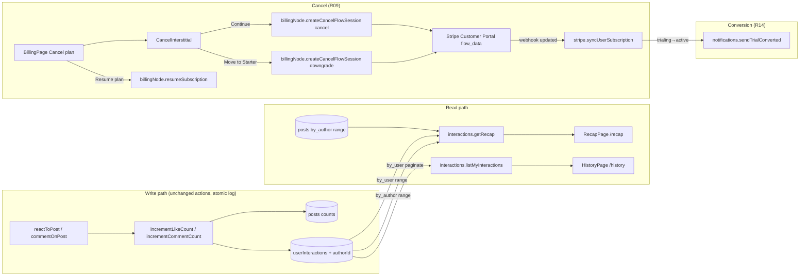

# Recap, History, Cancel Flow, Landing Proof & Conversion Email — Design

**Date:** 2026-09-07 · **Status:** approved by Henriko (design), spec pending review · **Batch:** backlog/revenue
R15, R16, R09, R10, R14 (in that execution order) · **Commits:** none — Henriko commits everything himself.

## 0. Decisions locked before this spec

| # | Question                                                               | Decision (Henriko, 2026-09-07)                                                                                                                                                                                                                                                      |
|---|------------------------------------------------------------------------|-------------------------------------------------------------------------------------------------------------------------------------------------------------------------------------------------------------------------------------------------------------------------------------|
| 1 | R10 — the three landing SSI stats (45%, 5×, +51%)                      | **Drop all three.** LinkedIn's live SSI page ("From SSI to AI") shows none of them; 45%/51% trace only to a 23 Oct 2014 LinkedIn Sales Blog post about quota-carrying salespeople; 5× has no source. The four pillar cards stay as the mechanism; the Proof card becomes the recap. |
| 2 | R09 — landing FAQ "Cancel … in one click"                              | **Drop the click count.** "Cancel from your billing page at any time; access lasts until the end of the current period."                                                                                                                                                            |
| 3 | R14 — conversion email when the trial converted with zero interactions | **Skip the email at zero.** Stripe's receipt is the only notice.                                                                                                                                                                                                                    |
| 4 | R15 — which posts get an interaction-cap bar                           | **Posts added in the selected window only** (`_creationTime ≥ since`), newest 200, as the R15 doc says. Not every live post.                                                                                                                                                        |
| 5 | Whole design (sections 1–12 below)                                     | **Approved as presented.**                                                                                                                                                                                                                                                          |

Design defaults I took without asking (all reversible, all called out where they land): rolling 7-day / 30-day
windows; only the Comment *tap* counts (no `ai_draft` kind); the interaction log is written inside the count
mutations; the received side excludes self-interactions; the sidebar SSI link-out moves to one line on the recap;
the "featured in window" tile and the "top received posts" list are dropped (the monthly featured pill and the
per-post bars already carry those numbers); R09 uses Stripe Customer Portal `flow_data` deep links through the Stripe
SDK because `@convex-dev/stripe` 0.1.4 cannot pass `flow_data`; the History page gets an "All time" window option.

## 1. Goals and non-goals

**Goals.** Give every member a page that proves the product with their own numbers (R15), a page that lists every
interaction they recorded (R16), a cancel path that shows what they lose and offers Starter before Stripe's
confirmation (R09), a landing page with no unsourced numbers and no SSI timeline (R10, R14), and one email at trial
conversion that carries the member's trial numbers (R14).

**Non-goals.** No SSI field, baseline or prediction anywhere. No search, filters, export or upsell on History. No
discounts or coupons in the cancel flow. No new tables. No backfill of existing `userInteractions` rows (pre-launch,
dev data is disposable). No new dependencies. No R18.

**Standing rules that bind every task** (backlog/revenue/README.md): one dominant action per screen; precise,
traceable numbers or none; upgrade inline at the limit, never by interruption; retain with the member's accumulated
data; design every state (loading, empty, error, gated, trialing, capped); one consent-gated PostHog event per new
moment; no modals on load, no upgrade emails, no upsell toasts; cancel visible without scrolling, one interstitial at
most; never tell a free member to check their SSI; never claim the app reads or shows the SSI; Apify never appears in
member-facing copy; three locales in parity (pt = pt-BR, es = neutral LatAm, sentence case); files change only through
the Edit/Write tools; no git state-changing commands, ever.

## 2. Architecture overview



Everything new sits on existing seams: the two count mutations, the `by_user` index plus one new `by_author` index,
the `billingNode.ts` Stripe SDK helper, `syncUserSubscription`, the `notifications.ts` / `lib/billingEmails.ts`
mailer pair, `NAV_GROUPS`, `UpgradeAtLimit`, and shadcn `Dialog`.

## 3. Backend

### 3.1 Schema (`convex/schema.ts`)

- `userInteractions` gains `authorId: v.optional(v.id('users'))` — the post's author at write time — and
  `.index('by_author', ['authorId'])`. Widen-only: existing rows lack it and are never backfilled.
- `feedback.category` union gains `v.literal('cancellation')`.
- Nothing else changes. The `createdAt` field on `userInteractions` stays; all range reads and the summarizer use
  `_creationTime` (the field the index range is on), so the two can never disagree.

### 3.2 Interaction log becomes authoritative (`convex/interactions.ts`)

- `incrementCommentCount` gains `comment: v.string()`; `incrementLikeCount` gains `reaction: reactionValidator`.
- Each inserts the `userInteractions` row **inside the same transaction, right after the count patch**, with
  `{ userId: actorId, postId, authorId: post.authorId, kind, reaction | comment, createdAt: Date.now() }`. Every early
  return (post missing, already capped, repeat reaction) also skips the log, so "counted" and "logged" are the same
  event. `incrementLikeCount` keeps returning `{ counted }`.
- `recordInteraction` is deleted, together with both best-effort `try/catch` call sites in `commentOnPost` and
  `reactToPost`. The actions pass `commentText` / `reactionType` straight into the mutations.
- Comment length is already capped at 3000 in the action; the log stores it verbatim (R16 shows it verbatim).

### 3.3 Pure helpers

`convex/lib/interactionLimit.ts`

```ts
export const UPGRADE_NUDGE_RATIO = 0.8
/** True from 80% of the cap up to (not including) the cap. Starter 25 → 20..24; Growth 50 → 40..49. cap ≤ 0 → false. */
export function isNearInteractionLimit(likeCount: number, commentCount: number, interactionsPerPost: number): boolean
```

`convex/lib/recap.ts` (new, no Convex imports)

```ts
export type RecapWindow = '7d' | '30d'
export const RECAP_ROW_CEILING = 2000
export const EXCERPT_LENGTH = 140
export interface RecapCounts { reactions: number; comments: number; posts: number; total: number } // posts = distinct postIds
export interface WindowBounds { since: number; prevSince: number; until: number }
export function floorToHour(ms: number): number
export function windowBounds(window: RecapWindow, now: number): WindowBounds        // until = now, since = now − N days, prevSince = since − N days
export function windowDays(window: RecapWindow): 7 | 30
export function countInteractions(rows: readonly InteractionLike[], from: number, to: number): RecapCounts  // from inclusive, to exclusive
export function excludeSelf<T extends { userId: string; authorId?: string }>(rows: readonly T[]): T[]         // drops rows where userId === authorId
export function excerpt(content: string, max = EXCERPT_LENGTH): string   // collapse whitespace, trim, cut + '…'
export function pickNearCapPost<T extends { likeCount: number; commentCount: number; interactionLimitReached?: boolean }>(posts: readonly T[], cap: number): T | null // highest total that isNearInteractionLimit and not capped
```

`convex/lib/history.ts` (new)

```ts
export interface HistoryRow {
  id: string; kind: 'reaction' | 'comment'; reaction?: Reaction; comment?: string; createdAt: number
  post: null | { id: string; linkedinPostUrn: string; sourceUrl?: string; excerpt: string; authorName: string; removed: boolean }
}
export function toHistoryRow(row, post: PostLike | null, author: { name: string } | null): HistoryRow
// removed = post.deletedAt !== undefined || post.hidden ; authorName falls back to ''
```

`convex/lib/stripePrices.ts` gains `starterPriceIdFor(env, interval: string | undefined): string | undefined`
(`'year'` → `STRIPE_STARTER_ANNUAL_PRICE_ID`, anything else → `STRIPE_STARTER_PRICE_ID`).

`convex/lib/trialMilestone.ts` gains
`isTrialConversion(previousStatus: string | undefined, nextStatus: string): boolean`
(`previousStatus === 'trialing' && nextStatus === 'active'`).

### 3.4 `interactions.getRecap` (public query)

```ts
args: { sessionToken: v.string(), window: v.union(v.literal('7d'), v.literal('30d')), now: v.number() }
```

`now` is the client's `floorToHour(Date.now())` — a stable reactive arg that changes once an hour, so the query
re-runs on the hour and never on every render (queries must not call `Date.now()` for this).

Reads, in order:

1. `requireAuth` → user; `tier = user.tier ?? 'starter'`; `limits = getPlanLimitsHelper(ctx, user._id, tier)`.
2. `bounds = windowBounds(window, now)`.
3.

`made = userInteractions.withIndex('by_user', q => q.eq('userId', user._id).gte('_creationTime', bounds.prevSince)).take(RECAP_ROW_CEILING)`.

4.

`received = userInteractions.withIndex('by_author', q => q.eq('authorId', user._id).gte('_creationTime', bounds.prevSince)).take(RECAP_ROW_CEILING)`
then `excludeSelf`.

5.

`posts = posts.withIndex('by_author', q => q.eq('authorId', user._id).gte('_creationTime', bounds.since)).order('desc').take(200)`
filtered to `deletedAt === undefined && !hidden`.

Returns:

```ts
{
  window, since, until,
  made:     { current: RecapCounts, previous: RecapCounts },
  received: { current: RecapCounts, previous: RecapCounts },
  truncated: boolean,                       // either read hit RECAP_ROW_CEILING
  plan: { tier, interactionsPerPost, postsPerWeek, featuredPerMonth, nextTier: nextTier(tier) },
  posts: Array<{ id, linkedinPostUrn, sourceUrl?, excerpt, likeCount, commentCount, isFeatured, interactionLimitReached: boolean }>,
  nearCapPost: null | { id, excerpt, total }
}
```

`current` = `[since, until)`, `previous` = `[prevSince, since)`. The current window counts `[since, +∞)` and the
previous window `[prevSince, since)`; both reads are `.order('desc')` so a truncated read drops the oldest rows
first, and `until` is returned for display only. The client builds LinkedIn links with the existing
`buildPostUrl(urn, sourceUrl)`; the server never formats URLs.

### 3.5 `interactions.listMyInteractions` (public paginated query)

```ts
args: { sessionToken: v.string(), since: v.number(), paginationOpts: paginationOptsValidator }
```

`userInteractions.withIndex('by_user', q => q.eq('userId', user._id).gte('_creationTime', since)).order('desc').paginate(paginationOpts)`,
then for each row `ctx.db.get(postId)` and, when the post exists, `ctx.db.get(post.authorId)`, mapped through
`toHistoryRow`. Returns the pagination result with `page: HistoryRow[]`. `since = 0` means all time. A post erased
with its author is gone with its child rows (the erasure cron deletes `userInteractions` by post), so `post: null`
is reachable only in the window between a post's hard delete and the cron pass; the UI still renders it.

### 3.6 Cancel flow through Stripe (`convex/billingNode.ts`, `'use node'`)

`createCancelFlowSession` (public action)

```ts
args: { sessionToken: v.string(), flow: v.union(v.literal('cancel'), v.literal('downgrade')) }
```

1. `requireAuthAction`. The customer id comes from `stripeComponent.getOrCreateCustomer` (same as checkout); a
   member with a live subscription always has one.
2. `live = findLiveSubscription(await ctx.runQuery(internal.billing.listUserSubscriptions, { userId }))`;
   `ConvexError('NO_LIVE_SUBSCRIPTION')` when none. `downgrade` on `live.tier === 'starter'` →
   `ConvexError('ALREADY_STARTER')`.
3. `cancel`:
   `flow_data = { type: 'subscription_cancel', subscription_cancel: { subscription: live.stripeSubscriptionId }, after_completion: { type: 'redirect', redirect: { return_url: `$
   {APP_URL}/billing?canceled=true` } } }`.
4. `downgrade`: `sub = await stripe().subscriptions.retrieve(live.stripeSubscriptionId)`; `item = sub.items.data[0]`
   (`ConvexError('Subscription has no item')` when absent); the interval comes from the retrieved item
   (`item.price.recurring?.interval`, narrowed to `month`/`year`) with our optional `live.priceInterval` snapshot as
   the fallback; `price = starterPriceIdFor(process.env, interval)` (`ConvexError('Starter price not configured')`
   when missing);
   `flow_data = { type: 'subscription_update_confirm', subscription_update_confirm: { subscription, items: [{ id: itemId, price, quantity: 1 }] }, after_completion: { type: 'redirect', redirect: { return_url: `$
   {APP_URL}/billing?downgraded=true` } } }`.
5. `stripe().billingPortal.sessions.create({ customer, return_url: `${APP_URL}/billing`, flow_data })` → `{ url }`.

`resumeSubscription` (public action, `args: { sessionToken }`): same live lookup; `ConvexError('NO_LIVE_SUBSCRIPTION')`
when none; idempotent — when `live.cancelAtPeriodEnd` is already false (stale tab, double tap) it returns `null`
without calling Stripe; otherwise `stripe().subscriptions.update(id, { cancel_at_period_end: false })`; returns
`null`. The `customer.subscription.updated` webhook already carries `cancel_at_period_end` into both our
`subscriptions` row and the component's table that `getSubscriptionInfo` reads, so the page flips reactively.

A trialing member who cancels keeps `status: 'trialing'` with `cancelAtPeriodEnd: true`; both existing trial mailers
already skip that state. No proration, no refund, no discount — unchanged policy.

**Stripe Dashboard (manual, Henriko — PLATFORM §8 table rows):** Customer Portal → Cancellations **on**, mode *at end of
billing period*, reasons **on**; Subscriptions → update **on** with all six prices listed (the
`subscription_update_confirm` flow needs the Starter prices there), proration behaviour *none* if offered;
Pausing **off**. Stripe's own trial-ending email stays off (already documented).

### 3.7 Feedback category (`convex/feedback/feedback.ts`)

`FEEDBACK_CATEGORIES` and `categoryValidator` gain `'cancellation'`. `app/src/components/FeedbackModal.tsx`'s own
`CATEGORIES` list is **not** touched (members never pick it by hand). The admin `FeedbackTab` renders the raw id in
a badge, so no label key is needed. The existing 10/hour rate limit applies to the interstitial's submission.

### 3.8 Conversion email (`convex/stripe.ts`, `notifications.ts`, `lib/billingEmails.ts`)

- `syncUserSubscription`: `const converted = isTrialConversion(existing?.status, args.status)` computed **before**
  the row patch. After the user doc patch (i.e. only on the defining-row path, past the duplicate/other-row return),
  `if (converted) await ctx.scheduler.runAfter(0, internal.notifications.sendTrialConverted, { userId: user._id })`.
  A webhook replay sees the row already `active`, so it fires exactly once.
- `notifications.sendTrialConverted({ userId })`: `getBillingContext`; return without email, when
  `subscriptionStatus !== 'active'`, when `findLiveSubscription(subscriptions)` is missing, or when
  `made + received === 0` (decision 3). Otherwise `deliver('trial_converted', …)` with
  `trialConvertedEmail(locale, { made, received, planName, priceLabel, recapUrl: `${APP_URL}/recap` })`.
  `made`/`received` are the trial counters on the user, which stop moving at conversion — exactly "during your trial".
- `trialConvertedEmail` (pure, three locales, same shape as its siblings):
    - subject: `Your {planName} plan started today`
    - lead: `During your trial you made {made} interactions and your posts received {received}.`
    - term: `Your {planName} plan ({priceLabel}) is now active.`
    - link: `See your recap:` + `recapUrl`
      No marketing, no urgency, no upsell — it is a status notice.

## 4. App

### 4.1 Routes and navigation

- `App.tsx`: `/recap` → `RecapPage`, `/history` → `HistoryPage`, both inside `RequireAuth`.
- `navItems.ts` main group becomes Feed, My Posts, **Recap** (`BarChart3`), **History** (`History`) — the ⌘K palette
  maps `NAV_GROUPS` and picks both up.
- `Sidebar.tsx`: delete the footer SSI anchor, its note and the placeholder `Recap → /feed` link; the footer keeps
  only `UserMenu`. Delete `nav.viewSsi` and `nav.viewSsiNote` in all three locales.

### 4.2 Shared pieces

- `app/src/components/WindowToggle.tsx`: `{ value, onChange, options: RecapWindow | 'all' list }`, segmented
  buttons with `aria-pressed`, `min-h-10 px-3` targets, the pill classes of BillingPage's interval toggle, labels
  `recap.window.*`.
- `app/src/components/PlanUsagePills.tsx`: the two `Badge` pills (weekly + featured, unlimited sentinel guarded)
  extracted verbatim from `MyPostsPage.tsx`, used by both pages. Pure extraction; MyPostsPage tests must not change.
- `app/src/lib/relativeDay.ts`: the "Today / N days ago" formatter MyPostsPage uses inline, extracted so History
  reuses `myPosts.today` / `myPosts.daysAgo` instead of new keys.
- `UpgradeAtLimit` gains `nearCap?: { total: number; cap: number }`; for `limit === 'interactionCap'` it selects
  `upgrade.interactionCapNear` when set. The click event gains `near: boolean`.

### 4.3 `RecapPage` (`/recap`)

Container `mx-auto max-w-[900px] px-4 py-8`. Queries: `getRecap({ sessionToken, window, now })` with `now =
floorToHour(Date.now())` memoised per render, `getWeeklyUsage`, `getFeaturedUsage`, `useTrialProgress()`.
`captureEvent('recap_viewed', { window, nearCap })` once per loaded window.

1. `PageHeader` title `recap.title`, lead `recap.lead`, children `WindowToggle` (7d, 30d). Default 7d.
2. **Loading:** `LoadingSpinner` while `recap === undefined`.
3. **Trialing:** an accent box with the existing `TrialMeter` above the tiles (the sidebar card already explains the
   rule; the page just shows the meter).
4. **Empty** (`made.current.total === 0 && received.current.total === 0 && posts.length === 0`): one card with
   `recap.emptyTitle`, `recap.emptyBody`, and a single primary `Button asChild` → `Link to="/feed"`
   (`recap.emptyCta`). The plan-usage block is **not** rendered in this state (one dominant action). Footer still
   renders.
5. **Tiles** `grid grid-cols-1 gap-4 sm:grid-cols-2`: "You made" and "Your posts received", each with the total in
   `font-display text-3xl`, the breakdown `recap.breakdown`, and — only when `previous.total > 0` — `recap.delta`
   with the delta formatted by `Intl.NumberFormat(lang, { signDisplay: 'always' })`. When `truncated`, one muted
   `recap.truncated` line with `RECAP_ROW_CEILING`.
6. **Celebration line** (`text-primary`, under the tiles) when `made.current.total > made.previous.total` and
   `made.previous.total > 0`: `recap.celebrate`.
7. **Plan usage** card: heading `recap.planUsage` + the tier name via `billing.plans.<tier>.name`, `PlanUsagePills`,
   then one row per `posts[]` entry: excerpt as an external link (`buildPostUrl`, `target="_blank"
   rel="noopener noreferrer"`, `line-clamp-2`), `feed.featured` badge when featured, caption `recap.postUsage`
   (`{{total}} of {{cap}}`), and a `UsageBar` (`role="progressbar"`, `aria-valuenow/max`, `aria-label` = the
   caption text, `bg-primary` fill, `motion-safe:transition-[width]`). A capped post renders a full bar plus the
   existing `myPosts.interactionCapBadge` (`warning` Badge). No posts in the window → `recap.noPosts` + a plain
   link to `/my-posts` (`nav.myPosts`).
8. **Upgrade section** — only when `nearCapPost !== null`: a `border-primary bg-accent` card containing
   `<UpgradeAtLimit limit="interactionCap" nearCap={{ total, cap }} />`. Pro → the component's Enterprise mailto line;
   contact → its custom-limit line; gated members never reach it (their posts are hidden and excluded).
9. **Footer** (muted, small): `recap.honest`; `recap.salesNav` + an external link `linkedin.com/sales/ssi`
   (`rel="noopener noreferrer"`, ↗); `recap.seeAll` → `Link to="/history"`.

### 4.4 `HistoryPage` (`/history`)

`usePaginatedQuery(api.interactions.listMyInteractions, { sessionToken, since }, { initialNumItems: 20 })` with
`since = 0` for "all", else `windowBounds(window, floorToHour(Date.now())).since`. Default 30d.

- `PageHeader` title `history.title`, lead `history.lead`, `WindowToggle` (7d, 30d, all).
- `LoadingFirstPage` → `LoadingSpinner`. `results.length === 0 && status === 'Exhausted'` → `history.empty` + one
  primary `Button asChild` → `/feed` (`history.emptyCta`).
- Rows (`<ul className="divide-y divide-border">`, each `<li>` stacks on mobile, `sm:flex-row` above): the reaction
  emoji + label from `REACTIONS` (`aria-hidden` emoji, visible label), or 💬 + `history.commented` and the verbatim
  comment in `whitespace-pre-wrap` with `line-clamp-6`; a `history.showMore` / `history.showLess` toggle appears only
  when `comment.length > 280 || newline count > 6`. A `<time dateTime={iso} title={absolute}>` with the relative day.
  Post block: excerpt (`text-muted-foreground` when `removed`), `history.by` with the author name, `history.removed`
  badge when removed, and the existing `feed.viewOnLinkedIn` external link (always, even when removed — the LinkedIn
  post may still exist). `post === null` → excerpt row shows only `history.removed`, no link.
- `status === 'CanLoadMore'` → outline `Button` `feed.loadMore`; `LoadingMore` → disabled.
- No search, filters, export, upsell or analytics event (a read-only page is not a new revenue moment).

### 4.5 `BillingPage` changes

Inside the existing "Your Subscription" card, under the Manage button (top of the page — visible without scrolling):

- `!subscriptionInfo.cancelAtPeriodEnd` → a text link `billing.cancel.link` ("Cancel plan") that opens
  `CancelInterstitial`. Never a primary button.
- `subscriptionInfo.cancelAtPeriodEnd` → primary `Button` `billing.cancel.resume` ("Resume plan") calling
  `billingNode.resumeSubscription`, then toast `billing.cancel.resumed`; failure toast `billing.cancel.resumeFailed`.
  Under it, `billing.cancel.postsLeave` with `periodEndDate` (only when the date is known; otherwise the existing
  `billing.cancelPending` line already says it will not renew).
- `?canceled=true`: latched at render like `?success=true`. Once `subscriptionInfo.cancelAtPeriodEnd` is true, fire
  `captureEvent('cancel_completed', { plan })` once and strip the param (`setSearchParams({}, { replace: true })`).
  If the member backed out inside Stripe the flag never flips and nothing fires; the param is harmless.
- `?downgraded=true` is a return marker only; nothing fires (the `cancel_alternative_taken` click is the signal).

### 4.6 `CancelInterstitial` (`app/src/components/CancelInterstitial.tsx`, shadcn `Dialog`)

Props `{ open, onOpenChange, tier, isTrialing, periodEndDate: string | null }`. Data while open:
`getRecap({ window: '30d' })` for `received.current.total`, `posts.getMyPosts` for the live post count
(`!hidden && !interactionLimitReached && deletedAt === undefined`).
`captureEvent('cancel_started', { plan: tier, trial: isTrialing })`
once per open.

Content, top to bottom (one screen, no scrolling on a 375-px phone):

1. `DialogTitle` `billing.cancel.title` ("Before you go").
2. `DialogDescription`: trialing → `billing.cancel.trialBody` (`trialBodyNoDate` without a date); active →
   `billing.cancel.body` (i18next plural on `count` = live posts, `received` interpolated; `bodyNoDate` when the
   period end is unknown). Numbers come straight from the queries; while they load the paragraph renders with `…`.
3. `tier !== 'starter'` → `billing.cancel.alternative` + outline `Button` `billing.cancel.alternativeCta` → fires
   `cancel_alternative_taken { from: tier }`, calls `createCancelFlowSession({ flow: 'downgrade' })`, redirects.
4. `Textarea` labelled `billing.cancel.question`, placeholder `billing.cancel.questionPlaceholder`, `maxLength` equal
   to the feedback modal's limit (4000).
5. `DialogFooter`: `DialogClose` outline `billing.cancel.keep` ("Keep my plan") and a `destructive` `Button`
   `billing.cancel.continue` ("Continue to cancel"). Continue: if the textarea is non-blank,
   `submitFeedback({ category: 'cancellation', message })`
   inside `try/catch` (a failed note never blocks the cancel); then `createCancelFlowSession({ flow: 'cancel' })` and
   redirect. Any action error → the existing `billing.portalFailed` toast. Buttons show `cursor-wait` and disable
   while pending.

No discount, no "are you sure", no second interstitial. Radix handles focus trap and Esc; the footer stacks on
mobile (`flex-col-reverse sm:flex-row`, shadcn default).

### 4.7 Analytics (consent-gated `captureEvent`)

| Event                      | Props                   | Where                                                    |
|----------------------------|-------------------------|----------------------------------------------------------|
| `recap_viewed`             | `{ window, nearCap }`   | RecapPage, once per loaded window                        |
| `upgrade_at_limit_clicked` | `{ limit, plan, near }` | UpgradeAtLimit (existing event, new `near` prop)         |
| `cancel_started`           | `{ plan, trial }`       | CancelInterstitial open                                  |
| `cancel_alternative_taken` | `{ from }`              | Move to Starter click                                    |
| `cancel_completed`         | `{ plan }`              | BillingPage on `?canceled=true` once `cancelAtPeriodEnd` |

### 4.8 i18n — app keys (English; pt-BR and neutral LatAm es in parity, sentence case)

Removed: `nav.viewSsi`, `nav.viewSsiNote`. Added:

```
nav.history                     History
recap.title                     Recap
recap.lead                      What you made and received here, and how your plan is being used.
recap.window.7d                 Last 7 days
recap.window.30d                Last 30 days
recap.window.all                All time
recap.made                      You made
recap.received                  Your posts received
recap.breakdown                 REPLACED (task 5, controller ruling R-P4) — see recap.reactionsCount_one/_other, recap.commentsCount_one/_other, recap.postsCount_one/_other, joined with ' · ' in the Tile
recap.delta                     {{delta}} vs the previous {{days}} days
recap.celebrate                 More than the previous {{days}} days. Keep going.
recap.truncated                 Showing the first {{count}} interactions in this window.
recap.planUsage                 Plan usage
recap.postUsage                 {{total}} of {{cap}} interactions
recap.noPosts                   No posts added in this window. Posts you share show up here with their interaction count.
recap.emptyTitle                Nothing recorded in the last {{days}} days
recap.emptyBody                 Your first reaction or comment in the feed shows up here, along with what your posts receive.
recap.emptyCta                  Go to the feed
recap.honest                    These are the interactions recorded here. We don't read or predict your SSI.
recap.salesNav                  Have Sales Navigator? Your SSI is still at
recap.seeAll                    See every interaction
history.title                   History
history.lead                    Every reaction and comment you recorded here.
history.commented               Commented
history.by                      by {{name}}
history.removed                 Post removed
history.showMore                Show more
history.showLess                Show less
history.empty                   No interactions in this window.
history.emptyCta                Go to the feed
upgrade.interactionCapNear      Your post is at {{total}} of {{cap}} interactions. On {{nextPlan}} it keeps collecting to {{next}}.
billing.cancel.link             Cancel plan
billing.cancel.title            Before you go
billing.cancel.trialBody        You won't be charged. Your trial ends on {{date}} and your posts leave the feed then.
billing.cancel.trialBodyNoDate  You won't be charged. Your posts leave the feed when your trial ends.
billing.cancel.body_one         Your post leaves the feed on {{date}}. In the last 30 days it received {{received}} reactions and comments.
billing.cancel.body_other       Your {{count}} posts leave the feed on {{date}}. In the last 30 days they received {{received}} reactions and comments.
billing.cancel.bodyNoPosts      Your plan ends on {{date}}. In the last 30 days your posts received {{received}} reactions and comments. (used when the member has no live post; `…` renders while the counts load)
billing.cancel.bodyNoDate       Your posts leave the feed at the end of your billing period. In the last 30 days they received {{received}} reactions and comments.
billing.cancel.alternative      Move to Starter and keep your posts in the feed.
billing.cancel.alternativeCta   Move to Starter
billing.cancel.question         What would have made you stay?
billing.cancel.questionPlaceholder  Optional. One line is enough.
billing.cancel.keep             Keep my plan
billing.cancel.continue         Continue to cancel
billing.cancel.resume           Resume plan
billing.cancel.postsLeave       Your posts leave the feed on {{date}}.
billing.cancel.resumed          Your plan continues.
billing.cancel.resumeFailed     Couldn't resume your plan: {{error}}
```

Reused, not added: `myPosts.weeklyUsage`, `myPosts.featuredPill`, `myPosts.featuredPillUnlimited`,
`myPosts.interactionCapBadge`, `myPosts.today`, `myPosts.daysAgo`, `feed.featured`, `feed.viewOnLinkedIn`,
`feed.loadMore`, `nav.myPosts`, `nav.recap`, `billing.plans.*.name`, `billing.portalFailed`, `reactions.*`,
`upgrade.cta`, `upgrade.proContact`, `upgrade.contactCustom`. No literal numbers in any new copy; every number is
interpolated from a query.

## 5. Landing (`landing/`)

### 5.1 `SSIExplainer.tsx` + `ssiExplainer.*`

- Delete the `stats` array in en/pt/es and the stats grid in the component.
- `intro` loses its speed claim: "Your Social Selling Index is LinkedIn's own 0–100 measure of how findable you are
  to recruiters, clients and peers. Four areas, 25 points each. Engagement is the one you control every day."
- Under the pillar cards, one centred muted line: `sourceLine` ("Four areas, 25 points each, recalculated daily.")
  followed by an anchor `sourceLabel` ("Source: LinkedIn") to
  `https://business.linkedin.com/sales-solutions/social-selling`
  with `target="_blank" rel="noopener noreferrer"`. The URL lives as a constant in the component; retrieval date
  2026-09-06 goes in PLATFORM §15, not in copy.

### 5.2 `Proof.tsx` + `proof.*`

- `proofCardHeadline` stays ("The only proof that matters is your own.").
- `proofCardBody` → "Your recap shows every interaction you make and receive, week by week. No score we invent, no
  number we inflate."
- Delete `proofCardLink` and the anchor. Add `proofCardNote` ("Have Sales Navigator? Your SSI stays on LinkedIn.")
  as a small muted line, no link. Update the component comment (the SSI page is a Sales Navigator feature since
  late August 2026).

### 5.3 FAQ + final CTA (`faq.items`, `finalCta.subheadline`)

- SSI item, question unchanged, answer → "Your Social Selling Index is LinkedIn's 0–100 score across four areas:
  professional brand, the right people, insights, and relationships. LinkedIn recalculates it daily. We don't read
  or predict it, and we won't promise a timeline. What we give you is a feed where real engagement is easy, and a
  recap of every interaction you make and receive. Since August 2026 the SSI page is a Sales Navigator feature; free
  and Premium members no longer see it."
- Cancel item answer → "Yes. No contracts, no lock-in, no cancellation fees. Cancel from your billing page at any
  time; access lasts until the end of the current period."
- `finalCta.subheadline` → "Seven days free. Real engagement from day one." (the old "Seven days to see it work" was
  a timeline promise.)
- `howItWorks` step 3 ("As your SSI climbs, you surface in more searches and feeds") is a mechanism statement with no
  number or date; it stays.

pt and es dictionaries mirror every addition/removal key-for-key (the `Dictionary` type is derived from `en.json`,
so a missing key fails the landing typecheck).

## 6. Error handling and edge cases

- Bad or missing session: `requireAuth` throws → the app's `ErrorBoundary`, same as every other page.
- `getRecap` ceilings: both range reads `.take(2000)`; `truncated` surfaces it. Posts `.take(200)`.
- Self-interactions (a member reacting to their own post, if ever engageable) never count as received.
- A capped post is excluded from `nearCapPost` and shown with a full bar and the "left the feed" badge.
- `nextTier === null` (Pro/contact) near the cap → mailto line, never a checkout link (existing rule).
- Cancel actions: `NO_LIVE_SUBSCRIPTION`, `ALREADY_STARTER`, missing Starter price → `ConvexError` → the existing
  `billing.portalFailed` toast. Feedback submission failure is swallowed (logged by the mutation's own path).
- Resume when nothing is pending → silent success (idempotent); resume with no live row → `NO_LIVE_SUBSCRIPTION` →
  `billing.cancel.resumeFailed` toast. The button only renders when `cancelAtPeriodEnd`.
- Conversion email: skipped without an email address, when the status is no longer `active`, when no live row, or at
  zero interactions; `deliver` already logs a loud error when email is unconfigured.
- History: `post === null` and `removed` both render; a comment with only whitespace still renders (verbatim).
- All `Date`-dependent client values (`now`, `since`) are hour-floored so reactive queries do not thrash.

## 7. Accessibility, responsiveness, visual language

Applies the five requested skills (responsive-design, karpathy-guidelines, frontend-design, web-design-guidelines,
ui-ux-pro-max) as concrete rules:

- Mobile-first: one column under 640 px, `sm:` two columns; no horizontal scroll; tap targets ≥ 40 px (`min-h-10`
  toggles, default `Button`), text never under 12 px.
- Semantics: `role="progressbar"` with `aria-valuenow/valuemax/label`; `aria-pressed` on toggles; `<time dateTime>`;
  headings in order (one `h1` from `PageHeader`, `h2` per card); external links carry `rel="noopener noreferrer"` and
  a visible ↗; colour is never the only signal (capped bars also carry the badge text).
- Tokens only (`bg-card`, `border-border`, `text-muted-foreground`, `bg-primary`, `bg-accent`, `text-destructive`):
  `app/src` stays palette-clean in light and dark. Cards `rounded-xl border p-5`, headings `font-display`, numbers
  large and quiet, no gradients, no decorative icons beyond the nav.
- Motion: `motion-safe:` on bar transitions; nothing animates on load.
- One dominant action per screen: recap → the feed (empty) or the upgrade link (near cap); history → load more;
  interstitial → "Keep my plan" is the safe default, "Continue to cancel" is destructive-styled and last.
- Karpathy rules for the implementers: read the file before editing it; state assumptions in the task report; the
  smallest diff that satisfies the acceptance line; no speculative props, no abstractions with one caller (the two
  extractions in §4.2 each have two callers); every non-trivial branch leaves one test behind.

## 8. Testing

Repo convention: Convex tests unit-test **pure functions** only (no convex-test; mutation handlers are not
executed). Page tests mock `../convex` with string refs and `convex/react` by function identity, render inside
`MemoryRouter`, and use real i18n (`en`).

**Convex (new/extended):**

- `lib/recap.test.ts`: `floorToHour`; `windowBounds` 7d/30d; `countInteractions` inclusive `from` / exclusive `to`,
  distinct posts, previous window; `excludeSelf`; `excerpt` (whitespace collapse, exact 140, ellipsis);
  `pickNearCapPost`
  (19/25 → null, 20/25 → post, capped ignored, highest total wins).
- `lib/interactionLimit.test.ts` (+): `isNearInteractionLimit` 19→false, 20→true, 24→true, 25→false, cap 0→false,
  Growth 39/40.
- `lib/history.test.ts`: reaction row, comment row, `removed` via `deletedAt` and via `hidden`, `post: null`,
  missing author → `''`.
- `lib/stripePrices.test.ts` (+): `starterPriceIdFor` year / month / undefined / unset env.
- `lib/trialMilestone.test.ts` (+): `isTrialConversion` truth table.
- `lib/billingEmails.test.ts` (+): `trialConvertedEmail` en/pt/es contain the counts, plan, price and `/recap` URL.
- `schema.test.ts` / any feedback test: `'cancellation'` accepted; existing snapshots updated if they list tables.

**App (new/extended):**

- `RecapPage.test.tsx`: loading; empty state (CTA → `/feed`, no plan block); tiles + breakdown; delta only when the
  previous window is non-zero; celebration only when current > previous > 0; truncated note; pills; bars with
  progressbar semantics; capped badge; upgrade block at 20/25 with the Growth link
  `/billing?plan=growth&interval=annual`
  and none at 19/25; footer links (`/history`, `sales/ssi` with `rel`); toggle changes the query arg; trial meter when
  trialing; `recap_viewed` fired.
- `HistoryPage.test.tsx`: reaction and comment rows; show more toggle; removed badge; `post: null`; load more calls
  `loadMore`; empty state; "All" passes `since: 0`.
- `CancelInterstitial.test.tsx`: trial copy; active plural copy with `received`; alternative hidden on Starter,
  shown on Growth and calling the action with `flow: 'downgrade'` + event; Continue submits feedback only when
  non-blank, then calls `flow: 'cancel'`; Keep closes; `cancel_started` once per open.
- `BillingPage.test.tsx` (+): Cancel link opens the dialog; Resume button + posts-leave line when
  `cancelAtPeriodEnd`; resume calls the action; `cancel_completed` fires once on `?canceled=true` and the param is
  stripped; the existing "no SSI link" assertion stays.
- `UpgradeAtLimit.test.tsx` (+): `nearCap` copy and the `near` event prop.
- `Sidebar.test.tsx`: no `sales/ssi` link; Recap → `/recap`, History → `/history`.
- MyPostsPage tests unchanged and green after the `PlanUsagePills` / `relativeDay` extractions.

**Gates:** `pnpm verify` exit 0 (prettier check, lint, typecheck, convex + app vitest); locale parity by recursive
key diff for `app/src/i18n/locales/*.json` and `landing/i18n/dictionaries/*.json` (read-only script); no
`git commit`, `git stash`, `git checkout`, `git reset` by anyone.

## 9. Documentation and backlog (same change)

`docs/PLATFORM.md`:

- §5: `userInteractions.authorId` + `by_author` (+ ER diagram), `feedback.category` union.
- §8: cancel-flow Mermaid (interstitial → portal `flow_data` → webhook → Resume), the two new `billingNode` actions,
  Stripe Dashboard setup rows (portal cancellation/update/pause), trial-notifications table row `trial_converted`
  with the zero-interaction skip, `isTrialConversion` in `syncUserSubscription`.
- §9: `UPGRADE_NUDGE_RATIO` / `isNearInteractionLimit` and the recap's near-cap ask.
- §11: log written inside the count mutations (`recordInteraction` removed), `getRecap`, `listMyInteractions`,
  `lib/recap.ts`, `lib/history.ts`, windows and ceilings.
- §11B: Recap and History in the palette via `NAV_GROUPS`.
- §12A: `cancellation` category and where it is written from.
- §13B: `authorId` is a user id already covered by the by-post drain; export unchanged (own rows only).
- §14: routes, nav, `RecapPage`, `HistoryPage`, `CancelInterstitial`, `WindowToggle`, `PlanUsagePills`,
  `relativeDay`, `UpgradeAtLimit.nearCap`, BillingPage cancel/resume, events, locale key count.
- §15: stats removed (with the reason and the 2014 source they traced to), pillar source URL + retrieval date, the
  SSI-page paywall fact, Proof and FAQ rewrites, final-CTA subline.
- §21: changelog paragraph (dated 2026-09-07) and, if any new file is a subsystem, the mapping row.

`backlog/revenue/README.md`: R09, R10, R14, R15, R16 → DONE (2026-09-07) with the decisions above; each R-doc's
status line and acceptance boxes flipped, R10 recording decision 1, R09 recording decision 2 and the Dashboard steps
left for Henriko, R14 recording decision 3, R15 recording decision 4 and the dropped featured tile / top-posts list,
R16 recording the "All time" option.

## 10. Out of scope / deferred (do not re-raise)

- Backfilling `authorId` on existing dev rows (dev data is disposable; prod has none).
- "Featured in window" tile, "top received posts" list, History analytics event, `cancel_alternative_completed`.
- A screenshot for the landing Proof card (post-launch, once a real recap exists).
- An automated locale-parity test (still none; verified by script).
- R18 survival panel; R17 featured add-on; R13 ladder math.
- Stripe Dashboard clicks (Henriko, listed in §3.6 and PLATFORM §8).

## 11. Acceptance criteria (merged from the five R-docs)

- [ ] Every counted reaction/comment writes one `userInteractions` row with `authorId`, atomically; no
  `recordInteraction` remains.
- [ ] `/recap` shows made and received for 7d and 30d with breakdowns and previous-window deltas from
  `by_user`/`by_author` range reads; self-interactions excluded; `2000+` ceiling surfaced.
- [ ] Plan usage shows the weekly and featured pills (sentinel never printed) and one bar per window post with
  "N of cap"; capped posts show the "left the feed" badge.
- [ ] The upgrade section renders only at ≥ 80% of the cap with the member's own numbers and the next tier's real
  number; Pro/contact see the mailto lines; nothing renders on load otherwise.
- [ ] The sidebar has no SSI link; the recap carries one Sales Navigator line; the app never claims to read the SSI.
- [ ] `/history` lists every row newest-first, 20 per page, with reaction/comment, verbatim text, post excerpt,
  author, LinkedIn link, and removed state; empty state links to the feed.
- [ ] "Cancel plan" is visible without scrolling; the interstitial shows the member's posts/received numbers or the
  trial "you won't be charged" line, offers Starter above Starter, asks one optional question, and hands off to
  Stripe's own confirmation; "Resume plan" appears once cancelled with the posts-leave date.
- [ ] Trial → active fires one `trial_converted` email with the trial counts, skipped at zero.
- [ ] Landing carries no unsourced number; the pillar line links its source; the Proof card and FAQ no longer
  promise a timeline or a link-out; the cancel FAQ has no click count; pt/es in parity.
- [ ] Events: `recap_viewed`, `cancel_started`, `cancel_alternative_taken`, `cancel_completed`, `near` on the
  upgrade click — all through the consent-gated `captureEvent`.
- [ ] `pnpm verify` green; PLATFORM.md and backlog statuses updated; nothing committed.
