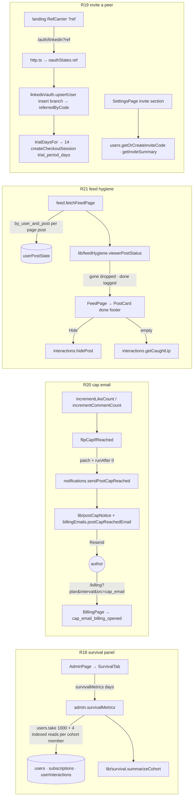

# Survival Panel, Cap Email, Feed Hygiene & Invite a Peer — Design

**Date:** 2026-09-07 · **Status:** approved by Henriko (design), spec pending review · **Batch:** backlog/revenue
R18, R20, R21, R19 (in that execution order) · **Commits:** none — Henriko commits everything himself.

## 0. Decisions locked before this spec

| # | Question                                             | Decision (Henriko, 2026-09-07)                                                                                                                                                                                                 |
|---|------------------------------------------------------|--------------------------------------------------------------------------------------------------------------------------------------------------------------------------------------------------------------------------------|
| 1 | R17 — cap-bonus ladder rule for the $5 featured post | **Hold R17 until R13 is decided.** R17 stays TODO in the README with a "held until R13" note. Nothing from R17 ships in this batch.                                                                                            |
| 2 | Batch shape                                          | **One spec, one plan, sequential R18 → R20 → R21 → R19**, one subagent per task, a reviewer after each task. Sequential because R20 and R21 both edit `interactions.ts` and all four touch the locale files and `PLATFORM.md`. |
| 3 | R18 — extra "started trial" count                    | **Add it.** Without a card-entry step the panel cannot separate a card-gate leak from an activation leak.                                                                                                                      |
| 4 | Whole design (sections 1–11 below)                   | **Approved as presented.**                                                                                                                                                                                                     |

Design defaults I took without asking (all reversible, all called out where they land): R18 reuses the existing
consent-gated `captureEvent` and adds only `checkout_started` (its other three proposed events already exist under other
names or are visible in the database); R20's upgrade sentence renders only when the next tier's cap is higher than the
cap that bound; R21's 24-hour clock runs from the member's **latest** interaction on the post, and a repeat comment
restamps it; R21's caught-up state shows when the feed is empty and the member's latest interaction is under 24 hours
old, otherwise the R05 empty state shows; R19 creates the invite code lazily on the first Settings render; the six
in-app strings that hardcode "7-day" take a `{{days}}` placeholder so an invited member never reads a shorter promise
than they get; the landing keeps "7-day" (per the R19 doc) but its Terms clause gains the 14-day case, flagged for
lawyer review; the landing carries `?ref` through a tiny client component that also survives a language switch via
session storage; `getMe` exposes `trialDays` and the inviter's first name; the support address moves to
`convex/lib/support.ts` with the app re-exporting it; the 24-hour expiry is evaluated when the feed query runs, the same
way `getFeed` reads the clock today.

## 1. Goals and non-goals

**Goals.** Give the admin one panel that answers "who survives the first week" from the database (R18). Tell an author
by email, once, that a post reached its cap and left the feed, with the plan's next cap stated inline and nothing else
(R20). Let a member's feed forget the posts they already handled after 24 hours, with a Hide for the impatient and an
honest caught-up state (R21). Let a member invite a peer with one link, attribute the signup, and give the invited peer
a 14-day trial instead of 7 (R19).

**Non-goals.** No R17 (held). No nightly metrics snapshot or new metrics table. No `limit_reached` analytics event. No
unhide. No reward for the inviter beyond seeing who joined. No new dependencies. No backfill of existing rows
(pre-launch, dev data is disposable). No change to the landing's "7-day" CTAs.

**Standing rules that bind every task** (backlog/revenue/README.md): one dominant action per screen; precise,
traceable numbers or none; upgrade inline at the limit, never by interruption; retain with the member's accumulated
data; design every state (loading, empty, error, gated, trialing, capped); one consent-gated PostHog event per new
moment; no modals on load, no broadcasts, no upsell toasts — the one email in this batch is an **event notice** under
the README's carve-out, sent once per post and never on a schedule; never tell a free member to check their SSI; never
claim the app reads or shows the SSI; Apify never appears in member-facing copy; three locales in parity (pt = pt-BR,
es = neutral LatAm, sentence case); files change only through the Edit/Write tools; no git state-changing commands,
ever.

## 2. Architecture overview



## 3. Backend

### 3.1 Schema (`convex/schema.ts`) — widen only, no backfill

- `users.inviteCode?: string` + `.index('by_invite_code', ['inviteCode'])`.
- `users.referredByCode?: string` + `.index('by_referred_by_code', ['referredByCode'])`.
- `oauthStates.ref?: string` (travels beside `plan` and `interval`).
- `userPostState.commentedAt?: number`, `userPostState.hiddenAt?: number`.

No new tables. No new index on `userInteractions`: R18's return windows use the `_creationTime` tail that Convex appends
to `by_user`.

### 3.2 R18 — `convex/lib/survival.ts` (pure) and `admin.survivalMetrics`

```ts
export const DAY_MS = 86_400_000
export const ACTIVATION_WINDOW_MS = DAY_MS

export type CohortRow = {
  createdAt: number
  subscriptionStatus: string
  tier?: string
  trialEndsAt?: number
  startedTrial: boolean       // any subscriptions row exists
  cancelPending: boolean      // live subscription row has cancelAtPeriodEnd === true
  firstInteractionAt?: number // earliest userInteractions row, any time
  returnedDay1: boolean       // any interaction in [createdAt + 24h, createdAt + 48h)
  returnedDays2to7: boolean   // any interaction in [createdAt + 24h, createdAt + 8d)
}

export type CohortSummary = {
  signups: number
  startedTrial: number
  activated: number                          // firstInteractionAt - createdAt < 24h
  medianMinutesToFirstInteraction: number | null // over rows with a first interaction; null when none
  returnedDay1: number
  returnedDays2to7: number
  trialsEnded: number                        // trialEndsAt !== undefined && trialEndsAt <= now
  converted: number                          // trial ended && subscriptionStatus === 'active'
  canceled: number                           // subscriptionStatus === 'canceled' || cancelPending
}

export function returnWindows(createdAt: number): { day1: [number, number]; days2to7: [number, number] }
export function summarizeCohort(rows: CohortRow[], now: number): CohortSummary
export function payingByTier(users: { subscriptionStatus: string; tier?: string }[]): Record<Tier, number> // status 'active' only; tier defaults to 'starter'
```

`Tier` here and in 3.3 is the four-literal type exported by `convex/lib/planLimits.ts` (starter, growth, pro, contact),
not the three-literal one in `lib/stripePrices.ts`.

Median: sort the minute deltas, middle element, mean of the two middles when even, rounded to a whole minute.

```ts
// convex/admin.ts
export const survivalMetrics = query({
  args: { sessionToken: v.string(), days: v.union(v.literal(7), v.literal(28)) },
  handler → { days, since, generatedAt, cohort: CohortSummary, payingByTier: Record<Tier, number> }
})
```

Reads: `requireAuth` + `assertAdmin`; `users.order('desc').take(1000)` (the same ceiling `listUsers` uses); `since =
now - days * DAY_MS`; a member is in the cohort when `(createdAt ?? _creationTime) >= since`. Per cohort member, four
small indexed reads: `subscriptions.by_user` `.take(5)` (started trial +
`findLiveSubscription(...)?.cancelAtPeriodEnd`),
`userInteractions.by_user` ascending `.first()` (first interaction), and two `.first()` reads on the same index with
`q.eq('userId', id).gte('_creationTime', a).lt('_creationTime', b)` for the two return windows (`createdAt` and
`_creationTime` on `userInteractions` are written in the same mutation, so the system field is the range key).
`payingByTier` runs over all 1000 rows. `Date.now()` inside the query matches `getFeed`/`getRecap`; the panel tolerates
staleness. `// ponytail: ~4 reads per cohort member; precompute nightly if a 28-day cohort passes ~1500 members.`

### 3.3 R20 — cap-flip helper, `lib/postCapNotice.ts`, email builder, sender

**`convex/lib/support.ts`** (new, pure): `export const SUPPORT_EMAIL = 'contact@linkintothessi.com'`.
`app/src/lib/support.ts` becomes `export { SUPPORT_EMAIL } from '../../../convex/lib/support'`.

**`convex/interactions.ts`** — the two identical flip blocks in `incrementCommentCount` and `incrementLikeCount`
collapse into one module-private helper (surgical: the callers' guards and counters do not move):

```ts
async function flipCapIfReached(ctx: MutationCtx, post: Doc<'posts'>, likeCount: number, commentCount: number): Promise<void>
// author → getPlanLimitsHelper(ctx, author._id, author.tier ?? 'starter')
// if !shouldFlipInteractionLimit(likeCount, commentCount, limits.interactionsPerPost, false) return
// patch { interactionLimitReached: true, ...computeFeedFields({ ...post fields, interactionLimitReached: true }) }
// await ctx.scheduler.runAfter(0, internal.notifications.sendPostCapReached, { postId: post._id })
```

The existing `interactionLimitReached` early returns in both callers guarantee the flip, and therefore the schedule,
happens once per post.

**`convex/lib/postCapNotice.ts`** (new, pure):

```ts
export type CapNoticeMode = 'upgrade' | 'proContact' | 'contactCustom'
export function capNoticeMode(tier: Tier | undefined): CapNoticeMode         // starter/growth → upgrade; pro → proContact; contact → contactCustom
export function shouldSendCapNotice(c: { subscriptionStatus: string; cancelAtPeriodEnd?: boolean; email?: string }): boolean
                                                                              // trialing | active, not cancel-pending, email present
export function billingIntervalParam(priceInterval: string | undefined): 'monthly' | 'annual' // 'year' → annual, else monthly
export function includeUpgradeSentence(mode: CapNoticeMode, cap: number, nextCap: number | undefined): boolean
                                                                              // mode === 'upgrade' && nextCap !== undefined && nextCap > cap
```

**`convex/lib/billingEmails.ts`** — new builder beside the four existing ones so `billingEmails.test.ts`'s "stays
transactional" guard covers it:

```ts
export interface CapReachedArgs {
  excerpt: string; cap: number; planName: string; mode: CapNoticeMode
  nextPlanName?: string; nextCap?: number; upgradeUrl?: string
  myPostsUrl: string; supportEmail: string
}
export function postCapReachedEmail(locale: BillingLocale, a: CapReachedArgs): EmailContent
```

English copy (pt-BR and es in parity, same structure, no marketing verbs, no exclamation marks):

- subject: `Your post reached {cap} interactions and left the feed`
- lead: `“{excerpt}”`
- body: `It collected {cap} interactions, the {planName} cap, and left the feed so members see the rest. It stays on
  My Posts: {myPostsUrl}`
- upgrade sentence, only when `includeUpgradeSentence` is true: `On {nextPlanName} each post keeps collecting up to
  {nextCap}: {upgradeUrl}`
- `proContact`: `Need a higher cap? Write to {supportEmail}.`
- `contactCustom`: `Your plan has a custom cap. Write to {supportEmail} to adjust it.`

`text` joins the paragraphs with blank lines; `html` wraps each in `<p>` with the URL as an `<a>`.

**`convex/notifications.ts`**:

```ts
export const sendPostCapReached = internalAction({
  args: { postId: v.id('posts') },
  handler: async (ctx, { postId }) => {
    // internal.interactions.getPost → return when missing or soft-deleted
    // internal.billing.getBillingContext(post.authorId) → return when null
    // live = findLiveSubscription(c.subscriptions); guard with shouldSendCapNotice
    // limits = internal.lib.planLimits.getPlanLimits({ userId: authorId, tier }); next = nextTier(tier)
    // nextLimits = next ? getPlanLimits({ userId: authorId, tier: next }) : null   (non-contact tiers resolve by tier default)
    // locale = resolveBillingLocale(c.language, c.primaryLocale)
    // m = postCapReachedEmail(locale, { excerpt: excerpt(post.content), cap: limits.interactionsPerPost, planName, mode: capNoticeMode(tier),
    //      nextPlanName, nextCap: nextLimits?.interactionsPerPost,
    //      upgradeUrl: next ? `${appUrl}/billing?plan=${next}&interval=${billingIntervalParam(live?.priceInterval)}&src=cap_email` : undefined,
    //      myPostsUrl: `${appUrl}/my-posts`, supportEmail: SUPPORT_EMAIL })
    // await deliver('post_cap_reached', c.email, m)
  }
})
```

`excerpt` is the existing helper in `convex/lib/recap.ts`. `appUrl` comes from the same env read `billingUrl()` uses.
Delivery failures log through `scrubError` and are not retried, exactly like the trial mailers.

### 3.4 R21 — `lib/feedHygiene.ts`, feed walk, `hidePost`, `getCaughtUp`

**`convex/lib/feedHygiene.ts`** (new, pure):

```ts
export const INTERACTED_TTL_MS = 86_400_000
export type ViewerRow = { reactedAt?: number; commentedAt?: number; hiddenAt?: number } | null | undefined
export type FeedViewerState = { reacted: boolean; commented: boolean; hidesAt: number }
export function lastInteractedAt(row: ViewerRow): number | undefined          // max(reactedAt, commentedAt)
export function viewerPostStatus(row: ViewerRow, now: number): 'fresh' | 'done' | 'gone'
                                                                               // hiddenAt → gone; last + TTL <= now → gone; last defined → done; else fresh
export function canHide(row: ViewerRow): boolean                               // lastInteractedAt defined
export function toFeedViewerState(row: ViewerRow, now: number): FeedViewerState | null // null when fresh
```

**`convex/interactions.ts`**:

- `incrementCommentCount`: after the cap guard and the counter patch, upsert the viewer's `userPostState` row with
  `commentedAt: now` (patch when the row exists, insert otherwise — same shape as `saveCommentDraft`).
- `hidePost = mutation({ sessionToken, postId })`: `requireAuth`; read the row via `by_user_and_post` `.unique()`;
  `if (!canHide(row)) throw new ConvexError('NOT_INTERACTED')`; already hidden → return (idempotent); else patch
  `hiddenAt: Date.now()`.
- `getCaughtUp = query({ sessionToken? })` → `{ caughtUp: boolean }`: latest `userInteractions.by_user` row (descending
  `.first()`); `caughtUp = row !== null && now - row.createdAt < INTERACTED_TTL_MS`. Optional session
  resolved the way `getTrialProgress` does it; unauthenticated → `{ caughtUp: false }`.

**`convex/feed.ts` `fetchFeedPage`**: after the existing visibility/industry/country filter, read the viewer's
`userPostState` row for each remaining post (`by_user_and_post` `.unique()`, `Promise.all`), drop posts whose status is
`gone`, and attach `viewerState: toFeedViewerState(row, now)` (null for fresh) in the enrichment map. `isDone` and
`continueCursor` still come from the index walk. `// ponytail: expiry is evaluated when the query runs; a tab left open
keeps a done card until the next re-run. The card's countdown is client-side.`

### 3.5 R19 — invite code, attribution, gift

**`convex/lib/invite.ts`** (new, pure): `INVITE_CODE_RE = /^[a-z0-9]{8}$/`, `isInviteCode(s: unknown): s is string`,
`generateInviteCode(): string` (eight base-36 characters drawn with `Math.random()`, which Convex seeds
deterministically
inside mutations so a retried mutation produces the same code), `firstName(name: string): string` (first
whitespace-separated token).

**`convex/lib/trialMilestone.ts`**: `export const TRIAL_PERIOD_DAYS = 7`, `export const INVITED_TRIAL_PERIOD_DAYS =
14`, `export function trialDaysFor(user: { referredByCode?: string }): number`. `billingNode.ts` drops its local
constant and imports these.

**`convex/lib/checkoutCopy.ts`**: `checkoutSubmitMessage(locale, opts: { trial: boolean; days: number })` — the trial
message becomes a template with the day count; the no-trial message is unchanged.

**`convex/billingNode.ts` `createCheckoutSession`**: `trial_period_days: trialDaysFor(user)` and
`checkoutSubmitMessage(billingLocale, { trial, days: trialDaysFor(user) })`. Nothing else changes.

**`convex/users.ts`**:

- `toSafeMe` adds `trialDays: trialDaysFor(user)`.
- `getMe` adds `inviterName: string | null` — the first name of the `by_invite_code` match when `referredByCode` is set
  (one indexed read, invited members only).
- `getOrCreateInviteCode = mutation({ sessionToken })` → `string`: returns the existing code; otherwise generates one,
  checks `by_invite_code`, retries once on collision, then throws `ConvexError('INVITE_CODE_RETRY')`; patches
  `inviteCode`.
- `getInviteSummary = query({ sessionToken })` → `{ inviteCode: string | null; joined: number }` where `joined` is
  `by_referred_by_code` `.take(101)`'s length (the UI renders 101 as "100+"); `joined` is 0 when no code exists yet.

**`convex/http.ts`**: `/auth/linkedin` reads `ref`, keeps it only when `isInviteCode(ref)`, and passes it to
`createOAuthState({ state, plan, interval, ref })`. The callback passes `oauthState.ref` to `upsertUser`. The success
redirect is unchanged (no `ref` on the app URL).

**`convex/sessions.ts`**: `createOAuthState` gains `ref: v.optional(v.string())`; `validateAndConsumeOAuthState`
returns `ref` beside `plan` and `interval`.

**`convex/linkedin/auth.ts`**: `UpsertUserArgs.ref?: string`; the **insert branch only** resolves the code through
`by_invite_code` `.first()` and sets `referredByCode` when a member owns it. The patch branch ignores `ref`, so an
existing member can never be re-attributed and a member cannot be their own inviter. The `upsertUser` internalMutation
validator gains `ref: v.optional(v.string())`.

## 4. App

### 4.1 Routes and navigation

No new routes. `/admin?tab=survival` is the sixth admin tab. Settings gets an in-page anchor `#invite` that the recap
footer and the empty/caught-up feed states link to.

### 4.2 R18 — `SurvivalTab` (`app/src/components/SurvivalTab.tsx`)

`AdminPage`'s `TabValue` gains `'survival'`; a `TabsTrigger` "Survival" sits after MOTD. The tab holds a 7 / 28 day
segmented toggle (local state, default 7), a semantic table (`ui/table.tsx`) with one row per metric — Signed up,
Started trial, Activated within 24 h, Median minutes to first interaction, Returned day 1, Returned days 2–7, Trials
ended, Converted, Canceled — showing the count and, where the doc defines a share, the share beside it (started trial,
activated, returned rows as a share of signups; converted as a share of trials ended). A second small table lists
paying members by tier. Footer: "UTC · cohort = members who signed up in the window · newest 1000 members". Loading
state is the shared spinner; a query error shows the shared `Flash`. English only, like the other admin tabs; no i18n
keys. Median renders "–" when null.

`BillingPage` fires `captureEvent('checkout_started', { plan, interval })` immediately before the existing
`createCheckout` call (the plan id and the interval the price belongs to).

### 4.3 R20 — `BillingPage` return trip

When `searchParams.get('src') === 'cap_email'`, fire `captureEvent('cap_email_billing_opened', { plan })` once (ref
guard, `plan` = `resolveTargetPlan(searchParams)`). The `src` param is left in place; it is inert after the event. The
existing R08 `?plan=&interval=` handling already scrolls the member to the recommended plan; nothing else changes.

### 4.4 R21 — `PostCard` done footer, `FeedPage`, `EmptyFeed`

`PostWithAuthor.viewerState?: FeedViewerState | null`. When `viewerState` is null or absent the card renders exactly as
today. When present, the overlay footer becomes:

- a status label — `feed.doneBoth` when both, else `feed.doneReacted` / `feed.doneCommented` — followed by ` · ` and
  `feed.leavesIn` with `hours = max(1, ceil((hidesAt - Date.now()) / 3_600_000))`, computed at render (no timer);
- the remaining action, if one is left: the existing `ReactionButton` when not reacted, the existing Comment button
  when not commented, nothing when both;
- the existing View on LinkedIn link;
- a ghost `Button` `feed.hideNow` (`aria-label` = the same text) that calls `onHide(postId)`.

`FeedPage` wires `onHide` to `api.interactions.hidePost` and fires `captureEvent('post_hidden', { after })` with
`after` ∈ `'reaction' | 'comment' | 'both'` from `viewerState`. Failure → `toast(friendlyError(err, String(err)))`, the
same pattern the reaction handler uses. The mutation's reactivity removes the card; no optimistic state.

Auto-load: a second effect runs when `posts.length === 0 && status === 'CanLoadMore'` and a ref counter is below
`MAX_EMPTY_PAGES = 5`; it increments the counter and calls `loadMore(FEED_PAGE_SIZE)`. While that runs the page shows
the existing `LoadingMore` spinner, not the empty state. The empty state renders when `posts.length === 0` and either
`status === 'Exhausted'` or the counter has reached the cap. `getCaughtUp` is subscribed only while `posts.length ===
0` (same skip pattern as `getTrialProgress`). `caughtUp` true → `<EmptyFeed caughtUp … />`; false → the R05 state as
today.

`EmptyFeed` gains `caughtUp?: boolean`. The caught-up variant renders `feed.caughtUpTitle`, `feed.caughtUpBody`, and
the R19 text link (`feed.inviteLink` → `/settings#invite`); no composer CTA, no checklist, no banner. The R05 variant
gains the same text link under its existing content (a link, never a second button).

### 4.5 R19 — Settings, Billing, Recap, card-gate strings

**Settings** (`SettingsPage.tsx`): a new section `id="invite"` after the AI comments section: heading
`settings.invite`, note `settings.inviteNote`, a read-only `Input` labelled `settings.inviteLinkLabel` holding
`${LANDING_URL}/${lang}?ref=${code}` (`lang` = the first two letters of `i18n.language`), a `Button`
`settings.inviteCopy`
that writes the link to the clipboard, toasts `settings.inviteCopied` and fires `captureEvent('invite_copied')`, and one
line `settings.inviteJoined` (i18next `_one`/`_other` on `count`) or `settings.inviteJoinedMany` when `joined === 101`.
Data: `useQuery(api.users.getInviteSummary)`; when the summary has loaded with `inviteCode === null`, a ref-guarded
effect calls `getOrCreateInviteCode` once. Until the code exists the input is empty and Copy is disabled (no spinner, no
new key). Clipboard failure → the existing error toast pattern; the input stays selectable.

**Billing** (`BillingPage.tsx`): when `me.inviterName` is set and `me.subscriptionStatus` is `none` or `trialing`, one
line `billing.giftFrom` (`{ name, days: me.trialDays }`) renders directly above the trial banner / plan lead. All
"7-day" strings on this page take `{ days: me?.trialDays ?? 7 }`: `billing.newUserTrialNote`, `billing.startTrialCta`,
`billing.chosenPlanLead`, `billing.trialBannerNoDate`.

**Card gate** (`CardGateBanner`, `CardGateDialog`, `UpgradeAtLimit`): `feed.cardGateCta` and `feed.cardGateCost` take
`{ days }` from `useCardGate().me?.trialDays ?? 7` (`useCardGate` already returns `me`).

**Recap** (`RecapPage.tsx`): when `recap.received.current.total > 0`, the footer gains one paragraph: `recap.inviteLine`
followed by a `Link` to `/settings#invite` with `feed.inviteLink`.

### 4.6 Analytics (consent-gated `captureEvent`, no PII)

| Event                      | Where                                  | Props                                     |
|----------------------------|----------------------------------------|-------------------------------------------|
| `checkout_started`         | `BillingPage`, before `createCheckout` | `plan`, `interval`                        |
| `cap_email_billing_opened` | `BillingPage`, `?src=cap_email`, once  | `plan`                                    |
| `post_hidden`              | `FeedPage`, after `hidePost` resolves  | `after` (`reaction` / `comment` / `both`) |
| `invite_copied`            | `SettingsPage` Copy button             | none                                      |

### 4.7 i18n — app keys (English; pt-BR and neutral LatAm es in parity, sentence case)

New keys:

```
feed.doneReacted            "Reacted"
feed.doneCommented          "Commented"
feed.doneBoth               "Reacted · commented"
feed.leavesIn               "Leaves your feed in {{hours}} h"
feed.hideNow                "Hide now"
feed.caughtUpTitle          "You're caught up"
feed.caughtUpBody           "Posts you handled leave after 24 hours. New ones appear as members share them."
feed.inviteLink             "Invite a peer"
settings.invite             "Invite a peer"
settings.inviteNote         "Anyone who joins through your link gets a 14-day trial instead of 7. Share it with someone whose posts you'd want to see here."
settings.inviteLinkLabel    "Your invite link"
settings.inviteCopy         "Copy link"
settings.inviteCopied       "Link copied"
settings.inviteJoined_one   "{{count}} peer joined through your link"
settings.inviteJoined_other "{{count}} peers joined through your link"
settings.inviteJoinedMany   "100+ peers joined through your link"
billing.giftFrom            "{{name}} gave you {{days}} days of trial."
recap.inviteLine            "Know someone whose posts you'd want here?"
```

Changed keys (the literal 7 becomes `{{days}}`; every call site passes `days`):

```
feed.cardGateCta            "Start {{days}}-day trial"
feed.cardGateCost           "Free for {{days}} days or {{threshold}} interactions, then your plan starts. Cancel anytime."
billing.newUserTrialNote    "Every plan starts with a free {{days}}-day trial · cancel anytime."
billing.startTrialCta       "Start {{days}}-day {{plan}} trial"
billing.chosenPlanLead      "You picked {{plan}} on the site. Its {{days}}-day trial starts below."
billing.trialBannerNoDate   "You're on a free {{plan}} trial. Your plan starts at {{threshold}} interactions or after {{days}} days, whichever comes first."
```

Admin copy stays hardcoded English (existing convention). Email copy lives in the builder, three locales.

## 5. Landing (`landing/`)

- **`components/RefCarrier.tsx`** (`'use client'`, renders nothing), mounted once in `app/[lang]/layout.tsx` beside
  `CookieNotice`. On mount: read `?ref` from `window.location.search`; keep it only when it matches `/^[a-z0-9]{8}$/`;
  store it in `sessionStorage` (`'ref'`), or fall back to the stored value when the URL has none (a language switch
  drops
  the query); then, for every `a[href*="/auth/linkedin"]`, set `ref` on the anchor's URL via `URL.searchParams.set`.
  Existing `plan`/`interval` params on plan CTAs are preserved. When `NEXT_PUBLIC_CONVEX_SITE` is unset the CTAs point
  at
  the app root and the selector matches nothing, so the component is a no-op in that setup. All `try/catch` around
  storage.
- **Terms clause** (`app/[lang]/terms/content/{en,pt,es}.tsx`): "New accounts start with a **7-day free trial** (14
  days when you join through a member's invite link) …" and "or when the trial period ends, whichever comes first"
  replaces "or after **7 days**". pt and es mirror it. **Lawyer review** is noted in the R19 doc and PLATFORM §13B.
- No dictionary changes: the landing CTAs keep "7-day" as decided.
- The landing has no test runner; verification is `next lint` and `next build` (the build typechecks).

## 6. Error handling and edge cases

- **R18.** Empty cohort → all zeros and a null median rendered as "–". A non-admin caller throws through `assertAdmin`.
  `days` outside 7/28 is rejected by the validator. Members without `createdAt` use `_creationTime`.
- **R20.** Post deleted or missing when the action runs → return. Author with no email, status other than
  trialing/active, or a pending cancellation → return. The near-cap trial email and this notice can arrive minutes
  apart;
  accepted per the R20 doc. A contact member with a custom override gets `contactCustom`, never an upgrade line. If the
  next tier's cap is not higher (admin-edited defaults), the upgrade sentence is omitted and the email is still sent.
- **R21.** No state row → fresh. `hidePost` on a fresh post → `NOT_INTERACTED` (unreachable from the UI; the button
  only renders on done cards). `hidePost` twice → no-op. The viewer's own posts never carry `viewerState`; the feed
  already excludes them. A member's reaction on a post that is later hidden by its author or capped is unaffected. Hide
  never touches `userInteractions`, so recap, history and the cap counters are unchanged.
- **R19.** Unknown or malformed `ref` → ignored silently at every hop. Existing member signing in with `ref` → ignored.
  Code collision → one retry, then `INVITE_CODE_RETRY` surfaces as the generic Settings error. Clipboard denied → error
  toast, link still selectable. Inviter erased later → `inviterName` is null, the gift line hides, the 14 days stay (the
  attribution happened at signup). `referredByCode` is a random token, not an identifier of the inviter, so an
  erased inviter leaves nothing personal behind. Both new user fields ride the existing DSR export (whole `users` row)
  and
  erasure (row delete) paths.

## 7. Accessibility, responsiveness, visual language

- Token-only colours (light + dark), shadcn primitives, sentence case, no new icons beyond lucide.
- **Done footer**: `min-h-[52px]` (replacing the fixed `h-[52px]`), `flex-wrap`, `gap-x-4 gap-y-1`, one row at ≥ 480 px
  and two rows below; the status label
  is `text-muted-foreground` 13 px, Hide is a `ghost` `Button` with the same visible text as its label; nothing is
  colour-only.
- **Survival table**: the semantic `<table>` primitive with `<th scope="row">`, counts right-aligned in tabular
  numerals, the toggle a `role="group"` of two `Button`s with `aria-pressed`.
- **Invite section**: the link lives in a labelled read-only `Input`; the Copy button is keyboard reachable; the toast
  region announces the copy.
- **Landing `RefCarrier`** renders no DOM; no layout or CSP impact (inline script not needed, it is a component).

## 8. Testing

Convex (`pnpm --filter ./convex test <file>`; no convex-test, pure logic only, mock ctx where a walker is exercised):

- `lib/survival.test.ts` — activation boundary (exactly 24 h is **not** activated), return windows half-open, median odd
  / even / none, converted requires an ended trial, canceled counts cancel-pending, `payingByTier` ignores non-active.
- `lib/postCapNotice.test.ts` — mode per tier incl. undefined tier; `shouldSendCapNotice` truth table;
  `billingIntervalParam`; `includeUpgradeSentence` when `nextCap ≤ cap`.
- `lib/billingEmails.test.ts` — `postCapReachedEmail` in three locales: subject carries the cap, text carries the
  excerpt, plan name and My Posts URL; upgrade sentence present only in `upgrade` mode with a higher next cap; support
  address in the two contact modes; added to the transactional (banned-phrase) list.
- `lib/feedHygiene.test.ts` — fresh / done / gone, exactly 24 h is gone, hidden beats everything, `lastInteractedAt`
  picks the later stamp, `toFeedViewerState` shape.
- `feed.test.ts` — the page walk drops a gone post, tags a done post with `viewerState`, leaves a fresh post untagged;
  `feedCtx` gains a `userPostState` lookup keyed by post id.
- `lib/trialMilestone.test.ts` — `trialDaysFor` 7 / 14.
- `lib/checkoutCopy.test.ts` — the trial message carries the day count in three locales.
- `lib/invite.test.ts` — generated codes match the regex, `isInviteCode` rejects length/case/charset, `firstName`.
- `linkedin/auth.test.ts` — insert branch attributes a resolving code, ignores an unknown code, patch branch ignores
  `ref`; the mock `withIndex` dispatches on the index name.
- No new test for `sessions.ts` or `http.ts` (both need a database; `sessions.test.ts` covers pure helpers only). The
  `ref` hop is exercised by the `auth.test.ts` cases above and by typecheck.

App (`pnpm --filter ./app test <file>`):

- `SurvivalTab.test.tsx` — renders counts and shares from a fixture, "–" for a null median, the 7/28 toggle re-queries.
- `AdminPage.test.tsx` — the sixth tab exists and reads `?tab=survival`.
- `BillingPage.test.tsx` — `checkout_started` fires with plan + interval; `cap_email_billing_opened` fires once for
  `?src=cap_email`; `giftFrom` renders only with `inviterName` and status none/trialing; the `{{days}}` strings render
  14
  for `trialDays: 14`.
- `PostCard.test.tsx` — fresh card unchanged; done card shows the label, the countdown, only the remaining action, and
  Hide calls `onHide`.
- `FeedPage.test.tsx` — `post_hidden` fires with the right `after`; empty page + `CanLoadMore` triggers `loadMore` at
  most five times; caught-up state vs R05 state by `getCaughtUp`.
- `EmptyFeed.test.tsx` — caught-up variant and the invite link in both variants.
- `SettingsPage.test.tsx` — invite section renders the link, Copy writes to the clipboard and fires `invite_copied`,
  joined line pluralises and shows "100+" at 101, the create mutation is called once when the code is missing.
- `RecapPage.test.tsx` — invite line only when received > 0.
- `CardGateDialog.test.tsx` — cost line renders the day count.

Gates: `pnpm verify` exit 0 (format:check, lint, typecheck, all tests); landing `pnpm --filter ./landing lint` and
`build`. i18n parity by recursive key-diff en/pt/es plus placeholder-set comparison.

## 9. Documentation and backlog (same change)

`docs/PLATFORM.md`: §5 (users, oauthStates, userPostState fields + ER diagram), §7 (OAuth `ref` hop + attribution),
§8 (trial length 7/14 via `trialDaysFor`; `post_cap_reached` in the billing-email list; `checkout_started`), §11
(rewrite the "deliberately no toast and no notice" paragraph: in-app stays silent, one email at the cap; new
"24-hour feed hygiene" subsection with a Mermaid flow; `hidePost`, `getCaughtUp`, `viewerState`), §12 (Survival tab
and the query's read budget), §13B (two new personal-data fields; Terms 14-day clause pending lawyer review), §14 (Feed
page done cards and caught-up state; Settings invite section; Billing gift line and `{{days}}` strings; Recap
footer line), §15 (`RefCarrier`), §17 (four new events; the events list count and date). §16 has no change (no new env
variable). TOC entries for any new subsection.

`backlog/revenue/README.md`: R18, R20, R21, R19 → DONE with the date; R17 stays TODO with "held until R13 (2026-09-07)".
Each of the four R-docs: status line to DONE, acceptance boxes ticked, a short "Shipped as" note where the code differs
from the doc (R18 events, R19 `{{days}}` strings, R21 caught-up rule).

## 10. Out of scope / deferred (do not re-raise)

R17 and its ladder decision (waits for R13). Nightly survival snapshot. `limit_reached` event. Unhide. Inviter rewards.
Landing CTA day count. Timer-driven countdown on done cards. Client-supplied `now` for the feed queries (would fix the
open-tab staleness; the existing `getFeed` convention stands).

## 11. Acceptance criteria (merged from the four R-docs)

- **R18.** Admin sees, for 7 and 28 days, signups, started trial, activated within 24 h, median minutes to first
  interaction, returned day 1, returned days 2–7, trials ended, converted, canceled, and paying by tier; every number
  comes from a query the admin could re-run; the panel reads nothing from PostHog; `checkout_started` fires once per
  checkout attempt; no member-facing change.
- **R20.** The author receives exactly one email per post when it reaches the cap; it states the excerpt, the cap and
  the plan, links My Posts, and carries the next tier's cap and a Billing link only when that cap is higher; Pro and
  Enterprise get the support address instead; no email for members without a live paid status or with a pending
  cancellation; the in-app behaviour is unchanged; the Billing return trip is measured.
- **R21.** A post the member reacted to or commented on stays visible for 24 hours with a status footer and then leaves
  that member's feed; Hide removes it at once and only exists on such posts; a member whose feed is empty within 24
  hours
  of their latest interaction sees the caught-up state; an empty page with more to load auto-loads (bounded); nothing
  about hiding changes counters, recap or history.
- **R19.** Every member can copy one invite link from Settings; a signup through it is attributed once, on insert, and
  the invited member's checkout carries a 14-day trial; the invited member reads 14 days everywhere in the app that
  states the trial length, plus the inviter's first name on Billing; the inviter sees how many peers joined; the recap
  and the empty feed link to the section; the landing carries the code into OAuth without a dictionary change; the Terms
  state the 14-day case.
