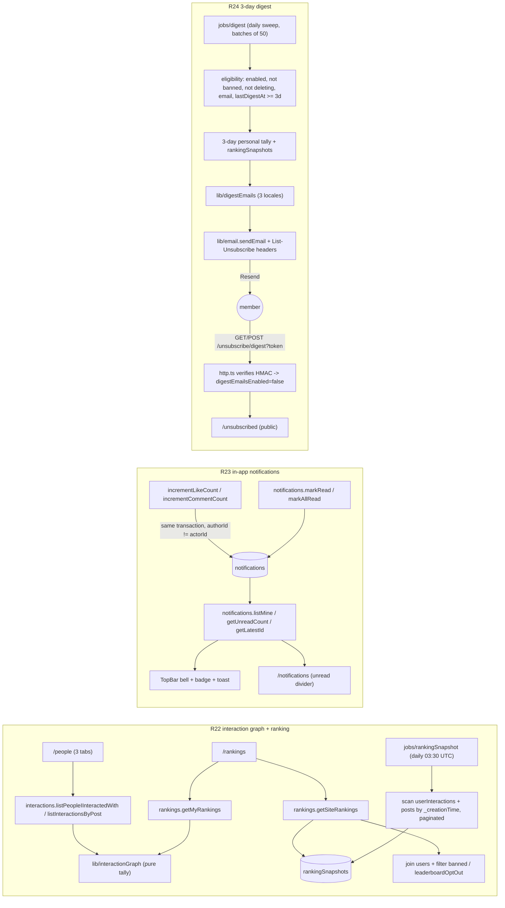

# Interaction Graph, Notifications, Ranking & 3-Day Digest - Design

**Date:** 2026-09-14 · **Status:** approved by Henriko (design); **implementation complete** — R22, R23 and R24 shipped
in the working tree, and the Task 22 sweep updated `docs/PLATFORM.md` (digest fields, digest email subsection, 10:00
UTC cron, `/unsubscribed` + public endpoint, `UNSUBSCRIBE_SECRET`, security/compliance notes, roadmap), the three
compliance documents (`DATA-INVENTORY.md`, `RETENTION-POLICY.md`, `GAP-ASSESSMENT.md`), the landing privacy policy
(en/pt/es) and the consent-prompt digest line + locale keys. Verification: `pnpm typecheck`, `pnpm lint` and the
touched test suites pass; the open items in §11 remain open (none invented) · **Batch:** backlog/revenue
R22 (interaction graph + rankings), R23 (in-app notifications), R24 (3-day digest + email preferences) · **Commits:**
none - Henriko commits everything himself.

## 0. Decisions locked before this spec

Henriko's raw notes for this batch, verbatim intent: (1) list of people you interacted with, (2) list of people on the
tool, (3) notifications of people who interacted with you, (4) notifications of people using the tool, interacting
among users ("pessoa A comentou no seu post!"), (5) ranking of who interacted most with you and who you interacted most
with, (6) site-wide ranking of most interactions, (7) site-wide ranking of most posts, (8) email notifications every 3
days with these same interactions, (9) email unsubscribe directly in the platform.

| #  | Question                       | Decision (Henriko, 2026-09-14)                                                                                                                                                                    |
|----|--------------------------------|---------------------------------------------------------------------------------------------------------------------------------------------------------------------------------------------------|
| 1  | Primary objective of the batch | **Retention and conversion.** Every feature available to all tiers in this cut. Ranking as a later monetization lever is noted, not built.                                                        |
| 2  | Digest authorization basis     | **Own preference with opt-out.** `digestEmailsEnabled` defaults ON, unsubscribe from the email itself and from the platform. Privacy Policy and consent-prompt copy updated in all three locales. |
| 3  | Items 3 and 4 of the raw notes | **Duplicates. One inbox** of events where the member is the target (their post received a reaction or comment). No general activity mural. No co-participation notifications in this cut.         |
| 4  | Site-wide ranking visibility   | **Visible to logged-in members, with opt-out** in Settings. Same exposure level as the existing people search (⌘K). No public/visitor ranking.                                                    |
| 5  | Time windows                   | **7 and 30 days everywhere**, consistent with recap (`lib/recap.ts`) and the survival panel.                                                                                                      |
| 6  | Aggregation architecture       | **On-demand aggregation over the existing log + periodic snapshot for the site-wide ranking.** No denormalized counters, no pair table in this cut.                                               |
| 7  | Small-base behavior            | **Ranking always visible**, even with a small base. Henriko expects at least 5 members at launch and prefers the always-on value over a hidden state.                                             |
| 8  | Notifications route            | **A dedicated `/notifications` route** showing what happened while the member was away, in addition to the bell panel.                                                                            |
| 9  | Realtime signals               | **In-app toast** when a new notification arrives. Browser notifications (service worker + VAPID) are Phase 2, out of this cut.                                                                    |
| 10 | Personal ranking shape         | **Both directions** (who interacted most with your posts, who you interacted most with) plus the per-post accordion in `/people`.                                                                 |
| 11 | Read-cost ceiling              | **2000 rows per side per window documented in the spec, with the future fix path written down.** Henriko's explicit request.                                                                      |

Design defaults taken without asking (all reversible, each lands in a named section): AI drafts are excluded from every
list, ranking, notification and digest number (an AI draft is not an interaction with a person); self-interactions are
excluded by reusing `excludeSelf`; banned members are filtered at read time, not at write time, so the log stays
complete; an empty digest is never sent; the snapshot stores top 100 identities plus full count distributions; ranking
movement uses the last 4 daily snapshot generations; the digest is a daily sweep, not a per-user scheduled chain; the
unsubscribe token never expires; re-enabling the digest requires login; toasts are deduped by last-seen notification id;
the members directory reuses the existing profile projection and full-text search; notifications older than 180 days are
purged by the retention cron; every preference change writes an `auditLogs` row; "most posts" counts posts by
`publishedAt` inside the window, excluding hidden and soft-deleted.

## 1. Goals and non-goals

**Goals.**

- **R22.** Give members visibility into who interacts with them and how they compare: a members directory, a per-post
  accordion of who engaged, both directions of personal ranking, and site-wide rankings (most interactions, most
  posts) in 7-day and 30-day windows, all derived from the append-only `userInteractions` log. No new write path except
  the ranking snapshot.
- **R23.** Notify the author in real time, inside the app, when someone reacts to or comments on their post: one
  `notifications` row per event written in the same transaction as the interaction, a bell with unread count, a toast,
  and a `/notifications` inbox that separates what is new since the last visit.
- **R24.** Send a 3-day activity digest by email (personal numbers, top people both directions, site-wide top posters
  and interactors, rank position and movement), with an in-platform preference that defaults ON and a one-click
  unsubscribe that works from the email without a login.

**Non-goals.**

- No browser push notifications (Phase 2; needs a service worker, VAPID keys, a subscription table and permission UX).
- No general platform activity mural and no co-participation ("someone also commented on a post you commented on")
  notifications. Item 4 of the raw notes was ruled a duplicate in decision 3.
- No tier gating. All features are available to starter, growth, pro and contact in this cut.
- No denormalized counter table (`userStats`-style) and no `interactionPairs` table. Deferred as the escape hatch if
  the read ceiling in section 6 is ever hit.
- No public ranking outside the login. No visitor-facing leaderboard on the landing.
- No backfill or migration. New tables are created on deploy; `digestEmailsEnabled` absent already means enabled.
- No change to `getRecap`, `listMyInteractions`, `userPostState` or any existing feed behavior.
- No follow/connections graph, no direct messages, no profile pages, no per-post ranking.
- No new dependencies (the unsubscribe flow is HMAC over `node:crypto`, already available in Convex).

## 2. Standing rules that bind every task

From the repo's own conventions and this batch's decisions:

- Three locales in parity for every string and every email: `en` (US), `pt` (pt-BR), `es` (neutral LatAm), sentence
  case. App copy lives in `app/src/i18n/index.ts`; email copy lives in pure per-flow builders.
- Precise, traceable numbers or none. No rounded-up claims, no urgency theatrics, no marketing verbs in the digest.
- One dominant action per screen. Design every state: loading, empty, error, truncated, opted-out, banned.
- The digest is the only scheduled email in this batch. Billing emails keep their existing transactional rules.
- DSR parity from day one: every new table that stores personal data is covered by `privacy/export.ts` and
  `privacy/deletion.ts` in the same phase that creates it.
- `docs/PLATFORM.md` is updated in the same change as each phase (AGENTS.md). Compliance docs updated in R24.
- Files change only through the Edit/Write tools. No git state-changing commands, ever.

## 3. Architecture overview



## 4. Data model (`convex/schema.ts`) - widen only, no backfill

### 4.1 New table `notifications`

```ts
notifications: defineTable({
  recipientId: v.id('users'),   // post author being notified
  actorId: v.id('users'),       // member who reacted or commented
  postId: v.id('posts'),
  kind: v.union(v.literal('reaction'), v.literal('comment')),
  reaction: v.optional(reactionValidator),
  excerpt: v.optional(v.string()), // comment text, flattened, 140 chars (lib/recap excerpt)
  createdAt: v.number(),
  readAt: v.optional(v.number())   // absent => unread
})
  .index('by_recipient_and_created_at', ['recipientId', 'createdAt']) // inbox page
  .index('by_recipient_and_read_at', ['recipientId', 'readAt'])       // unread count, mark all
  .index('by_actor', ['actorId'])                                      // account-deletion cascade
```

`readAt` absent means unread. The repo already relies on `eq(field, undefined)` over an index (see
`users.by_deletion_and_last_login`), so no sentinel value is needed. Notifications are append-only except for `readAt`.

### 4.2 New fields on `users`

```ts
digestEmailsEnabled: v.optional(v.boolean()), // absent => enabled (same convention as appSettings.apifyEnabled)
lastDigestAt: v.optional(v.number()),         // last successful digest send; absent => due immediately
leaderboardOptOut: v.optional(v.boolean())    // absent => appears in rankings
```

Preferences live on the user doc, following `language` and `commentLanguage`. There is no preference table, and none
of these fields is written on a hot path (toggle events and one digest send per 3 days per member).

### 4.3 New table `rankingSnapshots`

```ts
rankingSnapshots: defineTable({
  window: v.union(v.literal('7d'), v.literal('30d')),
  generatedAt: v.number(),
  since: v.number(),
  topPosters: v.array(v.object({ userId: v.id('users'), count: v.number(), lastAt: v.number() })),
  topInteractors: v.array(v.object({ userId: v.id('users'), count: v.number(), lastAt: v.number() })),
  posterCountsDescending: v.array(v.number()),
  interactorCountsDescending: v.array(v.number()),
  partial: v.boolean() // true when a scan ceiling was hit; page shows a caption
}).index('by_window_and_generated_at', ['window', 'generatedAt'])
```

Identity is not copied into the snapshot: the read joins `users` and drops banned or opted-out members at read time,
the same way `search.toSearchPerson` projects safe fields. `countsDescending` gives the exact position of a member
outside the top 100 via binary search, so the page can say "you are #87" instead of "not ranked", which is what keeps
the loop open for the majority. The last 4 generations per window are kept (movement + a 3-day lookback for the
digest); older rows are deleted on insert.

### 4.4 No change to `userInteractions`

All windows are `_creationTime` ranges over the existing `by_user` / `by_author` indexes, exactly like `getRecap`
(`convex/interactions.ts:438`). The snapshot scan walks the table in `_creationTime` order without an index, paginated,
which Convex supports natively. Rows written before 2026-09-07 lack `authorId` and therefore never appear on any
"received" side, and cannot be detected as self-interactions on the "made" side; they are counted as made. That is the
documented data limitation of this batch.

## 5. Backend surface

### 5.1 `convex/lib/interactionGraph.ts` (pure, no database)

Mirrors `lib/recap.ts`: takes rows, groups, counts, sorts. Unit-tested without Convex.

```ts
export type GraphWindow = '7d' | '30d'
export interface InteractionRow {
  _creationTime: number
  userId: string       // actor (always present)
  authorId?: string    // post author at write time (absent on pre-2026-09-07 rows)
  postId: string
  kind: 'reaction' | 'comment' | 'ai_draft'
}
export interface CounterpartyTally {
  userId: string       // the other person
  reactions: number
  comments: number
  total: number
  lastAt: number
}

// "Received" side: groups by actor (row.userId), excluding self and ai_draft.
export function tallyReceivedByPerson(rows: InteractionRow[], from: number): CounterpartyTally[]
// "Made" side: groups by author (row.authorId), excluding self, ai_draft and rows without authorId.
export function tallyMadeByPerson(rows: InteractionRow[], from: number): CounterpartyTally[]
// Accordion: groups received rows by post, actors nested, sorted by total then recency.
export function tallyReceivedByPost(rows: InteractionRow[], from: number): Array<{
  postId: string
  total: number
  lastAt: number
  actors: CounterpartyTally[]
}>
// Site-wide actor tally for the snapshot (made side, ai_draft out, self out when detectable).
export function tallySiteActors(rows: InteractionRow[], from: number): Map<string, { count: number; lastAt: number }>
```

Sort rule everywhere: `total` descending, then `lastAt` descending, then `userId` ascending, so a tie is stable and
recent activity wins.

### 5.2 `convex/lib/ranking.ts` (pure)

```ts
// Competition ranking over a descending counts array: 1,2,2,4.
export function rankPositions(countsDescending: number[]): number[]
// Exact position for an arbitrary count via binary search; null when count is 0.
export function positionOf(count: number, countsDescending: number[]): number | null
// Positive = moved up. null when either side is missing.
export function movement(previousPosition: number | null, currentPosition: number | null): number | null
// 3-day digest window [lastDigestAt ?? now - 3d, now).
export function digestWindow(now: number, lastDigestAt?: number): { since: number; until: number }
```

### 5.3 Read queries

- `interactions.listPeopleIInteractedWith(sessionToken, window)` - mirror over `by_user`, `tallyMadeByPerson`. (A flat
  "people who interacted with you" query was specified here originally and dropped during implementation: the
  received surface is the by-post accordion below, and the per-person received ranking lives in
  `rankings.getMyRankings`. Keeping it would have been dead API surface.)
- `interactions.listPeopleIInteractedWith(sessionToken, window)` - mirror over `by_user`, `tallyMadeByPerson`.
- `interactions.listInteractionsByPost(sessionToken, window)` - `tallyReceivedByPost` plus each post's excerpt and
  counts. Returns `{ posts, truncated }`.
- `notifications.listMine(sessionToken, paginationOpts)` - newest first, one `get` per unique actor and post, and a
  `removed: true` flag when the post is soft-deleted or hidden (same shape idea as `lib/history.toHistoryRow`).
- `notifications.getUnreadCount(sessionToken)` - `by_recipient_and_read_at`, `readAt` absent.
- `notifications.getLatestId(sessionToken)` - newest id only, to seed the toast without downloading the list.
- `rankings.getMyRankings(sessionToken, window)` - reuses the two personal tallies, returns top 10 each direction with
  counts.
- `rankings.getSiteRankings(sessionToken, window)` - reads the two newest snapshot generations, joins profiles, filters
  banned and `leaderboardOptOut`, returns top 20 of each list, the member's own count, exact position and movement,
  and `partial` when the snapshot was truncated.
- `users.listMembers(sessionToken, paginationOpts)` - directory tab; safe projection, alphabetical, banned excluded.
  The search input on the same tab keeps using `search.search` for full-text people lookup.
- `users.getEmailPreferences(sessionToken)` - `{ digestEmailsEnabled, leaderboardOptOut }` with absent resolved to
  defaults.

### 5.4 Mutations

- `notifications.markRead(sessionToken, ids)` - idempotent, only rows whose `recipientId` is the caller.
- `notifications.markAllRead(sessionToken)` - batched over the unread index, self-rescheduling if a batch fills.
- `users.setDigestEmailsEnabled(sessionToken, enabled)` - patches the field and appends an `auditLogs` row
  (`action: 'digest_preference_changed'`, metadata `{ enabled }`).
- `users.setLeaderboardOptOut(sessionToken, optOut)` - same pattern (`action: 'leaderboard_opt_out_changed'`).

### 5.5 Write path (`convex/interactions.ts`)

`incrementCommentCount` (line 249) and `incrementLikeCount` (line 295) insert one `notifications` row in the same
transaction, after the existing `userInteractions` insert:

```ts
if (post.authorId !== actorId) {
  await ctx.db.insert('notifications', {
    recipientId: post.authorId,
    actorId,
    postId,
    kind: 'comment', // 'reaction' in incrementLikeCount, plus `reaction`
    excerpt: excerpt(comment), // comment only
    createdAt: now
  })
}
```

No scheduler, no extra read: the reactive client subscription is the realtime channel. A banned author's notifications
are filtered at read time so the log stays complete. Repeat reactions never insert because `incrementLikeCount` already
returns before any write when `state?.reactedAt` is set.

### 5.6 `convex/jobs/rankingSnapshot.ts`

Daily crons at 03:30 UTC (7d) and 03:35 UTC (30d), after the 03:15 survival snapshot; each window rebuilds in its own
transaction with no shared read cache:

1. Paginate `userInteractions` newest-first, one page per invocation, self-rescheduling with the cursor
   (`jobs/syncPostsApify.ts` pattern). Stop when a page crosses `since`. `tallySiteActors` accumulates in memory.
2. Paginate `posts` newest-first by `_creationTime`; count authors whose `publishedAt >= since`, excluding
   `hidden` and `deletedAt`. Tally posters.
3. Write one `rankingSnapshots` row with top 100 identities per list, both counts arrays, `partial` when any ceiling
   was hit, and delete generations older than the newest 3 (keeping 4).

Snapshot freshness is intentionally daily. Personal rankings are live; only the site-wide board resets on the daily
ritual, which also gives the digest a stable movement number ("you moved up since yesterday / since 3 days ago").

### 5.7 `convex/jobs/digest.ts`

Daily sweep at 10:00 UTC. Paginates `users`, filters eligibility in memory, and self-reschedules after batches of 50
sends:

- Eligible: `digestEmailsEnabled !== false`, `isBanned !== true`, `deletionScheduledAt === undefined`, `email` present,
  and `lastDigestAt` absent or `<= now - 3 days`.
- Window: `digestWindow(now, lastDigestAt)`.
- Personal numbers from `by_user` (made) and `by_author` (received, self excluded, `ai_draft` excluded); top 3 people
  each direction; site tops from the newest snapshot; position and movement from the two-generations lookback.
- **Skip when `made + received === 0`**: an email about other people's activity to someone with none of their own is
  spam ("The line between content and spam is context").
- `lastDigestAt` is stamped only after `sendEmail` resolves without throwing, so a failure retries on the next sweep.

### 5.8 Email plumbing

- `convex/lib/email.ts`: `SendEmailArgs` gains `headers?: Record<string, string>`, forwarded to Resend. Everything
  else is unchanged, including the unconfigured no-op.
- `convex/lib/digestEmails.ts` (new, pure): `digestEmail(locale, input): EmailContent` for `en` / `pt` / `es`, using
  `lib/emailLayout.ts`. Subject carries the precise personal number (e.g. "3 reactions and 1 comment on your posts").
  Laid out as: personal numbers, top people both directions, site tops, position and movement with CTA to `/rankings`,
  CTA to `/people`, then the footer with the one-click unsubscribe link, the settings link and the support address.
- `convex/lib/unsubscribeToken.ts` (new): `signUnsubscribeToken(userId, secret)` and
  `verifyUnsubscribeToken(token, secret)`, HMAC-SHA256 over `digest:{userId}`, base64url, constant-time compare. The
  token does not expire, because an old email in an inbox must keep working.
- `convex/http.ts` (existing): `GET /unsubscribe/digest?token=...` sets `digestEmailsEnabled = false` and redirects to
  `${APP_URL}/unsubscribed?status=ok` (`status=invalid` on a bad token, never echoing the token). `POST` on the same
  path is the RFC 8058 one-click endpoint (Resend passes `List-Unsubscribe-Post`). Both are idempotent and logged to
  `auditLogs` (`actor: 'user'`, action `digest_unsubscribed_email`).
- New env var `UNSUBSCRIBE_SECRET`, documented in `docs/PLATFORM.md` §16 and set in the Convex dashboard.

### 5.9 File rename in R23

`convex/notifications.ts` today holds the transactional billing email actions. The in-app feature deserves that name.
R23 renames the file to `convex/billingNotices.ts` and updates the four calling files plus one test that reference
`internal.notifications.sendTrialEnding` / `sendTrialNearEnd` / `sendTrialConverted` / `sendPostCapReached` /
`sendDuplicateCanceled` (`http.ts`, `stripe.ts`, `interactions.ts` twice, `billingNode.ts`, plus
`interactions.trialMilestone.test.ts`). Mechanical, done in the same change, no compatibility alias.

## 6. Read-cost ceiling and the future fix path

Every per-member aggregation reads at most **2000 rows per side per window** (`RECAP_ROW_CEILING`, reused), with a
`truncated` flag in the response and a caption on screen when the ceiling is hit. The full volume is bounded by the
product itself: interactions per post have a plan cap, so a 30-day received tally is hundreds of rows, and the
made-side is one member's own activity. The snapshot scan is paginated and self-rescheduling, so it never reads an
unbounded table in one transaction.

If the ceiling is ever hit in practice, the fix path is written here on purpose: add `interactionPairs`-style
denormalized per-counterparty rows (or incremental pagination with aggregation cursors) and keep every query signature
in section 5.3 unchanged. The UI never knows the difference. Do not reach for counters before a real read cost
measurement shows it, and if that day comes, this section is the starting point.

## 7. Screens

### 7.1 TopBar bell

Icon button with an unread badge (cap "9+"), `aria-label` carrying the count. Popover with the 5 newest rows: avatar,
actor name, action text, relative time (existing `lib/relativeDay.ts`), unread dot. Clicking a row marks it read and
opens the post on LinkedIn. Footer with "See all" (`/notifications`) and "Mark all as read". Full keyboard support:
Enter/Space opens, Esc closes, focus returns to the trigger. Built on the existing `popover` / `dropdown-menu`
primitives.

### 7.2 Toast

On a new notification while the member is on the site, a toast in the bottom corner with the same row text; clicking
opens the post. Dedup: the client seeds `lastSeenNotificationId` from `getLatestId` on mount (in memory and
`localStorage` per user) and only toasts for ids greater than the seed, so a reload never repeats a toast. Respects
`prefers-reduced-motion`. Uses the existing `toast.tsx`.

### 7.3 `/notifications`

Paginated list, newest first, unread rows highlighted, a "New since your last visit" divider between unread and read at
render time, and a "Mark all as read" action. Empty state invites the member to the feed. Removed posts render as
"post removed" rows without a link, mirroring history. This is the "what happened while I was away" surface.

### 7.4 `/people`

Three tabs.

- **Interacted with you.** Window toggle (7d / 30d, the recap component). Accordion per post: post excerpt and totals
  in the header, expanded shows avatars, names, kind icon, per-person count and relative time. Empty state per window.
- **You interacted with.** Mirror list of people with counts and last interaction.
- **All members.** Directory with search input and paginated member list, safe projection only (name, headline,
  picture; never tokens or PII).

### 7.5 `/rankings`

Window toggle at the top. "You" block: two cards (who interacted most with you, who you interacted most with), top 5
each, deep links to the matching `/people` tab. "Site ranking" block: two lists (most posts, most interactions), top
20, the member's own row highlighted when present, an "you are #87" line when outside the top 20, medal treatment only
for the top 3, and exact counts everywhere. The member's own row (or the "you are #87" line) carries a quiet "don't
show me" control that calls `users.setLeaderboardOptOut`, so the opt-out lives one click from the place the member
sees themselves ranked. A short caption above the block explains the window and, when `partial`, that some activity may
be missing from the snapshot. Movement is shown as a small delta with plain text alternatives for screen readers ("up 3
positions"),
never color alone. Ranking is always visible, even with a small base (decision 7).

### 7.6 Settings, email section

A new "Emails" section in `SettingsPage`: "3-day activity digest" toggle (default ON), "Appear in rankings" toggle
(default ON), and a link to the marketing/analytics consents that already live in Privacy. Each toggle saves
immediately, shows its own saving/error state, and reflects the server value on load.

### 7.7 `/unsubscribed` (public)

Confirmation page for the email link. No login required. Reads `status` from the query string and offers "Start
receiving again", which requires login and routes to Settings. Invalid or expired tokens render a neutral message with
a support link and never echo the token.

### 7.8 Navigation

`/people` and `/rankings` join the "main" group in `navItems.ts` (`/people` after `/history`, `/rankings` after
`/people`). Notifications is an alert surface, not a browsing destination: bell in the TopBar plus the dedicated route.

### 7.9 i18n and accessibility

All new strings in `app/src/i18n/index.ts` for the three locales, keys prefixed `notifications.*`, `people.*`,
`rankings.*`, `settings.emails.*`, `unsubscribed.*`. Accordions use `aria-expanded` / `aria-controls`; the bell is a
real button; toasts use the existing live-region pattern; ranking rows are lists, not tables, so mobile has no
horizontal scroll; focus is visible everywhere; touch targets respect the existing minimums.

## 8. Email digest content

For the 3-day window, in this order:

1. Personal numbers: reactions and comments received, reactions and comments made. Precise numbers only.
2. Who interacted most with your posts, top 3 with counts.
3. Who you interacted most with, top 3 with counts.
4. Site-wide top posters and top interactors, top 3 each, with the window stated.
5. Your position ("you are #8 this week") and movement when available ("up 3 since your last digest").
6. CTAs to `/people` and `/rankings`, then the unsubscribe and settings links plus the support address.

Movement in the digest compares the newest snapshot with the generation closest to `lastDigestAt`, so "movement"
genuinely means "since your last digest", not "since yesterday". When the member is outside the top 100, the position
still comes from `positionOf`, and movement is omitted when either side is unavailable. Copy follows
`lib/billingEmails.ts` standards: no urgency, no promotional verbs, sentence case, localized dates via the existing
`INTL_TAG` map.

## 9. Compliance and lifecycle

- **Privacy Policy (3 locales).** New processing note: activity digest under legitimate interest with the right to
  object, and ranking display to members with opt-out. One line in the consent-prompt copy explains the digest exists
  and where to disable it. Legal wording goes through Henriko's lawyer-review step before R24 ships.
- **CAN-SPAM postal address (resolved).** The digest footer carries Henriko's fiscal address, set verbatim in
  `lib/digestEmails.ts` (`AV SETE DE SETEMBRO, 2775, REBOUÇAS - 80230-010 - Curitiba, Paraná - Brazil`) and enabled by
  `includePostalAddress: true` in `jobs/digest.ts`.
- **Objection log.** Preference changes append `auditLogs` rows (section 5.4). `consentRecords` keeps its existing two
  purposes; an opt-out preference is not consent and does not join that union.
- **DSR export.** `privacy/export.ts` includes notifications received, `digestEmailsEnabled`, `lastDigestAt` and
  `leaderboardOptOut`. Interactions the member made are already exported from `userInteractions`.
- **Deletion cascade.** `privacy/deletion.ts` deletes notifications by recipient (`by_recipient_and_created_at` drain)
  and by actor (`by_actor`). Snapshot rows keep the deleted id until the next rebuild, and the read join drops nulls in
  the meantime. Unsubscribe tokens are stateless and need no cleanup.
- **Retention.** Notifications older than 180 days are purged in batched, self-rescheduling fashion by the existing
  retention cron (`privacy/retention.ts`), documented in `docs/compliance/RETENTION-POLICY.md`.
- **Banned and deleting members.** Banned: filtered from rankings and the directory, no notifications at read time, no
  digest. Deleting (`deletionScheduledAt` set): no digest, no notifications written to them (read-time filter covers
  the window until deletion completes).
- **Deliverability.** `List-Unsubscribe` and `List-Unsubscribe-Post` headers on every digest, one-click POST endpoint,
  no sender reputation risk from a 3-day cadence. The digest is skipped for inactive members, which also protects
  reputation.

## 10. Phases, testing and migration

### Phase R22 - interaction graph and rankings

Deliverables: schema (`rankingSnapshots`, `users.leaderboardOptOut`), `lib/interactionGraph.ts`, `lib/ranking.ts`,
the `interactions.list*` and `rankings.*` queries, `users.listMembers`, `users.setLeaderboardOptOut`, the `/rankings`
opt-out control, `jobs/rankingSnapshot.ts` plus the cron entry, `/people`, `/rankings`, nav items, i18n, `PLATFORM.md`.

Tests: pure helper tests for both tallies, the by-post grouping, self and `ai_draft` exclusion, tie ordering, window
bounds; `rankPositions` / `positionOf` / `movement` with ties and boundaries; `convex-test` integration for each query
(ban filter, opt-out filter, truncation flag, empty windows, `partial` snapshot); UI tests with mocked `useQuery` for
tabs, accordion, window toggle, empty states.

### Phase R23 - in-app notifications

Deliverables: `notifications` table, the rename of `convex/notifications.ts` to `billingNotices.ts` with call sites,
write-path inserts, `notifications.*` queries and mutations, bell, toast, `/notifications`, retention purge,
`privacy/export.ts` and `privacy/deletion.ts` extensions, `PLATFORM.md`.

Tests: write on comment and reaction, no write on self-interaction, no write on repeat reaction, unread count,
markRead ownership (another member's id is a no-op), markAllRead batching, `removed` flag, banned filter at read,
retention purge, export/deletion integration.

### Phase R24 - digest and preferences

Deliverables: `users` digest fields and setters, `lib/digestEmails.ts`, `lib/unsubscribeToken.ts`, `lib/email.ts`
headers, `jobs/digest.ts` plus cron, `http.ts` endpoints, `UNSUBSCRIBE_SECRET`, Settings email section, `/unsubscribed`,
Privacy Policy and consent-prompt copy in 3 locales, compliance docs (`DATA-INVENTORY.md`, `RETENTION-POLICY.md`,
`GAP-ASSESSMENT.md`), `PLATFORM.md`.

Tests: token sign/verify (tamper, wrong secret, malformed), HTTP endpoint idempotency and redirect statuses,
eligibility matrix (disabled, banned, deleting, no email, too recent, due, never sent), skip-on-empty, `lastDigestAt`
stamped only on success, digest copy snapshots per locale with the no-urgency verb assertion, movement math, UI toggles.

### Migration

None. New tables are created on deploy. `digestEmailsEnabled` absent means enabled, `lastDigestAt` absent means due,
`leaderboardOptOut` absent means visible. First snapshot generation happens on the first cron run; until then,
`getSiteRankings` renders its empty state.

### Verification per phase

`pnpm` typecheck, lint and the repo's Vitest suites for both `convex/` and `app/`; then real browser verification at
desktop and mobile widths (overflow, keyboard, focus, contrast, loading, empty, error, `prefers-reduced-motion`), per
the UI delivery check this repo uses. `docs/PLATFORM.md` updated in the same change.

## 11. Open items for Henriko

> **Item 1 resolved (2026-09-14):** the CAN-SPAM physical postal address was supplied and the digest now ships it —
> `includePostalAddress: true` (`convex/jobs/digest.ts`) with the controller's fiscal address held by the
> `POSTAL_ADDRESS` constant in `convex/lib/digestEmails.ts`. Items 2–5 below remain open; none of Henriko's answers to
> them is recorded here (see `docs/compliance/GAP-ASSESSMENT.md`, item 11).

1. CAN-SPAM physical postal address — **resolved (2026-09-14)**: the controller's fiscal address
   (`AV SETE DE SETEMBRO, 2775, REBOUÇAS - 80230-010 - Curitiba, Paraná - Brazil`) ships in every digest footer;
   `includePostalAddress: true` in `convex/jobs/digest.ts` and the verbatim constant in `convex/lib/digestEmails.ts`
   (`docs/compliance/GAP-ASSESSMENT.md`, item 11).
2. Lawyer review of the Privacy Policy additions and consent-prompt line before R24 ships.
3. Confirm the R22 / R23 / R24 backlog ids.
4. Digest sweep hour (default 10:00 UTC) and snapshot hour (default 03:30 UTC).
5. Whether the members directory tab should also carry the `leaderboardOptOut` flag or stay independent (current
   design: independent, opt-out covers rankings only).

## 12. Traceability to the raw notes

| Raw note                                                                  | Where it lands                                                                |
|---------------------------------------------------------------------------|-------------------------------------------------------------------------------|
| 1. List of people you interacted with                                     | R22, `/people` tab "You interacted with", `listPeopleIInteractedWith`         |
| 2. List of people on the tool                                             | R22, `/people` tab "All members", `users.listMembers` + existing search       |
| 3. Notifications of people who interacted with you                        | R23, `notifications` table, bell, toast, `/notifications`                     |
| 4. Notifications of interactions among users                              | Ruled duplicate of 3 (decision 3). Not built.                                 |
| 5. Ranking of who interacted most with you / who you interacted most with | R22, `rankings.getMyRankings`, `/rankings` "You" block, `/people` tallies     |
| 6. Ranking of most interactions on the site                               | R22, `rankingSnapshots.interactors`, `/rankings` site block, digest section 4 |
| 7. Ranking of most posts on the site                                      | R22, `rankingSnapshots.posters`, `/rankings` site block, digest section 4     |
| 8. Email every 3 days with the interactions                               | R24, `jobs/digest.ts`, `lib/digestEmails.ts`                                  |
| 9. Unsubscribe from email in the platform                                 | R24, Settings email section, `/unsubscribed`, one-click headers               |
