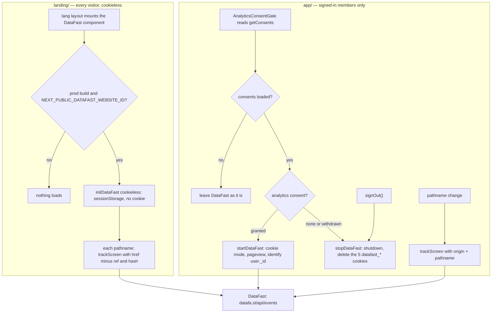

# DataFast Web Analytics (landing + app) - Design

**Date:** 2026-09-23 · **Status:** design agreed in chat with Henriko; this written spec awaits his review. No code
yet · **Package:** `datafast@3.0.18` (npm SDK), already added to `app/` and `landing/` in the working tree ·
**Commits:** none - Henriko commits everything himself.

## 0. Decisions locked before this spec

| # | Question              | Decision (Henriko, 2026-09-23)                                                                                                                                        |
|---|-----------------------|-----------------------------------------------------------------------------------------------------------------------------------------------------------------------|
| 1 | Where DataFast runs   | **Client SDK on the landing and the app. No backend code**: no Stripe Checkout metadata, no DataFast REST API, no new Convex env var.                                 |
| 2 | Landing tracking mode | **Cookieless**, every visitor, no banner.                                                                                                                             |
| 3 | App tracking mode     | **Default cookie mode**, only for signed-in members who granted the existing `analytics` consent (the gate PostHog already uses). Nothing loads for anyone else.      |
| 4 | What `identify` sends | **The opaque Convex user `_id` only.** No name, email or avatar, so the consent label "Allow privacy-friendly usage analytics" stays accurate and needs no rewording. |
| 5 | DataFast website      | One website, `dfid_8IrKZ1PONPjcOv8mSg4o2`, for both sites.                                                                                                            |

Defaults taken without asking (each is reversible and lands in a named section):

- Pageviews go out with an href we build, never the SDK's own: app = origin + path only, landing = full URL minus
  the `ref` param and the hash. SDK auto-capture stays off (§2, §3, §4).
- `maxQueueSize: 1` on both sites, so every event is sent at once (§2).
- No custom goals. The landing's CTA clicks stay in the first-party beacon (§7).
- "Stop" means `shutdown()` plus deleting the cookies ourselves, and `signOut()` stops too (§4).
- The DataFast `domain` comes from the existing `*_COOKIE_DOMAIN` env vars, not a new one (§2).
- The docs extend §17's existing analytics coverage instead of opening a new numbered section (§10).
- Public policy copy and the `POLICY_VERSION` bump wait for launch, as they did for Sentry and PostHog (§10, §11).

## 1. Goal and success criteria

One DataFast dashboard that shows landing traffic (sources, UTM campaigns, pages, countries, devices) and how
consenting members move through the app.

Done means:

- Landing pageviews from `www.linkintothessi.com` reach DataFast with their UTM sources and without invite codes.
- A consenting member's app pageviews from `www.app.linkintothessi.com` reach DataFast under one visitor, identified by
  their Convex `_id`.
- A member who never granted analytics consent causes no DataFast request and holds no `datafast_*` cookie.
- Withdrawing consent or signing out stops sending and deletes the cookies, without a reload.
- No tracked URL carries an app query string or fragment (`#session=`, `?token=`), or the landing's `ref` code.
- Everything is inert on localhost, in dev builds, and until the website-ID env vars are set.
- `pnpm typecheck`, `pnpm lint`, and the app and landing test suites pass.

## 2. SDK behavior this design relies on

Verified by reading `datafast/dist/web/index.mjs` (3.0.18).

| SDK behavior                                                                                                                                                                                                                                                                | Consequence here                                                                                                                                                                                                                  |
|-----------------------------------------------------------------------------------------------------------------------------------------------------------------------------------------------------------------------------------------------------------------------------|-----------------------------------------------------------------------------------------------------------------------------------------------------------------------------------------------------------------------------------|
| `initDataFast` returns a no-op client on localhost, `*.local`, `file://`, inside iframes, and for bots.                                                                                                                                                                     | Dev stays silent for free. A LAN IP (`192.168.x.x`) is not "localhost", so both sites also require a production build.                                                                                                            |
| Cookie mode writes five cookies on `.<domain>` when the page's host is `domain` or a subdomain of it: `datafast_visitor_id`, `datafast_visitor_first_seen_at`, `datafast_visitor_session_count` (365 days), `datafast_session_id`, `datafast_session_start` (30 minutes).   | The app's cookies live on `.linkintothessi.com`. The landing never reads them: its cookieless storage uses only sessionStorage and localStorage.                                                                                  |
| Cookieless mode keeps the session id and the server's visitor hash in sessionStorage, sends a fresh random visitor id with each event, and flags every event `cookieless: true`.                                                                                            | The landing sets no cookie.                                                                                                                                                                                                       |
| `optOut()` stops sending and writes `datafast_ignore=true` to localStorage, but **leaves the visitor cookies in place**. On a fresh page `optIn()` is a no-op, so that flag would block every later start. `shutdown()` flushes the queue and stops without writing a flag. | "Stop" is `shutdown()` plus deleting the five cookies with the SDK's exported `deleteCookie`. We never call `optOut()`, so DataFast's documented self-exclusion (`datafast_ignore`) keeps working for anyone who sets it by hand. |
| `trackPageview()` sends `window.location.href`, query and hash included. `trackPageview(path)` builds `https://<domain><path>` and drops the subdomain. `trackScreen(path, { href })` sends `href` unchanged.                                                               | Both sites send pageviews through `trackScreen` with an href we build.                                                                                                                                                            |
| Every event carries `domain`, which must match the website's domain in DataFast.                                                                                                                                                                                            | Both sites pass the root `linkintothessi.com`: `*_COOKIE_DOMAIN` with its leading dot stripped, or the page's host when that var is unset (the SDK's own default).                                                                |
| `identify` and `track` build their href from `domain` + the last screen name, or `/Unknown` before any pageview.                                                                                                                                                            | The app sends its first pageview before `identify`. Identify events then show `https://linkintothessi.com/<path>`, which is harmless because pageviews carry the real host.                                                       |
| Events queue in localStorage (`datafast_event_queue`) and flush every 5 s or at `maxQueueSize` (default 10). Each event is its own request. There is no `keepalive` or `sendBeacon`.                                                                                        | `maxQueueSize: 1` sends each event immediately for the same number of requests, so a visit shorter than 5 s still reports its pageview. A goal fired by a click that leaves the page would still usually be lost (§7).            |

## 3. Landing (`landing/`)

- **New `components/DataFast.tsx`:** a client component that renders nothing, mounted in `app/[lang]/layout.tsx` next
  to `CookieNotice`.
    - Runs only when `NEXT_PUBLIC_DATAFAST_WEBSITE_ID` is set and `NODE_ENV === 'production'`.
    - Initializes once per page load, through a module-level promise:
      `initDataFast({ websiteId, domain, cookieless: true, maxQueueSize: 1 })`. Auto-capture stays off.
    - On every `usePathname()` change it calls `trackScreen(pathname, { href: landingPageviewHref(location.href) })`.
    - `landingPageviewHref` (pure, exported) drops the `ref` query param and the hash, and keeps everything else,
      including `utm_*`, `source` and `via`. An invite code identifies a member (the same reason `invite_copied` carries
      no props), and DataFast would otherwise list each code as a traffic source.
- **`lib/metrics.ts` is unchanged.** The first-party beacon keeps counting `pricing_view` and the CTA clicks.
- **`next.config.js`:** add `https://datafa.st` to `connect-src`.
- **`.env.example`:** `NEXT_PUBLIC_DATAFAST_WEBSITE_ID=dfid_8IrKZ1PONPjcOv8mSg4o2`, commented as a public id.

## 4. App (`app/`)

- **New `src/lib/observability/datafast.ts`:**
    - `startDataFast(userId)`: a no-op unless `import.meta.env.PROD` is true and `VITE_DATAFAST_WEBSITE_ID` is set.
      Idempotent through a module-level promise. It runs `initDataFast({ websiteId, domain, maxQueueSize: 1 })` in
      cookie mode with auto-capture off, sends a pageview for the current path, then calls `identify(userId)` with no
      traits.
    - `stopDataFast()`: deletes the five cookies right away. If a start is pending or done, it waits for that start,
      calls `shutdown()`, and deletes the cookies again, because an init still in flight may have just written them.
    - `trackDataFastPageview(pathname)`: once started, sends
      `trackScreen(pathname, { href: location.origin + pathname })`.
      Never a query string or fragment.
- **`src/lib/observability/analytics.ts` `syncAnalyticsConsent`** (the existing consent choke point):
    - While consents are still loading (`undefined`), it leaves DataFast alone. Stopping at that point would delete the
      cookies on every page load before the query resolves, and every load would mint a new visitor.
    - Once loaded: allowed (`shouldCaptureAnalytics`) → `startDataFast(userId)`; not allowed → `stopDataFast()`.
    - The DataFast half runs whether or not PostHog is initialized. Today the function returns early without a PostHog
      key. PostHog's own behavior does not change.
- **`src/components/AnalyticsConsentGate.tsx`:** a second effect calls `trackDataFastPageview(useLocation().pathname)`.
  The first pageview comes from `startDataFast`. If the two overlap, the SDK's same-URL 60-second dedup absorbs it.
- **`src/lib/session.ts` `signOut()`:** calls `stopDataFast()` first, so a shared browser never carries one member's
  visitor into the next session.
- **`scripts/gen-headers.mjs`:** add `https://datafa.st` to `connect-src`, and update its test.
- **`.env.example`:** `VITE_DATAFAST_WEBSITE_ID=dfid_8IrKZ1PONPjcOv8mSg4o2`.

## 5. Flow

## 6. Privacy guards and failure modes

| Case                                                                                | Behavior                                                                                                                                                                                                                   |
|-------------------------------------------------------------------------------------|----------------------------------------------------------------------------------------------------------------------------------------------------------------------------------------------------------------------------|
| Member never granted analytics                                                      | DataFast is never initialized: no cookie, no request. `stopDataFast` only expires cookies that are not there.                                                                                                              |
| Consent withdrawn in Settings                                                       | The gate sees the new consents and calls `stopDataFast`: sending stops and the cookies go, with no reload. Events already queued are flushed (captured under consent); with `maxQueueSize: 1` the queue is normally empty. |
| Sign-out from any path that goes through `signOut()`                                | Cookies are deleted before the redirect to the landing. The next member on that browser starts as a new visitor.                                                                                                           |
| Session expires without sign-out, then a different consenting member signs in there | Accepted edge: the old visitor cookie is reused and re-identified with the new `_id`.                                                                                                                                      |
| Secret-bearing app URLs (`/auth/success#session=…`, `/unsubscribe?token=…`)         | App hrefs are `origin + pathname`, so the query and fragment never leave the browser.                                                                                                                                      |
| Invite link on the landing (`/en?ref=<code>`)                                       | `ref` is removed from the href before sending.                                                                                                                                                                             |
| Ad blocker, or DataFast down                                                        | Requests fail quietly: the SDK retries 3 times, drops the event, and logs one `console.error`. Nothing reaches the UI; the numbers undercount.                                                                             |

## 7. Out of scope, and when to add it

- **Stripe revenue attribution** (`datafast_visitor_id`/`datafast_session_id` in Checkout metadata). Add it when you
  want DataFast to tie a payment to the member's journey: about 20 lines in `convex/billingNode.ts` plus the two
  checkout call sites.
- **Connecting Stripe in DataFast.** A dashboard step, not code, and it changes the compliance picture (§11 step 6).
- **Landing-to-app source bridge.** A landing visitor is cookieless and an app visitor exists only after sign-in and
  consent, so DataFast cannot say which landing source a member came from. Add it when paid acquisition needs
  source-to-revenue.
- **Custom goals.** Landing CTA clicks leave the page before the SDK can send (no `keepalive`), and in-app funnels are
  PostHog's job.
- **The ad-blocker proxy** (`datafa.st/docs/proxy-guide`) and **DataFast's REST API**.

## 8. Testing

- **`app/src/lib/observability/datafast.test.ts`** (new; mocks `datafast`, stubs `PROD` and the env vars):
    - `startDataFast` initializes once.
    - The pageview href is `origin + pathname` even when the URL carries `?token=` and `#session=`.
    - The pageview goes out before `identify`, and `identify` gets the bare id with no traits.
    - `stopDataFast` deletes all five cookies on the root domain even when never started, and calls `shutdown()` after
      a start.
- **`app/src/lib/observability/analytics.test.ts`** (extended): with no PostHog key, `syncAnalyticsConsent` leaves
  DataFast alone while consents are `undefined`, starts it when granted, and stops it when not.
- **`landing/components/DataFast.test.ts`** (new): `landingPageviewHref` drops `ref` and the hash and keeps `utm_*`.
- **`app/scripts/gen-headers.test.ts`:** the expected `connect-src` gains `https://datafa.st`.
- **Gate:** `pnpm typecheck`, `pnpm lint`, `pnpm --filter app test`, `pnpm --filter landing test`. No `pnpm format`.

## 9. Files

| File                                                                                     | Change                                      |
|------------------------------------------------------------------------------------------|---------------------------------------------|
| `landing/components/DataFast.tsx`                                                        | new                                         |
| `landing/components/DataFast.test.ts`                                                    | new                                         |
| `landing/app/[lang]/layout.tsx`                                                          | mount `<DataFast />`                        |
| `landing/next.config.js`                                                                 | CSP `connect-src`                           |
| `landing/.env.example`                                                                   | new var                                     |
| `app/src/lib/observability/datafast.ts`                                                  | new                                         |
| `app/src/lib/observability/datafast.test.ts`                                             | new                                         |
| `app/src/lib/observability/analytics.ts`                                                 | `syncAnalyticsConsent` also drives DataFast |
| `app/src/lib/observability/analytics.test.ts`                                            | new cases                                   |
| `app/src/components/AnalyticsConsentGate.tsx`                                            | pageview effect                             |
| `app/src/lib/session.ts`                                                                 | `signOut()` stops DataFast                  |
| `app/scripts/gen-headers.mjs`, `app/scripts/gen-headers.test.ts`                         | CSP `connect-src`                           |
| `app/.env.example`                                                                       | new var                                     |
| `docs/PLATFORM.md`, `docs/compliance/SUBPROCESSORS.md`, `DATA-INVENTORY.md`, `README.md` | see §10                                     |

`convex/` is untouched. `app/package.json`, `landing/package.json` and `pnpm-lock.yaml` already carry
`datafast@^3.0.18` from Henriko's install. The root `packageManager` bump in the same working tree is unrelated and is
left alone.

## 10. Docs and compliance (same change)

**`docs/PLATFORM.md`**

- **§17 Observability & Error Monitoring:**
    - The intro names DataFast.
    - One DataFast bullet per site: mode, gate, what is sent, how it stops.
    - The Mermaid chart gains a landing subgraph and the app's DataFast branch.
    - The launch checklist gains the steps in §11.
    - This extends the existing analytics coverage (PostHog lives here) rather than opening a new numbered section.
- **§17 CSP bullets:** `https://datafa.st` in both `connect-src` lists.
- **§15:** a short "Web analytics (DataFast, cookieless)" subsection next to "Landing funnel metrics (cookieless)",
  pointing to §17. The "Still deferred" warning under "Privacy Policy: OIDC wording…" (`/privacy` omits Sentry and
  PostHog) gains DataFast.
- **§14 bootstrap/routing:** the gate drives PostHog and DataFast, and `signOut()` stops DataFast.
- **§16:** both env vars, in the Cloudflare build-env tables and the per-site tables.
- **§21:** code-area map rows for the new files, and a changelog entry.
- **Compliance Documentation table:** the SUBPROCESSORS description gains DataFast.

**`docs/compliance/`**

- **`SUBPROCESSORS.md`:** a DataFast row, plus a human-action bullet.
    - Entity: JustShipIt Pte. Ltd. (trading as DataFast), Singapore.
    - Location: infrastructure mostly outside the EU, including the US. SCCs per its DPA (`datafa.st/dpa`, Singapore
      law).
    - Landing data: IP and user agent (hashed server-side into a daily-rotating visitor id), page URL minus `ref`,
      referrer, device, browser, country.
    - App data: cookie visitor and session ids, the opaque Convex `_id`, page paths, device, browser, country.
    - Not shared: name, email, tokens, billing data, post content.
- **`DATA-INVENTORY.md` Activity 14:**
    - Add DataFast, and remove the "landing site is not instrumented" sentence.
    - Data subjects gain landing visitors.
    - Legal basis: legitimate interest for the landing (cookieless audience measurement; update the §3 LIA) and consent
      for the app.
    - Update §4 international transfers.
- **`README.md`:** the consolidated to-do list gains the DataFast DPA.
- **Not in this change** (launch-time, as with Sentry and PostHog): the public Privacy Policy, the Cookie & Storage
  Policy, the landing's CookieNotice text (en/pt/es), and the `POLICY_VERSION` bump. The CookieNotice currently says
  "We only use essential browser storage…", which stops being true once the landing stores a DataFast session.

## 11. Launch steps (Henriko, in order)

1. Sign DataFast's DPA. `datafa.st/dpa` generates a cookie-script variant and a cookieless one; the app sets cookies,
   so take the cookie variant.
2. In DataFast Site Settings, confirm the website domain is `linkintothessi.com`. Keep the cookieless/privacy-mode
   toggle **off**: the landing marks its own events cookieless, and "off" lets the app's `identify` persist.
3. Update the public Privacy Policy, the Cookie & Storage Policy and the CookieNotice text (en/pt/es), and bump
   `POLICY_VERSION`.
4. Set `NEXT_PUBLIC_DATAFAST_WEBSITE_ID` on the landing Worker and `VITE_DATAFAST_WEBSITE_ID` on the app Worker
   (Cloudflare build env, production only), then redeploy both.
5. Check DataFast's realtime view: a landing visit shows up, and a consenting member's app pageviews show up under their
   `_id`. If landing events are missing (cookieless events rejected on a non-cookieless website), give the landing its
   own DataFast website and swap its env var. No code change.
6. Decide separately whether to connect Stripe (Site Settings → Revenue).
    - It adds revenue, MRR and subscription events to DataFast, not tied to visitors (decision 1 leaves out the
      Checkout metadata).
    - It also gives DataFast read access to Stripe payment and customer records, including emails, for every paying
      member, whatever their in-app consent. If you connect it, extend the SUBPROCESSORS row and the Privacy Policy
      first.

## 12. Open risk

Mixed modes on one website (§11 step 5) is the one behavior the SDK source can't settle. The SDK marks each landing
event `cookieless: true`, so the server can tell the two apart, and the fallback costs one env var.
